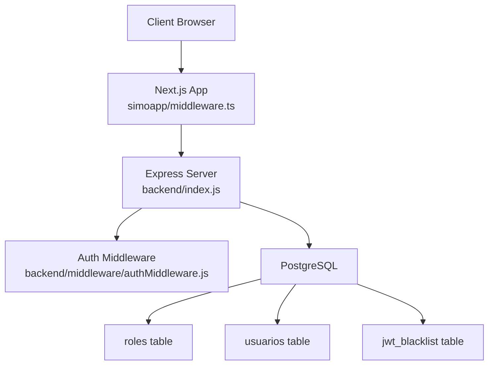
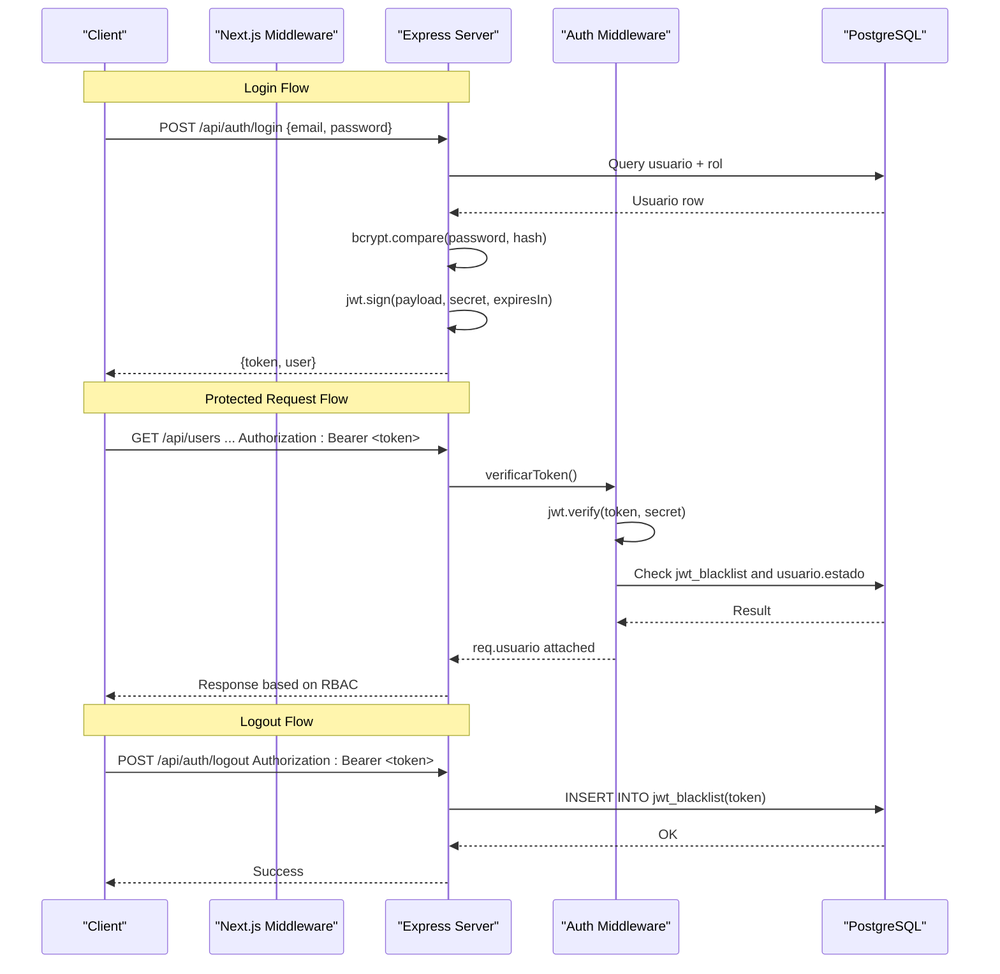
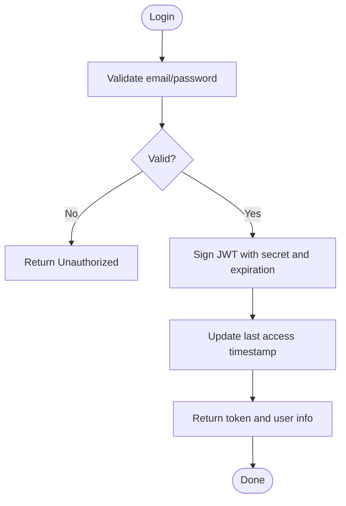
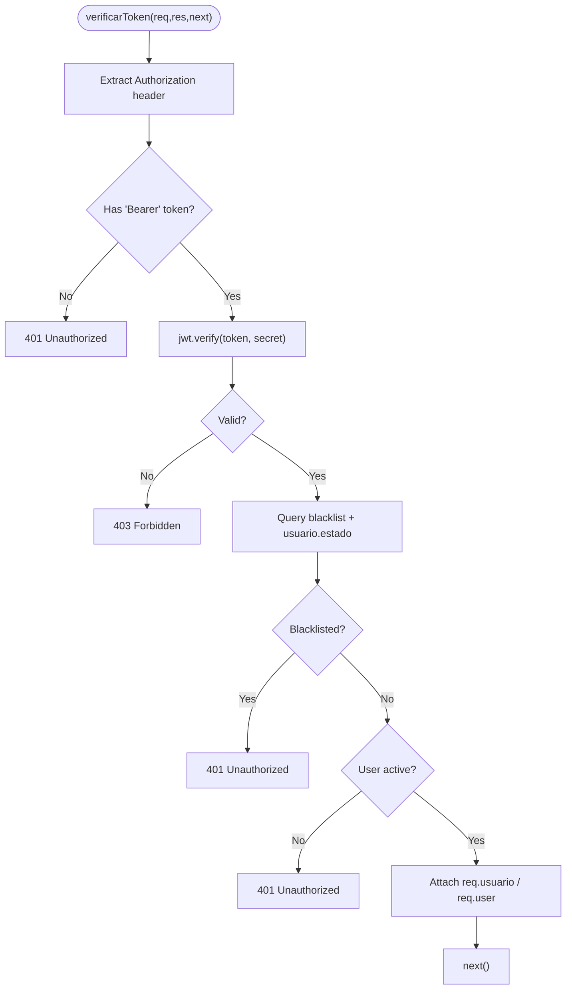
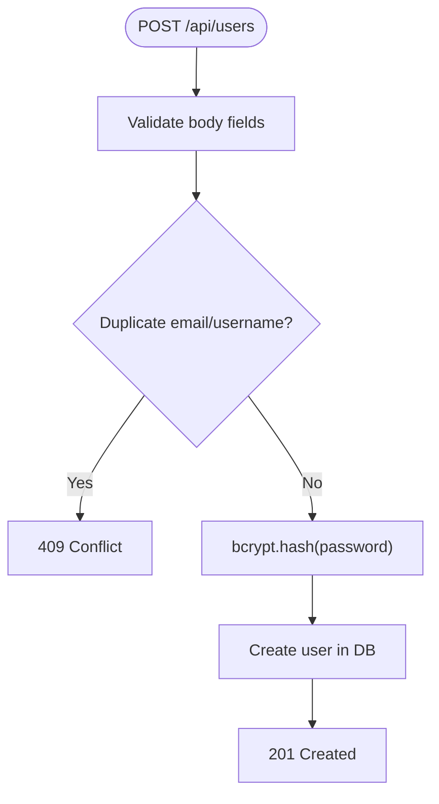
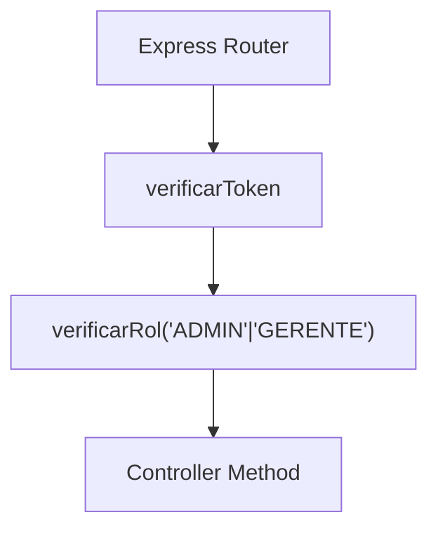
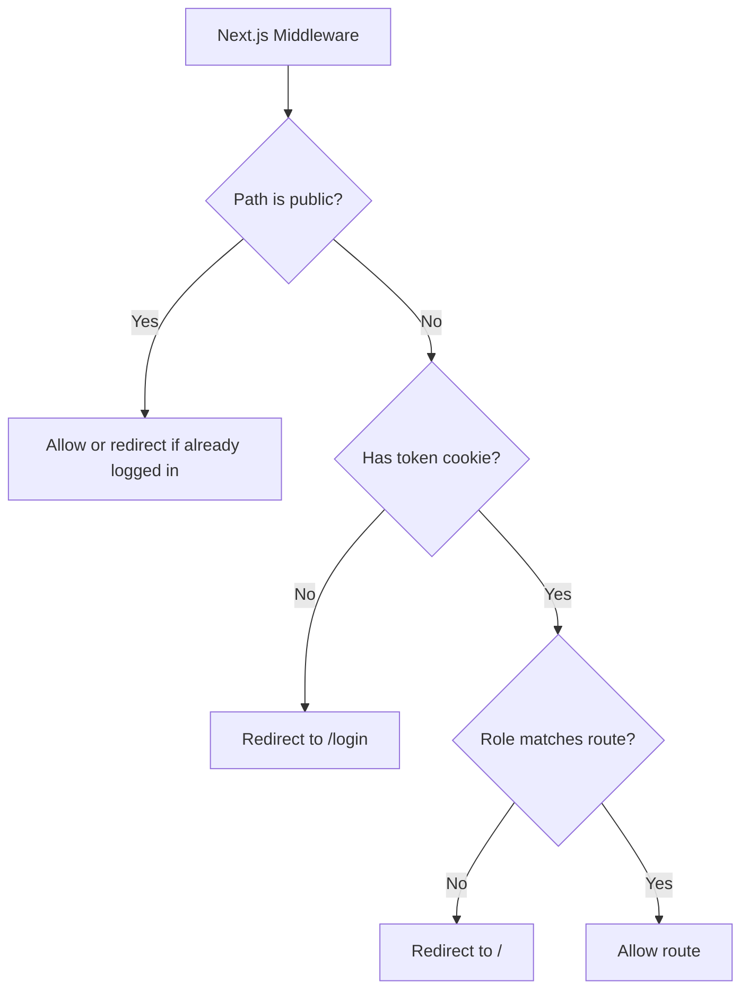
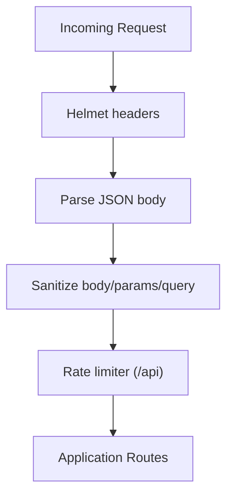
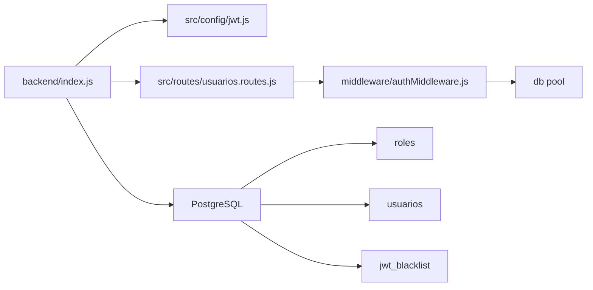

# Authentication & Authorization

<cite>
**Referenced Files in This Document**
- [index.js](file://backend/index.js)
- [jwt.js](file://backend/src/config/jwt.js)
- [authMiddleware.js](file://backend/middleware/authMiddleware.js)
- [usuarios.controller.js](file://backend/src/controllers/usuarios.controller.js)
- [usuarios.repository.js](file://backend/src/repositories/usuarios.repository.js)
- [usuarios.routes.js](file://backend/src/routes/usuarios.routes.js)
- [002_seguridad.sql](file://backend/db/migrations/002_seguridad.sql)
- [010_sesiones.sql](file://backend/db/migrations/010_sesiones.sql)
- [sanitizarXss.js](file://backend/middleware/sanitizarXss.js)
- [middleware.ts](file://simoapp/middleware.ts)
</cite>

## Table of Contents
1. [Introduction](#introduction)
2. [Project Structure](#project-structure)
3. [Core Components](#core-components)
4. [Architecture Overview](#architecture-overview)
5. [Detailed Component Analysis](#detailed-component-analysis)
6. [Dependency Analysis](#dependency-analysis)
7. [Performance Considerations](#performance-considerations)
8. [Troubleshooting Guide](#troubleshooting-guide)
9. [Conclusion](#conclusion)

## Introduction
This document explains SIMO’s authentication and authorization system. It covers the JWT-based login flow, token validation and revocation, role-based access control (RBAC), session management, password hashing with bcrypt, input sanitization for XSS protection, security headers via Helmet, rate limiting, and audit-related database structures. It also provides practical examples of protected routes, token validation behavior, and custom middleware usage.

## Project Structure
The backend is an Express application that centralizes security configuration at startup, defines authentication endpoints, and applies reusable middleware for token verification and RBAC. The frontend Next.js application enforces client-side route protection using cookies.



**Diagram sources**
- [index.js:24-56](file://backend/index.js#L24-L56)
- [authMiddleware.js:9-49](file://backend/middleware/authMiddleware.js#L9-L49)
- [002_seguridad.sql:15-53](file://backend/db/migrations/002_seguridad.sql#L15-L53)
- [010_sesiones.sql:12-15](file://backend/db/migrations/010_sesiones.sql#L12-L15)
- [middleware.ts:4-28](file://simoapp/middleware.ts#L4-L28)

**Section sources**
- [index.js:1-56](file://backend/index.js#L1-L56)
- [middleware.ts:1-36](file://simoapp/middleware.ts#L1-L36)

## Core Components
- JWT configuration: shared secret and expiration used by both login and token verification.
- Authentication middleware: validates tokens, checks blacklist, verifies user status, and attaches user data to requests.
- Role-based access control: middleware factory that restricts routes by role ID or role code.
- User management controller: validates inputs, hashes passwords with bcrypt, and manages users.
- Database schema: roles, usuarios, and jwt_blacklist tables support RBAC and session invalidation.
- Security middleware: Helmet for HTTP headers, XSS sanitization, and rate limiting.

**Section sources**
- [jwt.js:1-15](file://backend/src/config/jwt.js#L1-L15)
- [authMiddleware.js:1-80](file://backend/middleware/authMiddleware.js#L1-L80)
- [usuarios.controller.js:1-295](file://backend/src/controllers/usuarios.controller.js#L1-L295)
- [002_seguridad.sql:15-53](file://backend/db/migrations/002_seguridad.sql#L15-L53)
- [010_sesiones.sql:12-15](file://backend/db/migrations/010_sesiones.sql#L12-L15)
- [index.js:24-48](file://backend/index.js#L24-L48)

## Architecture Overview
The authentication architecture combines server-side JWT issuance and validation with a persistent blacklist for logout, and a role model for RBAC.



**Diagram sources**
- [index.js:347-423](file://backend/index.js#L347-L423)
- [index.js:428-469](file://backend/index.js#L428-L469)
- [authMiddleware.js:9-49](file://backend/middleware/authMiddleware.js#L9-L49)
- [010_sesiones.sql:12-15](file://backend/db/migrations/010_sesiones.sql#L12-L15)

## Detailed Component Analysis

### JWT Configuration and Token Lifecycle
- Secret and expiration are centralized in a single module. The secret can be overridden via environment variables; otherwise, a development secret is used with a warning in production.
- Expiration defaults to 30 minutes and can be overridden via environment variables.
- Login signs a token containing user ID, role ID, email, and role code.
- Logout inserts the token into a blacklist table so it cannot be reused even before expiration.



**Diagram sources**
- [index.js:347-423](file://backend/index.js#L347-L423)
- [jwt.js:11-15](file://backend/src/config/jwt.js#L11-L15)

**Section sources**
- [jwt.js:1-15](file://backend/src/config/jwt.js#L1-L15)
- [index.js:347-423](file://backend/index.js#L347-L423)
- [index.js:428-469](file://backend/index.js#L428-L469)

### Authentication Middleware and Session Validation
- Extracts the Bearer token from the Authorization header.
- Verifies the token signature and expiration using the shared secret.
- Checks whether the token is blacklisted (logout).
- Ensures the user account is active; inactive users are denied immediately.
- Attaches decoded user data to the request under both `req.usuario` and `req.user`.



**Diagram sources**
- [authMiddleware.js:9-49](file://backend/middleware/authMiddleware.js#L9-L49)

**Section sources**
- [authMiddleware.js:1-80](file://backend/middleware/authMiddleware.js#L1-L80)
- [010_sesiones.sql:12-15](file://backend/db/migrations/010_sesiones.sql#L12-L15)

### Role-Based Access Control (RBAC)
- Roles are defined in the database with stable codes: ADMIN, GERENTE, INVENTARIO, VENDEDOR.
- The RBAC middleware accepts either numeric role IDs or role codes.
- Routes declare required roles; if the authenticated user’s role does not match, access is forbidden.

```mermaid
classDiagram
class Roles {
+id_rol
+codigo
+nombre
+descripcion
}
class Usuarios {
+id_usuario
+id_rol
+correo
+usuario
+estado
}
class JwtBlacklist {
+token
+invalidado_en
}
Roles ||--o{ Usuarios : "assigned"
```

**Diagram sources**
- [002_seguridad.sql:15-53](file://backend/db/migrations/002_seguridad.sql#L15-L53)
- [010_sesiones.sql:12-15](file://backend/db/migrations/010_sesiones.sql#L12-L15)

**Section sources**
- [002_seguridad.sql:15-53](file://backend/db/migrations/002_seguridad.sql#L15-L53)
- [authMiddleware.js:52-75](file://backend/middleware/authMiddleware.js#L52-L75)

### User Management Controller and Password Hashing
- Input validation ensures required fields, correct formats, and business rules.
- Passwords are hashed with bcrypt using a configured salt rounds value.
- Duplicate checks prevent multiple users sharing the same email or username.
- Updates protect against removing the last active administrator.



**Diagram sources**
- [usuarios.controller.js:29-84](file://backend/src/controllers/usuarios.controller.js#L29-L84)

**Section sources**
- [usuarios.controller.js:1-295](file://backend/src/controllers/usuarios.controller.js#L1-L295)
- [usuarios.repository.js:25-36](file://backend/src/repositories/usuarios.repository.js#L25-L36)

### Protected Routes and RBAC Usage
- The users API routes apply both authentication and role checks:
  - Create user: requires ADMIN.
  - List/get users: requires ADMIN or GERENTE.
  - Update user: requires ADMIN.
  - Change user status: requires ADMIN.



**Diagram sources**
- [usuarios.routes.js:9-15](file://backend/src/routes/usuarios.routes.js#L9-L15)

**Section sources**
- [usuarios.routes.js:1-18](file://backend/src/routes/usuarios.routes.js#L1-L18)

### Frontend Route Protection
- The Next.js middleware protects client-side routes by checking cookies for token and role.
- Public pages like login and password recovery redirect authenticated users away.
- Restricted pages (e.g., /usuarios) require the ADMIN role.



**Diagram sources**
- [middleware.ts:4-28](file://simoapp/middleware.ts#L4-L28)

**Section sources**
- [middleware.ts:1-36](file://simoapp/middleware.ts#L1-L36)

### Security Headers, Rate Limiting, and XSS Sanitization
- Helmet configures secure HTTP response headers automatically.
- Rate limiting caps API requests per IP to mitigate abuse.
- Custom XSS sanitization replaces dangerous characters in body, params, and query to prevent script injection.



**Diagram sources**
- [index.js:24-48](file://backend/index.js#L24-L48)
- [sanitizarXss.js:13-35](file://backend/middleware/sanitizarXss.js#L13-L35)

**Section sources**
- [index.js:24-48](file://backend/index.js#L24-L48)
- [sanitizarXss.js:1-39](file://backend/middleware/sanitizarXss.js#L1-L39)

## Dependency Analysis
The following diagram shows how core authentication components depend on each other and the database.



**Diagram sources**
- [index.js:1-56](file://backend/index.js#L1-L56)
- [usuarios.routes.js:1-18](file://backend/src/routes/usuarios.routes.js#L1-L18)
- [authMiddleware.js:1-80](file://backend/middleware/authMiddleware.js#L1-L80)
- [002_seguridad.sql:15-53](file://backend/db/migrations/002_seguridad.sql#L15-L53)
- [010_sesiones.sql:12-15](file://backend/db/migrations/010_sesiones.sql#L12-L15)

**Section sources**
- [index.js:1-56](file://backend/index.js#L1-L56)
- [usuarios.routes.js:1-18](file://backend/src/routes/usuarios.routes.js#L1-L18)
- [authMiddleware.js:1-80](file://backend/middleware/authMiddleware.js#L1-L80)

## Performance Considerations
- JWT verification is fast but includes two database reads per protected request: one to check the blacklist and another to verify user status. Consider caching frequently accessed user state or optimizing queries if latency becomes an issue.
- Rate limiting is applied globally to `/api`; tune the window and max values according to expected traffic patterns.
- bcrypt hashing adds CPU cost during user creation and login; ensure appropriate hardware resources and consider connection pooling tuning for peak loads.
- Pagination and filtering in user listing reduce payload sizes and improve performance.

[No sources needed since this section provides general guidance]

## Troubleshooting Guide
Common issues and their likely causes:

- 401 Unauthorized on protected routes:
  - Missing or malformed Authorization header.
  - Expired or invalid token.
  - Token blacklisted due to logout.
  - User account deactivated.

- 403 Forbidden on protected routes:
  - Insufficient role for the requested endpoint.

- 400 Bad Request on login:
  - Missing email or password.

- 403 Forbidden on login:
  - Credentials valid but account is inactive.

- 409 Conflict when creating/updating users:
  - Duplicate email or username.
  - Attempting to remove the last active administrator.

- 500 Internal Server Error:
  - Database connectivity or query failures.
  - Unexpected errors in controllers or repositories.

Operational tips:
- Ensure JWT_SECRET is set in production; otherwise, a development secret is used with a warning.
- Confirm that migrations have created roles, usuarios, and jwt_blacklist tables.
- Verify that Helmet and rate limiting are enabled in the server bootstrap.

**Section sources**
- [authMiddleware.js:9-49](file://backend/middleware/authMiddleware.js#L9-L49)
- [index.js:347-423](file://backend/index.js#L347-L423)
- [index.js:428-469](file://backend/index.js#L428-L469)
- [usuarios.controller.js:29-84](file://backend/src/controllers/usuarios.controller.js#L29-L84)
- [usuarios.controller.js:172-255](file://backend/src/controllers/usuarios.controller.js#L172-L255)
- [usuarios.controller.js:263-292](file://backend/src/controllers/usuarios.controller.js#L263-L292)

## Conclusion
SIMO implements a robust, layered security model:
- Centralized JWT configuration with configurable secret and expiration.
- Strict token validation with immediate logout enforcement via a blacklist.
- RBAC enforced through reusable middleware supporting both role IDs and role codes.
- Secure password storage with bcrypt and comprehensive input validation.
- Defense-in-depth with Helmet, XSS sanitization, and rate limiting.
- Clear separation between server-side auth logic and client-side route protection.

For compliance and auditing, the system tracks last access timestamps and maintains structured tables for roles, users, and invalidated tokens. Extending audit logging to capture authentication events and sensitive operations would further strengthen compliance posture.

[No sources needed since this section summarizes without analyzing specific files]