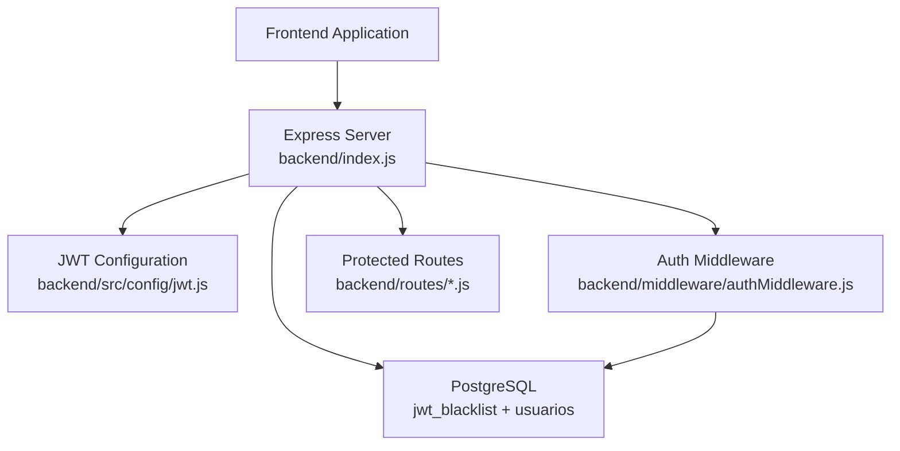
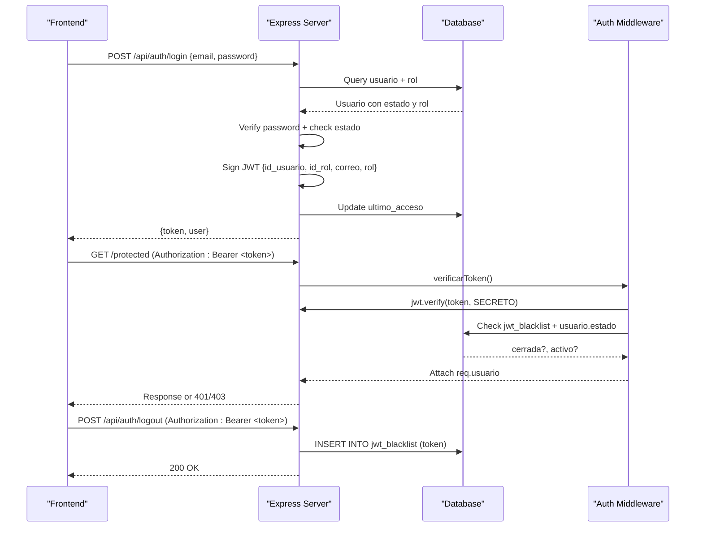
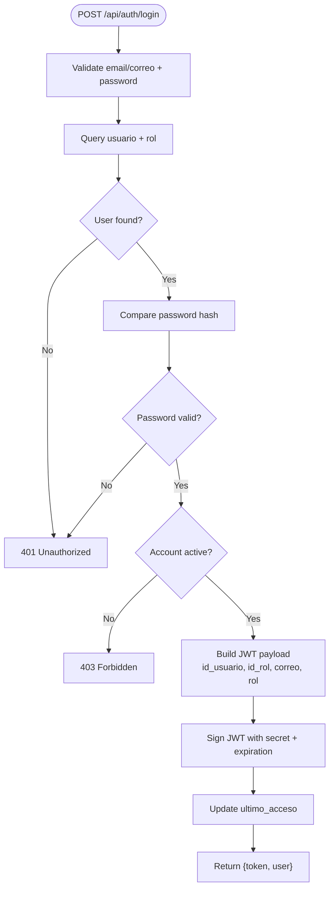
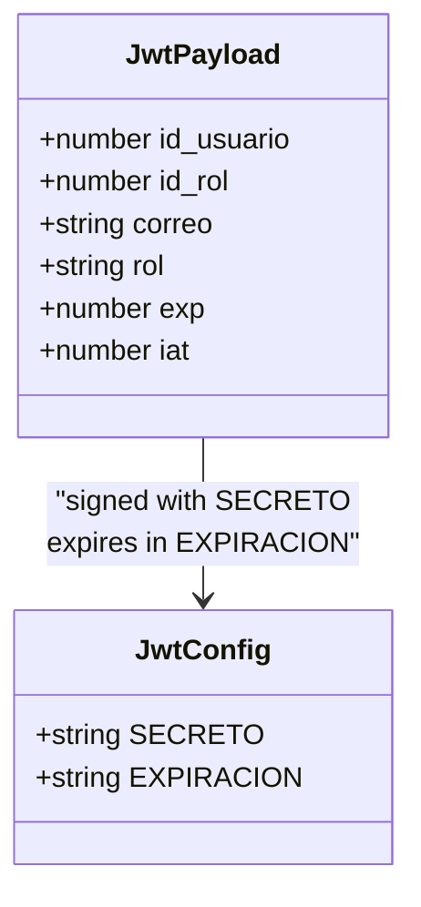
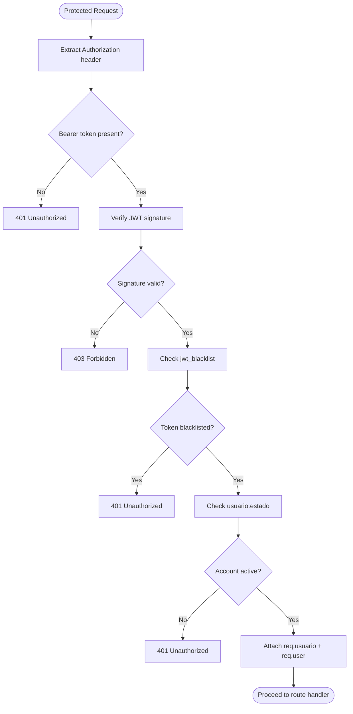
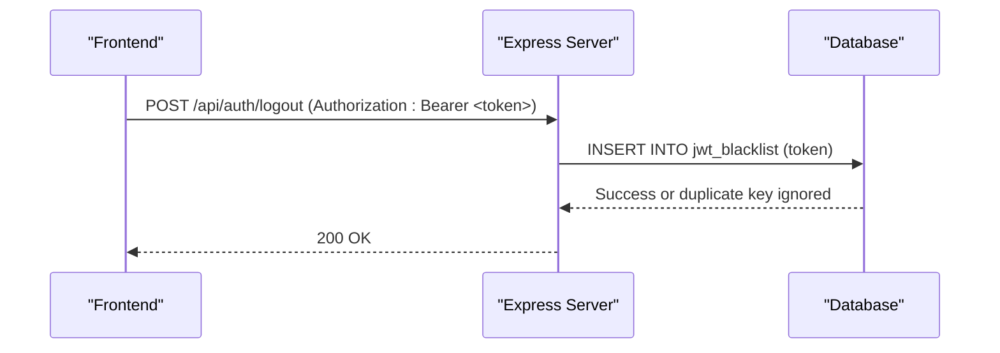
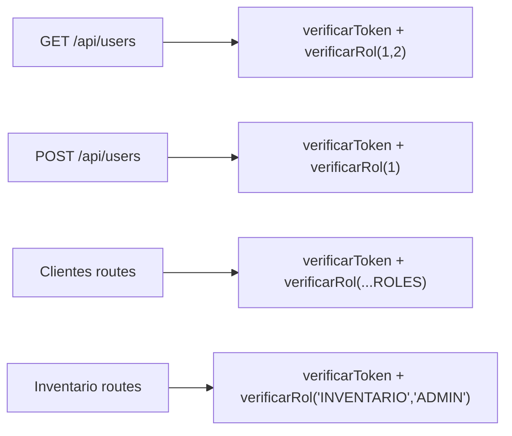
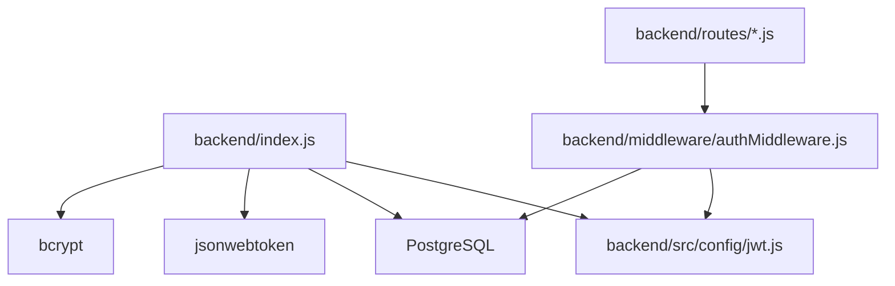

# JWT Authentication Flow

<cite>
**Referenced Files in This Document**   
- [backend/index.js](file://backend/index.js)
- [backend/src/config/jwt.js](file://backend/src/config/jwt.js)
- [backend/middleware/authMiddleware.js](file://backend/middleware/authMiddleware.js)
- [backend/db/migrations/010_sesiones.sql](file://backend/db/migrations/010_sesiones.sql)
- [backend/tests/integracion/auth.test.js](file://backend/tests/integracion/auth.test.js)
- [backend/tests/integracion/sesion.js](file://backend/tests/integracion/sesion.js)
- [backend/routes/usuariosRoutes.js](file://backend/routes/usuariosRoutes.js)
- [backend/src/routes/usuarios.routes.js](file://backend/src/routes/usuarios.routes.js)
- [backend/src/controllers/usuarios.controller.js](file://backend/src/controllers/usuarios.controller.js)
</cite>

## Table of Contents
1. [Introduction](#introduction)
2. [Project Structure](#project-structure)
3. [Core Components](#core-components)
4. [Architecture Overview](#architecture-overview)
5. [Detailed Component Analysis](#detailed-component-analysis)
6. [Dependency Analysis](#dependency-analysis)
7. [Performance Considerations](#performance-considerations)
8. [Troubleshooting Guide](#troubleshooting-guide)
9. [Conclusion](#conclusion)
10. [Appendices](#appendices)

## Introduction
This document explains SIMO’s JWT-based authentication implementation, covering the complete flow from login to token validation, including token generation, storage, verification, expiration handling, and logout blacklisting. It also documents the JWT structure with user claims (`id_usuario`, `id_rol`, `correo`, `rol`), error responses for invalid or expired tokens, and how frontend applications should integrate with the API using bearer tokens. Finally, it provides guidance on token refresh strategies, blacklisting mechanisms for logout, and security best practices for token management.

## Project Structure
The authentication logic is implemented primarily in the backend:
- Login and logout endpoints are defined at the application entry point.
- JWT configuration (secret and expiration) is centralized.
- A reusable middleware validates tokens, checks blacklist status, and enforces role-based access control.
- Database migrations define the blacklist table used for immediate session invalidation.
- Routes protect resource endpoints by applying the authentication and authorization middlewares.

**Diagram sources**
- [backend/index.js:345-469](file://backend/index.js#L345-L469)
- [backend/src/config/jwt.js:1-15](file://backend/src/config/jwt.js#L1-L15)
- [backend/middleware/authMiddleware.js:1-81](file://backend/middleware/authMiddleware.js#L1-L81)
- [backend/db/migrations/010_sesiones.sql:1-19](file://backend/db/migrations/010_sesiones.sql#L1-L19)

**Section sources**
- [backend/index.js:1-57](file://backend/index.js#L1-L57)
- [backend/src/config/jwt.js:1-15](file://backend/src/config/jwt.js#L1-L15)

## Core Components
- **Login endpoint**: Authenticates credentials, verifies account state, generates a signed JWT with user claims, updates last access timestamp, and returns both token and user metadata.
- **Logout endpoint**: Adds the current token to the blacklist so that subsequent requests using the same token are rejected even if not yet expired.
- **JWT configuration**: Centralizes secret key and expiration policy; supports environment variables for production safety.
- **Authentication middleware**: Validates the Bearer token signature, checks blacklist membership, verifies user account state, attaches decoded user data to the request, and enables role-based route protection.
- **Role-based access control**: Route-level guards enforce allowed roles by numeric ID or role code.

**Section sources**
- [backend/index.js:345-469](file://backend/index.js#L345-L469)
- [backend/src/config/jwt.js:1-15](file://backend/src/config/jwt.js#L1-L15)
- [backend/middleware/authMiddleware.js:1-81](file://backend/middleware/authMiddleware.js#L1-L81)

## Architecture Overview
The authentication architecture follows a standard token-based pattern:
1. The client sends credentials to `/api/auth/login`.
2. The server validates credentials and account state, then signs a JWT containing user identity and role information.
3. The client stores the token and includes it as a Bearer token in protected requests.
4. The server’s middleware verifies the token signature, checks the blacklist, and ensures the user is active before allowing access.
5. On logout, the server adds the token to the blacklist, immediately invalidating it.

**Diagram sources**
- [backend/index.js:345-469](file://backend/index.js#L345-L469)
- [backend/middleware/authMiddleware.js:1-81](file://backend/middleware/authMiddleware.js#L1-L81)
- [backend/db/migrations/010_sesiones.sql:1-19](file://backend/db/migrations/010_sesiones.sql#L1-L19)

## Detailed Component Analysis

### Login Flow
- Accepts either `email` or `correo` in the request body.
- Queries the database for the user, including role code.
- Compares the provided password with the stored hash.
- Rejects inactive accounts with a forbidden response.
- Builds a payload with `id_usuario`, `id_rol`, `correo`, and `rol`.
- Signs the JWT using the shared secret and configured expiration.
- Updates the user’s last access timestamp.
- Returns the token and a minimal user object compatible with the frontend contract.

**Diagram sources**
- [backend/index.js:345-423](file://backend/index.js#L345-L423)

**Section sources**
- [backend/index.js:345-423](file://backend/index.js#L345-L423)
- [backend/tests/integracion/auth.test.js:49-61](file://backend/tests/integracion/auth.test.js#L49-L61)

### Token Generation and Structure
- Payload fields:
  - `id_usuario`: Numeric user identifier.
  - `id_rol`: Numeric role identifier.
  - `correo`: User email address.
  - `rol`: Role code string (e.g., ADMIN, GERENTE).
- Expiration:
  - Controlled by `JWT_EXPIRES_IN`; default is 30 minutes.
  - Tests assert that `exp - iat` equals 1800 seconds.
- Secret:
  - Loaded from `JWT_SECRET` environment variable; falls back to development secret when unset.

**Diagram sources**
- [backend/index.js:394-401](file://backend/index.js#L394-L401)
- [backend/src/config/jwt.js:11-15](file://backend/src/config/jwt.js#L11-L15)
- [backend/tests/integracion/auth.test.js:56-61](file://backend/tests/integracion/auth.test.js#L56-L61)

**Section sources**
- [backend/index.js:394-401](file://backend/index.js#L394-L401)
- [backend/src/config/jwt.js:1-15](file://backend/src/config/jwt.js#L1-L15)
- [backend/tests/integracion/auth.test.js:56-61](file://backend/tests/integracion/auth.test.js#L56-L61)

### Token Validation and Authorization
- Extracts the Bearer token from the `Authorization` header.
- Verifies the token signature using the shared secret.
- Checks whether the token appears in the blacklist.
- Ensures the user account remains active.
- Attaches decoded user data to `req.usuario` and `req.user`.
- Provides a role guard that accepts either numeric role IDs or role codes.

**Diagram sources**
- [backend/middleware/authMiddleware.js:9-49](file://backend/middleware/authMiddleware.js#L9-L49)

**Section sources**
- [backend/middleware/authMiddleware.js:1-81](file://backend/middleware/authMiddleware.js#L1-L81)

### Logout and Blacklisting
- Requires a valid Bearer token in the request header.
- Inserts the token into the `jwt_blacklist` table.
- Ignores duplicate insert errors (primary key conflict).
- Subsequent requests with the blacklisted token receive an unauthorized response indicating the session was closed.

**Diagram sources**
- [backend/index.js:428-469](file://backend/index.js#L428-L469)
- [backend/db/migrations/010_sesiones.sql:12-15](file://backend/db/migrations/010_sesiones.sql#L12-L15)

**Section sources**
- [backend/index.js:428-469](file://backend/index.js#L428-L469)
- [backend/db/migrations/010_sesiones.sql:1-19](file://backend/db/migrations/010_sesiones.sql#L1-L19)

### Protected Routes and RBAC
- Example routes apply both authentication and role guards:
  - Users listing requires roles 1 or 2 (ADMIN or GERENTE).
  - Users creation requires role 1 (ADMIN).
  - Other modules use role codes like INVENTARIO, ADMIN, GERENTE, VENDEDOR.

**Diagram sources**
- [backend/routes/usuariosRoutes.js:10-23](file://backend/routes/usuariosRoutes.js#L10-L23)
- [backend/src/routes/clientes.routes.js:13-24](file://backend/src/routes/clientes.routes.js#L13-L24)
- [backend/src/routes/inventario.routes.js:5-14](file://backend/src/routes/inventario.routes.js#L5-L14)

**Section sources**
- [backend/routes/usuariosRoutes.js:1-48](file://backend/routes/usuariosRoutes.js#L1-L48)
- [backend/src/routes/usuarios.routes.js:1-11](file://backend/src/routes/usuarios.routes.js#L1-L11)

## Dependency Analysis
- The login endpoint depends on:
  - Express app setup and routing.
  - Database pool for user queries and last-access updates.
  - bcrypt for password comparison.
  - jsonwebtoken for signing tokens.
  - Shared JWT configuration for secret and expiration.
- The authentication middleware depends on:
  - jsonwebtoken for verification.
  - Database pool for blacklist and user state checks.
  - Shared JWT configuration for verification secret.
- Routes depend on:
  - Authentication middleware for protecting endpoints.
  - Role middleware for enforcing permissions.

**Diagram sources**
- [backend/index.js:1-6](file://backend/index.js#L1-L6)
- [backend/src/config/jwt.js:1-15](file://backend/src/config/jwt.js#L1-L15)
- [backend/middleware/authMiddleware.js:1-4](file://backend/middleware/authMiddleware.js#L1-L4)
- [backend/routes/usuariosRoutes.js:1-7](file://backend/routes/usuariosRoutes.js#L1-L7)

**Section sources**
- [backend/index.js:1-6](file://backend/index.js#L1-L6)
- [backend/middleware/authMiddleware.js:1-4](file://backend/middleware/authMiddleware.js#L1-L4)
- [backend/routes/usuariosRoutes.js:1-7](file://backend/routes/usuariosRoutes.js#L1-L7)

## Performance Considerations
- Token verification is lightweight but incurs a database lookup per request to check blacklist and user state.
- For high-throughput systems, consider caching blacklist entries in memory with TTL aligned to token expiration.
- Keep JWT payloads minimal to reduce network overhead; avoid storing sensitive data in tokens.
- Use short-lived tokens combined with refresh tokens to balance security and performance.

[No sources needed since this section provides general guidance]

## Troubleshooting Guide
Common issues and their causes:
- Missing Authorization header:
  - Cause: Frontend did not attach the Bearer token.
  - Response: 401 Unauthorized.
- Malformed token format:
  - Cause: Incorrect header value or missing token after Bearer.
  - Response: 401 Unauthorized.
- Invalid or expired token:
  - Cause: Wrong secret, tampered token, or token past expiration.
  - Response: 403 Forbidden.
- Session closed due to logout:
  - Cause: Token added to blacklist via `/api/auth/logout`.
  - Response: 401 Unauthorized with message indicating session closure.
- Inactive user account:
  - Cause: User account disabled by administrator.
  - Response: 401 Unauthorized during middleware validation; 403 Forbidden during login.

Operational tips:
- Ensure `JWT_SECRET` is set in production environments.
- Confirm that the `jwt_blacklist` migration has been applied.
- Validate frontend integration uses the correct header format: `Authorization: Bearer <token>`.
- Use the test helper to simulate login and obtain tokens for integration tests.

**Section sources**
- [backend/middleware/authMiddleware.js:9-49](file://backend/middleware/authMiddleware.js#L9-L49)
- [backend/index.js:345-469](file://backend/index.js#L345-L469)
- [backend/tests/integracion/auth.test.js:95-128](file://backend/tests/integracion/auth.test.js#L95-L128)

## Conclusion
SIMO’s JWT authentication implementation provides a secure, extensible foundation for protecting API resources. It centralizes configuration, validates tokens against signature and blacklist, enforces role-based access, and supports immediate session invalidation through logout. Frontend applications should store the returned token securely, include it in every protected request, and handle error responses appropriately. For improved resilience and user experience, consider implementing refresh tokens and optimizing blacklist checks for scale.

[No sources needed since this section summarizes without analyzing specific files]

## Appendices

### Practical Examples of Token-Based API Requests
- Login:
  - Method: POST
  - Path: `/api/auth/login`
  - Body: `{ email: "user@example.com", password: "..." }`
  - Response: `{ token, user: { id, email, nombre_completo, rol } }`
- Protected Resource:
  - Method: GET
  - Path: `/api/users`
  - Header: `Authorization: Bearer <token>`
  - Response: List of users (subject to role permissions)
- Logout:
  - Method: POST
  - Path: `/api/auth/logout`
  - Header: `Authorization: Bearer <token>`
  - Response: `{ message: "Cierre de sesión exitoso..." }`

**Section sources**
- [backend/index.js:345-469](file://backend/index.js#L345-L469)
- [backend/tests/integracion/sesion.js:1-19](file://backend/tests/integracion/sesion.js#L1-L19)

### Token Refresh Strategies
- Current implementation does not include a dedicated refresh endpoint.
- Recommended approach:
  - Issue short-lived access tokens (e.g., 15 minutes).
  - Issue long-lived refresh tokens stored securely on the server.
  - Provide a `/api/auth/refresh` endpoint that validates the refresh token and issues a new access token.
  - Invalidate refresh tokens upon logout or rotation.

[No sources needed since this section provides general guidance]

### Security Best Practices for Token Management
- Never store secrets in source code; always use environment variables.
- Enforce HTTPS for all API communication.
- Set appropriate CORS policies to restrict origins.
- Apply rate limiting to authentication endpoints.
- Avoid placing sensitive data in JWT payloads.
- Implement token rotation and revocation strategies.
- Monitor and log failed authentication attempts for security analysis.

[No sources needed since this section provides general guidance]