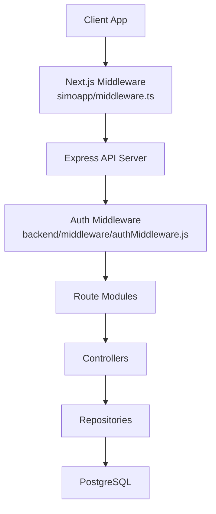
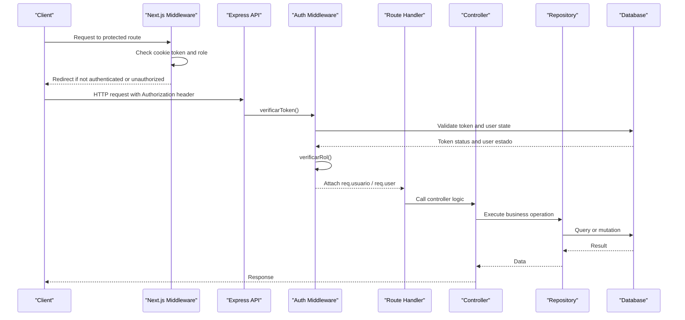
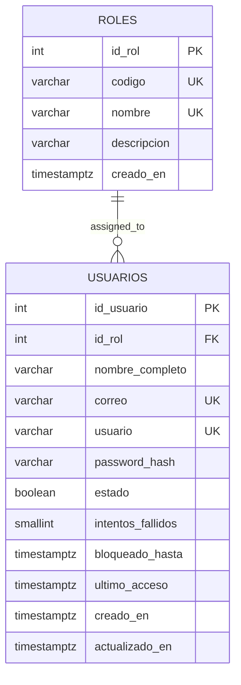
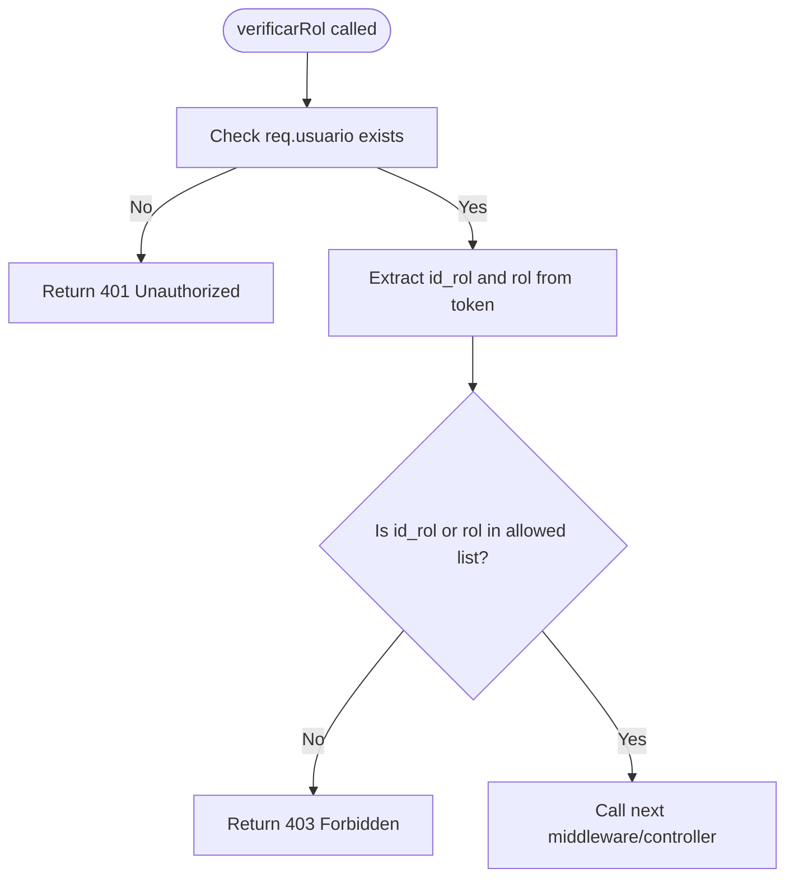
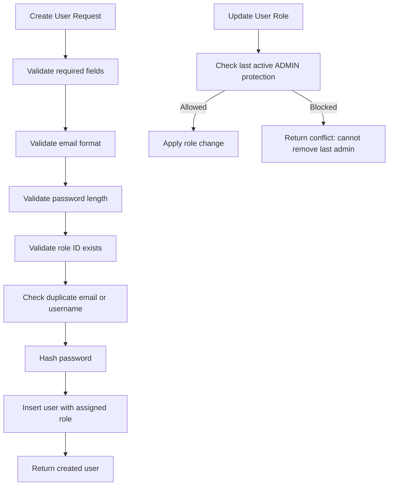
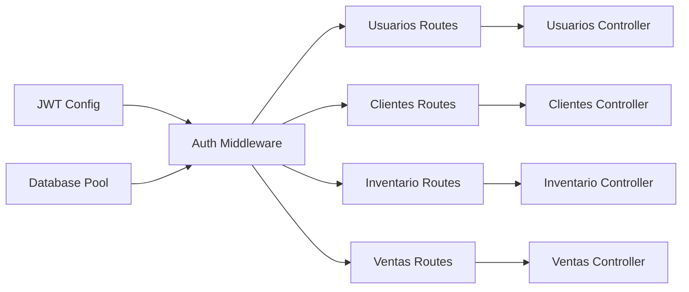

# Role-Based Access Control (RBAC)

<cite>
**Referenced Files in This Document**
- [authMiddleware.js](file://backend/middleware/authMiddleware.js)
- [002_seguridad.sql](file://backend/db/migrations/002_seguridad.sql)
- [usuarios.controller.js](file://backend/src/controllers/usuarios.controller.js)
- [usuarios.routes.js](file://backend/src/routes/usuarios.routes.js)
- [usuariosRoutes.js](file://backend/routes/usuariosRoutes.js)
- [ventasRoutes.js](file://backend/routes/ventasRoutes.js)
- [clientes.routes.js](file://backend/src/routes/clientes.routes.js)
- [inventario.routes.js](file://backend/src/routes/inventario.routes.js)
- [middleware.ts](file://simoapp/middleware.ts)
</cite>

## Table of Contents
1. [Introduction](#introduction)
2. [Project Structure](#project-structure)
3. [Core Components](#core-components)
4. [Architecture Overview](#architecture-overview)
5. [Detailed Component Analysis](#detailed-component-analysis)
6. [Permission Matrix](#permission-matrix)
7. [Role Assignment and Lifecycle](#role-assignment-and-lifecycle)
8. [Protected Routes and Guards](#protected-routes-and-guards)
9. [Dynamic Permission Evaluation](#dynamic-permission-evaluation)
10. [Dependency Analysis](#dependency-analysis)
11. [Performance Considerations](#performance-considerations)
12. [Troubleshooting Guide](#troubleshooting-guide)
13. [Best Practices for Fine-Grained Access Control](#best-practices-for-fine-grained-access-control)
14. [Conclusion](#conclusion)

## Introduction
This document explains SIMO’s role-based access control system. It covers the four application roles, how authentication and authorization are enforced on the backend and frontend, how roles are assigned during user creation, and how to implement fine-grained permissions for new features. The goal is to make RBAC clear for both developers and non-technical stakeholders while remaining fully grounded in the repository’s implementation.

SIMO uses:
- A database-backed role model with stable role codes.
- JWT-based authentication with session invalidation support.
- A reusable `verificarRol` middleware for route-level authorization.
- Frontend middleware that enforces basic role-based navigation.

## Project Structure
The RBAC implementation spans several layers:

- Database schema defines roles and users.
- Backend middleware authenticates requests and checks roles.
- Route modules attach authorization guards to endpoints.
- Controllers validate business rules and enforce additional constraints.
- Frontend middleware protects client-side routes based on stored tokens and roles.

**Diagram sources**
- [middleware.ts:4-28](file://simoapp/middleware.ts#L4-L28)
- [authMiddleware.js:9-49](file://backend/middleware/authMiddleware.js#L9-L49)
- [usuarios.routes.js:9-15](file://backend/src/routes/usuarios.routes.js#L9-L15)

**Section sources**
- [002_seguridad.sql:15-31](file://backend/db/migrations/002_seguridad.sql#L15-L31)
- [authMiddleware.js:9-49](file://backend/middleware/authMiddleware.js#L9-L49)
- [middleware.ts:4-28](file://simoapp/middleware.ts#L4-L28)

## Core Components
The core RBAC components are:

- **Roles table**: Defines the four stable role codes used by the system.
- **Users table**: Associates each user with a role and an active/inactive state.
- **Authentication middleware**: Validates JWT, checks logout/blacklist, and ensures the user is active.
- **Authorization middleware**: Checks whether the authenticated user has one of the allowed roles for a route.
- **Route guards**: Apply authentication and role checks per endpoint.
- **Frontend middleware**: Redirects unauthenticated or unauthorized clients before rendering protected pages.

Key responsibilities:
- Authentication happens first; authorization depends on it.
- Role checks accept either numeric role IDs or string role codes.
- User state (`estado`) can immediately revoke access even if the token is still valid.

**Section sources**
- [002_seguridad.sql:15-58](file://backend/db/migrations/002_seguridad.sql#L15-L58)
- [authMiddleware.js:9-75](file://backend/middleware/authMiddleware.js#L9-L75)
- [middleware.ts:4-28](file://simoapp/middleware.ts#L4-L28)

## Architecture Overview
The request flow for protected routes follows this sequence:

**Diagram sources**
- [middleware.ts:4-28](file://simoapp/middleware.ts#L4-L28)
- [authMiddleware.js:9-75](file://backend/middleware/authMiddleware.js#L9-L75)
- [usuarios.routes.js:9-15](file://backend/src/routes/usuarios.routes.js#L9-L15)

## Detailed Component Analysis

### Roles and Users Schema
The roles table stores stable role codes that drive authorization decisions. The users table links each user to a role and tracks account state.

Important design points:
- Role codes are uppercase and unique.
- Role codes include ADMIN, GERENTE, INVENTARIO, VENDEDOR.
- Users have an `estado` boolean that controls immediate access revocation.
- Foreign key constraints prevent deleting roles referenced by active users.

**Diagram sources**
- [002_seguridad.sql:15-58](file://backend/db/migrations/002_seguridad.sql#L15-L58)

**Section sources**
- [002_seguridad.sql:15-58](file://backend/db/migrations/002_seguridad.sql#L15-L58)

### Authentication Middleware
The authentication middleware performs:
- Header parsing for Bearer tokens.
- JWT verification against the configured secret.
- Blacklist check for logged-out sessions.
- Immediate rejection of inactive users.
- Attaching decoded user data to `req.usuario` and `req.user`.

Security notes:
- Expired or malformed tokens return appropriate error responses.
- Logged-out tokens are rejected even if they are still technically valid.
- Inactive accounts lose access immediately.

**Section sources**
- [authMiddleware.js:9-49](file://backend/middleware/authMiddleware.js#L9-L49)

### Authorization Middleware: `verificarRol`
The `verificarRol` middleware implements role checking:
- Requires prior authentication via `verificarToken`.
- Accepts multiple allowed roles as arguments.
- Compares both numeric role IDs and string role codes from the token.
- Returns 401 when no authenticated user is present.
- Returns 403 when the user lacks required roles.

**Diagram sources**
- [authMiddleware.js:57-75](file://backend/middleware/authMiddleware.js#L57-L75)

**Section sources**
- [authMiddleware.js:52-75](file://backend/middleware/authMiddleware.js#L52-L75)

### Frontend Middleware
The Next.js middleware enforces:
- Public access to login and password recovery routes.
- Redirect to login when no token is present.
- Basic role-based protection for `/usuarios`, allowing only ADMIN.

Limitations:
- Frontend protection is convenient but not sufficient for security.
- All sensitive operations must also be protected on the backend.

**Section sources**
- [middleware.ts:4-28](file://simoapp/middleware.ts#L4-L28)

## Permission Matrix
The permission matrix maps roles to module capabilities based on route guards and controller behavior.

| Role | Users Management | Customers | Inventory Operations | Sales | Daily Summary | Notes |
|---|---|---|---|---|---|---|
| ADMIN | Create, List, Read, Update, Change Status | Create, List, Read, Update, History | Create entries, Create purchases, Read purchase details | Create sales | Read daily summary | Highest privilege; can manage users and most modules |
| GERENTE | List, Read | Create, List, Read, Update, History | Read purchase details | No direct sales creation | Read daily summary | Operational oversight without full admin rights |
| INVENTARIO | No access | No access | Create entries, Create purchases | No direct sales creation | No access | Inventory-focused operations |
| VENDEDOR | No access | Create, List, Read, Update, History | No access | Create sales | No access | Sales and customer-facing operations |

How this matrix is derived:
- Users routes: ADMIN can create/update/change status; GERENTE can list/read.
- Customers routes: VENDEDOR, GERENTE, ADMIN can access.
- Inventory routes: INVENTARIO and ADMIN can write; GERENTE can read purchase details.
- Sales routes: ADMIN and VENDEDOR can create sales; ADMIN and GERENTE can read daily summaries.

**Section sources**
- [usuarios.routes.js:9-15](file://backend/src/routes/usuarios.routes.js#L9-L15)
- [clientes.routes.js:18-24](file://backend/src/routes/clientes.routes.js#L18-L24)
- [inventario.routes.js:10-14](file://backend/src/routes/inventario.routes.js#L10-L14)
- [ventasRoutes.js:11-11](file://backend/routes/ventasRoutes.js#L11-L11)
- [ventasRoutes.js:114-114](file://backend/routes/ventasRoutes.js#L114-L114)

## Role Assignment and Lifecycle
Role assignment occurs primarily through user creation and user updates:

- During creation, the controller validates that the provided role ID exists before inserting the user.
- During updates, the repository prevents removing the last active ADMIN from the system.
- Changing a user’s state to inactive immediately blocks login and existing sessions.

**Diagram sources**
- [usuarios.controller.js:29-84](file://backend/src/controllers/usuarios.controller.js#L29-L84)
- [usuarios.repository.js:115-172](file://backend/src/repositories/usuarios.repository.js#L115-L172)

**Section sources**
- [usuarios.controller.js:29-84](file://backend/src/controllers/usuarios.controller.js#L29-L84)
- [usuarios.repository.js:115-172](file://backend/src/repositories/usuarios.repository.js#L115-L172)

## Protected Routes and Guards
Protected routes combine authentication and authorization:

- `POST /api/users`: ADMIN only.
- `GET /api/users`: ADMIN and GERENTE.
- `PUT /api/users/:id`: ADMIN only.
- `PATCH /api/users/:id/status` and `/api/users/:id/estado`: ADMIN only.
- Customer routes: VENDEDOR, GERENTE, ADMIN.
- Inventory entry and purchase routes: INVENTARIO and ADMIN.
- Purchase detail route: INVENTARIO, ADMIN, GERENTE.
- Sales creation: ADMIN and VENDEDOR.
- Daily sales summary: ADMIN and GERENTE.

Frontend additionally redirects non-ADMIN users away from `/usuarios`.

**Section sources**
- [usuarios.routes.js:9-15](file://backend/src/routes/usuarios.routes.js#L9-L15)
- [clientes.routes.js:18-24](file://backend/src/routes/clientes.routes.js#L18-L24)
- [inventario.routes.js:10-14](file://backend/src/routes/inventario.routes.js#L10-L14)
- [ventasRoutes.js:11-11](file://backend/routes/ventasRoutes.js#L11-L11)
- [ventasRoutes.js:114-114](file://backend/routes/ventasRoutes.js#L114-L114)
- [middleware.ts:23-26](file://simoapp/middleware.ts#L23-L26)

## Dynamic Permission Evaluation
Current dynamic evaluation supports:
- Multiple allowed roles per route.
- Matching by numeric role ID or string role code.
- Frontend role checks for simple page-level redirection.

Opportunities for more dynamic evaluation:
- Centralized permission constants to avoid scattered role arrays.
- Feature flags combined with roles for gradual rollout.
- Resource-level permissions such as “can edit only own records.”
- Action-level permissions such as “can authorize cancellations.”

These enhancements would require extending `verificarRol` or adding higher-level authorization helpers.

**Section sources**
- [authMiddleware.js:57-75](file://backend/middleware/authMiddleware.js#L57-L75)
- [clientes.routes.js:14-24](file://backend/src/routes/clientes.routes.js#L14-L24)
- [middleware.ts:23-26](file://simoapp/middleware.ts#L23-L26)

## Dependency Analysis
The RBAC layer depends on:
- JWT configuration for token verification.
- Database pool for session and user state checks.
- Route modules for attaching guards.
- Controllers for business validation beyond role checks.

**Diagram sources**
- [authMiddleware.js:1-3](file://backend/middleware/authMiddleware.js#L1-L3)
- [usuarios.routes.js:4-15](file://backend/src/routes/usuarios.routes.js#L4-L15)
- [clientes.routes.js:4-24](file://backend/src/routes/clientes.routes.js#L4-L24)
- [inventario.routes.js:4-14](file://backend/src/routes/inventario.routes.js#L4-L14)
- [ventasRoutes.js:1-11](file://backend/routes/ventasRoutes.js#L1-L11)

**Section sources**
- [authMiddleware.js:1-3](file://backend/middleware/authMiddleware.js#L1-L3)
- [usuarios.routes.js:4-15](file://backend/src/routes/usuarios.routes.js#L4-L15)
- [clientes.routes.js:4-24](file://backend/src/routes/clientes.routes.js#L4-L24)
- [inventario.routes.js:4-14](file://backend/src/routes/inventario.routes.js#L4-L14)
- [ventasRoutes.js:1-11](file://backend/routes/ventasRoutes.js#L1-L11)

## Performance Considerations
- JWT verification is fast and stateless except for blacklist and user state checks.
- Role checks are simple array comparisons and add negligible overhead.
- Avoid expensive permission computations inside hot paths; prefer route-level guards.
- Keep role lists centralized to reduce duplication and improve maintainability.
- Use pagination and filtering in user queries to avoid large result sets.

[No sources needed since this section provides general guidance]

## Troubleshooting Guide
Common issues and resolutions:

- **401 Unauthorized**: Missing or malformed Authorization header; expired token; logged-out session; inactive user.
- **403 Forbidden**: Authenticated user does not have one of the required roles.
- **Cannot remove last ADMIN**: Repository prevents leaving the system without any active administrator.
- **Cannot deactivate last ADMIN**: State change is blocked if it would leave no active administrators.
- **Frontend redirect from `/usuarios`**: Non-ADMIN users are redirected because frontend middleware restricts that route.

Recommended debugging steps:
- Verify the token is present and correctly formatted.
- Confirm the user’s role matches at least one allowed role for the route.
- Check whether the user is active.
- Review route definitions for correct role guards.
- Inspect controller and repository validations for additional business constraints.

**Section sources**
- [authMiddleware.js:9-75](file://backend/middleware/authMiddleware.js#L9-L75)
- [usuarios.repository.js:115-172](file://backend/src/repositories/usuarios.repository.js#L115-L172)
- [usuarios.repository.js:178-229](file://backend/src/repositories/usuarios.repository.js#L178-L229)
- [middleware.ts:23-26](file://simoapp/middleware.ts#L23-L26)

## Best Practices for Fine-Grained Access Control
When implementing new features:

1. **Define roles explicitly**: Add or reference stable role codes instead of hardcoding numbers.
2. **Attach guards at the route level**: Use `verificarToken` followed by `verificarRol` for every protected endpoint.
3. **Prefer role codes over IDs**: Role codes are stable and readable.
4. **Centralize permissions**: Maintain a single source of truth for which roles can perform which actions.
5. **Separate authentication from authorization**: Never assume a route is safe just because the frontend allows it.
6. **Enforce resource ownership where needed**: For example, allow users to edit only their own records.
7. **Audit sensitive changes**: Log who changed roles, states, inventory, or financial data.
8. **Test authorization paths**: Include tests for missing roles, inactive users, and edge cases like the last administrator.
9. **Keep frontend guards minimal**: Use them for UX, not security.
10. **Review role assignments regularly**: Ensure roles match current job responsibilities.

[No sources needed since this section provides general guidance]

## Conclusion
SIMO’s RBAC system combines a clear role model, JWT-based authentication, and reusable middleware to protect backend routes. The four roles—ADMIN, GERENTE, INVENTARIO, and VENDEDOR—provide distinct access levels aligned with business needs. While the current implementation is effective for route-level authorization, future enhancements can introduce more dynamic and granular permissions. Developers should follow the established patterns: authenticate first, authorize next, validate business rules in controllers, and keep frontend guards lightweight.

[No sources needed since this section summarizes without analyzing specific files]