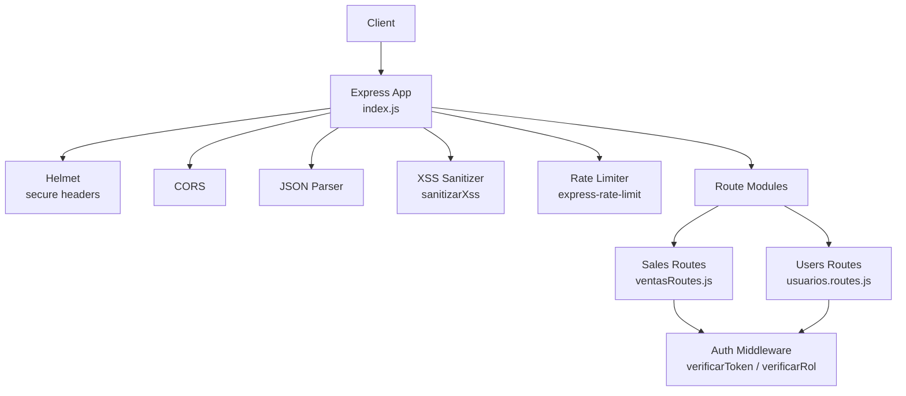
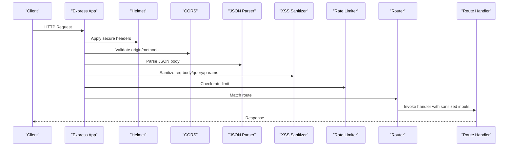
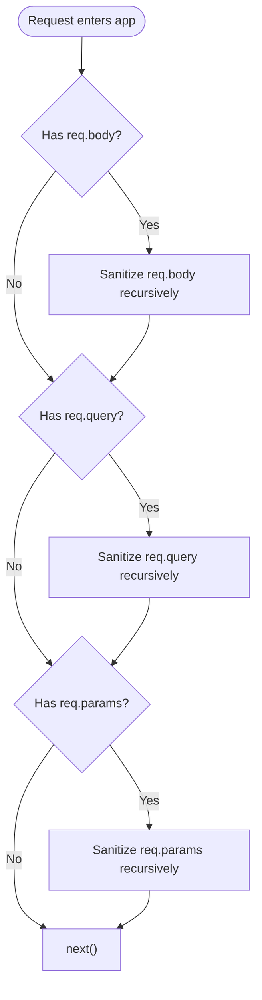
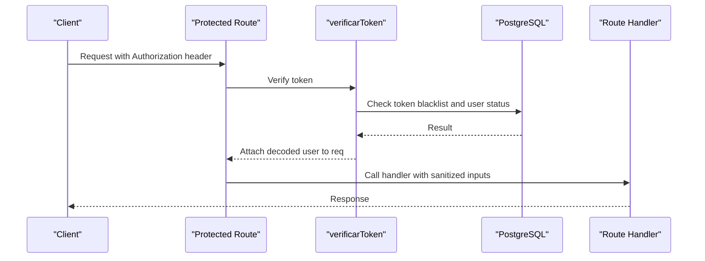
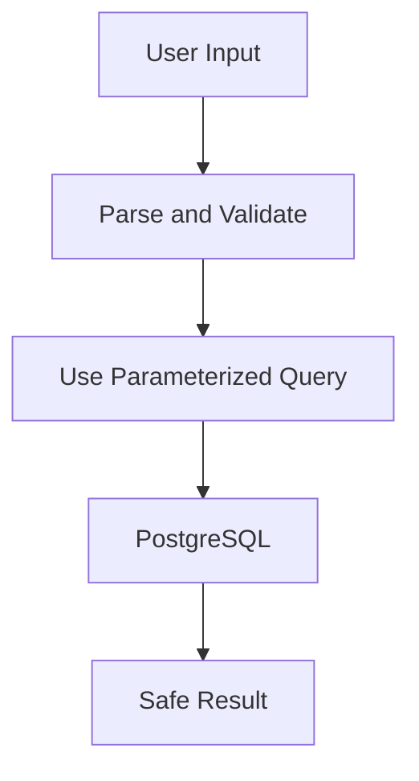
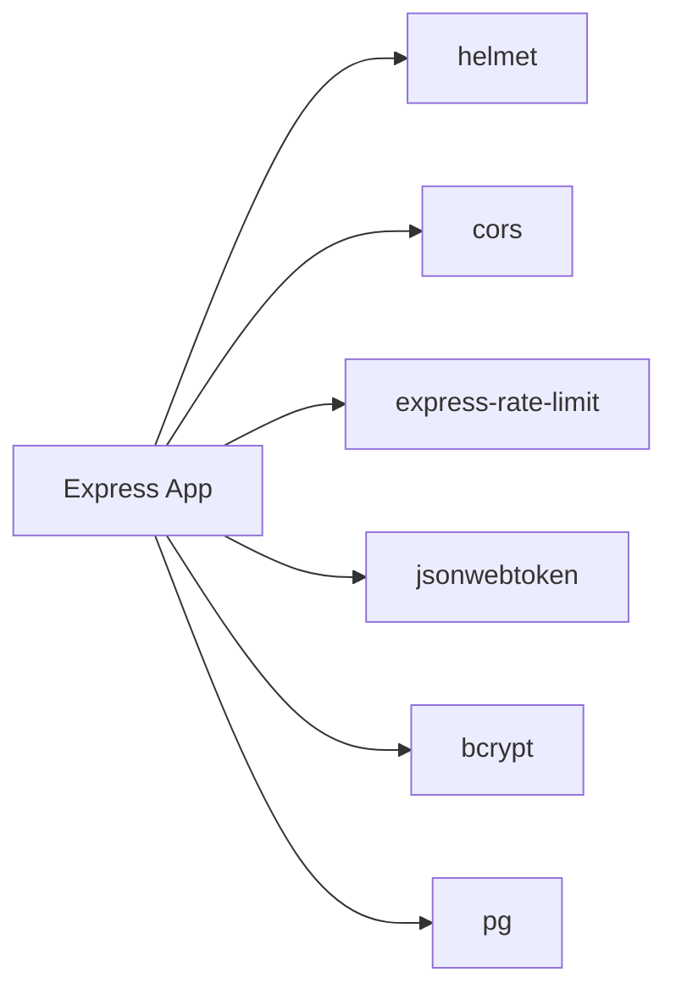

# Security Middleware & Protection

<cite>
**Referenced Files in This Document**
- [index.js](file://backend/index.js)
- [sanitizarXss.js (src)](file://backend/src/middleware/sanitizarXss.js)
- [sanitizarXss.js (middleware)](file://backend/middleware/sanitizarXss.js)
- [authMiddleware.js](file://backend/middleware/authMiddleware.js)
- [ventasRoutes.js](file://backend/routes/ventasRoutes.js)
- [usuarios.routes.js](file://backend/src/routes/usuarios.routes.js)
- [package.json](file://backend/package.json)
</cite>

## Table of Contents
1. [Introduction](#introduction)
2. [Project Structure](#project-structure)
3. [Core Components](#core-components)
4. [Architecture Overview](#architecture-overview)
5. [Detailed Component Analysis](#detailed-component-analysis)
6. [Dependency Analysis](#dependency-analysis)
7. [Performance Considerations](#performance-considerations)
8. [Troubleshooting Guide](#troubleshooting-guide)
9. [Conclusion](#conclusion)

## Introduction
This document explains SIMO’s security middleware and protection strategies with a focus on XSS prevention, security headers, request filtering, data validation, and defense-in-depth patterns. It covers the custom `sanitizarXss` middleware implementation, its usage across routes, and how authentication, authorization, rate limiting, and parameterized queries work together to reduce common vulnerabilities such as XSS, SQL injection, brute force, and unauthorized access.

## Project Structure
The backend is an Express 5 application that configures global security middleware early in the request pipeline:
- Helmet for secure HTTP headers
- CORS for cross-origin control
- JSON body parsing
- Custom XSS sanitization middleware
- Rate limiting for API endpoints
- Route modules protected by JWT authentication and role-based access control

**Diagram sources**
- [index.js:24-56](file://backend/index.js#L24-L56)
- [ventasRoutes.js:1-11](file://backend/routes/ventasRoutes.js#L1-L11)
- [usuarios.routes.js:1-15](file://backend/src/routes/usuarios.routes.js#L1-L15)

**Section sources**
- [index.js:1-56](file://backend/index.js#L1-L56)

## Core Components
- **Helmet**: Sets secure HTTP response headers globally.
- **CORS**: Controls allowed origins and methods.
- **XSS Sanitizer**: Recursively escapes dangerous HTML characters in `req.body`, `req.query`, and `req.params`.
- **Rate Limiter**: Limits requests per IP to mitigate abuse.
- **Authentication Middleware**: Validates JWT tokens and checks session validity and user status.
- **Authorization Middleware**: Enforces role-based access control (RBAC).

Key responsibilities:
- Prevent client-side script injection via input sanitization.
- Harden HTTP responses with secure headers.
- Protect sensitive endpoints with authentication and roles.
- Limit request volume to reduce DoS risk.
- Use parameterized queries to prevent SQL injection.

**Section sources**
- [index.js:24-48](file://backend/index.js#L24-L48)
- [authMiddleware.js:9-49](file://backend/middleware/authMiddleware.js#L9-L49)

## Architecture Overview
The request flow applies security layers before reaching route handlers:

**Diagram sources**
- [index.js:24-56](file://backend/index.js#L24-L56)

## Detailed Component Analysis

### XSS Sanitization Middleware
There are two implementations of the XSS sanitizer:
- `backend/src/middleware/sanitizarXss.js`: Escapes multiple HTML-sensitive characters (`&`, `<`, `>`, `"`, `'`, `/`) recursively across strings, arrays, and objects.
- `backend/middleware/sanitizarXss.js`: A simpler version escaping only `<` and `>`; it also handles Express 5’s read-only `req.query` getter by defining a new property.

Both versions traverse incoming data structures and sanitize string values before they reach route handlers. The `src` version is more comprehensive in character escaping.

**Diagram sources**
- [sanitizarXss.js (src):26-44](file://backend/src/middleware/sanitizarXss.js#L26-L44)
- [sanitizarXss.js (middleware):17-35](file://backend/middleware/sanitizarXss.js#L17-L35)

Usage in the application:
- Global registration after JSON parsing ensures all routes receive sanitized inputs.
- The middleware is applied once at the app level, so every route benefits from input sanitization.

**Section sources**
- [sanitizarXss.js (src):1-47](file://backend/src/middleware/sanitizarXss.js#L1-L47)
- [sanitizarXss.js (middleware):1-38](file://backend/middleware/sanitizarXss.js#L1-L38)
- [index.js:28-32](file://backend/index.js#L28-L32)

### Security Headers Configuration
Helmet is configured globally to set secure HTTP headers. This helps protect against clickjacking, MIME sniffing, and other browser-based attacks.

- Helmet is initialized early in the middleware stack.
- No additional configuration is present, so default secure headers apply.

Best practices:
- Keep Helmet enabled in production.
- Review default settings and customize if needed (e.g., strict transport security, content security policy).

**Section sources**
- [index.js:24-25](file://backend/index.js#L24-L25)

### Request/Response Filtering
- **CORS**: Allows cross-origin requests; ensure it is restricted to trusted origins in production.
- **JSON Parser**: Parses incoming JSON payloads; combined with XSS sanitizer to clean string fields.
- **Rate Limiter**: Applied to `/api` routes to limit request frequency per IP.

Recommendations:
- Restrict CORS to specific domains.
- Tune rate limits based on expected traffic and testing results.
- Add explicit content-type validation where necessary.

**Section sources**
- [index.js:28-48](file://backend/index.js#L28-L48)

### Data Validation Patterns
- **Input Parsing**: Numeric parameters are parsed using `parseInt`; search terms are trimmed.
- **Business Rules**: For example, sale prices must be greater than purchase prices; stock checks occur before updates.
- **Parameterized Queries**: All database operations use parameter placeholders to prevent SQL injection.

Examples:
- Product creation validates required fields and business rules before insertion.
- Product listing parses pagination parameters safely and uses parameterized WHERE clauses.
- Sales processing locks rows with `FOR UPDATE` and performs atomic transactions.

**Section sources**
- [index.js:157-232](file://backend/index.js#L157-L232)
- [index.js:75-152](file://backend/index.js#L75-L152)
- [ventasRoutes.js:10-111](file://backend/routes/ventasRoutes.js#L10-L111)

### Authentication and Authorization
- **JWT Verification**: Extracts token from Authorization header, verifies signature, and checks blacklist and user status.
- **Role-Based Access Control**: Routes require specific roles; e.g., sales endpoints allow ADMIN and VENDEDOR; user management requires ADMIN or GERENTE.

**Diagram sources**
- [authMiddleware.js:9-49](file://backend/middleware/authMiddleware.js#L9-L49)
- [ventasRoutes.js:10-11](file://backend/routes/ventasRoutes.js#L10-L11)
- [usuarios.routes.js:9-15](file://backend/src/routes/usuarios.routes.js#L9-L15)

**Section sources**
- [authMiddleware.js:1-81](file://backend/middleware/authMiddleware.js#L1-L81)
- [ventasRoutes.js:10-11](file://backend/routes/ventasRoutes.js#L10-L11)
- [usuarios.routes.js:9-15](file://backend/src/routes/usuarios.routes.js#L9-L15)

### CSRF Protection Considerations
- The current codebase does not implement explicit CSRF tokens.
- Since the frontend appears to use token-based authentication (JWT), CSRF is less relevant compared to cookie-based sessions.
- If switching to cookies for sessions, add CSRF protection (e.g., double-submit cookies or SameSite cookies).

Recommendations:
- Avoid storing sensitive state in cookies unless CSRF protections are in place.
- Prefer bearer tokens for APIs and enforce HTTPS.

[No sources needed since this section provides general guidance]

### SQL Injection Prevention
- All database queries use parameterized statements with `$1`, `$2`, etc.
- User-supplied values are passed as parameters rather than concatenated into SQL strings.
- Database connection pool is configured securely, and SSL can be enabled via environment variables.

**Diagram sources**
- [index.js:103-122](file://backend/index.js#L103-L122)
- [index.js:188-211](file://backend/index.js#L188-L211)
- [ventasRoutes.js:31-85](file://backend/routes/ventasRoutes.js#L31-L85)

**Section sources**
- [index.js:103-122](file://backend/index.js#L103-L122)
- [index.js:188-211](file://backend/index.js#L188-L211)
- [ventasRoutes.js:31-85](file://backend/routes/ventasRoutes.js#L31-L85)

## Dependency Analysis
Security-related dependencies:
- `helmet`: Secure HTTP headers.
- `cors`: Cross-origin resource sharing.
- `express-rate-limit`: Rate limiting.
- `jsonwebtoken`: JWT verification.
- `bcrypt`: Password hashing.
- `pg`: PostgreSQL driver.

**Diagram sources**
- [package.json:15-23](file://backend/package.json#L15-L23)

**Section sources**
- [package.json:15-23](file://backend/package.json#L15-L23)

## Performance Considerations
- XSS sanitization traverses nested objects and arrays; keep payloads reasonable in size.
- Rate limiting adds overhead but protects against abuse; tune thresholds based on load tests.
- Parameterized queries are efficient and safe; avoid dynamic SQL construction.
- JWT verification includes a database lookup for blacklist and user status; consider caching strategies if latency becomes an issue.

[No sources needed since this section provides general guidance]

## Troubleshooting Guide
Common issues and mitigations:
- **XSS bypass attempts**: Ensure the comprehensive sanitizer (`src/middleware/sanitizarXss.js`) is used consistently.
- **Express 5 query property errors**: The middleware defines a writable `query` property to avoid read-only getter issues.
- **Unauthorized access**: Verify JWT presence, signature validity, and user status; check blacklist entries.
- **Forbidden access**: Confirm the user’s role matches the route’s required roles.
- **Too Many Requests**: Adjust rate limit configuration or whitelist trusted IPs if necessary.

**Section sources**
- [sanitizarXss.js (middleware):28-35](file://backend/middleware/sanitizarXss.js#L28-L35)
- [authMiddleware.js:9-49](file://backend/middleware/authMiddleware.js#L9-L49)
- [index.js:34-48](file://backend/index.js#L34-L48)

## Conclusion
SIMO’s backend implements a layered security approach:
- Helmet hardens HTTP responses.
- CORS restricts cross-origin access.
- Custom XSS sanitization cleans user inputs across body, query, and params.
- Rate limiting mitigates abuse.
- JWT authentication and RBAC protect sensitive endpoints.
- Parameterized queries prevent SQL injection.

To strengthen defenses further:
- Restrict CORS to trusted origins.
- Customize Helmet policies (e.g., CSP, HSTS).
- Add CSRF protection if using cookie-based sessions.
- Implement input validation libraries for stricter schema enforcement.
- Monitor and log security events for proactive threat detection.

[No sources needed since this section summarizes without analyzing specific files]