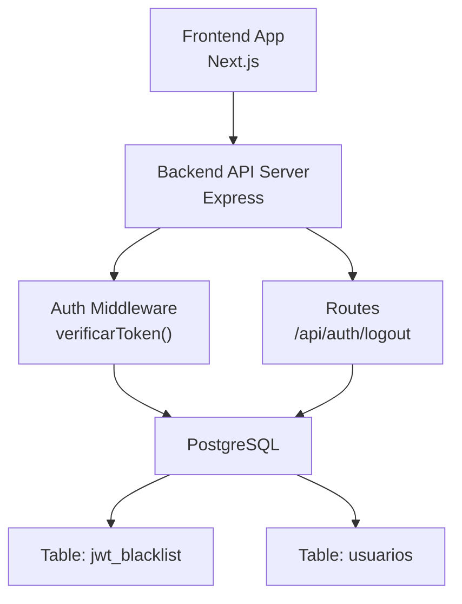
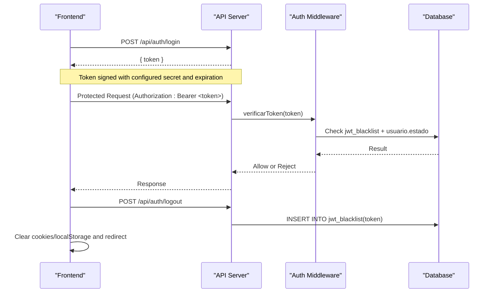
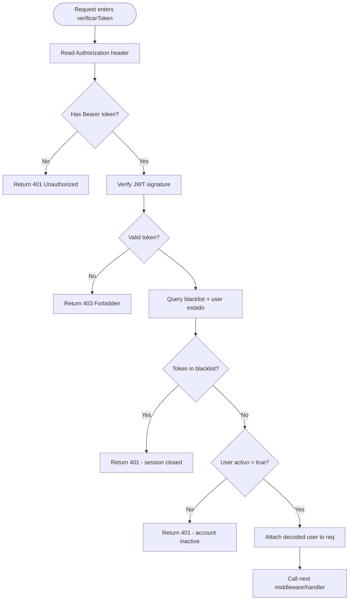
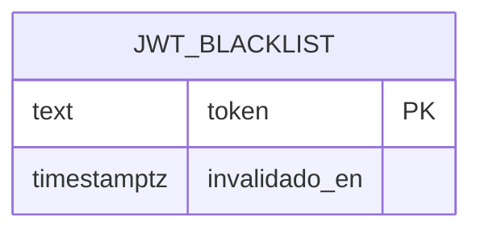
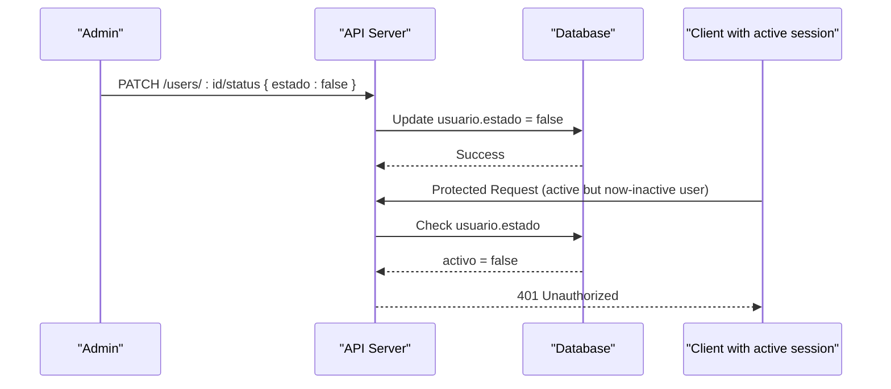
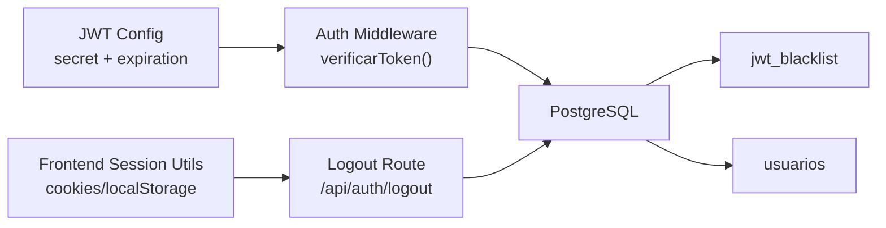

# Session Management & Token Lifecycle

<cite>
**Referenced Files in This Document**
- [backend/middleware/authMiddleware.js](file://backend/middleware/authMiddleware.js)
- [backend/src/config/jwt.js](file://backend/src/config/jwt.js)
- [backend/db/migrations/010_sesiones.sql](file://backend/db/migrations/010_sesiones.sql)
- [backend/index.js](file://backend/index.js)
- [backend/tests/integracion/sesion.js](file://backend/tests/integracion/sesion.js)
- [backend/tests/integracion/usuarios.test.js](file://backend/tests/integracion/usuarios.test.js)
- [backend/src/controllers/usuarios.controller.js](file://backend/src/controllers/usuarios.controller.js)
- [simoapp/lib/auth/sesion.ts](file://simoapp/lib/auth/sesion.ts)
- [simoapp/components/shell/Navbar.tsx](file://simoapp/components/shell/Navbar.tsx)
- [backend/db/migrations/007_auditoria.sql](file://backend/db/migrations/007_auditoria.sql)
</cite>

## Table of Contents
1. [Introduction](#introduction)
2. [Project Structure](#project-structure)
3. [Core Components](#core-components)
4. [Architecture Overview](#architecture-overview)
5. [Detailed Component Analysis](#detailed-component-analysis)
6. [Dependency Analysis](#dependency-analysis)
7. [Performance Considerations](#performance-considerations)
8. [Troubleshooting Guide](#troubleshooting-guide)
9. [Conclusion](#conclusion)

## Introduction
This document explains SIMO’s session management system with a focus on the JWT token lifecycle and session state enforcement. It covers:
- Immediate token invalidation via the `jwt_blacklist` table.
- Real-time session termination when user status changes (activation/deactivation).
- Logout flow and client-side session cleanup.
- Audit logging for security compliance.
- Practical examples for session cleanup, monitoring active sessions, and graceful handling of concurrent logins and security events.

## Project Structure
The session-related logic spans backend middleware, configuration, database migrations, routes, tests, and frontend session utilities:
- Backend authentication middleware validates tokens and enforces blacklist and user status checks.
- JWT configuration centralizes secret and expiration settings.
- Database migration defines the blacklist table for immediate invalidation.
- Frontend stores and clears session cookies and local storage during logout.
- Integration tests validate login, logout, and real-time session termination on user deactivation.

**Diagram sources**
- [backend/middleware/authMiddleware.js:9-49](file://backend/middleware/authMiddleware.js#L9-L49)
- [backend/index.js:426-463](file://backend/index.js#L426-L463)
- [backend/db/migrations/010_sesiones.sql:12-15](file://backend/db/migrations/010_sesiones.sql#L12-L15)

**Section sources**
- [backend/middleware/authMiddleware.js:9-49](file://backend/middleware/authMiddleware.js#L9-L49)
- [backend/src/config/jwt.js:11-15](file://backend/src/config/jwt.js#L11-L15)
- [backend/db/migrations/010_sesiones.sql:12-15](file://backend/db/migrations/010_sesiones.sql#L12-L15)
- [simoapp/lib/auth/sesion.ts:32-48](file://simoapp/lib/auth/sesion.ts#L32-L48)

## Core Components
- JWT configuration: Centralized secret and expiration time used by both login and verification.
- Authentication middleware: Verifies token signature, checks blacklist, and enforces user activation status.
- Blacklist table: Stores invalidated tokens to enforce immediate logout.
- Logout endpoint: Adds the current token to the blacklist.
- Frontend session utilities: Persist and clear session cookies/local storage; trigger logout UI.

Key responsibilities:
- Token signing and expiration are configured centrally.
- Every protected request is validated against the blacklist and user status.
- Logout immediately invalidates the token server-side.
- Frontend cleans local session artifacts and redirects to login.

**Section sources**
- [backend/src/config/jwt.js:11-15](file://backend/src/config/jwt.js#L11-L15)
- [backend/middleware/authMiddleware.js:9-49](file://backend/middleware/authMiddleware.js#L9-L49)
- [backend/db/migrations/010_sesiones.sql:12-15](file://backend/db/migrations/010_sesiones.sql#L12-L15)
- [backend/index.js:426-463](file://backend/index.js#L426-L463)
- [simoapp/lib/auth/sesion.ts:32-48](file://simoapp/lib/auth/sesion.ts#L32-L48)

## Architecture Overview
The session architecture ensures that once a token is issued, it remains valid until either its configured expiration or explicit invalidation. The system supports:
- Immediate invalidation through the blacklist.
- Real-time revocation when a user is deactivated.
- Graceful client-side cleanup on logout.

**Diagram sources**
- [backend/src/config/jwt.js:11-15](file://backend/src/config/jwt.js#L11-L15)
- [backend/middleware/authMiddleware.js:22-49](file://backend/middleware/authMiddleware.js#L22-L49)
- [backend/db/migrations/010_sesiones.sql:12-15](file://backend/db/migrations/010_sesiones.sql#L12-L15)
- [backend/index.js:426-463](file://backend/index.js#L426-L463)

## Detailed Component Analysis

### JWT Configuration and Expiration
- Secret and expiration are centralized to avoid mismatch between login and verification.
- Default expiration is set to 30 minutes unless overridden by environment variables.

Operational implications:
- Tokens expire automatically after the configured duration.
- For immediate revocation before expiry, use the blacklist mechanism.

**Section sources**
- [backend/src/config/jwt.js:11-15](file://backend/src/config/jwt.js#L11-L15)

### Authentication Middleware: Token Validation and Session Enforcement
Responsibilities:
- Extract and verify the JWT signature.
- Check if the token exists in the blacklist.
- Verify the user’s activation status in real time.
- Attach decoded user data to the request for downstream handlers.

Security behavior:
- A blacklisted token is rejected even if not expired.
- Deactivating a user causes all their active tokens to be rejected immediately.

Error handling:
- Missing or malformed Authorization header returns 401.
- Invalid/expired token returns 403.
- Blacklisted or inactive user returns 401.
- Unexpected DB errors return 500.

**Diagram sources**
- [backend/middleware/authMiddleware.js:9-49](file://backend/middleware/authMiddleware.js#L9-L49)

**Section sources**
- [backend/middleware/authMiddleware.js:9-49](file://backend/middleware/authMiddleware.js#L9-L49)

### Blacklist Table: Immediate Token Invalidation
- The `jwt_blacklist` table stores tokens that have been explicitly invalidated.
- Each entry includes the token and the timestamp when it was invalidated.
- The primary key prevents duplicate entries for the same token.

Usage:
- On logout, the server inserts the current token into this table.
- On every protected request, the middleware checks this table before granting access.

**Diagram sources**
- [backend/db/migrations/010_sesiones.sql:12-15](file://backend/db/migrations/010_sesiones.sql#L12-L15)

**Section sources**
- [backend/db/migrations/010_sesiones.sql:12-15](file://backend/db/migrations/010_sesiones.sql#L12-L15)

### Logout Endpoint: Adding Tokens to the Blacklist
- The `/api/auth/logout` route adds the current token to `jwt_blacklist`.
- After insertion, the client should clear local session artifacts and redirect to login.

Behavioral notes:
- Insertion is idempotent due to the primary key constraint.
- Subsequent requests using the same token will be rejected immediately.

**Section sources**
- [backend/index.js:426-463](file://backend/index.js#L426-L463)
- [backend/db/migrations/010_sesiones.sql:12-15](file://backend/db/migrations/010_sesiones.sql#L12-L15)

### User Status Changes: Activation/Deactivation and Real-Time Termination
- Changing a user’s status affects all active sessions instantly.
- Deactivation rejects any ongoing requests from that user, even if the token has not expired.
- Tests assert that deactivation terminates open sessions and blocks new logins.

Operational guidance:
- Use the PATCH endpoint to toggle user status.
- Monitor subsequent requests to ensure they receive 401 responses for deactivated users.

**Diagram sources**
- [backend/src/controllers/usuarios.controller.js:257-285](file://backend/src/controllers/usuarios.controller.js#L257-L285)
- [backend/middleware/authMiddleware.js:29-41](file://backend/middleware/authMiddleware.js#L29-L41)
- [backend/tests/integracion/usuarios.test.js:318-326](file://backend/tests/integracion/usuarios.test.js#L318-L326)

**Section sources**
- [backend/src/controllers/usuarios.controller.js:257-285](file://backend/src/controllers/usuarios.controller.js#L257-L285)
- [backend/tests/integracion/usuarios.test.js:318-326](file://backend/tests/integracion/usuarios.test.js#L318-L326)

### Frontend Session Cleanup and Logout UX
- The frontend stores token, role, and userId in cookies and clears them on logout.
- Legacy localStorage entries are also removed.
- The logout UI provides confirmation, disables actions while processing, and redirects to login.

Best practices:
- Always clear both cookies and local storage on logout.
- Provide visual feedback during logout to prevent double submissions.
- Force a clean navigation to the login page to reset application state.

**Section sources**
- [simoapp/lib/auth/sesion.ts:32-48](file://simoapp/lib/auth/sesion.ts#L32-L48)
- [simoapp/components/shell/Navbar.tsx:34-51](file://simoapp/components/shell/Navbar.tsx#L34-L51)
- [simoapp/components/shell/Navbar.tsx:148-184](file://simoapp/components/shell/Navbar.tsx#L148-L184)

### Audit Logging for Security Compliance
- Critical operations are recorded in an immutable audit log table.
- The log captures actor, action, entity, timestamps, IP address, and before/after data where applicable.
- Triggers and privileges protect the log from modification or truncation.

Relevance to sessions:
- While session invalidation itself may not always be audited here, the same infrastructure can be extended to record security-sensitive events such as mass invalidations or admin-driven deactivations.

**Section sources**
- [backend/db/migrations/007_auditoria.sql:13-67](file://backend/db/migrations/007_auditoria.sql#L13-L67)

## Dependency Analysis
The following diagram shows how components depend on each other to manage sessions and tokens:

**Diagram sources**
- [backend/src/config/jwt.js:11-15](file://backend/src/config/jwt.js#L11-L15)
- [backend/middleware/authMiddleware.js:9-49](file://backend/middleware/authMiddleware.js#L9-L49)
- [backend/index.js:426-463](file://backend/index.js#L426-L463)
- [backend/db/migrations/010_sesiones.sql:12-15](file://backend/db/migrations/010_sesiones.sql#L12-L15)
- [simoapp/lib/auth/sesion.ts:32-48](file://simoapp/lib/auth/sesion.ts#L32-L48)

**Section sources**
- [backend/src/config/jwt.js:11-15](file://backend/src/config/jwt.js#L11-L15)
- [backend/middleware/authMiddleware.js:9-49](file://backend/middleware/authMiddleware.js#L9-L49)
- [backend/index.js:426-463](file://backend/index.js#L426-L463)
- [backend/db/migrations/010_sesiones.sql:12-15](file://backend/db/migrations/010_sesiones.sql#L12-L15)
- [simoapp/lib/auth/sesion.ts:32-48](file://simoapp/lib/auth/sesion.ts#L32-L48)

## Performance Considerations
- Blacklist lookup per request:
  - The middleware performs a simple existence check on `jwt_blacklist.token`, which is indexed by its primary key.
  - Keep the blacklist size manageable by periodically purging old entries based on `invalidado_en`.
- User status check:
  - A lightweight column read (`usuarios.estado`) avoids expensive joins.
- Expiration strategy:
  - Short-lived tokens reduce the window of misuse; combine with blacklist for immediate revocation.
- Concurrency:
  - Multiple concurrent requests from the same user will be evaluated independently; deactivation or blacklist insertion takes effect on the next request.

[No sources needed since this section provides general guidance]

## Troubleshooting Guide
Common issues and resolutions:
- 401 Unauthorized on protected endpoints:
  - Verify the Authorization header format and presence.
  - Confirm the token is not present in `jwt_blacklist`.
  - Ensure the user’s `estado` is true.
- 403 Forbidden:
  - Indicates an invalid or expired token; re-authenticate.
- Logout does not invalidate immediately:
  - Confirm the logout endpoint inserted the token into `jwt_blacklist`.
  - Ensure the client clears cookies/localStorage and navigates to login.
- Deactivated user still accessing resources:
  - Check that the middleware reads `usuarios.estado` and rejects inactive users.
  - Validate that the change propagated to the database.

Validation references:
- Login helper used in tests demonstrates expected token retrieval.
- Integration tests assert that deactivation terminates active sessions and blocks login attempts.

**Section sources**
- [backend/middleware/authMiddleware.js:9-49](file://backend/middleware/authMiddleware.js#L9-L49)
- [backend/tests/integracion/sesion.js:6-17](file://backend/tests/integracion/sesion.js#L6-L17)
- [backend/tests/integracion/usuarios.test.js:318-326](file://backend/tests/integracion/usuarios.test.js#L318-L326)

## Conclusion
SIMO’s session management combines short-lived JWTs with server-side enforcement to provide robust security:
- Tokens are signed with a centralized secret and expire after a configurable duration.
- The `jwt_blacklist` enables immediate invalidation upon logout.
- User status changes terminate active sessions in real time.
- Frontend cleanup ensures no residual session artifacts remain after logout.
- An immutable audit log supports compliance and forensic analysis.

For production hardening:
- Implement periodic cleanup of `jwt_blacklist`.
- Extend audit logging to capture critical security events related to sessions.
- Monitor failed authentication patterns for anomaly detection.

[No sources needed since this section summarizes without analyzing specific files]