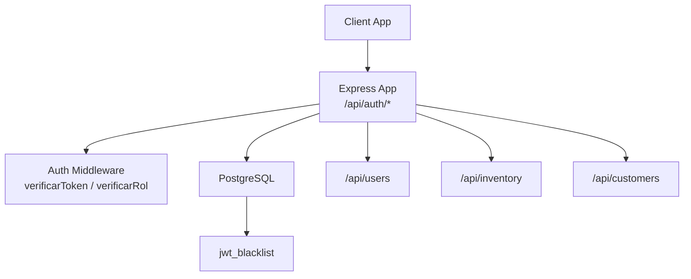
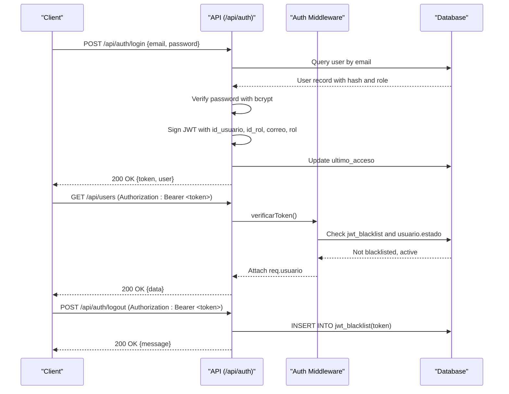
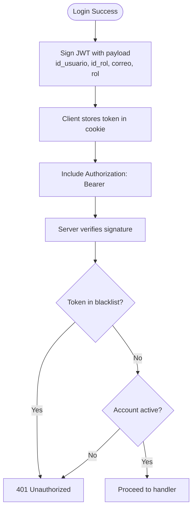
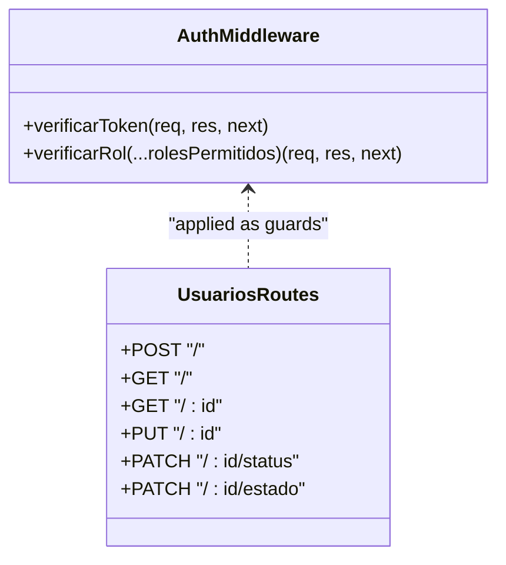
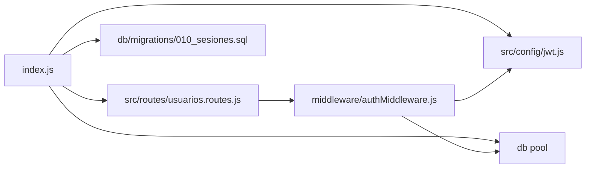

# Authentication API

<cite>
**Referenced Files in This Document**
- [index.js](file://backend/index.js)
- [jwt.js](file://backend/src/config/jwt.js)
- [authMiddleware.js](file://backend/middleware/authMiddleware.js)
- [010_sesiones.sql](file://backend/db/migrations/010_sesiones.sql)
- [usuarios.routes.js](file://backend/src/routes/usuarios.routes.js)
- [sesion.ts](file://simoapp/lib/auth/sesion.ts)
- [auth.test.js](file://backend/tests/integracion/auth.test.js)
</cite>

## Table of Contents
1. [Introduction](#introduction)
2. [Project Structure](#project-structure)
3. [Core Components](#core-components)
4. [Architecture Overview](#architecture-overview)
5. [Detailed Component Analysis](#detailed-component-analysis)
6. [Dependency Analysis](#dependency-analysis)
7. [Performance Considerations](#performance-considerations)
8. [Troubleshooting Guide](#troubleshooting-guide)
9. [Conclusion](#conclusion)

## Introduction
This document describes SIMO’s authentication API, focusing on login, logout, token handling, and session management. It explains how JWT tokens are issued, verified, invalidated, and consumed by protected routes, including role-based access control (RBAC). It also provides request/response schemas, security headers, error responses, and best practices for client implementations.

## Project Structure
The authentication endpoints are implemented directly in the Express application entry point and supported by shared middleware and configuration:

- Authentication endpoints: `/api/auth/login`, `/api/auth/logout`
- Protected resource routes: mounted under `/api/users`, `/api/inventory`, `/api/customers`
- JWT configuration: centralized secret and expiration
- RBAC middleware: token verification and role checks
- Session invalidation: blacklist table for immediate logout

**Diagram sources**
- [index.js:20-56](file://backend/index.js#L20-L56)
- [index.js:345-469](file://backend/index.js#L345-L469)
- [authMiddleware.js:9-49](file://backend/middleware/authMiddleware.js#L9-L49)
- [010_sesiones.sql:12-15](file://backend/db/migrations/010_sesiones.sql#L12-L15)

**Section sources**
- [index.js:1-56](file://backend/index.js#L1-L56)
- [index.js:345-469](file://backend/index.js#L345-L469)

## Core Components
- Login endpoint: authenticates credentials, issues a signed JWT with user identity and role, updates last access timestamp.
- Logout endpoint: accepts an Authorization header, stores the token in a blacklist to invalidate it immediately.
- Token verification middleware: validates signature, checks blacklist, verifies account status, attaches decoded user to request.
- Role-based access control: route-level guards that allow only permitted roles or role IDs.
- JWT configuration: centralizes secret and expiration; default expiration is 30 minutes.

Key responsibilities:
- Credential validation and password hashing via bcrypt
- JWT signing and verification using jsonwebtoken
- Security headers via helmet
- Rate limiting across all API routes
- XSS sanitization middleware

**Section sources**
- [index.js:345-423](file://backend/index.js#L345-L423)
- [index.js:428-469](file://backend/index.js#L428-L469)
- [authMiddleware.js:9-49](file://backend/middleware/authMiddleware.js#L9-L49)
- [authMiddleware.js:52-75](file://backend/middleware/authMiddleware.js#L52-L75)
- [jwt.js:1-15](file://backend/src/config/jwt.js#L1-L15)

## Architecture Overview
The authentication flow uses stateless JWTs with server-side invalidation support through a blacklist table. Clients send credentials to login, receive a JWT, and include it as a Bearer token in subsequent requests. Protected routes require a valid token and appropriate role. Logout adds the current token to the blacklist so it cannot be used again even before expiration.

**Diagram sources**
- [index.js:345-423](file://backend/index.js#L345-L423)
- [index.js:428-469](file://backend/index.js#L428-L469)
- [authMiddleware.js:9-49](file://backend/middleware/authMiddleware.js#L9-L49)
- [010_sesiones.sql:12-15](file://backend/db/migrations/010_sesiones.sql#L12-L15)

## Detailed Component Analysis

### Authentication Endpoints

#### POST /api/auth/login
Authenticates a user by email and password, returns a JWT and minimal user profile.

- Request body
  - email: string (required)
  - password: string (required)
  - Alternative field name correo is accepted

- Success response (200)
  - message: string
  - token: string (JWT)
  - user: object
    - id: number
    - email: string
    - nombre_completo: string
    - rol: string

- Error responses
  - 400 Bad Request: missing email/password
  - 401 Unauthorized: invalid credentials
  - 403 Forbidden: account inactive
  - 500 Internal Server Error: unexpected error

Notes
- Passwords are compared using bcrypt against stored hashes.
- On success, the user’s last access timestamp is updated.
- The JWT includes id_usuario, id_rol, correo, rol and expires after the configured duration.

**Section sources**
- [index.js:345-423](file://backend/index.js#L345-L423)
- [auth.test.js:47-91](file://backend/tests/integracion/auth.test.js#L47-L91)

#### POST /api/auth/logout
Invalidates the current session by adding the provided token to the blacklist.

- Authorization header
  - Required: Bearer <token>

- Success response (200)
  - message: string indicating successful logout

- Error responses
  - 400 Bad Request: missing or malformed Authorization header
  - 500 Internal Server Error: database error while blacklisting

Notes
- Duplicate insertion errors are ignored to ensure idempotency.
- After logout, any request using the same token will be rejected until the token naturally expires.

**Section sources**
- [index.js:428-469](file://backend/index.js#L428-L469)
- [010_sesiones.sql:12-15](file://backend/db/migrations/010_sesiones.sql#L12-L15)

### Token Handling and Expiration

- Signing
  - Algorithm and secret are managed centrally.
  - Payload contains user identity and role code.

- Expiration
  - Default expiration is 30 minutes unless overridden by environment variables.

- Verification
  - Signature is validated.
  - Blacklist check prevents use of logged-out tokens.
  - Account status check ensures inactive users cannot access resources.

- Client storage
  - The frontend stores token, role, and userId in cookies with the same lifetime as the token.

**Diagram sources**
- [index.js:394-403](file://backend/index.js#L394-L403)
- [jwt.js:11-15](file://backend/src/config/jwt.js#L11-L15)
- [authMiddleware.js:22-49](file://backend/middleware/authMiddleware.js#L22-L49)
- [sesion.ts:32-48](file://simoapp/lib/auth/sesion.ts#L32-L48)

**Section sources**
- [jwt.js:1-15](file://backend/src/config/jwt.js#L1-L15)
- [authMiddleware.js:9-49](file://backend/middleware/authMiddleware.js#L9-L49)
- [sesion.ts:32-48](file://simoapp/lib/auth/sesion.ts#L32-L48)

### Role-Based Access Control (RBAC)

- Route guards
  - verificarToken enforces authentication.
  - verificarRol enforces authorization based on role ID or role code.

- Example protected routes
  - POST /api/users requires ADMIN
  - GET /api/users requires ADMIN or GERENTE
  - PATCH /api/users/:id/status or /estado requires ADMIN

- Role values
  - Numeric IDs: e.g., 1 Admin, 2 Gerente, 3 Inventario, 4 Vendedor
  - Codes: 'ADMIN', 'GERENTE', 'INVENTARIO', 'VENDEDOR'

**Diagram sources**
- [authMiddleware.js:9-75](file://backend/middleware/authMiddleware.js#L9-L75)
- [usuarios.routes.js:9-15](file://backend/src/routes/usuarios.routes.js#L9-L15)

**Section sources**
- [authMiddleware.js:52-75](file://backend/middleware/authMiddleware.js#L52-L75)
- [usuarios.routes.js:1-17](file://backend/src/routes/usuarios.routes.js#L1-L17)

### Security Headers and Global Protections

- Helmet sets secure HTTP headers automatically.
- CORS is enabled for cross-origin requests.
- JSON parsing is enabled.
- XSS sanitization middleware is applied globally.
- Rate limiting applies to all API routes (default 100 requests per minute per IP), configurable via RATE_LIMIT_MAX.

These protections apply to authentication endpoints as well as protected resource routes.

**Section sources**
- [index.js:20-48](file://backend/index.js#L20-L48)

### Password Validation and Security

- Backend
  - Passwords are hashed with bcrypt during user creation and compared during login.
  - No explicit password policy enforcement is present in the login endpoint; policies should be enforced at the client or admin user creation flows.

- Frontend
  - UI components provide password visibility toggles and form validation utilities.

Recommendations
- Enforce minimum length, complexity, and history rules on the client side.
- Add server-side validation for new user registration and password changes.

**Section sources**
- [index.js:380-383](file://backend/index.js#L380-L383)
- [auth.test.js:81-91](file://backend/tests/integracion/auth.test.js#L81-L91)

### Token Refresh Strategy

Current implementation
- There is no dedicated refresh endpoint.
- Tokens expire after the configured duration (default 30 minutes).
- Clients should re-authenticate when the token expires or when receiving 401/403 due to invalid/expired tokens.

Recommended client behavior
- Detect expiration locally using the JWT exp claim if needed.
- Prompt the user to log in again when the token is expired or rejected.
- Clear local session data on logout.

**Section sources**
- [jwt.js:11-15](file://backend/src/config/jwt.js#L11-L15)
- [auth.test.js:56-61](file://backend/tests/integracion/auth.test.js#L56-L61)
- [sesion.ts:38-48](file://simoapp/lib/auth/sesion.ts#L38-L48)

## Dependency Analysis

**Diagram sources**
- [index.js:1-15](file://backend/index.js#L1-L15)
- [index.js:345-469](file://backend/index.js#L345-L469)
- [usuarios.routes.js:1-17](file://backend/src/routes/usuarios.routes.js#L1-L17)
- [authMiddleware.js:1-49](file://backend/middleware/authMiddleware.js#L1-L49)
- [010_sesiones.sql:12-15](file://backend/db/migrations/010_sesiones.sql#L12-L15)

**Section sources**
- [index.js:1-15](file://backend/index.js#L1-L15)
- [usuarios.routes.js:1-17](file://backend/src/routes/usuarios.routes.js#L1-L17)
- [authMiddleware.js:1-49](file://backend/middleware/authMiddleware.js#L1-L49)

## Performance Considerations
- JWT verification is fast but still performs two database queries per protected request: blacklist existence and user status. Consider caching frequently accessed user status or implementing periodic cleanup of the blacklist.
- Rate limiting protects against brute-force attempts; tune RATE_LIMIT_MAX according to expected traffic.
- Avoid storing large payloads in JWTs; keep claims minimal to reduce overhead.

[No sources needed since this section provides general guidance]

## Troubleshooting Guide

Common issues and resolutions
- Missing Authorization header
  - Symptom: 401 Unauthorized from auth middleware.
  - Resolution: Ensure requests include Authorization: Bearer <token>.

- Malformed token
  - Symptom: 401 Unauthorized with “malformado” message.
  - Resolution: Validate token format and ensure it is not truncated.

- Invalid or expired token
  - Symptom: 403 Forbidden with “inválido o expirado”.
  - Resolution: Re-authenticate to obtain a new token.

- Session closed
  - Symptom: 401 Unauthorized with “La sesión fue cerrada”.
  - Resolution: Call logout intentionally or re-authenticate after logout.

- Account inactive
  - Symptom: 401 Unauthorized with “cuenta se encuentra inactiva”.
  - Resolution: Contact administrator to reactivate the account.

- Too Many Requests
  - Symptom: 429-like behavior due to rate limiter.
  - Resolution: Reduce request frequency or adjust RATE_LIMIT_MAX in development.

- Database errors during logout
  - Symptom: 500 Internal Server Error.
  - Resolution: Ensure jwt_blacklist table exists and is accessible; duplicate insertions are handled gracefully.

**Section sources**
- [authMiddleware.js:9-49](file://backend/middleware/authMiddleware.js#L9-L49)
- [index.js:428-469](file://backend/index.js#L428-L469)
- [index.js:34-48](file://backend/index.js#L34-L48)

## Conclusion
SIMO’s authentication system uses short-lived JWTs with centralized configuration, robust verification, and immediate session invalidation via a blacklist. Protected routes enforce both authentication and role-based authorization. Clients should store tokens securely, handle expiration by re-authentication, and clear session data on logout. For production, ensure environment variables override secrets and expiration, and consider additional server-side password policies and cache strategies for performance.

[No sources needed since this section summarizes without analyzing specific files]