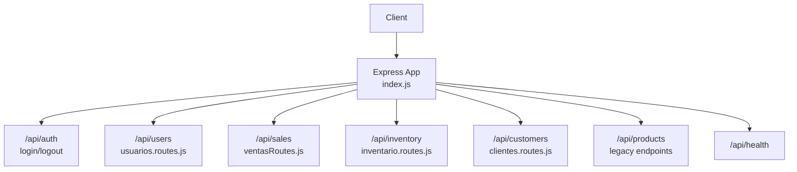
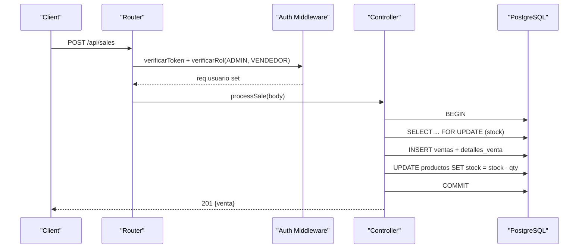
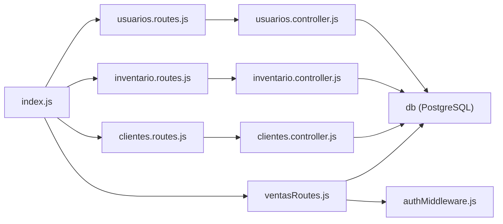

# Backend API Reference

<cite>
**Referenced Files in This Document**
- [index.js](file://backend/index.js)
- [package.json](file://backend/package.json)
- [authMiddleware.js](file://backend/middleware/authMiddleware.js)
- [jwt.js](file://backend/src/config/jwt.js)
- [usuarios.routes.js](file://backend/src/routes/usuarios.routes.js)
- [inventario.routes.js](file://backend/src/routes/inventario.routes.js)
- [clientes.routes.js](file://backend/src/routes/clientes.routes.js)
- [ventasRoutes.js](file://backend/routes/ventasRoutes.js)
- [usuarios.controller.js](file://backend/src/controllers/usuarios.controller.js)
- [inventario.controller.js](file://backend/src/controllers/inventario.controller.js)
- [clientes.controller.js](file://backend/src/controllers/clientes.controller.js)
- [001_base.sql](file://backend/db/migrations/001_base.sql)
- [002_seguridad.sql](file://backend/db/migrations/002_seguridad.sql)
</cite>

## Table of Contents
1. [Introduction](#introduction)
2. [Project Structure](#project-structure)
3. [Core Components](#core-components)
4. [Architecture Overview](#architecture-overview)
5. [Detailed Component Analysis](#detailed-component-analysis)
6. [Dependency Analysis](#dependency-analysis)
7. [Performance Considerations](#performance-considerations)
8. [Troubleshooting Guide](#troubleshooting-guide)
9. [Conclusion](#conclusion)

## Introduction
This document provides a comprehensive API reference for SIMO’s backend RESTful endpoints. It covers authentication, user management, inventory operations, sales processing, and customer management APIs. For each endpoint, you will find HTTP methods, URL patterns, request/response schemas, parameter specifications, status codes, error formats, rate limiting behavior, pagination, filtering, search capabilities, security considerations, input validation rules, and performance guidance.

The backend is an Express 5 application with PostgreSQL, JWT-based authentication, role-based access control (RBAC), global XSS sanitization, Helmet headers, CORS, and per-route authorization. Rate limiting is applied globally to the /api namespace.

## Project Structure
The backend exposes several top-level route groups:
- Authentication: /api/auth
- Users: /api/users
- Sales: /api/sales
- Inventory: /api/inventory
- Customers: /api/customers
- Health check: /api/health
- Legacy product catalog endpoints: /api/products (still present in the root router)

**Diagram sources**
- [index.js:17-56](file://backend/index.js#L17-L56)

**Section sources**
- [index.js:17-56](file://backend/index.js#L17-L56)
- [package.json:1-38](file://backend/package.json#L1-L38)

## Core Components
- Authentication and Authorization
  - JWT configuration and signing/verification
  - Token blacklist for logout
  - Role-based access control (RBAC)
- Route Modules
  - Users: create, list, get by id, update, toggle status
  - Inventory: warehouse entries, purchase creation and retrieval
  - Customers: CRUD and history
  - Sales: transactional sale processing and daily summary
- Security Middleware
  - Helmet, CORS, JSON parsing, XSS sanitization, rate limiting

Key implementation references:
- JWT config and expiration: [jwt.js](file://backend/src/config/jwt.js)
- Auth middleware and RBAC: [authMiddleware.js](file://backend/middleware/authMiddleware.js)
- Global app setup and routes mounting: [index.js](file://backend/index.js)

**Section sources**
- [jwt.js:1-16](file://backend/src/config/jwt.js#L1-L16)
- [authMiddleware.js:1-81](file://backend/middleware/authMiddleware.js#L1-L81)
- [index.js:20-56](file://backend/index.js#L20-L56)

## Architecture Overview
The API follows a layered structure:
- Routes define URL patterns and apply auth/RBAC guards
- Controllers validate inputs, enforce business rules, and call repositories
- Repositories interact with PostgreSQL
- Transactions ensure data integrity for critical operations (e.g., sales)

**Diagram sources**
- [ventasRoutes.js:10-111](file://backend/routes/ventasRoutes.js#L10-L111)
- [authMiddleware.js:9-50](file://backend/middleware/authMiddleware.js#L9-L50)

## Detailed Component Analysis

### Authentication Endpoints

#### POST /api/auth/login
- Purpose: Authenticate a user and return a JWT token.
- Authentication: None
- Request body fields:
  - email or correo (string, required)
  - password (string, required)
- Response 200:
  - message: string
  - token: string (JWT)
  - user: object with id, email, nombre_completo, rol
- Error responses:
  - 400 Bad Request: missing credentials
  - 401 Unauthorized: invalid credentials
  - 403 Forbidden: account inactive
  - 500 Internal Server Error: unexpected error

Example curl:
- curl -X POST http://localhost:3001/api/auth/login -H "Content-Type: application/json" -d '{"email":"user@example.com","password":"yourpassword"}'

**Section sources**
- [index.js:345-423](file://backend/index.js#L345-L423)
- [jwt.js:11-15](file://backend/src/config/jwt.js#L11-L15)

#### POST /api/auth/logout
- Purpose: Invalidate the current session by blacklisting the token.
- Authentication: Bearer token required
- Headers:
  - Authorization: Bearer <token>
- Response 200:
  - message: string confirming logout
- Error responses:
  - 400 Bad Request: missing or malformed token
  - 500 Internal Server Error: unexpected error

Example curl:
- curl -X POST http://localhost:3001/api/auth/logout -H "Authorization: Bearer YOUR_TOKEN"

**Section sources**
- [index.js:425-469](file://backend/index.js#L425-L469)

### User Management API (/api/users)

Access control:
- Most endpoints require ADMIN role; some allow GERENTE for read operations.
- All protected endpoints require a valid Bearer token.

#### POST /api/users
- Purpose: Create a new user.
- Authentication: Bearer token + ADMIN role
- Request body fields:
  - id_rol (integer, required)
  - nombre_completo (string, required)
  - correo (string, required, normalized to lowercase)
  - usuario (string, required)
  - password (string, required, min length 8)
- Response 201:
  - message: string
  - usuario: object
- Error responses:
  - 400 Bad Request: validation errors
  - 409 Conflict: duplicate correo or usuario
  - 500 Internal Server Error

Example curl:
- curl -X POST http://localhost:3001/api/users -H "Authorization: Bearer YOUR_TOKEN" -H "Content-Type: application/json" -d '{"id_rol":1,"nombre_completo":"Admin User","correo":"admin@example.com","usuario":"admin","password":"securepass123"}'

**Section sources**
- [usuarios.routes.js:9](file://backend/src/routes/usuarios.routes.js#L9)
- [usuarios.controller.js:29-84](file://backend/src/controllers/usuarios.controller.js#L29-L84)

#### GET /api/users
- Purpose: List users with pagination and filters.
- Authentication: Bearer token + ADMIN or GERENTE role
- Query parameters:
  - page (integer > 0, default 1)
  - limit (integer 1..100, default 10)
  - estado (true|false)
  - id_rol (positive integer)
  - rol (role code: ADMIN, GERENTE, INVENTARIO, VENDEDOR)
  - q (text up to 100 chars)
- Response 200:
  - data: array of users
  - pagination: { page, limit, total, totalPages }
- Error responses:
  - 400 Bad Request: invalid query params
  - 500 Internal Server Error

Example curl:
- curl -G "http://localhost:3001/api/users?page=1&limit=10&q=admin" -H "Authorization: Bearer YOUR_TOKEN"

**Section sources**
- [usuarios.routes.js:10](file://backend/src/routes/usuarios.routes.js#L10)
- [usuarios.controller.js:90-143](file://backend/src/controllers/usuarios.controller.js#L90-L143)

#### GET /api/users/:id
- Purpose: Get a single user by ID.
- Authentication: Bearer token + ADMIN or GERENTE role
- Path parameter:
  - id (positive integer)
- Response 200:
  - usuario: object
- Error responses:
  - 400 Bad Request: invalid id
  - 404 Not Found
  - 500 Internal Server Error

Example curl:
- curl http://localhost:3001/api/users/1 -H "Authorization: Bearer YOUR_TOKEN"

**Section sources**
- [usuarios.routes.js:11](file://backend/src/routes/usuarios.routes.js#L11)
- [usuarios.controller.js:148-164](file://backend/src/controllers/usuarios.controller.js#L148-L164)

#### PUT /api/users/:id
- Purpose: Update user attributes (id_rol, nombre_completo, correo, usuario). Password and estado are not updated here.
- Authentication: Bearer token + ADMIN role
- Path parameter:
  - id (positive integer)
- Request body fields (at least one):
  - id_rol (positive integer)
  - nombre_completo (string, max 150)
  - correo (string, valid email format)
  - usuario (string, max 50)
- Response 200:
  - message: string
  - usuario: object
- Error responses:
  - 400 Bad Request: validation errors
  - 404 Not Found
  - 409 Conflict: duplicate correo/usuario or last admin constraint
  - 500 Internal Server Error

Example curl:
- curl -X PUT http://localhost:3001/api/users/1 -H "Authorization: Bearer YOUR_TOKEN" -H "Content-Type: application/json" -d '{"correo":"new@example.com"}'

**Section sources**
- [usuarios.routes.js:12](file://backend/src/routes/usuarios.routes.js#L12)
- [usuarios.controller.js:172-255](file://backend/src/controllers/usuarios.controller.js#L172-L255)

#### PATCH /api/users/:id/status or /api/users/:id/estado
- Purpose: Toggle user active/inactive state.
- Authentication: Bearer token + ADMIN role
- Path parameter:
  - id (positive integer)
- Request body:
  - estado (boolean, required)
- Response 200:
  - message: string
  - usuario: object
- Error responses:
  - 400 Bad Request: invalid state
  - 404 Not Found
  - 409 Conflict: cannot deactivate last active admin
  - 500 Internal Server Error

Example curl:
- curl -X PATCH http://localhost:3001/api/users/1/status -H "Authorization: Bearer YOUR_TOKEN" -H "Content-Type: application/json" -d '{"estado":false}'

**Section sources**
- [usuarios.routes.js:14-15](file://backend/src/routes/usuarios.routes.js#L14-L15)
- [usuarios.controller.js:263-292](file://backend/src/controllers/usuarios.controller.js#L263-L292)

### Inventory API (/api/inventory)

Access control:
- Warehouse entries and purchases require INVENTARIO or ADMIN roles.
- Purchase retrieval allows INVENTARIO, ADMIN, or GERENTE roles.

#### POST /api/inventory/entries
- Purpose: Record a warehouse entry (ingreso a bodega).
- Authentication: Bearer token + INVENTARIO or ADMIN role
- Request body fields:
  - id_producto (positive integer) OR sku (string)
  - cantidad (number, positive, up to 3 decimals, max 9 digits)
  - costo_unitario (optional number, non-negative, up to 2 decimals)
  - id_proveedor (optional positive integer)
  - documento_referencia (optional string, max 100)
  - observacion (optional string, max 500)
- Response 201:
  - message: string
  - movimiento: object
  - producto: object
- Error responses:
  - 400 Bad Request: validation/business rule violations
  - 404 Not Found: SKU/product not found
  - 500 Internal Server Error

Example curl:
- curl -X POST http://localhost:3001/api/inventory/entries -H "Authorization: Bearer YOUR_TOKEN" -H "Content-Type: application/json" -d '{"sku":"SKU-001","cantidad":10,"costo_unitario":5.50}'

**Section sources**
- [inventario.routes.js:10](file://backend/src/routes/inventario.routes.js#L10)
- [inventario.controller.js:48-147](file://backend/src/controllers/inventario.controller.js#L48-L147)

#### POST /api/inventory/purchases
- Purpose: Create a purchase order with multiple lines; optionally confirm immediately.
- Authentication: Bearer token + INVENTARIO or ADMIN role
- Request body fields:
  - id_proveedor (optional positive integer)
  - documento_referencia (optional string, max 100)
  - observacion (optional string, max 500)
  - lineas (array of 1..100 items):
    - id_producto (positive integer) OR sku (string)
    - cantidad (number, positive, up to 3 decimals)
    - costo_unitario (optional number, non-negative, up to 2 decimals)
  - confirmar (boolean, default true)
- Response 201:
  - message: string indicating draft or confirmed
  - compra: object
- Error responses:
  - 400 Bad Request: validation/business rule violations
  - 404 Not Found: product/SKU not found
  - 409 Conflict: duplicate product in lines
  - 500 Internal Server Error

Example curl:
- curl -X POST http://localhost:3001/api/inventory/purchases -H "Authorization: Bearer YOUR_TOKEN" -H "Content-Type: application/json" -d '{"lineas":[{"sku":"SKU-001","cantidad":5},{"id_producto":2,"cantidad":3,"costo_unitario":12.00}]}'

**Section sources**
- [inventario.routes.js:13](file://backend/src/routes/inventario.routes.js#L13)
- [inventario.controller.js:163-247](file://backend/src/controllers/inventario.controller.js#L163-L247)

#### GET /api/inventory/purchases/:id
- Purpose: Retrieve a purchase by ID.
- Authentication: Bearer token + INVENTARIO, ADMIN, or GERENTE role
- Path parameter:
  - id (positive integer)
- Response 200:
  - compra: object
- Error responses:
  - 400 Bad Request: invalid id
  - 404 Not Found
  - 500 Internal Server Error

Example curl:
- curl http://localhost:3001/api/inventory/purchases/1 -H "Authorization: Bearer YOUR_TOKEN"

**Section sources**
- [inventario.routes.js:14](file://backend/src/routes/inventario.routes.js#L14)
- [inventario.controller.js:252-266](file://backend/src/controllers/inventario.controller.js#L252-L266)

### Sales API (/api/sales)

Access control:
- Sale processing requires ADMIN or VENDEDOR roles.
- Daily summary requires ADMIN or GERENTE roles.

#### POST /api/sales
- Purpose: Process a sale transactionally, validating live stock and updating inventory.
- Authentication: Bearer token + ADMIN or VENDEDOR role
- Request body:
  - productos (array of objects):
    - id_producto (integer, required)
    - cantidad (integer, required)
- Response 201:
  - message: string
  - venta: object with id_venta, subtotal, impuestos, total, detalles[]
- Error responses:
  - 400 Bad Request: missing products, insufficient stock, product not found
  - 500 Internal Server Error

Example curl:
- curl -X POST http://localhost:3001/api/sales -H "Authorization: Bearer YOUR_TOKEN" -H "Content-Type: application/json" -d '{"productos":[{"id_producto":1,"cantidad":2}]}'

**Section sources**
- [ventasRoutes.js:10-111](file://backend/routes/ventasRoutes.js#L10-L111)

#### GET /api/sales/daily-summary
- Purpose: Generate a daily cash summary grouped by payment method.
- Authentication: Bearer token + ADMIN or GERENTE role
- Response 200:
  - mensaje: string
  - fecha: string (YYYY-MM-DD)
  - resumen: array of {metodo_pago, cantidad_transacciones, total_ingresos}
  - gran_total: number
- Error responses:
  - 500 Internal Server Error

Example curl:
- curl http://localhost:3001/api/sales/daily-summary -H "Authorization: Bearer YOUR_TOKEN"

**Section sources**
- [ventasRoutes.js:113-147](file://backend/routes/ventasRoutes.js#L113-L147)

### Customer Management API (/api/customers)

Access control:
- All endpoints require a valid Bearer token and one of: VENDEDOR, GERENTE, ADMIN.

#### POST /api/customers
- Purpose: Register a new customer.
- Authentication: Bearer token + VENDEDOR, GERENTE, or ADMIN role
- Request body fields:
  - identificacion (string, required, normalized)
  - tipo_identificacion (string, optional, defaults to CC; allowed values: CC, CE, NIT, TI, PAS)
  - nombre (string, required, max 150)
  - telefono (optional string, 7..30 chars, digits and symbols)
  - correo (optional string, valid email, max 150)
  - direccion (optional string, max 200)
- Response 201:
  - message: string
  - cliente: object
- Error responses:
  - 400 Bad Request: validation errors
  - 409 Conflict: duplicate identity document
  - 500 Internal Server Error

Example curl:
- curl -X POST http://localhost:3001/api/customers -H "Authorization: Bearer YOUR_TOKEN" -H "Content-Type: application/json" -d '{"identificacion":"12345678","tipo_identificacion":"CC","nombre":"John Doe","telefono":"+57 300 123 4567","correo":"john@example.com","direccion":"Main St #123"}'

**Section sources**
- [clientes.routes.js:18](file://backend/src/routes/clientes.routes.js#L18)
- [clientes.controller.js:73-122](file://backend/src/controllers/clientes.controller.js#L73-L122)

#### GET /api/customers
- Purpose: List customers with pagination and filters.
- Authentication: Bearer token + VENDEDOR, GERENTE, or ADMIN role
- Query parameters:
  - page (integer > 0, default 1)
  - limit (integer 1..100, default 10)
  - estado (true|false)
  - q (text up to 100 chars; searches name and optionally document if numeric-like)
- Response 200:
  - data: array of customers
  - pagination: { page, limit, total, totalPages }
- Error responses:
  - 400 Bad Request: invalid query params
  - 500 Internal Server Error

Example curl:
- curl -G "http://localhost:3001/api/customers?q=john&page=1&limit=10" -H "Authorization: Bearer YOUR_TOKEN"

**Section sources**
- [clientes.routes.js:19](file://backend/src/routes/clientes.routes.js#L19)
- [clientes.controller.js:127-168](file://backend/src/controllers/clientes.controller.js#L127-L168)

#### GET /api/customers/document/:documento
- Purpose: Fetch a customer by normalized identity document.
- Authentication: Bearer token + VENDEDOR, GERENTE, or ADMIN role
- Path parameter:
  - documento (string, normalized, 3..30 chars, alphanumeric plus hyphen)
- Response 200:
  - cliente: object
- Error responses:
  - 400 Bad Request: invalid document format
  - 404 Not Found
  - 500 Internal Server Error

Example curl:
- curl http://localhost:3001/api/customers/document/12345678 -H "Authorization: Bearer YOUR_TOKEN"

**Section sources**
- [clientes.routes.js:21](file://backend/src/routes/clientes.routes.js#L21)
- [clientes.controller.js:173-188](file://backend/src/controllers/clientes.controller.js#L173-L188)

#### GET /api/customers/:id
- Purpose: Fetch a customer by ID.
- Authentication: Bearer token + VENDEDOR, GERENTE, or ADMIN role
- Path parameter:
  - id (positive integer)
- Response 200:
  - cliente: object
- Error responses:
  - 400 Bad Request: invalid id
  - 404 Not Found
  - 500 Internal Server Error

Example curl:
- curl http://localhost:3001/api/customers/1 -H "Authorization: Bearer YOUR_TOKEN"

**Section sources**
- [clientes.routes.js:22](file://backend/src/routes/clientes.routes.js#L22)
- [clientes.controller.js:193-207](file://backend/src/controllers/clientes.controller.js#L193-L207)

#### PUT /api/customers/:id
- Purpose: Update customer details (document is immutable).
- Authentication: Bearer token + VENDEDOR, GERENTE, or ADMIN role
- Path parameter:
  - id (positive integer)
- Request body fields (at least one):
  - nombre (string, max 150)
  - telefono (optional string, 7..30 chars)
  - correo (optional string, valid email, max 150)
  - direccion (optional string, max 200)
  - estado (boolean)
- Response 200:
  - message: string
  - cliente: object
- Error responses:
  - 400 Bad Request: validation errors or attempting to change document
  - 404 Not Found
  - 500 Internal Server Error

Example curl:
- curl -X PUT http://localhost:3001/api/customers/1 -H "Authorization: Bearer YOUR_TOKEN" -H "Content-Type: application/json" -d '{"correo":"john.new@example.com"}'

**Section sources**
- [clientes.routes.js:23](file://backend/src/routes/clientes.routes.js#L23)
- [clientes.controller.js:213-247](file://backend/src/controllers/clientes.controller.js#L213-L247)

#### GET /api/customers/:id/history
- Purpose: Retrieve recent transactions for a customer.
- Authentication: Bearer token + VENDEDOR, GERENTE, or ADMIN role
- Path parameter:
  - id (positive integer)
- Query parameters:
  - limit (integer 1..100, default 20)
- Response 200:
  - cliente: object
  - historial: object/array depending on repository response
- Error responses:
  - 400 Bad Request: invalid id or limit
  - 404 Not Found
  - 500 Internal Server Error

Example curl:
- curl "http://localhost:3001/api/customers/1/history?limit=10" -H "Authorization: Bearer YOUR_TOKEN"

**Section sources**
- [clientes.routes.js:24](file://backend/src/routes/clientes.routes.js#L24)
- [clientes.controller.js:252-273](file://backend/src/controllers/clientes.controller.js#L252-L273)

### Health Check

#### GET /api/health
- Purpose: Service health check including database connectivity.
- Authentication: None
- Response 200:
  - status: "ok"
  - database: "ok"
- Response 503:
  - status: "error"
  - database: "unavailable"

Example curl:
- curl http://localhost:3001/api/health

**Section sources**
- [index.js:62-70](file://backend/index.js#L62-L70)

## Dependency Analysis
- Application bootstrap and route mounting:
  - index.js wires Express, security middleware, and mounts route modules under /api/* namespaces.
- Authentication and RBAC:
  - jwt.js centralizes secret and expiration.
  - authMiddleware.js verifies tokens, checks blacklist, validates user status, and enforces roles.
- Route modules:
  - usuarios.routes.js, inventario.routes.js, clientes.routes.js define endpoints and attach auth/RBAC guards.
  - ventasRoutes.js implements transactional sale logic directly in the router.
- Database migrations:
  - 001_base.sql defines shared functions and triggers.
  - 002_seguridad.sql defines roles, usuarios, empresa tables and constraints.

**Diagram sources**
- [index.js:53-56](file://backend/index.js#L53-L56)
- [usuarios.routes.js:1-17](file://backend/src/routes/usuarios.routes.js#L1-L17)
- [inventario.routes.js:1-17](file://backend/src/routes/inventario.routes.js#L1-L17)
- [clientes.routes.js:1-27](file://backend/src/routes/clientes.routes.js#L1-L27)
- [ventasRoutes.js:1-149](file://backend/routes/ventasRoutes.js#L1-L149)

**Section sources**
- [index.js:53-56](file://backend/index.js#L53-L56)
- [001_base.sql:1-60](file://backend/db/migrations/001_base.sql#L1-L60)
- [002_seguridad.sql:1-91](file://backend/db/migrations/002_seguridad.sql#L1-L91)

## Performance Considerations
- Pagination
  - Users and customers support page and limit parameters with sensible defaults and maximum limits to prevent large payloads.
- Filtering and Search
  - Users: filter by estado, id_rol, rol code, and free-text q.
  - Customers: filter by estado and q (name and optional document normalization).
- Transaction Safety
  - Sales use explicit transactions with row-level locking (FOR UPDATE) to avoid race conditions when selling the same product concurrently.
- Rate Limiting
  - Global rate limiter applies to all /api routes: default 100 requests per minute per IP, configurable via RATE_LIMIT_MAX.
- Security Headers and Input Sanitization
  - Helmet sets secure HTTP headers.
  - Global XSS sanitization middleware runs before route handlers.
- Database Timezone
  - Database timezone is set to America/Bogota for consistent timestamps across sales, kardex, and audit data.

[No sources needed since this section provides general guidance]

## Troubleshooting Guide
Common issues and resolutions:
- Authentication failures
  - Missing or malformed Authorization header: ensure Bearer token format.
  - Expired or revoked token: re-authenticate; verify logout blacklist behavior.
  - Inactive account: contact administrator to reactivate.
- Validation errors
  - Many endpoints return 400 with detailed messages for invalid parameters (e.g., negative quantities, invalid emails, out-of-range limits).
- Business rule conflicts
  - Duplicate identities (users, customers) return 409 Conflict.
  - Last admin constraints prevent deactivating the final active admin.
- Inventory and sales
  - Insufficient stock returns 400 during sale processing.
  - Product not found returns 404 in various endpoints.
- Rate limiting
  - Exceeding 100 requests per minute returns a standard rate-limit error; adjust client retry/backoff strategies.

Operational tips:
- Use the health endpoint to verify service and database availability.
- Log correlation: include request IDs in clients to aid server-side debugging.
- Prefer batched updates where possible to reduce round-trips.

**Section sources**
- [authMiddleware.js:9-50](file://backend/middleware/authMiddleware.js#L9-L50)
- [index.js:35-48](file://backend/index.js#L35-L48)
- [ventasRoutes.js:101-111](file://backend/routes/ventasRoutes.js#L101-L111)

## Conclusion
SIMO’s backend provides a secure, well-structured REST API covering user management, inventory operations, sales processing, and customer management. Authentication and RBAC protect sensitive endpoints, while robust input validation and clear error responses simplify integration. Consumers should implement pagination, filtering, and backoff strategies aligned with the documented parameters and rate limits. For high-throughput scenarios, consider batching requests and caching read-only data where appropriate.

[No sources needed since this section summarizes without analyzing specific files]