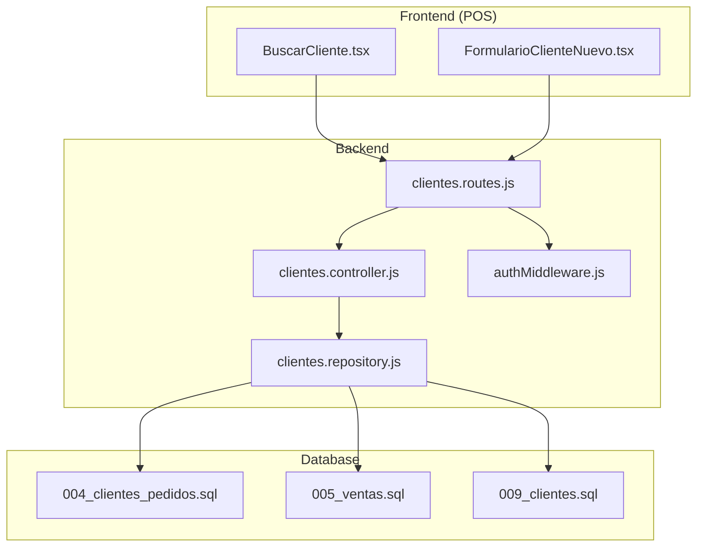
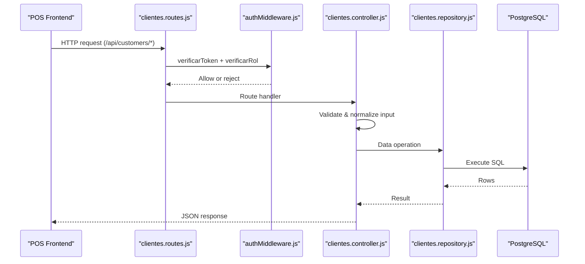
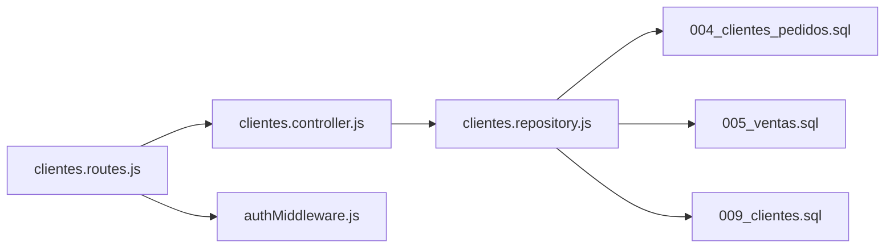

# Customer Management API

<cite>
**Referenced Files in This Document**
- [clientes.controller.js](file://backend/src/controllers/clientes.controller.js)
- [clientes.repository.js](file://backend/src/repositories/clientes.repository.js)
- [clientes.routes.js](file://backend/src/routes/clientes.routes.js)
- [authMiddleware.js](file://backend/middleware/authMiddleware.js)
- [004_clientes_pedidos.sql](file://backend/db/migrations/004_clientes_pedidos.sql)
- [005_ventas.sql](file://backend/db/migrations/005_ventas.sql)
- [009_clientes.sql](file://backend/db/migrations/009_clientes.sql)
- [BuscarCliente.tsx](file://simoapp/components/ventas/BuscarCliente.tsx)
- [FormularioClienteNuevo.tsx](file://simoapp/components/ventas/FormularioClienteNuevo.tsx)
</cite>

## Table of Contents
1. [Introduction](#introduction)
2. [Project Structure](#project-structure)
3. [Core Components](#core-components)
4. [Architecture Overview](#architecture-overview)
5. [Detailed Component Analysis](#detailed-component-analysis)
6. [Dependency Analysis](#dependency-analysis)
7. [Performance Considerations](#performance-considerations)
8. [Troubleshooting Guide](#troubleshooting-guide)
9. [Conclusion](#conclusion)
10. [Appendices](#appendices)

## Introduction
This document provides comprehensive API documentation for the customer management endpoints exposed by the backend. It covers:
- Customer registration, retrieval, search, filtering, and profile updates
- Purchase history tracking and integration with sales transactions
- Validation rules and error handling
- Data privacy considerations and protection measures

The API is designed to support point-of-sale workflows where cashiers can quickly find or register customers and view their purchase patterns.

## Project Structure
Customer management is implemented across controllers, repositories, routes, database migrations, and frontend components that consume the API.

**Diagram sources**
- [clientes.routes.js:1-27](file://backend/src/routes/clientes.routes.js#L1-L27)
- [clientes.controller.js:1-283](file://backend/src/controllers/clientes.controller.js#L1-L283)
- [clientes.repository.js:1-131](file://backend/src/repositories/clientes.repository.js#L1-L131)
- [authMiddleware.js:1-81](file://backend/middleware/authMiddleware.js#L1-L81)
- [004_clientes_pedidos.sql:1-192](file://backend/db/migrations/004_clientes_pedidos.sql#L1-L192)
- [005_ventas.sql:1-104](file://backend/db/migrations/005_ventas.sql#L1-L104)
- [009_clientes.sql:1-40](file://backend/db/migrations/009_clientes.sql#L1-L40)

**Section sources**
- [clientes.routes.js:1-27](file://backend/src/routes/clientes.routes.js#L1-L27)
- [clientes.controller.js:1-283](file://backend/src/controllers/clientes.controller.js#L1-L283)
- [clientes.repository.js:1-131](file://backend/src/repositories/clientes.repository.js#L1-L131)
- [authMiddleware.js:1-81](file://backend/middleware/authMiddleware.js#L1-L81)
- [004_clientes_pedidos.sql:1-192](file://backend/db/migrations/004_clientes_pedidos.sql#L1-L192)
- [005_ventas.sql:1-104](file://backend/db/migrations/005_ventas.sql#L1-L104)
- [009_clientes.sql:1-40](file://backend/db/migrations/009_clientes.sql#L1-L40)

## Core Components
- Routes: Define REST endpoints under /api/customers and apply authentication and role-based access control.
- Controller: Validates input, enforces business rules, and orchestrates repository calls.
- Repository: Encapsulates SQL queries for CRUD operations, search, and historical data aggregation.
- Database: Defines schema, constraints, indexes, and triggers ensuring data integrity and immutability of identity documents.

Key responsibilities:
- POST /api/customers: Register a new customer with validation and duplicate detection.
- GET /api/customers: Search and filter customers with pagination.
- GET /api/customers/document/:documento: Retrieve a customer by normalized identity document.
- GET /api/customers/:id: Retrieve a customer by ID.
- PUT /api/customers/:id: Update editable fields; identity document is immutable.
- GET /api/customers/:id/history: Retrieve purchase history and order summary.

**Section sources**
- [clientes.routes.js:18-24](file://backend/src/routes/clientes.routes.js#L18-L24)
- [clientes.controller.js:70-283](file://backend/src/controllers/clientes.controller.js#L70-L283)
- [clientes.repository.js:10-131](file://backend/src/repositories/clientes.repository.js#L10-L131)

## Architecture Overview
The customer management flow integrates authentication, validation, persistence, and reporting.

**Diagram sources**
- [clientes.routes.js:18-24](file://backend/src/routes/clientes.routes.js#L18-L24)
- [authMiddleware.js:9-75](file://backend/middleware/authMiddleware.js#L9-L75)
- [clientes.controller.js:70-283](file://backend/src/controllers/clientes.controller.js#L70-L283)
- [clientes.repository.js:10-131](file://backend/src/repositories/clientes.repository.js#L10-L131)

## Detailed Component Analysis

### Authentication and Authorization
- All customer endpoints require a valid JWT token and one of the roles: VENDEDOR, GERENTE, ADMIN.
- Token verification checks expiration, blacklist status, and user active state.
- Role middleware ensures only permitted roles can access endpoints.

Security implications:
- Prevents unauthorized access to customer data.
- Enforces least privilege by limiting operations to specific roles.

**Section sources**
- [clientes.routes.js:12-24](file://backend/src/routes/clientes.routes.js#L12-L24)
- [authMiddleware.js:9-75](file://backend/middleware/authMiddleware.js#L9-L75)

### Endpoints

#### POST /api/customers
Purpose: Register a new customer.

Request body:
- Required:
  - identificacion: string (normalized; digits, uppercase letters, hyphen; length 3–30)
  - tipo_identificacion: enum ["CC","CE","NIT","TI","PAS"]; defaults to "CC" if omitted
  - nombre: string (trimmed; max 150 characters)
- Optional:
  - telefono: string (digits, spaces, +, -, parentheses; length 7–30)
  - correo: string (email format; lowercase; max 150)
  - direccion: string (max 200)
- Not allowed:
  - estado field on creation (always active)

Validation rules:
- Identity document normalization removes dots/spaces and uppercases letters.
- Duplicate identity document returns 409 Conflict with existing customer data.
- Business rule: identity document cannot be changed after creation.

Response:
- 201 Created with message and created customer object
- 400 Bad Request for invalid inputs
- 409 Conflict for duplicate identity document
- 500 Internal Server Error for unexpected failures

Example usage:
- Register a new customer with CC type and minimal required fields.
- Attempting to register an already registered document returns the existing customer details.

**Section sources**
- [clientes.controller.js:70-122](file://backend/src/controllers/clientes.controller.js#L70-L122)
- [009_clientes.sql:19-34](file://backend/db/migrations/009_clientes.sql#L19-L34)

#### GET /api/customers
Purpose: List and search customers with optional filters and pagination.

Query parameters:
- q: string (max 100); supports partial name match and prefix match on identity document
- estado: boolean string ("true"|"false")
- page: positive integer (default 1)
- limit: positive integer between 1 and 100 (default 10)

Search behavior:
- If q contains only digits/letters/hyphen after normalization, it matches identity document prefix.
- Name matching is case-insensitive substring search.
- Results are ordered by name then id.

Response:
- 200 OK with data array and pagination metadata (page, limit, total, totalPages)
- 400 Bad Request for invalid parameters
- 500 Internal Server Error for unexpected failures

Example searches:
- By name: ?q=maria
- By document prefix: ?q=1090
- Active only: ?estado=true&page=1&limit=20

**Section sources**
- [clientes.controller.js:124-168](file://backend/src/controllers/clientes.controller.js#L124-L168)
- [clientes.repository.js:30-68](file://backend/src/repositories/clientes.repository.js#L30-L68)

#### GET /api/customers/document/:documento
Purpose: Retrieve a single customer by normalized identity document.

Path parameter:
- documento: string (normalized; digits, uppercase letters, hyphen; length 3–30)

Response:
- 200 OK with customer object
- 400 Bad Request for invalid document format
- 404 Not Found when no customer exists
- 500 Internal Server Error for unexpected failures

**Section sources**
- [clientes.controller.js:170-188](file://backend/src/controllers/clientes.controller.js#L170-L188)

#### GET /api/customers/:id
Purpose: Retrieve a single customer by numeric ID.

Path parameter:
- id: positive integer

Response:
- 200 OK with customer object
- 400 Bad Request for invalid id
- 404 Not Found when no customer exists
- 500 Internal Server Error for unexpected failures

**Section sources**
- [clientes.controller.js:190-207](file://backend/src/controllers/clientes.controller.js#L190-L207)

#### PUT /api/customers/:id
Purpose: Update editable fields of an existing customer.

Path parameter:
- id: positive integer

Request body:
- At least one of: nombre, telefono, correo, direccion, estado
- Identity document fields (identificacion, tipo_identificacion) are ignored for changes; attempting to change them returns 400 Bad Request.

Validation rules:
- Partial update supported; only provided fields are validated and updated.
- Must send at least one editable field.

Response:
- 200 OK with message and updated customer object
- 400 Bad Request for invalid inputs or attempted document change
- 404 Not Found when customer does not exist
- 500 Internal Server Error for unexpected failures

**Section sources**
- [clientes.controller.js:209-247](file://backend/src/controllers/clientes.controller.js#L209-L247)
- [009_clientes.sql:19-34](file://backend/db/migrations/009_clientes.sql#L19-L34)

#### GET /api/customers/:id/history
Purpose: Retrieve purchase history and order summary for a customer.

Path parameter:
- id: positive integer

Query parameters:
- limit: positive integer between 1 and 100 (default 20)

Response:
- 200 OK with:
  - cliente: customer object
  - resumen: aggregated metrics (completed purchases count, total spent, last purchase date, total orders, open orders)
  - compras: list of completed sales with payment method, totals, product counts
  - pedidos: list of orders with statuses, due dates, overdue flags, product counts
- 400 Bad Request for invalid parameters
- 404 Not Found when customer does not exist
- 500 Internal Server Error for unexpected failures

Integration with sales:
- Sales are joined with payment methods and include line item counts from sale details.
- Orders include overdue calculation based on agreed delivery date and non-delivered/cancelled states.

**Section sources**
- [clientes.controller.js:249-273](file://backend/src/controllers/clientes.controller.js#L249-L273)
- [clientes.repository.js:83-121](file://backend/src/repositories/clientes.repository.js#L83-L121)
- [004_clientes_pedidos.sql:42-117](file://backend/db/migrations/004_clientes_pedidos.sql#L42-L117)
- [005_ventas.sql:40-77](file://backend/db/migrations/005_ventas.sql#L40-L77)

### Data Models

#### Customer Registration Schema
Fields:
- tipo_identificacion: enum ["CC","CE","NIT","TI","PAS"]
- identificacion: string (normalized; unique; immutable)
- nombre: string (trimmed; max 150)
- telefono: string (optional; max 30)
- correo: string (optional; email format; lowercase; max 150)
- direccion: string (optional; max 200)
- estado: boolean (defaults true; not settable on creation)

Constraints:
- Unique identity document per system
- Immutability enforced by trigger on update attempts

**Section sources**
- [004_clientes_pedidos.sql:12-24](file://backend/db/migrations/004_clientes_pedidos.sql#L12-L24)
- [009_clientes.sql:19-34](file://backend/db/migrations/009_clientes.sql#L19-L34)

#### Profile Update Schema
Editable fields:
- nombre, telefono, correo, direccion, estado

Rules:
- Partial updates supported
- Identity document fields cannot be changed

**Section sources**
- [clientes.controller.js:209-247](file://backend/src/controllers/clientes.controller.js#L209-L247)
- [009_clientes.sql:19-34](file://backend/db/migrations/009_clientes.sql#L19-L34)

#### Historical Data Retrieval Schema
Response structure:
- cliente: customer object
- resumen:
  - compras_completadas: number
  - total_comprado: number
  - ultima_compra: timestamp
  - pedidos_totales: number
  - pedidos_abiertos: number
- compras: array of sales with fields including id_venta, fecha_venta, estado, subtotal, descuento, impuestos, total, metodo_pago, id_pedido, productos
- pedidos: array of orders with fields including id_pedido, fecha_solicitud, fecha_entrega_pactada, estado, total, vencido, productos

**Section sources**
- [clientes.repository.js:83-121](file://backend/src/repositories/clientes.repository.js#L83-L121)
- [004_clientes_pedidos.sql:42-117](file://backend/db/migrations/004_clientes_pedidos.sql#L42-L117)
- [005_ventas.sql:40-77](file://backend/db/migrations/005_ventas.sql#L40-L77)

### Validation Rules and Error Handling
Input validation:
- Positive integers for IDs and pagination parameters
- String length limits and regex patterns for phone, email, and identity document
- Enum validation for document types and status values

Error responses:
- 400 Bad Request for validation errors
- 404 Not Found for missing resources
- 409 Conflict for duplicate identity document
- 500 Internal Server Error for unexpected server-side issues

Business rule enforcement:
- Identity document immutability via database trigger
- State transitions for orders enforced by database functions and triggers

**Section sources**
- [clientes.controller.js:19-68](file://backend/src/controllers/clientes.controller.js#L19-L68)
- [clientes.controller.js:70-283](file://backend/src/controllers/clientes.controller.js#L70-L283)
- [004_clientes_pedidos.sql:114-189](file://backend/db/migrations/004_clientes_pedidos.sql#L114-L189)
- [009_clientes.sql:19-34](file://backend/db/migrations/009_clientes.sql#L19-L34)

### Integration with Sales Transactions
- Sales records link to customers optionally (counter sales may not have a customer).
- Order-to-sale linkage allows tracing sales back to delivered orders.
- Payment methods are informational and included in historical reports.

Data relationships:
- ventas.id_cliente references clientes.id_cliente
- ventas.id_pedido references pedidos.id_pedido
- detalles_ventas.id_venta references ventas.id_venta

**Section sources**
- [005_ventas.sql:40-77](file://backend/db/migrations/005_ventas.sql#L40-L77)
- [004_clientes_pedidos.sql:42-117](file://backend/db/migrations/004_clientes_pedidos.sql#L42-L117)

### Frontend Usage Patterns
- Predictive search component supports keyboard navigation and debounced requests.
- New customer form handles duplicate detection gracefully, allowing reuse of existing active customers.

Behavior highlights:
- Minimum two characters before triggering search
- Debounce typing to reduce API load
- Display recent customers when no query is present
- Offer to register a new customer when none found

**Section sources**
- [BuscarCliente.tsx:1-209](file://simoapp/components/ventas/BuscarCliente.tsx#L1-L209)
- [FormularioClienteNuevo.tsx:1-202](file://simoapp/components/ventas/FormularioClienteNuevo.tsx#L1-L202)

## Dependency Analysis
The following diagram shows how modules depend on each other:

**Diagram sources**
- [clientes.routes.js:1-27](file://backend/src/routes/clientes.routes.js#L1-L27)
- [clientes.controller.js:1-283](file://backend/src/controllers/clientes.controller.js#L1-L283)
- [clientes.repository.js:1-131](file://backend/src/repositories/clientes.repository.js#L1-L131)
- [authMiddleware.js:1-81](file://backend/middleware/authMiddleware.js#L1-L81)
- [004_clientes_pedidos.sql:1-192](file://backend/db/migrations/004_clientes_pedidos.sql#L1-L192)
- [005_ventas.sql:1-104](file://backend/db/migrations/005_ventas.sql#L1-L104)
- [009_clientes.sql:1-40](file://backend/db/migrations/009_clientes.sql#L1-L40)

**Section sources**
- [clientes.routes.js:1-27](file://backend/src/routes/clientes.routes.js#L1-L27)
- [clientes.controller.js:1-283](file://backend/src/controllers/clientes.controller.js#L1-L283)
- [clientes.repository.js:1-131](file://backend/src/repositories/clientes.repository.js#L1-L131)
- [authMiddleware.js:1-81](file://backend/middleware/authMiddleware.js#L1-L81)

## Performance Considerations
- Pagination: Use page and limit to avoid large result sets. Default limit is 10; maximum allowed is 100.
- Indexes:
  - idx_clientes_nombre optimizes name searches.
  - idx_clientes_identificacion_prefijo optimizes prefix searches on identity document.
  - idx_ventas_id_cliente and idx_ventas_fecha_completadas optimize sales queries.
- Query optimization:
  - Parallel execution of summary and detail queries for history endpoint.
  - Escaping special characters in LIKE patterns to prevent performance pitfalls.

Recommendations:
- Prefer searching by document prefix for faster autocomplete.
- Cache frequent lookups at the application layer if needed.
- Monitor slow queries on history endpoint for large customer bases.

[No sources needed since this section provides general guidance]

## Troubleshooting Guide
Common issues and resolutions:
- Duplicate identity document on registration:
  - Cause: Attempting to create a customer with an existing document.
  - Resolution: Use the returned existing customer or choose a different document.
- Invalid parameters:
  - Ensure page and limit are positive integers within allowed ranges.
  - Ensure estado is "true" or "false".
  - Ensure q is a string up to 100 characters.
- Unauthorized or forbidden:
  - Verify JWT token validity and role permissions.
- Not found:
  - Check customer id or document format.

Operational tips:
- Normalize identity documents consistently (remove dots/spaces, uppercase).
- Handle 409 Conflict responses in the UI to allow reusing existing customers.
- Log and monitor 500 errors for server-side exceptions.

**Section sources**
- [clientes.controller.js:70-283](file://backend/src/controllers/clientes.controller.js#L70-L283)
- [authMiddleware.js:9-75](file://backend/middleware/authMiddleware.js#L9-L75)

## Conclusion
The Customer Management API provides robust CRUD operations, advanced search and filtering, and detailed historical insights integrated with sales and orders. Strong validation, immutability guarantees, and role-based access ensure data integrity and security. The frontend components demonstrate practical usage patterns for POS workflows, emphasizing speed and usability.

[No sources needed since this section summarizes without analyzing specific files]

## Appendices

### API Reference Summary

| Endpoint | Method | Description | Key Parameters | Status Codes |
|---|---|---|---|---|
| /api/customers | POST | Register a new customer | Body: identificacion, tipo_identificacion, nombre, optional telefono, correo, direccion | 201, 400, 409, 500 |
| /api/customers | GET | List/search customers with filters | q, estado, page, limit | 200, 400, 500 |
| /api/customers/document/:documento | GET | Get customer by identity document | Path: documento | 200, 400, 404, 500 |
| /api/customers/:id | GET | Get customer by ID | Path: id | 200, 400, 404, 500 |
| /api/customers/:id | PUT | Update customer profile | Path: id; Body: nombre, telefono, correo, direccion, estado | 200, 400, 404, 500 |
| /api/customers/:id/history | GET | Get purchase history and order summary | Path: id; Query: limit | 200, 400, 404, 500 |

**Section sources**
- [clientes.routes.js:18-24](file://backend/src/routes/clientes.routes.js#L18-L24)
- [clientes.controller.js:70-283](file://backend/src/controllers/clientes.controller.js#L70-L283)

### Data Privacy and Protection Measures
- Authentication: JWT-based with blacklist and user active state checks.
- Authorization: Role-based access control restricts endpoints to authorized roles.
- Data integrity: Database constraints and triggers enforce immutability of identity documents and order state transitions.
- Input sanitization: Strict validation prevents injection and malformed data.
- Auditability: Order state changes are recorded with user context and timestamps.

Best practices:
- Always transmit requests over HTTPS.
- Store tokens securely in clients and rotate secrets regularly.
- Limit exposure of sensitive fields in logs and responses.
- Apply least privilege principles for roles.

**Section sources**
- [authMiddleware.js:9-75](file://backend/middleware/authMiddleware.js#L9-L75)
- [004_clientes_pedidos.sql:114-189](file://backend/db/migrations/004_clientes_pedidos.sql#L114-L189)
- [009_clientes.sql:19-34](file://backend/db/migrations/009_clientes.sql#L19-L34)