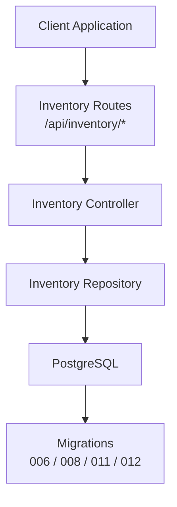
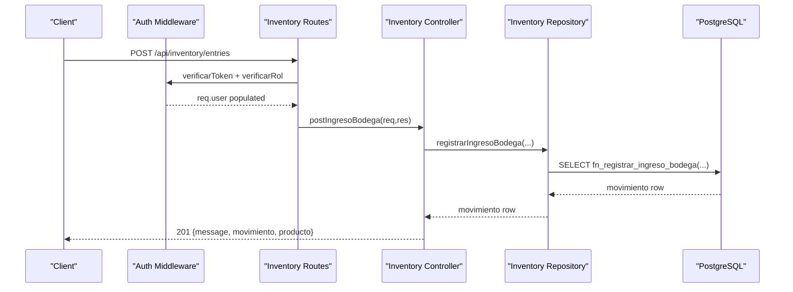
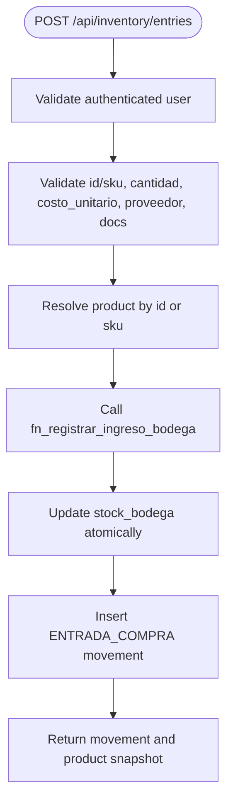
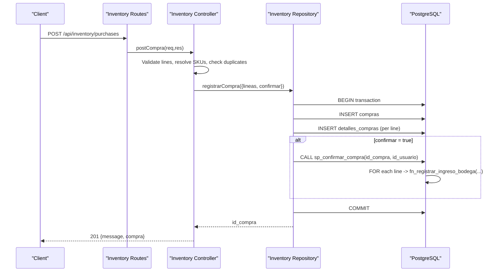
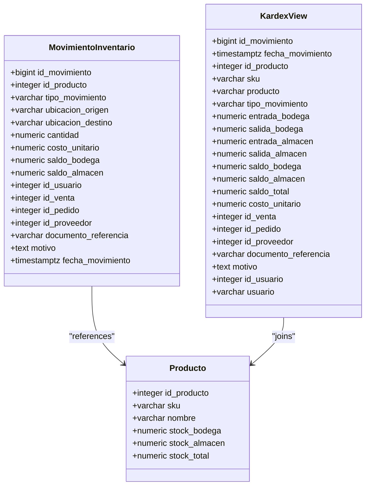
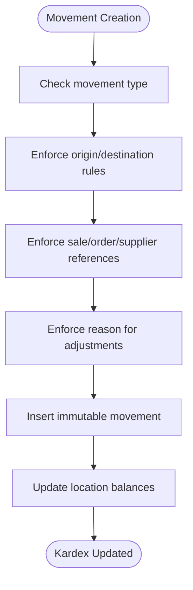
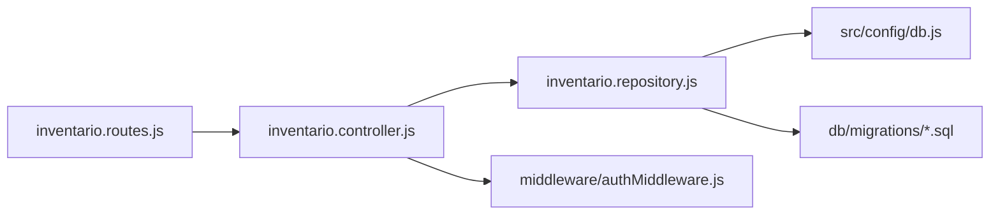

# Inventory Management API

<cite>
**Referenced Files in This Document**
- [inventario.controller.js](file://backend/src/controllers/inventario.controller.js)
- [inventario.routes.js](file://backend/src/routes/inventario.routes.js)
- [inventario.repository.js](file://backend/src/repositories/inventario.repository.js)
- [authMiddleware.js](file://backend/middleware/authMiddleware.js)
- [db.js](file://backend/src/config/db.js)
- [006_inventario.sql](file://backend/db/migrations/006_inventario.sql)
- [008_ingreso_bodega.sql](file://backend/db/migrations/008_ingreso_bodega.sql)
- [011_compras.sql](file://backend/db/migrations/011_compras.sql)
- [012_saldo_kardex.sql](file://backend/db/migrations/012_saldo_kardex.sql)
- [README.md](file://README.md)
- [inventario.test.js](file://backend/tests/integracion/inventario.test.js)
</cite>

## Table of Contents
1. [Introduction](#introduction)
2. [Project Structure](#project-structure)
3. [Core Components](#core-components)
4. [Architecture Overview](#architecture-overview)
5. [Detailed Component Analysis](#detailed-component-analysis)
6. [Dependency Analysis](#dependency-analysis)
7. [Performance Considerations](#performance-considerations)
8. [Troubleshooting Guide](#troubleshooting-guide)
9. [Conclusion](#conclusion)

## Introduction
This document provides comprehensive API documentation for the inventory management module. It covers product catalog operations, stock level management, dual-location tracking (warehouse and store), and inventory movement processing. The system supports:

- Product entry into warehouse stock with full auditability.
- Multi-line purchase registration with optional immediate confirmation.
- Dual-location stock tracking across warehouse and store locations.
- An immutable Kardex ledger for chronological inventory movements.
- Reconciliation and validation functions for stock consistency.

The backend is a Node.js Express service using PostgreSQL. Authentication and authorization are enforced through JWT middleware and role-based access control.

## Project Structure
The inventory module follows a layered structure:

- Routes define HTTP endpoints under `/api/inventory`.
- Controllers validate input, map business rules, and return standardized responses.
- Repositories encapsulate database interactions and call stored procedures/functions.
- Database migrations define tables, views, functions, and constraints that enforce business rules at the data layer.

**Diagram sources**
- [inventario.routes.js:1-17](file://backend/src/routes/inventario.routes.js#L1-L17)
- [inventario.controller.js:1-269](file://backend/src/controllers/inventario.controller.js#L1-L269)
- [inventario.repository.js:1-102](file://backend/src/repositories/inventario.repository.js#L1-L102)
- [006_inventario.sql:1-166](file://backend/db/migrations/006_inventario.sql#L1-L166)
- [008_ingreso_bodega.sql:1-91](file://backend/db/migrations/008_ingreso_bodega.sql#L1-L91)
- [011_compras.sql:1-261](file://backend/db/migrations/011_compras.sql#L1-L261)
- [012_saldo_kardex.sql:1-155](file://backend/db/migrations/012_saldo_kardex.sql#L1-L155)

**Section sources**
- [inventario.routes.js:1-17](file://backend/src/routes/inventario.routes.js#L1-L17)
- [inventario.controller.js:1-269](file://backend/src/controllers/inventario.controller.js#L1-L269)
- [inventario.repository.js:1-102](file://backend/src/repositories/inventario.repository.js#L1-L102)

## Core Components
This section documents the core API endpoints exposed by the inventory module.

### POST /api/inventory/entries
Registers an inbound purchase entry directly to warehouse stock. It validates user identity from the authenticated session, product identification via ID or SKU, quantity constraints, optional unit cost, optional supplier, reference document, and observation.

- Authorization: JWT required; roles `INVENTARIO` or `ADMIN`.
- Request body fields:
  - `id_producto` or `sku`: one must be provided.
  - `cantidad`: positive numeric; up to 3 decimals if allowed by unit type; maximum integer digits constrained.
  - `costo_unitario`: optional non-negative number with up to 2 decimals.
  - `id_proveedor`: optional positive integer.
  - `documento_referencia`: optional text up to 100 characters.
  - `observacion`: optional text up to 500 characters.
- Success response: 201 with movement details and updated product stock snapshot.
- Error responses:
  - 400: invalid parameters.
  - 401: unauthorized.
  - 404: product not found.
  - 409: inactive product.
  - 500: internal server error.

Example request payload:
- Provide either `id_producto` or `sku`, plus `cantidad`; optionally include supplier and reference document.

Example success response:
- Includes movement metadata and product stock totals after the operation.

**Section sources**
- [inventario.controller.js:43-147](file://backend/src/controllers/inventario.controller.js#L43-L147)
- [inventario.routes.js:9-10](file://backend/src/routes/inventario.routes.js#L9-L10)
- [README.md:170-203](file://README.md#L170-L203)

### POST /api/inventory/purchases
Registers a multi-line purchase order to a supplier. By default, it confirms the purchase immediately, applying all lines to warehouse stock atomically via a stored procedure. If confirmation is disabled, the purchase remains in draft state.

- Authorization: JWT required; roles `INVENTARIO` or `ADMIN`.
- Request body fields:
  - `id_proveedor`: optional positive integer.
  - `documento_referencia`: optional text up to 100 characters.
  - `observacion`: optional text up to 500 characters.
  - `lineas`: array of 1 to 100 line items. Each line requires either `id_producto` or `sku`, plus `cantidad`; optional `costo_unitario`.
  - `confirmar`: boolean; defaults to true.
- Validation rules:
  - Duplicate products per purchase are not allowed; aggregate quantities instead.
  - All referenced products must exist.
  - Quantity and cost validations mirror single-entry rules.
- Success response: 201 with purchase summary and lines.
- Error responses:
  - 400: invalid parameters or duplicate lines.
  - 401: unauthorized.
  - 404: product or purchase not found.
  - 409: conflict (e.g., already confirmed).
  - 500: internal server error.

Example request payload:
- Include multiple lines mixing SKUs and product IDs; optionally set unit costs.

Example success response:
- Returns purchase metadata and line-level details including current product stock snapshots.

**Section sources**
- [inventario.controller.js:149-247](file://backend/src/controllers/inventario.controller.js#L149-L247)
- [inventario.routes.js:12-14](file://backend/src/routes/inventario.routes.js#L12-L14)
- [README.md:205-214](file://README.md#L205-L214)

### GET /api/inventory/purchases/:id
Retrieves a purchase record by ID, including its lines and associated product stock snapshots.

- Authorization: JWT required; roles `INVENTARIO`, `ADMIN`, or `GERENTE`.
- Path parameter:
  - `id`: positive integer representing the purchase ID.
- Success response: 200 with purchase object and lines.
- Error responses:
  - 400: invalid ID format.
  - 404: purchase not found.
  - 500: internal server error.

**Section sources**
- [inventario.controller.js:249-266](file://backend/src/controllers/inventario.controller.js#L249-L266)
- [inventario.routes.js:14](file://backend/src/routes/inventario.routes.js#L14)

## Architecture Overview
The inventory API integrates authentication, route handling, controller logic, repository data access, and PostgreSQL business logic.

**Diagram sources**
- [inventario.routes.js:9-10](file://backend/src/routes/inventario.routes.js#L9-L10)
- [authMiddleware.js:9-49](file://backend/middleware/authMiddleware.js#L9-L49)
- [inventario.controller.js:48-147](file://backend/src/controllers/inventario.controller.js#L48-L147)
- [inventario.repository.js:12-27](file://backend/src/repositories/inventario.repository.js#L12-L27)
- [008_ingreso_bodega.sql:23-88](file://backend/db/migrations/008_ingreso_bodega.sql#L23-L88)

## Detailed Component Analysis

### Inventory Entry Workflow
The entry workflow ensures atomic updates to warehouse stock and creates an immutable movement record.

**Diagram sources**
- [inventario.controller.js:48-147](file://backend/src/controllers/inventario.controller.js#L48-L147)
- [inventario.repository.js:12-27](file://backend/src/repositories/inventario.repository.js#L12-L27)
- [008_ingreso_bodega.sql:23-88](file://backend/db/migrations/008_ingreso_bodega.sql#L23-L88)

**Section sources**
- [inventario.controller.js:48-147](file://backend/src/controllers/inventario.controller.js#L48-L147)
- [inventario.repository.js:12-27](file://backend/src/repositories/inventario.repository.js#L12-L27)
- [008_ingreso_bodega.sql:23-88](file://backend/db/migrations/008_ingreso_bodega.sql#L23-L88)

### Purchase Registration and Confirmation
Purchase registration supports drafting and immediate confirmation. Confirmation applies all lines to warehouse stock atomically.

**Diagram sources**
- [inventario.controller.js:163-247](file://backend/src/controllers/inventario.controller.js#L163-L247)
- [inventario.repository.js:32-62](file://backend/src/repositories/inventario.repository.js#L32-L62)
- [011_compras.sql:217-258](file://backend/db/migrations/011_compras.sql#L217-L258)

**Section sources**
- [inventario.controller.js:163-247](file://backend/src/controllers/inventario.controller.js#L163-L247)
- [inventario.repository.js:32-62](file://backend/src/repositories/inventario.repository.js#L32-L62)
- [011_compras.sql:217-258](file://backend/db/migrations/011_compras.sql#L217-L258)

### Dual-Location Tracking (Warehouse/Store)
The system tracks stock across two locations:

- Warehouse (`BODEGA`)
- Store (`ALMACEN`)

Movements specify origin and destination locations, enforcing business rules such as internal transfers from warehouse to store and sales/purchase exits.

Key aspects:
- Movement types include purchases, internal transfers, sales, orders, reversals, and adjustments.
- Each movement records resulting balances for both locations.
- The Kardex view aggregates chronological entries per product and location.

**Diagram sources**
- [006_inventario.sql:62-161](file://backend/db/migrations/006_inventario.sql#L62-L161)

**Section sources**
- [006_inventario.sql:62-161](file://backend/db/migrations/006_inventario.sql#L62-L161)

### Inventory Movement Processing
Inventory movements are immutable and auditable. The system enforces:

- Location constraints per movement type.
- Reference constraints linking movements to sales, orders, or suppliers.
- Mandatory reasons for manual adjustments.
- Indexing for performance on product/date and references.

**Diagram sources**
- [006_inventario.sql:62-120](file://backend/db/migrations/006_inventario.sql#L62-L120)

**Section sources**
- [006_inventario.sql:62-120](file://backend/db/migrations/006_inventario.sql#L62-L120)

### Low Stock Alerts
Low stock alerts can be derived from the Kardex view and product stock totals. While no dedicated alert endpoint exists in the current routes, clients can query the Kardex view and product stock to implement alerting logic.

Recommended approach:
- Query `v_kardex` filtered by product and date range.
- Compare `saldo_bodega` and `saldo_almacen` against configured thresholds.
- Trigger notifications when combined stock falls below thresholds.

**Section sources**
- [006_inventario.sql:136-161](file://backend/db/migrations/006_inventario.sql#L136-L161)

### Inventory Reconciliation
Reconciliation is supported by database functions that recalculate balances and compare them with stored stock values.

- `fn_kardex_producto(product_id, desde, hasta)`: recalculates balances chronologically and marks inconsistencies.
- `fn_validar_kardex(product_id?)`: audits one or all products, comparing recalculated balances with current stock and counting inconsistent movements.

Use cases:
- Periodic reconciliation jobs.
- Audit reports highlighting discrepancies.
- Automated correction workflows triggered by inconsistencies.

**Section sources**
- [012_saldo_kardex.sql:26-108](file://backend/db/migrations/012_saldo_kardex.sql#L26-L108)
- [012_saldo_kardex.sql:113-149](file://backend/db/migrations/012_saldo_kardex.sql#L113-L149)

### Batch Operations
Batch operations are supported through multi-line purchase registration. Clients can submit up to 100 lines per request, with validation ensuring uniqueness per product and correct quantity/cost formats.

Best practices:
- Aggregate quantities per product before sending.
- Use SKUs for bulk lookups to reduce client-side resolution overhead.
- Set `confirmar=false` to stage large batches, then confirm once validated.

**Section sources**
- [inventario.controller.js:180-215](file://backend/src/controllers/inventario.controller.js#L180-L215)
- [inventario.repository.js:32-62](file://backend/src/repositories/inventario.repository.js#L32-L62)

### Real-Time Stock Synchronization
Real-time synchronization relies on atomic operations and immutable movements:

- Single-entry purchases lock the product row during update to prevent race conditions.
- Purchases confirmation uses a stored procedure that processes lines in deterministic order.
- The Kardex view provides a consistent chronological record for downstream consumers.

Concurrency testing demonstrates that simultaneous entries do not lose units and produce monotonically increasing balances.

**Section sources**
- [008_ingreso_bodega.sql:53-70](file://backend/db/migrations/008_ingreso_bodega.sql#L53-L70)
- [011_compras.sql:233-245](file://backend/db/migrations/011_compras.sql#L233-L245)
- [inventario.test.js:186-199](file://backend/tests/integracion/inventario.test.js#L186-L199)

## Dependency Analysis
The inventory module depends on authentication middleware, database configuration, and PostgreSQL functions/procedures defined in migrations.

**Diagram sources**
- [inventario.routes.js:1-17](file://backend/src/routes/inventario.routes.js#L1-L17)
- [inventario.controller.js:1-269](file://backend/src/controllers/inventario.controller.js#L1-L269)
- [inventario.repository.js:1-102](file://backend/src/repositories/inventario.repository.js#L1-L102)
- [db.js:1-29](file://backend/src/config/db.js#L1-L29)
- [authMiddleware.js:1-81](file://backend/middleware/authMiddleware.js#L1-L81)
- [006_inventario.sql:1-166](file://backend/db/migrations/006_inventario.sql#L1-L166)
- [008_ingreso_bodega.sql:1-91](file://backend/db/migrations/008_ingreso_bodega.sql#L1-L91)
- [011_compras.sql:1-261](file://backend/db/migrations/011_compras.sql#L1-L261)
- [012_saldo_kardex.sql:1-155](file://backend/db/migrations/012_saldo_kardex.sql#L1-L155)

**Section sources**
- [inventario.routes.js:1-17](file://backend/src/routes/inventario.routes.js#L1-L17)
- [inventario.controller.js:1-269](file://backend/src/controllers/inventario.controller.js#L1-L269)
- [inventario.repository.js:1-102](file://backend/src/repositories/inventario.repository.js#L1-L102)
- [db.js:1-29](file://backend/src/config/db.js#L1-L29)
- [authMiddleware.js:1-81](file://backend/middleware/authMiddleware.js#L1-L81)

## Performance Considerations
Optimization techniques implemented in the inventory module:

- Atomic database functions and procedures minimize race conditions and ensure consistency.
- Deterministic ordering of purchase lines prevents deadlocks during concurrent confirmations.
- Indexes on key columns improve query performance for Kardex and movement lookups.
- Bulk purchase registration reduces round-trips and leverages server-side transactions.
- Immutable movements avoid expensive reconciliation by design, with optional audit functions for verification.

Recommendations:
- Use batched purchase requests to reduce network overhead.
- Leverage SKUs for efficient product resolution in bulk operations.
- Schedule periodic reconciliation using `fn_validar_kardex` to detect drift early.
- Monitor database locks and contention during high-concurrency scenarios.

[No sources needed since this section provides general guidance]

## Troubleshooting Guide
Common issues and resolutions:

- Unauthorized access: Ensure valid JWT token and appropriate roles (`INVENTARIO`, `ADMIN`, `GERENTE`).
- Invalid parameters: Validate numeric formats, decimal limits, and positive integers.
- Product not found: Verify product existence and active status.
- Conflict errors: Check for inactive products or already confirmed purchases.
- Internal server errors: Inspect server logs for stack traces and database errors.

Database-level error codes:
- SM001-SM007: Business rule violations in inventory entries.
- SM010-SM013: Business rule violations in purchase operations.

Reconciliation checks:
- Use `fn_validar_kardex` to identify inconsistent movements and balance mismatches.
- Investigate root causes such as manual data changes or failed partial operations.

**Section sources**
- [inventario.controller.js:14-23](file://backend/src/controllers/inventario.controller.js#L14-L23)
- [inventario.controller.js:235-246](file://backend/src/controllers/inventario.controller.js#L235-L246)
- [008_ingreso_bodega.sql:13-18](file://backend/db/migrations/008_ingreso_bodega.sql#L13-L18)
- [011_compras.sql:12-16](file://backend/db/migrations/011_compras.sql#L12-L16)
- [012_saldo_kardex.sql:113-149](file://backend/db/migrations/012_saldo_kardex.sql#L113-L149)

## Conclusion
The inventory management API provides robust support for product catalog operations, stock level management, dual-location tracking, and immutable movement processing. It emphasizes data integrity through atomic operations, business rule enforcement at the database layer, and comprehensive auditability via the Kardex ledger. Clients can leverage batch operations for efficiency and use reconciliation functions to maintain stock accuracy. Authentication and authorization ensure secure access controlled by roles.

[No sources needed since this section summarizes without analyzing specific files]