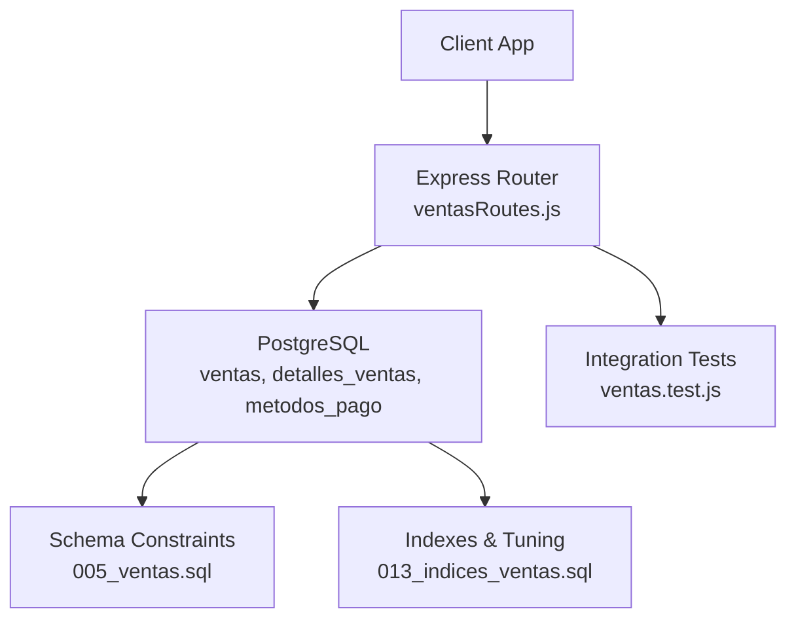
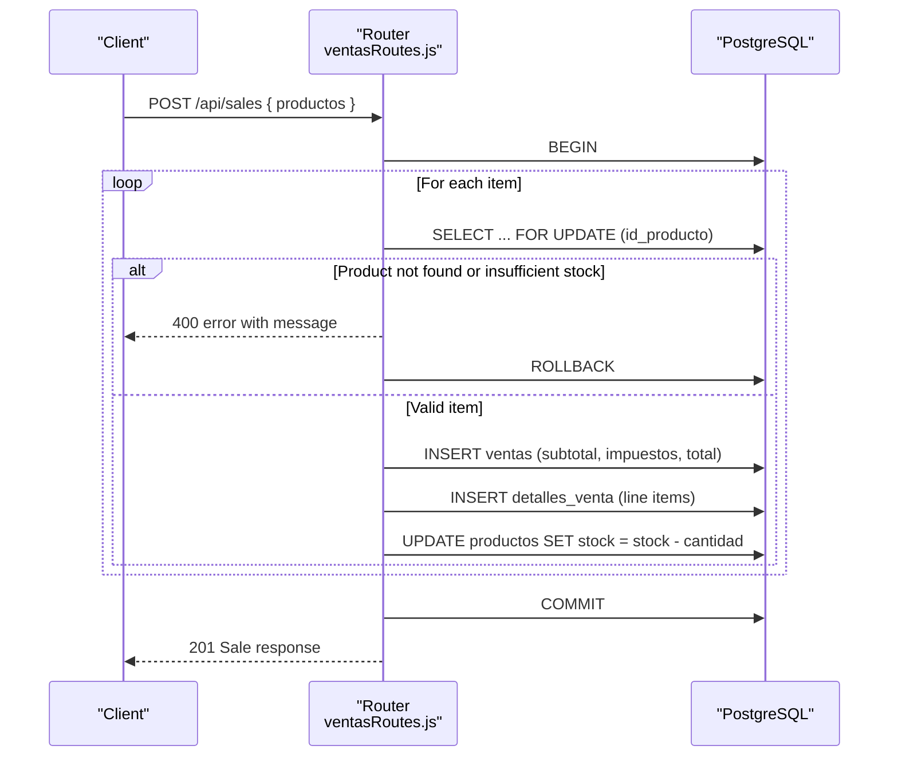
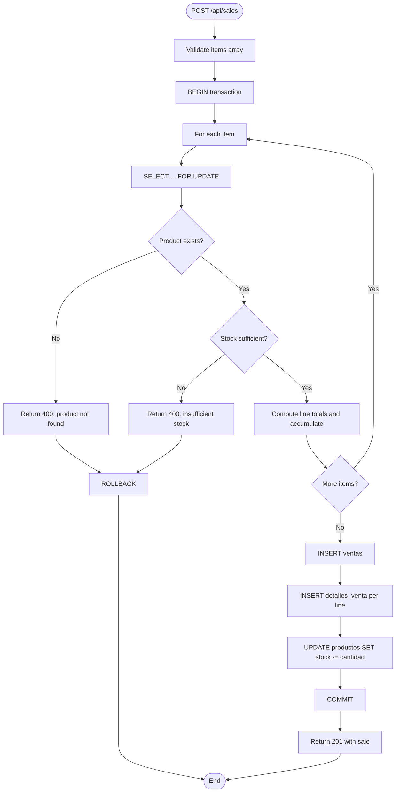
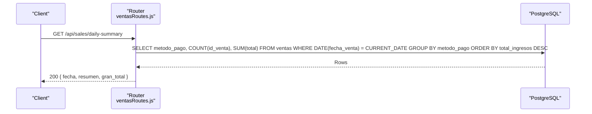
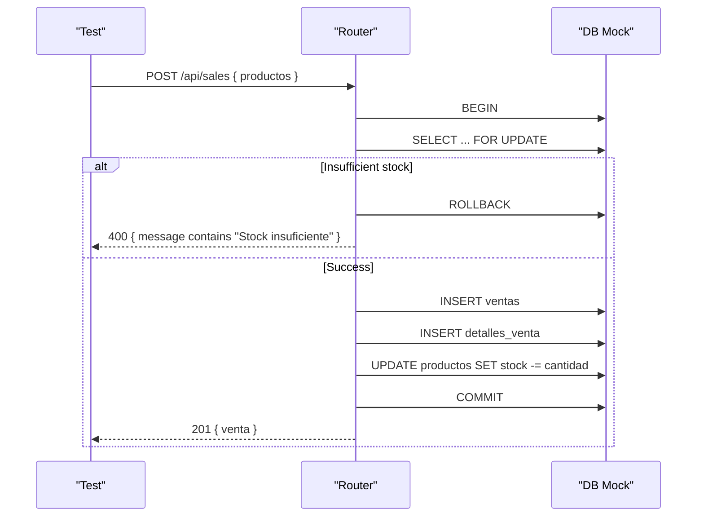
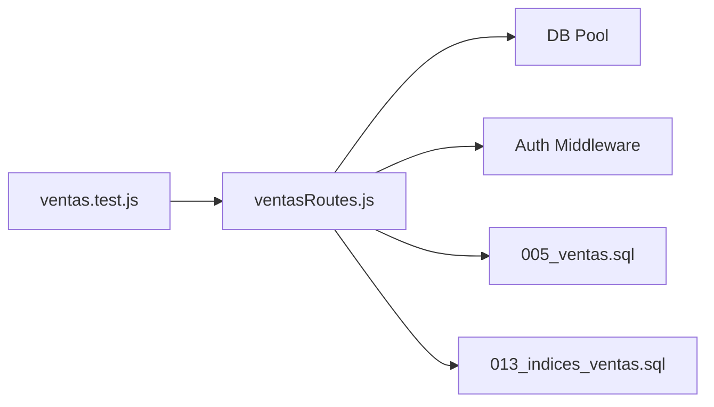

# Sales and POS API

<cite>
**Referenced Files in This Document**
- [ventasRoutes.js](file://backend/routes/ventasRoutes.js)
- [005_ventas.sql](file://backend/db/migrations/005_ventas.sql)
- [013_indices_ventas.sql](file://backend/db/migrations/013_indices_ventas.sql)
- [001_reglas_esquema.sql](file://backend/db/tests/001_reglas_esquema.sql)
- [ventas.test.js](file://backend/tests/ventas.test.js)
</cite>

## Table of Contents
1. [Introduction](#introduction)
2. [Project Structure](#project-structure)
3. [Core Components](#core-components)
4. [Architecture Overview](#architecture-overview)
5. [Detailed Component Analysis](#detailed-component-analysis)
6. [Dependency Analysis](#dependency-analysis)
7. [Performance Considerations](#performance-considerations)
8. [Troubleshooting Guide](#troubleshooting-guide)
9. [Conclusion](#conclusion)

## Introduction
This document describes the sales and point-of-sale (POS) API implemented in the backend. It covers:
- Sales processing workflow and transaction handling
- Payment method support and current limitations
- Sales ticket generation and data model
- Schemas for sale creation, item addition, discount application, and tax calculations
- Transaction rollback scenarios and concurrent sale handling
- Daily cash summary generation
- Error handling for insufficient stock, invalid products, and transaction failures

The implementation is a Node.js Express router with direct PostgreSQL operations and database constraints ensuring data integrity.

## Project Structure
The sales functionality is primarily implemented in:
- Backend routes: `backend/routes/ventasRoutes.js`
- Database schema and constraints: `backend/db/migrations/005_ventas.sql`
- Performance indexes and query optimizations: `backend/db/migrations/013_indices_ventas.sql`
- Schema validation tests: `backend/db/tests/001_reglas_esquema.sql`
- Integration tests for sales: `backend/tests/ventas.test.js`



**Diagram sources**
- [ventasRoutes.js:1-149](file://backend/routes/ventasRoutes.js#L1-L149)
- [005_ventas.sql:1-104](file://backend/db/migrations/005_ventas.sql#L1-L104)
- [013_indices_ventas.sql:1-71](file://backend/db/migrations/013_indices_ventas.sql#L1-L71)
- [ventas.test.js:1-106](file://backend/tests/ventas.test.js#L1-L106)

**Section sources**
- [ventasRoutes.js:1-149](file://backend/routes/ventasRoutes.js#L1-L149)
- [005_ventas.sql:1-104](file://backend/db/migrations/005_ventas.sql#L1-L104)
- [013_indices_ventas.sql:1-71](file://backend/db/migrations/013_indices_ventas.sql#L1-L71)
- [ventas.test.js:1-106](file://backend/tests/ventas.test.js#L1-L106)

## Core Components
- Sales endpoint: POST /api/sales
  - Validates items, checks live stock using row-level locks, calculates totals with taxes, inserts sale header and line items, updates inventory, and commits within a transaction.
- Daily cash summary endpoint: GET /api/sales/daily-summary
  - Aggregates completed sales by payment method for the current date and returns totals.

Key responsibilities:
- Authentication and role-based access control via middleware
- Transactional safety with BEGIN/COMMIT/ROLLBACK
- Stock validation and concurrency protection
- Tax calculation at line level
- Summary reporting grouped by payment method

**Section sources**
- [ventasRoutes.js:10-111](file://backend/routes/ventasRoutes.js#L10-L111)
- [ventasRoutes.js:113-147](file://backend/routes/ventasRoutes.js#L113-L147)

## Architecture Overview
The sales flow uses an Express route that connects to PostgreSQL, performs row-level locking on product rows, validates stock, computes totals, persists sale records, and updates inventory atomically.



**Diagram sources**
- [ventasRoutes.js:10-111](file://backend/routes/ventasRoutes.js#L10-L111)

## Detailed Component Analysis

### Sales Processing Endpoint: POST /api/sales
- Purpose: Create a sale, validate stock, calculate taxes, persist sale and details, update inventory, and return the created sale.
- Access control: Requires authentication and roles ADMIN or VENDEDOR.
- Request body: Array of items with product identifiers and quantities.
- Response: Created sale with subtotal, taxes, total, and line details.

Request schema
- Body:
  - productos: array of objects
    - id_producto: integer (required)
    - cantidad: integer > 0 (required)

Response schema
- venta: object
  - id_venta: integer
  - subtotal: number
  - impuestos: number
  - total: number
  - detalles: array of line objects
    - id_producto: integer
    - cantidad: integer
    - precio_unitario: number
    - subtotal: number
    - impuesto: number
    - total: number

Processing logic
- Begin transaction
- For each item:
  - Lock product row and validate existence
  - Validate available stock
  - Compute line subtotal, tax, and total
  - Accumulate sale totals
- Insert sale header
- Insert line items and update product stock
- Commit transaction

Concurrency handling
- Uses SELECT ... FOR UPDATE to lock product rows during validation and prevent race conditions when multiple sellers process overlapping sales.

Error handling
- Invalid input (empty items): 400
- Product not found: 400
- Insufficient stock: 400
- Internal server errors: 500
- On any error, transaction is rolled back.



**Diagram sources**
- [ventasRoutes.js:10-111](file://backend/routes/ventasRoutes.js#L10-L111)

**Section sources**
- [ventasRoutes.js:10-111](file://backend/routes/ventasRoutes.js#L10-L111)

### Daily Cash Summary Endpoint: GET /api/sales/daily-summary
- Purpose: Generate a daily cash summary grouped by payment method for the current date.
- Access control: Requires authentication and roles ADMIN or CAJERO.
- Response:
  - fecha: YYYY-MM-DD string
  - resumen: array of objects with payment method, transaction count, and total income
  - gran_total: sum of all totals for the day

Query behavior
- Filters sales by current date
- Groups by payment method
- Orders by total income descending



**Diagram sources**
- [ventasRoutes.js:113-147](file://backend/routes/ventasRoutes.js#L113-L147)

**Section sources**
- [ventasRoutes.js:113-147](file://backend/routes/ventasRoutes.js#L113-L147)

### Data Model and Constraints
Tables involved in sales:
- metodos_pago: Reference table for supported payment methods
- ventas: Sale header with subtotal, descuento, impuestos, total, estado, and audit fields
- detalles_ventas: Line items with quantity, unit price, cost, and line subtotal

Constraints and rules
- Total must equal subtotal minus discount plus taxes
- Discount cannot exceed subtotal
- Anulation requires timestamp, user who cancelled, authorizer, and reason
- Line subtotal equals rounded quantity times unit price
- Unique constraint per sale-product pair in line items

Supported payment methods
- Efectivo
- Nequi
- Daviplata
- Transferencia bancaria
- Tarjeta débito/crédito
- Otro

Note: The current sales endpoint does not accept or persist a payment method; it only writes subtotal, impuestos, and total.

```mermaid
erDiagram
METODOS_PAGO {
int id_metodo_pago PK
varchar codigo UK
varchar nombre UK
boolean estado
}
VENTAS {
int id_venta PK
int id_cliente FK
int id_usuario FK
int id_pedido UK FK
int id_metodo_pago FK
timestamptz fecha_venta
numeric subtotal
numeric descuento
numeric impuestos
numeric total
varchar estado
timestamptz anulada_en
int anulada_por FK
int autorizada_por FK
text motivo_anulacion
}
DETALLES_VENTAS {
int id_detalle_venta PK
int id_venta FK
int id_producto FK
numeric cantidad
numeric precio_unitario
numeric costo_unitario
numeric subtotal_linea
}
METODOS_PAGO ||--o{ VENTAS : "referenced by"
VENTAS ||--o{ DETALLES_VENTAS : "has lines"
```

**Diagram sources**
- [005_ventas.sql:13-97](file://backend/db/migrations/005_ventas.sql#L13-L97)

**Section sources**
- [005_ventas.sql:13-97](file://backend/db/migrations/005_ventas.sql#L13-L97)
- [001_reglas_esquema.sql:97-111](file://backend/db/tests/001_reglas_esquema.sql#L97-L111)

### Sales Ticket Generation
- The API returns a structured sale object including line details suitable for generating a sales ticket.
- Fields include product identifiers, quantities, unit prices, subtotals, taxes, and totals per line, plus aggregate totals for the sale.
- Frontend components can render these details into a printable ticket format.

Current limitations
- No explicit ticket template in the backend
- Payment method is not included in the sale creation response because the endpoint does not persist it

Recommendation
- Extend the request to include id_metodo_pago and descuento, and adjust the route to persist them according to the schema constraints.

**Section sources**
- [ventasRoutes.js:90-99](file://backend/routes/ventasRoutes.js#L90-L99)
- [005_ventas.sql:40-67](file://backend/db/migrations/005_ventas.sql#L40-L67)

### Transaction Handling and Rollback Scenarios
- All sale operations occur within a single transaction.
- On validation errors (product not found, insufficient stock), the route rolls back and returns a 400 status.
- On internal errors, the route rolls back and returns a 500 status.

Tested behaviors
- Successful sale returns 201 and decrements stock
- Insufficient stock returns 400 and triggers ROLLBACK



**Diagram sources**
- [ventas.test.js:49-105](file://backend/tests/ventas.test.js#L49-L105)
- [ventasRoutes.js:101-110](file://backend/routes/ventasRoutes.js#L101-L110)

**Section sources**
- [ventas.test.js:49-105](file://backend/tests/ventas.test.js#L49-L105)
- [ventasRoutes.js:101-110](file://backend/routes/ventasRoutes.js#L101-L110)

### Concurrent Sale Handling
- Concurrency is protected by SELECT ... FOR UPDATE on the product row during stock validation.
- This prevents two simultaneous sales from overselling the same product.

Operational implications
- High contention on popular products may serialize sales for those items
- Ensure efficient queries and appropriate indexing to reduce lock contention

**Section sources**
- [ventasRoutes.js:31-46](file://backend/routes/ventasRoutes.js#L31-L46)

### Discount Application and Tax Calculations
- Current route calculates taxes at 19% per line and accumulates totals.
- Discount field exists in the schema but is not used by the current route.
- To support discounts:
  - Accept descuento in the request
  - Validate descuento <= subtotal
  - Persist descuento and recalculate total = subtotal - descuento + impuestos

Tax calculation
- Line tax = line subtotal * 0.19
- Sale taxes = sum of line taxes
- Sale total = subtotal + taxes (current route)

**Section sources**
- [ventasRoutes.js:48-54](file://backend/routes/ventasRoutes.js#L48-L54)
- [005_ventas.sql:47-57](file://backend/db/migrations/005_ventas.sql#L47-L57)

### Payment Method Support
- Supported methods are defined in the database reference table.
- The current sales endpoint does not accept or persist a payment method.
- To fully integrate payment methods:
  - Add id_metodo_pago to the request
  - Validate against metodos_pago
  - Persist id_metodo_pago in ventas
  - Include payment method in responses and tickets

**Section sources**
- [005_ventas.sql:13-29](file://backend/db/migrations/005_ventas.sql#L13-L29)
- [ventasRoutes.js:67-72](file://backend/routes/ventasRoutes.js#L67-L72)

## Dependency Analysis
The sales module depends on:
- Express router for HTTP endpoints
- PostgreSQL pool for transactions and queries
- Authentication and role middleware for access control
- Database schema constraints for data integrity
- Tests for validating behavior under mock conditions



**Diagram sources**
- [ventasRoutes.js:1-149](file://backend/routes/ventasRoutes.js#L1-L149)
- [005_ventas.sql:1-104](file://backend/db/migrations/005_ventas.sql#L1-L104)
- [013_indices_ventas.sql:1-71](file://backend/db/migrations/013_indices_ventas.sql#L1-L71)
- [ventas.test.js:1-106](file://backend/tests/ventas.test.js#L1-L106)

**Section sources**
- [ventasRoutes.js:1-149](file://backend/routes/ventasRoutes.js#L1-L149)
- [ventas.test.js:1-106](file://backend/tests/ventas.test.js#L1-L106)

## Performance Considerations
- Row-level locking ensures correctness but can cause contention on hot products.
- Indexes improve query performance for history, dashboards, and product sales reports.
- Coverage indexes reduce table scans for common aggregations.

Optimizations present
- Partial index on completed sales by date
- Covering indexes on sales and details for frequent queries
- Adjusted random_page_cost for SSD-friendly planning

Recommendations
- Monitor lock waits and contention on popular products
- Use pagination and filtering for large histories
- Consider caching daily summaries if read-heavy

**Section sources**
- [013_indices_ventas.sql:1-71](file://backend/db/migrations/013_indices_ventas.sql#L1-L71)

## Troubleshooting Guide
Common issues and resolutions:
- Insufficient stock
  - Symptom: 400 response with message indicating insufficient stock
  - Resolution: Reduce requested quantity or replenish inventory
- Invalid product
  - Symptom: 400 response indicating product does not exist
  - Resolution: Verify product ID and catalog availability
- Transaction failure
  - Symptom: 500 response after internal error
  - Resolution: Retry after resolving underlying issue; check logs for stack traces
- Daily summary not generated
  - Symptom: 500 response from daily summary endpoint
  - Resolution: Check database connectivity and permissions; verify sales have valid dates

Validation references
- Schema tests enforce correct totals, line subtotals, and cancellation requirements

**Section sources**
- [ventasRoutes.js:101-110](file://backend/routes/ventasRoutes.js#L101-L110)
- [ventasRoutes.js:140-146](file://backend/routes/ventasRoutes.js#L140-L146)
- [001_reglas_esquema.sql:97-111](file://backend/db/tests/001_reglas_esquema.sql#L97-L111)

## Conclusion
The sales and POS API provides a robust foundation for processing sales with transactional integrity, live stock validation, and concurrency controls. While the current implementation focuses on core sale creation and daily summaries, extending it to support discounts and payment methods will align the API with the full schema capabilities. Proper indexing and constraints ensure reliable performance and data consistency across high-volume operations.