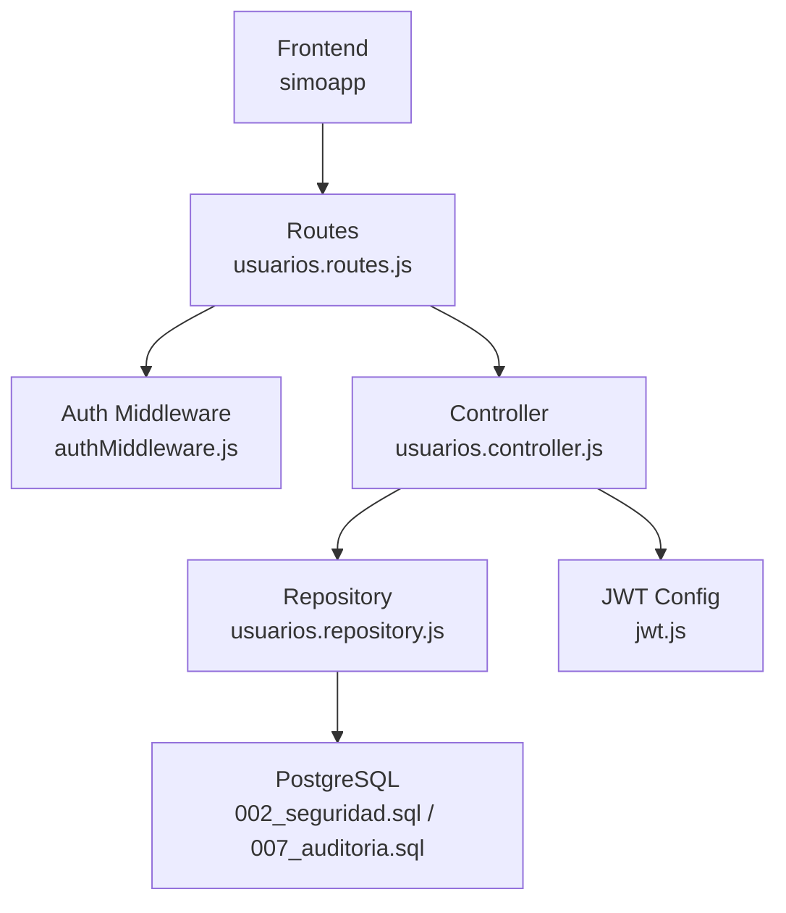
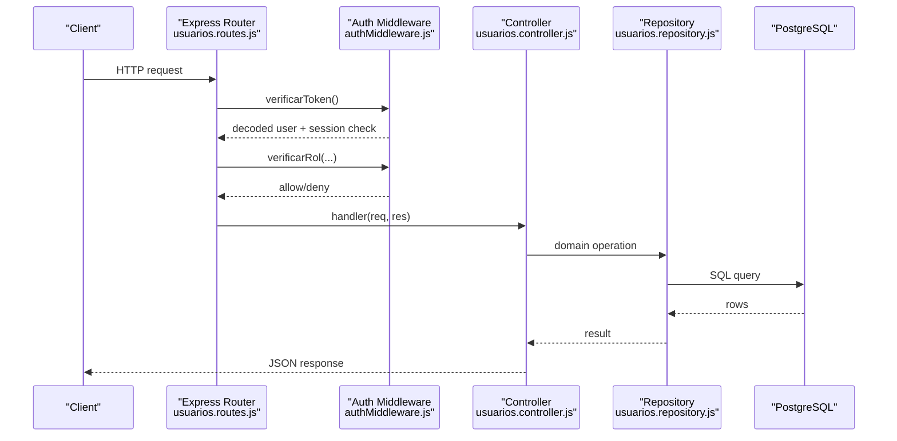
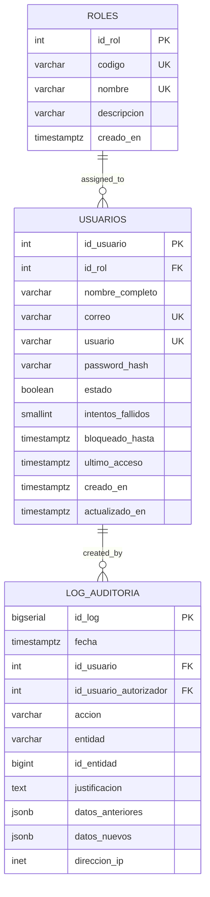
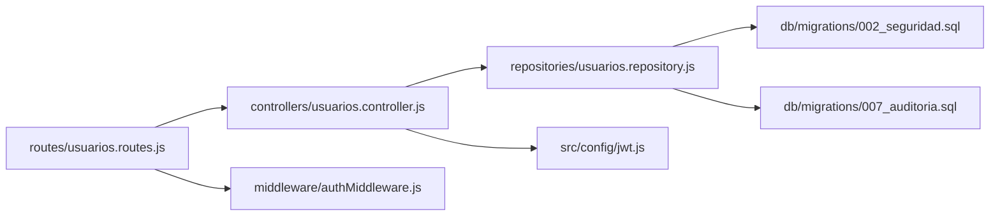

# User Management API

<cite>
**Referenced Files in This Document**
- [usuarios.routes.js](file://backend/src/routes/usuarios.routes.js)
- [usuarios.controller.js](file://backend/src/controllers/usuarios.controller.js)
- [usuarios.repository.js](file://backend/src/repositories/usuarios.repository.js)
- [authMiddleware.js](file://backend/middleware/authMiddleware.js)
- [002_seguridad.sql](file://backend/db/migrations/002_seguridad.sql)
- [007_auditoria.sql](file://backend/db/migrations/007_auditoria.sql)
- [jwt.js](file://backend/src/config/jwt.js)
- [usuarios.test.js](file://backend/tests/integracion/usuarios.test.js)
- [FormularioUsuario.tsx](file://simoapp/components/usuarios/FormularioUsuario.tsx)
- [tipos.ts](file://simoapp/lib/auth/tipos.ts)
- [validaciones.ts](file://simoapp/lib/auth/validaciones.ts)
</cite>

## Table of Contents
1. [Introduction](#introduction)
2. [Project Structure](#project-structure)
3. [Core Components](#core-components)
4. [Architecture Overview](#architecture-overview)
5. [Detailed Component Analysis](#detailed-component-analysis)
6. [Dependency Analysis](#dependency-analysis)
7. [Performance Considerations](#performance-considerations)
8. [Troubleshooting Guide](#troubleshooting-guide)
9. [Conclusion](#conclusion)

## Introduction
This document provides detailed API documentation for the user management endpoints exposed by the backend. It covers:
- CRUD operations for users
- Role assignment and validation
- Status management (active/inactive)
- Search, filtering, and pagination
- Request/response schemas
- Validation rules
- Authentication and role-based access control
- Audit logging integration points

The API is designed to be consumed by the frontend application and automated tests. All sensitive data such as password hashes are never returned in responses.

## Project Structure
The user management feature spans routes, controllers, repositories, middleware, database migrations, and frontend contracts.

**Diagram sources**
- [usuarios.routes.js:1-18](file://backend/src/routes/usuarios.routes.js#L1-L18)
- [authMiddleware.js:1-81](file://backend/middleware/authMiddleware.js#L1-L81)
- [usuarios.controller.js:1-295](file://backend/src/controllers/usuarios.controller.js#L1-L295)
- [usuarios.repository.js:1-242](file://backend/src/repositories/usuarios.repository.js#L1-L242)
- [002_seguridad.sql:1-91](file://backend/db/migrations/002_seguridad.sql#L1-L91)
- [007_auditoria.sql:1-68](file://backend/db/migrations/007_auditoria.sql#L1-L68)
- [jwt.js:1-16](file://backend/src/config/jwt.js#L1-L16)

**Section sources**
- [usuarios.routes.js:1-18](file://backend/src/routes/usuarios.routes.js#L1-L18)
- [usuarios.controller.js:1-295](file://backend/src/controllers/usuarios.controller.js#L1-L295)
- [usuarios.repository.js:1-242](file://backend/src/repositories/usuarios.repository.js#L1-L242)
- [authMiddleware.js:1-81](file://backend/middleware/authMiddleware.js#L1-L81)
- [002_seguridad.sql:1-91](file://backend/db/migrations/002_seguridad.sql#L1-L91)
- [007_auditoria.sql:1-68](file://backend/db/migrations/007_auditoria.sql#L1-L68)
- [jwt.js:1-16](file://backend/src/config/jwt.js#L1-L16)

## Core Components
- Routes define HTTP endpoints and apply authentication and authorization guards.
- Controllers validate input, enforce business rules, and return standardized JSON responses.
- Repositories encapsulate database queries and protect critical state transitions with transactions and advisory locks.
- Middleware validates JWT tokens, checks session validity, and enforces RBAC.
- Database schema defines roles, users, and audit log tables.

Key responsibilities:
- POST /api/users: create a new user with validated fields and hashed password.
- GET /api/users: list users with pagination and filters.
- GET /api/users/:id: retrieve a single user.
- PUT /api/users/:id: update user attributes without changing password or status.
- PATCH /api/users/:id/status or /api/users/:id/estado: toggle user active/inactive status.

**Section sources**
- [usuarios.routes.js:1-18](file://backend/src/routes/usuarios.routes.js#L1-L18)
- [usuarios.controller.js:26-295](file://backend/src/controllers/usuarios.controller.js#L26-L295)
- [usuarios.repository.js:12-242](file://backend/src/repositories/usuarios.repository.js#L12-L242)
- [authMiddleware.js:9-75](file://backend/middleware/authMiddleware.js#L9-L75)

## Architecture Overview
The request flow for user management endpoints follows a layered architecture:

**Diagram sources**
- [usuarios.routes.js:9-15](file://backend/src/routes/usuarios.routes.js#L9-L15)
- [authMiddleware.js:9-75](file://backend/middleware/authMiddleware.js#L9-L75)
- [usuarios.controller.js:29-295](file://backend/src/controllers/usuarios.controller.js#L29-L295)
- [usuarios.repository.js:25-242](file://backend/src/repositories/usuarios.repository.js#L25-L242)

## Detailed Component Analysis

### Authentication and Authorization
- Token verification:
  - Validates Bearer token signature and expiration.
  - Checks if the token is blacklisted.
  - Ensures the user account is active; inactive accounts receive immediate unauthorized responses even if the token is valid.
- Role-based access control:
  - Route-level guards accept either numeric role IDs or role codes.
  - The user management module restricts creation and updates to ADMIN, while listing and detail can be accessed by ADMIN and GERENTE.

Security notes:
- Passwords are never included in API responses.
- Session invalidation and deactivation are enforced at the middleware layer.

**Section sources**
- [authMiddleware.js:9-75](file://backend/middleware/authMiddleware.js#L9-L75)
- [jwt.js:1-16](file://backend/src/config/jwt.js#L1-L16)

### Endpoints

#### Create User
- Method: POST
- Path: /api/users
- Access: ADMIN only
- Request body:
  - id_rol: integer, must exist in roles table
  - nombre_completo: string, non-empty, trimmed
  - correo: string, normalized to lowercase, valid email format
  - usuario: string, non-empty, trimmed
  - password: string, minimum length 8
- Response:
  - 201 Created with message and user object (no password_hash)
  - 400 Bad Request for missing or invalid fields
  - 409 Conflict if email or username already exists
- Validation rules:
  - Email regex excludes spaces and requires a basic email structure
  - Password length enforced server-side
  - Role existence checked before insertion
  - Duplicate email/username prevented via pre-check and DB constraint

Example request payload:
{
  "id_rol": 4,
  "nombre_completo": "Test User",
  "correo": "test@example.com",
  "usuario": "testuser",
  "password": "SecurePass1"
}

Example success response:
{
  "message": "Usuario creado exitosamente",
  "usuario": {
    "id_usuario": 123,
    "nombre_completo": "Test User",
    "correo": "test@example.com",
    "usuario": "testuser",
    "estado": true,
    "id_rol": 4,
    "rol_codigo": "VENDEDOR",
    "rol_nombre": "Vendedor",
    "creado_en": "2026-01-01T00:00:00Z",
    "actualizado_en": "2026-01-01T00:00:00Z"
  }
}

**Section sources**
- [usuarios.routes.js:9](file://backend/src/routes/usuarios.routes.js#L9)
- [usuarios.controller.js:29-84](file://backend/src/controllers/usuarios.controller.js#L29-L84)
- [usuarios.repository.js:25-36](file://backend/src/repositories/usuarios.repository.js#L25-L36)
- [002_seguridad.sql:15-31](file://backend/db/migrations/002_seguridad.sql#L15-L31)
- [002_seguridad.sql:40-61](file://backend/db/migrations/002_seguridad.sql#L40-L61)

#### List Users
- Method: GET
- Path: /api/users
- Access: ADMIN, GERENTE
- Query parameters:
  - page: positive integer, default 1
  - limit: positive integer up to 100, default 10
  - estado: boolean string 'true' or 'false'
  - id_rol: positive integer
  - rol: role code string (ADMIN, GERENTE, INVENTARIO, VENDEDOR), case-insensitive on client side but normalized to uppercase
  - q: text search up to 100 characters; searches full name, email, and username using ILIKE with escaped wildcards
- Response:
  - 200 OK with data array and pagination metadata
  - 400 Bad Request for invalid parameters
- Pagination:
  - totalPages computed from total and limit
  - Consistent ordering by user ID

Example request:
GET /api/users?page=1&limit=20&estado=true&id_rol=1&q=admin

Example success response:
{
  "data": [
    {
      "id_usuario": 1,
      "nombre_completo": "Admin",
      "correo": "admin@simo.local",
      "usuario": "admin",
      "estado": true,
      "id_rol": 1,
      "rol_codigo": "ADMIN",
      "rol_nombre": "Administrador",
      "creado_en": "2026-01-01T00:00:00Z",
      "actualizado_en": "2026-01-01T00:00:00Z"
    }
  ],
  "pagination": {
    "page": 1,
    "limit": 20,
    "total": 5,
    "totalPages": 1
  }
}

**Section sources**
- [usuarios.routes.js:10](file://backend/src/routes/usuarios.routes.js#L10)
- [usuarios.controller.js:90-143](file://backend/src/controllers/usuarios.controller.js#L90-L143)
- [usuarios.repository.js:39-85](file://backend/src/repositories/usuarios.repository.js#L39-L85)

#### Get User by ID
- Method: GET
- Path: /api/users/:id
- Access: ADMIN, GERENTE
- Path parameter:
  - id: positive integer
- Response:
  - 200 OK with user object (no password_hash)
  - 404 Not Found if user does not exist
  - 400 Bad Request if id is invalid

Example success response:
{
  "id_usuario": 1,
  "nombre_completo": "Admin",
  "correo": "admin@simo.local",
  "usuario": "admin",
  "estado": true,
  "id_rol": 1,
  "rol_codigo": "ADMIN",
  "rol_nombre": "Administrador",
  "creado_en": "2026-01-01T00:00:00Z",
  "actualizado_en": "2026-01-01T00:00:00Z"
}

**Section sources**
- [usuarios.routes.js:11](file://backend/src/routes/usuarios.routes.js#L11)
- [usuarios.controller.js:148-164](file://backend/src/controllers/usuarios.controller.js#L148-L164)
- [usuarios.repository.js:88-97](file://backend/src/repositories/usuarios.repository.js#L88-L97)

#### Update User
- Method: PUT
- Path: /api/users/:id
- Access: ADMIN only
- Path parameter:
  - id: positive integer
- Request body (all optional, at least one required):
  - id_rol: integer, must exist
  - nombre_completo: string, non-empty, max 150 chars
  - correo: string, valid email, max 150 chars, normalized to lowercase
  - usuario: string, non-empty, max 50 chars
- Restrictions:
  - password field is rejected
  - estado field is rejected; use PATCH /status instead
  - Prevents removing ADMIN role from the last active admin
  - Prevents duplicate email/username across other users
- Response:
  - 200 OK with message and updated user object
  - 400 Bad Request for invalid fields or disallowed fields
  - 404 Not Found if user does not exist
  - 409 Conflict if another user has the same email/username or if removing ADMIN would leave no active admins

Example request payload:
{
  "nombre_completo": "Updated Name",
  "correo": "updated@example.com",
  "usuario": "updateduser",
  "id_rol": 2
}

Example success response:
{
  "message": "Usuario actualizado exitosamente",
  "usuario": {
    "id_usuario": 123,
    "nombre_completo": "Updated Name",
    "correo": "updated@example.com",
    "usuario": "updateduser",
    "estado": true,
    "id_rol": 2,
    "rol_codigo": "GERENTE",
    "rol_nombre": "Propietario / Gerente",
    "creado_en": "2026-01-01T00:00:00Z",
    "actualizado_en": "2026-01-01T00:00:00Z"
  }
}

**Section sources**
- [usuarios.routes.js:12](file://backend/src/routes/usuarios.routes.js#L12)
- [usuarios.controller.js:172-255](file://backend/src/controllers/usuarios.controller.js#L172-L255)
- [usuarios.repository.js:115-172](file://backend/src/repositories/usuarios.repository.js#L115-L172)

#### Change User Status
- Methods: PATCH
- Paths:
  - /api/users/:id/status
  - /api/users/:id/estado (alias used by frontend)
- Access: ADMIN only
- Path parameter:
  - id: positive integer
- Request body:
  - estado: boolean (true to activate, false to deactivate)
- Behavior:
  - Deactivating a user immediately blocks login and existing sessions
  - Reactivating clears failed attempts and temporary lockout
  - Prevents deactivating the last active admin
- Response:
  - 200 OK with message and updated user object
  - 400 Bad Request if estado is not boolean
  - 404 Not Found if user does not exist
  - 409 Conflict if attempting to deactivate the last active admin

Example request payload:
{
  "estado": false
}

Example success response:
{
  "message": "Usuario inactivado exitosamente",
  "usuario": {
    "id_usuario": 123,
    "nombre_completo": "Test User",
    "correo": "test@example.com",
    "usuario": "testuser",
    "estado": false,
    "id_rol": 4,
    "rol_codigo": "VENDEDOR",
    "rol_nombre": "Vendedor",
    "creado_en": "2026-01-01T00:00:00Z",
    "actualizado_en": "2026-01-01T00:00:00Z"
  }
}

**Section sources**
- [usuarios.routes.js:14-15](file://backend/src/routes/usuarios.routes.js#L14-L15)
- [usuarios.controller.js:263-292](file://backend/src/controllers/usuarios.controller.js#L263-L292)
- [usuarios.repository.js:178-230](file://backend/src/repositories/usuarios.repository.js#L178-L230)

### Data Models

**Diagram sources**
- [002_seguridad.sql:15-61](file://backend/db/migrations/002_seguridad.sql#L15-L61)
- [007_auditoria.sql:13-51](file://backend/db/migrations/007_auditoria.sql#L13-L51)

**Section sources**
- [002_seguridad.sql:15-61](file://backend/db/migrations/002_seguridad.sql#L15-L61)
- [007_auditoria.sql:13-51](file://backend/db/migrations/007_auditoria.sql#L13-L51)

### Validation Rules
- Required fields for creation:
  - id_rol, nombre_completo, correo, usuario, password
- Email format:
  - Must match a standard email pattern without spaces
- Password:
  - Minimum 8 characters
- Username:
  - Non-empty, trimmed, max 50 characters
- Full name:
  - Non-empty, trimmed, max 150 characters
- Role:
  - Must exist in the roles table
- Uniqueness:
  - Email and username are unique across users
- Update restrictions:
  - Cannot change password via PUT
  - Cannot change status via PUT; use PATCH /status
- Search:
  - Wildcard characters in q are treated literally

Frontend validation mirrors backend rules for better UX, including minimum password length and email format.

**Section sources**
- [usuarios.controller.js:30-53](file://backend/src/controllers/usuarios.controller.js#L30-L53)
- [usuarios.controller.js:187-218](file://backend/src/controllers/usuarios.controller.js#L187-L218)
- [validaciones.ts:16-45](file://simoapp/lib/auth/validaciones.ts#L16-L45)
- [validaciones.ts:76-119](file://simoapp/lib/auth/validaciones.ts#L76-L119)

### Role-Based Permissions
- Roles:
  - ADMIN: manages users, roles, company data, and audit logs
  - GERENTE: dashboard, profitability, inventory value, authorizes cancellations
  - INVENTARIO: catalog, warehouse receipts, transfers, adjustments, alerts
  - VENDEDOR: sales and clients, order lifecycle
- Endpoint permissions:
  - POST /api/users: ADMIN
  - GET /api/users: ADMIN, GERENTE
  - GET /api/users/:id: ADMIN, GERENTE
  - PUT /api/users/:id: ADMIN
  - PATCH /api/users/:id/status or /api/users/:id/estado: ADMIN

RBAC enforcement occurs at route level using verificarRol, which accepts either numeric role IDs or role codes.

**Section sources**
- [002_seguridad.sql:26-31](file://backend/db/migrations/002_seguridad.sql#L26-L31)
- [authMiddleware.js:57-75](file://backend/middleware/authMiddleware.js#L57-L75)
- [usuarios.routes.js:9-15](file://backend/src/routes/usuarios.routes.js#L9-L15)

### Audit Logging Integration
- Audit table:
  - log_auditoria stores immutable records of critical operations
- Relevant actions for user management:
  - CAMBIO_ROL_USUARIO
  - CAMBIO_ESTADO_USUARIO
- Constraints:
  - UPDATE, DELETE, TRUNCATE are blocked on the audit table
- Integration note:
  - Backend interceptor writes audit entries within the same transaction as the operation to ensure consistency

While user endpoints do not directly insert into the audit table in the analyzed files, the schema and constraints define how such integrations should occur.

**Section sources**
- [007_auditoria.sql:13-68](file://backend/db/migrations/007_auditoria.sql#L13-L68)

### Bulk Operations
- No bulk endpoints are implemented in the current codebase.
- To support bulk operations, consider adding:
  - POST /api/users/bulk: create multiple users
  - PATCH /api/users/bulk/status: update status for multiple users
- Ensure:
  - Transactional boundaries per batch
  - Advisory locks to prevent race conditions when modifying admin counts
  - Partial failure handling with clear error reporting

[No sources needed since this section proposes conceptual enhancements]

## Dependency Analysis
The following diagram shows component dependencies for user management:

**Diagram sources**
- [usuarios.routes.js:1-18](file://backend/src/routes/usuarios.routes.js#L1-L18)
- [usuarios.controller.js:1-295](file://backend/src/controllers/usuarios.controller.js#L1-L295)
- [usuarios.repository.js:1-242](file://backend/src/repositories/usuarios.repository.js#L1-L242)
- [authMiddleware.js:1-81](file://backend/middleware/authMiddleware.js#L1-L81)
- [jwt.js:1-16](file://backend/src/config/jwt.js#L1-L16)
- [002_seguridad.sql:1-91](file://backend/db/migrations/002_seguridad.sql#L1-L91)
- [007_auditoria.sql:1-68](file://backend/db/migrations/007_auditoria.sql#L1-L68)

**Section sources**
- [usuarios.routes.js:1-18](file://backend/src/routes/usuarios.routes.js#L1-L18)
- [usuarios.controller.js:1-295](file://backend/src/controllers/usuarios.controller.js#L1-L295)
- [usuarios.repository.js:1-242](file://backend/src/repositories/usuarios.repository.js#L1-L242)
- [authMiddleware.js:1-81](file://backend/middleware/authMiddleware.js#L1-L81)
- [jwt.js:1-16](file://backend/src/config/jwt.js#L1-L16)
- [002_seguridad.sql:1-91](file://backend/db/migrations/002_seguridad.sql#L1-L91)
- [007_auditoria.sql:1-68](file://backend/db/migrations/007_auditoria.sql#L1-L68)

## Performance Considerations
- Pagination:
  - Default limit is 10; maximum allowed is 100
  - Queries use LIMIT and OFFSET with consistent ordering by user ID
- Filtering:
  - Filters are applied via dynamic WHERE clauses
  - Text search uses ILIKE with escaped wildcards to avoid unintended pattern matching
- Security:
  - Password hashing uses bcrypt with configurable salt rounds
  - Advisory locks serialize critical admin-related changes to prevent race conditions
- Database:
  - Indexes on id_rol and estado improve filter performance
  - Audit table indexes optimize querying by date, entity, user, and action

[No sources needed since this section provides general guidance]

## Troubleshooting Guide
Common errors and resolutions:
- 400 Bad Request:
  - Missing required fields in creation
  - Invalid email format
  - Password too short
  - Invalid role ID
  - Disallowed fields in update (password, estado)
  - Invalid query parameters (page, limit, estado, id_rol, rol, q)
- 401 Unauthorized:
  - Missing or malformed Authorization header
  - Expired or invalid JWT
  - Blacklisted token
  - Inactive user account
- 403 Forbidden:
  - Insufficient role permissions for the endpoint
- 404 Not Found:
  - User ID does not exist
- 409 Conflict:
  - Duplicate email or username
  - Attempting to remove ADMIN role from the last active admin
  - Attempting to deactivate the last active admin

Frontend error types map to these statuses to provide user-friendly messages.

**Section sources**
- [usuarios.controller.js:22-24](file://backend/src/controllers/usuarios.controller.js#L22-L24)
- [usuarios.controller.js:40-53](file://backend/src/controllers/usuarios.controller.js#L40-L53)
- [usuarios.controller.js:95-124](file://backend/src/controllers/usuarios.controller.js#L95-L124)
- [usuarios.controller.js:180-218](file://backend/src/controllers/usuarios.controller.js#L180-L218)
- [usuarios.controller.js:269-283](file://backend/src/controllers/usuarios.controller.js#L269-L283)
- [authMiddleware.js:9-49](file://backend/middleware/authMiddleware.js#L9-L49)
- [tipos.ts:55-66](file://simoapp/lib/auth/tipos.ts#L55-L66)

## Conclusion
The User Management API provides secure, validated, and well-structured endpoints for creating, reading, updating, and managing user status. It enforces strong authentication and role-based access controls, supports robust filtering and pagination, and integrates with an immutable audit log schema. The implementation prioritizes data integrity through transactions and advisory locks, ensuring safe concurrent modifications especially around administrative roles.

[No sources needed since this section summarizes without analyzing specific files]