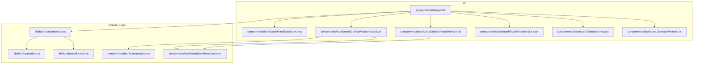
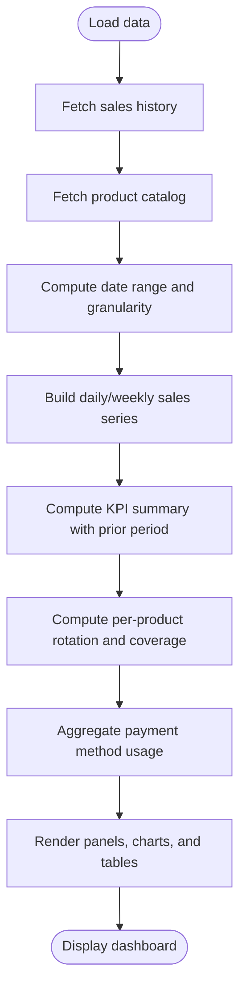
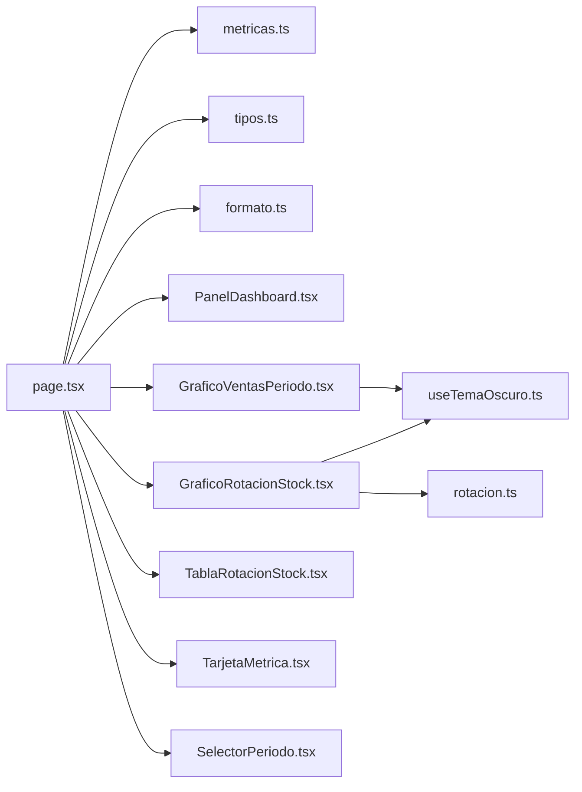

# Business Intelligence Dashboard

<cite>
**Referenced Files in This Document**
- [page.tsx](file://simoapp/app/(protected)/page.tsx)
- [metricas.ts](file://simoapp/lib/dashboard/metricas.ts)
- [tipos.ts](file://simoapp/lib/dashboard/tipos.ts)
- [formato.ts](file://simoapp/lib/dashboard/formato.ts)
- [PanelDashboard.tsx](file://simoapp/components/dashboard/PanelDashboard.tsx)
- [GraficoVentasPeriodo.tsx](file://simoapp/components/dashboard/GraficoVentasPeriodo.tsx)
- [GraficoRotacionStock.tsx](file://simoapp/components/dashboard/GraficoRotacionStock.tsx)
- [TablaRotacionStock.tsx](file://simoapp/components/dashboard/TablaRotacionStock.tsx)
- [TarjetaMetrica.tsx](file://simoapp/components/dashboard/TarjetaMetrica.tsx)
- [SelectorPeriodo.tsx](file://simoapp/components/dashboard/SelectorPeriodo.tsx)
- [rotacion.ts](file://simoapp/components/dashboard/rotacion.ts)
- [useTemaOscuro.ts](file://simoapp/components/dashboard/useTemaOscuro.ts)
</cite>

## Table of Contents
1. [Introduction](#introduction)
2. [Project Structure](#project-structure)
3. [Core Components](#core-components)
4. [Architecture Overview](#architecture-overview)
5. [Detailed Component Analysis](#detailed-component-analysis)
6. [Dependency Analysis](#dependency-analysis)
7. [Performance Considerations](#performance-considerations)
8. [Troubleshooting Guide](#troubleshooting-guide)
9. [Conclusion](#conclusion)
10. [Appendices](#appendices)

## Introduction
This document explains the Business Intelligence dashboard that provides sales analytics, inventory rotation metrics, performance indicators, and reporting capabilities. It covers chart components, data aggregation logic, real-time metric updates, configuration options for time periods and thresholds, data sources, caching strategies, export considerations, customization by business role, and mobile responsiveness.

The dashboard is a client-side Next.js page that:
- Loads sales history and product catalog data.
- Computes KPIs, time series, payment method shares, and inventory rotation per product.
- Renders charts and tables with Recharts and TailwindCSS.
- Supports period selection, dark mode, and responsive layouts.

## Project Structure
The dashboard lives under the protected routes and uses shared libraries for types, formatting, and calculations.



**Diagram sources**
- [page.tsx:1-336](file://simoapp/app/(protected)/page.tsx#L1-L336)
- [metricas.ts:1-334](file://simoapp/lib/dashboard/metricas.ts#L1-L334)
- [tipos.ts:1-90](file://simoapp/lib/dashboard/tipos.ts#L1-L90)
- [formato.ts:1-67](file://simoapp/lib/dashboard/formato.ts#L1-L67)
- [PanelDashboard.tsx:1-40](file://simoapp/components/dashboard/PanelDashboard.tsx#L1-L40)
- [GraficoVentasPeriodo.tsx:1-132](file://simoapp/components/dashboard/GraficoVentasPeriodo.tsx#L1-L132)
- [GraficoRotacionStock.tsx:1-159](file://simoapp/components/dashboard/GraficoRotacionStock.tsx#L1-L159)
- [TablaRotacionStock.tsx:1-115](file://simoapp/components/dashboard/TablaRotacionStock.tsx#L1-L115)
- [TarjetaMetrica.tsx:1-110](file://simoapp/components/dashboard/TarjetaMetrica.tsx#L1-L110)
- [SelectorPeriodo.tsx:1-45](file://simoapp/components/dashboard/SelectorPeriodo.tsx#L1-L45)
- [rotacion.ts:1-40](file://simoapp/components/dashboard/rotacion.ts#L1-L40)
- [useTemaOscuro.ts:1-35](file://simoapp/components/dashboard/useTemaOscuro.ts#L1-L35)

**Section sources**
- [page.tsx:1-336](file://simoapp/app/(protected)/page.tsx#L1-L336)
- [metricas.ts:1-334](file://simoapp/lib/dashboard/metricas.ts#L1-L334)
- [tipos.ts:1-90](file://simoapp/lib/dashboard/tipos.ts#L1-L90)

## Core Components
- Dashboard page orchestrates data loading, period selection, and rendering of panels.
- Calculation library computes ranges, series, summaries, rotation, and payment methods.
- Chart components visualize sales over time and inventory rotation.
- Table component shows detailed rotation metrics per product.
- Metric card displays KPIs with variation badges.
- Period selector drives all visualizations.
- Formatting utilities standardize currency, numbers, dates, and percentages.
- Rotation palette and labels keep chart/table visuals consistent.
- Dark mode hook ensures correct chart colors.

Key responsibilities:
- Data source integration: sales history and product catalog.
- Pure computation functions for deterministic outputs.
- Responsive UI with TailwindCSS and Recharts.
- Real-time refresh via explicit update action.

**Section sources**
- [page.tsx:1-336](file://simoapp/app/(protected)/page.tsx#L1-L336)
- [metricas.ts:1-334](file://simoapp/lib/dashboard/metricas.ts#L1-L334)
- [formato.ts:1-67](file://simoapp/lib/dashboard/formato.ts#L1-L67)

## Architecture Overview
The dashboard follows a clear separation between UI and domain logic:

```mermaid
sequenceDiagram
participant User as "User"
participant Page as "DashboardPage (page.tsx)"
participant API as "listarVentas()"
participant Catalog as "useProductos()"
calc as "calcularDashboard (metricas.ts)"
Charts as "Recharts Panels"
User->>Page : Open dashboard
Page->>API : Load sales history
Page->>Catalog : Load product catalog
API-->>Page : Sales history
Catalog-->>Page : Products
Page->>calc : Compute range, series, summary, rotation, payments
calc-->>Page : DatosDashboard
Page->>Charts : Render panels and cards
User->>Page : Change period or click Update
Page->>API : Reload sales history
Page->>calc : Recompute
calc-->>Page : Updated DatosDashboard
Page->>Charts : Re-render with new data
```

**Diagram sources**
- [page.tsx:53-113](file://simoapp/app/(protected)/page.tsx#L53-L113)
- [metricas.ts:316-333](file://simoapp/lib/dashboard/metricas.ts#L316-L333)

## Detailed Component Analysis

### Dashboard Page (Orchestrator)
Responsibilities:
- Loads sales history once on mount and supports manual refresh.
- Uses product catalog context to get current stock.
- Computes dashboard data using pure functions.
- Renders KPI cards, sales chart, payment methods chart, rotation chart, and rotation table.
- Shows contextual messages when using mock data or fallback catalogs.

Real-time updates:
- Manual refresh triggers a new sales history fetch and recomputes metrics without full page reload.
- Displays last updated timestamp.

Configuration:
- Period selector controls date range and granularity.
- Environment flag indicates whether demo sales are used.

Mobile responsiveness:
- Grid layout adapts from single column on small screens to multi-column on large screens.

**Section sources**
- [page.tsx:53-113](file://simoapp/app/(protected)/page.tsx#L53-L113)
- [page.tsx:128-336](file://simoapp/app/(protected)/page.tsx#L128-L336)

### Metrics Library (Pure Computation)
Responsibilities:
- Define available periods and thresholds.
- Compute date ranges and granularities.
- Build daily or weekly sales series.
- Calculate summary KPIs with prior-period comparison.
- Compute per-product inventory rotation and coverage days.
- Aggregate payment method usage and participation.

Key formulas:
- Variance: percentage change vs previous period of equal length; null if no base.
- Ticket average: total revenue divided by completed sales count.
- Inventory rotation index: units sold / average inventory; average inventory estimated as current stock plus half of units sold in the period.
- Coverage days: current stock divided by daily sales rate within the period.
- Payment method share: method total divided by total revenue.

Configuration:
- PERIODOS_DASHBOARD defines selectable periods.
- TOP_ROTACION limits top products shown in the rotation chart.
- UMBRAL_ROTACION_ALTA and UMBRAL_ROTACION_MEDIA define classification thresholds.

**Section sources**
- [metricas.ts:30-45](file://simoapp/lib/dashboard/metricas.ts#L30-L45)
- [metricas.ts:84-129](file://simoapp/lib/dashboard/metricas.ts#L84-L129)
- [metricas.ts:135-176](file://simoapp/lib/dashboard/metricas.ts#L135-L176)
- [metricas.ts:178-210](file://simoapp/lib/dashboard/metricas.ts#L178-L210)
- [metricas.ts:216-277](file://simoapp/lib/dashboard/metricas.ts#L216-L277)
- [metricas.ts:283-310](file://simoapp/lib/dashboard/metricas.ts#L283-L310)
- [metricas.ts:316-333](file://simoapp/lib/dashboard/metricas.ts#L316-L333)

### Types and Formats
Types:
- PeriodoDashboard: supported periods.
- RangoFechas: start, end, and day count.
- PuntoSerieVentas: aggregated point for chart.
- ResumenVentas: KPI summary fields.
- RotacionProducto: per-product rotation details.
- UsoMetodoPago: payment method totals and participation.
- DatosDashboard: final output consumed by UI.

Formats:
- Currency, numbers, decimals, short dates, date-time, hour formats.
- Axis money formatter abbreviates large values.
- Percentage formatter with optional sign.
- Index formatter for rotation values.

**Section sources**
- [tipos.ts:1-90](file://simoapp/lib/dashboard/tipos.ts#L1-L90)
- [formato.ts:1-67](file://simoapp/lib/dashboard/formato.ts#L1-L67)

### PanelDashboard (Container)
- Provides consistent panel styling, title, description, and optional actions.
- Used to wrap each visualization area.

**Section sources**
- [PanelDashboard.tsx:1-40](file://simoapp/components/dashboard/PanelDashboard.tsx#L1-L40)

### GraficoVentasPeriodo (Sales Over Time)
- Dual-axis composed chart: bars for revenue, line for units sold.
- Custom legend and tooltips.
- Handles empty data gracefully.
- Adapts grid and text colors based on system dark mode.

Data flow:
- Receives serie from calcularDashboard.
- Aggregates per day or week depending on granularity.

**Section sources**
- [GraficoVentasPeriodo.tsx:1-132](file://simoapp/components/dashboard/GraficoVentasPeriodo.tsx#L1-L132)
- [useTemaOscuro.ts:1-35](file://simoapp/components/dashboard/useTemaOscuro.ts#L1-L35)

### GraficoRotacionStock (Inventory Rotation Chart)
- Horizontal bar chart showing top products by rotation index.
- Color-coded by classification (high, medium, low).
- Legend includes threshold references.
- Tooltip shows product details and metrics.

Configuration:
- TOP_ROTACION determines number of items displayed.
- Thresholds imported from metricas.ts.

**Section sources**
- [GraficoRotacionStock.tsx:1-159](file://simoapp/components/dashboard/GraficoRotacionStock.tsx#L1-L159)
- [rotacion.ts:1-40](file://simoapp/components/dashboard/rotacion.ts#L1-L40)
- [metricas.ts:30-45](file://simoapp/lib/dashboard/metricas.ts#L30-L45)

### TablaRotacionStock (Rotation Detail Table)
- Full list of products with columns for name, code, category, units sold, stock, rotation index, coverage days, and classification badge.
- Sortable columns and pagination.
- Highlights products requiring replenishment.

**Section sources**
- [TablaRotacionStock.tsx:1-115](file://simoapp/components/dashboard/TablaRotacionStock.tsx#L1-L115)

### TarjetaMetrica (KPI Card)
- Displays a prominent value with icon, optional variation badge, and detail text.
- Variation badge shows direction and magnitude compared to previous period.
- Supports multiple color tones.

**Section sources**
- [TarjetaMetrica.tsx:1-110](file://simoapp/components/dashboard/TarjetaMetrica.tsx#L1-L110)

### SelectorPeriodo (Period Selector)
- Button group for selecting 7 days, 30 days, 90 days, or current month.
- Drives all dashboard computations and visualizations.

**Section sources**
- [SelectorPeriodo.tsx:1-45](file://simoapp/components/dashboard/SelectorPeriodo.tsx#L1-L45)
- [metricas.ts:30-35](file://simoapp/lib/dashboard/metricas.ts#L30-L35)

### Data Flow and Processing Logic


**Diagram sources**
- [page.tsx:64-113](file://simoapp/app/(protected)/page.tsx#L64-L113)
- [metricas.ts:84-129](file://simoapp/lib/dashboard/metricas.ts#L84-L129)
- [metricas.ts:135-176](file://simoapp/lib/dashboard/metricas.ts#L135-L176)
- [metricas.ts:183-210](file://simoapp/lib/dashboard/metricas.ts#L183-L210)
- [metricas.ts:233-277](file://simoapp/lib/dashboard/metricas.ts#L233-L277)
- [metricas.ts:283-310](file://simoapp/lib/dashboard/metricas.ts#L283-L310)

## Dependency Analysis
The dashboard has clear layering:
- UI components depend on domain calculation functions.
- Calculation functions depend on shared types and formatting utilities.
- Visualization components depend on Recharts and theme detection.



**Diagram sources**
- [page.tsx:1-336](file://simoapp/app/(protected)/page.tsx#L1-L336)
- [metricas.ts:1-334](file://simoapp/lib/dashboard/metricas.ts#L1-L334)
- [tipos.ts:1-90](file://simoapp/lib/dashboard/tipos.ts#L1-L90)
- [formato.ts:1-67](file://simoapp/lib/dashboard/formato.ts#L1-L67)
- [PanelDashboard.tsx:1-40](file://simoapp/components/dashboard/PanelDashboard.tsx#L1-L40)
- [GraficoVentasPeriodo.tsx:1-132](file://simoapp/components/dashboard/GraficoVentasPeriodo.tsx#L1-L132)
- [GraficoRotacionStock.tsx:1-159](file://simoapp/components/dashboard/GraficoRotacionStock.tsx#L1-L159)
- [TablaRotacionStock.tsx:1-115](file://simoapp/components/dashboard/TablaRotacionStock.tsx#L1-L115)
- [TarjetaMetrica.tsx:1-110](file://simoapp/components/dashboard/TarjetaMetrica.tsx#L1-L110)
- [SelectorPeriodo.tsx:1-45](file://simoapp/components/dashboard/SelectorPeriodo.tsx#L1-L45)
- [rotacion.ts:1-40](file://simoapp/components/dashboard/rotacion.ts#L1-L40)
- [useTemaOscuro.ts:1-35](file://simoapp/components/dashboard/useTemaOscuro.ts#L1-L35)

**Section sources**
- [page.tsx:1-336](file://simoapp/app/(protected)/page.tsx#L1-L336)
- [metricas.ts:1-334](file://simoapp/lib/dashboard/metricas.ts#L1-L334)

## Performance Considerations
- Memoization: The dashboard page memoizes computed results to avoid unnecessary recalculations when inputs do not change.
- Pure functions: All calculations are side-effect free, enabling predictable recomputation and easier testing.
- Efficient aggregation: Sales series and rotation use maps to aggregate efficiently across large datasets.
- Chart rendering: Recharts components render only visible data slices (e.g., top N products in rotation chart).
- Dark mode: Theme detection avoids re-renders by using an external store pattern.

Recommendations:
- If sales history grows significantly, consider server-side aggregation or paginated endpoints.
- Introduce client-side caching for sales history and product catalog to reduce network calls.
- Debounce rapid period changes if needed.

[No sources needed since this section provides general guidance]

## Troubleshooting Guide
Common issues and resolutions:
- Sales history load failure: The page sets an error state and disables auto-updates until resolved. Check connectivity and backend availability.
- Mock data indicator: When using demo sales, a banner informs users that figures are illustrative.
- No sales in period: Charts show empty states with helpful messages.
- Stock data from backup: If the product catalog falls back to backup data, a status message warns that rotation metrics are not based on real inventory.

Operational tips:
- Use the “Update” button to refresh sales data after POS transactions.
- Verify environment flags to ensure production data is loaded instead of mocks.

**Section sources**
- [page.tsx:50-52](file://simoapp/app/(protected)/page.tsx#L50-L52)
- [page.tsx:64-102](file://simoapp/app/(protected)/page.tsx#L64-L102)
- [page.tsx:160-175](file://simoapp/app/(protected)/page.tsx#L160-L175)
- [page.tsx:213-223](file://simoapp/app/(protected)/page.tsx#L213-L223)

## Conclusion
The Business Intelligence dashboard delivers actionable insights through well-structured components and pure computation logic. It provides robust sales analytics, inventory rotation metrics, and payment method analysis with configurable time periods and thresholds. The design emphasizes clarity, responsiveness, and maintainability, while offering opportunities for further enhancements such as advanced caching, export features, and role-based customization.

[No sources needed since this section summarizes without analyzing specific files]

## Appendices

### Configuration Options
- Time periods:
  - 7 days, 30 days, 90 days, current month.
  - Granularity switches to weekly for 90-day view.
- Metric thresholds:
  - High rotation threshold.
  - Medium rotation threshold.
  - Top N products in rotation chart.
- Visualization preferences:
  - Dark mode support via system preference.
  - Consistent formatting for currency, numbers, dates, and percentages.

**Section sources**
- [metricas.ts:30-45](file://simoapp/lib/dashboard/metricas.ts#L30-L45)
- [metricas.ts:127-129](file://simoapp/lib/dashboard/metricas.ts#L127-L129)
- [formato.ts:1-67](file://simoapp/lib/dashboard/formato.ts#L1-L67)
- [useTemaOscuro.ts:1-35](file://simoapp/components/dashboard/useTemaOscuro.ts#L1-L35)

### Data Sources and Real-Time Updates
- Sales history:
  - Loaded via a dedicated service; can be backed by a real API or local demo data.
- Product catalog:
  - Loaded via a context provider; falls back to demo data if backend is unavailable.
- Real-time updates:
  - Manual refresh triggers a fresh sales history fetch and recomputes all metrics.

**Section sources**
- [page.tsx:9-16](file://simoapp/app/(protected)/page.tsx#L9-L16)
- [page.tsx:64-102](file://simoapp/app/(protected)/page.tsx#L64-L102)

### Export Capabilities
- Current implementation focuses on on-screen visualization and does not include built-in export functionality.
- Recommended approach:
  - Add CSV export for rotation table and series data.
  - Provide PDF report generation for executive summaries.
  - Implement server-side report generation for large datasets.

[No sources needed since this section provides general guidance]

### Customization by Business Role
- Suggested roles:
  - Sales manager: focus on revenue, ticket size, and payment methods.
  - Inventory planner: focus on rotation indices, coverage days, and replenishment alerts.
- Implementation ideas:
  - Toggle visibility of panels based on user role.
  - Adjust default periods and thresholds per role.
  - Surface role-specific KPIs and drill-down paths.

[No sources needed since this section provides general guidance]

### Mobile Responsiveness Considerations
- Layout:
  - Single-column on small screens; multi-column on larger screens.
- Charts:
  - Responsive containers adapt width and height.
- Tables:
  - Pagination and sorting improve usability on smaller devices.
- Touch-friendly controls:
  - Button groups for period selection and actions.

**Section sources**
- [page.tsx:128-336](file://simoapp/app/(protected)/page.tsx#L128-L336)
- [GraficoVentasPeriodo.tsx:48-100](file://simoapp/components/dashboard/GraficoVentasPeriodo.tsx#L48-L100)
- [GraficoRotacionStock.tsx:73-112](file://simoapp/components/dashboard/GraficoRotacionStock.tsx#L73-L112)
- [TablaRotacionStock.tsx:102-112](file://simoapp/components/dashboard/TablaRotacionStock.tsx#L102-L112)