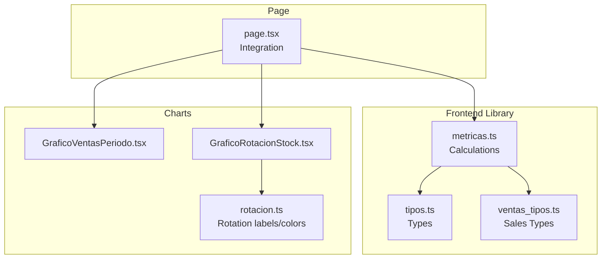
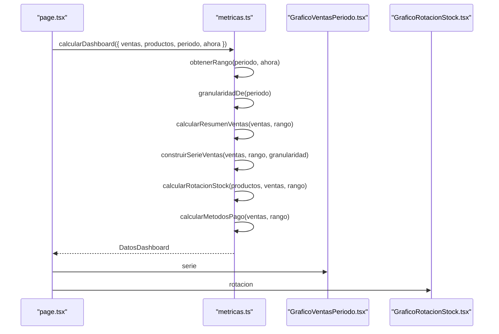
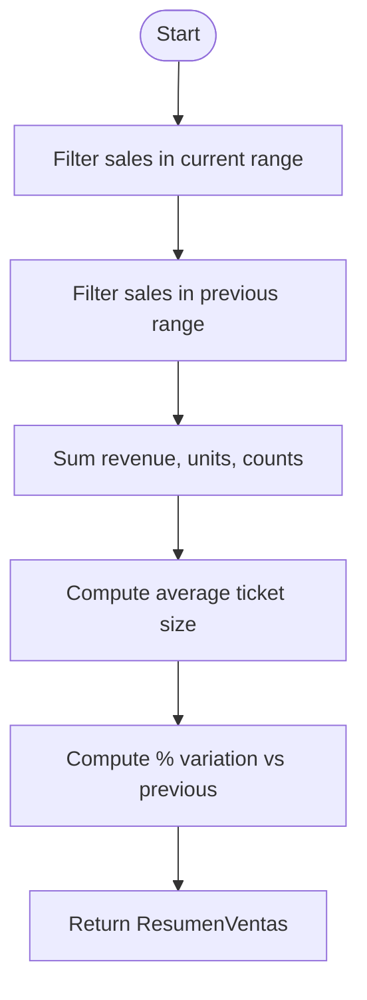
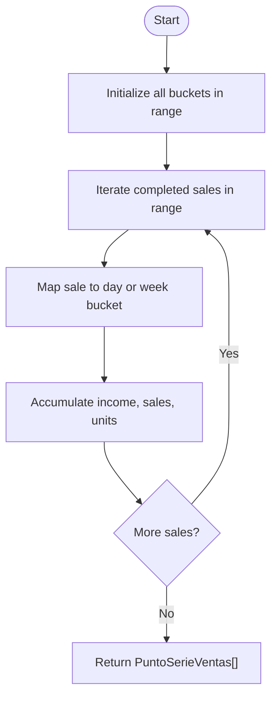
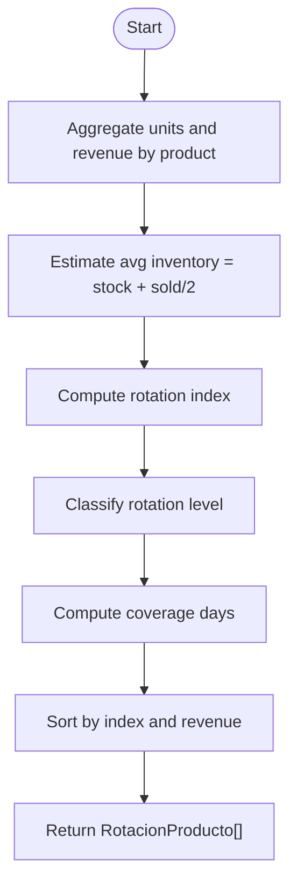
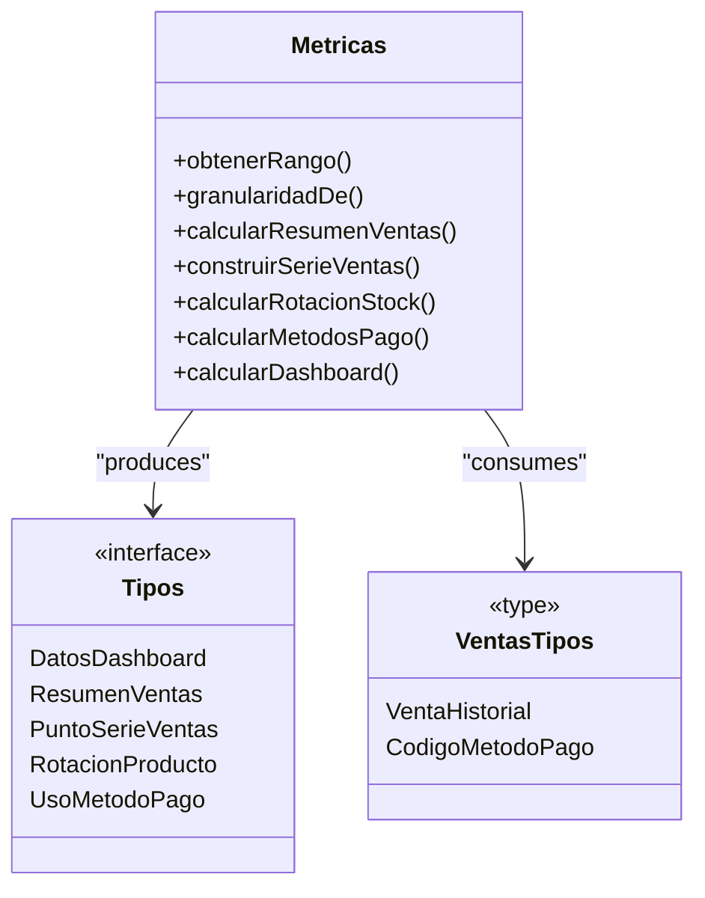
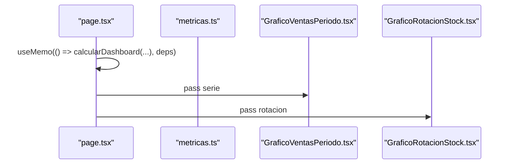
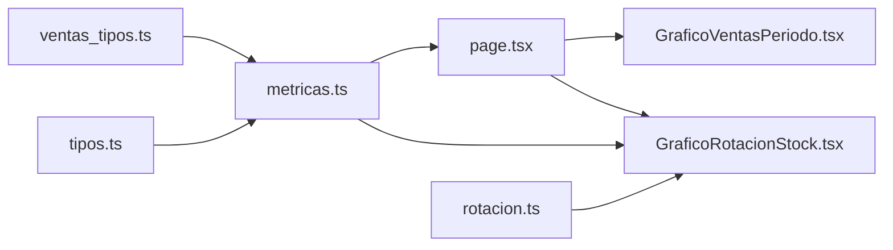

# Dashboard Calculations Engine

<cite>
**Referenced Files in This Document**
- [metricas.ts](file://simoapp/lib/dashboard/metricas.ts)
- [tipos.ts](file://simoapp/lib/dashboard/tipos.ts)
- [ventas_tipos.ts](file://simoapp/lib/ventas/tipos.ts)
- [page.tsx](file://simoapp/app/(protected)/page.tsx)
- [GraficoVentasPeriodo.tsx](file://simoapp/components/dashboard/GraficoVentasPeriodo.tsx)
- [GraficoRotacionStock.tsx](file://simoapp/components/dashboard/GraficoRotacionStock.tsx)
- [rotacion.ts](file://simoapp/components/dashboard/rotacion.ts)
</cite>

## Table of Contents
1. [Introduction](#introduction)
2. [Project Structure](#project-structure)
3. [Core Components](#core-components)
4. [Architecture Overview](#architecture-overview)
5. [Detailed Component Analysis](#detailed-component-analysis)
6. [Dependency Analysis](#dependency-analysis)
7. [Performance Considerations](#performance-considerations)
8. [Troubleshooting Guide](#troubleshooting-guide)
9. [Conclusion](#conclusion)

## Introduction
This document explains the dashboard calculations engine that powers the operational dashboard. It focuses on how raw sales history is transformed into summary metrics, time series, stock rotation indices, and payment method usage. The central entry point is `calcularDashboard`, which orchestrates date range computation, aggregation, classification, and output generation.

The engine is implemented as pure functions over immutable data: it reads sales history and product catalog data, computes derived metrics, and returns a structured result for UI rendering. This design makes the logic testable, predictable, and easy to extend with new metrics or formulas.

## Project Structure
The dashboard calculation logic lives under the frontend library module for dashboards. The main files are:

- Calculation engine: `lib/dashboard/metricas.ts`
- Dashboard types: `lib/dashboard/tipos.ts`
- Sales domain types used by the engine: `lib/ventas/tipos.ts`
- Page integration and memoization: `app/(protected)/page.tsx`
- Visualization components consuming calculated data:
  - `components/dashboard/GraficoVentasPeriodo.tsx`
  - `components/dashboard/GraficoRotacionStock.tsx`
  - `components/dashboard/rotacion.ts`

**Diagram sources**
- [metricas.ts:1-334](file://simoapp/lib/dashboard/metricas.ts#L1-L334)
- [tipos.ts:1-90](file://simoapp/lib/dashboard/tipos.ts#L1-L90)
- [ventas_tipos.ts:1-130](file://simoapp/lib/ventas/tipos.ts#L1-L130)
- [page.tsx:100-120](file://simoapp/app/(protected)/page.tsx#L100-L120)
- [GraficoVentasPeriodo.tsx:1-132](file://simoapp/components/dashboard/GraficoVentasPeriodo.tsx#L1-L132)
- [GraficoRotacionStock.tsx:1-159](file://simoapp/components/dashboard/GraficoRotacionStock.tsx#L1-L159)
- [rotacion.ts:1-40](file://simoapp/components/dashboard/rotacion.ts#L1-L40)

**Section sources**
- [metricas.ts:1-334](file://simoapp/lib/dashboard/metricas.ts#L1-L334)
- [tipos.ts:1-90](file://simoapp/lib/dashboard/tipos.ts#L1-L90)
- [ventas_tipos.ts:1-130](file://simoapp/lib/ventas/tipos.ts#L1-L130)
- [page.tsx:100-120](file://simoapp/app/(protected)/page.tsx#L100-L120)

## Core Components
- Date range and granularity:
  - Computes the active period boundaries and number of days.
  - Determines daily vs weekly granularity based on the selected period.
- Sales summary:
  - Aggregates revenue, completed sales count, units sold, average ticket size, cancellations, and percentage variation versus the previous identical period.
- Time series:
  - Builds a continuous timeline (day or week) with income, sales count, and units per bucket.
- Stock rotation:
  - Estimates inventory turnover using current stock plus half of period sales as an approximation of average inventory.
  - Classifies products into high, medium, low, or no movement categories.
  - Calculates coverage days based on current stock and period sales rate.
- Payment methods:
  - Aggregates total revenue and transaction counts per payment method, then computes participation percentages.

Key responsibilities and outputs are defined through typed interfaces so the UI can consume them consistently.

**Section sources**
- [metricas.ts:84-129](file://simoapp/lib/dashboard/metricas.ts#L84-L129)
- [metricas.ts:135-210](file://simoapp/lib/dashboard/metricas.ts#L135-L210)
- [metricas.ts:216-277](file://simoapp/lib/dashboard/metricas.ts#L216-L277)
- [metricas.ts:283-310](file://simoapp/lib/dashboard/metricas.ts#L283-L310)
- [tipos.ts:22-89](file://simoapp/lib/dashboard/tipos.ts#L22-L89)

## Architecture Overview
The dashboard page calls `calcularDashboard` with sales history, product catalog, selected period, and optional reference timestamp. The function computes:

- Range and granularity
- Summary statistics
- Time series points
- Rotation metrics per product
- Payment method breakdown

**Diagram sources**
- [page.tsx:104-113](file://simoapp/app/(protected)/page.tsx#L104-L113)
- [metricas.ts:316-333](file://simoapp/lib/dashboard/metricas.ts#L316-L333)
- [GraficoVentasPeriodo.tsx:23-25](file://simoapp/components/dashboard/GraficoVentasPeriodo.tsx#L23-L25)
- [GraficoRotacionStock.tsx:29-31](file://simoapp/components/dashboard/GraficoRotacionStock.tsx#L29-L31)

## Detailed Component Analysis

### Date Range and Granularity
- `obtenerRango`:
  - Supports “last N days” and “current month”.
  - Normalizes dates to day boundaries and calculates the number of calendar days covered.
- `granularidadDe`:
  - Uses weekly buckets for long periods (e.g., 90 days), otherwise daily buckets.

These helpers ensure consistent time alignment across all aggregations.

**Section sources**
- [metricas.ts:84-101](file://simoapp/lib/dashboard/metricas.ts#L84-L101)
- [metricas.ts:127-129](file://simoapp/lib/dashboard/metricas.ts#L127-L129)

### Sales Summary
- Filters sales within the active range and the immediately preceding identical-length range.
- Computes:
  - Total revenue and unit sales for both ranges.
  - Completed sales count and cancellation totals.
  - Average ticket size.
  - Percentage variation between current and previous ranges.

Variation is null when there is no base value to compare against.

**Diagram sources**
- [metricas.ts:183-210](file://simoapp/lib/dashboard/metricas.ts#L183-L210)

**Section sources**
- [metricas.ts:183-210](file://simoapp/lib/dashboard/metricas.ts#L183-L210)

### Time Series Construction
- Creates every time bucket in the range (days or weeks) even if empty, ensuring a continuous axis.
- For each completed sale, maps it to the correct bucket and accumulates:
  - Income
  - Number of sales
  - Units sold

Weekly buckets align to Monday start; daily buckets align to midnight.

**Diagram sources**
- [metricas.ts:135-176](file://simoapp/lib/dashboard/metricas.ts#L135-L176)

**Section sources**
- [metricas.ts:135-176](file://simoapp/lib/dashboard/metricas.ts#L135-L176)

### Stock Rotation Index
- Aggregates units sold and revenue per product from completed sales in the range.
- Estimates average inventory as current stock plus half of period units sold.
- Computes:
  - Rotation index = units sold / average inventory.
  - Coverage days = (current stock / units sold) × range days.
  - Classification thresholds: high, medium, low, or no movement.
  - Replenishment flag when current stock is at or below minimum.

**Diagram sources**
- [metricas.ts:216-277](file://simoapp/lib/dashboard/metricas.ts#L216-L277)

**Section sources**
- [metricas.ts:216-277](file://simoapp/lib/dashboard/metricas.ts#L216-L277)

### Payment Method Usage
- Aggregates total revenue and transaction count per payment method.
- Computes participation percentage relative to total period revenue.
- Returns only methods present in the dataset, sorted by total revenue.

**Section sources**
- [metricas.ts:283-310](file://simoapp/lib/dashboard/metricas.ts#L283-L310)

### Entry Point: `calcularDashboard`
- Orchestrates all computations:
  - Determines range and granularity.
  - Produces summary, series, rotation, and payment method breakdown.
- Returns a single structured object consumed by the dashboard UI.

**Diagram sources**
- [metricas.ts:316-333](file://simoapp/lib/dashboard/metricas.ts#L316-L333)
- [tipos.ts:82-89](file://simoapp/lib/dashboard/tipos.ts#L82-L89)
- [ventas_tipos.ts:78-106](file://simoapp/lib/ventas/tipos.ts#L78-L106)

**Section sources**
- [metricas.ts:316-333](file://simoapp/lib/dashboard/metricas.ts#L316-L333)

### UI Integration and Memoization
- The dashboard page calls `calcularDashboard` inside `useMemo` to avoid recomputation unless inputs change.
- Derived metrics such as average rotation and replenishment count are computed from the calculated data.
- Charts receive precomputed series and rotation arrays.

**Diagram sources**
- [page.tsx:104-120](file://simoapp/app/(protected)/page.tsx#L104-L120)
- [GraficoVentasPeriodo.tsx:23-25](file://simoapp/components/dashboard/GraficoVentasPeriodo.tsx#L23-L25)
- [GraficoRotacionStock.tsx:29-31](file://simoapp/components/dashboard/GraficoRotacionStock.tsx#L29-L31)

**Section sources**
- [page.tsx:104-120](file://simoapp/app/(protected)/page.tsx#L104-L120)

## Dependency Analysis
- `metricas.ts` depends on:
  - `tipos.ts` for dashboard structures.
  - `ventas_tipos.ts` for sales entities and payment method codes.
- `page.tsx` depends on `metricas.ts` for calculations and passes results to chart components.
- `GraficoRotacionStock.tsx` uses rotation thresholds and labels from `metricas.ts` and `rotacion.ts`.

**Diagram sources**
- [ventas_tipos.ts:1-130](file://simoapp/lib/ventas/tipos.ts#L1-L130)
- [tipos.ts:1-90](file://simoapp/lib/dashboard/tipos.ts#L1-L90)
- [metricas.ts:1-334](file://simoapp/lib/dashboard/metricas.ts#L1-L334)
- [page.tsx:100-120](file://simoapp/app/(protected)/page.tsx#L100-L120)
- [GraficoVentasPeriodo.tsx:1-132](file://simoapp/components/dashboard/GraficoVentasPeriodo.tsx#L1-L132)
- [GraficoRotacionStock.tsx:1-159](file://simoapp/components/dashboard/GraficoRotacionStock.tsx#L1-L159)
- [rotacion.ts:1-40](file://simoapp/components/dashboard/rotacion.ts#L1-L40)

**Section sources**
- [metricas.ts:1-334](file://simoapp/lib/dashboard/metricas.ts#L1-L334)
- [page.tsx:100-120](file://simoapp/app/(protected)/page.tsx#L100-L120)

## Performance Considerations
- Data filtering and aggregation:
  - Sales are filtered once per range and reused across summaries and series.
  - Product rotation aggregates items in a single pass per product.
- Memory and CPU:
  - Using maps for per-product and per-method aggregation reduces repeated scans.
  - Creating all time buckets ensures stable axes but adds overhead proportional to range length.
- React memoization:
  - `useMemo` prevents recalculating dashboard data when inputs do not change.
- Recommendations:
  - Pre-aggregate historical data server-side for very large datasets.
  - Cache computed results keyed by period and timestamp.
  - Limit top-N products in charts to reduce rendering cost.
  - Avoid unnecessary re-renders by stabilizing input references.

[No sources needed since this section provides general guidance]

## Troubleshooting Guide
- Empty or missing data:
  - If no completed sales exist in the range, series will be empty and variations may be null.
  - Rotation chart shows a message when no product had sales.
- Zero denominators:
  - Variation returns null when the previous period has zero or negative base values.
  - Coverage days is null when no units were sold.
- Date alignment issues:
  - Ensure timestamps are normalized to day boundaries before aggregation.
- Payment method mismatches:
  - Only methods present in the dataset are included; verify codes match expected values.

**Section sources**
- [metricas.ts:178-181](file://simoapp/lib/dashboard/metricas.ts#L178-L181)
- [metricas.ts:269-274](file://simoapp/lib/dashboard/metricas.ts#L269-L274)
- [GraficoVentasPeriodo.tsx:103-107](file://simoapp/components/dashboard/GraficoVentasPeriodo.tsx#L103-L107)
- [GraficoRotacionStock.tsx:52-65](file://simoapp/components/dashboard/GraficoRotacionStock.tsx#L52-L65)

## Conclusion
The dashboard calculations engine provides a clear, extensible pipeline from raw sales history to actionable metrics. Its pure-function design, strong typing, and separation of concerns make it straightforward to add new metrics, adjust aggregation windows, and implement advanced analytics while maintaining performance and reliability.

[No sources needed since this section summarizes without analyzing specific files]