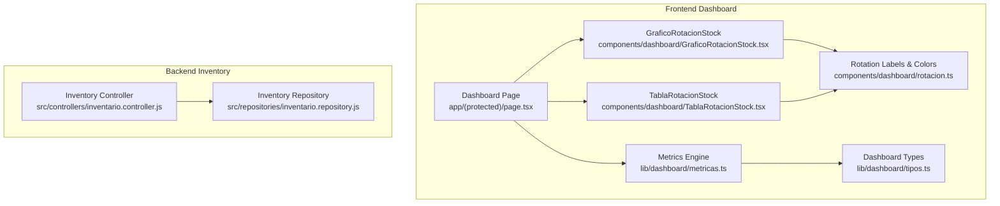
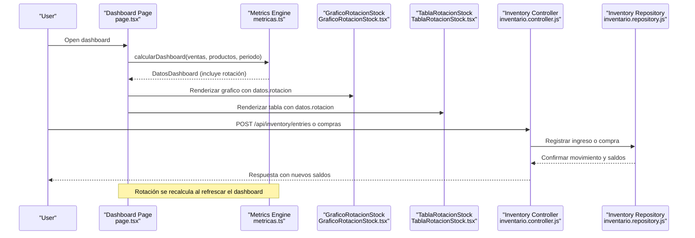
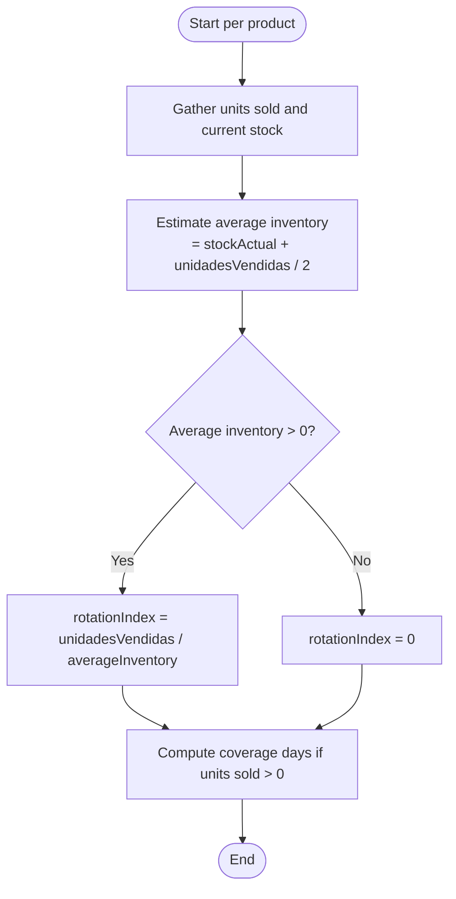
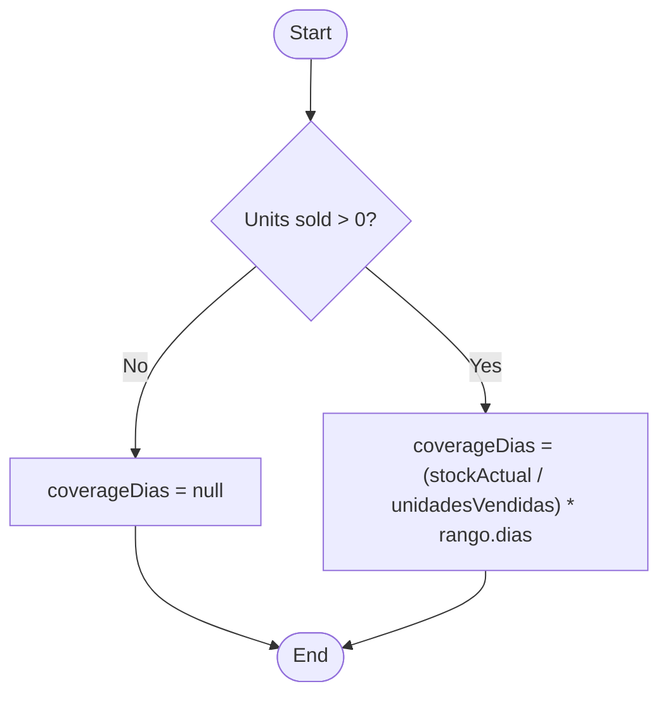
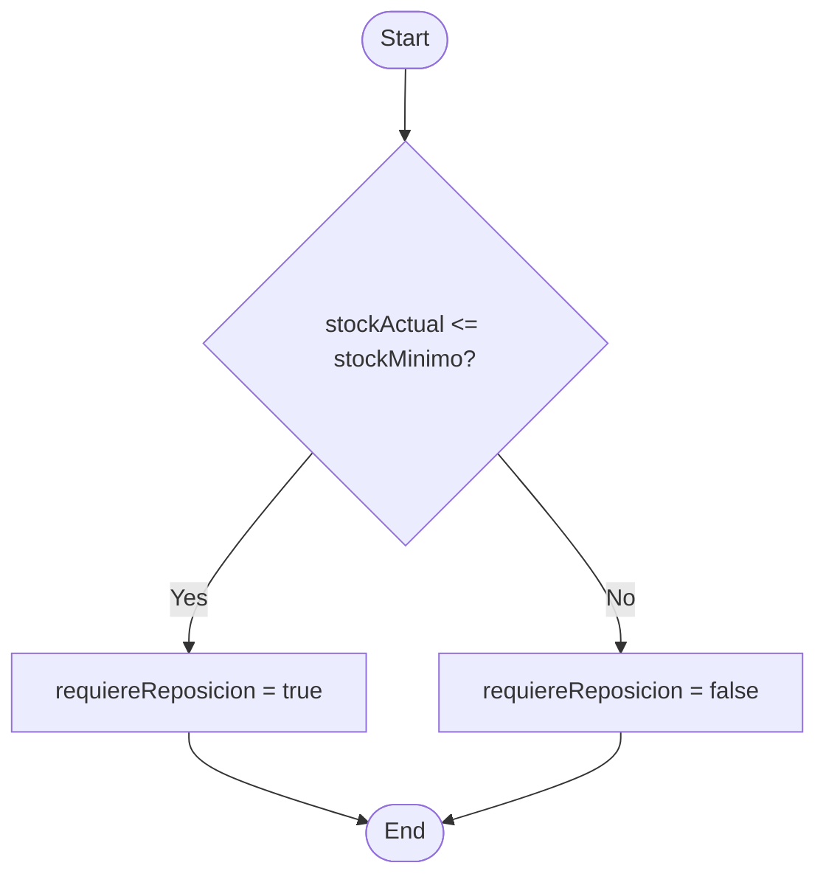
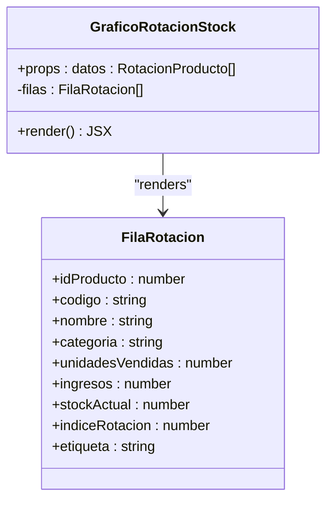
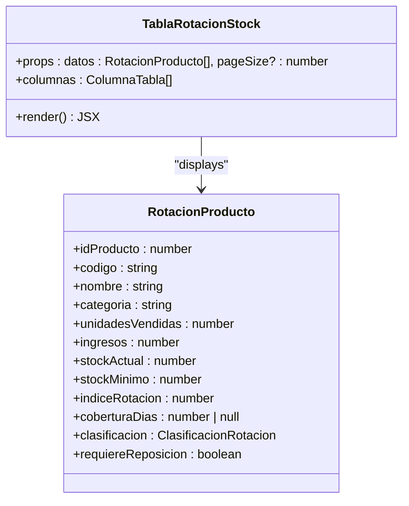
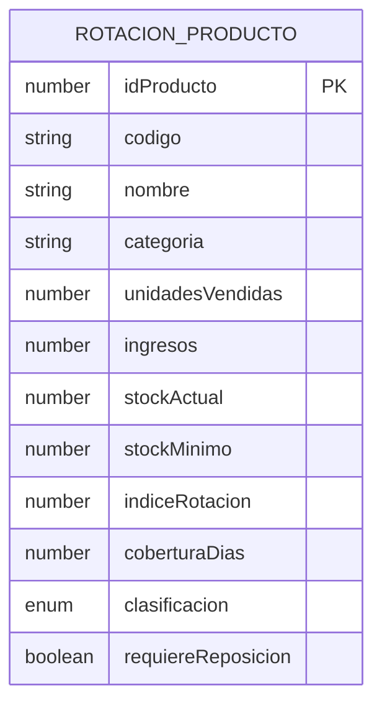
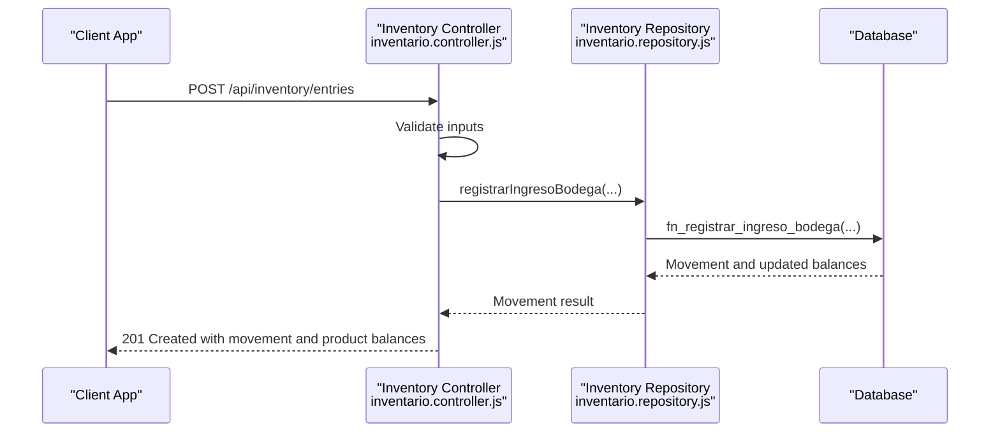
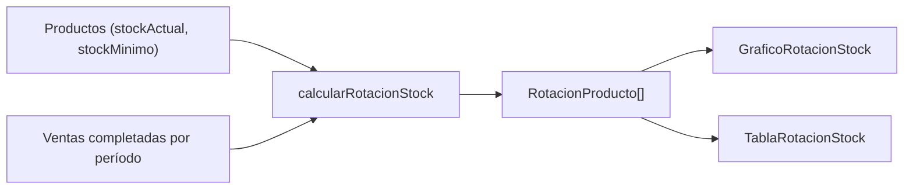

# Inventory Rotation Metrics

<cite>
**Referenced Files in This Document**
- [GraficoRotacionStock.tsx](file://simoapp/components/dashboard/GraficoRotacionStock.tsx)
- [TablaRotacionStock.tsx](file://simoapp/components/dashboard/TablaRotacionStock.tsx)
- [rotacion.ts](file://simoapp/components/dashboard/rotacion.ts)
- [metricas.ts](file://simoapp/lib/dashboard/metricas.ts)
- [tipos.ts](file://simoapp/lib/dashboard/tipos.ts)
- [page.tsx](file://simoapp/app/(protected)/page.tsx)
- [inventario.controller.js](file://backend/src/controllers/inventario.controller.js)
- [inventario.repository.js](file://backend/src/repositories/inventario.repository.js)
</cite>

## Table of Contents
1. [Introduction](#introduction)
2. [Project Structure](#project-structure)
3. [Core Components](#core-components)
4. [Architecture Overview](#architecture-overview)
5. [Detailed Component Analysis](#detailed-component-analysis)
6. [Dependency Analysis](#dependency-analysis)
7. [Performance Considerations](#performance-considerations)
8. [Troubleshooting Guide](#troubleshooting-guide)
9. [Conclusion](#conclusion)

## Introduction
This document explains the inventory rotation metrics system used by the operational dashboard. It covers:
- The rotation index calculation formula and its average inventory estimation.
- Stock coverage days computation based on sales velocity.
- Reorder point detection logic for low stock alerts.
- The GraficoRotacionStock bar chart and TablaRotacionStock table components, including data structures, sorting, and filtering behavior.
- Configuration of rotation thresholds, alerting signals, and integration with the inventory management system.
- Performance considerations for large product catalogs and real-time stock synchronization.

The implementation is primarily frontend-driven: rotation metrics are computed from a product catalog and completed sales history within a selected date range, while the backend provides inventory movement and purchase operations that update current stock levels.

## Project Structure
The rotation metrics feature spans frontend visualization, metric computation, type definitions, and backend inventory operations:

**Diagram sources**
- [page.tsx:312-320](file://simoapp/app/(protected)/page.tsx#L312-L320)
- [GraficoRotacionStock.tsx:1-159](file://simoapp/components/dashboard/GraficoRotacionStock.tsx#L1-L159)
- [TablaRotacionStock.tsx:1-115](file://simoapp/components/dashboard/TablaRotacionStock.tsx#L1-L115)
- [rotacion.ts:1-40](file://simoapp/components/dashboard/rotacion.ts#L1-L40)
- [metricas.ts:233-277](file://simoapp/lib/dashboard/metricas.ts#L233-L277)
- [tipos.ts:54-71](file://simoapp/lib/dashboard/tipos.ts#L54-L71)
- [inventario.controller.js:48-147](file://backend/src/controllers/inventario.controller.js#L48-L147)
- [inventario.repository.js:12-27](file://backend/src/repositories/inventario.repository.js#L12-L27)

**Section sources**
- [page.tsx:312-331](file://simoapp/app/(protected)/page.tsx#L312-L331)
- [GraficoRotacionStock.tsx:1-159](file://simoapp/components/dashboard/GraficoRotacionStock.tsx#L1-L159)
- [TablaRotacionStock.tsx:1-115](file://simoapp/components/dashboard/TablaRotacionStock.tsx#L1-L115)
- [rotacion.ts:1-40](file://simoapp/components/dashboard/rotacion.ts#L1-L40)
- [metricas.ts:1-334](file://simoapp/lib/dashboard/metricas.ts#L1-L334)
- [tipos.ts:1-90](file://simoapp/lib/dashboard/tipos.ts#L1-L90)
- [inventario.controller.js:1-269](file://backend/src/controllers/inventario.controller.js#L1-L269)
- [inventario.repository.js:1-102](file://backend/src/repositories/inventario.repository.js#L1-L102)

## Core Components
- **GraficoRotacionStock**: Horizontal bar chart showing the top rotating products during the selected period. It filters out zero-sales products, limits to a configured top count, and colors bars by rotation classification.
- **TablaRotacionStock**: Full product detail table with sortable columns for product name, units sold, stock, rotation index, coverage days, and classification. It highlights reorder needs visually.
- **Metricas Engine**: Pure functions computing dashboard metrics, including rotation index, coverage days, classification, and reorder flags.
- **Types**: Shared TypeScript interfaces defining rotation product records, classifications, and dashboard data shapes.
- **Backend Inventory**: Controllers and repositories handling inventory entries and purchases, which update current stock levels consumed by the dashboard.

Key responsibilities:
- Compute rotation index as units sold divided by estimated average inventory.
- Estimate average inventory using current stock plus half of units sold in the period.
- Calculate stock coverage days based on daily sales velocity over the selected range.
- Detect reorder points when current stock is at or below minimum stock.
- Classify rotation into high, medium, low, or no movement.

**Section sources**
- [GraficoRotacionStock.tsx:29-57](file://simoapp/components/dashboard/GraficoRotacionStock.tsx#L29-L57)
- [TablaRotacionStock.tsx:14-113](file://simoapp/components/dashboard/TablaRotacionStock.tsx#L14-L113)
- [metricas.ts:216-277](file://simoapp/lib/dashboard/metricas.ts#L216-L277)
- [tipos.ts:54-71](file://simoapp/lib/dashboard/tipos.ts#L54-L71)
- [inventario.controller.js:48-147](file://backend/src/controllers/inventario.controller.js#L48-L147)
- [inventario.repository.js:12-27](file://backend/src/repositories/inventario.repository.js#L12-L27)

## Architecture Overview
The dashboard page requests metrics, computes rotation data, and renders both the chart and table. Backend inventory operations update stock levels that feed into these calculations.

**Diagram sources**
- [page.tsx:312-320](file://simoapp/app/(protected)/page.tsx#L312-L320)
- [metricas.ts:316-333](file://simoapp/lib/dashboard/metricas.ts#L316-L333)
- [GraficoRotacionStock.tsx:47-133](file://simoapp/components/dashboard/GraficoRotacionStock.tsx#L47-L133)
- [TablaRotacionStock.tsx:102-113](file://simoapp/components/dashboard/TablaRotacionStock.tsx#L102-L113)
- [inventario.controller.js:48-147](file://backend/src/controllers/inventario.controller.js#L48-L147)
- [inventario.repository.js:12-27](file://backend/src/repositories/inventario.repository.js#L12-L27)

## Detailed Component Analysis

### Rotation Index Calculation Formula
The rotation index measures how many times inventory turns over during the selected period:
- Formula: rotation index = units sold ÷ average inventory.
- Average inventory estimation: current stock + (units sold ÷ 2). This assumes uniform depletion across the period.
- If average inventory is zero, the rotation index is set to zero.

**Diagram sources**
- [metricas.ts:252-277](file://simoapp/lib/dashboard/metricas.ts#L252-L277)

**Section sources**
- [metricas.ts:226-277](file://simoapp/lib/dashboard/metricas.ts#L226-L277)

### Stock Coverage Days Computation
Coverage days estimate how long current stock will last given the period’s sales velocity:
- If units sold in the period are greater than zero: coverage days = (current stock ÷ units sold) × number of days in the selected range.
- If no units were sold, coverage days is null.

**Diagram sources**
- [metricas.ts:269-271](file://simoapp/lib/dashboard/metricas.ts#L269-L271)

**Section sources**
- [metricas.ts:269-271](file://simoapp/lib/dashboard/metricas.ts#L269-L271)

### Reorder Point Detection Logic
Reorder detection compares current stock against minimum stock:
- If current stock is less than or equal to minimum stock, the product requires reordering.
- The table highlights such items with an alert symbol and distinct styling.

**Diagram sources**
- [metricas.ts:273-273](file://simoapp/lib/dashboard/metricas.ts#L273-L273)
- [TablaRotacionStock.tsx:50-61](file://simoapp/components/dashboard/TablaRotacionStock.tsx#L50-L61)

**Section sources**
- [metricas.ts:273-273](file://simoapp/lib/dashboard/metricas.ts#L273-L273)
- [TablaRotacionStock.tsx:50-61](file://simoapp/components/dashboard/TablaRotacionStock.tsx#L50-L61)

### GraficoRotacionStock Bar Chart
Responsibilities:
- Accepts an array of rotation product records.
- Filters out products with zero units sold.
- Limits display to a configured top count.
- Renders horizontal bars colored by rotation classification.
- Shows a legend with threshold details for high, medium, and low rotation.
- Tooltip displays product name, code, category, rotation index, units sold, revenue, and current stock.

Data structure:
- Input: array of `RotacionProducto`.
- Internal row shape adds a truncated label for axis display.

Sorting and filtering:
- Filtering: only products with positive units sold enter the chart.
- Top limit: controlled by a constant; default shows seven products.

Threshold configuration:
- High rotation threshold: 0.75.
- Medium rotation threshold: 0.3.
- Low rotation: below medium threshold.
- No movement: zero units sold (not shown in chart, appears in table).

**Diagram sources**
- [GraficoRotacionStock.tsx:29-57](file://simoapp/components/dashboard/GraficoRotacionStock.tsx#L29-L57)
- [GraficoRotacionStock.tsx:71-133](file://simoapp/components/dashboard/GraficoRotacionStock.tsx#L71-L133)

**Section sources**
- [GraficoRotacionStock.tsx:29-133](file://simoapp/components/dashboard/GraficoRotacionStock.tsx#L29-L133)
- [metricas.ts:37-44](file://simoapp/lib/dashboard/metricas.ts#L37-L44)

### TablaRotacionStock Table
Responsibilities:
- Displays all products with rotation metrics.
- Provides sortable columns for product, units sold, stock, rotation index, coverage days, and classification.
- Highlights reorder needs visually.
- Supports pagination with configurable page sizes.

Data structure:
- Input: array of `RotacionProducto`.
- Columns map to fields like nombre, unidadesVendidas, stockActual, indiceRotacion, coberturaDias, clasificacion.

Sorting capabilities:
- All key columns are marked sortable.
- Initial sort defaults to rotation index descending.

Filtering options:
- The table does not implement client-side filters beyond sorting and pagination.
- Classification badges provide visual grouping but not interactive filtering.

Low stock alerts:
- Items requiring reorder show an alert symbol and emphasis.

**Diagram sources**
- [TablaRotacionStock.tsx:14-113](file://simoapp/components/dashboard/TablaRotacionStock.tsx#L14-L113)
- [tipos.ts:54-71](file://simoapp/lib/dashboard/tipos.ts#L54-L71)

**Section sources**
- [TablaRotacionStock.tsx:14-113](file://simoapp/components/dashboard/TablaRotacionStock.tsx#L14-L113)
- [tipos.ts:54-71](file://simoapp/lib/dashboard/tipos.ts#L54-L71)

### Data Structures
The core data structure for rotation metrics is `RotacionProducto`, which includes identifiers, descriptive fields, sales aggregates, stock levels, computed metrics, classification, and reorder flag.

**Diagram sources**
- [tipos.ts:54-71](file://simoapp/lib/dashboard/tipos.ts#L54-L71)

**Section sources**
- [tipos.ts:54-71](file://simoapp/lib/dashboard/tipos.ts#L54-L71)

### Rotation Threshold Configuration
Thresholds define rotation classification:
- High rotation: rotation index ≥ 0.75.
- Medium rotation: rotation index ≥ 0.3.
- Low rotation: rotation index < 0.3.
- No movement: units sold equals zero.

These thresholds are constants and can be adjusted to reflect business policy.

**Section sources**
- [metricas.ts:40-44](file://simoapp/lib/dashboard/metricas.ts#L40-L44)
- [metricas.ts:216-224](file://simoapp/lib/dashboard/metricas.ts#L216-L224)

### Low Stock Alerts
Alerts are triggered when current stock is at or below minimum stock:
- The table marks such rows with an alert symbol and emphasizes the stock value.
- The reorder flag is included in the data structure for programmatic use.

**Section sources**
- [metricas.ts:273-273](file://simoapp/lib/dashboard/metricas.ts#L273-L273)
- [TablaRotacionStock.tsx:50-61](file://simoapp/components/dashboard/TablaRotacionStock.tsx#L50-L61)

### Integration with Inventory Management System
The backend supports inventory entry and purchase confirmation, updating stock balances that feed into the dashboard’s rotation calculations:
- Inventory entry endpoint validates inputs, resolves product IDs, and records movements via repository functions.
- Purchase endpoint registers purchase lines and optionally confirms them, invoking stored procedures to update stock.

**Diagram sources**
- [inventario.controller.js:48-147](file://backend/src/controllers/inventario.controller.js#L48-L147)
- [inventario.repository.js:12-27](file://backend/src/repositories/inventario.repository.js#L12-L27)

**Section sources**
- [inventario.controller.js:48-147](file://backend/src/controllers/inventario.controller.js#L48-L147)
- [inventario.repository.js:12-27](file://backend/src/repositories/inventario.repository.js#L12-L27)

## Dependency Analysis
The rotation metrics depend on:
- Product catalog data with current stock and minimum stock.
- Completed sales history filtered by the selected date range.
- Constants for thresholds and top product count.
- Visualization components consuming the computed rotation records.

**Diagram sources**
- [metricas.ts:233-277](file://simoapp/lib/dashboard/metricas.ts#L233-L277)
- [GraficoRotacionStock.tsx:47-133](file://simoapp/components/dashboard/GraficoRotacionStock.tsx#L47-L133)
- [TablaRotacionStock.tsx:102-113](file://simoapp/components/dashboard/TablaRotacionStock.tsx#L102-L113)

**Section sources**
- [metricas.ts:233-277](file://simoapp/lib/dashboard/metricas.ts#L233-L277)
- [GraficoRotacionStock.tsx:47-133](file://simoapp/components/dashboard/GraficoRotacionStock.tsx#L47-L133)
- [TablaRotacionStock.tsx:102-113](file://simoapp/components/dashboard/TablaRotacionStock.tsx#L102-L113)

## Performance Considerations
Optimization strategies for large product catalogs and real-time stock synchronization:

- Pre-aggregate sales by product:
  - Use a map keyed by product ID to accumulate units sold and revenue per product before mapping to rotation records.
  - This avoids repeated lookups and reduces complexity to O(n + m), where n is total sale items and m is number of products.

- Limit chart rendering:
  - Show only the top N rotating products in the chart to reduce DOM nodes and improve responsiveness.

- Avoid unnecessary recomputation:
  - Cache computed rotation results when inputs (products, ventas, rango) do not change.
  - Debounce or throttle dashboard refreshes if stock updates occur frequently.

- Optimize date filtering:
  - Filter sales by timestamp ranges efficiently; avoid creating excessive Date objects inside tight loops.

- Real-time stock synchronization:
  - After inventory entries or purchases, invalidate or refetch dashboard metrics to ensure rotation calculations reflect updated stock levels.
  - Consider server-side aggregation endpoints for very large catalogs to offload computation.

[No sources needed since this section provides general guidance]

## Troubleshooting Guide
Common issues and resolutions:

- Zero rotation values:
  - Occurs when no completed sales exist for a product in the selected period.
  - These products are excluded from the chart and appear in the table with “no movement” classification.

- Negative or null coverage days:
  - Coverage days is null when no units were sold; this is expected.
  - Ensure the selected date range is valid and includes completed sales.

- Reorder alerts not appearing:
  - Verify that current stock is correctly set and minimum stock is defined.
  - Check that stock updates from backend inventory operations are reflected in the catalog data used by the dashboard.

- Chart shows fewer products than expected:
  - Only products with positive units sold are displayed.
  - The chart is limited to a configured top count; check the threshold constant.

- Slow dashboard load with large catalogs:
  - Reduce the number of products processed by pre-filtering or limiting the dataset.
  - Implement pagination or virtualization in the table if necessary.

**Section sources**
- [metricas.ts:216-277](file://simoapp/lib/dashboard/metricas.ts#L216-L277)
- [GraficoRotacionStock.tsx:52-65](file://simoapp/components/dashboard/GraficoRotacionStock.tsx#L52-L65)
- [TablaRotacionStock.tsx:74-86](file://simoapp/components/dashboard/TablaRotacionStock.tsx#L74-L86)

## Conclusion
The inventory rotation metrics system provides actionable insights into product turnover, stock coverage, and reorder needs. The rotation index uses a practical average inventory estimation based on current stock and sales velocity. The dashboard components visualize top performers and detailed metrics, while backend inventory operations keep stock levels accurate. With careful threshold configuration and performance optimizations, the system scales to support large catalogs and near-real-time decision-making.

[No sources needed since this section summarizes without analyzing specific files]