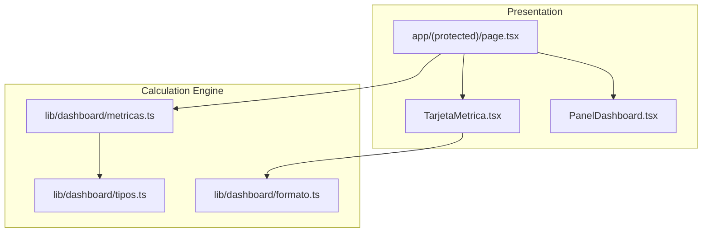
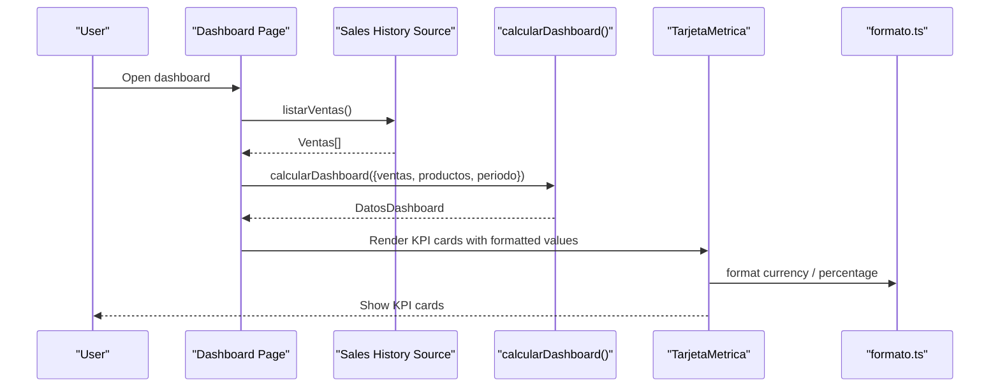
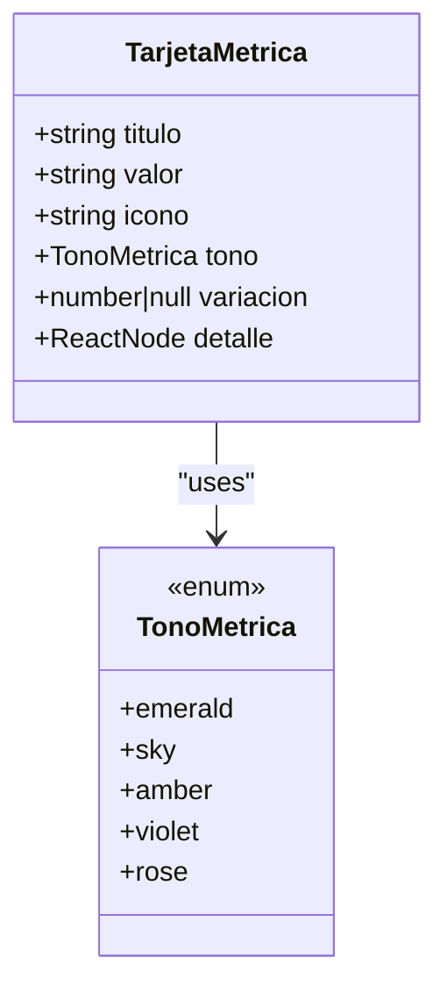
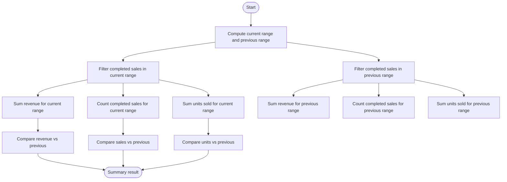
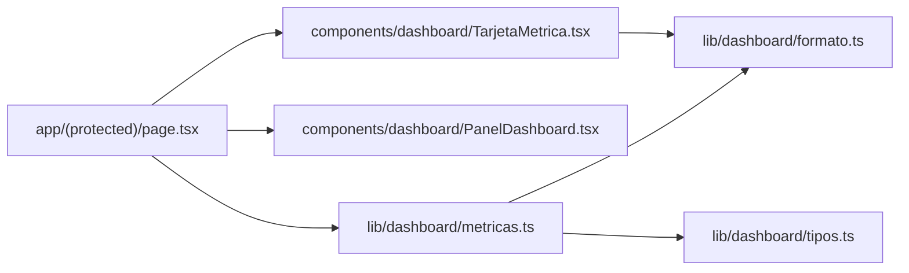

# KPI Cards & Key Metrics

<cite>
**Referenced Files in This Document**
- [TarjetaMetrica.tsx](file://simoapp/components/dashboard/TarjetaMetrica.tsx)
- [PanelDashboard.tsx](file://simoapp/components/dashboard/PanelDashboard.tsx)
- [page.tsx](file://simoapp/app/(protected)/page.tsx)
- [metricas.ts](file://simoapp/lib/dashboard/metricas.ts)
- [formato.ts](file://simoapp/lib/dashboard/formato.ts)
- [tipos.ts](file://simoapp/lib/dashboard/tipos.ts)
</cite>

## Table of Contents
1. [Introduction](#introduction)
2. [Project Structure](#project-structure)
3. [Core Components](#core-components)
4. [Architecture Overview](#architecture-overview)
5. [Detailed Component Analysis](#detailed-component-analysis)
6. [Dependency Analysis](#dependency-analysis)
7. [Performance Considerations](#performance-considerations)
8. [Troubleshooting Guide](#troubleshooting-guide)
9. [Conclusion](#conclusion)

## Introduction
This document explains the KPI cards and key performance indicators used by the operational dashboard. It covers the four main metrics: revenue, completed sales, units sold, and average rotation rate. It also documents the TarjetaMetrica component’s styling options, icon configuration, variation indicators, metric calculations, period-over-period comparison logic, threshold-based alerting for stock rotation, currency formatting, automated refresh behavior, integration with the dashboard calculation engine, and handling of edge cases such as negative values or zero denominators.

## Project Structure
The KPI system is composed of a presentation layer (cards and panels), a page that wires data sources to the UI, and a pure calculation layer that computes metrics from sales history and catalog stock.

**Diagram sources**
- [TarjetaMetrica.tsx:1-110](file://simoapp/components/dashboard/TarjetaMetrica.tsx#L1-L110)
- [PanelDashboard.tsx:1-40](file://simoapp/components/dashboard/PanelDashboard.tsx#L1-L40)
- [page.tsx:1-336](file://simoapp/app/(protected)/page.tsx#L1-L336)
- [metricas.ts:1-334](file://simoapp/lib/dashboard/metricas.ts#L1-L334)
- [formato.ts:1-67](file://simoapp/lib/dashboard/formato.ts#L1-L67)
- [tipos.ts:1-89](file://simoapp/lib/dashboard/tipos.ts#L1-L89)

**Section sources**
- [TarjetaMetrica.tsx:1-110](file://simoapp/components/dashboard/TarjetaMetrica.tsx#L1-L110)
- [PanelDashboard.tsx:1-40](file://simoapp/components/dashboard/PanelDashboard.tsx#L1-L40)
- [page.tsx:1-336](file://simoapp/app/(protected)/page.tsx#L1-L336)
- [metricas.ts:1-334](file://simoapp/lib/dashboard/metricas.ts#L1-L334)
- [formato.ts:1-67](file://simoapp/lib/dashboard/formato.ts#L1-L67)
- [tipos.ts:1-89](file://simoapp/lib/dashboard/tipos.ts#L1-L89)

## Core Components
- TarjetaMetrica: Renders a single KPI card with title, value, module icon, optional tone, optional period-over-period variation badge, and optional detail text.
- PanelDashboard: A reusable panel container for dashboard sections; it standardizes borders, backgrounds, titles, descriptions, and action areas.
- Dashboard page: Loads sales history and product catalog, calls the calculation engine, and renders four KPI cards plus charts and tables.
- Calculation engine: Computes ranges, series, summaries, rotation per product, and payment methods using pure functions over sales and catalog data.
- Formatting utilities: Provide consistent currency, number, date, percentage, and index formatting.

Key responsibilities:
- Data loading and refresh are handled on the page.
- Calculations are isolated in the metric library.
- Presentation components remain stateless and focused on display.

**Section sources**
- [TarjetaMetrica.tsx:18-109](file://simoapp/components/dashboard/TarjetaMetrica.tsx#L18-L109)
- [PanelDashboard.tsx:7-39](file://simoapp/components/dashboard/PanelDashboard.tsx#L7-L39)
- [page.tsx:53-113](file://simoapp/app/(protected)/page.tsx#L53-L113)
- [metricas.ts:183-210](file://simoapp/lib/dashboard/metricas.ts#L183-L210)
- [formato.ts:5-66](file://simoapp/lib/dashboard/formato.ts#L5-L66)

## Architecture Overview
The dashboard follows a clear separation between UI and computation:

**Diagram sources**
- [page.tsx:64-113](file://simoapp/app/(protected)/page.tsx#L64-L113)
- [metricas.ts:316-333](file://simoapp/lib/dashboard/metricas.ts#L316-L333)
- [TarjetaMetrica.tsx:30-109](file://simoapp/components/dashboard/TarjetaMetrica.tsx#L30-L109)
- [formato.ts:5-66](file://simoapp/lib/dashboard/formato.ts#L5-L66)

## Detailed Component Analysis

### TarjetaMetrica Component
TarjetaMetrica is a presentational component that displays one KPI. It accepts:
- titulo: The label shown above the value.
- valor: The formatted value string.
- icono: An SVG path string used to render a small module icon next to the title.
- tono: Visual tone for the icon background and text. Supported tones are emerald, sky, amber, violet, and rose.
- variacion: Optional numeric percentage change compared to the previous period; null means no comparison available; undefined means do not show a comparison badge at all.
- detalle: Optional secondary text below the value.

Styling and visual behavior:
- The card uses a rounded border, white/dark background, and padding.
- The icon is rendered inside a colored square whose color depends on tono.
- The variation badge shows an arrow and a percentage when variacion is provided and not null.
- If variacion is undefined, no comparison badge is shown.
- If variacion is null, a “no prior period” indicator is displayed.
- Positive changes use an upward arrow and green tones; negative changes rotate the arrow and use red tones; near-zero changes use neutral gray.

Variation logic:
- The component determines whether there is a valid comparison and whether the change is positive, near-zero, or negative.
- Near-zero is defined as an absolute value less than 0.05 percent.
- The percentage is formatted without a sign by default.

Icon configuration:
- The icon is passed as an SVG path string and rendered inside a fixed-size SVG element.
- The dashboard page defines specific icon paths for revenue, completed sales, units sold, and rotation.

Customization examples:
- Change tono to match business roles:
  - Finance: emerald for revenue, sky for completed sales.
  - Operations: violet for units sold, amber for rotation.
- Use detalle to add context, such as ticket average or cancellation counts.
- Omit variacion to hide comparisons for metrics like average rotation where comparing against a prior period may be misleading.

Edge case handling:
- If variacion is null, the component avoids showing misleading directional arrows.
- If variacion is undefined, the component does not show any comparison badge.
- Negative values are supported through the arrow rotation and red tone.

**Section sources**
- [TarjetaMetrica.tsx:8-28](file://simoapp/components/dashboard/TarjetaMetrica.tsx#L8-L28)
- [TarjetaMetrica.tsx:30-109](file://simoapp/components/dashboard/TarjetaMetrica.tsx#L30-L109)
- [page.tsx:40-48](file://simoapp/app/(protected)/page.tsx#L40-L48)
- [page.tsx:248-278](file://simoapp/app/(protected)/page.tsx#L248-L278)

#### TarjetaMetrica Class Diagram

**Diagram sources**
- [TarjetaMetrica.tsx:8-28](file://simoapp/components/dashboard/TarjetaMetrica.tsx#L8-L28)
- [TarjetaMetrica.tsx:30-109](file://simoapp/components/dashboard/TarjetaMetrica.tsx#L30-L109)

### Dashboard Page Integration
The dashboard page loads sales history, optionally detects mock data, allows manual refresh, computes dashboard data, and renders four KPI cards:
- Revenue: formatted currency with completion count in detail.
- Completed sales: integer count with average ticket in detail.
- Units sold: integer count with cancellation count and amount in detail.
- Average rotation: computed average rotation across products with movement, with a detail indicating how many products require replenishment.

Data flow:
- Sales history is fetched once on mount and can be refreshed via a button.
- The page passes ventas, productos, and selected periodo to calcularDashboard.
- The returned summary drives the first three KPI cards; rotation-related fields drive the fourth card.

Automated refresh cycles:
- There is no automatic interval in the current implementation.
- Refresh is triggered manually by the user through the “Actualizar” button.
- To implement automated refresh, wrap the fetch logic with a timer that periodically calls the same update function and updates the timestamp used for calculation.

Currency and number formatting:
- Currency uses Colombian pesos without cents.
- Numbers are formatted without decimals for counts.
- Percentages are formatted with one decimal place and no sign unless explicitly requested.

**Section sources**
- [page.tsx:53-113](file://simoapp/app/(protected)/page.tsx#L53-L113)
- [page.tsx:181-200](file://simoapp/app/(protected)/page.tsx#L181-L200)
- [page.tsx:248-278](file://simoapp/app/(protected)/page.tsx#L248-L278)
- [formato.ts:5-66](file://simoapp/lib/dashboard/formato.ts#L5-L66)

### Calculation Engine: Metric Definitions and Formulas
The calculation engine provides pure functions that compute dashboard data from sales history and product catalog.

Period selection and ranges:
- Period options include 7 days, 30 days, 90 days, and current month.
- Ranges are calculated relative to today, including today.
- The previous range has the same duration and ends one day before the current range starts.

Revenue:
- Revenue equals the sum of totals for completed sales within the current range.
- Canceled sales do not contribute to revenue.
- Period-over-period revenue change is calculated as the percentage difference between current and previous range revenues.

Completed sales:
- Completed sales equal the count of sales with status COMPLETADA in the current range.
- Period-over-period change compares the count with the previous range.

Units sold:
- Units sold equal the sum of item quantities across completed sales in the current range.
- Period-over-period change compares unit totals with the previous range.

Average ticket:
- Average ticket equals total revenue divided by the number of completed sales.
- If there are no completed sales, the average ticket is zero.

Rotation rate:
- Rotation index equals units sold divided by estimated average inventory.
- Estimated average inventory equals current stock plus half of units sold during the period.
- If estimated average inventory is zero, the rotation index is zero.
- Classification thresholds:
  - High rotation: index greater than or equal to 0.75.
  - Medium rotation: index greater than or equal to 0.3.
  - Low rotation: otherwise.
  - No movement: units sold equals zero.
- Coverage days estimate how long current stock lasts at the current selling pace.

Comparison formula:
- Percentage change equals (current minus previous) divided by previous, multiplied by 100.
- If the previous value is zero or negative, the change is null to avoid misleading percentages.

Dashboard entry point:
- calcularDashboard returns range, granularity, sales summary, time series, rotation per product, and payment method usage.

**Section sources**
- [metricas.ts:30-44](file://simoapp/lib/dashboard/metricas.ts#L30-L44)
- [metricas.ts:84-108](file://simoapp/lib/dashboard/metricas.ts#L84-L108)
- [metricas.ts:178-210](file://simoapp/lib/dashboard/metricas.ts#L178-L210)
- [metricas.ts:216-277](file://simoapp/lib/dashboard/metricas.ts#L216-L277)
- [metricas.ts:316-333](file://simoapp/lib/dashboard/metricas.ts#L316-L333)

#### Metric Calculation Flowchart

**Diagram sources**
- [metricas.ts:178-210](file://simoapp/lib/dashboard/metricas.ts#L178-L210)

### Threshold-Based Alerting for Rotation
Thresholds classify rotation into high, medium, low, or no movement:
- High rotation indicates strong turnover relative to inventory.
- Medium rotation indicates moderate turnover.
- Low rotation indicates slow turnover.
- No movement indicates zero units sold.

Alerting signals:
- Products requiring replenishment are identified when current stock is less than or equal to minimum stock.
- The dashboard page aggregates how many products require replenishment and shows this in the rotation card detail.

Usage:
- The rotation chart colors bars by classification.
- The rotation table highlights coverage and replenishment needs.

**Section sources**
- [metricas.ts:40-44](file://simoapp/lib/dashboard/metricas.ts#L40-L44)
- [metricas.ts:216-277](file://simoapp/lib/dashboard/metricas.ts#L216-L277)
- [page.tsx:115-121](file://simoapp/app/(protected)/page.tsx#L115-L121)

### Currency Formats and Customization
Formatting utilities centralize locale-aware formatting:
- Currency: Colombian pesos with no fractional digits.
- Numbers: Integer formatting for counts.
- Decimals: Two decimal places for indices.
- Dates: Short dates and full date-time formats.
- Percentages: One decimal place, optional sign control.
- Axis currency: Abbreviated thousands and millions for chart axes.

Customization guidance:
- To support other currencies, replace the currency formatter with the desired locale and currency code.
- To change decimal precision, adjust the relevant formatters.
- Ensure consistency across cards, charts, and tooltips by reusing these formatters.

**Section sources**
- [formato.ts:5-66](file://simoapp/lib/dashboard/formato.ts#L5-L66)
- [page.tsx:29-34](file://simoapp/app/(protected)/page.tsx#L29-L34)

### Handling Edge Cases
Negative values:
- Percentage change returns null if the previous value is zero or negative, preventing misleading directional indicators.
- The card handles null by showing a “no prior period” indicator instead of a percentage.

Zero denominators:
- Rotation index is zero when estimated average inventory is zero.
- Coverage days is null when no units were sold.
- Average ticket is zero when there are no completed sales.

No comparison baseline:
- If variacion is undefined, the card does not show a comparison badge.
- If variacion is null, the card shows a neutral indicator.

**Section sources**
- [metricas.ts:178-181](file://simoapp/lib/dashboard/metricas.ts#L178-L181)
- [metricas.ts:204-204](file://simoapp/lib/dashboard/metricas.ts#L204-L204)
- [metricas.ts:256-271](file://simoapp/lib/dashboard/metricas.ts#L256-L271)
- [TarjetaMetrica.tsx:38-45](file://simoapp/components/dashboard/TarjetaMetrica.tsx#L38-L45)
- [TarjetaMetrica.tsx:76-104](file://simoapp/components/dashboard/TarjetaMetrica.tsx#L76-L104)

## Dependency Analysis
The following diagram shows how components and libraries depend on each other:

**Diagram sources**
- [page.tsx:18-38](file://simoapp/app/(protected)/page.tsx#L18-L38)
- [TarjetaMetrica.tsx:6-6](file://simoapp/components/dashboard/TarjetaMetrica.tsx#L6-L6)
- [metricas.ts:10-28](file://simoapp/lib/dashboard/metricas.ts#L10-L28)
- [formato.ts:1-67](file://simoapp/lib/dashboard/formato.ts#L1-L67)
- [tipos.ts:1-89](file://simoapp/lib/dashboard/tipos.ts#L1-L89)

Coupling and cohesion:
- The page coordinates data fetching and rendering but delegates computation to metricas.ts.
- TarjetaMetrica is decoupled from data sources and only consumes formatted strings and simple props.
- Formatting is centralized, reducing duplication and ensuring consistency.

Potential circular dependencies:
- None observed; imports flow from UI to calculation and formatting layers.

External dependencies:
- Recharts is used elsewhere in the dashboard for charts, but KPI cards themselves do not depend on charting libraries.

**Section sources**
- [page.tsx:18-38](file://simoapp/app/(protected)/page.tsx#L18-L38)
- [TarjetaMetrica.tsx:1-110](file://simoapp/components/dashboard/TarjetaMetrica.tsx#L1-L110)
- [metricas.ts:1-334](file://simoapp/lib/dashboard/metricas.ts#L1-L334)
- [formato.ts:1-67](file://simoapp/lib/dashboard/formato.ts#L1-L67)
- [tipos.ts:1-89](file://simoapp/lib/dashboard/tipos.ts#L1-L89)

## Performance Considerations
- Calculations are pure functions operating on arrays and maps, which is efficient for typical dashboard sizes.
- Time series construction creates all time buckets even when empty to keep axes continuous; this is intentional for readability.
- Rotation calculation uses a map to aggregate sales per product, avoiding repeated scans.
- Avoid unnecessary re-renders by keeping TarjetaMetrica stateless and passing preformatted values.
- For large datasets, consider memoizing expensive computations and limiting the number of products shown in rotation views.

[No sources needed since this section provides general guidance]

## Troubleshooting Guide
Common issues and resolutions:
- Missing sales history:
  - Symptom: KPI cards show zeros or “no prior period.”
  - Cause: Sales history fetch failed or mock data is disabled.
  - Resolution: Check network connectivity, verify the sales API, and use the manual refresh button.
- Misleading percentage changes:
  - Symptom: Large spikes or missing arrows.
  - Cause: Previous period had zero or negative values.
  - Resolution: The engine returns null for such cases; the card shows a neutral indicator.
- Zero rotation index:
  - Symptom: Rotation shows 0x.
  - Cause: Estimated average inventory is zero or no units sold.
  - Resolution: Verify catalog stock and sales data; check coverage days and classification.
- Inconsistent formatting:
  - Symptom: Different number or currency formats across components.
  - Cause: Using ad-hoc formatters instead of shared utilities.
  - Resolution: Use formatoMoneda, formatoNumero, and formatearPorcentaje consistently.

**Section sources**
- [page.tsx:64-102](file://simoapp/app/(protected)/page.tsx#L64-L102)
- [metricas.ts:178-181](file://simoapp/lib/dashboard/metricas.ts#L178-L181)
- [metricas.ts:256-271](file://simoapp/lib/dashboard/metricas.ts#L256-L271)
- [formato.ts:5-66](file://simoapp/lib/dashboard/formato.ts#L5-L66)

## Conclusion
The KPI system combines a clean presentation layer with a robust calculation engine. TarjetaMetrica provides flexible, accessible cards with clear variation indicators and customizable styling. The calculation engine ensures accurate metrics, safe comparisons, and meaningful rotation classifications. Formatting utilities maintain consistency across the dashboard. By following the guidelines here, teams can customize KPI displays for different business roles, configure currency formats, set up automated refresh cycles, and handle edge cases gracefully while integrating smoothly with the dashboard calculation engine.