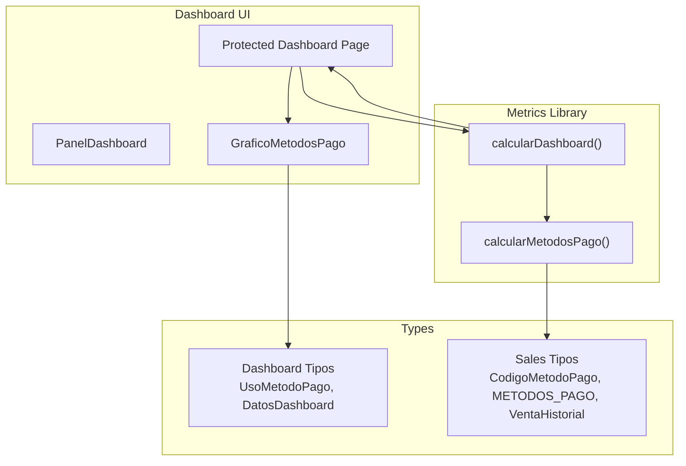
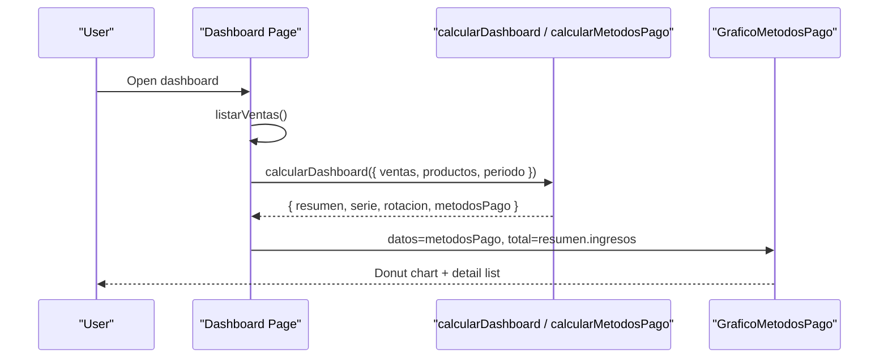
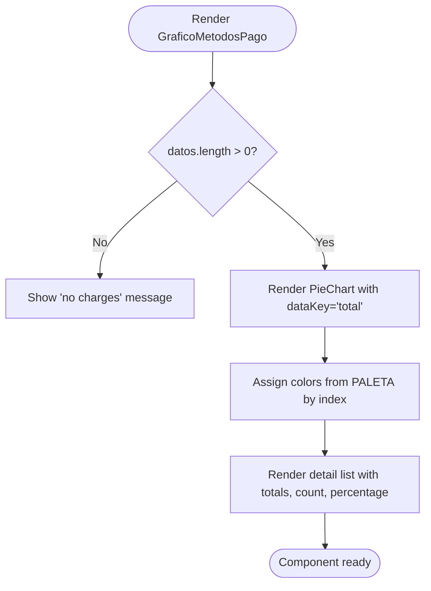
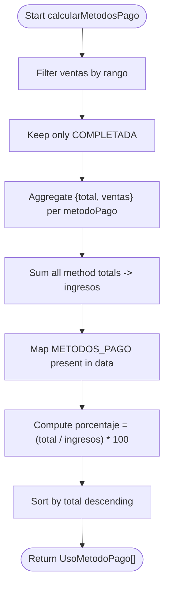
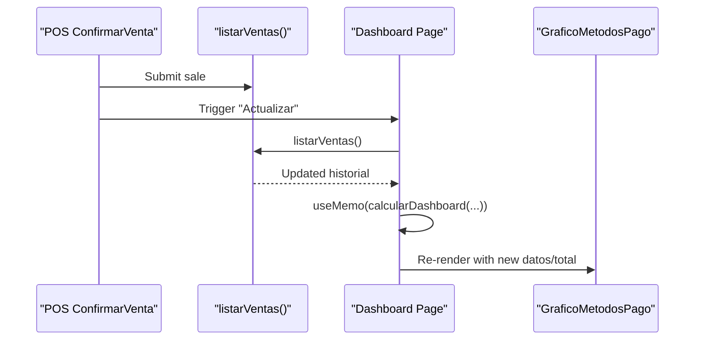
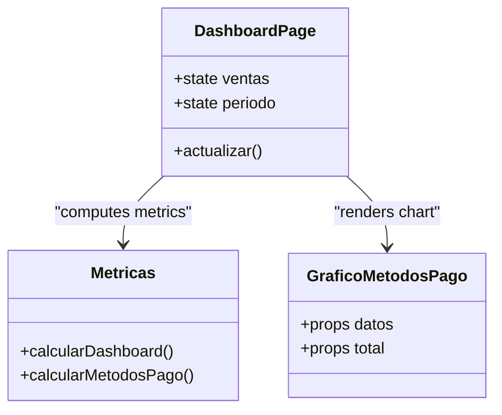
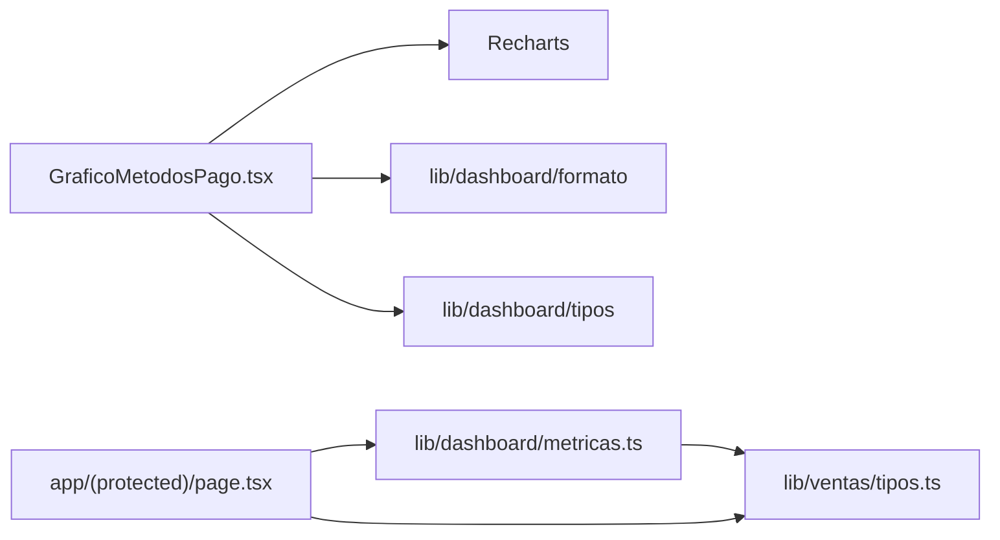
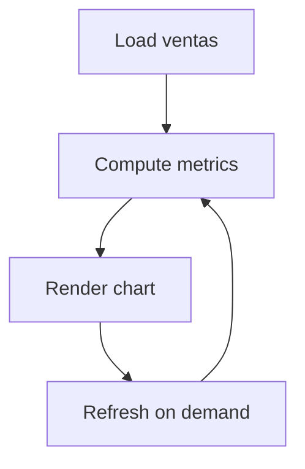

# Payment Methods Analysis

<cite>
**Referenced Files in This Document**
- [GraficoMetodosPago.tsx](file://simoapp/components/dashboard/GraficoMetodosPago.tsx)
- [metricas.ts](file://simoapp/lib/dashboard/metricas.ts)
- [tipos.ts (dashboard)](file://simoapp/lib/dashboard/tipos.ts)
- [tipos.ts (ventas)](file://simoapp/lib/ventas/tipos.ts)
- [page.tsx (protected dashboard)](file://simoapp/app/(protected)/page.tsx)
- [ConfirmarVenta.tsx](file://simoapp/components/ventas/ConfirmarVenta.tsx)
</cite>

## Table of Contents
1. [Introduction](#introduction)
2. [Project Structure](#project-structure)
3. [Core Components](#core-components)
4. [Architecture Overview](#architecture-overview)
5. [Detailed Component Analysis](#detailed-component-analysis)
6. [Dependency Analysis](#dependency-analysis)
7. [Performance Considerations](#performance-considerations)
8. [Troubleshooting Guide](#troubleshooting-guide)
9. [Conclusion](#conclusion)
10. [Appendices](#appendices)

## Introduction
This document explains the payment methods analysis feature centered on the GraficoMetodosPago component. It covers how the pie chart visualizes payment method distribution, how percentages are calculated, how colors are assigned, and how the component integrates with sales data sources. It also documents props, data structures, customization options, real-time updates when new sales are processed, export considerations for analytics reports, handling of different payment types, responsive design, and accessibility compliance.

## Project Structure
The payment methods analysis is implemented as a client-side React component that consumes precomputed metrics derived from the sales history. The main integration points are:
- Dashboard page: loads sales history, computes dashboard metrics, and renders GraficoMetodosPago.
- Metrics library: aggregates completed sales by payment method and calculates participation percentages.
- Types: define payment method codes, names, and the shape of the data passed to the chart.
- POS confirmation flow: allows selecting payment methods that later appear in the dashboard.

**Diagram sources**
- [page.tsx (protected dashboard):104-113](file://simoapp/app/(protected)/page.tsx#L104-L113)
- [page.tsx (protected dashboard):296-304](file://simoapp/app/(protected)/page.tsx#L296-L304)
- [metricas.ts:283-333](file://simoapp/lib/dashboard/metricas.ts#L283-L333)
- [tipos.ts (dashboard):73-89](file://simoapp/lib/dashboard/tipos.ts#L73-L89)
- [tipos.ts (ventas):18-42](file://simoapp/lib/ventas/tipos.ts#L18-L42)

**Section sources**
- [page.tsx (protected dashboard):1-39](file://simoapp/app/(protected)/page.tsx#L1-L39)
- [metricas.ts:1-28](file://simoapp/lib/dashboard/metricas.ts#L1-L28)

## Core Components
- GraficoMetodosPago: Renders a donut pie chart showing each payment method’s share of period revenue, plus a detail list with totals, number of sales, and percentage.
- calcularMetodosPago: Aggregates completed sales by payment method within the selected date range, computes total revenue per method, and derives percentage participation.
- Dashboard page: Loads sales history, calls calcularDashboard, and passes metodosPago and total revenue to GraficoMetodosPago.

Key responsibilities:
- Data aggregation and percentage calculation live in metricas.ts.
- Visualization and user interaction live in GraficoMetodosPago.tsx.
- Integration and state management live in the protected dashboard page.

**Section sources**
- [GraficoMetodosPago.tsx:20-24](file://simoapp/components/dashboard/GraficoMetodosPago.tsx#L20-L24)
- [metricas.ts:283-310](file://simoapp/lib/dashboard/metricas.ts#L283-L310)
- [page.tsx (protected dashboard):296-304](file://simoapp/app/(protected)/page.tsx#L296-L304)

## Architecture Overview
The payment methods analysis follows a unidirectional data flow:
1. The dashboard page fetches the sales history.
2. It computes dashboard metrics using calcularDashboard, which includes calcularMetodosPago.
3. The resulting metodosPago array and total revenue are passed to GraficoMetodosPago.
4. The component renders the donut chart and a legend-like list.

**Diagram sources**
- [page.tsx (protected dashboard):64-80](file://simoapp/app/(protected)/page.tsx#L64-L80)
- [page.tsx (protected dashboard):104-113](file://simoapp/app/(protected)/page.tsx#L104-L113)
- [metricas.ts:316-333](file://simoapp/lib/dashboard/metricas.ts#L316-L333)
- [GraficoMetodosPago.tsx:26-97](file://simoapp/components/dashboard/GraficoMetodosPago.tsx#L26-L97)

## Detailed Component Analysis

### GraficoMetodosPago Component
Purpose:
- Visualize the distribution of payment methods by revenue share for the selected period.
- Provide a readable list with currency-formatted totals, sale counts, and percentages.

Props:
- datos: Array of UsoMetodoPago objects representing each payment method’s aggregated data.
- total: Total period revenue used to display the center label of the donut chart.

Data structure requirements:
- Each item must include:
  - metodo: Payment method code (from CodigoMetodoPago).
  - nombre: Human-readable name.
  - total: Revenue amount for this method.
  - ventas: Number of completed sales for this method.
  - porcentaje: Percentage of total revenue (0–100).

Color coding strategy:
- A fixed palette of six colors is applied cyclically to segments and legend items.
- Colors are assigned by index modulo palette length.

Percentage calculations:
- Percentages are precomputed by calcularMetodosPago as (method_total / period_total) * 100.
- If there is no revenue, percentages default to zero.

Empty state:
- When datos is empty, the component shows a message indicating no charges were recorded in the period.

Tooltip:
- Displays method name, total revenue, percentage, and number of sales.

Responsive behavior:
- Uses ResponsiveContainer to adapt width and height to parent container.
- Fixed chart height via Tailwind classes; list adapts to available space.

Accessibility:
- Legend color dots use aria-hidden since they are decorative.
- Tooltip content is visually descriptive; ensure screen readers can access labels through surrounding text or ARIA if needed.

Customization options:
- Palette: Extend or replace the PALETA constant to change segment colors.
- Formatting: Use provided formatters for currency, numbers, and percentages.
- Layout: Adjust chart dimensions and spacing via Tailwind classes.

**Diagram sources**
- [GraficoMetodosPago.tsx:26-97](file://simoapp/components/dashboard/GraficoMetodosPago.tsx#L26-L97)

**Section sources**
- [GraficoMetodosPago.tsx:1-117](file://simoapp/components/dashboard/GraficoMetodosPago.tsx#L1-L117)

### Percentage Calculation Logic
Behavior:
- Only completed sales are included.
- Sales are filtered by the selected date range.
- Totals are aggregated per payment method.
- Percentage is computed relative to total period revenue.
- Results are sorted by descending total revenue.

Complexity:
- Single pass over filtered sales to aggregate totals: O(n).
- Final mapping and sorting: O(m log m), where m is the number of distinct payment methods present.

Edge cases:
- Zero total revenue yields zero percentages.
- Methods not present in the period are excluded from results.

**Diagram sources**
- [metricas.ts:283-310](file://simoapp/lib/dashboard/metricas.ts#L283-L310)

**Section sources**
- [metricas.ts:110-121](file://simoapp/lib/dashboard/metricas.ts#L110-L121)
- [metricas.ts:283-310](file://simoapp/lib/dashboard/metricas.ts#L283-L310)

### Props and Data Model Reference
- GraficoMetodosPagoProps:
  - datos: UsoMetodoPago[]
  - total: number
- UsoMetodoPago:
  - metodo: CodigoMetodoPago
  - nombre: string
  - total: number
  - ventas: number
  - porcentaje: number

These types ensure consistent data between the metrics layer and the visualization.

**Section sources**
- [GraficoMetodosPago.tsx:20-24](file://simoapp/components/dashboard/GraficoMetodosPago.tsx#L20-L24)
- [tipos.ts (dashboard):73-80](file://simoapp/lib/dashboard/tipos.ts#L73-L80)

### Payment Method Categorization
Supported payment methods:
- Cash (EFECTIVO)
- Digital wallets (NEQUI, DAVIPLATA)
- Bank transfer (TRANSFERENCIA)
- Card (TARJETA)
- Other (OTRO)

These are defined centrally and used both in POS selection and dashboard aggregation.

Real-world examples:
- A cash-heavy day will show a large green segment for EFECTIVO.
- A day with many digital wallet payments will increase NEQUI and DAVIPLATA shares.
- Card transactions contribute to TARJETA share.

**Section sources**
- [tipos.ts (ventas):18-42](file://simoapp/lib/ventas/tipos.ts#L18-L42)

### Real-Time Updates When New Sales Are Processed
Flow:
- After confirming a sale in the POS, the dashboard can refresh by calling listarVentas again.
- The dashboard recomputes metrics and re-renders GraficoMetodosPago with updated data.

**Diagram sources**
- [page.tsx (protected dashboard):87-102](file://simoapp/app/(protected)/page.tsx#L87-L102)
- [page.tsx (protected dashboard):104-113](file://simoapp/app/(protected)/page.tsx#L104-L113)

**Section sources**
- [page.tsx (protected dashboard):87-102](file://simoapp/app/(protected)/page.tsx#L87-L102)

### Export Capabilities for Payment Analytics Reports
Current implementation:
- No built-in export functionality is present in GraficoMetodosPago or the dashboard page.

Recommended approach:
- Add an export function that serializes datos and total into CSV or JSON.
- Include headers such as method, name, total, ventas, porcentaje.
- Trigger download via a Blob and anchor element.
- Optionally integrate with existing report utilities if present elsewhere in the app.

Note: This section describes recommended enhancements rather than existing code.

[No sources needed since this section provides general guidance]

### Integration with Sales Data Sources
- The dashboard page uses listarVentas to load the sales history.
- calcularDashboard aggregates series, summaries, stock rotation, and payment methods.
- GraficoMetodosPago receives metodosPago and total revenue directly from the computed dashboard data.

**Diagram sources**
- [page.tsx (protected dashboard):104-113](file://simoapp/app/(protected)/page.tsx#L104-L113)
- [metricas.ts:316-333](file://simoapp/lib/dashboard/metricas.ts#L316-L333)
- [GraficoMetodosPago.tsx:26-97](file://simoapp/components/dashboard/GraficoMetodosPago.tsx#L26-L97)

**Section sources**
- [page.tsx (protected dashboard):1-39](file://simoapp/app/(protected)/page.tsx#L1-L39)
- [metricas.ts:316-333](file://simoapp/lib/dashboard/metricas.ts#L316-L333)

### Handling Different Payment Types
- Cash (EFECTIVO): Physical currency transactions.
- Digital wallets (NEQUI, DAVIPLATA): Mobile wallet transfers.
- Bank transfer (TRANSFERENCIA): Traditional bank transfers.
- Card (TARJETA): Debit/credit card transactions via terminal.
- Other (OTRO): Miscellaneous payment methods.

The POS confirmation flow presents these options to users, ensuring consistency between data entry and reporting.

**Section sources**
- [tipos.ts (ventas):18-42](file://simoapp/lib/ventas/tipos.ts#L18-L42)
- [ConfirmarVenta.tsx:247-255](file://simoapp/components/ventas/ConfirmarVenta.tsx#L247-L255)

### Responsive Design Considerations
- Chart container uses ResponsiveContainer to adapt to parent size.
- Fixed chart height ensures consistent layout across breakpoints.
- Detail list adapts flexibly with min-width and truncation for long names.
- Grid layout in the dashboard page adjusts columns based on viewport size.

**Section sources**
- [GraficoMetodosPago.tsx:37-96](file://simoapp/components/dashboard/GraficoMetodosPago.tsx#L37-L96)
- [page.tsx (protected dashboard):281-304](file://simoapp/app/(protected)/page.tsx#L281-L304)

### Accessibility Compliance
- Decorative color dots in the legend use aria-hidden to avoid redundant announcements.
- Tooltips provide clear textual information about each segment.
- Ensure any future interactive elements (e.g., export buttons) have proper labels and keyboard support.
- Maintain sufficient color contrast for text and indicators.

**Section sources**
- [GraficoMetodosPago.tsx:68-93](file://simoapp/components/dashboard/GraficoMetodosPago.tsx#L68-L93)

## Dependency Analysis
Key dependencies:
- Recharts: Used for PieChart, Pie, Cell, ResponsiveContainer, Tooltip.
- Formatters: Currency, number, and percentage formatting utilities.
- Types: Shared type definitions for payment methods and dashboard data.

Coupling:
- GraficoMetodosPago depends on UsoMetodoPago type and formatters.
- Dashboard page depends on metricas functions and sales types.
- Metrics depend on sales types and constants.

Potential circular dependencies:
- None observed; types are imported without runtime logic.

External integrations:
- Backend sales API via listarVentas.
- Catalog products via useProductos (not directly used by payment methods but part of dashboard context).

**Diagram sources**
- [GraficoMetodosPago.tsx:7-16](file://simoapp/components/dashboard/GraficoMetodosPago.tsx#L7-L16)
- [page.tsx (protected dashboard):18-38](file://simoapp/app/(protected)/page.tsx#L18-L38)
- [metricas.ts:10-28](file://simoapp/lib/dashboard/metricas.ts#L10-L28)

**Section sources**
- [GraficoMetodosPago.tsx:7-16](file://simoapp/components/dashboard/GraficoMetodosPago.tsx#L7-L16)
- [page.tsx (protected dashboard):18-38](file://simoapp/app/(protected)/page.tsx#L18-L38)
- [metricas.ts:10-28](file://simoapp/lib/dashboard/metricas.ts#L10-L28)

## Performance Considerations
- Aggregation complexity is linear in the number of sales for the selected range.
- Sorting by total is logarithmic in the number of distinct payment methods, typically small.
- Using useMemo in the dashboard page avoids recomputation unless inputs change.
- Avoid unnecessary re-renders by keeping data shapes stable and minimizing prop churn.

Recommendations:
- For very large datasets, consider server-side aggregation or pagination.
- Debounce rapid updates if polling frequently.
- Keep the palette and formatter references stable to prevent unnecessary recalculations.

[No sources needed since this section provides general guidance]

## Troubleshooting Guide
Common issues:
- Empty chart: Occurs when no completed sales exist in the selected period. Verify date range and sales status.
- Incorrect percentages: Ensure total revenue is non-zero and that only completed sales are counted.
- Missing payment methods: Only methods present in the period appear; verify POS selection and backend storage.
- Stale data: Click “Actualizar” to reload sales history after POS transactions.

Debugging steps:
- Inspect datos passed to GraficoMetodosPago to confirm shape and values.
- Check calcularMetodosPago output for correct aggregation and sorting.
- Validate date range computation in obtenerRango and ventasDelRango.

**Section sources**
- [GraficoMetodosPago.tsx:26-33](file://simoapp/components/dashboard/GraficoMetodosPago.tsx#L26-L33)
- [metricas.ts:110-121](file://simoapp/lib/dashboard/metricas.ts#L110-L121)
- [metricas.ts:283-310](file://simoapp/lib/dashboard/metricas.ts#L283-L310)

## Conclusion
The payment methods analysis feature provides a clear, responsive visualization of how revenue is distributed across payment methods for the selected period. The GraficoMetodosPago component focuses on presentation, while the metrics library handles robust aggregation and percentage calculation. The dashboard page orchestrates data loading and updates, enabling near real-time insights after POS transactions. Future enhancements could include export capabilities and additional customization options for colors and tooltips.

[No sources needed since this section summarizes without analyzing specific files]

## Appendices

### Data Flow Summary
- Sales history loaded by dashboard page.
- Metrics compute payment method totals and percentages.
- Chart renders donut and detail list.
- User can refresh to see updated analytics.

[No sources needed since this diagram shows conceptual workflow, not actual code structure]