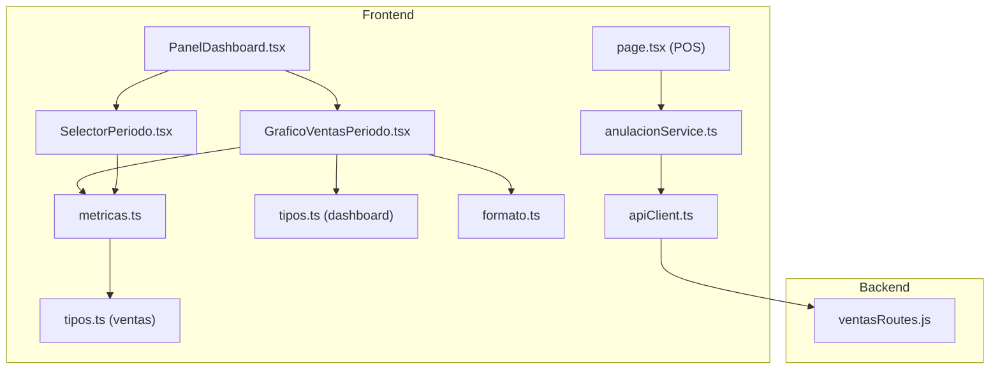
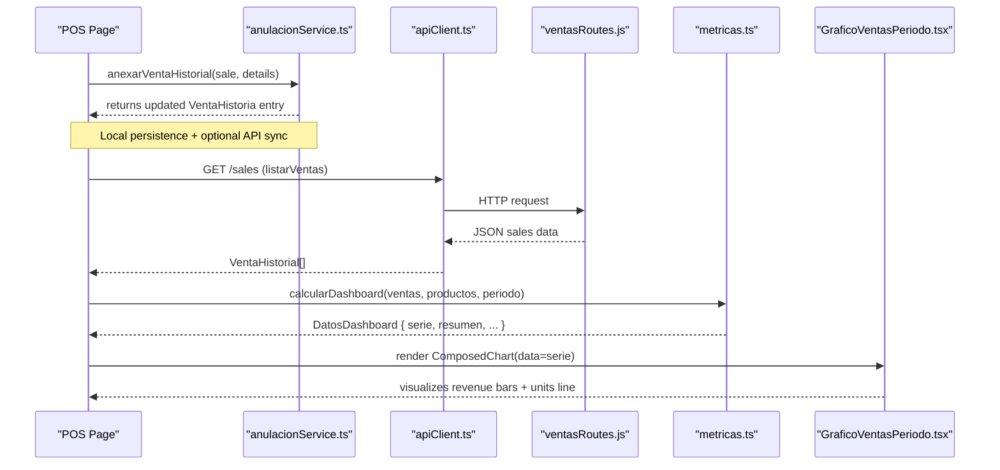
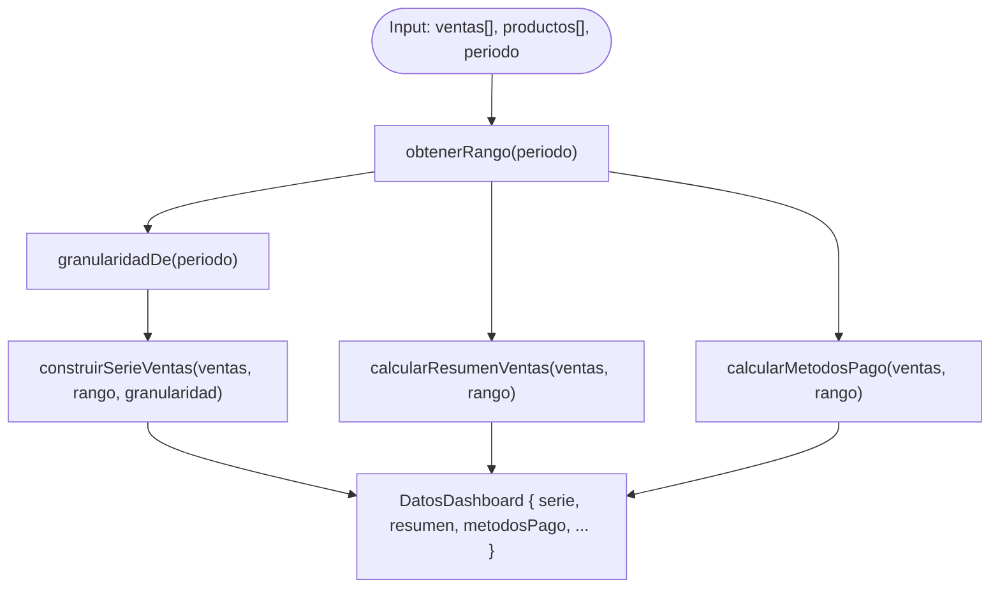
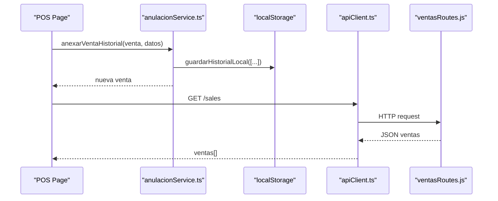
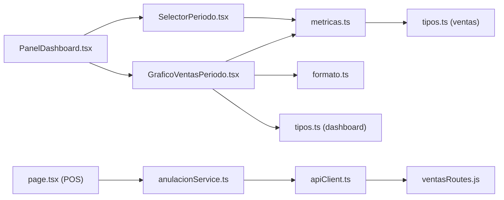

# Sales Analytics

<cite>
**Referenced Files in This Document**
- [GraficoVentasPeriodo.tsx](file://simoapp/components/dashboard/GraficoVentasPeriodo.tsx)
- [SelectorPeriodo.tsx](file://simoapp/components/dashboard/SelectorPeriodo.tsx)
- [PanelDashboard.tsx](file://simoapp/components/dashboard/PanelDashboard.tsx)
- [metricas.ts](file://simoapp/lib/dashboard/metricas.ts)
- [tipos.ts (dashboard)](file://simoapp/lib/dashboard/tipos.ts)
- [formato.ts](file://simoapp/lib/dashboard/formato.ts)
- [anulacionService.ts](file://simoapp/lib/ventas/anulacionService.ts)
- [apiClient.ts](file://simoapp/lib/apiClient.ts)
- [tipos.ts (ventas)](file://simoapp/lib/ventas/tipos.ts)
- [page.tsx (POS)](file://simoapp/app/(protected)/ventas/page.tsx)
- [ventasRoutes.js](file://backend/routes/ventasRoutes.js)
</cite>

## Table of Contents
1. [Introduction](#introduction)
2. [Project Structure](#project-structure)
3. [Core Components](#core-components)
4. [Architecture Overview](#architecture-overview)
5. [Detailed Component Analysis](#detailed-component-analysis)
6. [Dependency Analysis](#dependency-analysis)
7. [Performance Considerations](#performance-considerations)
8. [Troubleshooting Guide](#troubleshooting-guide)
9. [Conclusion](#conclusion)

## Introduction
This document explains the sales analytics component, focusing on:
- Sales trend visualization using GraficoVentasPeriodo
- Time period aggregation logic and granularity selection
- Revenue calculation methods and series construction
- Configuration options, data transformation, and chart customization
- Data formatting examples for sales data
- Period filtering (daily vs weekly)
- Real-time updates from POS transactions
- Integration with the ventas API
- Error handling for missing or inconsistent data
- Performance optimization for large datasets
- Mobile responsiveness and accessibility features

## Project Structure
The sales analytics feature spans UI components, dashboard metrics computation, types, formatting utilities, and backend routes. The key files are:
- UI: GraficoVentasPeriodo.tsx, SelectorPeriodo.tsx, PanelDashboard.tsx
- Metrics and types: metricas.ts, tipos.ts (dashboard), formato.ts
- Sales history and API integration: anulacionService.ts, apiClient.ts, tipos.ts (ventas)
- POS page that writes to the sales history: page.tsx (POS)
- Backend route for sales processing: ventasRoutes.js



**Diagram sources**
- [GraficoVentasPeriodo.tsx:1-132](file://simoapp/components/dashboard/GraficoVentasPeriodo.tsx#L1-L132)
- [SelectorPeriodo.tsx:1-45](file://simoapp/components/dashboard/SelectorPeriodo.tsx#L1-L45)
- [PanelDashboard.tsx:1-40](file://simoapp/components/dashboard/PanelDashboard.tsx#L1-L40)
- [metricas.ts:1-334](file://simoapp/lib/dashboard/metricas.ts#L1-L334)
- [tipos.ts (dashboard):1-90](file://simoapp/lib/dashboard/tipos.ts#L1-L90)
- [formato.ts:1-67](file://simoapp/lib/dashboard/formato.ts#L1-L67)
- [anulacionService.ts:1-261](file://simoapp/lib/ventas/anulacionService.ts#L1-L261)
- [apiClient.ts:1-59](file://simoapp/lib/apiClient.ts#L1-L59)
- [tipos.ts (ventas):1-130](file://simoapp/lib/ventas/tipos.ts#L1-L130)
- [page.tsx (POS):1-789](file://simoapp/app/(protected)/ventas/page.tsx#L1-L789)
- [ventasRoutes.js:1-149](file://backend/routes/ventasRoutes.js#L1-L149)

**Section sources**
- [GraficoVentasPeriodo.tsx:1-132](file://simoapp/components/dashboard/GraficoVentasPeriodo.tsx#L1-L132)
- [SelectorPeriodo.tsx:1-45](file://simoapp/components/dashboard/SelectorPeriodo.tsx#L1-L45)
- [PanelDashboard.tsx:1-40](file://simoapp/components/dashboard/PanelDashboard.tsx#L1-L40)
- [metricas.ts:1-334](file://simoapp/lib/dashboard/metricas.ts#L1-L334)
- [tipos.ts (dashboard):1-90](file://simoapp/lib/dashboard/tipos.ts#L1-L90)
- [formato.ts:1-67](file://simoapp/lib/dashboard/formato.ts#L1-L67)
- [anulacionService.ts:1-261](file://simoapp/lib/ventas/anulacionService.ts#L1-L261)
- [apiClient.ts:1-59](file://simoapp/lib/apiClient.ts#L1-L59)
- [tipos.ts (ventas):1-130](file://simoapp/lib/ventas/tipos.ts#L1-L130)
- [page.tsx (POS):1-789](file://simoapp/app/(protected)/ventas/page.tsx#L1-L789)
- [ventasRoutes.js:1-149](file://backend/routes/ventasRoutes.js#L1-L149)

## Core Components
- GraficoVentasPeriodo: Renders a composed chart with bars for revenue and a line for units sold, dual Y-axes, custom tooltip, and responsive container.
- SelectorPeriodo: Provides period buttons (7 days, 30 days, 90 days, this month) with accessibility attributes.
- PanelDashboard: Reusable panel wrapper used by dashboard sections.
- metricas.ts: Pure functions for date ranges, granularity, series construction, summaries, rotation, and payment methods.
- tipos.ts (dashboard): Types for periods, ranges, series points, summaries, rotation, and payment usage.
- formato.ts: Shared formatters for currency, numbers, dates, and axis labels.
- anulacionService.ts: Service for listing sales history and canceling sales; supports mock/local storage fallback and real API calls.
- apiClient.ts: Axios client with token injection and auth error handling.
- tipos.ts (ventas): Types for POS items, payment methods, sale records, and cancellation payloads/results.
- page.tsx (POS): POS page that persists new sales into local history and triggers UI updates.
- ventasRoutes.js: Backend route for processing sales and daily summary.

**Section sources**
- [GraficoVentasPeriodo.tsx:1-132](file://simoapp/components/dashboard/GraficoVentasPeriodo.tsx#L1-L132)
- [SelectorPeriodo.tsx:1-45](file://simoapp/components/dashboard/SelectorPeriodo.tsx#L1-L45)
- [PanelDashboard.tsx:1-40](file://simoapp/components/dashboard/PanelDashboard.tsx#L1-L40)
- [metricas.ts:1-334](file://simoapp/lib/dashboard/metricas.ts#L1-L334)
- [tipos.ts (dashboard):1-90](file://simoapp/lib/dashboard/tipos.ts#L1-L90)
- [formato.ts:1-67](file://simoapp/lib/dashboard/formato.ts#L1-L67)
- [anulacionService.ts:1-261](file://simoapp/lib/ventas/anulacionService.ts#L1-L261)
- [apiClient.ts:1-59](file://simoapp/lib/apiClient.ts#L1-L59)
- [tipos.ts (ventas):1-130](file://simoapp/lib/ventas/tipos.ts#L1-L130)
- [page.tsx (POS):1-789](file://simoapp/app/(protected)/ventas/page.tsx#L1-L789)
- [ventasRoutes.js:1-149](file://backend/routes/ventasRoutes.js#L1-L149)

## Architecture Overview
The sales analytics pipeline connects POS transactions to the dashboard visualization through a layered architecture:
- POS page captures transactions and appends them to the sales history via anulacionService.anexarVentaHistorial.
- Dashboard metrics compute time-based aggregations and series from VentaHistorial[] using pure functions in metricas.ts.
- GraficoVentasPeriodo renders the computed series with Recharts.
- Backend provides sales processing and daily summary endpoints consumed by the frontend when connected to the real API.



**Diagram sources**
- [page.tsx (POS):690-758](file://simoapp/app/(protected)/ventas/page.tsx#L690-L758)
- [anulacionService.ts:80-140](file://simoapp/lib/ventas/anulacionService.ts#L80-L140)
- [apiClient.ts:1-59](file://simoapp/lib/apiClient.ts#L1-L59)
- [ventasRoutes.js:10-111](file://backend/routes/ventasRoutes.js#L10-L111)
- [metricas.ts:316-333](file://simoapp/lib/dashboard/metricas.ts#L316-L333)
- [GraficoVentasPeriodo.tsx:48-100](file://simoapp/components/dashboard/GraficoVentasPeriodo.tsx#L48-L100)

## Detailed Component Analysis

### GraficoVentasPeriodo Component
Purpose:
- Visualize sales trends with a composed chart: bars for revenue and a line for units sold.
- Use dual Y-axes to avoid scale distortion between monetary values and unit counts.
- Provide a custom tooltip showing label, revenue, units, and number of sales.

Configuration options:
- Input prop: serie (PuntoSerieVentas[])
- Theme-aware colors via useTemaOscuro
- Chart configuration:
  - XAxis: dataKey="etiqueta", tick formatting, interval preservation
  - Left YAxis (ingresos): yAxisId="ingresos", tickFormatter uses formatearEjeMoneda
  - Right YAxis (unidades): yAxisId="unidades", orientation="right", allowDecimals=false
  - Bar: yAxisId="ingresos", dataKey="ingresos", fill color, radius, maxBarSize
  - Line: yAxisId="unidades", type="monotone", dataKey="unidades", stroke color, activeDot

Data transformation:
- Expects PuntoSerieVentas entries with fields: clave, etiqueta, ingresos, ventas, unidades.
- Tooltip reads payload[0].payload as PuntoSerieVentas and formats values using Intl formatters.

Accessibility and responsiveness:
- Uses aria-hidden for decorative legend markers.
- ResponsiveContainer ensures chart adapts to container width.
- Custom legend is always visible even when no sales exist.

Error handling:
- If no completed sales exist in the period, displays a message indicating no sales.

```mermaid
classDiagram
class GraficoVentasPeriodo {
+props : { serie : PuntoSerieVentas[] }
+render()
}
class PuntoSerieVentas {
+clave : string
+etiqueta : string
+ingresos : number
+ventas : number
+unidades : number
}
GraficoVentasPeriodo --> PuntoSerieVentas : "renders"
```

**Diagram sources**
- [GraficoVentasPeriodo.tsx:23-25](file://simoapp/components/dashboard/GraficoVentasPeriodo.tsx#L23-L25)
- [tipos.ts (dashboard):31-39](file://simoapp/lib/dashboard/tipos.ts#L31-L39)

**Section sources**
- [GraficoVentasPeriodo.tsx:1-132](file://simoapp/components/dashboard/GraficoVentasPeriodo.tsx#L1-L132)
- [tipos.ts (dashboard):31-39](file://simoapp/lib/dashboard/tipos.ts#L31-L39)
- [formato.ts:5-13](file://simoapp/lib/dashboard/formato.ts#L5-L13)

### SelectorPeriodo Component
Purpose:
- Provide a group of buttons for selecting the dashboard period.
- Ensure accessibility with role="group", aria-label, and aria-pressed.

Behavior:
- Maps PERIODOS_DASHBOARD to buttons.
- Calls onCambiar(periodo) when a button is clicked.

Accessibility:
- Keyboard focusable with focus-visible ring.
- Title attribute shows description per option.

**Section sources**
- [SelectorPeriodo.tsx:1-45](file://simoapp/components/dashboard/SelectorPeriodo.tsx#L1-L45)
- [metricas.ts:30-35](file://simoapp/lib/dashboard/metricas.ts#L30-L35)

### PanelDashboard Component
Purpose:
- Reusable container for dashboard panels with consistent styling, title, description, and actions area.

Usage:
- Wraps charts and tables to maintain uniform appearance across light/dark themes.

**Section sources**
- [PanelDashboard.tsx:1-40](file://simoapp/components/dashboard/PanelDashboard.tsx#L1-L40)

### Dashboard Metrics and Aggregation Logic
Time range calculation:
- obtenerRango computes desde/hasta and dias based on selected period ("7d", "30d", "90d", "mes").
- Granularity selection: granularidadDe returns "semana" for "90d", otherwise "dia".

Series construction:
- construirSerieVentas creates all time slots (days or weeks) within the range to keep the timeline continuous.
- For each completed sale within the range, it aggregates:
  - ingresos: sum of venta.total
  - ventas: count of sales
  - unidades: sum of item.cantidad across items

Summary calculation:
- calcularResumenVentas compares current period vs previous period of equal length.
- Computes ingresos, variacionIngresos, ventas, variacionVentas, ticketPromedio, unidadesVendidas, variacionUnidades, ventasAnuladas, montoAnulado.

Payment methods:
- calcularMetodosPago aggregates totals and counts per payment method, computing percentages.

Entry point:
- calcularDashboard orchestrates rango, granularidad, resumen, serie, rotacion, metodosPago.



**Diagram sources**
- [metricas.ts:84-101](file://simoapp/lib/dashboard/metricas.ts#L84-L101)
- [metricas.ts:127-129](file://simoapp/lib/dashboard/metricas.ts#L127-L129)
- [metricas.ts:135-176](file://simoapp/lib/dashboard/metricas.ts#L135-L176)
- [metricas.ts:183-210](file://simoapp/lib/dashboard/metricas.ts#L183-L210)
- [metricas.ts:283-310](file://simoapp/lib/dashboard/metricas.ts#L283-L310)
- [metricas.ts:316-333](file://simoapp/lib/dashboard/metricas.ts#L316-L333)

**Section sources**
- [metricas.ts:1-334](file://simoapp/lib/dashboard/metricas.ts#L1-L334)
- [tipos.ts (dashboard):1-90](file://simoapp/lib/dashboard/tipos.ts#L1-L90)

### Data Formatting Utilities
Shared formatters:
- Currency: COP without cents
- Numbers: integer formatting
- Dates: short date and datetime formats
- Axis money formatter: abbreviates large values to k/M
- Percentage formatter: optional sign prefix
- Rotation index formatter: decimal with "x" suffix

These ensure consistent display across axes, tooltips, and tables.

**Section sources**
- [formato.ts:1-67](file://simoapp/lib/dashboard/formato.ts#L1-L67)

### Sales History Service and API Integration
Sales history service:
- anexarVentaHistorial: Appends a new sale to local storage and returns the created record.
- listarVentas: Fetches from backend if available; falls back to local storage/mock data.
- anularVenta: Validates credentials and roles; supports mock and real API paths; maps HTTP errors to typed errors.

API client:
- Injects Authorization header with JWT token.
- Redirects to login on 401/403 responses.

POS integration:
- On confirmation, POS page decrements stock, clears cart, prepares thermal receipt data, and appends to local history.
- Updates local state with the newly recorded sale.



**Diagram sources**
- [anulacionService.ts:80-140](file://simoapp/lib/ventas/anulacionService.ts#L80-L140)
- [apiClient.ts:13-31](file://simoapp/lib/apiClient.ts#L13-L31)
- [ventasRoutes.js:10-111](file://backend/routes/ventasRoutes.js#L10-L111)
- [page.tsx (POS):690-758](file://simoapp/app/(protected)/ventas/page.tsx#L690-L758)

**Section sources**
- [anulacionService.ts:1-261](file://simoapp/lib/ventas/anulacionService.ts#L1-L261)
- [apiClient.ts:1-59](file://simoapp/lib/apiClient.ts#L1-L59)
- [page.tsx (POS):690-758](file://simoapp/app/(protected)/ventas/page.tsx#L690-L758)
- [ventasRoutes.js:10-111](file://backend/routes/ventasRoutes.js#L10-L111)

### Revenue Calculation Methods
- Backend calculates subtotal, impuestos (tax at fixed rate), and total per product line, then sums across items.
- Frontend dashboard metrics aggregate venta.total for ingresos and item.cantidad for unidades.
- Ticket promedio = ingresos / ventas count.

Notes:
- Backend applies a fixed tax rate per product line and accumulates totals.
- Frontend treats completed sales only for analytics.

**Section sources**
- [ventasRoutes.js:30-64](file://backend/routes/ventasRoutes.js#L30-L64)
- [metricas.ts:164-173](file://simoapp/lib/dashboard/metricas.ts#L164-L173)
- [metricas.ts:194-209](file://simoapp/lib/dashboard/metricas.ts#L194-L209)

### Period Filtering (Daily/Weekly)
- For "90d", granularity switches to weekly; other periods use daily.
- Weekly labels use "Sem. DD MMM" format; daily labels use short date format.
- Series creation ensures every slot exists even if no sales occurred.

**Section sources**
- [metricas.ts:127-129](file://simoapp/lib/dashboard/metricas.ts#L127-L129)
- [metricas.ts:135-176](file://simoapp/lib/dashboard/metricas.ts#L135-L176)
- [formato.ts:37-40](file://simoapp/lib/dashboard/formato.ts#L37-L40)

### Real-Time Updates from POS Transactions
- POS page appends new sales to local history immediately upon confirmation.
- Dashboard can recompute metrics and refresh the chart when the underlying series changes.
- In production, listarVentas fetches from backend; in development/mock mode, local storage is used.

**Section sources**
- [page.tsx (POS):690-758](file://simoapp/app/(protected)/ventas/page.tsx#L690-L758)
- [anulacionService.ts:80-140](file://simoapp/lib/ventas/anulacionService.ts#L80-L140)

### Chart Customization Capabilities
- Colors adapt to dark/light theme.
- Grid lines and axis ticks styled consistently.
- Tooltip content customized to show revenue, units, and sales count.
- Legend is custom-built to remain visible when there are no sales.

**Section sources**
- [GraficoVentasPeriodo.tsx:27-31](file://simoapp/components/dashboard/GraficoVentasPeriodo.tsx#L27-L31)
- [GraficoVentasPeriodo.tsx:37-46](file://simoapp/components/dashboard/GraficoVentasPeriodo.tsx#L37-L46)
- [GraficoVentasPeriodo.tsx:77-99](file://simoapp/components/dashboard/GraficoVentasPeriodo.tsx#L77-L99)

### Mobile Responsiveness and Accessibility
- ResponsiveContainer ensures chart scales to container width.
- SelectorPeriodo uses accessible button groups with aria-pressed and titles.
- GraficoVentasPeriodo uses aria-hidden for decorative elements.
- PanelDashboard standardizes layout and spacing for readability on small screens.

**Section sources**
- [GraficoVentasPeriodo.tsx:48-50](file://simoapp/components/dashboard/GraficoVentasPeriodo.tsx#L48-L50)
- [SelectorPeriodo.tsx:18-41](file://simoapp/components/dashboard/SelectorPeriodo.tsx#L18-L41)
- [PanelDashboard.tsx:24-37](file://simoapp/components/dashboard/PanelDashboard.tsx#L24-L37)

## Dependency Analysis
The following diagram highlights dependencies among core modules:



**Diagram sources**
- [GraficoVentasPeriodo.tsx:1-132](file://simoapp/components/dashboard/GraficoVentasPeriodo.tsx#L1-L132)
- [SelectorPeriodo.tsx:1-45](file://simoapp/components/dashboard/SelectorPeriodo.tsx#L1-L45)
- [PanelDashboard.tsx:1-40](file://simoapp/components/dashboard/PanelDashboard.tsx#L1-L40)
- [metricas.ts:1-334](file://simoapp/lib/dashboard/metricas.ts#L1-L334)
- [formato.ts:1-67](file://simoapp/lib/dashboard/formato.ts#L1-L67)
- [tipos.ts (dashboard):1-90](file://simoapp/lib/dashboard/tipos.ts#L1-L90)
- [tipos.ts (ventas):1-130](file://simoapp/lib/ventas/tipos.ts#L1-L130)
- [anulacionService.ts:1-261](file://simoapp/lib/ventas/anulacionService.ts#L1-L261)
- [apiClient.ts:1-59](file://simoapp/lib/apiClient.ts#L1-L59)
- [page.tsx (POS):1-789](file://simoapp/app/(protected)/ventas/page.tsx#L1-L789)
- [ventasRoutes.js:1-149](file://backend/routes/ventasRoutes.js#L1-L149)

**Section sources**
- [metricas.ts:1-334](file://simoapp/lib/dashboard/metricas.ts#L1-L334)
- [anulacionService.ts:1-261](file://simoapp/lib/ventas/anulacionService.ts#L1-L261)
- [apiClient.ts:1-59](file://simoapp/lib/apiClient.ts#L1-L59)
- [page.tsx (POS):1-789](file://simoapp/app/(protected)/ventas/page.tsx#L1-L789)
- [ventasRoutes.js:1-149](file://backend/routes/ventasRoutes.js#L1-L149)

## Performance Considerations
- Series construction iterates over all time slots and sales once; complexity is O(N + S) where N is number of slots and S is number of sales.
- Using Map for indices avoids repeated scans and improves lookup performance.
- Avoid unnecessary re-renders by keeping series stable (using stable keys like clave).
- For large datasets:
  - Consider server-side aggregation for historical queries.
  - Paginate or limit the dataset returned by the backend.
  - Debounce user interactions that trigger recomputation.
- Chart rendering:
  - Limit bar size and disable decimals on unit axis to reduce label clutter.
  - Use responsive container to prevent layout thrashing.

[No sources needed since this section provides general guidance]

## Troubleshooting Guide
Common issues and resolutions:
- Missing sales data:
  - If backend is unavailable, listarVentas falls back to local storage/mock data.
  - Verify environment variables for API URL and mock mode.
- Authentication errors:
  - apiClient redirects to login on 401/403; ensure valid session.
- Cancellation failures:
  - anularVenta maps HTTP status codes to typed errors; handle specific cases (invalid credentials, unauthorized role, not found, already canceled).
- POS transaction inconsistencies:
  - Stock validation occurs both in frontend and backend; ensure inventory updates are synchronized.

Operational checks:
- Confirm PERIODOS_DASHBOARD matches expected periods.
- Validate that PuntoSerieVentas contains required fields before rendering.
- Ensure formatters are applied consistently across axes and tooltips.

**Section sources**
- [anulacionService.ts:127-140](file://simoapp/lib/ventas/anulacionService.ts#L127-L140)
- [anulacionService.ts:146-261](file://simoapp/lib/ventas/anulacionService.ts#L146-L261)
- [apiClient.ts:33-56](file://simoapp/lib/apiClient.ts#L33-L56)
- [tipos.ts (dashboard):31-39](file://simoapp/lib/dashboard/tipos.ts#L31-L39)

## Conclusion
The sales analytics component integrates POS transactions, dashboard metrics, and visualization into a cohesive system. GraficoVentasPeriodo renders clear, accessible charts with dual axes, while metricas.ts provides robust aggregation and comparison logic. The service layer supports both mock and real API modes, ensuring resilience and flexibility. With careful attention to performance, error handling, and accessibility, the system delivers reliable insights for operational decision-making.

[No sources needed since this section summarizes without analyzing specific files]