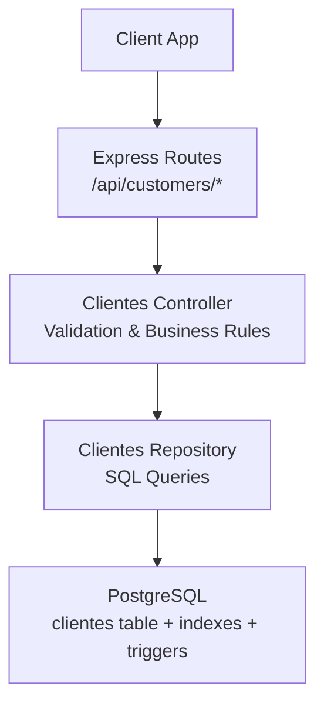
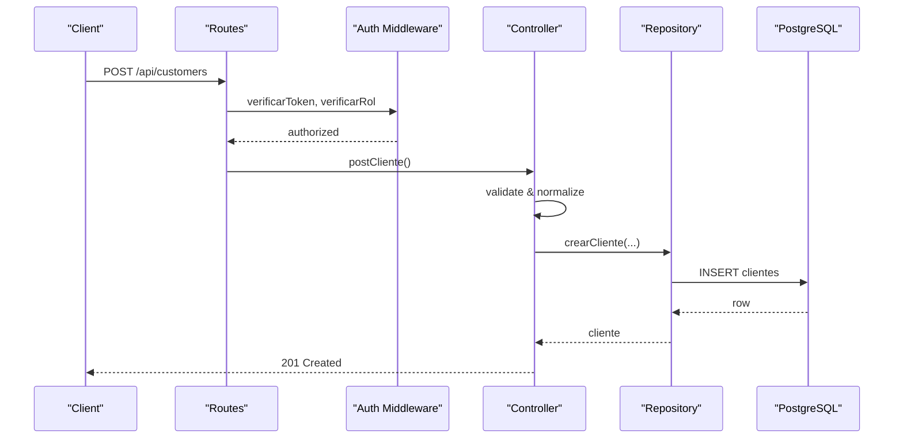
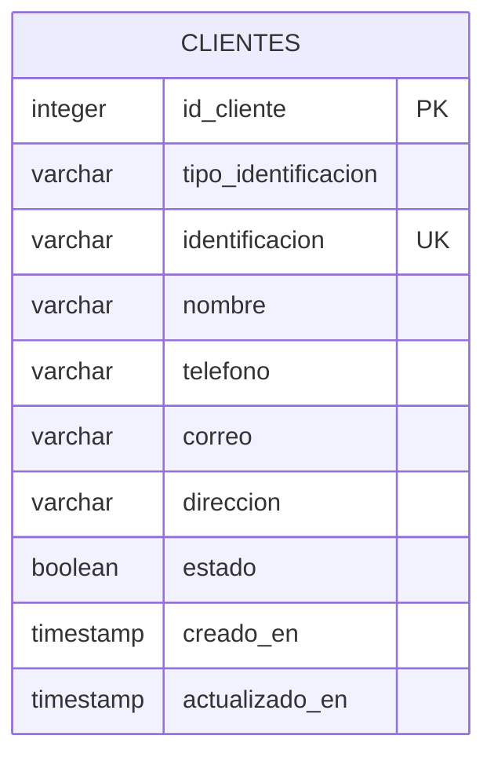
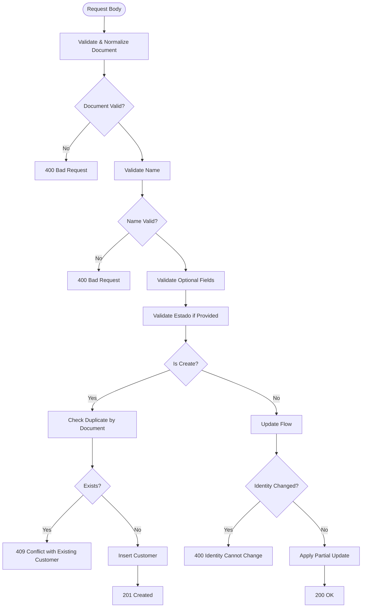
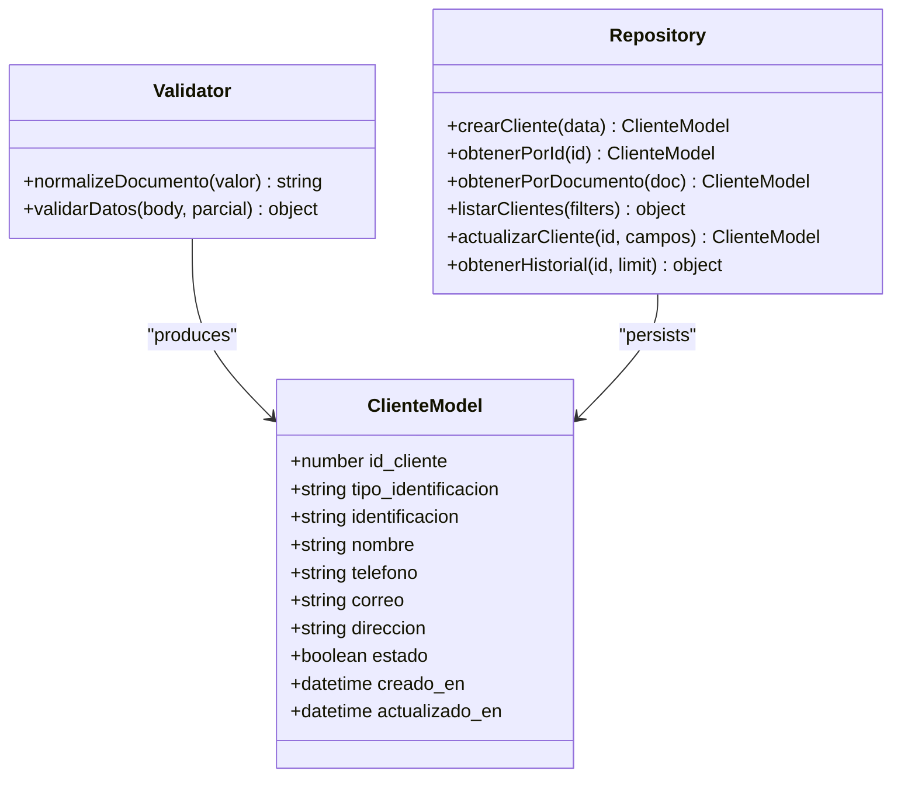
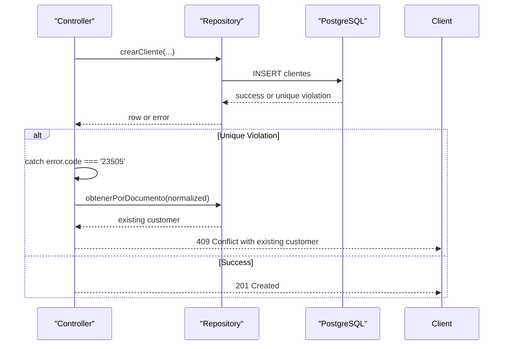
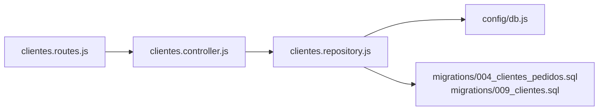

# Customer Database Operations

<cite>
**Referenced Files in This Document**
- [clientes.controller.js](file://backend/src/controllers/clientes.controller.js)
- [clientes.repository.js](file://backend/src/repositories/clientes.repository.js)
- [clientes.routes.js](file://backend/src/routes/clientes.routes.js)
- [004_clientes_pedidos.sql](file://backend/db/migrations/004_clientes_pedidos.sql)
- [009_clientes.sql](file://backend/db/migrations/009_clientes.sql)
- [db.js](file://backend/src/config/db.js)
- [clientes.test.js](file://backend/tests/integracion/clientes.test.js)
- [tipos.ts](file://simoapp/lib/clientes/tipos.ts)
- [validaciones.ts](file://simoapp/lib/clientes/validaciones.ts)
</cite>

## Table of Contents
1. [Introduction](#introduction)
2. [Project Structure](#project-structure)
3. [Core Components](#core-components)
4. [Architecture Overview](#architecture-overview)
5. [Detailed Component Analysis](#detailed-component-analysis)
6. [Dependency Analysis](#dependency-analysis)
7. [Performance Considerations](#performance-considerations)
8. [Troubleshooting Guide](#troubleshooting-guide)
9. [Conclusion](#conclusion)

## Introduction
This document explains the customer database operations in the SIMO system, focusing on the complete CRUD lifecycle for customer records. It covers creation, retrieval, updating, and deletion workflows (where applicable), data model structure, validation rules, normalization, unique identifier handling, integrity constraints, error handling, duplicate detection, and performance considerations for large datasets.

The customer module is implemented as a REST API under `/api/customers`, with Express routes delegating to a controller that validates input and delegates persistence to a repository layer backed by PostgreSQL. The frontend type definitions and validations mirror backend rules to provide consistent user experience.

## Project Structure
The customer feature spans three layers:
- Routes: define HTTP endpoints and authorization guards.
- Controller: validates requests, normalizes identifiers, enforces business rules, and returns standardized responses.
- Repository: executes SQL queries against PostgreSQL using a shared connection pool.

**Diagram sources**
- [clientes.routes.js:1-27](file://backend/src/routes/clientes.routes.js#L1-L27)
- [clientes.controller.js:1-283](file://backend/src/controllers/clientes.controller.js#L1-L283)
- [clientes.repository.js:1-131](file://backend/src/repositories/clientes.repository.js#L1-L131)
- [004_clientes_pedidos.sql:12-24](file://backend/db/migrations/004_clientes_pedidos.sql#L12-L24)

**Section sources**
- [clientes.routes.js:1-27](file://backend/src/routes/clientes.routes.js#L1-L27)
- [clientes.controller.js:1-283](file://backend/src/controllers/clientes.controller.js#L1-L283)
- [clientes.repository.js:1-131](file://backend/src/repositories/clientes.repository.js#L1-L131)

## Core Components
- API endpoints:
  - POST /api/customers: create a new customer.
  - GET /api/customers: list customers with search and pagination.
  - GET /api/customers/document/:documento: retrieve by normalized document number.
  - GET /api/customers/:id: retrieve by internal ID.
  - PUT /api/customers/:id: update editable fields; document cannot be changed.
  - GET /api/customers/:id/history: get purchase and order history summary plus recent rows.
- Data model:
  - clientes table with identity fields, contact info, status, and timestamps.
- Validation and normalization:
  - Document normalization removes dots/spaces and uppercases letters.
  - Strict field validation for name, phone, email, address, and state.
- Integrity mechanisms:
  - Unique constraint on identificacion.
  - CHECK constraints on tipo_identificacion and other fields.
  - Trigger preventing updates to identity fields.

**Section sources**
- [clientes.routes.js:18-24](file://backend/src/routes/clientes.routes.js#L18-L24)
- [clientes.controller.js:12-17](file://backend/src/controllers/clientes.controller.js#L12-L17)
- [clientes.controller.js:24-26](file://backend/src/controllers/clientes.controller.js#L24-L26)
- [clientes.controller.js:30-68](file://backend/src/controllers/clientes.controller.js#L30-L68)
- [004_clientes_pedidos.sql:12-24](file://backend/db/migrations/004_clientes_pedidos.sql#L12-L24)
- [009_clientes.sql:19-34](file://backend/db/migrations/009_clientes.sql#L19-L34)

## Architecture Overview
The request flow follows a layered architecture:
- Authorization middleware ensures only authorized roles can access customer endpoints.
- Controller performs input validation and normalization, checks duplicates, and calls repository methods.
- Repository executes parameterized SQL statements via a connection pool.
- Database enforces schema-level constraints and triggers for data integrity.

**Diagram sources**
- [clientes.routes.js:18-18](file://backend/src/routes/clientes.routes.js#L18-L18)
- [clientes.controller.js:73-122](file://backend/src/controllers/clientes.controller.js#L73-L122)
- [clientes.repository.js:10-18](file://backend/src/repositories/clientes.repository.js#L10-L18)

## Detailed Component Analysis

### Data Model and Constraints
The customer entity is stored in the clientes table with the following key attributes and constraints:
- id_cliente: primary key, auto-incremented.
- tipo_identificacion: restricted to CC, CE, NIT, TI, PAS.
- identificacion: unique, non-empty, normalized (no dots/spaces).
- nombre: required, trimmed, max length.
- telefono: optional, validated format.
- correo: optional, lowercased, validated format.
- direccion: optional, max length.
- estado: boolean default true.
- created_at/updated_at: timestamps managed by triggers.

**Diagram sources**
- [004_clientes_pedidos.sql:12-24](file://backend/db/migrations/004_clientes_pedidos.sql#L12-L24)

**Section sources**
- [004_clientes_pedidos.sql:12-24](file://backend/db/migrations/004_clientes_pedidos.sql#L12-L24)

### Field Validation Rules and Business Constraints
- Document normalization:
  - Removes dots and spaces, uppercases letters.
- Required fields:
  - identificacion must be present and valid.
  - nombre must be present and within length limits.
- Optional fields:
  - telefono: allowed characters and length.
  - correo: email format, lowercase.
  - direccion: max length.
- State:
  - Must be boolean when provided; new customers are always active.
- Editable fields:
  - Only nombre, telefono, correo, direccion, estado can be updated.
  - Changing identity fields is forbidden at both API and database levels.

**Diagram sources**
- [clientes.controller.js:24-26](file://backend/src/controllers/clientes.controller.js#L24-L26)
- [clientes.controller.js:30-68](file://backend/src/controllers/clientes.controller.js#L30-L68)
- [clientes.controller.js:73-122](file://backend/src/controllers/clientes.controller.js#L73-L122)
- [clientes.controller.js:213-247](file://backend/src/controllers/clientes.controller.js#L213-L247)

**Section sources**
- [clientes.controller.js:12-17](file://backend/src/controllers/clientes.controller.js#L12-L17)
- [clientes.controller.js:24-26](file://backend/src/controllers/clientes.controller.js#L24-L26)
- [clientes.controller.js:30-68](file://backend/src/controllers/clientes.controller.js#L30-L68)
- [clientes.controller.js:73-122](file://backend/src/controllers/clientes.controller.js#L73-L122)
- [clientes.controller.js:213-247](file://backend/src/controllers/clientes.controller.js#L213-L247)

### Document Normalization and Unique Identifier Handling
- Normalization function removes separators and standardizes case.
- Uniqueness enforced by:
  - UNIQUE constraint on identificacion.
  - Prefixed index optimized for LIKE prefix searches.
  - Trigger rejecting any attempt to change identity fields during updates.

**Diagram sources**
- [clientes.controller.js:24-26](file://backend/src/controllers/clientes.controller.js#L24-L26)
- [clientes.controller.js:30-68](file://backend/src/controllers/clientes.controller.js#L30-L68)
- [clientes.repository.js:10-18](file://backend/src/repositories/clientes.repository.js#L10-L18)
- [004_clientes_pedidos.sql:12-24](file://backend/db/migrations/004_clientes_pedidos.sql#L12-L24)
- [009_clientes.sql:16-17](file://backend/db/migrations/009_clientes.sql#L16-L17)

**Section sources**
- [clientes.controller.js:24-26](file://backend/src/controllers/clientes.controller.js#L24-L26)
- [004_clientes_pedidos.sql:12-24](file://backend/db/migrations/004_clientes_pedidos.sql#L12-L24)
- [009_clientes.sql:16-17](file://backend/db/migrations/009_clientes.sql#L16-L17)

### CRUD Workflows and API Examples

#### Create Customer
- Endpoint: POST /api/customers
- Behavior:
  - Validates and normalizes document and fields.
  - Rejects invalid types or formats.
  - Prevents setting estado on creation.
  - Detects duplicates before insert; returns 409 with existing customer details.
  - Handles concurrent inserts via database unique constraint; second attempts return 409.
- Example payloads:
  - CC: { tipo_identificacion: "CC", identificacion: "1090123456", nombre: "Ana Pérez", telefono: "300 123 4567", correo: "ana@correo.com", direccion: "Calle 10 # 5-20" }
  - CE: { tipo_identificacion: "CE", identificacion: "12345678", nombre: "Carlos López", telefono: "+57 311 000 0000", correo: "", direccion: "" }
  - NIT: { tipo_identificacion: "NIT", identificacion: "900123456-7", nombre: "Comercial XYZ S.A.S.", correo: "", direccion: "Av. Principal 123" }
  - TI: { tipo_identificacion: "TI", identificacion: "1234567890", nombre: "María Gómez", telefono: "320 555 1234", correo: "maria@correo.com", direccion: "" }
  - PAS: { tipo_identificacion: "PAS", identificacion: "AB1234567", nombre: "Juan Torres", correo: "", direccion: "" }
- Responses:
  - 201 Created with customer object.
  - 400 Bad Request for validation errors.
  - 409 Conflict if document already exists.

**Section sources**
- [clientes.controller.js:73-122](file://backend/src/controllers/clientes.controller.js#L73-L122)
- [clientes.test.js:61-119](file://backend/tests/integracion/clientes.test.js#L61-L119)

#### Retrieve Customers
- List endpoint: GET /api/customers
  - Query parameters:
    - q: free text search; supports partial document match and case-insensitive name match.
    - estado: filter by active/inactive ("true"/"false").
    - page: positive integer.
    - limit: integer between 1 and 100.
  - Response includes data array and pagination metadata.
- By document: GET /api/customers/document/:documento
  - Accepts formatted documents; normalizes internally.
  - Returns 404 if not found.
- By ID: GET /api/customers/:id
  - Validates numeric ID.
  - Returns 404 if not found.

Example calls:
- List with search: GET /api/customers?q=ANA%20MARÍA&estado=true&page=1&limit=20
- By document: GET /api/customers/document/77.123456.1
- By ID: GET /api/customers/12345

**Section sources**
- [clientes.controller.js:127-168](file://backend/src/controllers/clientes.controller.js#L127-L168)
- [clientes.controller.js:173-188](file://backend/src/controllers/clientes.controller.js#L173-L188)
- [clientes.controller.js:193-207](file://backend/src/controllers/clientes.controller.js#L193-L207)
- [clientes.test.js:123-152](file://backend/tests/integracion/clientes.test.js#L123-L152)

#### Update Customer
- Endpoint: PUT /api/customers/:id
- Behavior:
  - Requires at least one editable field.
  - Forbids changing identity fields; allows sending same values.
  - Validates partial body fields.
  - Updates only provided fields and returns updated record.
- Example payload:
  - { telefono: "+57 311 000 0000", direccion: "", estado: false }
- Responses:
  - 200 OK with updated customer.
  - 400 Bad Request for validation or identity change attempts.
  - 404 Not Found if customer does not exist.

**Section sources**
- [clientes.controller.js:213-247](file://backend/src/controllers/clientes.controller.js#L213-L247)
- [clientes.test.js:156-181](file://backend/tests/integracion/clientes.test.js#L156-L181)

#### Delete Customer
- There is no DELETE endpoint exposed for customers in the current implementation.
- Deletion is prevented by foreign key restrictions from related tables (e.g., pedidos).
- Recommended approach: set estado to false to deactivate customers instead of deleting.

**Section sources**
- [clientes.routes.js:18-24](file://backend/src/routes/clientes.routes.js#L18-L24)
- [004_clientes_pedidos.sql:42-56](file://backend/db/migrations/004_clientes_pedidos.sql#L42-L56)

#### Customer History
- Endpoint: GET /api/customers/:id/history?limit=N
- Behavior:
  - Returns summary counts (completed purchases, total amount, last purchase date, total orders, open orders).
  - Returns recent ventas and pedidos lists.
  - Limits results based on query parameter.
- Responses:
  - 200 OK with { cliente, resumen, compras, pedidos }.
  - 404 Not Found if customer does not exist.

**Section sources**
- [clientes.controller.js:252-273](file://backend/src/controllers/clientes.controller.js#L252-L273)
- [clientes.repository.js:84-121](file://backend/src/repositories/clientes.repository.js#L84-L121)
- [clientes.test.js:193-243](file://backend/tests/integracion/clientes.test.js#L193-L243)

### Error Handling Patterns
- Validation errors:
  - 400 Bad Request with descriptive messages for invalid inputs.
- Duplicate detection:
  - 409 Conflict when attempting to create a customer with an existing document; response includes the existing customer.
- Concurrency safety:
  - Database unique constraint prevents race conditions; controller catches specific error codes and returns 409 with existing customer.
- Identity immutability:
  - API rejects changes to identity fields; database trigger enforces this with custom error code SM008.
- Not found:
  - 404 Not Found for missing IDs or documents.

**Diagram sources**
- [clientes.controller.js:104-122](file://backend/src/controllers/clientes.controller.js#L104-L122)
- [clientes.repository.js:10-18](file://backend/src/repositories/clientes.repository.js#L10-L18)

**Section sources**
- [clientes.controller.js:113-122](file://backend/src/controllers/clientes.controller.js#L113-L122)
- [clientes.controller.js:242-247](file://backend/src/controllers/clientes.controller.js#L242-L247)
- [009_clientes.sql:19-34](file://backend/db/migrations/009_clientes.sql#L19-L34)

### Frontend Alignment
Frontend types and validations mirror backend rules:
- Allowed document types: CC, CE, NIT, TI, PAS.
- Document normalization and formatting utilities align with backend behavior.
- Form validation provides immediate feedback matching backend constraints.

**Section sources**
- [tipos.ts:1-39](file://simoapp/lib/clientes/tipos.ts#L1-L39)
- [validaciones.ts:1-63](file://simoapp/lib/clientes/validaciones.ts#L1-L63)

## Dependency Analysis
The customer module depends on:
- Express router and authentication middleware for route protection.
- Controller for validation and business logic.
- Repository for database access.
- PostgreSQL schema with constraints and triggers for integrity.

**Diagram sources**
- [clientes.routes.js:1-27](file://backend/src/routes/clientes.routes.js#L1-L27)
- [clientes.controller.js:1-283](file://backend/src/controllers/clientes.controller.js#L1-L283)
- [clientes.repository.js:1-131](file://backend/src/repositories/clientes.repository.js#L1-L131)
- [db.js:1-29](file://backend/src/config/db.js#L1-L29)
- [004_clientes_pedidos.sql:12-24](file://backend/db/migrations/004_clientes_pedidos.sql#L12-L24)
- [009_clientes.sql:16-34](file://backend/db/migrations/009_clientes.sql#L16-L34)

**Section sources**
- [clientes.routes.js:1-27](file://backend/src/routes/clientes.routes.js#L1-L27)
- [clientes.controller.js:1-283](file://backend/src/controllers/clientes.controller.js#L1-L283)
- [clientes.repository.js:1-131](file://backend/src/repositories/clientes.repository.js#L1-L131)
- [db.js:1-29](file://backend/src/config/db.js#L1-L29)

## Performance Considerations
- Indexing strategies:
  - idx_clientes_identificacion_prefijo: optimizes prefix searches on identificacion for autocomplete and fast lookups.
  - idx_clientes_nombre: supports case-insensitive name searches via lower(name).
- Query patterns:
  - Pagination uses LIMIT/OFFSET with controlled maximum limit to prevent heavy loads.
  - Search combines document prefix and name ILIKE filters efficiently.
- Database configuration:
  - Connection pooling via pg Pool configured through environment variables.
  - SSL settings configurable for cloud databases.
- Recommendations for large datasets:
  - Keep limit <= 100 as enforced by API.
  - Use document prefix searches where possible to leverage the prefixed index.
  - Avoid full-table scans by filtering on estado and q appropriately.
  - Monitor query plans for complex history queries and consider additional covering indexes if needed.

**Section sources**
- [009_clientes.sql:16-17](file://backend/db/migrations/009_clientes.sql#L16-L17)
- [004_clientes_pedidos.sql:28-28](file://backend/db/migrations/004_clientes_pedidos.sql#L28-L28)
- [clientes.controller.js:132-137](file://backend/src/controllers/clientes.controller.js#L132-L137)
- [clientes.repository.js:32-68](file://backend/src/repositories/clientes.repository.js#L32-L68)
- [db.js:17-26](file://backend/src/config/db.js#L17-L26)

## Troubleshooting Guide
Common issues and resolutions:
- Validation failures:
  - Ensure document matches allowed pattern and length.
  - Verify name is non-empty and within length limits.
  - Confirm phone and email formats meet regex requirements.
- Duplicate document errors:
  - If receiving 409 Conflict, check whether the document already exists; use GET /api/customers/document/:documento to fetch existing customer.
- Identity change attempts:
  - Updating identity fields will fail at API level and database trigger level; do not send identificacion or tipo_identificacion in updates unless they are identical to existing values.
- Not found errors:
  - Verify the ID or document number is correct; ensure the customer exists and is active if filtering by estado.
- Concurrency conflicts:
  - Simultaneous creates for the same document result in one success and multiple 409s; handle 409 by loading the existing customer.

**Section sources**
- [clientes.controller.js:73-122](file://backend/src/controllers/clientes.controller.js#L73-L122)
- [clientes.controller.js:213-247](file://backend/src/controllers/clientes.controller.js#L213-L247)
- [clientes.test.js:79-119](file://backend/tests/integracion/clientes.test.js#L79-L119)
- [clientes.test.js:165-174](file://backend/tests/integracion/clientes.test.js#L165-L174)

## Conclusion
The SIMO customer module provides robust CRUD operations with strong validation, normalization, and integrity enforcement. The design separates concerns across routes, controller, and repository layers, while PostgreSQL constraints and triggers guarantee data consistency. Performance is addressed through targeted indexing and controlled query patterns. The frontend mirrors backend rules to ensure a consistent user experience. For large datasets, adhere to pagination limits and leverage indexed search patterns to maintain responsiveness.