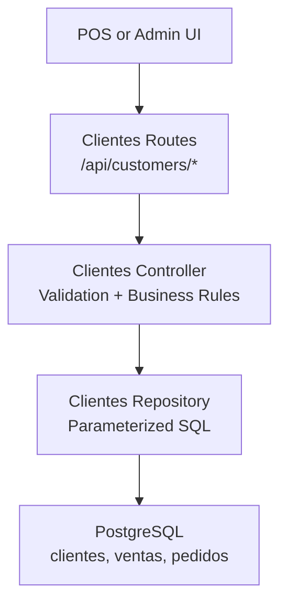
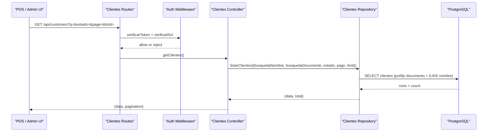
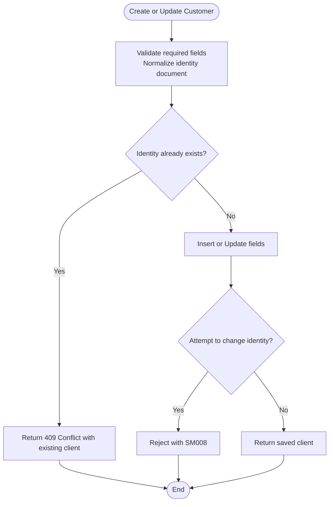
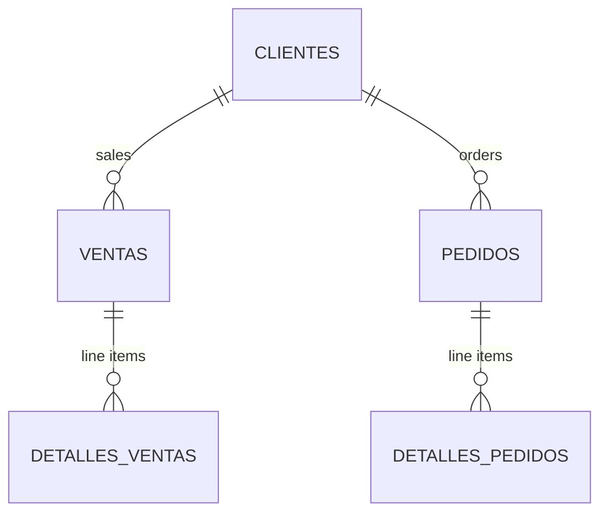
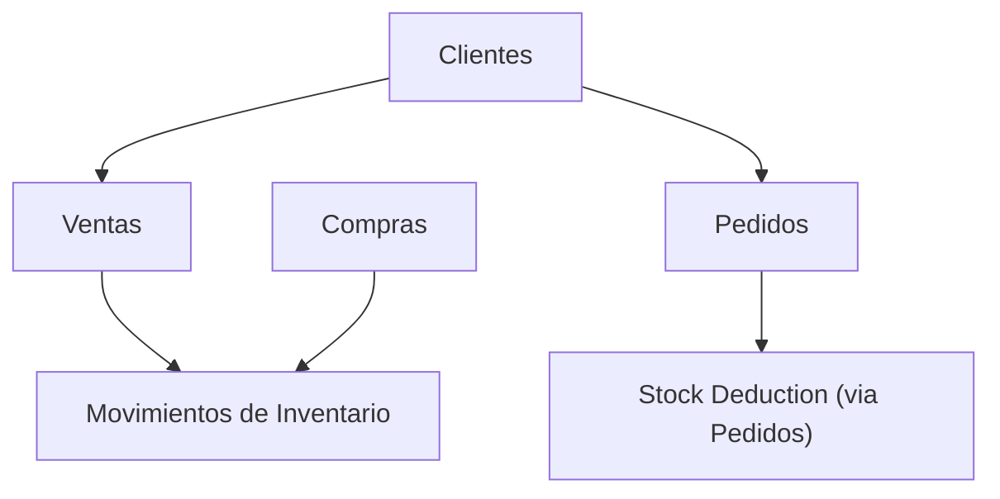
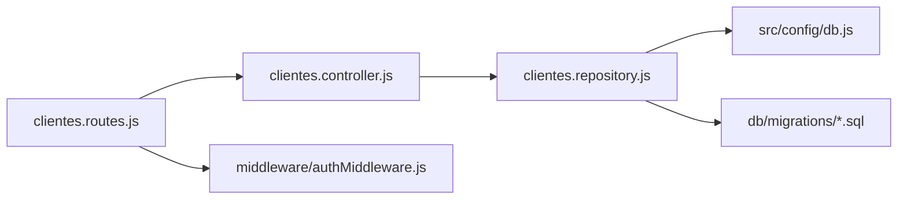

# Customer Management

<cite>
**Referenced Files in This Document**
- [clientes.controller.js](file://backend/src/controllers/clientes.controller.js)
- [clientes.repository.js](file://backend/src/repositories/clientes.repository.js)
- [clientes.routes.js](file://backend/src/routes/clientes.routes.js)
- [authMiddleware.js](file://backend/middleware/authMiddleware.js)
- [db.js](file://backend/src/config/db.js)
- [004_clientes_pedidos.sql](file://backend/db/migrations/004_clientes_pedidos.sql)
- [005_ventas.sql](file://backend/db/migrations/005_ventas.sql)
- [009_clientes.sql](file://backend/db/migrations/009_clientes.sql)
- [BuscarCliente.tsx](file://simoapp/components/ventas/BuscarCliente.tsx)
</cite>

## Table of Contents
1. [Introduction](#introduction)
2. [Project Structure](#project-structure)
3. [Core Components](#core-components)
4. [Architecture Overview](#architecture-overview)
5. [Detailed Component Analysis](#detailed-component-analysis)
6. [Dependency Analysis](#dependency-analysis)
7. [Performance Considerations](#performance-considerations)
8. [Troubleshooting Guide](#troubleshooting-guide)
9. [Conclusion](#conclusion)

## Introduction
This document explains the customer management system implemented in the backend and its integration with sales, orders, and inventory modules. It covers:
- Customer database schema and constraints
- Customer lifecycle management
- Purchase history tracking through sales and orders
- Search and filtering capabilities
- Input validation and data safety rules
- Integration points with sales and inventory
- Data privacy, export considerations, and bulk operation guidance

The system exposes a REST API under `/api/customers` for creating, reading, updating, searching, and reviewing customer purchase history.

## Project Structure
Customer functionality is organized into three layers:
- Routes define HTTP endpoints and authorization requirements.
- Controllers validate input, enforce business rules, and return responses.
- Repositories execute parameterized SQL queries against PostgreSQL.

**Diagram sources**
- [clientes.routes.js:1-27](file://backend/src/routes/clientes.routes.js#L1-L27)
- [clientes.controller.js:1-283](file://backend/src/controllers/clientes.controller.js#L1-L283)
- [clientes.repository.js:1-131](file://backend/src/repositories/clientes.repository.js#L1-L131)
- [004_clientes_pedidos.sql:12-24](file://backend/db/migrations/004_clientes_pedidos.sql#L12-L24)
- [005_ventas.sql:40-67](file://backend/db/migrations/005_ventas.sql#L40-L67)

**Section sources**
- [clientes.routes.js:1-27](file://backend/src/routes/clientes.routes.js#L1-L27)
- [clientes.controller.js:1-283](file://backend/src/controllers/clientes.controller.js#L1-L283)
- [clientes.repository.js:1-131](file://backend/src/repositories/clientes.repository.js#L1-L131)

## Core Components
- **Routes**: Define endpoints for customers, require authentication and role checks for Vendedor, Gerente, and Administrador.
- **Controller**: Validates inputs, normalizes documents, enforces uniqueness, protects identity documents from modification, and returns structured responses including pagination and error messages.
- **Repository**: Performs CRUD operations, advanced search with prefix matching on identity documents, and builds a comprehensive customer history summary combining sales and orders.

Key responsibilities:
- Create customer with unique identity document.
- Read by ID or normalized identity document.
- Update editable fields while protecting identity document.
- List with filters and pagination.
- Retrieve purchase history including completed sales totals and open orders.

**Section sources**
- [clientes.routes.js:12-24](file://backend/src/routes/clientes.routes.js#L12-L24)
- [clientes.controller.js:12-68](file://backend/src/controllers/clientes.controller.js#L12-L68)
- [clientes.repository.js:5-18](file://backend/src/repositories/clientes.repository.js#L5-L18)

## Architecture Overview
The customer module integrates with sales and orders to provide a unified view of customer activity.

**Diagram sources**
- [clientes.routes.js:18-24](file://backend/src/routes/clientes.routes.js#L18-L24)
- [authMiddleware.js:9-49](file://backend/middleware/authMiddleware.js#L9-L49)
- [clientes.controller.js:127-168](file://backend/src/controllers/clientes.controller.js#L127-L168)
- [clientes.repository.js:32-68](file://backend/src/repositories/clientes.repository.js#L32-L68)

## Detailed Component Analysis

### Customer Database Schema and Lifecycle
- The `clientes` table stores identity type, normalized identity document, name, phone, email, address, active status, and timestamps.
- Identity documents are unique and immutable after creation; attempts to change them raise a specific error code.
- A trigger ensures updated timestamps are maintained automatically.
- An index supports fast prefix searches for autocomplete in the POS.

Lifecycle highlights:
- New customers are created active.
- Updates can modify contact fields and active status but not identity document.
- Deletion is restricted at the database level when referenced by sales or orders.

**Diagram sources**
- [004_clientes_pedidos.sql:12-33](file://backend/db/migrations/004_clientes_pedidos.sql#L12-L33)
- [009_clientes.sql:19-34](file://backend/db/migrations/009_clientes.sql#L19-L34)
- [clientes.controller.js:73-122](file://backend/src/controllers/clientes.controller.js#L73-L122)
- [clientes.controller.js:213-247](file://backend/src/controllers/clientes.controller.js#L213-L247)

**Section sources**
- [004_clientes_pedidos.sql:12-33](file://backend/db/migrations/004_clientes_pedidos.sql#L12-L33)
- [009_clientes.sql:19-34](file://backend/db/migrations/009_clientes.sql#L19-L34)

### Customer CRUD Operations

#### Create Customer
- Validates identity document format and allowed types.
- Normalizes document by removing spaces and dots and uppercasing letters.
- Ensures new customers are always active.
- Returns conflict response if duplicate identity document exists.

Example request path:
- POST `/api/customers`

Response behavior:
- 201 Created with saved client object.
- 400 Bad Request for invalid input.
- 409 Conflict if identity document already exists.

**Section sources**
- [clientes.controller.js:73-122](file://backend/src/controllers/clientes.controller.js#L73-L122)
- [clientes.repository.js:10-18](file://backend/src/repositories/clientes.repository.js#L10-L18)

#### Read Customer
- By ID: GET `/api/customers/:id`
- By identity document: GET `/api/customers/document/:documento`

Behavior:
- Validates positive integer IDs.
- Normalizes and validates identity document format.
- Returns 404 Not Found when no match.

**Section sources**
- [clientes.controller.js:173-207](file://backend/src/controllers/clientes.controller.js#L173-L207)
- [clientes.repository.js:20-28](file://backend/src/repositories/clientes.repository.js#L20-L28)

#### Update Customer
- Editable fields: name, phone, email, address, active status.
- Identity document cannot be changed; attempt triggers SM008 error.
- Requires at least one editable field.

Example request path:
- PUT `/api/customers/:id`

**Section sources**
- [clientes.controller.js:213-247](file://backend/src/controllers/clientes.controller.js#L213-L247)
- [clientes.repository.js:70-81](file://backend/src/repositories/clientes.repository.js#L70-L81)
- [009_clientes.sql:19-34](file://backend/db/migrations/009_clientes.sql#L19-L34)

#### List Customers with Search and Filtering
- Query parameters:
  - `q`: free text search across name and identity document prefix.
  - `estado`: boolean string `'true'` or `'false'`.
  - `page`: positive integer.
  - `limit`: positive integer up to 100.
- Response includes `data` array and `pagination` object with `total` and `totalPages`.

Search logic:
- Name uses case-insensitive substring match.
- Identity document uses prefix match via index for performance.
- Filters combine with AND/OR conditions safely escaped.

Example request path:
- GET `/api/customers?q=...&estado=true&page=1&limit=20`

**Section sources**
- [clientes.controller.js:127-168](file://backend/src/controllers/clientes.controller.js#L127-L168)
- [clientes.repository.js:32-68](file://backend/src/repositories/clientes.repository.js#L32-L68)
- [009_clientes.sql:16-17](file://backend/db/migrations/009_clientes.sql#L16-L17)

### Purchase History Tracking
The customer history endpoint aggregates:
- Completed sales metrics: count, total amount, last sale date.
- Open orders: count of non-delivered and non-cancelled orders.
- Recent sales list with payment method and product counts.
- Recent orders with overdue flags and product counts.

Endpoint:
- GET `/api/customers/:id/history?limit=`

Data model relationships:
- Sales reference customers and optionally orders.
- Orders reference customers and have detailed line items.
- History query joins payment methods and computes derived fields like overdue.

**Diagram sources**
- [004_clientes_pedidos.sql:42-85](file://backend/db/migrations/004_clientes_pedidos.sql#L42-L85)
- [005_ventas.sql:40-97](file://backend/db/migrations/005_ventas.sql#L40-L97)
- [clientes.repository.js:84-121](file://backend/src/repositories/clientes.repository.js#L84-L121)

**Section sources**
- [clientes.controller.js:252-273](file://backend/src/controllers/clientes.controller.js#L252-L273)
- [clientes.repository.js:84-121](file://backend/src/repositories/clientes.repository.js#L84-L121)
- [004_clientes_pedidos.sql:42-85](file://backend/db/migrations/004_clientes_pedidos.sql#L42-L85)
- [005_ventas.sql:40-97](file://backend/db/migrations/005_ventas.sql#L40-L97)

### Advanced Search Functionality
The POS component provides an interactive search experience:
- Accepts identity document or name.
- Debounces requests and shows recent suggestions.
- Navigates results using keyboard arrows and Enter selection.
- Offers quick registration for new customers when none found.

Integration:
- Calls the same `/api/customers` search endpoint used by admin interfaces.
- Displays errors and retry options.

**Section sources**
- [BuscarCliente.tsx:63-208](file://simoapp/components/ventas/BuscarCliente.tsx#L63-L208)
- [clientes.controller.js:127-168](file://backend/src/controllers/clientes.controller.js#L127-L168)

### Validation and Data Safety
Validation rules enforced in the controller:
- Identity document must match allowed characters and length.
- Allowed identity types: CC, CE, NIT, TI, PAS.
- Phone and email validated with regex patterns.
- Name trimmed and limited to 150 characters.
- Address limited to 200 characters.
- Pagination parameters constrained to safe ranges.

Database-level safeguards:
- Unique constraint on identity document.
- Trigger prevents modification of identity document and type.
- Email stored lowercase.
- Timestamps auto-updated.

Global sanitization:
- XSS sanitization middleware applies to body, query, and params.

**Section sources**
- [clientes.controller.js:12-68](file://backend/src/controllers/clientes.controller.js#L12-L68)
- [004_clientes_pedidos.sql:12-24](file://backend/db/migrations/004_clientes_pedidos.sql#L12-L24)
- [009_clientes.sql:19-34](file://backend/db/migrations/009_clientes.sql#L19-L34)
- [authMiddleware.js:9-49](file://backend/middleware/authMiddleware.js#L9-L49)

### Configuration Options
- Database connection:
  - Supports `DATABASE_URL` or individual environment variables (`DB_HOST`, `DB_PORT`, `DB_NAME`, `DB_USER`, `DB_PASSWORD`).
  - SSL configuration controlled by `DB_SSL`.
- Authentication and roles:
  - JWT-based authentication with token blacklist support.
  - Role-based access control for routes.
- Customer categories and communication preferences:
  - No dedicated category or preference tables exist in the current schema.
  - Extensibility points: add columns or related tables for categories and communication preferences.

**Section sources**
- [db.js:1-29](file://backend/src/config/db.js#L1-L29)
- [authMiddleware.js:9-49](file://backend/middleware/authMiddleware.js#L9-L49)
- [clientes.routes.js:12-24](file://backend/src/routes/clientes.routes.js#L12-L24)

### Relationships with Sales and Inventory Modules
- Sales module:
  - Sales reference customers and optionally orders.
  - Payment methods are informational and do not integrate with banking systems.
  - Sales cancellation requires manager/admin authorization and records who executed and authorized it.
- Orders module:
  - Orders follow a strict lifecycle with transitions enforced by triggers.
  - Order state changes are audited with user and reason.
- Inventory module:
  - Purchases update warehouse stock and create inventory movements linked to purchases.
  - Customer-facing operations do not directly modify inventory; sales deduct stock through inventory movement logic defined elsewhere.

**Diagram sources**
- [005_ventas.sql:40-97](file://backend/db/migrations/005_ventas.sql#L40-L97)
- [004_clientes_pedidos.sql:42-105](file://backend/db/migrations/004_clientes_pedidos.sql#L42-L105)
- [011_compras.sql:21-57](file://backend/db/migrations/011_compras.sql#L21-L57)

**Section sources**
- [005_ventas.sql:40-97](file://backend/db/migrations/005_ventas.sql#L40-L97)
- [004_clientes_pedidos.sql:42-105](file://backend/db/migrations/004_clientes_pedidos.sql#L42-L105)
- [011_compras.sql:21-57](file://backend/db/migrations/011_compras.sql#L21-L57)

### Data Privacy Compliance and Export Considerations
Current implementation does not include explicit data retention policies, consent flags, or built-in export endpoints for customer data. Recommended enhancements:
- Add fields for consent and communication preferences.
- Implement GDPR-style export endpoints returning all personal data associated with a customer.
- Add anonymization or deletion workflows respecting retention policies.
- Audit logs for data access and modifications beyond order state history.

[No sources needed since this section provides general guidance]

### Bulk Operations for Large Databases
- Pagination is supported for listing customers with a maximum limit of 100 per page.
- For large-scale imports or updates, consider:
  - Batch inserts using transactional batches.
  - Temporary staging tables with validation before merging into `clientes`.
  - Background jobs for heavy operations to avoid blocking API responses.
- Ensure indexes remain effective and monitor query performance during bulk operations.

**Section sources**
- [clientes.controller.js:132-137](file://backend/src/controllers/clientes.controller.js#L132-L137)
- [clientes.repository.js:55-68](file://backend/src/repositories/clientes.repository.js#L55-L68)

## Dependency Analysis
The customer module depends on:
- Express routing and middleware for authentication and role checks.
- PostgreSQL pool configured via environment variables.
- Database migrations defining schema, constraints, and triggers.

**Diagram sources**
- [clientes.routes.js:1-27](file://backend/src/routes/clientes.routes.js#L1-L27)
- [clientes.controller.js:1-283](file://backend/src/controllers/clientes.controller.js#L1-L283)
- [clientes.repository.js:1-131](file://backend/src/repositories/clientes.repository.js#L1-L131)
- [db.js:1-29](file://backend/src/config/db.js#L1-L29)
- [authMiddleware.js:1-81](file://backend/middleware/authMiddleware.js#L1-L81)

**Section sources**
- [clientes.routes.js:1-27](file://backend/src/routes/clientes.routes.js#L1-L27)
- [clientes.controller.js:1-283](file://backend/src/controllers/clientes.controller.js#L1-L283)
- [clientes.repository.js:1-131](file://backend/src/repositories/clientes.repository.js#L1-L131)
- [db.js:1-29](file://backend/src/config/db.js#L1-L29)
- [authMiddleware.js:1-81](file://backend/middleware/authMiddleware.js#L1-L81)

## Performance Considerations
- Use the identity document prefix index for fast autocomplete in POS.
- Keep search terms short and leverage server-side pagination.
- Avoid excessive nested subqueries; the repository consolidates history into parallel queries.
- Monitor slow queries on large datasets and consider additional indexes for frequently filtered fields.

[No sources needed since this section provides general guidance]

## Troubleshooting Guide
Common issues and resolutions:
- Duplicate identity document on create:
  - Return 409 Conflict with existing client details.
  - Check normalization and uniqueness constraints.
- Attempt to modify identity document:
  - Reject with SM008 error from database trigger.
- Invalid pagination parameters:
  - Enforce positive integers and limits up to 100.
- Unauthorized or forbidden access:
  - Verify JWT token validity and role permissions.

**Section sources**
- [clientes.controller.js:98-122](file://backend/src/controllers/clientes.controller.js#L98-L122)
- [clientes.controller.js:227-247](file://backend/src/controllers/clientes.controller.js#L227-L247)
- [clientes.controller.js:132-137](file://backend/src/controllers/clientes.controller.js#L132-L137)
- [authMiddleware.js:9-49](file://backend/middleware/authMiddleware.js#L9-L49)

## Conclusion
The customer management system provides robust CRUD operations, secure validation, and integrated purchase history retrieval across sales and orders. It leverages database constraints and triggers to enforce data integrity and immutability rules. While categories and communication preferences are not yet modeled, the architecture supports extension. For compliance and scalability, consider adding export endpoints, consent management, and batch processing capabilities.

[No sources needed since this section summarizes without analyzing specific files]