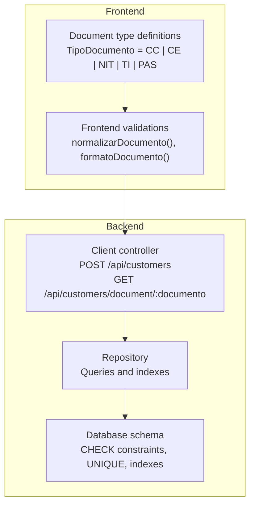
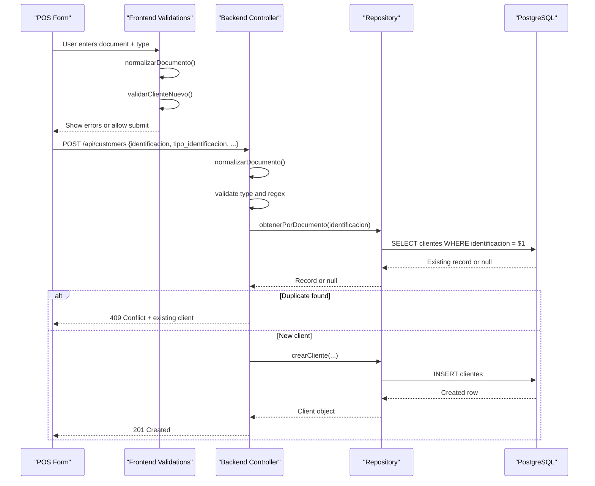
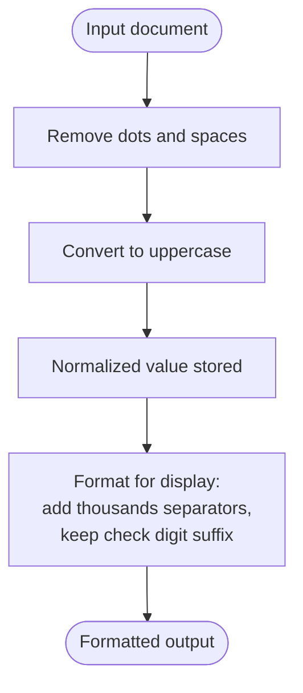
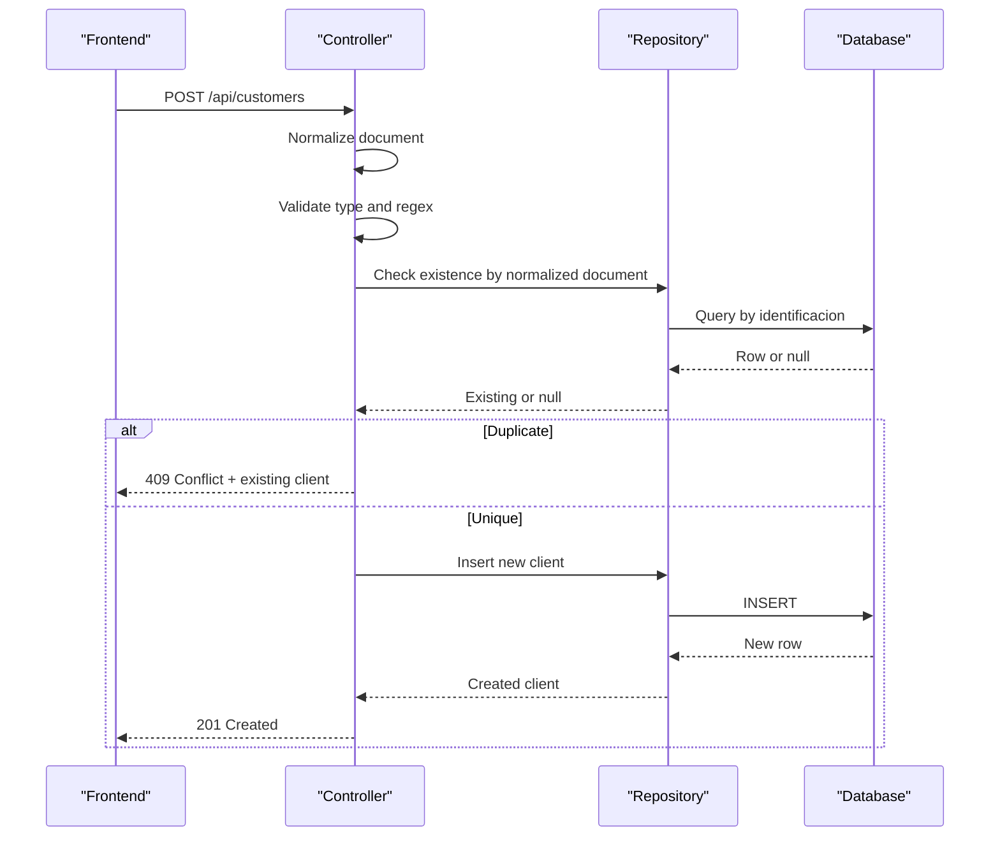
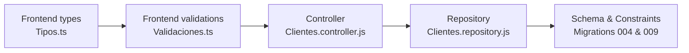

# Document Validation System

<cite>
**Referenced Files in This Document**
- [validaciones.ts](file://simoapp/lib/clientes/validaciones.ts)
- [tipos.ts](file://simoapp/lib/clientes/tipos.ts)
- [clientes.controller.js](file://backend/src/controllers/clientes.controller.js)
- [clientes.repository.js](file://backend/src/repositories/clientes.repository.js)
- [004_clientes_pedidos.sql](file://backend/db/migrations/004_clientes_pedidos.sql)
- [009_clientes.sql](file://backend/db/migrations/009_clientes.sql)
- [README.md](file://README.md)
</cite>

## Table of Contents
1. [Introduction](#introduction)
2. [Project Structure](#project-structure)
3. [Core Components](#core-components)
4. [Architecture Overview](#architecture-overview)
5. [Detailed Component Analysis](#detailed-component-analysis)
6. [Dependency Analysis](#dependency-analysis)
7. [Performance Considerations](#performance-considerations)
8. [Troubleshooting Guide](#troubleshooting-guide)
9. [Conclusion](#conclusion)

## Introduction
This document explains the document validation system used for customer management across the frontend and backend. It covers supported document types (CC, CE, NIT, TI, PAS), normalization rules, regular expressions, length constraints, character restrictions, error messages, duplicate conflict handling, internationalization considerations, security measures against injection attacks, and compliance requirements for identity documents.

The system ensures that identity documents are consistently normalized before storage, validated at both client and server layers, and protected by database constraints and triggers to prevent tampering.

## Project Structure
The validation logic is implemented in two layers:
- Frontend validation utilities for immediate user feedback and display formatting.
- Backend controller and repository for authoritative validation, persistence, and integrity enforcement.

**Diagram sources**
- [validaciones.ts:1-64](file://simoapp/lib/clientes/validaciones.ts#L1-L64)
- [tipos.ts:1-40](file://simoapp/lib/clientes/tipos.ts#L1-L40)
- [clientes.controller.js:1-283](file://backend/src/controllers/clientes.controller.js#L1-L283)
- [clientes.repository.js:1-131](file://backend/src/repositories/clientes.repository.js#L1-L131)
- [004_clientes_pedidos.sql:12-24](file://backend/db/migrations/004_clientes_pedidos.sql#L12-L24)
- [009_clientes.sql:14-37](file://backend/db/migrations/009_clientes.sql#L14-L37)

**Section sources**
- [validaciones.ts:1-64](file://simoapp/lib/clientes/validaciones.ts#L1-L64)
- [tipos.ts:1-40](file://simoapp/lib/clientes/tipos.ts#L1-L40)
- [clientes.controller.js:1-283](file://backend/src/controllers/clientes.controller.js#L1-L283)
- [clientes.repository.js:1-131](file://backend/src/repositories/clientes.repository.js#L1-L131)
- [004_clientes_pedidos.sql:12-24](file://backend/db/migrations/004_clientes_pedidos.sql#L12-L24)
- [009_clientes.sql:14-37](file://backend/db/migrations/009_clientes.sql#L14-L37)

## Core Components
- Supported document types: CC, CE, NIT, TI, PAS.
- Normalization: remove dots and spaces; uppercase letters.
- Display formatting: add thousands separators and optional check digit suffix.
- Validation patterns: regex for document, phone, email; length limits.
- Conflict resolution: HTTP 409 with existing client data when duplicates are detected.
- Database integrity: CHECK constraints, UNIQUE index, and trigger preventing document changes.

Key responsibilities:
- Frontend: early validation and user-friendly formatting.
- Backend: authoritative validation, normalization, uniqueness checks, and safe persistence.
- Database: enforce allowed values, uniqueness, and immutability of identity fields.

**Section sources**
- [tipos.ts:6-16](file://simoapp/lib/clientes/tipos.ts#L6-L16)
- [validaciones.ts:9-26](file://simoapp/lib/clientes/validaciones.ts#L9-L26)
- [clientes.controller.js:12-26](file://backend/src/controllers/clientes.controller.js#L12-L26)
- [004_clientes_pedidos.sql:12-24](file://backend/db/migrations/004_clientes_pedidos.sql#L12-L24)
- [009_clientes.sql:14-37](file://backend/db/migrations/009_clientes.sql#L14-L37)

## Architecture Overview
The document validation flow spans multiple layers:

**Diagram sources**
- [validaciones.ts:15-17](file://simoapp/lib/clientes/validaciones.ts#L15-L17)
- [validaciones.ts:36-63](file://simoapp/lib/clientes/validaciones.ts#L36-L63)
- [clientes.controller.js:73-122](file://backend/src/controllers/clientes.controller.js#L73-L122)
- [clientes.repository.js:10-18](file://backend/src/repositories/clientes.repository.js#L10-L18)
- [clientes.repository.js:25-28](file://backend/src/repositories/clientes.repository.js#L25-L28)

## Detailed Component Analysis

### Supported Document Types
- Allowed codes: CC, CE, NIT, TI, PAS.
- Default type is CC if not provided.
- The frontend defines these types and labels for UI selection.

Validation behavior:
- Backend enforces allowed values via an explicit list and a database CHECK constraint.
- Any other value is rejected with a clear error message listing valid options.

Examples:
- Valid: CC, CE, NIT, TI, PAS
- Invalid: ID, PASSPORT, cedula

**Section sources**
- [tipos.ts:6-16](file://simoapp/lib/clientes/tipos.ts#L6-L16)
- [clientes.controller.js:12-12](file://backend/src/controllers/clientes.controller.js#L12-L12)
- [004_clientes_pedidos.sql:14-15](file://backend/db/migrations/004_clientes_pedidos.sql#L14-L15)

### Normalization Process
Normalization ensures consistent storage and comparison:
- Remove all dots and spaces.
- Convert letters to uppercase.
- Preserve hyphens (e.g., check digits).

Display formatting:
- Add thousands separators to numeric portions.
- Append verification suffix after a hyphen when present.
- Leave alphabetic content unchanged (e.g., passports).

**Diagram sources**
- [validaciones.ts:15-17](file://simoapp/lib/clientes/validaciones.ts#L15-L17)
- [validaciones.ts:21-26](file://simoapp/lib/clientes/validaciones.ts#L21-L26)
- [clientes.controller.js:23-26](file://backend/src/controllers/clientes.controller.js#L23-L26)

**Section sources**
- [validaciones.ts:13-26](file://simoapp/lib/clientes/validaciones.ts#L13-L26)
- [clientes.controller.js:23-26](file://backend/src/controllers/clientes.controller.js#L23-L26)

### Regular Expressions and Constraints
- Document pattern: allows digits, uppercase letters, and hyphen; length between 3 and 30 characters.
- Phone pattern: allows digits, plus, parentheses, spaces, and hyphen; length between 7 and 30 characters.
- Email pattern: standard email format; max 150 characters.
- Name: required; max 150 characters; whitespace collapsed to single space.
- Address: optional; max 200 characters.

Database constraints:
- Type must be one of CC, CE, NIT, TI, PAS.
- Identity field is unique and non-empty.
- Email is stored lowercase.

Examples:
- Valid document formats:
  - CC: 1090123456
  - NIT: 900123456-7
  - PAS: ABC123456
- Invalid document formats:
  - Empty or too short (<3)
  - Too long (>30)
  - Contains invalid characters (e.g., lowercase letters without uppercase conversion)

Error messages:
- Document: “Must have between 3 and 30 characters: numbers, letters, or hyphen.”
- Phone: “Between 7 and 30 characters: numbers, spaces, +, -, or parentheses.”
- Email: “Email does not have a valid format.”
- Name: “Customer name is required” or “Name accepts maximum 150 characters.”
- Address: “Address accepts maximum 200 characters.”

**Section sources**
- [validaciones.ts:9-11](file://simoapp/lib/clientes/validaciones.ts#L9-L11)
- [validaciones.ts:36-63](file://simoapp/lib/clientes/validaciones.ts#L36-L63)
- [clientes.controller.js:13-16](file://backend/src/controllers/clientes.controller.js#L13-L16)
- [clientes.controller.js:30-68](file://backend/src/controllers/clientes.controller.js#L30-L68)
- [004_clientes_pedidos.sql:12-24](file://backend/db/migrations/004_clientes_pedidos.sql#L12-L24)

### Validation Flow for Creating a Customer

**Diagram sources**
- [clientes.controller.js:73-122](file://backend/src/controllers/clientes.controller.js#L73-L122)
- [clientes.repository.js:10-18](file://backend/src/repositories/clientes.repository.js#L10-L18)

**Section sources**
- [clientes.controller.js:73-122](file://backend/src/controllers/clientes.controller.js#L73-L122)
- [clientes.repository.js:10-18](file://backend/src/repositories/clientes.repository.js#L10-L18)

### Duplicate Conflict Resolution
When a duplicate identity document is detected:
- The backend returns HTTP 409 Conflict with a standardized message.
- The response includes the existing client object so the UI can load it directly.
- A race condition where two simultaneous inserts occur is handled by catching database unique violation errors and returning the same 409 response with the existing client.

Conflict response example:
- Status: 409
- Body: { error: "Conflict", message: "El documento de identidad ya se encuentra registrado.", cliente: {...existing client...} }

**Section sources**
- [clientes.controller.js:98-121](file://backend/src/controllers/clientes.controller.js#L98-L121)
- [README.md:235-237](file://README.md#L235-L237)

### Immutability of Identity Fields
Identity fields cannot be changed after creation:
- Attempting to update the document number or type results in a bad request error.
- Database-level trigger enforces this rule and raises a specific SQLSTATE code.

Behavior:
- PUT /api/customers/:id rejects any change to identificacion or tipo_identificacion.
- If attempted, the backend returns a 400 Bad Request with a message indicating immutability.
- Database trigger raises SM008 on direct updates attempting to modify these fields.

**Section sources**
- [clientes.controller.js:226-232](file://backend/src/controllers/clientes.controller.js#L226-L232)
- [009_clientes.sql:19-34](file://backend/db/migrations/009_clientes.sql#L19-L34)

### Search and Lookup by Document
Exact lookup endpoint:
- GET /api/customers/document/:documento
- Normalizes input and validates format before querying.
- Returns 404 if no client matches.

List endpoint:
- GET /api/customers?q=...
- Supports prefix search on document and substring search on name.
- Normalizes query text and detects document-like inputs.

**Section sources**
- [clientes.controller.js:173-188](file://backend/src/controllers/clientes.controller.js#L173-L188)
- [clientes.controller.js:127-168](file://backend/src/controllers/clientes.controller.js#L127-L168)
- [clientes.repository.js:30-68](file://backend/src/repositories/clientes.repository.js#L30-L68)

## Dependency Analysis
The validation system depends on coordinated components:

Coupling and cohesion:
- Frontend validation mirrors backend rules to provide immediate feedback but does not replace server-side validation.
- Controller centralizes validation logic and orchestrates repository calls.
- Repository encapsulates queries and leverages database indexes for performance.
- Database schema enforces business rules at the lowest level.

Potential circular dependencies:
- None observed; dependencies flow from frontend to backend to database.

External integrations:
- PostgreSQL database with constraints and triggers.
- No external identity providers; identity documents are treated as opaque identifiers after normalization.

**Diagram sources**
- [tipos.ts:1-40](file://simoapp/lib/clientes/tipos.ts#L1-L40)
- [validaciones.ts:1-64](file://simoapp/lib/clientes/validaciones.ts#L1-L64)
- [clientes.controller.js:1-283](file://backend/src/controllers/clientes.controller.js#L1-L283)
- [clientes.repository.js:1-131](file://backend/src/repositories/clientes.repository.js#L1-L131)
- [004_clientes_pedidos.sql:12-24](file://backend/db/migrations/004_clientes_pedidos.sql#L12-L24)
- [009_clientes.sql:14-37](file://backend/db/migrations/009_clientes.sql#L14-L37)

**Section sources**
- [tipos.ts:1-40](file://simoapp/lib/clientes/tipos.ts#L1-L40)
- [validaciones.ts:1-64](file://simoapp/lib/clientes/validaciones.ts#L1-L64)
- [clientes.controller.js:1-283](file://backend/src/controllers/clientes.controller.js#L1-L283)
- [clientes.repository.js:1-131](file://backend/src/repositories/clientes.repository.js#L1-L131)
- [004_clientes_pedidos.sql:12-24](file://backend/db/migrations/004_clientes_pedidos.sql#L12-L24)
- [009_clientes.sql:14-37](file://backend/db/migrations/009_clientes.sql#L14-L37)

## Performance Considerations
- Indexing:
  - A dedicated index supports fast prefix searches on the normalized identity field.
  - Additional indexes support name-based searches and state filters.
- Pagination:
  - List endpoints use pagination parameters with enforced limits to avoid heavy queries.
- Normalization cost:
  - Lightweight string operations (replace and toUpperCase) are negligible compared to I/O.
- Concurrency:
  - Database unique constraints protect against race conditions; controller handles duplicate detection gracefully.

Recommendations:
- Keep normalization functions pure and minimal.
- Avoid unnecessary re-normalization in hot paths.
- Use parameterized queries (already implemented) to prevent SQL injection and improve plan caching.

[No sources needed since this section provides general guidance]

## Troubleshooting Guide
Common issues and resolutions:
- Invalid document format:
  - Ensure the document contains only digits, uppercase letters, and hyphens; length between 3 and 30.
  - Normalize input by removing dots and spaces and converting to uppercase.
- Duplicate document:
  - If receiving 409 Conflict, load the existing client returned in the response body.
- Immutable identity fields:
  - Do not attempt to update the document number or type; only contact details and status are editable.
- Search anomalies:
  - For prefix search, ensure the query is normalized; the backend detects document-like inputs automatically.

Error responses:
- 400 Bad Request: invalid parameters or validation failures.
- 404 Not Found: client does not exist.
- 409 Conflict: duplicate identity document.

Security and compliance notes:
- Input validation and parameterized queries mitigate injection risks.
- Identity documents are stored normalized and case-insensitive where applicable.
- Access control for customer endpoints is pending JWT and role enforcement.

**Section sources**
- [clientes.controller.js:19-21](file://backend/src/controllers/clientes.controller.js#L19-L21)
- [clientes.controller.js:73-122](file://backend/src/controllers/clientes.controller.js#L73-L122)
- [clientes.controller.js:213-246](file://backend/src/controllers/clientes.controller.js#L213-L246)
- [README.md:235-237](file://README.md#L235-L237)

## Conclusion
The document validation system ensures robust, consistent handling of identity documents across the application. It combines frontend usability with strict backend enforcement and database integrity. Supported document types are validated, normalized, and formatted appropriately, while conflicts are resolved transparently. Security measures include input validation and parameterized queries, and compliance is reinforced through immutable identity fields and controlled access.

[No sources needed since this section summarizes without analyzing specific files]