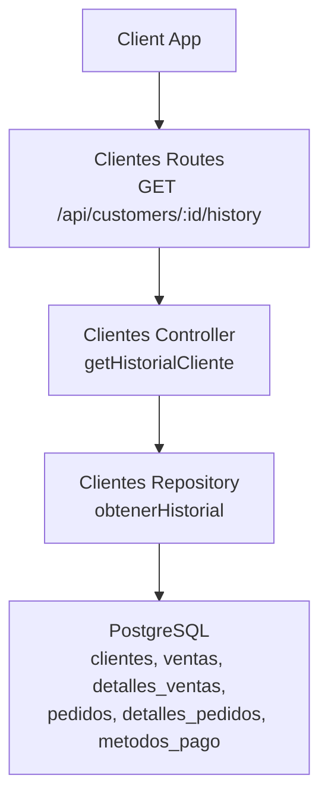
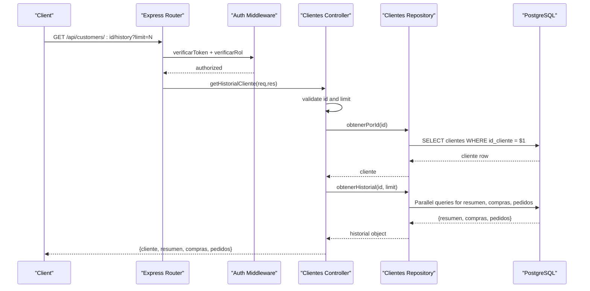
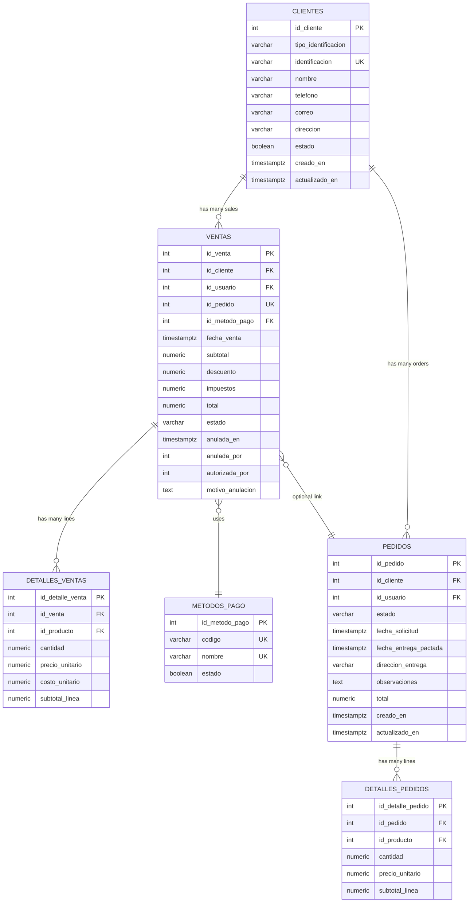
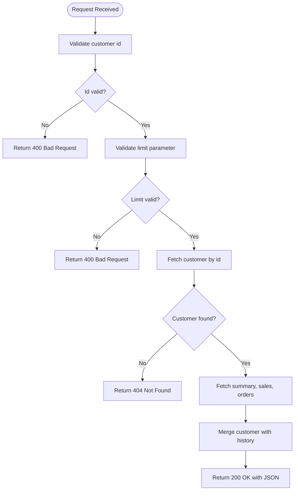
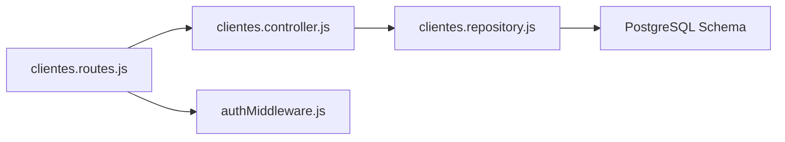

# Purchase History Tracking

<cite>
**Referenced Files in This Document**
- [clientes.controller.js](file://backend/src/controllers/clientes.controller.js)
- [clientes.repository.js](file://backend/src/repositories/clientes.repository.js)
- [clientes.routes.js](file://backend/src/routes/clientes.routes.js)
- [004_clientes_pedidos.sql](file://backend/db/migrations/004_clientes_pedidos.sql)
- [005_ventas.sql](file://backend/db/migrations/005_ventas.sql)
- [009_clientes.sql](file://backend/db/migrations/009_clientes.sql)
- [013_indices_ventas.sql](file://backend/db/migrations/013_indices_ventas.sql)
- [clientes.test.js](file://backend/tests/integracion/clientes.test.js)
</cite>

## Table of Contents
1. [Introduction](#introduction)
2. [Project Structure](#project-structure)
3. [Core Components](#core-components)
4. [Architecture Overview](#architecture-overview)
5. [Detailed Component Analysis](#detailed-component-analysis)
6. [Dependency Analysis](#dependency-analysis)
7. [Performance Considerations](#performance-considerations)
8. [Troubleshooting Guide](#troubleshooting-guide)
9. [Conclusion](#conclusion)

## Introduction
This document explains the purchase history tracking functionality for customers. It covers how customer profiles are linked to sales and orders, how the history endpoint retrieves and aggregates historical data, and what response structures clients receive. It also documents pagination limits, current filtering capabilities, chronological ordering, performance optimizations, caching strategies, and data retention considerations.

The implementation is part of a backend service that exposes customer management endpoints, including a dedicated history endpoint for retrieving a customer’s completed purchases, all sales (including cancelled ones), and their related orders.

## Project Structure
The purchase history feature spans three main layers:
- Routes define the HTTP endpoint.
- The controller validates input, checks authorization, and orchestrates the request.
- The repository executes database queries that aggregate summaries, list recent sales, and list recent orders.

**Diagram sources**
- [clientes.routes.js:24-24](file://backend/src/routes/clientes.routes.js#L24-L24)
- [clientes.controller.js:250-272](file://backend/src/controllers/clientes.controller.js#L250-L272)
- [clientes.repository.js:83-120](file://backend/src/repositories/clientes.repository.js#L83-L120)
- [004_clientes_pedidos.sql:12-56](file://backend/db/migrations/004_clientes_pedidos.sql#L12-L56)
- [005_ventas.sql:40-77](file://backend/db/migrations/005_ventas.sql#L40-L77)

**Section sources**
- [clientes.routes.js:1-27](file://backend/src/routes/clientes.routes.js#L1-L27)
- [clientes.controller.js:1-283](file://backend/src/controllers/clientes.controller.js#L1-L283)
- [clientes.repository.js:1-131](file://backend/src/repositories/clientes.repository.js#L1-L131)

## Core Components
- Customer profile model: stores identity, contact information, and status.
- Sales model: records each transaction with totals, payment method, timestamps, and state.
- Order model: represents pre-delivery requests with lifecycle states and delivery dates.
- History aggregation: computes summary metrics, lists recent sales, and lists recent orders.

Key responsibilities:
- Route: expose `/api/customers/:id/history` with authentication and role checks.
- Controller: validate parameters, ensure the customer exists, and return merged response.
- Repository: run parallel queries for summary, sales list, and orders list.

**Section sources**
- [004_clientes_pedidos.sql:12-56](file://backend/db/migrations/004_clientes_pedidos.sql#L12-L56)
- [005_ventas.sql:40-77](file://backend/db/migrations/005_ventas.sql#L40-L77)
- [clientes.routes.js:24-24](file://backend/src/routes/clientes.routes.js#L24-L24)
- [clientes.controller.js:250-272](file://backend/src/controllers/clientes.controller.js#L250-L272)
- [clientes.repository.js:83-120](file://backend/src/repositories/clientes.repository.js#L83-L120)

## Architecture Overview
The history endpoint follows a layered architecture:
- Authentication and authorization middleware protect the route.
- The controller validates inputs and delegates data access to the repository.
- The repository uses PostgreSQL to compute aggregated summaries and fetch paginated lists.

**Diagram sources**
- [clientes.routes.js:24-24](file://backend/src/routes/clientes.routes.js#L24-L24)
- [clientes.controller.js:250-272](file://backend/src/controllers/clientes.controller.js#L250-L272)
- [clientes.repository.js:83-120](file://backend/src/repositories/clientes.repository.js#L83-L120)

## Detailed Component Analysis

### Endpoint Definition and Authorization
- Route: `GET /api/customers/:id/history`
- Protection: requires valid token and one of the roles VENDEDOR, GERENTE, ADMIN.
- Query parameter: `limit` (optional). Default is 20 when not provided.
- Path parameter: `id` must be a positive integer.

Validation rules:
- `id`: positive integer; otherwise returns 400 Bad Request.
- `limit`: if present, must be a positive integer between 1 and 100; otherwise returns 400 Bad Request.
- If the customer does not exist, returns 404 Not Found.

Response structure:
- Top-level fields:
  - `cliente`: customer profile object.
  - `resumen`: summary metrics.
  - `compras`: array of sale records.
  - `pedidos`: array of order records.

**Section sources**
- [clientes.routes.js:12-24](file://backend/src/routes/clientes.routes.js#L12-L24)
- [clientes.controller.js:250-272](file://backend/src/controllers/clientes.controller.js#L250-L272)

### Controller Logic
The controller performs:
- Parameter validation for `id` and optional `limit`.
- Fetching the customer by ID; returning 404 if missing.
- Calling the repository to retrieve the history.
- Returning a combined JSON response merging the customer profile with the history payload.

Error handling:
- Validation errors return 400 with descriptive messages.
- Missing customer returns 404.
- Unexpected errors return 500 with an internal error message.

**Section sources**
- [clientes.controller.js:250-272](file://backend/src/controllers/clientes.controller.js#L250-L272)

### Repository Data Access and Aggregation
The repository runs three parallel queries:
1. Summary (`resumen`):
   - Count of completed purchases.
   - Sum of totals for completed purchases.
   - Timestamp of the most recent completed purchase.
   - Total number of orders for the customer.
   - Number of open orders (not delivered or cancelled).

2. Sales list (`compras`):
   - Fields include sale identifier, timestamp, state, subtotal, discount, taxes, total, payment method name, associated order ID, and product count.
   - Joins with payment methods to include human-readable names.
   - Ordered by sale date descending, then sale ID descending.
   - Limited by the requested `limit`.

3. Orders list (`pedidos`):
   - Fields include order identifier, request date, agreed delivery date, state, total, overdue flag, and product count.
   - Overdue flag is computed based on current time and delivery date for non-closed orders.
   - Ordered by request date descending, then order ID descending.
   - Limited by the same `limit`.

Return value:
- An object containing `resumen`, `compras`, and `pedidos`.

Data relationships:
- Sales reference customers via `id_cliente`.
- Orders reference customers via `id_cliente`.
- Sales may optionally reference an order via `id_pedido`.

**Section sources**
- [clientes.repository.js:83-120](file://backend/src/repositories/clientes.repository.js#L83-L120)
- [004_clientes_pedidos.sql:42-56](file://backend/db/migrations/004_clientes_pedidos.sql#L42-L56)
- [005_ventas.sql:40-77](file://backend/db/migrations/005_ventas.sql#L40-L77)

### Database Schema and Relationships
Customer and sales/order relationships:
- `clientes`: primary table for customer profiles.
- `ventas`: sales transactions linked to customers and users, with optional link to orders.
- `pedidos`: customer orders with lifecycle states and delivery scheduling.
- Detail tables:
  - `detalles_ventas`: line items per sale.
  - `detalles_pedidos`: line items per order.

Indexes relevant to history:
- Index on `ventas.id_cliente` supports fast filtering by customer.
- Additional indexes optimize date-based queries and dashboard aggregations.

**Diagram sources**
- [004_clientes_pedidos.sql:12-85](file://backend/db/migrations/004_clientes_pedidos.sql#L12-L85)
- [005_ventas.sql:13-97](file://backend/db/migrations/005_ventas.sql#L13-L97)

**Section sources**
- [004_clientes_pedidos.sql:12-85](file://backend/db/migrations/004_clientes_pedidos.sql#L12-L85)
- [005_ventas.sql:13-97](file://backend/db/migrations/005_ventas.sql#L13-L97)

### Response Data Model
History endpoint response fields:
- `cliente`: customer profile object returned by the repository’s customer lookup.
- `resumen`:
  - `compras_completadas`: number of completed sales.
  - `total_comprado`: sum of totals for completed sales.
  - `ultima_compra`: timestamp of the latest completed sale.
  - `pedidos_totales`: total number of orders for the customer.
  - `pedidos_abiertos`: number of orders not delivered or cancelled.
- `compras`: array of sale objects with fields such as identifiers, timestamps, financial amounts, state, payment method name, optional order reference, and product count.
- `pedidos`: array of order objects with identifiers, dates, state, total, overdue flag, and product count.

Chronological ordering:
- Sales are ordered by sale date descending, then sale ID descending.
- Orders are ordered by request date descending, then order ID descending.

Pagination behavior:
- The `limit` query parameter controls the maximum number of rows returned for both sales and orders.
- Default limit is 20 when not provided.
- Valid range is 1–100; values outside this range return 400 Bad Request.

Date range filtering:
- The current implementation does not support date range filtering on the history endpoint. Filtering is limited to the `limit` parameter.

Sales amount calculations:
- Completed sales contribute to `compras_completadas` and `total_comprado`.
- Cancelled sales appear in the `compras` list but do not affect the summary totals.

Examples of usage patterns:
- Fetch last 5 purchases: `GET /api/customers/{id}/history?limit=5`.
- Fetch default history: `GET /api/customers/{id}/history`.
- Invalid limit example: `GET /api/customers/{id}/history?limit=500` returns 400.
- Non-existent customer: `GET /api/customers/99999999/history` returns 404.

**Section sources**
- [clientes.controller.js:250-272](file://backend/src/controllers/clientes.controller.js#L250-L272)
- [clientes.repository.js:83-120](file://backend/src/repositories/clientes.repository.js#L83-L120)
- [clientes.test.js:193-243](file://backend/tests/integracion/clientes.test.js#L193-L243)

### Processing Flow and Decision Points

**Diagram sources**
- [clientes.controller.js:250-272](file://backend/src/controllers/clientes.controller.js#L250-L272)
- [clientes.repository.js:83-120](file://backend/src/repositories/clientes.repository.js#L83-L120)

**Section sources**
- [clientes.controller.js:250-272](file://backend/src/controllers/clientes.controller.js#L250-L272)

## Dependency Analysis
Component dependencies:
- Routes depend on controllers and auth middleware.
- Controllers depend on repositories for data access.
- Repositories depend on the database connection pool and schema definitions.

External integrations:
- Authentication and role verification middleware enforce access control.
- PostgreSQL provides relational storage and indexing for efficient queries.

Potential coupling:
- The history endpoint couples customer existence checks with history retrieval.
- Summary calculations rely on specific sales states and order lifecycle states.

**Diagram sources**
- [clientes.routes.js:1-27](file://backend/src/routes/clientes.routes.js#L1-L27)
- [clientes.controller.js:1-283](file://backend/src/controllers/clientes.controller.js#L1-L283)
- [clientes.repository.js:1-131](file://backend/src/repositories/clientes.repository.js#L1-L131)

**Section sources**
- [clientes.routes.js:1-27](file://backend/src/routes/clientes.routes.js#L1-L27)
- [clientes.controller.js:1-283](file://backend/src/controllers/clientes.controller.js#L1-L283)
- [clientes.repository.js:1-131](file://backend/src/repositories/clientes.repository.js#L1-L131)

## Performance Considerations
Optimizations implemented:
- Parallel queries: summary, sales list, and orders list are executed concurrently using Promise.all to reduce latency.
- Indexed columns:
  - `ventas.id_cliente` index accelerates customer-specific sales lookups.
  - Additional indexes target date-based queries and coverage scans for dashboard metrics.
- Pagination:
  - `LIMIT` clauses constrain result sets for sales and orders, preventing large payloads.
- Covering indexes:
  - Date and total columns included in indexes reduce table reads for aggregated queries.

Recommendations:
- Enforce reasonable defaults for `limit` at the API gateway or client layer to avoid excessive payloads.
- Consider adding server-side caching for frequently accessed customer histories, especially for high-traffic dashboards.
- Use read replicas for heavy analytical queries if the workload grows significantly.

Caching strategy suggestions:
- In-memory cache keyed by customer ID with TTL expiration.
- Cache invalidation triggers on new sales or order updates.
- Separate caches for summary vs. detailed lists to balance freshness and performance.

Data retention policies:
- No explicit archival or purging logic is present in the analyzed files.
- For long-term growth, consider partitioning sales and orders by date ranges and archiving old partitions.
- Implement retention jobs to move older transactions to cold storage while maintaining referential integrity.

**Section sources**
- [clientes.repository.js:83-120](file://backend/src/repositories/clientes.repository.js#L83-L120)
- [005_ventas.sql:75-77](file://backend/db/migrations/005_ventas.sql#L75-L77)
- [013_indices_ventas.sql:33-57](file://backend/db/migrations/013_indices_ventas.sql#L33-L57)

## Troubleshooting Guide
Common issues and resolutions:
- Invalid customer ID:
  - Symptom: 400 Bad Request.
  - Cause: `id` is not a positive integer.
  - Resolution: Ensure the path parameter is a valid positive integer.

- Invalid limit parameter:
  - Symptom: 400 Bad Request.
  - Cause: `limit` is missing or outside the allowed range (1–100).
  - Resolution: Provide a valid integer within the allowed range or omit it to use the default.

- Customer not found:
  - Symptom: 404 Not Found.
  - Cause: The specified customer ID does not exist.
  - Resolution: Verify the customer ID before calling the history endpoint.

- Empty history:
  - Symptom: `compras` and `pedidos` arrays are empty; summary shows zero totals.
  - Cause: Customer has no completed sales or orders.
  - Resolution: This is expected behavior; confirm data insertion steps.

- Cancelled sales not counted in totals:
  - Symptom: `total_comprado` excludes cancelled sales.
  - Cause: Summary only sums completed sales.
  - Resolution: Filter or calculate separately if you need to include cancelled sales.

- Excessive response size:
  - Symptom: Large payloads due to high `limit`.
  - Cause: Client requesting too many rows.
  - Resolution: Reduce `limit` or implement client-side pagination.

**Section sources**
- [clientes.controller.js:250-272](file://backend/src/controllers/clientes.controller.js#L250-L272)
- [clientes.test.js:193-243](file://backend/tests/integracion/clientes.test.js#L193-L243)

## Conclusion
The purchase history tracking feature provides a robust way to retrieve a customer’s sales and order history with clear summary metrics. The endpoint enforces strict validation, leverages indexed queries for performance, and returns structured data suitable for UI presentation. While date range filtering is not currently supported, the existing pagination and indexing provide a solid foundation for future enhancements such as advanced filtering, caching, and data retention strategies.