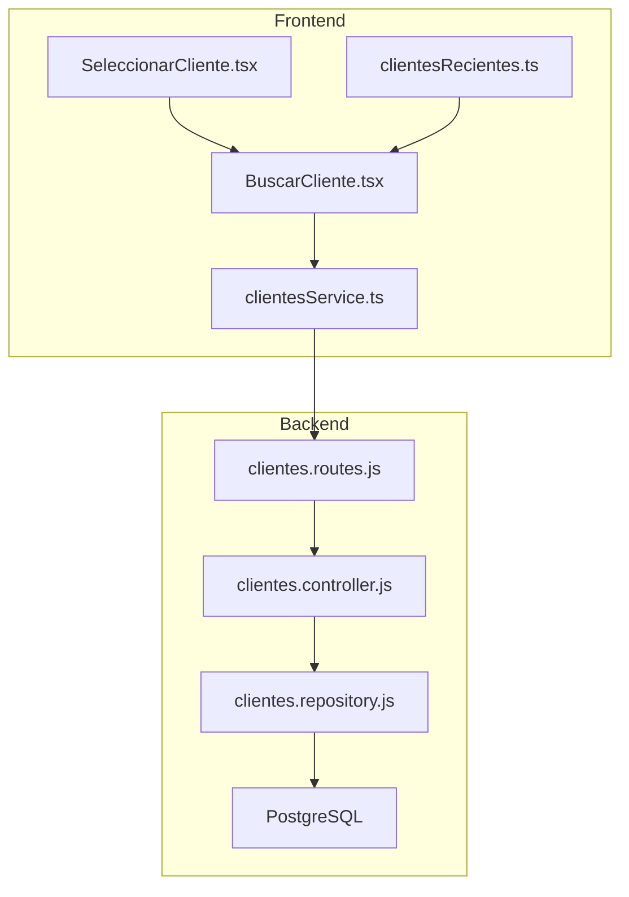
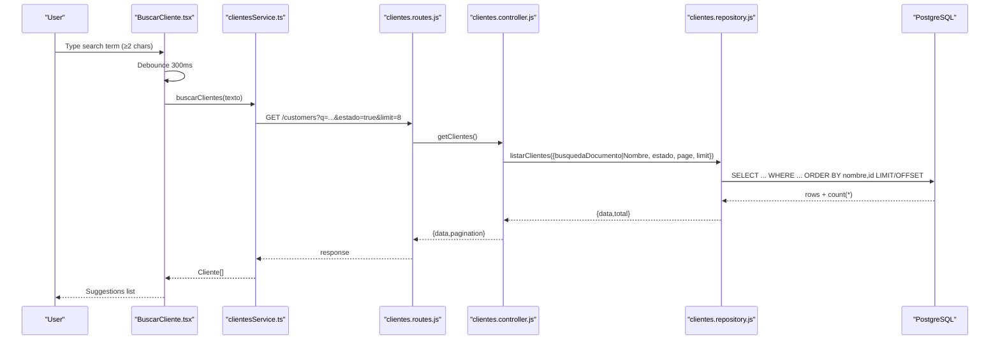
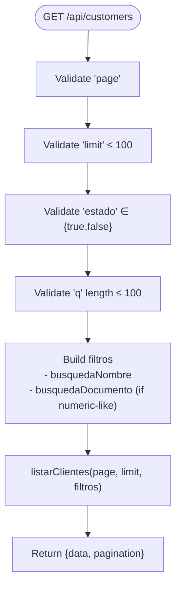
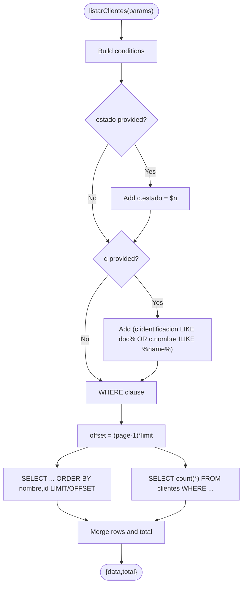
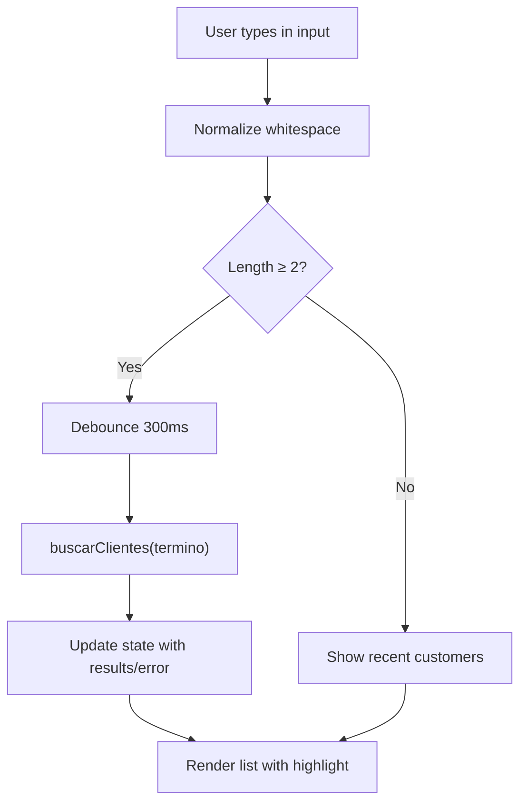
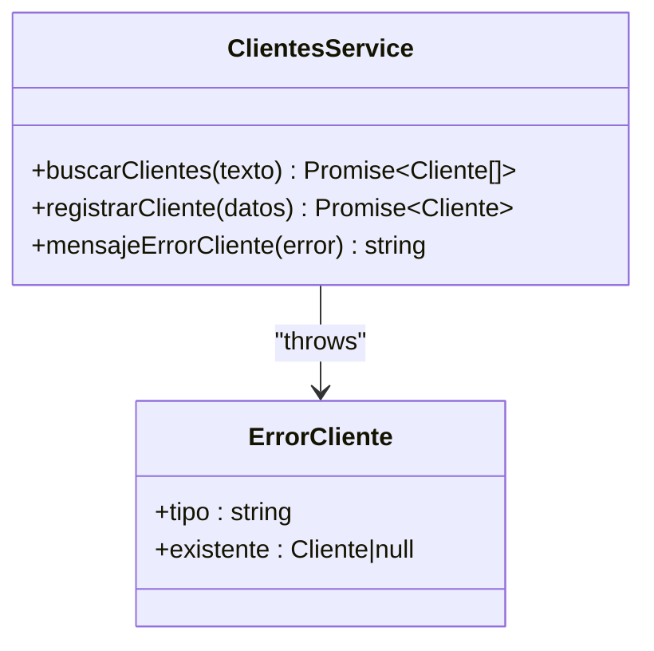
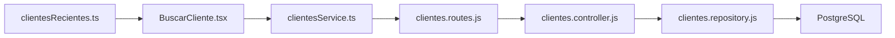

# Search & Filtering Capabilities

<cite>
**Referenced Files in This Document**
- [clientes.controller.js](file://backend/src/controllers/clientes.controller.js)
- [clientes.repository.js](file://backend/src/repositories/clientes.repository.js)
- [clientes.routes.js](file://backend/src/routes/clientes.routes.js)
- [004_clientes_pedidos.sql](file://backend/db/migrations/004_clientes_pedidos.sql)
- [009_clientes.sql](file://backend/db/migrations/009_clientes.sql)
- [BuscarCliente.tsx](file://simoapp/components/ventas/BuscarCliente.tsx)
- [SeleccionarCliente.tsx](file://simoapp/components/ventas/SeleccionarCliente.tsx)
- [clientesService.ts](file://simoapp/lib/clientes/clientesService.ts)
- [clientesRecientes.ts](file://simoapp/lib/clientes/clientesRecientes.ts)
</cite>

## Table of Contents
1. [Introduction](#introduction)
2. [Project Structure](#project-structure)
3. [Core Components](#core-components)
4. [Architecture Overview](#architecture-overview)
5. [Detailed Component Analysis](#detailed-component-analysis)
6. [Dependency Analysis](#dependency-analysis)
7. [Performance Considerations](#performance-considerations)
8. [Troubleshooting Guide](#troubleshooting-guide)
9. [Conclusion](#conclusion)

## Introduction
This document explains the customer search and filtering capabilities implemented across the backend API and the POS frontend. It covers:
- Advanced search by name, document number, and partial text matching.
- Query parameters for filtering by status, pagination, and result limiting.
- Real-time search suggestions with debouncing.
- Database indexing and query optimization strategies.
- Frontend integration patterns and user experience optimizations.

The system supports a fast, predictable search experience for point-of-sale workflows while remaining safe and efficient at scale.

## Project Structure
Customer search spans two layers:
- Backend: Express routes, controller validation, repository queries, and PostgreSQL schema/indexes.
- Frontend: React components for real-time search, recent customers, and selection flow.

**Diagram sources**
- [BuscarCliente.tsx:1-209](file://simoapp/components/ventas/BuscarCliente.tsx#L1-L209)
- [SeleccionarCliente.tsx:1-59](file://simoapp/components/ventas/SeleccionarCliente.tsx#L1-L59)
- [clientesService.ts:1-184](file://simoapp/lib/clientes/clientesService.ts#L1-L184)
- [clientesRecientes.ts:1-42](file://simoapp/lib/clientes/clientesRecientes.ts#L1-L42)
- [clientes.routes.js:1-27](file://backend/src/routes/clientes.routes.js#L1-L27)
- [clientes.controller.js:1-283](file://backend/src/controllers/clientes.controller.js#L1-L283)
- [clientes.repository.js:1-131](file://backend/src/repositories/clientes.repository.js#L1-L131)

**Section sources**
- [BuscarCliente.tsx:1-209](file://simoapp/components/ventas/BuscarCliente.tsx#L1-L209)
- [clientesService.ts:1-184](file://simoapp/lib/clientes/clientesService.ts#L1-L184)
- [clientes.routes.js:1-27](file://backend/src/routes/clientes.routes.js#L1-L27)
- [clientes.controller.js:1-283](file://backend/src/controllers/clientes.controller.js#L1-L283)
- [clientes.repository.js:1-131](file://backend/src/repositories/clientes.repository.js#L1-L131)

## Core Components
- Customer search endpoint: GET /api/customers with query parameters q, estado, page, limit.
- Repository query: builds dynamic WHERE clauses for document prefix and name content match; paginates results and returns total count.
- Frontend search component: Debounced input that calls the service layer to fetch active customers; shows recent customers when no query is present.
- Recent customers cache: LocalStorage-based list of recently selected customers for instant display.

Key responsibilities:
- Controller validates inputs and maps them to repository filters.
- Repository executes parameterized SQL with LIKE and ILIKE for performance and case-insensitive matching.
- Service layer normalizes requests and errors, and enforces a suggestion limit.
- UI provides keyboard navigation, accessibility attributes, and error retry behavior.

**Section sources**
- [clientes.controller.js:124-168](file://backend/src/controllers/clientes.controller.js#L124-L168)
- [clientes.repository.js:30-68](file://backend/src/repositories/clientes.repository.js#L30-L68)
- [clientesService.ts:84-96](file://simoapp/lib/clientes/clientesService.ts#L84-L96)
- [BuscarCliente.tsx:21-64](file://simoapp/components/ventas/BuscarCliente.tsx#L21-L64)

## Architecture Overview
The search flow integrates frontend interaction with backend validation and database retrieval.

**Diagram sources**
- [BuscarCliente.tsx:47-64](file://simoapp/components/ventas/BuscarCliente.tsx#L47-L64)
- [clientesService.ts:84-96](file://simoapp/lib/clientes/clientesService.ts#L84-L96)
- [clientes.routes.js:18-24](file://backend/src/routes/clientes.routes.js#L18-L24)
- [clientes.controller.js:124-168](file://backend/src/controllers/clientes.controller.js#L124-L168)
- [clientes.repository.js:30-68](file://backend/src/repositories/clientes.repository.js#L30-L68)

## Detailed Component Analysis

### Backend Search Endpoint and Validation
- Input validation:
  - page must be a positive integer.
  - limit must be a positive integer up to 100.
  - estado must be true or false.
  - q must be a string up to 100 characters.
- Query mapping:
  - q is normalized and used to build:
    - busquedaNombre for partial name matching.
    - busquedaDocumento if the normalized q looks like a document number (digits, uppercase letters, hyphens).
- Response:
  - Returns data array and pagination object with page, limit, total, totalPages.

**Diagram sources**
- [clientes.controller.js:124-168](file://backend/src/controllers/clientes.controller.js#L124-L168)

**Section sources**
- [clientes.controller.js:124-168](file://backend/src/controllers/clientes.controller.js#L124-L168)

### Repository Query Logic
- Filters:
  - Estado filter applied first.
  - If searching:
    - Document prefix match using LIKE on identificacion.
    - Name content match using ILIKE on nombre.
    - OR between document and name matches within the same search condition.
- Pagination:
  - Uses LIMIT and OFFSET based on page and limit.
- Count:
  - Separate COUNT(*) query for total pages calculation.

**Diagram sources**
- [clientes.repository.js:30-68](file://backend/src/repositories/clientes.repository.js#L30-L68)

**Section sources**
- [clientes.repository.js:30-68](file://backend/src/repositories/clientes.repository.js#L30-L68)

### Frontend Search Component Integration
- Debouncing:
  - Waits 300ms after typing stops before calling the backend.
  - Prevents stale responses using a “vigente” flag.
- Minimum characters:
  - Starts search only after ≥2 characters.
- Recent customers:
  - Displays local recent customers when no query is active.
- Accessibility:
  - Combobox/listbox roles, aria-expanded, aria-controls, aria-activedescendant.
- Keyboard navigation:
  - Arrow keys move focus; Enter selects.
- Error handling:
  - Shows friendly error message with retry button.

**Diagram sources**
- [BuscarCliente.tsx:21-64](file://simoapp/components/ventas/BuscarCliente.tsx#L21-L64)
- [BuscarCliente.tsx:78-90](file://simoapp/components/ventas/BuscarCliente.tsx#L78-L90)
- [BuscarCliente.tsx:92-118](file://simoapp/components/ventas/BuscarCliente.tsx#L92-L118)

**Section sources**
- [BuscarCliente.tsx:21-64](file://simoapp/components/ventas/BuscarCliente.tsx#L21-L64)
- [BuscarCliente.tsx:78-90](file://simoapp/components/ventas/BuscarCliente.tsx#L78-L90)
- [BuscarCliente.tsx:92-118](file://simoapp/components/ventas/BuscarCliente.tsx#L92-L118)
- [BuscarCliente.tsx:127-156](file://simoapp/components/ventas/BuscarCliente.tsx#L127-L156)

### Service Layer Contract and Mock Behavior
- Real API contract:
  - GET /customers?q=<texto>&estado=true&limit=8 → { data, pagination }
- Normalization:
  - Ensures document normalization and consistent field mapping.
- Error mapping:
  - Maps HTTP statuses to typed errors and user-friendly messages.
- Mock mode:
  - Simulates latency and applies the same logic (document prefix and name content match), limited to 8 suggestions.

**Diagram sources**
- [clientesService.ts:35-46](file://simoapp/lib/clientes/clientesService.ts#L35-L46)
- [clientesService.ts:84-96](file://simoapp/lib/clientes/clientesService.ts#L84-L96)
- [clientesService.ts:118-130](file://simoapp/lib/clientes/clientesService.ts#L118-L130)

**Section sources**
- [clientesService.ts:1-184](file://simoapp/lib/clientes/clientesService.ts#L1-L184)

### Recent Customers Cache
- Stores up to 5 recently selected customers in localStorage.
- Provides quick access without network calls when the modal opens.
- Gracefully handles storage failures by returning an empty list.

**Section sources**
- [clientesRecientes.ts:1-42](file://simoapp/lib/clientes/clientesRecientes.ts#L1-L42)

## Dependency Analysis
- Routes depend on authentication middleware and role checks.
- Controller depends on repository functions for data operations.
- Repository depends on database pool and schema indexes.
- Frontend components depend on service layer and local recent cache.

**Diagram sources**
- [clientes.routes.js:1-27](file://backend/src/routes/clientes.routes.js#L1-L27)
- [clientes.controller.js:1-283](file://backend/src/controllers/clientes.controller.js#L1-L283)
- [clientes.repository.js:1-131](file://backend/src/repositories/clientes.repository.js#L1-L131)
- [BuscarCliente.tsx:1-209](file://simoapp/components/ventas/BuscarCliente.tsx#L1-L209)
- [clientesService.ts:1-184](file://simoapp/lib/clientes/clientesService.ts#L1-L184)
- [clientesRecientes.ts:1-42](file://simoapp/lib/clientes/clientesRecientes.ts#L1-L42)

**Section sources**
- [clientes.routes.js:1-27](file://backend/src/routes/clientes.routes.js#L1-L27)
- [clientes.controller.js:1-283](file://backend/src/controllers/clientes.controller.js#L1-L283)
- [clientes.repository.js:1-131](file://backend/src/repositories/clientes.repository.js#L1-L131)

## Performance Considerations

### Query Parameter Structure
- q: Text to search. Supports partial name matching and document prefix matching when the input resembles a document number.
- estado: Boolean string ("true"/"false") to filter active/inactive customers.
- page: Positive integer for pagination.
- limit: Positive integer up to 100 for result limiting.

Example complex queries:
- Search by name and status:
  - GET /api/customers?q=María&estado=true&page=1&limit=10
- Search by document prefix and status:
  - GET /api/customers?q=1090&estado=true&page=1&limit=8
- Combine both criteria implicitly via q:
  - GET /api/customers?q=1090 María&estado=true&page=1&limit=8

Note: The backend automatically detects document-like inputs and applies prefix matching on identificacion while still matching nombre anywhere.

**Section sources**
- [clientes.controller.js:124-168](file://backend/src/controllers/clientes.controller.js#L124-L168)

### Fuzzy Search Implementation
- Current implementation uses:
  - Prefix matching on identificacion (LIKE 'prefix%').
  - Case-insensitive substring matching on nombre (ILIKE '%text%').
- No full-text search or fuzzy algorithms are implemented.
- For improved fuzziness, consider:
  - Trigram indexes (pg_trgm) with similarity operators.
  - Full-text search with tsvector/tsquery for token-based matching.
  - Levenshtein distance in application code for small candidate sets.

[No sources needed since this section provides general guidance]

### Real-Time Search Suggestions
- Debouncing strategy:
  - 300ms delay after typing stops.
  - Cancels previous timers to avoid race conditions.
- Minimum character threshold:
  - 2 characters to start searching.
- Result limiting:
  - Service layer requests up to 8 suggestions.
- UX enhancements:
  - Recent customers shown when no query is active.
  - Keyboard navigation and accessibility attributes.

**Section sources**
- [BuscarCliente.tsx:21-64](file://simoapp/components/ventas/BuscarCliente.tsx#L21-L64)
- [clientesService.ts:30-31](file://simoapp/lib/clientes/clientesService.ts#L30-L31)

### Database Query Optimization for Large Datasets
- Indexes:
  - idx_clientes_identificacion_prefijo: varchar_pattern_ops for efficient LIKE prefix searches on identificacion.
  - idx_clientes_nombre: index on lower(nombre) to support case-insensitive name lookups.
- Query design:
  - Parameterized queries prevent injection and allow plan reuse.
  - Separate COUNT(*) query avoids expensive counting during pagination.
- Recommendations:
  - Keep limit small for real-time suggestions (e.g., 8–10).
  - Use estado filter to reduce dataset size.
  - Monitor query plans with EXPLAIN ANALYZE for large tables.
  - Periodically run VACUUM ANALYZE to keep statistics fresh.

**Section sources**
- [004_clientes_pedidos.sql:12-28](file://backend/db/migrations/004_clientes_pedidos.sql#L12-L28)
- [009_clientes.sql:14-17](file://backend/db/migrations/009_clientes.sql#L14-L17)
- [clientes.repository.js:30-68](file://backend/src/repositories/clientes.repository.js#L30-L68)

### Indexing Strategies for Improved Search Response Times
- Existing indexes:
  - idx_clientes_identificacion_prefijo: Optimizes LIKE prefix on identificacion.
  - idx_clientes_nombre: Supports lower(nombre) usage.
- Potential additions:
  - Trigram index on nombre for fuzzy substring matching.
  - Composite index on (estado, nombre) if most searches filter by estado and sort by nombre.
- Maintenance:
  - Ensure random_page_cost is tuned for SSD-backed databases.
  - Run ANALYZE after bulk inserts to update planner statistics.

**Section sources**
- [004_clientes_pedidos.sql:28-28](file://backend/db/migrations/004_clientes_pedidos.sql#L28-L28)
- [009_clientes.sql:14-17](file://backend/db/migrations/009_clientes.sql#L14-L17)

## Troubleshooting Guide
Common issues and resolutions:
- Invalid page or limit:
  - Ensure page is a positive integer and limit is between 1 and 100.
- Invalid estado value:
  - Pass "true" or "false" as strings.
- Too long q:
  - Keep q under 100 characters.
- No results:
  - Verify estado filter; default frontend search uses active customers only.
  - Try shorter prefixes or different terms.
- Network errors:
  - Check connection; use retry button in UI.
- Duplicate document registration:
  - Backend returns conflict with existing client data; UI can show friendly message.

**Section sources**
- [clientes.controller.js:124-168](file://backend/src/controllers/clientes.controller.js#L124-L168)
- [clientesService.ts:118-130](file://simoapp/lib/clientes/clientesService.ts#L118-L130)

## Conclusion
The customer search and filtering system combines robust backend validation, efficient database queries, and a responsive frontend with debounced real-time suggestions. With current indexes and query design, it performs well for typical POS workloads. For advanced fuzzy matching and even faster large-dataset searches, consider trigram indexes and full-text search features. The architecture remains modular, allowing future enhancements without disrupting existing flows.