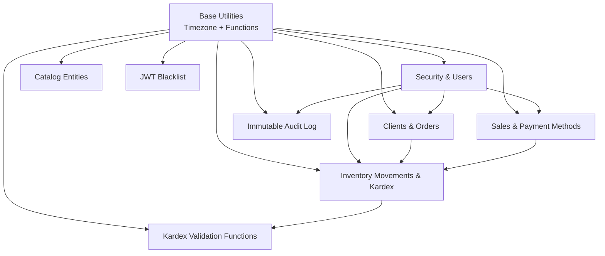
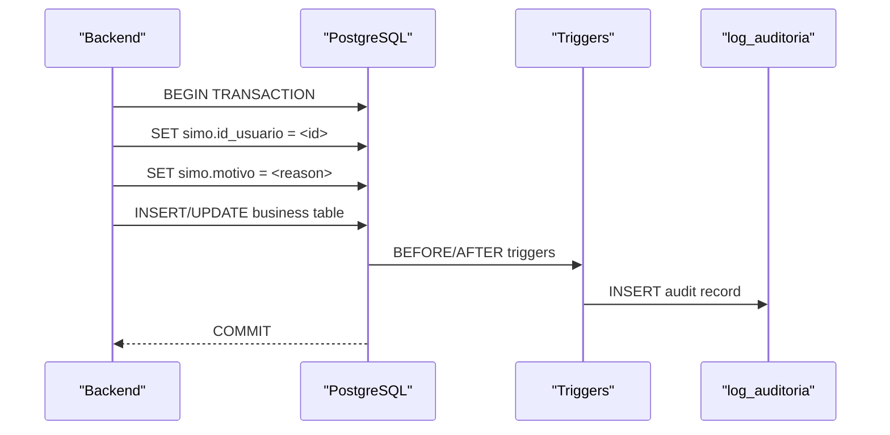
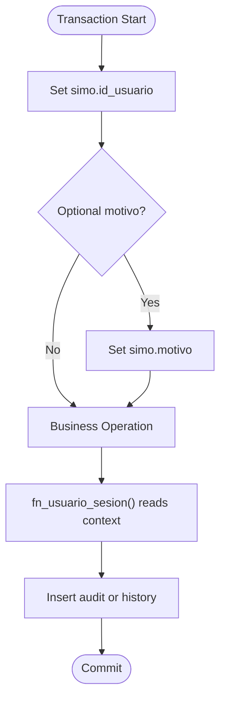
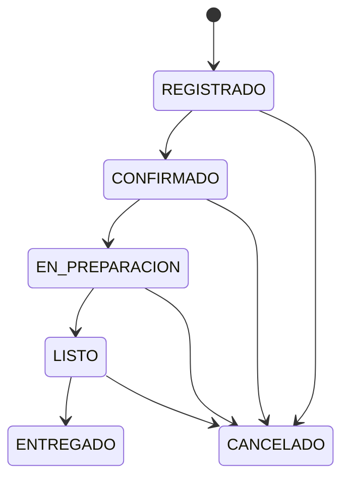
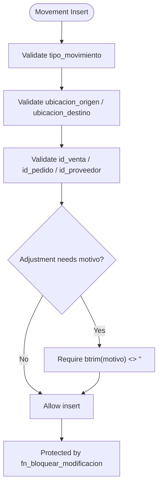
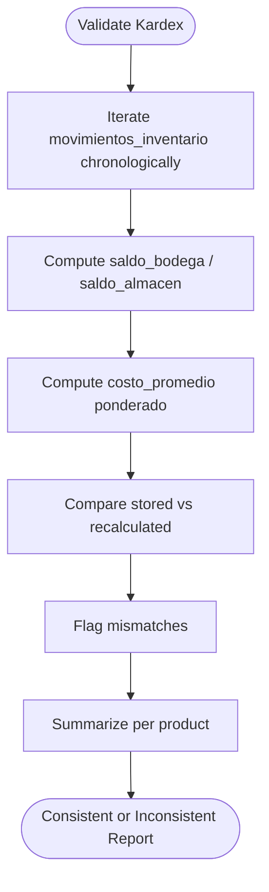
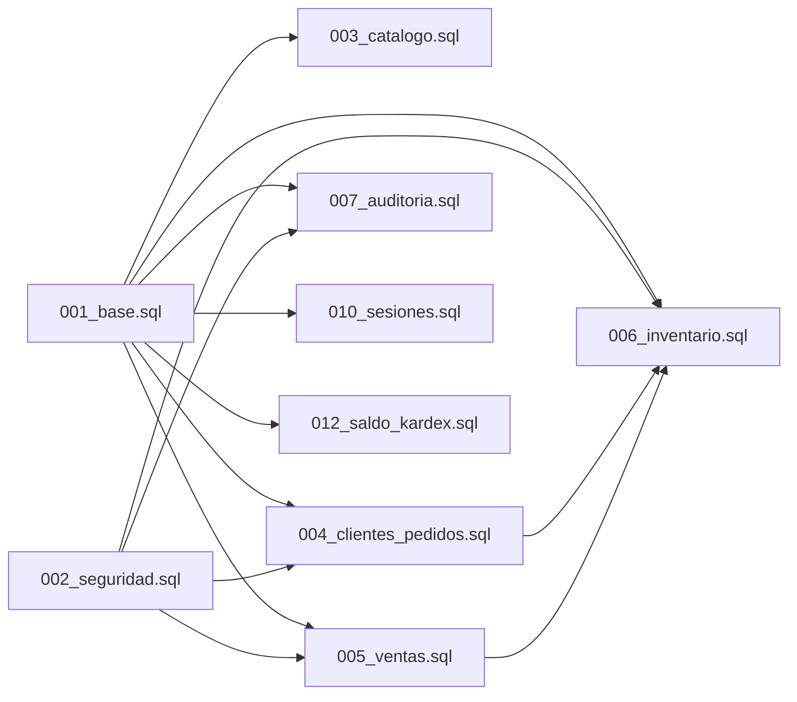

# Core Schema Design

<cite>
**Referenced Files in This Document**
- [001_base.sql](file://backend/db/migrations/001_base.sql)
- [002_seguridad.sql](file://backend/db/migrations/002_seguridad.sql)
- [003_catalogo.sql](file://backend/db/migrations/003_catalogo.sql)
- [004_clientes_pedidos.sql](file://backend/db/migrations/004_clientes_pedidos.sql)
- [005_ventas.sql](file://backend/db/migrations/005_ventas.sql)
- [006_inventario.sql](file://backend/db/migrations/006_inventario.sql)
- [007_auditoria.sql](file://backend/db/migrations/007_auditoria.sql)
- [010_sesiones.sql](file://backend/db/migrations/010_sesiones.sql)
- [012_saldo_kardex.sql](file://backend/db/migrations/012_saldo_kardex.sql)
</cite>

## Table of Contents
1. [Introduction](#introduction)
2. [Project Structure](#project-structure)
3. [Core Components](#core-components)
4. [Architecture Overview](#architecture-overview)
5. [Detailed Component Analysis](#detailed-component-analysis)
6. [Dependency Analysis](#dependency-analysis)
7. [Performance Considerations](#performance-considerations)
8. [Troubleshooting Guide](#troubleshooting-guide)
9. [Conclusion](#conclusion)

## Introduction
This document explains the foundational database schema and security patterns that underpin SIMO’s data integrity, auditing, and session-aware operations. It focuses on:

- The base utility functions `fn_set_actualizado_en`, `fn_usuario_sesion`, and `fn_bloquear_modificacion`.
- Timezone configuration to `America/Bogota`.
- Session-based user tracking through PostgreSQL session settings.
- Immutable table enforcement for audit trails, inventory movements, and order state history.
- Transaction context management using `set_config` to propagate user identity and optional reasons across triggers and functions.
- How these utilities are used throughout the schema to maintain consistent auditing and prevent unauthorized modifications.

The goal is to make the core design accessible to both technical and non-technical readers while providing precise references to the migration files where each pattern is implemented.

## Project Structure
SIMO’s database foundation lives under `backend/db/migrations`. Each migration file introduces tables, views, functions, triggers, and constraints that build upon earlier migrations. The most relevant files for this document are:

- Base utilities and timezone setup: `001_base.sql`
- Security, roles, users, and company metadata: `002_seguridad.sql`
- Catalog entities with update timestamps: `003_catalogo.sql`
- Clients, orders, and order state history: `004_clientes_pedidos.sql`
- Sales and payment methods: `005_ventas.sql`
- Inventory movements and Kardex view: `006_inventario.sql`
- Immutable audit log: `007_auditoria.sql`
- JWT blacklist for logout invalidation: `010_sesiones.sql`
- Kardex validation and recalculation functions: `012_saldo_kardex.sql`



**Diagram sources**
- [001_base.sql:1-60](file://backend/db/migrations/001_base.sql#L1-L60)
- [002_seguridad.sql:1-91](file://backend/db/migrations/002_seguridad.sql#L1-L91)
- [003_catalogo.sql:1-102](file://backend/db/migrations/003_catalogo.sql#L1-L102)
- [004_clientes_pedidos.sql:1-192](file://backend/db/migrations/004_clientes_pedidos.sql#L1-L192)
- [005_ventas.sql:1-104](file://backend/db/migrations/005_ventas.sql#L1-L104)
- [006_inventario.sql:1-166](file://backend/db/migrations/006_inventario.sql#L1-L166)
- [007_auditoria.sql:1-68](file://backend/db/migrations/007_auditoria.sql#L1-L68)
- [010_sesiones.sql:1-20](file://backend/db/migrations/010_sesiones.sql#L1-L20)
- [012_saldo_kardex.sql:1-155](file://backend/db/migrations/012_saldo_kardex.sql#L1-L155)

**Section sources**
- [001_base.sql:1-60](file://backend/db/migrations/001_base.sql#L1-L60)
- [002_seguridad.sql:1-91](file://backend/db/migrations/002_seguridad.sql#L1-L91)
- [003_catalogo.sql:1-102](file://backend/db/migrations/003_catalogo.sql#L1-L102)
- [004_clientes_pedidos.sql:1-192](file://backend/db/migrations/004_clientes_pedidos.sql#L1-L192)
- [005_ventas.sql:1-104](file://backend/db/migrations/005_ventas.sql#L1-L104)
- [006_inventario.sql:1-166](file://backend/db/migrations/006_inventario.sql#L1-L166)
- [007_auditoria.sql:1-68](file://backend/db/migrations/007_auditoria.sql#L1-L68)
- [010_sesiones.sql:1-20](file://backend/db/migrations/010_sesiones.sql#L1-L20)
- [012_saldo_kardex.sql:1-155](file://backend/db/migrations/012_saldo_kardex.sql#L1-L155)

## Core Components
This section documents the foundational utilities and how they are applied across the schema.

### Base Utility Functions
- `fn_set_actualizado_en`: A row-level trigger function that sets `actualizado_en` to the current timestamp on every update. It ensures consistent “last updated” tracking across auditable and operational tables.
- `fn_usuario_sesion`: Returns the transaction-scoped user ID from the session setting `simo.id_usuario`. If not set, it returns NULL, which allows downstream logic to detect missing context and raise errors.
- `fn_bloquear_modificacion`: A trigger function that raises an exception for UPDATE, DELETE, or TRUNCATE attempts on protected tables, enforcing immutability even for table owners.

These functions are defined once in the base migration and reused by later migrations to enforce consistent behavior.

**Section sources**
- [001_base.sql:28-57](file://backend/db/migrations/001_base.sql#L28-L57)

### Timezone Configuration
The database timezone is explicitly set to `America/Bogota` at the database level. This ensures that all `TIMESTAMPTZ` columns and functions like `now()` reflect Colombian local time consistently across sales, inventory movements, and audit records.

**Section sources**
- [001_base.sql:21-26](file://backend/db/migrations/001_base.sql#L21-L26)

### Session-Based User Tracking
The application must set the transaction-scoped session variables before modifying sensitive data:

- `simo.id_usuario`: Required for automatic user attribution in triggers and functions.
- `simo.motivo`: Optional reason text used by order state history and other audit-related logic.

If `simo.id_usuario` is missing when required (for example, when changing order states), the system raises a clear error indicating that the responsible user context was not provided.

**Section sources**
- [001_base.sql:11-16](file://backend/db/migrations/001_base.sql#L11-L16)
- [004_clientes_pedidos.sql:153-179](file://backend/db/migrations/004_clientes_pedidos.sql#L153-L179)

### Immutable Table Enforcement
Tables that must remain immutable use `fn_bloquear_modificacion` via triggers:

- Audit log (`log_auditoria`): Prevents UPDATE, DELETE, and TRUNCATE.
- Order state history (`historial_estados_pedido`): Prevents UPDATE and DELETE.
- Inventory movements (`movimientos_inventario`): Prevents UPDATE, DELETE, and TRUNCATE.

Additionally, permissions are revoked from PUBLIC for critical tables to strengthen protection.

**Section sources**
- [007_auditoria.sql:53-65](file://backend/db/migrations/007_auditoria.sql#L53-L65)
- [004_clientes_pedidos.sql:186-189](file://backend/db/migrations/004_clientes_pedidos.sql#L186-L189)
- [006_inventario.sql:121-129](file://backend/db/migrations/006_inventario.sql#L121-L129)

### Update Timestamp Pattern
Most business tables include `creado_en` and `actualizado_en` columns. Triggers attached to those tables call `fn_set_actualizado_en` to keep `actualizado_en` synchronized automatically.

Examples include:
- `usuarios`
- `empresa`
- `categorias`
- `productos`
- `clientes`
- `proveedores`
- `pedidos`

**Section sources**
- [002_seguridad.sql:63-66](file://backend/db/migrations/002_seguridad.sql#L63-L66)
- [002_seguridad.sql:85-88](file://backend/db/migrations/002_seguridad.sql#L85-L88)
- [003_catalogo.sql:52-55](file://backend/db/migrations/003_catalogo.sql#L52-L55)
- [003_catalogo.sql:96-99](file://backend/db/migrations/003_catalogo.sql#L96-L99)
- [004_clientes_pedidos.sql:30-33](file://backend/db/migrations/004_clientes_pedidos.sql#L30-L33)
- [004_clientes_pedidos.sql:68-71](file://backend/db/migrations/004_clientes_pedidos.sql#L68-L71)
- [006_inventario.sql:38-41](file://backend/db/migrations/006_inventario.sql#L38-L41)

## Architecture Overview
The database architecture centers around three pillars:

1. **Session Context**: The backend sets `simo.id_usuario` and optionally `simo.motivo` within each transaction. Functions and triggers read these values to attribute changes and record reasons.
2. **Immutability**: Critical append-only tables rely on triggers and permission revocation to prevent accidental or malicious modification.
3. **Auditing**: Every critical operation should be recorded in `log_auditoria` within the same transaction as the business change, ensuring atomicity between action and audit.



**Diagram sources**
- [001_base.sql:11-16](file://backend/db/migrations/001_base.sql#L11-L16)
- [007_auditoria.sql:1-9](file://backend/db/migrations/007_auditoria.sql#L1-L9)
- [004_clientes_pedidos.sql:153-179](file://backend/db/migrations/004_clientes_pedidos.sql#L153-L179)

## Detailed Component Analysis

### Base Utilities and Timezone
The base migration establishes shared functionality and environment configuration:

- Sets the database timezone to `America/Bogota`.
- Defines `fn_set_actualizado_en` to auto-update `actualizado_en`.
- Defines `fn_usuario_sesion` to retrieve the transaction-scoped user ID.
- Defines `fn_bloquear_modificacion` to block destructive operations on protected tables.



**Diagram sources**
- [001_base.sql:11-16](file://backend/db/migrations/001_base.sql#L11-L16)
- [001_base.sql:42-45](file://backend/db/migrations/001_base.sql#L42-L45)
- [004_clientes_pedidos.sql:153-179](file://backend/db/migrations/004_clientes_pedidos.sql#L153-L179)

**Section sources**
- [001_base.sql:1-60](file://backend/db/migrations/001_base.sql#L1-L60)

### Security Model and User Management
The security migration defines roles, users, and company metadata:

- Roles define RBAC codes used by middleware and JWT claims.
- Users store hashed passwords, login state, failure counters, and temporary lockout until a configured time.
- Company metadata is a single-row reference entity.
- Update triggers ensure `actualizado_en` is maintained.

```mermaid
classDiagram
class Roles {
+id_rol
+codigo
+nombre
+descripcion
+creado_en
}
class Usuarios {
+id_usuario
+id_rol
+nombre_completo
+correo
+usuario
+password_hash
+estado
+intentos_fallidos
+bloqueado_hasta
+ultimo_acceso
+creado_en
+actualizado_en
}
class Empresa {
+id_empresa
+razon_social
+nit
+telefono
+direccion
+logo_url
+actualizado_en
}
Roles ||--o{ Usuarios : "assigned_to"
```

**Diagram sources**
- [002_seguridad.sql:15-31](file://backend/db/migrations/002_seguridad.sql#L15-L31)
- [002_seguridad.sql:40-53](file://backend/db/migrations/002_seguridad.sql#L40-L53)
- [002_seguridad.sql:73-81](file://backend/db/migrations/002_seguridad.sql#L73-L81)

**Section sources**
- [002_seguridad.sql:1-91](file://backend/db/migrations/002_seguridad.sql#L1-L91)

### Catalog Entities and Update Timestamps
The catalog migration introduces units of measure, categories, and products:

- Products have dual inventory locations: `stock_bodega` and `stock_almacen`.
- `stock_total` is a generated column representing the sum of both locations.
- SKU is mandatory and unique.
- Purchase price is confidential and intended for restricted roles.
- Update triggers maintain `actualizado_en`.

```mermaid
classDiagram
class UnidadesMedida {
+id_unidad
+nombre
+abreviatura
+permite_decimales
}
class Categorias {
+id_categoria
+nombre
+descripcion
+estado
+creado_en
+actualizado_en
}
class Productos {
+id_producto
+id_categoria
+id_unidad
+sku
+nombre
+descripcion
+imagen_url
+precio_compra
+precio_venta
+stock_bodega
+stock_almacen
+stock_total
+stock_minimo_bodega
+stock_minimo_almacen
+estado
+creado_en
+actualizado_en
}
Categorias ||--o{ Productos : "belongs_to"
UnidadesMedida ||--o{ Productos : "measured_by"
```

**Diagram sources**
- [003_catalogo.sql:22-36](file://backend/db/migrations/003_catalogo.sql#L22-L36)
- [003_catalogo.sql:41-48](file://backend/db/migrations/003_catalogo.sql#L41-L48)
- [003_catalogo.sql:65-83](file://backend/db/migrations/003_catalogo.sql#L65-L83)

**Section sources**
- [003_catalogo.sql:1-102](file://backend/db/migrations/003_catalogo.sql#L1-L102)

### Clients, Orders, and Order State History
The clients and orders migration enforces strict lifecycle rules and immutable state history:

- Clients store identification type, unique identifier, contact details, and status.
- Orders track request date, agreed delivery date, address, observations, total, and state transitions.
- Order state transitions are validated by a function that enforces sequential progression and cancellation rules.
- Order state history is immutable and captures previous state, new state, user, and optional reason.



**Diagram sources**
- [004_clientes_pedidos.sql:42-56](file://backend/db/migrations/004_clientes_pedidos.sql#L42-L56)
- [004_clientes_pedidos.sql:114-151](file://backend/db/migrations/004_clientes_pedidos.sql#L114-L151)

**Section sources**
- [004_clientes_pedidos.sql:1-192](file://backend/db/migrations/004_clientes_pedidos.sql#L1-L192)

### Sales and Payment Methods
The sales migration defines payment methods and sales transactions:

- Payment methods are informational and include common options such as cash, digital wallets, bank transfers, and cards.
- Sales link to clients, users, payment methods, and optionally to delivered orders.
- Annulling a sale requires who performed it, who authorized it, and a written reason.
- Constraints enforce non-negative amounts, discount limits, and calculated totals.

```mermaid
classDiagram
class MetodosPago {
+id_metodo_pago
+codigo
+nombre
+estado
}
class Ventas {
+id_venta
+id_cliente
+id_usuario
+id_pedido
+id_metodo_pago
+fecha_venta
+subtotal
+descuento
+impuestos
+total
+estado
+anulada_en
+anulada_por
+autorizada_por
+motivo_anulacion
}
class DetallesVentas {
+id_detalle_venta
+id_venta
+id_producto
+cantidad
+precio_unitario
+costo_unitario
+subtotal_linea
}
MetodosPago ||--o{ Ventas : "payment_method"
Ventas ||--o{ DetallesVentas : "contains"
```

**Diagram sources**
- [005_ventas.sql:13-29](file://backend/db/migrations/005_ventas.sql#L13-L29)
- [005_ventas.sql:40-67](file://backend/db/migrations/005_ventas.sql#L40-L67)
- [005_ventas.sql:87-97](file://backend/db/migrations/005_ventas.sql#L87-L97)

**Section sources**
- [005_ventas.sql:1-104](file://backend/db/migrations/005_ventas.sql#L1-L104)

### Inventory Movements and Kardex View
The inventory migration defines suppliers and the immutable movement ledger:

- Movement types include purchases, internal transfers, sales outputs, order outputs, reversals, and adjustments.
- Location constraints ensure valid origin/destination combinations per movement type.
- References to sales, orders, and suppliers tie movements to business events.
- The Kardex view provides chronological entries with computed balances and valuation.



**Diagram sources**
- [006_inventario.sql:62-108](file://backend/db/migrations/006_inventario.sql#L62-L108)
- [006_inventario.sql:121-129](file://backend/db/migrations/006_inventario.sql#L121-L129)

**Section sources**
- [006_inventario.sql:1-166](file://backend/db/migrations/006_inventario.sql#L1-L166)

### Immutable Audit Log
The audit migration creates an immutable log for critical operations:

- Actions include inventory adjustments, sale cancellations, order cancellations, price changes, role/state changes, and company updates.
- Some actions require a written justification.
- Sale cancellations require an authorizer.
- Triggers and permission revocation prevent any modification or truncation.

```mermaid
classDiagram
class LogAuditoria {
+id_log
+fecha
+id_usuario
+id_usuario_autorizador
+accion
+entidad
+id_entidad
+justificacion
+datos_anteriores
+datos_nuevos
+direccion_ip
}
class Usuarios {
+id_usuario
+nombre_completo
}
Usuarios ||--o{ LogAuditoria : "created_by"
Usuarios ||--o{ LogAuditoria : "authorized_by"
```

**Diagram sources**
- [007_auditoria.sql:13-40](file://backend/db/migrations/007_auditoria.sql#L13-L40)
- [007_auditoria.sql:53-65](file://backend/db/migrations/007_auditoria.sql#L53-L65)

**Section sources**
- [007_auditoria.sql:1-68](file://backend/db/migrations/007_auditoria.sql#L1-L68)

### JWT Blacklist for Logout
The sessions migration adds a blacklist table for invalidated JWT tokens:

- Tokens stored here are rejected by authentication middleware even if they have not expired.
- This supports explicit logout flows where immediate invalidation is required.

**Section sources**
- [010_sesiones.sql:1-20](file://backend/db/migrations/010_sesiones.sql#L1-L20)

### Kardex Validation and Recalculation
The Kardex validation migration provides functions to audit inventory consistency:

- `fn_kardex_producto` recalculates balances and weighted average cost chronologically and flags inconsistent rows.
- `fn_validar_kardex` compares final recalculated balances with current product stock and counts inconsistencies.



**Diagram sources**
- [012_saldo_kardex.sql:26-108](file://backend/db/migrations/012_saldo_kardex.sql#L26-L108)
- [012_saldo_kardex.sql:113-149](file://backend/db/migrations/012_saldo_kardex.sql#L113-L149)

**Section sources**
- [012_saldo_kardex.sql:1-155](file://backend/db/migrations/012_saldo_kardex.sql#L1-L155)

## Dependency Analysis
The following diagram shows how the base utilities are consumed by later migrations:



**Diagram sources**
- [001_base.sql:1-60](file://backend/db/migrations/001_base.sql#L1-L60)
- [002_seguridad.sql:1-91](file://backend/db/migrations/002_seguridad.sql#L1-L91)
- [003_catalogo.sql:1-102](file://backend/db/migrations/003_catalogo.sql#L1-L102)
- [004_clientes_pedidos.sql:1-192](file://backend/db/migrations/004_clientes_pedidos.sql#L1-L192)
- [005_ventas.sql:1-104](file://backend/db/migrations/005_ventas.sql#L1-L104)
- [006_inventario.sql:1-166](file://backend/db/migrations/006_inventario.sql#L1-L166)
- [007_auditoria.sql:1-68](file://backend/db/migrations/007_auditoria.sql#L1-L68)
- [010_sesiones.sql:1-20](file://backend/db/migrations/010_sesiones.sql#L1-L20)
- [012_saldo_kardex.sql:1-155](file://backend/db/migrations/012_saldo_kardex.sql#L1-L155)

**Section sources**
- [001_base.sql:1-60](file://backend/db/migrations/001_base.sql#L1-L60)
- [002_seguridad.sql:1-91](file://backend/db/migrations/002_seguridad.sql#L1-L91)
- [003_catalogo.sql:1-102](file://backend/db/migrations/003_catalogo.sql#L1-L102)
- [004_clientes_pedidos.sql:1-192](file://backend/db/migrations/004_clientes_pedidos.sql#L1-L192)
- [005_ventas.sql:1-104](file://backend/db/migrations/005_ventas.sql#L1-L104)
- [006_inventario.sql:1-166](file://backend/db/migrations/006_inventario.sql#L1-L166)
- [007_auditoria.sql:1-68](file://backend/db/migrations/007_auditoria.sql#L1-L68)
- [010_sesiones.sql:1-20](file://backend/db/migrations/010_sesiones.sql#L1-L20)
- [012_saldo_kardex.sql:1-155](file://backend/db/migrations/012_saldo_kardex.sql#L1-L155)

## Performance Considerations
- Use indexes already defined in the migrations for frequent queries:
  - Order open/delivery alerts: `idx_pedidos_abiertos_entrega`
  - Auditoria by date, entity, user, and action: `idx_auditoria_fecha`, `idx_auditoria_entidad`, `idx_auditoria_usuario`, `idx_auditoria_accion`
  - Inventory movements by product/date and by reference: `idx_movimientos_producto_fecha`, `idx_movimientos_fecha`, `idx_movimientos_venta`, `idx_movimientos_pedido`
- Avoid direct writes to immutable tables; always go through the documented procedures or application logic that inserts into the correct ledger tables.
- Keep session context minimal and scoped to transactions to reduce overhead.
- Prefer reading from views like `v_kardex` rather than recomputing complex joins in application code.

[No sources needed since this section provides general guidance]

## Troubleshooting Guide
Common issues and their likely causes:

- Missing user context when updating orders:
  - Cause: `simo.id_usuario` was not set before modifying order state.
  - Symptom: Error indicating that the responsible user is missing.
  - Resolution: Ensure the backend sets `simo.id_usuario` inside the transaction before calling order state updates.

- Attempted modification of immutable tables:
  - Cause: Direct UPDATE, DELETE, or TRUNCATE on audit logs, order state history, or inventory movements.
  - Symptom: Exception raised by `fn_bloquear_modificacion`.
  - Resolution: Use only INSERT for these tables; corrections should be done through approved reversal or adjustment processes.

- Invalid order state transition:
  - Cause: Changing an order to a state not allowed by the lifecycle function.
  - Symptom: Check violation or explicit exception about invalid transition.
  - Resolution: Follow the allowed sequence: REGISTRADO → CONFIRMADO → EN_PREPARACION → LISTO → ENTREGADO, or cancel from allowed states.

- Inconsistent Kardex balances:
  - Cause: Stored balances do not match recalculated balances.
  - Symptom: `saldo_coincide` is false or validation reports inconsistencies.
  - Resolution: Investigate movements flagged by `fn_kardex_producto` and reconcile with business events.

**Section sources**
- [004_clientes_pedidos.sql:153-179](file://backend/db/migrations/004_clientes_pedidos.sql#L153-L179)
- [007_auditoria.sql:53-65](file://backend/db/migrations/007_auditoria.sql#L53-L65)
- [006_inventario.sql:121-129](file://backend/db/migrations/006_inventario.sql#L121-L129)
- [012_saldo_kardex.sql:26-108](file://backend/db/migrations/012_saldo_kardex.sql#L26-L108)

## Conclusion
SIMO’s core schema foundation relies on a small set of powerful utilities and consistent patterns:

- Timezone configuration ensures temporal consistency across Colombia.
- Session-scoped user context enables reliable attribution without passing user IDs through every layer.
- Immutable tables protect audit trails, inventory ledgers, and order state histories.
- Update timestamp triggers provide uniform maintenance of `actualizado_en`.
- Validation functions and constraints enforce business rules at the database level.

Together, these mechanisms create a robust foundation for data integrity, auditing, and secure operations across the application.

[No sources needed since this section summarizes without analyzing specific files]