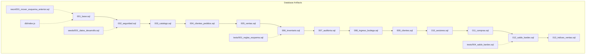
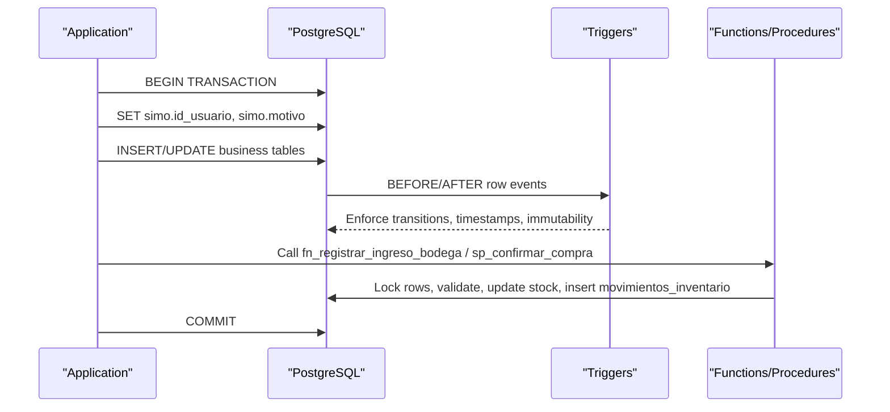

# Database Design

<cite>
**Referenced Files in This Document**
- [001_base.sql](file://backend/db/migrations/001_base.sql)
- [002_seguridad.sql](file://backend/db/migrations/002_seguridad.sql)
- [003_catalogo.sql](file://backend/db/migrations/003_catalogo.sql)
- [004_clientes_pedidos.sql](file://backend/db/migrations/004_clientes_pedidos.sql)
- [005_ventas.sql](file://backend/db/migrations/005_ventas.sql)
- [006_inventario.sql](file://backend/db/migrations/006_inventario.sql)
- [007_auditoria.sql](file://backend/db/migrations/007_auditoria.sql)
- [008_ingreso_bodega.sql](file://backend/db/migrations/008_ingreso_bodega.sql)
- [009_clientes.sql](file://backend/db/migrations/009_clientes.sql)
- [010_sesiones.sql](file://backend/db/migrations/010_sesiones.sql)
- [011_compras.sql](file://backend/db/migrations/011_compras.sql)
- [012_saldo_kardex.sql](file://backend/db/migrations/012_saldo_kardex.sql)
- [013_indices_ventas.sql](file://backend/db/migrations/013_indices_ventas.sql)
- [001_datos_desarrollo.sql](file://backend/db/seeds/001_datos_desarrollo.sql)
- [001_reglas_esquema.sql](file://backend/db/tests/001_reglas_esquema.sql)
- [004_saldo_kardex.sql](file://backend/db/tests/004_saldo_kardex.sql)
- [001_mover_esquema_anterior.sql](file://backend/db/neon/001_mover_esquema_anterior.sql)
- [index.js](file://backend/db/index.js)
</cite>

## Table of Contents
1. [Introduction](#introduction)
2. [Project Structure](#project-structure)
3. [Core Components](#core-components)
4. [Architecture Overview](#architecture-overview)
5. [Detailed Component Analysis](#detailed-component-analysis)
6. [Dependency Analysis](#dependency-analysis)
7. [Performance Considerations](#performance-considerations)
8. [Troubleshooting Guide](#troubleshooting-guide)
9. [Conclusion](#conclusion)
10. [Appendices](#appendices)

## Introduction
This document describes SIMO’s PostgreSQL data model and operational design. It covers entities for users, roles, company configuration, products, categories, units of measure, customers, orders, sales, suppliers, purchases, inventory movements, audit logs, and session token invalidation. It explains the dual-location inventory system (warehouse and store), Kardex calculations, trigger-based integrity rules, stored procedures, migration strategy, seed data, performance tuning, lifecycle and maintenance guidance, and security and access control mechanisms.

## Project Structure
The database schema is defined by ordered SQL migrations under `backend/db/migrations`. Supporting artifacts include:
- Seed data for development environments.
- Tests validating business rules and Kardex calculations.
- A Neon-specific migration to move legacy tables into a separate schema before applying the current schema.
- A shared connection pool entry point used by the API.



**Diagram sources**
- [001_base.sql:1-60](file://backend/db/migrations/001_base.sql#L1-L60)
- [002_seguridad.sql:1-91](file://backend/db/migrations/002_seguridad.sql#L1-L91)
- [003_catalogo.sql:1-102](file://backend/db/migrations/003_catalogo.sql#L1-L102)
- [004_clientes_pedidos.sql:1-192](file://backend/db/migrations/004_clientes_pedidos.sql#L1-L192)
- [005_ventas.sql:1-104](file://backend/db/migrations/005_ventas.sql#L1-L104)
- [006_inventario.sql:1-166](file://backend/db/migrations/006_inventario.sql#L1-L166)
- [007_auditoria.sql:1-68](file://backend/db/migrations/007_auditoria.sql#L1-L68)
- [008_ingreso_bodega.sql:1-91](file://backend/db/migrations/008_ingreso_bodega.sql#L1-L91)
- [009_clientes.sql:1-40](file://backend/db/migrations/009_clientes.sql#L1-L40)
- [010_sesiones.sql:1-20](file://backend/db/migrations/010_sesiones.sql#L1-L20)
- [011_compras.sql:1-261](file://backend/db/migrations/011_compras.sql#L1-L261)
- [012_saldo_kardex.sql:1-155](file://backend/db/migrations/012_saldo_kardex.sql#L1-L155)
- [013_indices_ventas.sql:1-71](file://backend/db/migrations/013_indices_ventas.sql#L1-L71)
- [001_datos_desarrollo.sql:1-62](file://backend/db/seeds/001_datos_desarrollo.sql#L1-L62)
- [001_reglas_esquema.sql:1-174](file://backend/db/tests/001_reglas_esquema.sql#L1-L174)
- [004_saldo_kardex.sql:1-102](file://backend/db/tests/004_saldo_kardex.sql#L1-L102)
- [001_mover_esquema_anterior.sql:1-53](file://backend/db/neon/001_mover_esquema_anterior.sql#L1-L53)
- [index.js:1-23](file://backend/db/index.js#L1-L23)

**Section sources**
- [001_base.sql:1-60](file://backend/db/migrations/001_base.sql#L1-L60)
- [index.js:1-23](file://backend/db/index.js#L1-L23)

## Core Components
- Security and administration: roles, users, company settings, JWT blacklist.
- Catalog: units of measure, categories, products with dual-location stock.
- Customers and orders: customer identity, order lifecycle, order details, state history.
- Sales: payment methods, sales header and lines, cancellation controls.
- Inventory and Kardex: suppliers, inventory movements, Kardex view, purchase workflow.
- Audit trail: immutable log of critical operations.
- Utilities: base functions, triggers, and validation helpers.

Key responsibilities:
- Users and roles enforce RBAC; user login uses email and supports optional lockout fields.
- Products maintain warehouse (`stock_bodega`) and store (`stock_almacen`) balances; totals are derived.
- Orders follow a strict sequential lifecycle with an immutable state history.
- Sales can optionally originate from delivered orders; cancellations require authorization and justification.
- Inventory changes are recorded only through controlled movement types; Kardex provides chronological visibility.
- Purchases are drafted then confirmed atomically to update warehouse stock and create Kardex entries.
- Audit log captures sensitive actions with required justifications and authorizers.

**Section sources**
- [002_seguridad.sql:15-66](file://backend/db/migrations/002_seguridad.sql#L15-L66)
- [003_catalogo.sql:22-99](file://backend/db/migrations/003_catalogo.sql#L22-L99)
- [004_clientes_pedidos.sql:12-105](file://backend/db/migrations/004_clientes_pedidos.sql#L12-L105)
- [005_ventas.sql:13-97](file://backend/db/migrations/005_ventas.sql#L13-L97)
- [006_inventario.sql:25-161](file://backend/db/migrations/006_inventario.sql#L25-L161)
- [011_compras.sql:21-140](file://backend/db/migrations/011_compras.sql#L21-L140)
- [007_auditoria.sql:13-51](file://backend/db/migrations/007_auditoria.sql#L13-L51)
- [010_sesiones.sql:12-15](file://backend/db/migrations/010_sesiones.sql#L12-L15)

## Architecture Overview
The database enforces business rules through constraints, triggers, and stored routines. The application layer sets transaction-scoped context variables to capture responsible users and reasons for sensitive operations.



**Diagram sources**
- [001_base.sql:31-57](file://backend/db/migrations/001_base.sql#L31-L57)
- [004_clientes_pedidos.sql:114-189](file://backend/db/migrations/004_clientes_pedidos.sql#L114-L189)
- [008_ingreso_bodega.sql:23-84](file://backend/db/migrations/008_ingreso_bodega.sql#L23-L84)
- [011_compras.sql:217-255](file://backend/db/migrations/011_compras.sql#L217-L255)

## Detailed Component Analysis

### Security, Roles, Users, Company, Sessions
- Roles define stable codes used by middleware and JWT claims.
- Users store hashed passwords, support optional lockout fields, and enforce lowercase normalized emails.
- Company stores a single record for branding and reporting headers.
- JWT blacklist supports logout by rejecting tokens even if not expired.

Primary keys and constraints:
- `roles.id_rol` PK; unique `codigo`, `nombre`.
- `usuarios.id_usuario` PK; unique `correo`, `usuario`; FK to `roles`; checks on email normalization and non-empty fields.
- `empresa.id_empresa` PK constrained to value 1.
- `jwt_blacklist.token` PK.

Indexes:
- `idx_usuarios_id_rol`, `idx_usuarios_estado`.
- Unique indexes implied by unique constraints on identifiers.

Triggers:
- Update timestamp helper applied to mutable tables.

Security notes:
- Passwords are stored as bcrypt hashes and must never be returned by APIs.
- Session context is set per transaction via `set_config('simo.id_usuario', ...)` and optionally `simo.motivo`.

**Section sources**
- [002_seguridad.sql:15-66](file://backend/db/migrations/002_seguridad.sql#L15-L66)
- [002_seguridad.sql:73-88](file://backend/db/migrations/002_seguridad.sql#L73-L88)
- [010_sesiones.sql:12-15](file://backend/db/migrations/010_sesiones.sql#L12-L15)
- [001_base.sql:42-45](file://backend/db/migrations/001_base.sql#L42-L45)

### Catalog: Units, Categories, Products
- Units of measure allow integer or fractional quantities.
- Categories group products and can be enabled/disabled.
- Products hold SKU, pricing, and dual-location stock; total stock is computed.

Primary keys and constraints:
- `unidades_medida.id_unidad` PK; unique `nombre`, `abreviatura`.
- `categorias.id_categoria` PK; unique `nombre`.
- `productos.id_producto` PK; unique `sku`; FKs to `categorias`, `unidades_medida`; checks ensure non-negative prices and stock; generated column `stock_total = stock_bodega + stock_almacen`.

Indexes:
- Category, state, and case-insensitive name search index.

Business rules:
- Stock columns are not edited directly; they change only through inventory movements.
- Purchase price is confidential and should not be exposed to sellers.

**Section sources**
- [003_catalogo.sql:22-36](file://backend/db/migrations/003_catalogo.sql#L22-L36)
- [003_catalogo.sql:41-55](file://backend/db/migrations/003_catalogo.sql#L41-L55)
- [003_catalogo.sql:65-99](file://backend/db/migrations/003_catalogo.sql#L65-L99)

### Customers and Orders
- Customers store identification type and number, contact info, and status.
- Orders link a customer and a seller, track lifecycle states, delivery dates, totals, and observations.
- Order details store product lines with unit prices and line subtotals.
- Order state history is immutable and records who changed the state and why.

Primary keys and constraints:
- `clientes.id_cliente` PK; unique `identificacion`; check on allowed ID types.
- `pedidos.id_pedido` PK; FK to `clientes`, `usuarios`; state check list; date ordering constraint.
- `detalles_pedidos.id_detalle_pedido` PK; FK to `pedidos`, `productos`; unique `(id_pedido, id_producto)`; subtotal equals rounded quantity times unit price.
- `historial_estados_pedido.id_historial` PK; FKs to `pedidos`, `usuarios`; requires reason when canceling.

Indexes:
- Customer name search.
- Order state and open-by-delivery-date partial index.
- Order detail product index.
- History index by order and date.

Lifecycle rules:
- Orders start as `REGISTRADO` and advance sequentially; `CANCELADO` is allowed from any pre-delivered state; once delivered or canceled, no further state changes.
- State changes are logged automatically with the responsible user from session context.

**Section sources**
- [004_clientes_pedidos.sql:12-33](file://backend/db/migrations/004_clientes_pedidos.sql#L12-L33)
- [004_clientes_pedidos.sql:42-71](file://backend/db/migrations/004_clientes_pedidos.sql#L42-L71)
- [004_clientes_pedidos.sql:76-89](file://backend/db/migrations/004_clientes_pedidos.sql#L76-L89)
- [004_clientes_pedidos.sql:95-109](file://backend/db/migrations/004_clientes_pedidos.sql#L95-L109)
- [004_clientes_pedidos.sql:114-189](file://backend/db/migrations/004_clientes_pedidos.sql#L114-L189)

### Sales and Payment Methods
- Payment methods are informational reference data.
- Sales link a customer (optional), seller, optional originating order, payment method, and financial breakdown.
- Cancellation requires an operator, an authorizer (manager/admin), and a written reason.
- Sales lines freeze cost at sale time for margin analysis.

Primary keys and constraints:
- `metodos_pago.id_metodo_pago` PK; unique `codigo`, `nombre`.
- `ventas.id_venta` PK; optional FK to `clientes`; required FK to `usuarios`; unique FK to `pedidos`; FK to `metodos_pago`; checks ensure non-negative amounts, discount not exceeding subtotal, and total formula; cancellation consistency check.
- `detalles_ventas.id_detalle_venta` PK; FK to `ventas`, `productos`; unique `(id_venta, id_producto)`; line subtotal equals rounded quantity times unit price.

Indexes:
- Customer, seller, and date filters for completed sales.
- Product index on lines.

Behavioral notes:
- If a sale originates from a delivered order, inventory was already reserved/deducted during order preparation; the sale does not generate new inventory movements.

**Section sources**
- [005_ventas.sql:13-29](file://backend/db/migrations/005_ventas.sql#L13-L29)
- [005_ventas.sql:40-77](file://backend/db/migrations/005_ventas.sql#L40-L77)
- [005_ventas.sql:87-101](file://backend/db/migrations/005_ventas.sql#L87-L101)

### Inventory, Suppliers, Movements, and Kardex
- Suppliers provide inbound purchases.
- Inventory movements form an immutable ledger capturing every stock change, including origin/destination locations and resulting balances.
- Kardex is provided as a view over movements that separates entries and exits by location and shows running balances.

Primary keys and constraints:
- `proveedores.id_proveedor` PK; unique `nit`; checks on non-empty fields and email normalization.
- `movimientos_inventario.id_movimiento` PK; FKs to `productos`, `usuarios`, optional `ventas`, `pedidos`, `proveedores`; checks enforce valid combinations of movement type, origin/destination, references, provider linkage, and adjustment reasons.

Indexes:
- Product+date primary query path.
- Date-only index.
- Partial indexes for movement references to sales and orders.

Kardex view:
- Exposes chronological entries per product with per-location inflows/outflows and resulting balances.

Immutability:
- Movement table blocks UPDATE, DELETE, and TRUNCATE via triggers.

**Section sources**
- [006_inventario.sql:25-41](file://backend/db/migrations/006_inventario.sql#L25-L41)
- [006_inventario.sql:62-129](file://backend/db/migrations/006_inventario.sql#L62-L129)
- [006_inventario.sql:136-161](file://backend/db/migrations/006_inventario.sql#L136-L161)

### Purchases Workflow
- Purchases are created in draft with lines; upon confirmation, all lines are added to warehouse stock atomically.
- Confirmation locks the purchase and its lines, iterates lines in deterministic order, calls the warehouse entry routine, and marks the purchase confirmed.

Primary keys and constraints:
- `compras.id_compra` PK; FK to `proveedores`, `usuarios`; state check ensures consistent confirmation metadata.
- `detalles_compras.id_detalle_compra` PK; FK to `compras`, `productos`; unique `(id_compra, id_producto)`; generated line subtotal.

Triggers and procedures:
- Prevent edits to lines after purchase confirmation.
- Recalculate purchase total from lines.
- Block updates to confirmed purchases.
- Link movements back to purchases.
- Procedure `sp_confirmar_compra` orchestrates atomic confirmation.

**Section sources**
- [011_compras.sql:21-61](file://backend/db/migrations/011_compras.sql#L21-L61)
- [011_compras.sql:66-123](file://backend/db/migrations/011_compras.sql#L66-L123)
- [011_compras.sql:128-140](file://backend/db/migrations/011_compras.sql#L128-L140)
- [011_compras.sql:217-255](file://backend/db/migrations/011_compras.sql#L217-L255)

### Warehouse Entry Function
- `fn_registrar_ingreso_bodega` validates inputs, locks the product row, updates only warehouse stock, and inserts a corresponding movement with post-change balances.
- Business errors use custom SQLSTATE codes for clear API translation.

Inputs and behavior:
- Validates quantity positivity, non-negative unit cost, active user and supplier existence, product existence and activation, and unit decimal allowance.
- Updates `stock_bodega` and writes one `ENTRADA_COMPRA` movement.

**Section sources**
- [008_ingreso_bodega.sql:23-84](file://backend/db/migrations/008_ingreso_bodega.sql#L23-L84)
- [011_compras.sql:146-207](file://backend/db/migrations/011_compras.sql#L146-L207)

### Immutable Audit Trail
- `log_auditoria` records critical operations with actor, optional authorizer, entity, IDs, JSON snapshots, IP address, and justification where required.
- UPDATE, DELETE, and TRUNCATE are blocked; permissions are revoked from public.

Constraints:
- Justification required for adjustments, cancellations, and order cancellations.
- Authorization required for sale cancellations.

Indexes:
- Date descending, entity+id, user, action.

**Section sources**
- [007_auditoria.sql:13-51](file://backend/db/migrations/007_auditoria.sql#L13-L51)
- [007_auditoria.sql:53-65](file://backend/db/migrations/007_auditoria.sql#L53-L65)

### Customer Identity Immutability
- Customer identity number and type cannot be changed after creation.
- Index optimized for prefix searches to support POS autocomplete.

**Section sources**
- [009_clientes.sql:16-34](file://backend/db/migrations/009_clientes.sql#L16-L34)

### Base Utilities and Timezone
- Sets database timezone to Colombia.
- Provides reusable functions for updating timestamps, reading session user, and blocking modifications to immutable tables.

**Section sources**
- [001_base.sql:21-26](file://backend/db/migrations/001_base.sql#L21-L26)
- [001_base.sql:31-57](file://backend/db/migrations/001_base.sql#L31-L57)

## Dependency Analysis
The following diagram maps core tables and their relationships.

```mermaid
erDiagram
ROLES {
int id_rol PK
varchar codigo UK
varchar nombre UK
}
USUARIOS {
int id_usuario PK
int id_rol FK
varchar correo UK
varchar usuario UK
boolean estado
}
EMPRESA {
smallint id_empresa PK
varchar razon_social
varchar nit
}
UNIDADES_MEDIDA {
int id_unidad PK
varchar nombre UK
varchar abreviatura UK
}
CATEGORIAS {
int id_categoria PK
varchar nombre UK
}
PRODUCTOS {
int id_producto PK
int id_categoria FK
int id_unidad FK
varchar sku UK
numeric stock_bodega
numeric stock_almacen
numeric stock_total
}
CLIENTES {
int id_cliente PK
varchar identificacion UK
varchar tipo_identificacion
}
PEDIDOS {
int id_pedido PK
int id_cliente FK
int id_usuario FK
varchar estado
}
DETALLES_PEDIDOS {
int id_detalle_pedido PK
int id_pedido FK
int id_producto FK
}
HISTORIAL_ESTADOS_PEDIDO {
bigint id_historial PK
int id_pedido FK
int id_usuario FK
}
METODOS_PAGO {
int id_metodo_pago PK
varchar codigo UK
varchar nombre UK
}
VENTAS {
int id_venta PK
int id_cliente FK
int id_usuario FK
int id_pedido UK FK
int id_metodo_pago FK
}
DETALLES_VENTAS {
int id_detalle_venta PK
int id_venta FK
int id_producto FK
}
PROVEEDORES {
int id_proveedor PK
varchar nit UK
}
COMPRAS {
int id_compra PK
int id_proveedor FK
int id_usuario FK
}
DETALLES_COMPRAS {
int id_detalle_compra PK
int id_compra FK
int id_producto FK
}
MOVIMIENTOS_INVENTARIO {
bigint id_movimiento PK
int id_producto FK
int id_usuario FK
int id_venta FK
int id_pedido FK
int id_proveedor FK
int id_compra FK
}
LOG_AUDITORIA {
bigint id_log PK
int id_usuario FK
int id_usuario_autorizador FK
}
JWT_BLACKLIST {
text token PK
}
ROLES ||--o{ USUARIOS : "assigned to"
CATEGORIAS ||--o{ PRODUCTOS : "contains"
UNIDADES_MEDIDA ||--o{ PRODUCTOS : "uses"
CLIENTES ||--o{ PEDIDOS : "places"
USUARIOS ||--o{ PEDIDOS : "registers"
PEDIDOS ||--o{ DETALLES_PEDIDOS : "has lines"
PRODUCTOS ||--o{ DETALLES_PEDIDOS : "referenced by"
PEDIDOS ||--o{ HISTORIAL_ESTADOS_PEDIDO : "state history"
USUARIOS ||--o{ HISTORIAL_ESTADOS_PEDIDO : "changed by"
VENTAS ||--o{ DETALLES_VENTAS : "has lines"
PRODUCTOS ||--o{ DETALLES_VENTAS : "referenced by"
METODOS_PAGO ||--o{ VENTAS : "paid with"
CLIENTES ||--o{ VENTAS : "purchased by"
USUARIOS ||--o{ VENTAS : "sold by"
PEDIDOS ||--o{ VENTAS : "originated from"
PROVEEDORES ||--o{ COMPRAS : "supplies"
USUARIOS ||--o{ COMPRAS : "created by"
COMPRAS ||--o{ DETALLES_COMPRAS : "has lines"
PRODUCTOS ||--o{ DETALLES_COMPRAS : "referenced by"
PRODUCTOS ||--o{ MOVIMIENTOS_INVENTARIO : "moves"
USUARIOS ||--o{ MOVIMIENTOS_INVENTARIO : "performed by"
VENTAS ||--o{ MOVIMIENTOS_INVENTARIO : "linked to"
PEDIDOS ||--o{ MOVIMIENTOS_INVENTARIO : "linked to"
PROVEEDORES ||--o{ MOVIMIENTOS_INVENTARIO : "linked to"
COMPRAS ||--o{ MOVIMIENTOS_INVENTARIO : "linked to"
USUARIOS ||--o{ LOG_AUDITORIA : "actor"
USUARIOS ||--o{ LOG_AUDITORIA : "authorizer"
```

**Diagram sources**
- [002_seguridad.sql:15-66](file://backend/db/migrations/002_seguridad.sql#L15-L66)
- [003_catalogo.sql:22-99](file://backend/db/migrations/003_catalogo.sql#L22-L99)
- [004_clientes_pedidos.sql:12-109](file://backend/db/migrations/004_clientes_pedidos.sql#L12-L109)
- [005_ventas.sql:13-97](file://backend/db/migrations/005_ventas.sql#L13-L97)
- [006_inventario.sql:25-129](file://backend/db/migrations/006_inventario.sql#L25-L129)
- [007_auditoria.sql:13-51](file://backend/db/migrations/007_auditoria.sql#L13-L51)
- [010_sesiones.sql:12-15](file://backend/db/migrations/010_sesiones.sql#L12-L15)
- [011_compras.sql:21-61](file://backend/db/migrations/011_compras.sql#L21-L61)

## Performance Considerations
- Partitioning candidates:
  - `movimientos_inventario`: consider range partitioning by month/year for large historical datasets.
  - `log_auditoria`: partition by date to keep recent logs fast while archiving older ones.
- Indexing strategy:
  - Covering indexes for frequent read patterns (e.g., sales by date with totals).
  - Partial indexes for filtered queries (e.g., open orders, completed sales).
- Planner tuning:
  - Lower `random_page_cost` for SSD-backed databases to favor index scans.
- Materialized views:
  - Consider materializing dashboard aggregates (daily sales, top products) refreshed periodically.
- Concurrency:
  - Row-level locking via `FOR UPDATE` in critical paths prevents double-counting and race conditions.
- Statistics:
  - Run `ANALYZE` after bulk loads or major schema changes to keep planner estimates accurate.

[No sources needed since this section provides general guidance]

## Troubleshooting Guide
Common issues and diagnostics:
- Invalid order state transitions:
  - Ensure updates go through the validated transition function and that session user is set.
- Missing auditor or justification:
  - Sale cancellations require an authorizer; adjustments and cancellations require a written reason.
- Inconsistent Kardex:
  - Use the validation function to compare recalculated balances against stored stock and identify inconsistent movements.
- Negative stock attempts:
  - Constraints prevent negative stock; verify movement types and cascading deductions.
- Duplicate identifiers:
  - Email, username, SKU, and identity numbers are unique; normalize inputs and handle conflicts gracefully.
- Connection problems:
  - Verify environment variables and SSL settings; inspect pool error logs.

Operational checks:
- Validate Kardex consistency across all products.
- Review audit log for unauthorized or unjustified sensitive operations.
- Confirm that order history contains expected state transitions.

**Section sources**
- [004_clientes_pedidos.sql:114-189](file://backend/db/migrations/004_clientes_pedidos.sql#L114-L189)
- [007_auditoria.sql:33-39](file://backend/db/migrations/007_auditoria.sql#L33-L39)
- [012_saldo_kardex.sql:113-149](file://backend/db/migrations/012_saldo_kardex.sql#L113-L149)
- [001_reglas_esquema.sql:97-169](file://backend/db/tests/001_reglas_esquema.sql#L97-L169)
- [index.js:14-20](file://backend/db/index.js#L14-L20)

## Conclusion
SIMO’s database model enforces strong integrity through constraints, triggers, and stored routines. Dual-location inventory tracking is captured exclusively through immutable movements, with Kardex providing chronological visibility and valuation. Orders and sales have strict lifecycles and cancellation controls, supported by comprehensive audit logging. The migration strategy is incremental and re-executable, with tests ensuring rule correctness and tools for diagnosing inconsistencies. With careful indexing, planner tuning, and periodic maintenance, the schema scales to high-volume retail operations while preserving data accuracy and compliance.

[No sources needed since this section summarizes without analyzing specific files]

## Appendices

### Migration Strategy
- Apply migrations in numerical order; each file is self-contained and designed to be re-run safely.
- For Neon upgrades, first run the legacy schema mover script to relocate old tables, then apply the current migrations.
- After bulk data loads, analyze tables to refresh statistics.

**Section sources**
- [001_mover_esquema_anterior.sql:1-53](file://backend/db/neon/001_mover_esquema_anterior.sql#L1-L53)
- [013_indices_ventas.sql:69-71](file://backend/db/migrations/013_indices_ventas.sql#L69-L71)

### Seed Data Management
- Development seeds create sample roles, users, company, categories, products, a client, and a supplier.
- Do not execute seeds in production; they are intended for local development and testing.

**Section sources**
- [001_datos_desarrollo.sql:1-62](file://backend/db/seeds/001_datos_desarrollo.sql#L1-L62)

### Data Lifecycle and Maintenance
- Data lifecycle:
  - Catalog and reference data are long-lived and rarely changed.
  - Orders evolve through states; state history is immutable.
  - Sales are final unless formally canceled with authorization.
  - Inventory movements are append-only; balances are recomputed for audits.
  - Audit logs are append-only and protected from modification.
- Backup strategy:
  - Schedule regular logical backups of the database.
  - Retain backups according to compliance requirements.
  - Test restore procedures regularly.
- Maintenance procedures:
  - Periodically run Kardex validation to detect inconsistencies.
  - Rebuild or add indexes based on evolving query patterns.
  - Archive old audit and movement partitions as needed.
  - Monitor connection pool health and adjust timeouts.

[No sources needed since this section provides general guidance]

### Security, Privacy, and Access Control
- Authentication and authorization:
  - RBAC via roles; JWT integrates role codes.
  - Optional account lockout fields support brute-force mitigation.
- Data protection:
  - Passwords stored as bcrypt hashes.
  - Confidential fields (e.g., purchase price) must not be exposed to lower-privileged roles.
- Immutability:
  - Critical logs and histories block UPDATE/DELETE/TRUNCATE.
- Session security:
  - Logout invalidates tokens via a blacklist table.
- Network security:
  - Connections may require SSL depending on environment configuration.

**Section sources**
- [002_seguridad.sql:40-58](file://backend/db/migrations/002_seguridad.sql#L40-L58)
- [007_auditoria.sql:53-65](file://backend/db/migrations/007_auditoria.sql#L53-L65)
- [010_sesiones.sql:12-15](file://backend/db/migrations/010_sesiones.sql#L12-L15)
- [index.js:1-10](file://backend/db/index.js#L1-L10)

### Stored Procedures and Functions Summary
- Base utilities:
  - Timestamp updater, session user reader, immutability blocker.
- Order lifecycle:
  - Transition validator and history logger.
- Inventory:
  - Warehouse entry function for purchases.
  - Purchase confirmation procedure.
- Kardex:
  - Per-product Kardex calculator with weighted average cost.
  - Validation function comparing recalculated vs. stored balances.

**Section sources**
- [001_base.sql:31-57](file://backend/db/migrations/001_base.sql#L31-L57)
- [004_clientes_pedidos.sql:114-189](file://backend/db/migrations/004_clientes_pedidos.sql#L114-L189)
- [008_ingreso_bodega.sql:23-84](file://backend/db/migrations/008_ingreso_bodega.sql#L23-L84)
- [011_compras.sql:217-255](file://backend/db/migrations/011_compras.sql#L217-L255)
- [012_saldo_kardex.sql:26-108](file://backend/db/migrations/012_saldo_kardex.sql#L26-L108)
- [012_saldo_kardex.sql:113-149](file://backend/db/migrations/012_saldo_kardex.sql#L113-L149)