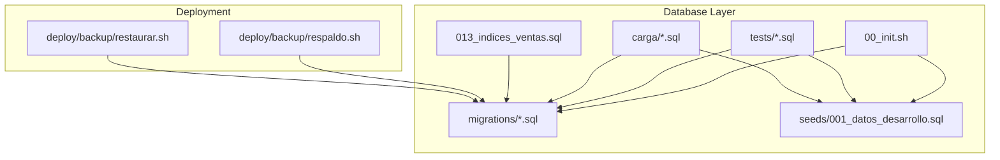
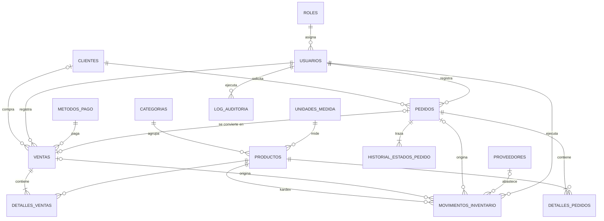
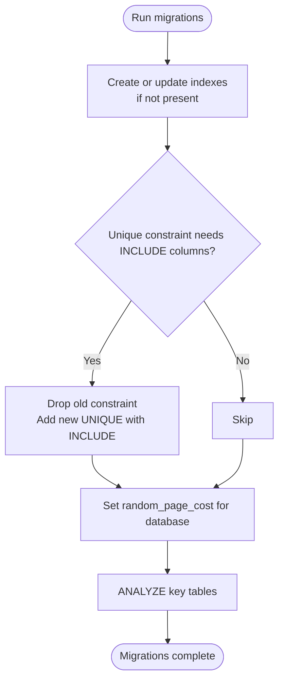
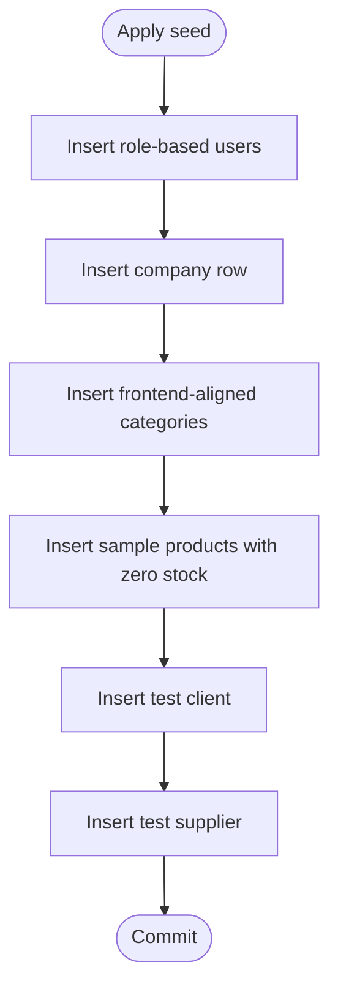
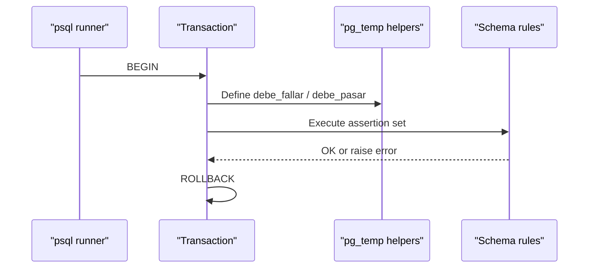
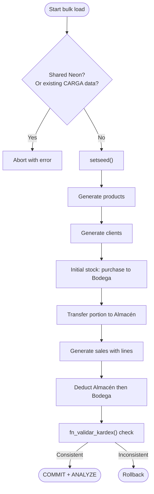
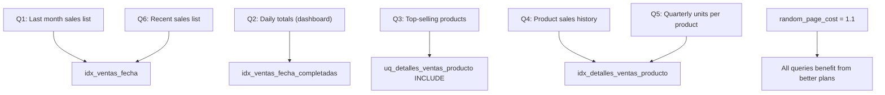
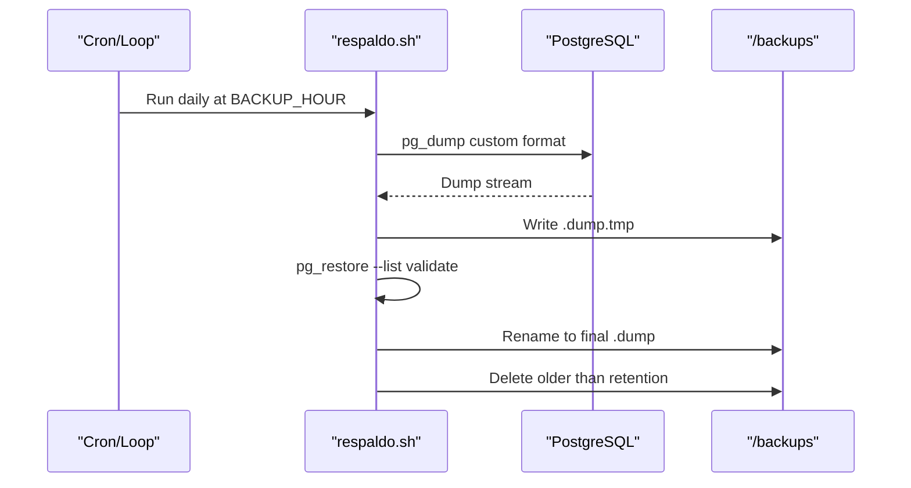
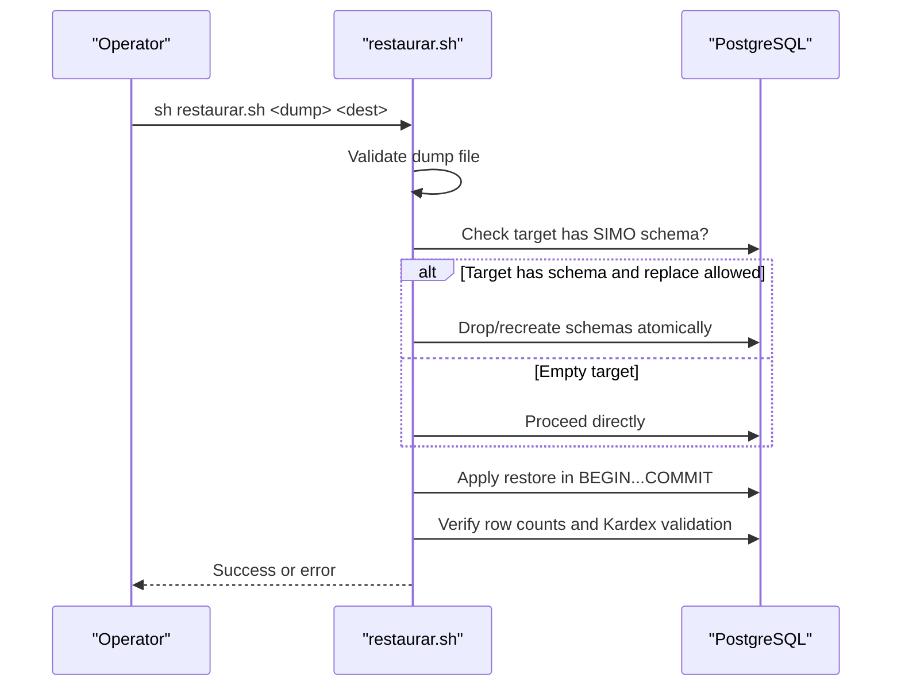
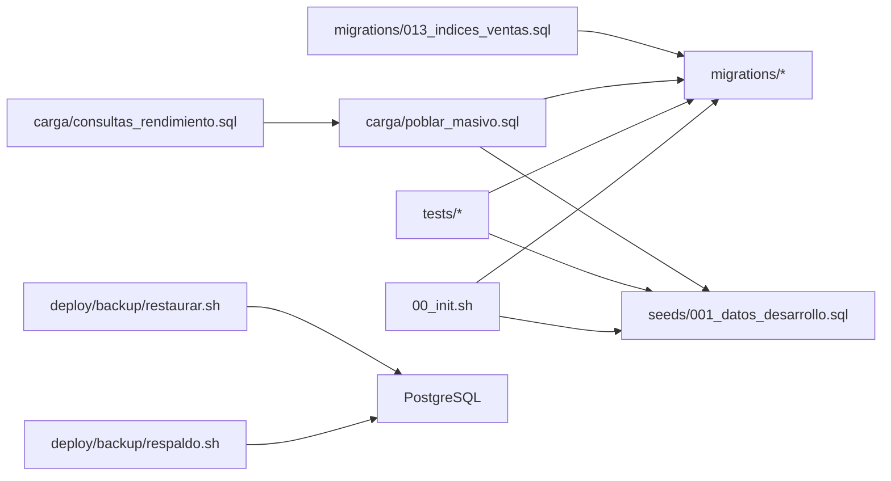

# Database Operations & Maintenance

<cite>
**Referenced Files in This Document**
- [README.md](file://backend/db/README.md)
- [00_init.sh](file://backend/db/00_init.sh)
- [001_datos_desarrollo.sql](file://backend/db/seeds/001_datos_desarrollo.sql)
- [001_reglas_esquema.sql](file://backend/db/tests/001_reglas_esquema.sql)
- [poblar_masivo.sql](file://backend/db/carga/poblar_masivo.sql)
- [consultas_rendimiento.sql](file://backend/db/carga/consultas_rendimiento.sql)
- [013_indices_ventas.sql](file://backend/db/migrations/013_indices_ventas.sql)
- [respaldo.sh](file://deploy/backup/respaldo.sh)
- [restaurar.sh](file://deploy/backup/restaurar.sh)
</cite>

## Table of Contents
1. [Introduction](#introduction)
2. [Project Structure](#project-structure)
3. [Core Components](#core-components)
4. [Architecture Overview](#architecture-overview)
5. [Detailed Component Analysis](#detailed-component-analysis)
6. [Dependency Analysis](#dependency-analysis)
7. [Performance Considerations](#performance-considerations)
8. [Troubleshooting Guide](#troubleshooting-guide)
9. [Conclusion](#conclusion)
10. [Appendices](#appendices)

## Introduction
This document explains SIMO’s database operations, testing, and maintenance procedures. It covers schema evolution through migrations, seed data for development, test data strategies, schema validation tests, performance tuning for sales queries, bulk population scripts, backup and recovery workflows, monitoring approaches, and maintenance schedules. The goal is to help developers, DBAs, and operators run, test, optimize, and protect the PostgreSQL database consistently across local, Docker, Neon, and deployment environments.

## Project Structure
SIMO’s database layer lives under `backend/db`. It contains:
- Migrations that define the relational schema, functions, triggers, constraints, and indexes.
- A development seed with users, company, categories, products, clients, and suppliers.
- Load scripts for coherent, rule-compliant bulk data generation.
- Schema validation tests that assert business rules without leaving data behind.
- An initialization script used by Docker and manual setups.
- Performance reference queries and index definitions focused on sales reporting.

**Diagram sources**
- [00_init.sh:1-43](file://backend/db/00_init.sh#L1-L43)
- [README.md:5-32](file://backend/db/README.md#L5-L32)
- [respaldo.sh:1-19](file://deploy/backup/respaldo.sh#L1-L19)
- [restaurar.sh:1-20](file://deploy/backup/restaurar.sh#L1-L20)

**Section sources**
- [README.md:5-32](file://backend/db/README.md#L5-L32)
- [00_init.sh:1-43](file://backend/db/00_init.sh#L1-L43)

## Core Components
- Migration system: ordered SQL files under `migrations/`, including schema, security, catalog, orders, sales, inventory, audit, warehouse entry, client document immutability, sessions, purchases, Kardex balance/validation, and sales indexes.
- Development seed: creates roles, admin/manager/inventory/sales users, company, categories, sample products, a test client, and a test supplier.
- Bulk load: generates reproducible, rule-compliant products, clients, and sales with correct inventory movements and Kardex consistency checks.
- Schema validation tests: execute assertions over business rules using transactional PL/pgSQL helpers; they roll back at the end so no test data remains.
- Performance tooling: reference queries with `EXPLAIN ANALYZE` and an index migration tuned for SSD-like workloads.
- Backup and restore: daily automated backups with retention cleanup and safe restoration with pre/post checks.

**Section sources**
- [README.md:34-60](file://backend/db/README.md#L34-L60)
- [001_datos_desarrollo.sql:1-62](file://backend/db/seeds/001_datos_desarrollo.sql#L1-L62)
- [poblar_masivo.sql:1-236](file://backend/db/carga/poblar_masivo.sql#L1-L236)
- [001_reglas_esquema.sql:1-174](file://backend/db/tests/001_reglas_esquema.sql#L1-L174)
- [013_indices_ventas.sql:1-71](file://backend/db/migrations/013_indices_ventas.sql#L1-L71)
- [consultas_rendimiento.sql:1-19](file://backend/db/carga/consultas_rendimiento.sql#L1-L19)
- [respaldo.sh:1-89](file://deploy/backup/respaldo.sh#L1-L89)
- [restaurar.sh:1-77](file://deploy/backup/restaurar.sh#L1-L77)

## Architecture Overview
The database architecture enforces business rules through constraints, triggers, and functions. Sales and inventory are tightly coupled: stock changes only via inventory movements, and sales generate cascading deductions from Almacén then Bodega. Audit logs and state histories are protected against modification.

**Diagram sources**
- [README.md:62-86](file://backend/db/README.md#L62-L86)

## Detailed Component Analysis

### Migration Management and Schema Evolution
Migrations are ordered SQL files executed during initialization. They create shared functions, time zone configuration, roles, users, company, catalog entities, clients, orders, payments, sales, inventory, audit logs, warehouse entry functions, client document immutability, session invalidation, purchase confirmation, Kardex balance and validation functions, and sales indexes.

Key aspects:
- Idempotent index creation and conditional constraint upgrades.
- Database-level planner tuning (`random_page_cost`) applied per connection.
- Post-migration statistics refresh for accurate query plans.

**Diagram sources**
- [013_indices_ventas.sql:31-71](file://backend/db/migrations/013_indices_ventas.sql#L31-L71)

**Section sources**
- [README.md:8-21](file://backend/db/README.md#L8-L21)
- [013_indices_ventas.sql:1-71](file://backend/db/migrations/013_indices_ventas.sql#L1-L71)

### Seed Data Management for Development Environments
The development seed creates:
- Users for each role (admin, manager, inventory, sales).
- Company profile.
- Categories aligned with frontend catalogs.
- Sample products with zero starting stock.
- One test client and one test supplier.

Operational notes:
- Passwords use a precomputed bcrypt hash compatible with Node.js.
- Stock must be populated through inventory movements, not direct updates.
- The seed is idempotent with conflict handling.

**Diagram sources**
- [001_datos_desarrollo.sql:11-61](file://backend/db/seeds/001_datos_desarrollo.sql#L11-L61)

**Section sources**
- [001_datos_desarrollo.sql:1-62](file://backend/db/seeds/001_datos_desarrollo.sql#L1-L62)

### Test Data Strategies and Schema Validation Tests
Schema validation tests assert business rules without leaving data behind:
- Security rules (unique emails, valid roles, single company row).
- Catalog integrity (SKU uniqueness, non-negative stock, category deletion protection).
- Inventory rules (purchase entries only to Bodega, internal transfers Bodega→Almacén, adjustments require justification, Kardex immutability).
- Sales rules (totals consistency, line subtotal correctness, cancellation/anulation authorization and reasons).
- Order lifecycle transitions and history immutability.
- Audit log requirements and immutability.

Test execution pattern:
- Wrap all assertions in a transaction.
- Use helper functions to assert expected failures and successes.
- Rollback at the end to keep the database clean.

**Diagram sources**
- [001_reglas_esquema.sql:10-30](file://backend/db/tests/001_reglas_esquema.sql#L10-L30)
- [001_reglas_esquema.sql:171-174](file://backend/db/tests/001_reglas_esquema.sql#L171-L174)

**Section sources**
- [001_reglas_esquema.sql:1-174](file://backend/db/tests/001_reglas_esquema.sql#L1-L174)

### Bulk Population and Coherent Test Data
The bulk loader generates:
- Products with varied units and pricing.
- Clients with identifiable documents.
- Initial stock entering Bodega via purchase, then partial transfer to Almacén.
- Sales spread over the last year, with realistic line items and discounts.
- Correct inventory deductions following cascade rules (Almacén first, then Bodega).
- Final Kardex validation ensuring consistency before committing.

Safety features:
- Blocks execution on shared Neon unless explicitly forced.
- Prevents re-running when load data already exists.
- Uses deterministic seeding for reproducibility.

**Diagram sources**
- [poblar_masivo.sql:32-43](file://backend/db/carga/poblar_masivo.sql#L32-L43)
- [poblar_masivo.sql:88-110](file://backend/db/carga/poblar_masivo.sql#L88-L110)
- [poblar_masivo.sql:112-210](file://backend/db/carga/poblar_masivo.sql#L112-L210)
- [poblar_masivo.sql:213-228](file://backend/db/carga/poblar_masivo.sql#L213-L228)

**Section sources**
- [poblar_masivo.sql:1-236](file://backend/db/carga/poblar_masivo.sql#L1-L236)

### Performance Optimization Techniques for Sales Queries
The sales index migration introduces:
- A date-based index covering total and estado for history and recent sales lists.
- A partial coverage index for completed sales used by dashboards.
- A unique constraint upgrade to include line quantities and subtotals for top-selling reports.
- A product-focused index on sale details to avoid table scans for product histories and unit totals.
- Planner tuning (`random_page_cost = 1.1`) for SSD-like storage behavior.

Reference queries measure:
- Last month’s sales list.
- Daily totals for the dashboard.
- Top-selling products per month.
- Product sales history.
- Quarterly unit totals per product.
- Recent sales list.

**Diagram sources**
- [013_indices_ventas.sql:8-26](file://backend/db/migrations/013_indices_ventas.sql#L8-L26)
- [consultas_rendimiento.sql:7-18](file://backend/db/carga/consultas_rendimiento.sql#L7-L18)

**Section sources**
- [013_indices_ventas.sql:1-71](file://backend/db/migrations/013_indices_ventas.sql#L1-L71)
- [consultas_rendimiento.sql:1-19](file://backend/db/carga/consultas_rendimiento.sql#L1-L19)
- [README.md:159-180](file://backend/db/README.md#L159-L180)

### Backup and Recovery Procedures
Daily backups:
- Automated script runs inside a dedicated container.
- Supports backing up both Neon and local databases.
- Writes atomic dumps, validates them with `pg_restore --list`, and cleans old backups based on retention.

Restore workflow:
- Validates input dump file.
- Protects Neon production with explicit confirmation variable.
- Optionally drops and recreates schemas if replacing an existing SIMO database.
- Applies restore within a single transaction for atomicity.
- Verifies restored counts and Kardex consistency.

**Diagram sources**
- [respaldo.sh:21-56](file://deploy/backup/respaldo.sh#L21-L56)
- [respaldo.sh:70-88](file://deploy/backup/respaldo.sh#L70-L88)

**Diagram sources**
- [restaurar.sh:22-38](file://deploy/backup/restaurar.sh#L22-L38)
- [restaurar.sh:40-62](file://deploy/backup/restaurar.sh#L40-L62)
- [restaurar.sh:64-76](file://deploy/backup/restaurar.sh#L64-L76)

**Section sources**
- [respaldo.sh:1-89](file://deploy/backup/respaldo.sh#L1-L89)
- [restaurar.sh:1-77](file://deploy/backup/restaurar.sh#L1-L77)

### Database Monitoring Approaches
Recommended monitoring focuses on:
- Query plan stability and index usage for sales queries.
- Table growth and bloat affecting sales and details tables.
- Planner parameter effectiveness after index changes.
- Kardex consistency health via validation function.

Practical checks:
- Run reference queries with `EXPLAIN ANALYZE` to confirm Index Only Scans where expected.
- After bulk loads, run `VACUUM ANALYZE` to improve plan accuracy.
- Periodically inspect `fn_validar_kardex()` results to detect inconsistencies early.

[No sources needed since this section provides general guidance]

### Maintenance Schedules
Suggested schedule:
- Daily: automated backups via `respaldo.sh`.
- Weekly: review backup retention and verify latest backup validity.
- Monthly: analyze query performance trends with reference queries; adjust indexes if needed.
- After bulk loads: run `VACUUM ANALYZE` on affected tables.
- Quarterly: review planner settings and index coverage for evolving queries.

[No sources needed since this section provides general guidance]

## Dependency Analysis
Initialization and execution dependencies:
- Docker or manual setup executes `00_init.sh`, which runs migrations and optionally seeds.
- Tests depend on migrations and seed data but do not leave data behind.
- Bulk loading depends on migrations and seed data and enforces safety guards.
- Performance reference queries depend on bulk-loaded data to demonstrate index benefits.
- Backup and restore operate independently of application code, relying on PostgreSQL tools.

**Diagram sources**
- [00_init.sh:25-42](file://backend/db/00_init.sh#L25-L42)
- [README.md:34-60](file://backend/db/README.md#L34-L60)
- [poblar_masivo.sql:1-236](file://backend/db/carga/poblar_masivo.sql#L1-L236)
- [consultas_rendimiento.sql:1-19](file://backend/db/carga/consultas_rendimiento.sql#L1-L19)
- [013_indices_ventas.sql:1-71](file://backend/db/migrations/013_indices_ventas.sql#L1-L71)
- [respaldo.sh:1-89](file://deploy/backup/respaldo.sh#L1-L89)
- [restaurar.sh:1-77](file://deploy/backup/restaurar.sh#L1-L77)

**Section sources**
- [00_init.sh:1-43](file://backend/db/00_init.sh#L1-L43)
- [README.md:34-60](file://backend/db/README.md#L34-L60)

## Performance Considerations
- Prefer indexed access paths for date-range queries and recent lists; ensure indexes cover frequently selected columns to enable Index Only Scans.
- Keep planner costs aligned with storage characteristics; SSD-backed environments benefit from lower `random_page_cost`.
- After large inserts or bulk loads, refresh statistics to avoid suboptimal plans.
- Monitor Kardex consistency to catch anomalies early; inconsistent balances indicate incorrect inventory flows.

[No sources needed since this section provides general guidance]

## Troubleshooting Guide
Common issues and resolutions:
- Bulk load blocked on shared Neon: pass the required force flag or run locally.
- Re-running bulk load fails due to existing load markers: clear the environment or use a fresh database.
- Sales queries still scanning full tables: verify indexes exist and statistics are up to date; check planner cost settings.
- Restore fails on Neon: set the explicit confirmation variable.
- Restore fails because target has existing SIMO data: either use an empty database or allow replacement with the appropriate flag.
- Tests fail unexpectedly: ensure migrations and seed are applied; run tests with `ON_ERROR_STOP=1`.

**Section sources**
- [poblar_masivo.sql:32-43](file://backend/db/carga/poblar_masivo.sql#L32-L43)
- [013_indices_ventas.sql:59-65](file://backend/db/migrations/013_indices_ventas.sql#L59-L65)
- [restaurar.sh:32-47](file://deploy/backup/restaurar.sh#L32-L47)
- [README.md:54-60](file://backend/db/README.md#L54-L60)

## Conclusion
SIMO’s database design emphasizes correctness, auditability, and performance. Migrations evolve the schema safely, tests enforce business rules, bulk loaders provide realistic datasets while preserving integrity, and indexes plus planner tuning accelerate sales queries. Backups and restores are automated and validated, and maintenance routines keep the system reliable and performant. Following these procedures ensures consistent development, testing, and operational outcomes.

[No sources needed since this section summarizes without analyzing specific files]

## Appendices

### Appendix A: Key Scripts and Their Roles
- Initialization: orchestrates migrations and optional seed.
- Seed: prepares development users, company, categories, products, clients, suppliers.
- Tests: asserts schema and business rules without leaving data.
- Bulk load: generates coherent, rule-compliant datasets for performance testing.
- Reference queries: measure performance improvements from indexes.
- Index migration: defines optimized indexes and planner tuning.
- Backup: automates daily dumps with validation and retention.
- Restore: safely applies backups with pre/post checks.

**Section sources**
- [00_init.sh:1-43](file://backend/db/00_init.sh#L1-L43)
- [001_datos_desarrollo.sql:1-62](file://backend/db/seeds/001_datos_desarrollo.sql#L1-L62)
- [001_reglas_esquema.sql:1-174](file://backend/db/tests/001_reglas_esquema.sql#L1-L174)
- [poblar_masivo.sql:1-236](file://backend/db/carga/poblar_masivo.sql#L1-L236)
- [consultas_rendimiento.sql:1-19](file://backend/db/carga/consultas_rendimiento.sql#L1-L19)
- [013_indices_ventas.sql:1-71](file://backend/db/migrations/013_indices_ventas.sql#L1-L71)
- [respaldo.sh:1-89](file://deploy/backup/respaldo.sh#L1-L89)
- [restaurar.sh:1-77](file://deploy/backup/restaurar.sh#L1-L77)