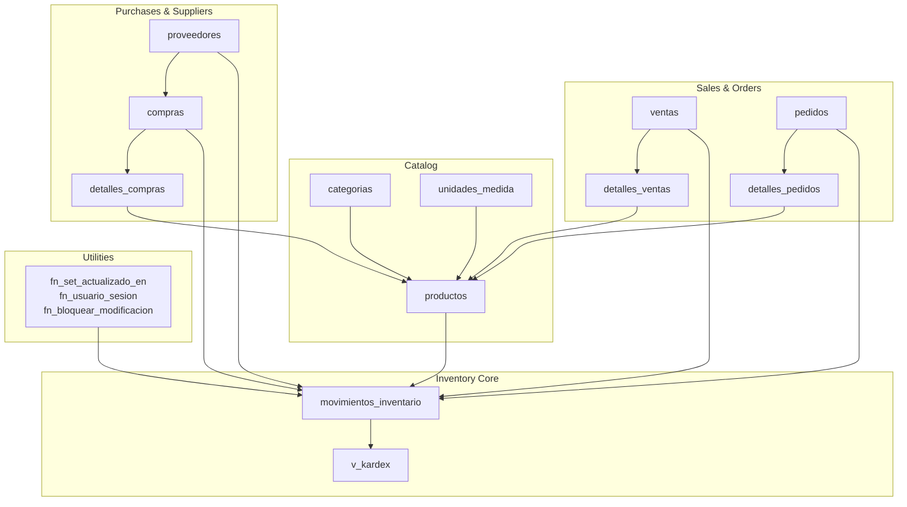
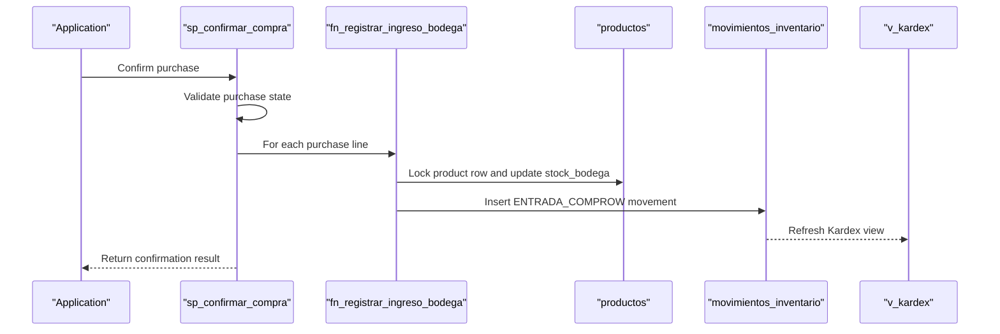
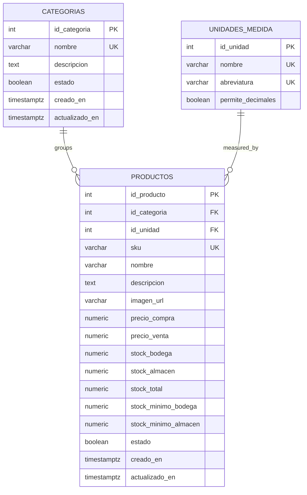
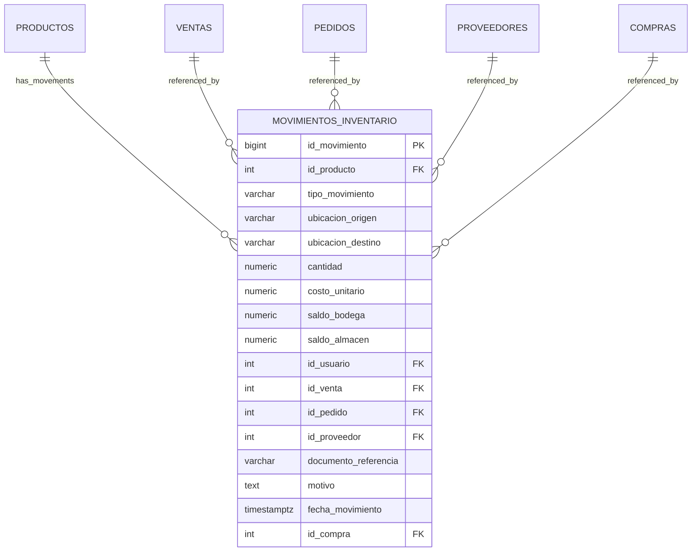
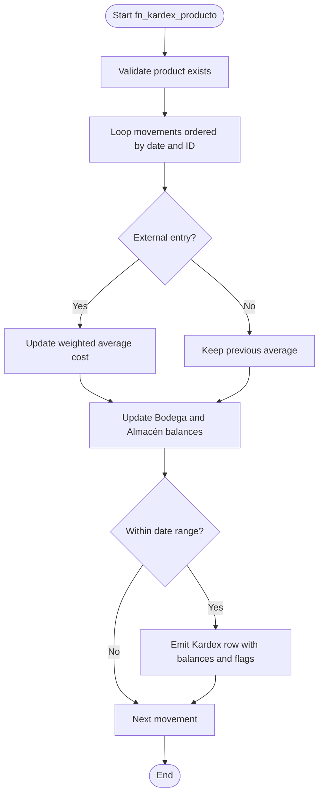
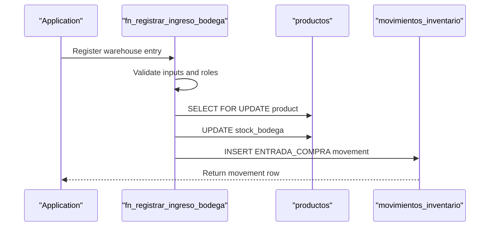
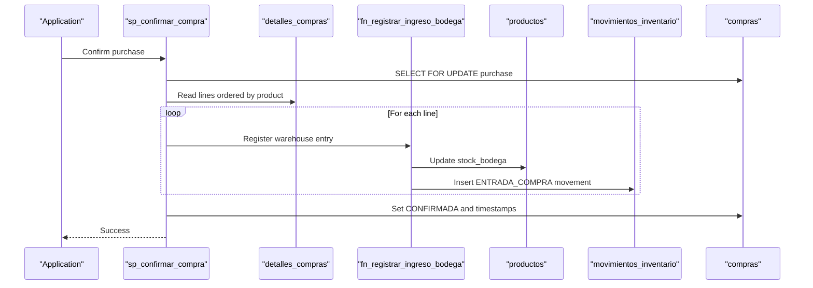
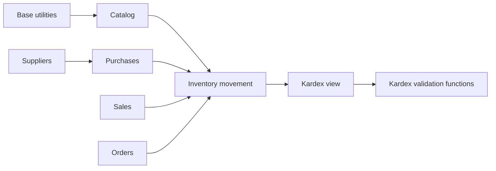

# Inventory Management Schema

<cite>
**Referenced Files in This Document**
- [001_base.sql](file://backend/db/migrations/001_base.sql)
- [003_catalogo.sql](file://backend/db/migrations/003_catalogo.sql)
- [004_clientes_pedidos.sql](file://backend/db/migrations/004_clientes_pedidos.sql)
- [005_ventas.sql](file://backend/db/migrations/005_ventas.sql)
- [006_inventario.sql](file://backend/db/migrations/006_inventario.sql)
- [008_ingreso_bodega.sql](file://backend/db/migrations/008_ingreso_bodega.sql)
- [011_compras.sql](file://backend/db/migrations/011_compras.sql)
- [012_saldo_kardex.sql](file://backend/db/migrations/012_saldo_kardex.sql)
- [kardex.sql](file://backend/scripts/kardex.sql)
- [movimiento_inventario.sql](file://backend/scripts/movimiento_inventario.sql)
- [inventaro.sql](file://backend/scripts/inventaro.sql)
</cite>

## Table of Contents
1. [Introduction](#introduction)
2. [Project Structure](#project-structure)
3. [Core Components](#core-components)
4. [Architecture Overview](#architecture-overview)
5. [Detailed Component Analysis](#detailed-component-analysis)
6. [Dependency Analysis](#dependency-analysis)
7. [Performance Considerations](#performance-considerations)
8. [Troubleshooting Guide](#troubleshooting-guide)
9. [Conclusion](#conclusion)

## Introduction
This document explains SIMO’s inventory management database schema with a focus on the dual-location system that tracks stock levels separately for warehouse and store locations. It covers:
- Product catalog structure
- Inventory movement tracking through an immutable Kardex-style log
- Real-time stock balances per location
- Kardex calculations using weighted average cost
- Relationships between products, inventory movements, sales, orders, and suppliers
- Trigger-based automatic updates and stored procedures for complex operations
- Practical examples such as stock adjustments, low-stock alerts, and inventory valuation queries

The design intentionally separates historical movement records from current stock balances. Current balances live on the product row, while every change is recorded in the movement table so that balances can be audited and recalculated.

## Project Structure
The inventory-related database logic is implemented across several PostgreSQL migrations and supporting scripts:
- Base utilities and audit helpers
- Catalog tables for categories, units, and products
- Sales, orders, and client tables that consume inventory
- Supplier and purchase tables that feed warehouse stock
- The core inventory movement table and Kardex view
- Functions and procedures for atomic stock updates and validation

**Diagram sources**
- [003_catalogo.sql:22-83](file://backend/db/migrations/003_catalogo.sql#L22-L83)
- [004_clientes_pedidos.sql:42-85](file://backend/db/migrations/004_clientes_pedidos.sql#L42-L85)
- [005_ventas.sql:40-97](file://backend/db/migrations/005_ventas.sql#L40-L97)
- [006_inventario.sql:25-161](file://backend/db/migrations/006_inventario.sql#L25-L161)
- [011_compras.sql:21-57](file://backend/db/migrations/011_compras.sql#L21-L57)
- [001_base.sql:31-57](file://backend/db/migrations/001_base.sql#L31-L57)

**Section sources**
- [001_base.sql:1-60](file://backend/db/migrations/001_base.sql#L1-L60)
- [003_catalogo.sql:1-102](file://backend/db/migrations/003_catalogo.sql#L1-L102)
- [004_clientes_pedidos.sql:1-192](file://backend/db/migrations/004_clientes_pedidos.sql#L1-L192)
- [005_ventas.sql:1-104](file://backend/db/migrations/005_ventas.sql#L1-L104)
- [006_inventario.sql:1-166](file://backend/db/migrations/006_inventario.sql#L1-L166)
- [008_ingreso_bodega.sql:1-91](file://backend/db/migrations/008_ingreso_bodega.sql#L1-L91)
- [011_compras.sql:1-261](file://backend/db/migrations/011_compras.sql#L1-L261)
- [012_saldo_kardex.sql:1-155](file://backend/db/migrations/012_saldo_kardex.sql#L1-L155)

## Core Components
SIMO’s inventory model centers on three layers:
1. **Product catalog**: defines what is sold and how it is measured.
2. **Current stock balances**: per-location quantities on the product row.
3. **Movement ledger**: an immutable chronological record of every stock change.

### Product Catalog
The catalog includes:
- Categories for grouping products
- Units of measure that support integer or fractional quantities
- Products with SKU, pricing, and dual-location stock fields

Key points:
- `stock_bodega` and `stock_almacen` are the authoritative current balances.
- `stock_total` is a generated column equal to the sum of both locations.
- Minimum stock thresholds exist per location to support low-stock alerts.
- Stock columns must remain non-negative; they should only change through movement procedures.

**Section sources**
- [003_catalogo.sql:22-83](file://backend/db/migrations/003_catalogo.sql#L22-L83)

### Inventory Movement Ledger
The movement table is the single source of truth for inventory changes. Each row captures:
- Product
- Movement type
- Source and destination locations
- Quantity and unit cost at the time of the movement
- Resulting balances after the movement
- Business references such as sale, order, supplier, or purchase
- User and timestamp

Movement types include:
- Purchase entry into warehouse
- Internal transfer from warehouse to store
- Sale or order fulfillment exits
- Reversals for canceled or returned transactions
- Manual positive or negative adjustments

The table is protected by constraints and triggers that prevent modification and truncation, ensuring an immutable audit trail.

**Section sources**
- [006_inventario.sql:44-129](file://backend/db/migrations/006_inventario.sql#L44-L129)

### Kardex View
The Kardex view presents the movement ledger as a readable chronological history per product. It expands each movement into:
- Entry and exit quantities per location
- Location-specific balances
- Total balance
- Unit cost and business context

This view does not duplicate balances; it derives them from the movement rows.

**Section sources**
- [006_inventario.sql:131-161](file://backend/db/migrations/006_inventario.sql#L131-L161)

### Purchases and Warehouse Inbound
Suppliers and purchases provide inbound stock:
- Suppliers hold vendor information
- Purchases track draft or confirmed orders
- Purchase lines define products, quantities, and costs
- A stored procedure confirms a purchase and atomically adds all lines to warehouse stock
- Each confirmed line creates a purchase entry movement linked back to the purchase

**Section sources**
- [006_inventario.sql:25-36](file://backend/db/migrations/006_inventario.sql#L25-L36)
- [011_compras.sql:21-57](file://backend/db/migrations/011_compras.sql#L21-L57)
- [011_compras.sql:217-258](file://backend/db/migrations/011_compras.sql#L217-L258)

### Sales, Orders, and Inventory Consumption
Sales and orders consume inventory:
- Sales have header and line details
- Order headers and line details reserve or fulfill demand
- Movements link back to sales or orders depending on the operation
- Cancellations or reversals create reversal movements toward the original location

**Section sources**
- [004_clientes_pedidos.sql:42-85](file://backend/db/migrations/004_clientes_pedidos.sql#L42-L85)
- [005_ventas.sql:40-97](file://backend/db/migrations/005_ventas.sql#L40-L97)
- [006_inventario.sql:46-103](file://backend/db/migrations/006_inventario.sql#L46-L103)

## Architecture Overview
The inventory architecture enforces consistency through layered constraints, triggers, functions, and procedures:

**Diagram sources**
- [011_compras.sql:217-258](file://backend/db/migrations/011_compras.sql#L217-L258)
- [011_compras.sql:146-207](file://backend/db/migrations/011_compras.sql#L146-L207)
- [006_inventario.sql:136-161](file://backend/db/migrations/006_inventario.sql#L136-L161)

## Detailed Component Analysis

### Product Catalog Model
The catalog defines measurable items with pricing and dual-location stock:
- `categorias`: product categories
- `unidades_medida`: units that may allow decimals
- `productos`: product master data with SKU, prices, and stock fields

**Diagram sources**
- [003_catalogo.sql:22-83](file://backend/db/migrations/003_catalogo.sql#L22-L83)

**Section sources**
- [003_catalogo.sql:22-83](file://backend/db/migrations/003_catalogo.sql#L22-L83)

### Inventory Movement Model
The movement model is the central inventory entity. It stores immutable records of every stock change and links to business documents.

**Diagram sources**
- [006_inventario.sql:62-108](file://backend/db/migrations/006_inventario.sql#L62-L108)
- [011_compras.sql:128-140](file://backend/db/migrations/011_compras.sql#L128-L140)

**Section sources**
- [006_inventario.sql:44-129](file://backend/db/migrations/006_inventario.sql#L44-L129)

### Kardex Calculation and Validation
Kardex calculation is performed by a function that walks movements chronologically and recalculates:
- Per-location balances
- Weighted average cost
- Valued inventory balance
- Consistency flags comparing stored balances with recalculated balances

A separate validation function audits one or all products, comparing recalculated final balances with current product stock and counting inconsistent movements.

**Diagram sources**
- [012_saldo_kardex.sql:26-108](file://backend/db/migrations/012_saldo_kardex.sql#L26-L108)

**Section sources**
- [012_saldo_kardex.sql:1-155](file://backend/db/migrations/012_saldo_kardex.sql#L1-L155)

### Warehouse Inbound Function
The warehouse inbound function performs an atomic purchase receipt:
- Validates quantity, user, supplier, product state, and unit decimal rules
- Locks the product row to avoid concurrent updates
- Updates only `stock_bodega`
- Inserts an `ENTRADA_COMPRA` movement with resulting balances
- Returns the created movement

**Diagram sources**
- [008_ingreso_bodega.sql:23-84](file://backend/db/migrations/008_ingreso_bodega.sql#L23-L84)
- [011_compras.sql:146-207](file://backend/db/migrations/011_compras.sql#L146-L207)

**Section sources**
- [008_ingreso_bodega.sql:1-91](file://backend/db/migrations/008_ingreso_bodega.sql#L1-L91)
- [011_compras.sql:146-207](file://backend/db/migrations/011_compras.sql#L146-L207)

### Purchase Confirmation Procedure
The purchase confirmation procedure:
- Locks the purchase row
- Validates purchase existence and state
- Iterates purchase lines in deterministic order
- Calls the warehouse inbound function for each line
- Marks the purchase as confirmed after successful application

**Diagram sources**
- [011_compras.sql:217-258](file://backend/db/migrations/011_compras.sql#L217-L258)
- [011_compras.sql:146-207](file://backend/db/migrations/011_compras.sql#L146-L207)

**Section sources**
- [011_compras.sql:21-57](file://backend/db/migrations/011_compras.sql#L21-L57)
- [011_compras.sql:217-258](file://backend/db/migrations/011_compras.sql#L217-L258)

### Historical Scripts vs Current Schema
Historical scripts show earlier versions of inventory structures:
- An older `movimiento_inventario` script used simpler movement types and did not include dual-location fields
- An older `kardex` script defined a physical table rather than a view
- The current migration replaces those patterns with a more robust dual-location design and a Kardex view

These historical files are useful for understanding evolution but are superseded by the current migrations.

**Section sources**
- [movimiento_inventario.sql:1-28](file://backend/scripts/movimiento_inventario.sql#L1-L28)
- [kardex.sql:1-35](file://backend/scripts/kardex.sql#L1-L35)
- [inventaro.sql:1-6](file://backend/scripts/inventaro.sql#L1-L6)

## Dependency Analysis
The inventory schema has clear dependency boundaries:

**Diagram sources**
- [001_base.sql:31-57](file://backend/db/migrations/001_base.sql#L31-L57)
- [003_catalogo.sql:22-83](file://backend/db/migrations/003_catalogo.sql#L22-L83)
- [006_inventario.sql:62-161](file://backend/db/migrations/006_inventario.sql#L62-L161)
- [011_compras.sql:21-57](file://backend/db/migrations/011_compras.sql#L21-L57)
- [012_saldo_kardex.sql:113-149](file://backend/db/migrations/012_saldo_kardex.sql#L113-L149)

**Section sources**
- [006_inventario.sql:62-161](file://backend/db/migrations/006_inventario.sql#L62-L161)
- [011_compras.sql:21-57](file://backend/db/migrations/011_compras.sql#L21-L57)
- [012_saldo_kardex.sql:113-149](file://backend/db/migrations/012_saldo_kardex.sql#L113-L149)

## Performance Considerations
- Use indexes on movement filters such as product, date, sale, order, and purchase references.
- Prefer querying the Kardex view for reporting instead of recomputing balances repeatedly.
- Avoid direct updates to product stock columns; always use the provided functions and procedures.
- When auditing large datasets, run validation functions against specific products first to limit scan scope.
- Be mindful of concurrent operations on the same product; locking occurs at the row level during stock updates.

[No sources needed since this section provides general guidance]

## Troubleshooting Guide

### Common Error Codes
Business errors use custom SQLSTATE codes:
- Product not found
- Product inactive
- Invalid quantity
- Decimal unit rule violation
- User inactive or missing
- Supplier inactive or missing
- Negative unit cost
- Purchase already confirmed
- Purchase not found
- Purchase without lines

These codes help the API translate database errors into consistent HTTP responses.

**Section sources**
- [008_ingreso_bodega.sql:13-18](file://backend/db/migrations/008_ingreso_bodega.sql#L13-L18)
- [011_compras.sql:12-17](file://backend/db/migrations/011_compras.sql#L12-L17)

### Immutability and Audit Integrity
- Movement records cannot be updated or deleted.
- Truncating movement records is blocked.
- These protections ensure the Kardex remains an immutable audit trail.

**Section sources**
- [001_base.sql:48-57](file://backend/db/migrations/001_base.sql#L48-L57)
- [006_inventario.sql:121-129](file://backend/db/migrations/006_inventario.sql#L121-L129)

### Validating Stock Consistency
Use the Kardex validation function to:
- Recalculate balances per product
- Compare recalculated balances with current stock
- Count inconsistent movements
- Identify valuation discrepancies

Run it for a single product when investigating a specific SKU, or without parameters to audit all products.

**Section sources**
- [012_saldo_kardex.sql:113-149](file://backend/db/migrations/012_saldo_kardex.sql#L113-L149)

## Conclusion
SIMO’s inventory schema implements a robust dual-location model where:
- Product catalogs define measurable items with per-location minimums
- Current stock balances live on the product row
- Every change is recorded in an immutable movement ledger
- A Kardex view provides chronological visibility
- Functions and procedures enforce atomicity, validation, and traceability
- Validation functions enable continuous reconciliation of balances and valuation

This design supports accurate real-time stock tracking, reliable auditability, and extensible inventory operations across warehouse and store locations.

[No sources needed since this section summarizes without analyzing specific files]