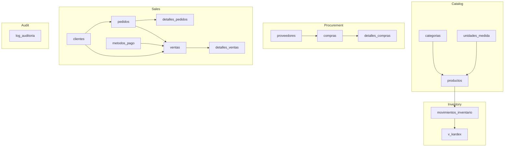
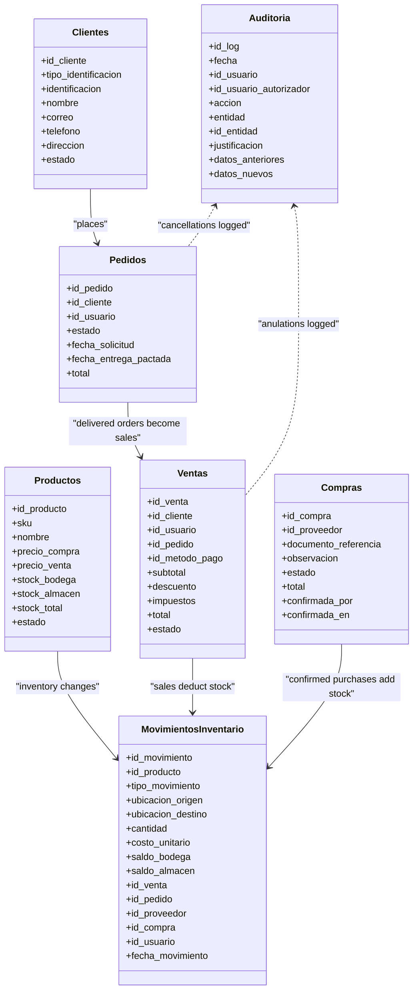
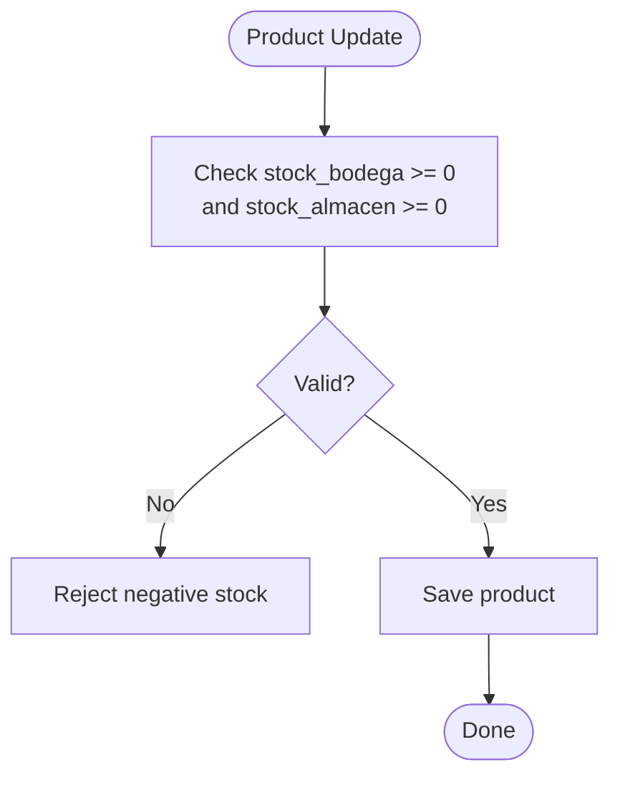
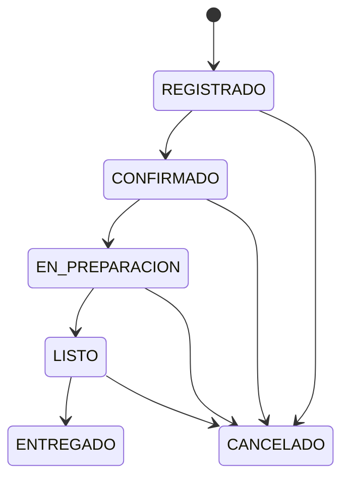
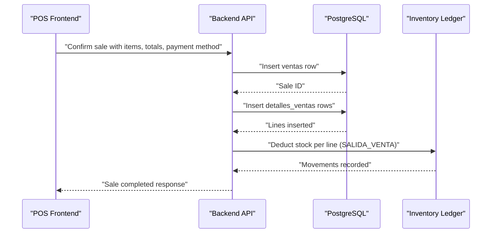
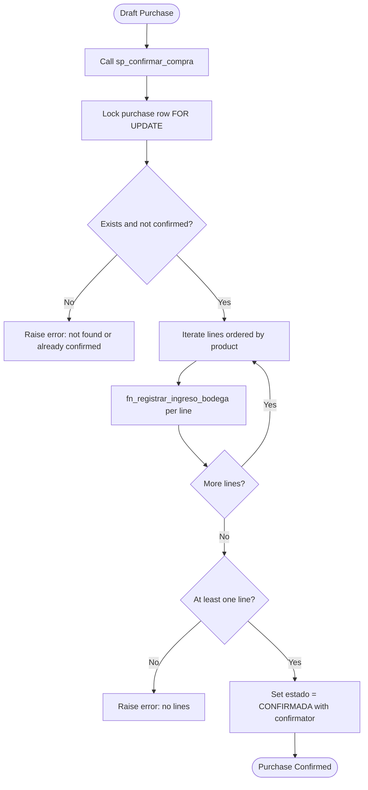
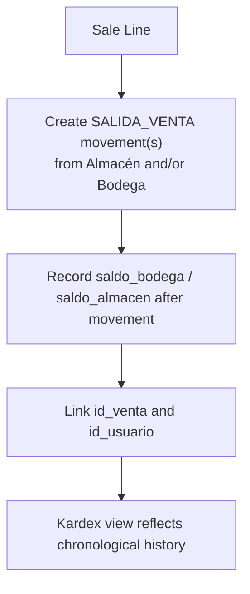
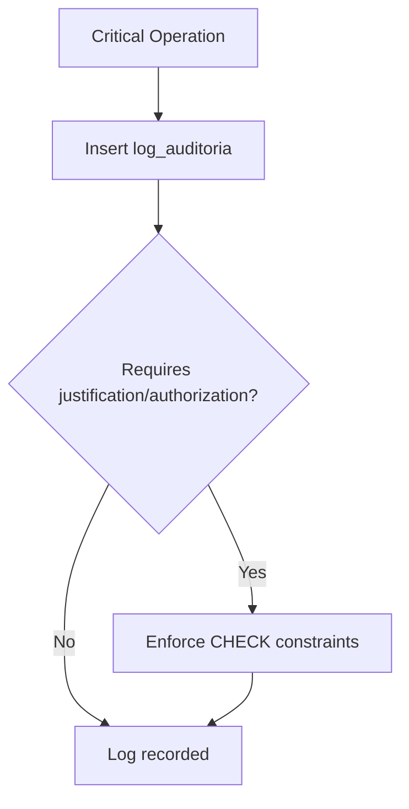
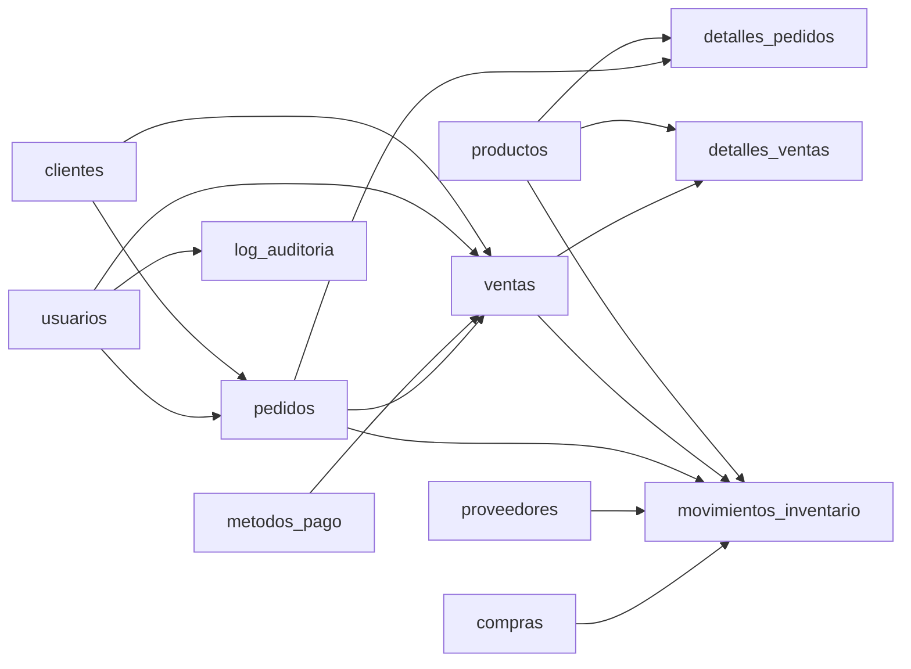

# Sales & Transactions Schema

<cite>
**Referenced Files in This Document**   
- [001_base.sql](file://backend/db/migrations/001_base.sql)
- [003_catalogo.sql](file://backend/db/migrations/003_catalogo.sql)
- [004_clientes_pedidos.sql](file://backend/db/migrations/004_clientes_pedidos.sql)
- [005_ventas.sql](file://backend/db/migrations/005_ventas.sql)
- [006_inventario.sql](file://backend/db/migrations/006_inventario.sql)
- [007_auditoria.sql](file://backend/db/migrations/007_auditoria.sql)
- [008_ingreso_bodega.sql](file://backend/db/migrations/008_ingreso_bodega.sql)
- [011_compras.sql](file://backend/db/migrations/011_compras.sql)
- [012_saldo_kardex.sql](file://backend/db/migrations/012_saldo_kardex.sql)
- [013_indices_ventas.sql](file://backend/db/migrations/013_indices_ventas.sql)
- [001_reglas_esquema.sql](file://backend/db/tests/001_reglas_esquema.sql)
</cite>

## Table of Contents
1. [Introduction](#introduction)
2. [Project Structure](#project-structure)
3. [Core Components](#core-components)
4. [Architecture Overview](#architecture-overview)
5. [Detailed Component Analysis](#detailed-component-analysis)
6. [Dependency Analysis](#dependency-analysis)
7. [Performance Considerations](#performance-considerations)
8. [Troubleshooting Guide](#troubleshooting-guide)
9. [Conclusion](#conclusion)

## Introduction
This document explains SIMO’s sales and transactions database schema. It covers the complete sales processing workflow from order creation through payment completion, customer-purchase relationships, order status tracking, sales history maintenance, purchase management for procurement operations, inventory deduction behavior, data integrity constraints, and business rule enforcement through database triggers and functions.

The schema is implemented as a set of PostgreSQL migrations under `backend/db/migrations`. Core entities include customers, orders, products, categories, units of measure, payment methods, sales, sale lines, purchases, purchase lines, inventory movements, and audit logs. Business rules are enforced at the database level using constraints, generated columns, and PL/pgSQL functions/triggers.

## Project Structure
The relevant parts of the repository for this documentation are:

- Database migrations define tables, indexes, views, functions, procedures, and triggers.
- Tests validate schema rules such as state transitions, totals, and immutability guarantees.
- Performance tuning includes specialized indexes and planner settings for sales queries.

**Diagram sources**
- [003_catalogo.sql:22-83](file://backend/db/migrations/003_catalogo.sql#L22-L83)
- [006_inventario.sql:25-161](file://backend/db/migrations/006_inventario.sql#L25-L161)
- [004_clientes_pedidos.sql:12-105](file://backend/db/migrations/004_clientes_pedidos.sql#L12-L105)
- [005_ventas.sql:13-97](file://backend/db/migrations/005_ventas.sql#L13-L97)
- [011_compras.sql:21-57](file://backend/db/migrations/011_compras.sql#L21-L57)

**Section sources**
- [003_catalogo.sql:1-102](file://backend/db/migrations/003_catalogo.sql#L1-L102)
- [006_inventario.sql:1-166](file://backend/db/migrations/006_inventario.sql#L1-L166)
- [004_clientes_pedidos.sql:1-192](file://backend/db/migrations/004_clientes_pedidos.sql#L1-L192)
- [005_ventas.sql:1-104](file://backend/db/migrations/005_ventas.sql#L1-L104)
- [011_compras.sql:1-261](file://backend/db/migrations/011_compras.sql#L1-L261)

## Core Components
- Catalog: categories, units of measure, and products with dual inventory balances (warehouse and store).
- Procurement: suppliers, purchases, and purchase lines; confirmed purchases add stock to the warehouse.
- Customers and Orders: customers, orders with strict lifecycle states, and order lines.
- Sales: payment methods, sales, and sale lines; sales can be linked to delivered orders or created directly at the counter.
- Inventory: immutable movement ledger and Kardex view; supports internal transfers, sales/purchase entries, reversals, and adjustments.
- Audit: immutable log of critical operations with authorization requirements.

Key design principles:
- Dual-location inventory: `stock_bodega` and `stock_almacen`, with `stock_total` as a generated column.
- Immutable ledgers: inventory movements and audit logs cannot be updated or deleted.
- Business rules via constraints and triggers: totals, state transitions, required justifications, and location validity.
- Traceability: every inventory movement links back to a sale, order, purchase, supplier, or user.

**Section sources**
- [003_catalogo.sql:22-83](file://backend/db/migrations/003_catalogo.sql#L22-L83)
- [006_inventario.sql:62-161](file://backend/db/migrations/006_inventario.sql#L62-L161)
- [004_clientes_pedidos.sql:12-105](file://backend/db/migrations/004_clientes_pedidos.sql#L12-L105)
- [005_ventas.sql:13-97](file://backend/db/migrations/005_ventas.sql#L13-L97)
- [011_compras.sql:21-57](file://backend/db/migrations/011_compras.sql#L21-L57)
- [007_auditoria.sql:13-40](file://backend/db/migrations/007_auditoria.sql#L13-L40)

## Architecture Overview
The system separates catalog, procurement, sales, inventory, and audit concerns while maintaining strong referential integrity and traceability.

**Diagram sources**
- [003_catalogo.sql:65-83](file://backend/db/migrations/003_catalogo.sql#L65-L83)
- [004_clientes_pedidos.sql:12-56](file://backend/db/migrations/004_clientes_pedidos.sql#L12-L56)
- [005_ventas.sql:40-67](file://backend/db/migrations/005_ventas.sql#L40-L67)
- [006_inventario.sql:62-108](file://backend/db/migrations/006_inventario.sql#L62-L108)
- [011_compras.sql:21-37](file://backend/db/migrations/011_compras.sql#L21-L37)
- [007_auditoria.sql:13-40](file://backend/db/migrations/007_auditoria.sql#L13-L40)

## Detailed Component Analysis

### Catalog and Products
- Categories and units of measure provide reference data.
- Products have SKU uniqueness, price fields, and dual inventory balances.
- `stock_total` is generated as the sum of warehouse and store balances.
- Stock columns must remain non-negative; direct edits are not intended—changes occur through inventory movements.

**Diagram sources**
- [003_catalogo.sql:65-83](file://backend/db/migrations/003_catalogo.sql#L65-L83)

**Section sources**
- [003_catalogo.sql:22-83](file://backend/db/migrations/003_catalogo.sql#L22-L83)

### Customers and Orders
- Customers are identified by type and unique identification number.
- Orders track request date, agreed delivery date, delivery address, observations, and total.
- Order lifecycle is strictly sequential: registered → confirmed → preparing → ready → delivered; cancellation is allowed before delivery.
- State transitions are validated by a trigger; each change is recorded in an immutable history table with user and optional reason.

**Diagram sources**
- [004_clientes_pedidos.sql:42-56](file://backend/db/migrations/004_clientes_pedidos.sql#L42-L56)
- [004_clientes_pedidos.sql:114-151](file://backend/db/migrations/004_clientes_pedidos.sql#L114-L151)

**Section sources**
- [004_clientes_pedidos.sql:12-105](file://backend/db/migrations/004_clientes_pedidos.sql#L12-L105)
- [004_clientes_pedidos.sql:114-189](file://backend/db/migrations/004_clientes_pedidos.sql#L114-L189)

### Sales and Payment Methods
- Payment methods are informational and include cash, digital wallets, bank transfer, card, and other methods.
- Sales link to a customer (optional for walk-in sales), a seller, a payment method, and optionally a delivered order.
- A delivered order can generate at most one sale due to a unique constraint on `id_pedido`.
- Sales totals are constrained: discount cannot exceed subtotal, and total equals subtotal minus discount plus taxes.
- Anulation requires timestamp, operator, authorizer, and mandatory reason.

**Diagram sources**
- [005_ventas.sql:13-97](file://backend/db/migrations/005_ventas.sql#L13-L97)
- [006_inventario.sql:44-108](file://backend/db/migrations/006_inventario.sql#L44-L108)

**Section sources**
- [005_ventas.sql:13-97](file://backend/db/migrations/005_ventas.sql#L13-L97)

### Purchase Management System
- Suppliers are tracked with NIT, name, contact info, and active state.
- Purchures start as drafts with lines; confirmation adds all lines to warehouse stock atomically.
- Once confirmed, purchase headers and lines are immutable.
- The confirmation procedure validates existence, prevents double confirmation, enforces non-empty lines, and records movements linked to the purchase.

**Diagram sources**
- [011_compras.sql:21-57](file://backend/db/migrations/011_compras.sql#L21-L57)
- [011_compras.sql:217-255](file://backend/db/migrations/011_compras.sql#L217-L255)
- [008_ingreso_bodega.sql:23-84](file://backend/db/migrations/008_ingreso_bodega.sql#L23-L84)

**Section sources**
- [011_compras.sql:21-261](file://backend/db/migrations/011_compras.sql#L21-L261)
- [008_ingreso_bodega.sql:23-91](file://backend/db/migrations/008_ingreso_bodega.sql#L23-L91)

### Inventory Deductions and Kardex
- Inventory movements form an immutable ledger with types for purchase entry, internal transfer, sale/purchase exit, reversal, and adjustments.
- Location constraints ensure valid origin/destination combinations per movement type.
- References are enforced: sale exits require a sale ID; order exits require an order ID; purchase entries may link to a supplier and purchase.
- The Kardex view provides chronological entries per product with separate inbound/outbound columns per location and resulting balances.

**Diagram sources**
- [006_inventario.sql:44-108](file://backend/db/migrations/006_inventario.sql#L44-L108)
- [006_inventario.sql:136-161](file://backend/db/migrations/006_inventario.sql#L136-L161)

**Section sources**
- [006_inventario.sql:44-161](file://backend/db/migrations/006_inventario.sql#L44-L161)

### Audit Log
- Critical operations like inventory adjustments, sale cancellations, order cancellations, price changes, user role/state changes, and company updates are logged.
- Some actions require justification and authorization.
- The audit table is immutable: updates, deletes, and truncates are blocked.

**Diagram sources**
- [007_auditoria.sql:13-40](file://backend/db/migrations/007_auditoria.sql#L13-L40)

**Section sources**
- [007_auditoria.sql:13-68](file://backend/db/migrations/007_auditoria.sql#L13-L68)

## Dependency Analysis
The following diagram shows key foreign-key dependencies among core tables:

**Diagram sources**
- [004_clientes_pedidos.sql:12-85](file://backend/db/migrations/004_clientes_pedidos.sql#L12-L85)
- [005_ventas.sql:40-97](file://backend/db/migrations/005_ventas.sql#L40-L97)
- [006_inventario.sql:62-108](file://backend/db/migrations/006_inventario.sql#L62-L108)
- [011_compras.sql:21-57](file://backend/db/migrations/011_compras.sql#L21-L57)
- [007_auditoria.sql:13-40](file://backend/db/migrations/007_auditoria.sql#L13-L40)

**Section sources**
- [004_clientes_pedidos.sql:12-85](file://backend/db/migrations/004_clientes_pedidos.sql#L12-L85)
- [005_ventas.sql:40-97](file://backend/db/migrations/005_ventas.sql#L40-L97)
- [006_inventario.sql:62-108](file://backend/db/migrations/006_inventario.sql#L62-L108)
- [011_compras.sql:21-57](file://backend/db/migrations/011_compras.sql#L21-L57)
- [007_auditoria.sql:13-40](file://backend/db/migrations/007_auditoria.sql#L13-L40)

## Performance Considerations
- Specialized indexes support sales history, dashboard aggregation, and product sales reporting.
- Partial indexes reduce scan size for completed sales.
- Unique constraints on detail lines are enhanced with included columns to enable index-only scans.
- Planner cost settings are tuned for SSD storage to favor index usage over full table scans.

Examples of performance-related definitions:
- Index on sales date including total and state for history queries.
- Partial index on completed sales by date including total for dashboard sums.
- Enhanced unique constraint on sale lines including quantity and subtotal.
- Index on sale lines by product and sale including quantity and unit price.

**Section sources**
- [013_indices_ventas.sql:33-57](file://backend/db/migrations/013_indices_ventas.sql#L33-L57)
- [013_indices_ventas.sql:59-65](file://backend/db/migrations/013_indices_ventas.sql#L59-L65)

## Troubleshooting Guide

### Common Validation Failures
- Negative stock attempts are rejected by product balance checks.
- Direct stock edits bypassing inventory movements are prevented by design and constraints.
- Invalid order state transitions raise exceptions; only sequential steps are allowed.
- Canceling orders requires a reason; cancellation history is immutable.
- Sale totals must satisfy mathematical constraints; line subtotals must match calculated values.
- Sale anulation requires operator, authorizer, and reason.

Relevant test cases demonstrate expected failures and successes:
- Duplicate emails, invalid roles, duplicate SKUs, negative stock, and category deletion protection.
- Movement validation: purchase entries only to warehouse, internal transfer direction, adjustment justification, sale exit linkage, positive quantities.
- Sales math and anulation requirements.
- Order lifecycle and cancellation reasons.
- Immutability of inventory movements and audit logs.

**Section sources**
- [001_reglas_esquema.sql:47-88](file://backend/db/tests/001_reglas_esquema.sql#L47-L88)
- [001_reglas_esquema.sql:97-112](file://backend/db/tests/001_reglas_esquema.sql#L97-L112)
- [001_reglas_esquema.sql:113-152](file://backend/db/tests/001_reglas_esquema.sql#L113-L152)
- [001_reglas_esquema.sql:154-169](file://backend/db/tests/001_reglas_esquema.sql#L154-L169)

## Conclusion
SIMO’s sales and transactions schema enforces robust business rules through database-level constraints, triggers, and functions. The design ensures accurate financial totals, strict order lifecycles, immutable audit trails, and reliable inventory accounting across two locations. Procurement operations integrate cleanly with inventory, while sales can originate from orders or direct counter transactions. Performance optimizations focus on common reporting patterns, ensuring efficient historical and analytical queries.