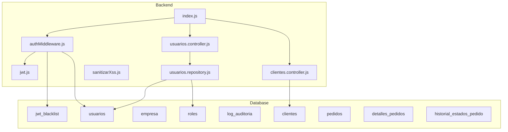
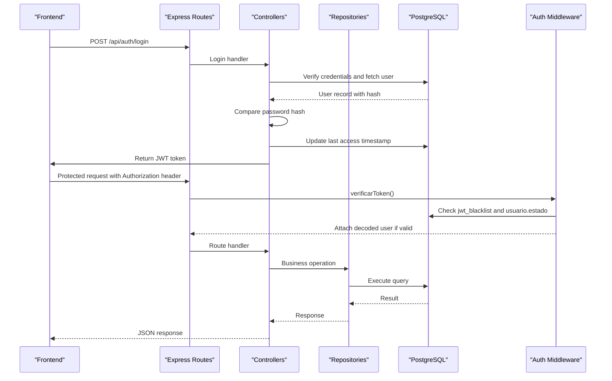
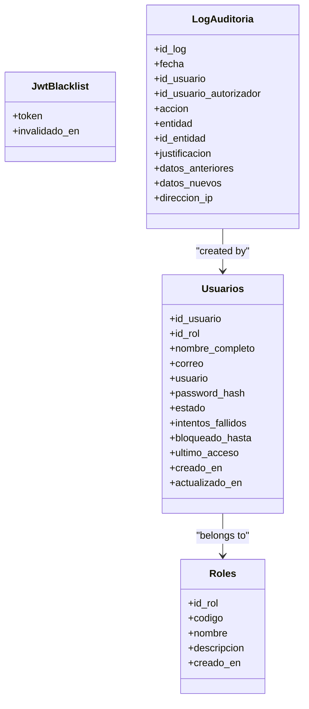
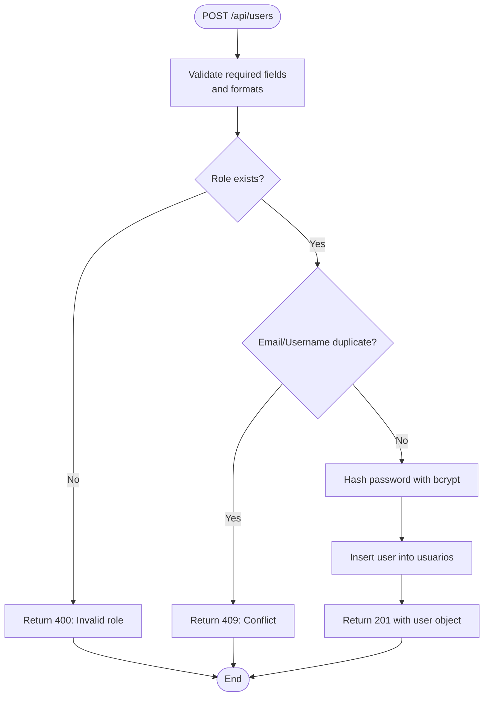
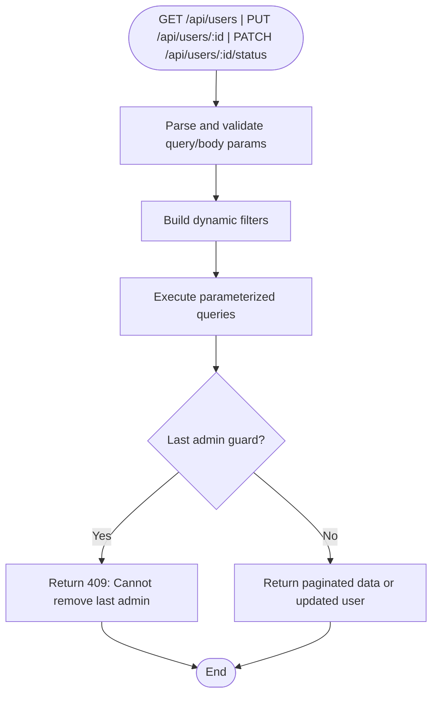
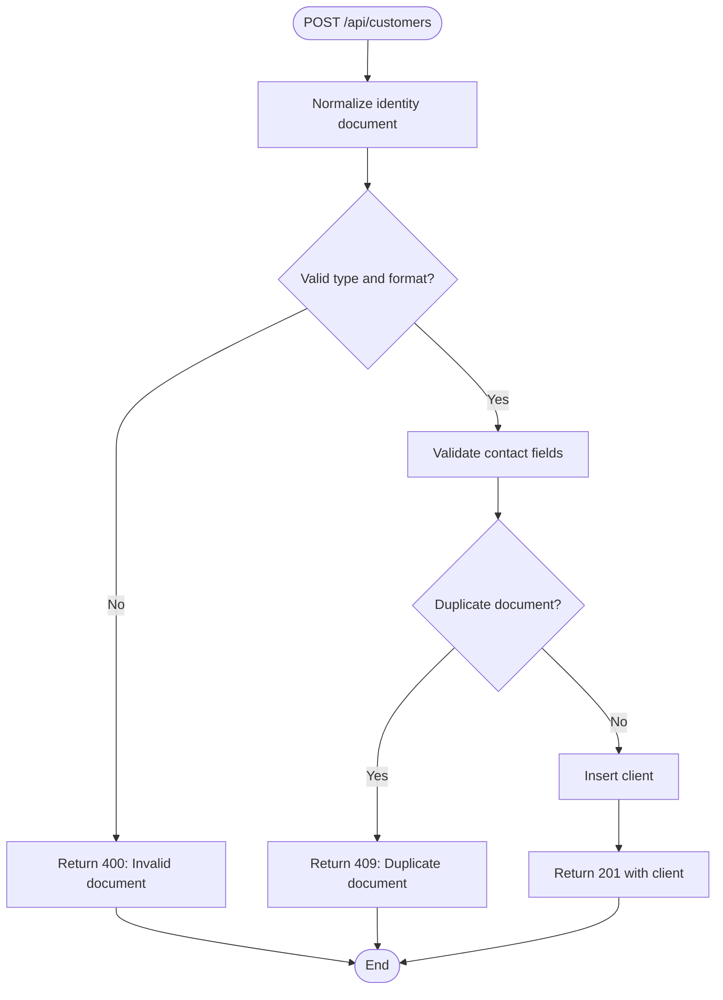
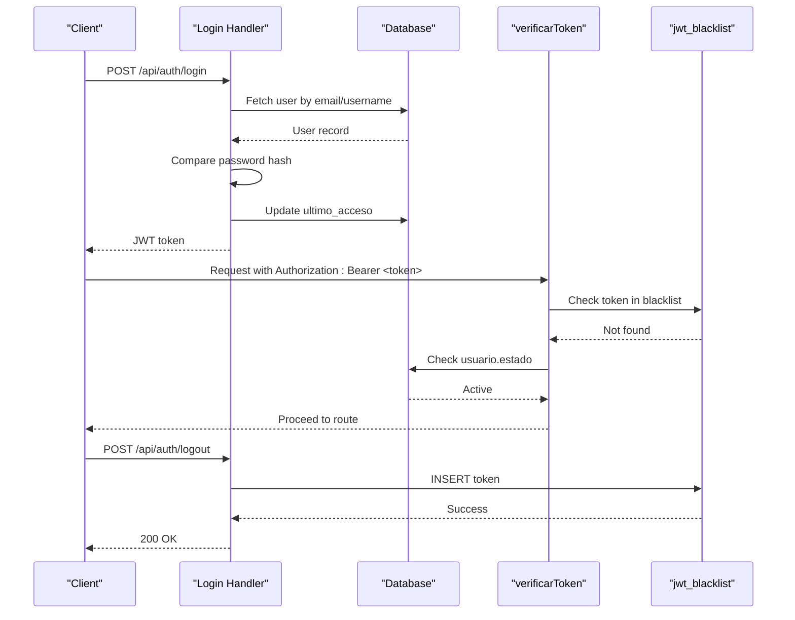
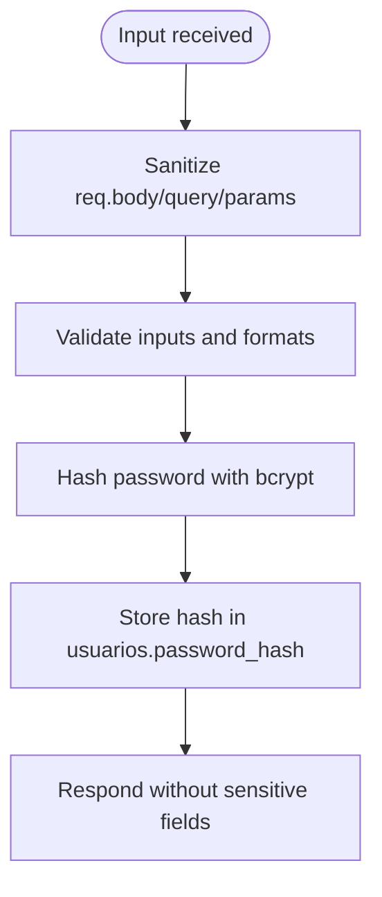
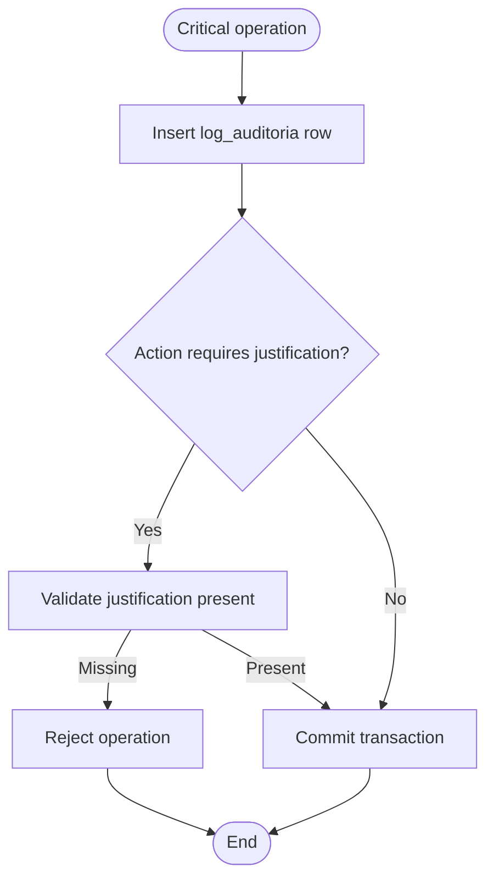
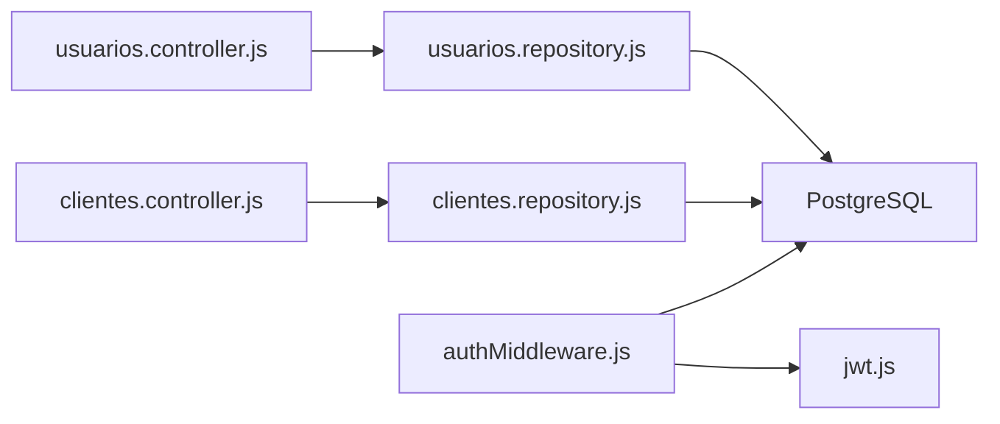

# User & Security Schema

<cite>
**Referenced Files in This Document**
- [002_seguridad.sql](file://backend/db/migrations/002_seguridad.sql)
- [010_sesiones.sql](file://backend/db/migrations/010_sesiones.sql)
- [007_auditoria.sql](file://backend/db/migrations/007_auditoria.sql)
- [004_clientes_pedidos.sql](file://backend/db/migrations/004_clientes_pedidos.sql)
- [009_clientes.sql](file://backend/db/migrations/009_clientes.sql)
- [001_rol_aplicacion.sql](file://backend/db/roles/001_rol_aplicacion.sql)
- [authMiddleware.js](file://backend/middleware/authMiddleware.js)
- [jwt.js](file://backend/src/config/jwt.js)
- [usuarios.controller.js](file://backend/src/controllers/usuarios.controller.js)
- [usuarios.repository.js](file://backend/src/repositories/usuarios.repository.js)
- [clientes.controller.js](file://backend/src/controllers/clientes.controller.js)
- [sanitizarXss.js](file://backend/src/middleware/sanitizarXss.js)
- [crear-admin.js](file://backend/tools/crear-admin.js)
- [index.js](file://backend/index.js)
</cite>

## Table of Contents
1. [Introduction](#introduction)
2. [Project Structure](#project-structure)
3. [Core Components](#core-components)
4. [Architecture Overview](#architecture-overview)
5. [Detailed Component Analysis](#detailed-component-analysis)
6. [Dependency Analysis](#dependency-analysis)
7. [Performance Considerations](#performance-considerations)
8. [Troubleshooting Guide](#troubleshooting-guide)
9. [Conclusion](#conclusion)
10. [Appendices](#appendices)

## Introduction
This document explains SIMO’s user management and security database schema, including:
- User accounts, roles, and role-based access control (RBAC).
- Permission enforcement through middleware and database privileges.
- Client/customer data model with validation rules and contact storage.
- Session management using JWT tokens and a blacklist for logout.
- Password hashing, security constraints, and audit logging.
- Data privacy considerations and compliance requirements for customer information handling.

The goal is to provide both technical depth and accessible explanations for developers, administrators, and auditors.

## Project Structure
The security and user-related logic spans database migrations, backend controllers, repositories, middleware, and configuration:
- Database schema and constraints are defined in SQL migrations under `backend/db/migrations`.
- RBAC roles and least-privilege database roles are defined under `backend/db/roles`.
- Authentication and authorization are implemented in Express middleware and route handlers.
- User and client business logic lives in controllers and repositories.
- Security utilities include XSS sanitization and secure password hashing.

**Diagram sources**
- [002_seguridad.sql:15-58](file://backend/db/migrations/002_seguridad.sql#L15-L58)
- [010_sesiones.sql:12-15](file://backend/db/migrations/010_sesiones.sql#L12-L15)
- [007_auditoria.sql:13-40](file://backend/db/migrations/007_auditoria.sql#L13-L40)
- [004_clientes_pedidos.sql:12-56](file://backend/db/migrations/004_clientes_pedidos.sql#L12-L56)
- [authMiddleware.js:9-49](file://backend/middleware/authMiddleware.js#L9-L49)
- [jwt.js:11-15](file://backend/src/config/jwt.js#L11-L15)
- [usuarios.controller.js:29-84](file://backend/src/controllers/usuarios.controller.js#L29-L84)
- [usuarios.repository.js:12-36](file://backend/src/repositories/usuarios.repository.js#L12-L36)
- [clientes.controller.js:73-122](file://backend/src/controllers/clientes.controller.js#L73-L122)
- [index.js:377-423](file://backend/index.js#L377-L423)

**Section sources**
- [002_seguridad.sql:15-58](file://backend/db/migrations/002_seguridad.sql#L15-L58)
- [010_sesiones.sql:12-15](file://backend/db/migrations/010_sesiones.sql#L12-L15)
- [007_auditoria.sql:13-40](file://backend/db/migrations/007_auditoria.sql#L13-L40)
- [004_clientes_pedidos.sql:12-56](file://backend/db/migrations/004_clientes_pedidos.sql#L12-L56)
- [authMiddleware.js:9-49](file://backend/middleware/authMiddleware.js#L9-L49)
- [jwt.js:11-15](file://backend/src/config/jwt.js#L11-L15)
- [usuarios.controller.js:29-84](file://backend/src/controllers/usuarios.controller.js#L29-L84)
- [usuarios.repository.js:12-36](file://backend/src/repositories/usuarios.repository.js#L12-L36)
- [clientes.controller.js:73-122](file://backend/src/controllers/clientes.controller.js#L73-L122)
- [index.js:377-423](file://backend/index.js#L377-L423)

## Core Components
- Roles and Users:
  - `roles` defines stable role codes used by RBAC and JWT payloads.
  - `usuarios` stores user accounts with hashed passwords, state, and optional lockout fields.
- Sessions:
  - JWT tokens are signed with a secret and expire after a configured duration.
  - Logout invalidates tokens via `jwt_blacklist`, checked during authentication.
- Audit Logging:
  - `log_auditoria` records critical operations with before/after snapshots and required justifications.
- Clients and Orders:
  - `clientes` stores identity documents and contact info with strict validation and immutability rules.
  - `pedidos` enforces a lifecycle with triggers and history tracking.
- Security Controls:
  - Middleware validates tokens and roles.
  - Least-privilege DB role restricts write access to sensitive tables.
  - XSS sanitization protects against script injection.

**Section sources**
- [002_seguridad.sql:15-58](file://backend/db/migrations/002_seguridad.sql#L15-L58)
- [010_sesiones.sql:12-15](file://backend/db/migrations/010_sesiones.sql#L12-L15)
- [007_auditoria.sql:13-40](file://backend/db/migrations/007_auditoria.sql#L13-L40)
- [004_clientes_pedidos.sql:12-56](file://backend/db/migrations/004_clientes_pedidos.sql#L12-L56)
- [authMiddleware.js:9-49](file://backend/middleware/authMiddleware.js#L9-L49)
- [jwt.js:11-15](file://backend/src/config/jwt.js#L11-L15)
- [001_rol_aplicacion.sql:31-37](file://backend/db/roles/001_rol_aplicacion.sql#L31-L37)
- [sanitizarXss.js:40-45](file://backend/src/middleware/sanitizarXss.js#L40-L45)

## Architecture Overview
The system uses a layered architecture:
- Frontend calls API endpoints.
- Express routes invoke controllers.
- Controllers validate input and delegate to repositories.
- Repositories execute parameterized SQL queries.
- Middleware enforces authentication and authorization.
- Database constraints and triggers enforce business rules and auditability.

**Diagram sources**
- [index.js:377-423](file://backend/index.js#L377-L423)
- [authMiddleware.js:9-49](file://backend/middleware/authMiddleware.js#L9-L49)
- [010_sesiones.sql:12-15](file://backend/db/migrations/010_sesiones.sql#L12-L15)
- [usuarios.controller.js:29-84](file://backend/src/controllers/usuarios.controller.js#L29-L84)
- [usuarios.repository.js:12-36](file://backend/src/repositories/usuarios.repository.js#L12-L36)

## Detailed Component Analysis

### User Accounts and Role-Based Access Control
- Roles:
  - Stable codes (`ADMIN`, `GERENTE`, `INVENTARIO`, `VENDEDOR`) drive RBAC decisions.
  - The code column is normalized to uppercase and unique.
- Users:
  - Fields include full name, email (lowercased), username, bcrypt hash, active state, failed attempts, and lockout timestamp.
  - Triggers update timestamps; indexes optimize lookups by role and state.
- RBAC Enforcement:
  - Middleware checks the user’s role ID or role code from the JWT payload.
  - Routes can require specific roles.

**Diagram sources**
- [002_seguridad.sql:15-58](file://backend/db/migrations/002_seguridad.sql#L15-L58)
- [010_sesiones.sql:12-15](file://backend/db/migrations/010_sesiones.sql#L12-L15)
- [007_auditoria.sql:13-40](file://backend/db/migrations/007_auditoria.sql#L13-L40)

**Section sources**
- [002_seguridad.sql:15-58](file://backend/db/migrations/002_seguridad.sql#L15-L58)
- [authMiddleware.js:57-75](file://backend/middleware/authMiddleware.js#L57-L75)

### User Creation Workflow
Key steps:
- Validate required fields (role, full name, email, username, password).
- Normalize email to lowercase and validate format.
- Enforce minimum password length.
- Verify role existence.
- Check uniqueness of email and username.
- Hash password with bcrypt.
- Insert user and return public fields (no password hash).

**Diagram sources**
- [usuarios.controller.js:29-84](file://backend/src/controllers/usuarios.controller.js#L29-L84)
- [usuarios.repository.js:25-36](file://backend/src/repositories/usuarios.repository.js#L25-L36)

**Section sources**
- [usuarios.controller.js:29-84](file://backend/src/controllers/usuarios.controller.js#L29-L84)
- [usuarios.repository.js:25-36](file://backend/src/repositories/usuarios.repository.js#L25-L36)

### Role Assignment Queries
- List users with filters:
  - Pagination (`page`, `limit`).
  - State filter (`estado`).
  - Role ID or role code (`id_rol`, `rol`).
  - Text search across name, email, username.
- Update user:
  - Allowed fields: role, full name, email, username.
  - Prevent removing admin role from the last active admin.
  - Prevent changing password or state via this endpoint.
- Change user state:
  - Activate/deactivate user.
  - Prevent deactivating the last active admin.
  - Clear lockout fields on activation.

**Diagram sources**
- [usuarios.controller.js:90-143](file://backend/src/controllers/usuarios.controller.js#L90-L143)
- [usuarios.controller.js:172-255](file://backend/src/controllers/usuarios.controller.js#L172-L255)
- [usuarios.controller.js:263-292](file://backend/src/controllers/usuarios.controller.js#L263-L292)
- [usuarios.repository.js:39-85](file://backend/src/repositories/usuarios.repository.js#L39-L85)
- [usuarios.repository.js:115-172](file://backend/src/repositories/usuarios.repository.js#L115-L172)
- [usuarios.repository.js:178-230](file://backend/src/repositories/usuarios.repository.js#L178-L230)

**Section sources**
- [usuarios.controller.js:90-143](file://backend/src/controllers/usuarios.controller.js#L90-L143)
- [usuarios.controller.js:172-255](file://backend/src/controllers/usuarios.controller.js#L172-L255)
- [usuarios.controller.js:263-292](file://backend/src/controllers/usuarios.controller.js#L263-L292)
- [usuarios.repository.js:39-85](file://backend/src/repositories/usuarios.repository.js#L39-L85)
- [usuarios.repository.js:115-172](file://backend/src/repositories/usuarios.repository.js#L115-L172)
- [usuarios.repository.js:178-230](file://backend/src/repositories/usuarios.repository.js#L178-L230)

### Client/Customer Data Model and Validation
- Identity document:
  - Type restricted to allowed values.
  - Unique and immutable after creation.
- Contact information:
  - Optional phone, email (normalized to lowercase), address.
  - Validated lengths and formats.
- Search and indexing:
  - Prefix search index on identity document for autocomplete.
  - Name index for fast searches.

**Diagram sources**
- [clientes.controller.js:73-122](file://backend/src/controllers/clientes.controller.js#L73-L122)
- [004_clientes_pedidos.sql:12-24](file://backend/db/migrations/004_clientes_pedidos.sql#L12-L24)
- [009_clientes.sql:19-34](file://backend/db/migrations/009_clientes.sql#L19-L34)

**Section sources**
- [clientes.controller.js:73-122](file://backend/src/controllers/clientes.controller.js#L73-L122)
- [004_clientes_pedidos.sql:12-24](file://backend/db/migrations/004_clientes_pedidos.sql#L12-L24)
- [009_clientes.sql:19-34](file://backend/db/migrations/009_clientes.sql#L19-L34)

### Session Management and Authentication Flow
- Login:
  - Validates credentials and account state.
  - Signs JWT with secret and expiration.
  - Updates last access timestamp.
- Token verification:
  - Checks signature and expiration.
  - Rejects blacklisted tokens.
  - Rejects inactive users immediately.
- Logout:
  - Adds token to blacklist to invalidate it even if not expired.

**Diagram sources**
- [index.js:377-423](file://backend/index.js#L377-L423)
- [index.js:428-458](file://backend/index.js#L428-L458)
- [authMiddleware.js:9-49](file://backend/middleware/authMiddleware.js#L9-L49)
- [010_sesiones.sql:12-15](file://backend/db/migrations/010_sesiones.sql#L12-L15)

**Section sources**
- [index.js:377-423](file://backend/index.js#L377-L423)
- [index.js:428-458](file://backend/index.js#L428-L458)
- [authMiddleware.js:9-49](file://backend/middleware/authMiddleware.js#L9-L49)
- [010_sesiones.sql:12-15](file://backend/db/migrations/010_sesiones.sql#L12-L15)

### Password Hashing and Security Constraints
- Password hashing:
  - Uses bcrypt with configurable salt rounds.
  - Never returned in API responses.
- Security constraints:
  - Email normalization and format validation.
  - Username and full name non-empty checks.
  - Minimum password length enforced at controller level.
  - Account lockout fields support temporary blocking after failed attempts.
- XSS protection:
  - Sanitizes body, query, and params to escape dangerous HTML characters.

**Diagram sources**
- [usuarios.controller.js:29-84](file://backend/src/controllers/usuarios.controller.js#L29-L84)
- [sanitizarXss.js:40-45](file://backend/src/middleware/sanitizarXss.js#L40-L45)
- [002_seguridad.sql:40-58](file://backend/db/migrations/002_seguridad.sql#L40-L58)

**Section sources**
- [usuarios.controller.js:29-84](file://backend/src/controllers/usuarios.controller.js#L29-L84)
- [sanitizarXss.js:40-45](file://backend/src/middleware/sanitizarXss.js#L40-L45)
- [002_seguridad.sql:40-58](file://backend/db/migrations/002_seguridad.sql#L40-L58)

### Audit Logging for User Activities
- Critical actions are recorded in `log_auditoria`:
  - Action types include inventory adjustments, sale cancellations, order cancellations, price changes, role/state changes, and company updates.
  - Requires justification for certain actions.
  - Authorizer field is mandatory for sale cancellations.
- Immutability:
  - Triggers block UPDATE, DELETE, and TRUNCATE.
  - Database privileges revoke destructive operations for the application role.

**Diagram sources**
- [007_auditoria.sql:13-40](file://backend/db/migrations/007_auditoria.sql#L13-L40)
- [007_auditoria.sql:53-65](file://backend/db/migrations/007_auditoria.sql#L53-L65)
- [001_rol_aplicacion.sql:31-37](file://backend/db/roles/001_rol_aplicacion.sql#L31-L37)

**Section sources**
- [007_auditoria.sql:13-40](file://backend/db/migrations/007_auditoria.sql#L13-L40)
- [007_auditoria.sql:53-65](file://backend/db/migrations/007_auditoria.sql#L53-L65)
- [001_rol_aplicacion.sql:31-37](file://backend/db/roles/001_rol_aplicacion.sql#L31-L37)

### Data Privacy and Compliance Considerations
- Customer identity documents:
  - Immutable after creation to prevent tampering.
  - Indexed for efficient prefix searches while maintaining uniqueness.
- Contact data:
  - Emails normalized to lowercase; validated formats.
  - Phone numbers and addresses constrained by length and pattern.
- Least privilege:
  - Application database role cannot modify audit logs, inventory movements, or order state history.
- Session security:
  - Short-lived JWT tokens with configurable expiration.
  - Immediate invalidation upon logout via blacklist.
  - Inactive users blocked even if token has not expired.

**Section sources**
- [009_clientes.sql:19-34](file://backend/db/migrations/009_clientes.sql#L19-L34)
- [004_clientes_pedidos.sql:12-24](file://backend/db/migrations/004_clientes_pedidos.sql#L12-L24)
- [001_rol_aplicacion.sql:31-37](file://backend/db/roles/001_rol_aplicacion.sql#L31-L37)
- [jwt.js:11-15](file://backend/src/config/jwt.js#L11-L15)
- [authMiddleware.js:29-49](file://backend/middleware/authMiddleware.js#L29-L49)

## Dependency Analysis
- Controllers depend on repositories for data access.
- Repositories depend on PostgreSQL via a connection pool.
- Middleware depends on JWT configuration and database for session checks.
- Database constraints and triggers enforce business rules independently of application logic.

**Diagram sources**
- [usuarios.controller.js:1-14](file://backend/src/controllers/usuarios.controller.js#L1-L14)
- [usuarios.repository.js:1-4](file://backend/src/repositories/usuarios.repository.js#L1-L4)
- [clientes.controller.js:1-10](file://backend/src/controllers/clientes.controller.js#L1-L10)
- [authMiddleware.js:1-3](file://backend/middleware/authMiddleware.js#L1-L3)
- [jwt.js:1-15](file://backend/src/config/jwt.js#L1-L15)

**Section sources**
- [usuarios.controller.js:1-14](file://backend/src/controllers/usuarios.controller.js#L1-L14)
- [usuarios.repository.js:1-4](file://backend/src/repositories/usuarios.repository.js#L1-L4)
- [clientes.controller.js:1-10](file://backend/src/controllers/clientes.controller.js#L1-L10)
- [authMiddleware.js:1-3](file://backend/middleware/authMiddleware.js#L1-L3)
- [jwt.js:1-15](file://backend/src/config/jwt.js#L1-L15)

## Performance Considerations
- Use parameterized queries to avoid SQL injection and improve plan caching.
- Leverage indexes:
  - `usuarios.id_rol`, `usuarios.estado`.
  - `clientes.identificacion` prefix index.
  - `pedidos.fechas` and state indexes.
- Keep JWT payload minimal and short-lived.
- Avoid returning sensitive fields like password hashes.
- Batch operations where possible and use advisory locks for critical sections (e.g., admin count checks).

[No sources needed since this section provides general guidance]

## Troubleshooting Guide
- Authentication failures:
  - Missing or malformed Authorization header returns unauthorized.
  - Expired or invalid tokens return forbidden.
  - Blacklisted tokens or inactive users return unauthorized with appropriate messages.
- User management errors:
  - Duplicate email/username returns conflict.
  - Removing the last active admin returns conflict.
  - Invalid role IDs or malformed parameters return bad request.
- Client management errors:
  - Duplicate identity document returns conflict.
  - Attempting to change identity document returns bad request with custom error code.
- Audit log immutability:
  - Attempts to update/delete/truncate audit logs are blocked by triggers and privileges.

**Section sources**
- [authMiddleware.js:9-49](file://backend/middleware/authMiddleware.js#L9-L49)
- [usuarios.controller.js:55-84](file://backend/src/controllers/usuarios.controller.js#L55-L84)
- [usuarios.controller.js:223-255](file://backend/src/controllers/usuarios.controller.js#L223-L255)
- [clientes.controller.js:226-247](file://backend/src/controllers/clientes.controller.js#L226-L247)
- [007_auditoria.sql:53-65](file://backend/db/migrations/007_auditoria.sql#L53-L65)

## Conclusion
SIMO’s security and user management design combines robust database constraints, middleware-driven RBAC, and secure session handling. Passwords are hashed, sessions are short-lived and revocable, and critical operations are logged immutably. Customer data is protected with validation and immutability rules, while least-privilege database roles limit exposure. This architecture supports scalability, auditability, and compliance needs.

[No sources needed since this section summarizes without analyzing specific files]

## Appendices

### Example Workflows and Queries

- Create an administrator user:
  - Use the provided tool to generate an admin with a secure password.
  - The tool hashes the password and assigns the ADMIN role.

**Section sources**
- [crear-admin.js:14-50](file://backend/tools/crear-admin.js#L14-L50)

- Role assignment queries:
  - List users filtered by role code or ID with pagination.
  - Update user role while ensuring at least one active admin remains.

**Section sources**
- [usuarios.controller.js:90-143](file://backend/src/controllers/usuarios.controller.js#L90-L143)
- [usuarios.repository.js:39-85](file://backend/src/repositories/usuarios.repository.js#L39-L85)
- [usuarios.repository.js:115-172](file://backend/src/repositories/usuarios.repository.js#L115-L172)

- Session validation process:
  - Verify JWT signature and expiration.
  - Check blacklist and user state.
  - Attach decoded user to request context.

**Section sources**
- [authMiddleware.js:9-49](file://backend/middleware/authMiddleware.js#L9-L49)
- [jwt.js:11-15](file://backend/src/config/jwt.js#L11-L15)
- [010_sesiones.sql:12-15](file://backend/db/migrations/010_sesiones.sql#L12-L15)