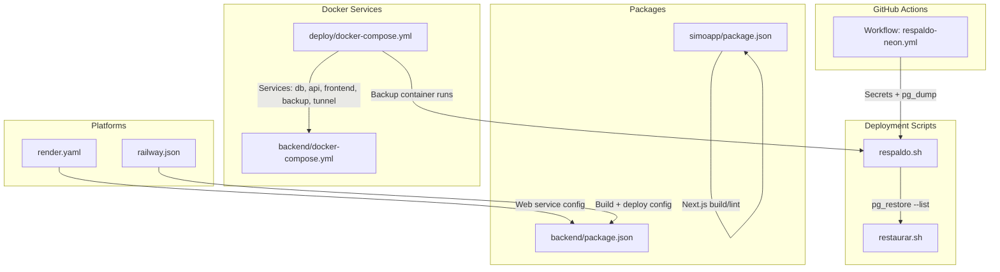
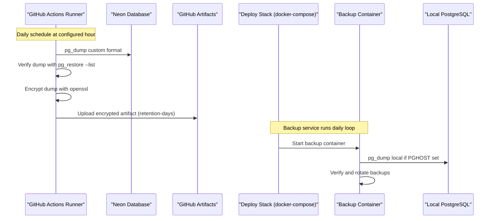
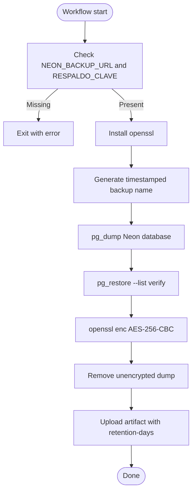
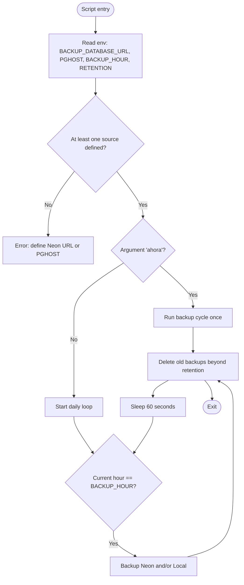
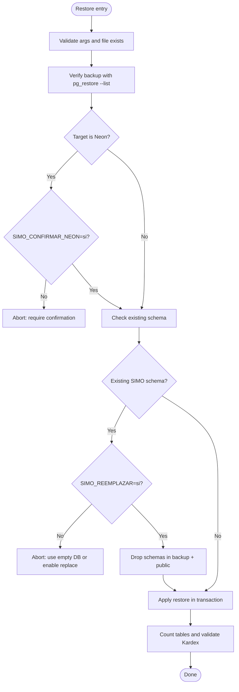
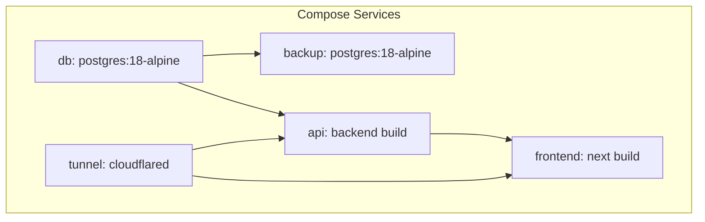
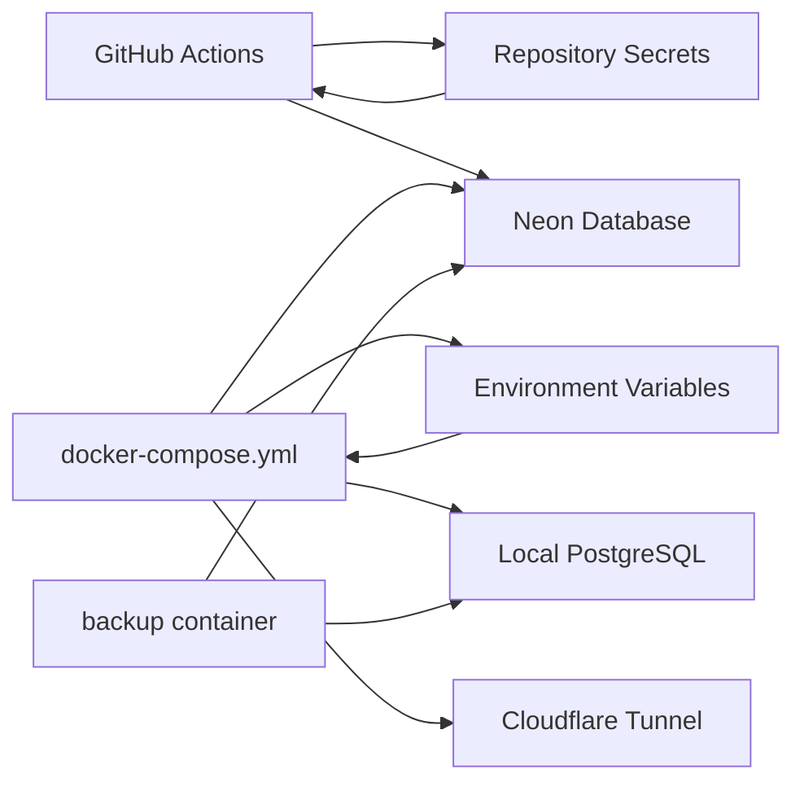

# CI/CD Pipelines

<cite>
**Referenced Files in This Document**
- [respaldo-neon.yml](file://.github/workflows/respaldo-neon.yml)
- [respaldo.sh](file://deploy/backup/respaldo.sh)
- [restaurar.sh](file://deploy/backup/restaurar.sh)
- [docker-compose.yml](file://deploy/docker-compose.yml)
- [backend docker-compose.yml](file://backend/docker-compose.yml)
- [render.yaml](file://render.yaml)
- [railway.json](file://railway.json)
- [backend package.json](file://backend/package.json)
- [simoapp package.json](file://simoapp/package.json)
</cite>

## Table of Contents
1. [Introduction](#introduction)
2. [Project Structure](#project-structure)
3. [Core Components](#core-components)
4. [Architecture Overview](#architecture-overview)
5. [Detailed Component Analysis](#detailed-component-analysis)
6. [Dependency Analysis](#dependency-analysis)
7. [Performance Considerations](#performance-considerations)
8. [Troubleshooting Guide](#troubleshooting-guide)
9. [Conclusion](#conclusion)
10. [Appendices](#appendices)

## Introduction
This document describes the CI/CD pipelines for SIMO, with a focus on GitHub Actions and the automated backup workflow for the Neon database. It explains how backups are scheduled, verified, encrypted, and stored as artifacts; how local and Neon backups are managed by deployment scripts; and how build, test, and deployment configurations are organized across Docker Compose, Render, and Railway. It also provides guidance for extending the repository with additional GitHub Actions workflows for code quality checks, unit testing, integration testing, environment-specific deployments, rollback procedures, secret management, and performance optimization.

## Project Structure
The repository contains:
- A single GitHub Actions workflow that performs daily encrypted backups of the Neon database.
- Deployment scripts for backing up and restoring PostgreSQL databases locally or via Neon.
- Docker Compose files for local development and deployment, including a dedicated backup service.
- Platform configuration files for Render and Railway.
- Backend and frontend package manifests defining available scripts for linting, building, and testing.

**Diagram sources**
- [respaldo-neon.yml:1-58](file://.github/workflows/respaldo-neon.yml#L1-L58)
- [respaldo.sh:1-89](file://deploy/backup/respaldo.sh#L1-L89)
- [restaurar.sh:1-77](file://deploy/backup/restaurar.sh#L1-L77)
- [docker-compose.yml:1-120](file://deploy/docker-compose.yml#L1-L120)
- [backend docker-compose.yml:1-41](file://backend/docker-compose.yml#L1-L41)
- [render.yaml:1-13](file://render.yaml#L1-L13)
- [railway.json:1-14](file://railway.json#L1-L14)
- [backend package.json:1-38](file://backend/package.json#L1-L38)
- [simoapp package.json:1-29](file://simoapp/package.json#L1-L29)

**Section sources**
- [respaldo-neon.yml:1-58](file://.github/workflows/respaldo-neon.yml#L1-L58)
- [docker-compose.yml:1-120](file://deploy/docker-compose.yml#L1-L120)
- [backend docker-compose.yml:1-41](file://backend/docker-compose.yml#L1-L41)
- [render.yaml:1-13](file://render.yaml#L1-L13)
- [railway.json:1-14](file://railway.json#L1-L14)
- [backend package.json:1-38](file://backend/package.json#L1-L38)
- [simoapp package.json:1-29](file://simoapp/package.json#L1-L29)

## Core Components
- GitHub Actions backup workflow: schedules a daily job, validates secrets, dumps the Neon database, verifies the dump, encrypts it, and uploads it as an artifact.
- Backup script: orchestrates daily backups of Neon and/or local PostgreSQL, verifies each dump, and cleans old backups based on retention policy.
- Restore script: safely restores a backup into a target database, optionally replacing schemas, and validates restored data.
- Docker Compose deployment: defines services for database, API, frontend, backup, and Cloudflare Tunnel, with health checks and secure port bindings.
- Platform configs: Render web service definition and Railway build/deploy metadata.
- Package scripts: backend tests and frontend build/lint commands used by future CI steps.

**Section sources**
- [respaldo-neon.yml:1-58](file://.github/workflows/respaldo-neon.yml#L1-L58)
- [respaldo.sh:1-89](file://deploy/backup/respaldo.sh#L1-L89)
- [restaurar.sh:1-77](file://deploy/backup/restaurar.sh#L1-L77)
- [docker-compose.yml:1-120](file://deploy/docker-compose.yml#L1-L120)
- [render.yaml:1-13](file://render.yaml#L1-L13)
- [railway.json:1-14](file://railway.json#L1-L14)
- [backend package.json:1-38](file://backend/package.json#L1-L38)
- [simoapp package.json:1-29](file://simoapp/package.json#L1-L29)

## Architecture Overview
The current CI/CD architecture centers on a scheduled GitHub Actions job that backs up the production Neon database. The same backup logic is mirrored in the deployment stack through a dedicated backup container running the shared script. Restoration is handled by a separate script that enforces safety checks before applying changes.

**Diagram sources**
- [respaldo-neon.yml:16-58](file://.github/workflows/respaldo-neon.yml#L16-L58)
- [respaldo.sh:21-89](file://deploy/backup/respaldo.sh#L21-L89)
- [docker-compose.yml:82-106](file://deploy/docker-compose.yml#L82-L106)

## Detailed Component Analysis

### GitHub Actions Neon Backup Workflow
The workflow performs the following:
- Triggers:
  - Scheduled execution using a cron expression.
  - Manual trigger via workflow_dispatch.
- Environment:
  - Runs on Ubuntu latest inside a PostgreSQL Alpine container to use pg_dump/pg_restore.
- Secrets:
  - NEON_BACKUP_URL: direct connection string to Neon (without pooler).
  - RESPALDO_CLAVE: passphrase used to encrypt backups.
- Steps:
  - Validate presence of required secrets.
  - Install OpenSSL.
  - Generate a timestamped filename.
  - Create a directory for backups.
  - Dump the Neon database in custom format without owner/privileges.
  - Verify the dump by listing its contents.
  - Encrypt the dump file using AES-256-CBC with PBKDF2.
  - Remove the unencrypted dump.
  - Export the generated name to GITHUB_ENV.
  - Upload the encrypted backup as an artifact with a 14-day retention.

**Diagram sources**
- [respaldo-neon.yml:24-58](file://.github/workflows/respaldo-neon.yml#L24-L58)

**Section sources**
- [respaldo-neon.yml:1-58](file://.github/workflows/respaldo-neon.yml#L1-L58)

### Backup Script (respaldo.sh)
Responsibilities:
- Accepts optional immediate mode argument to run once.
- Reads configuration from environment variables:
  - BACKUP_DATABASE_URL for Neon.
  - PGHOST, PGUSER, PGPASSWORD, PGDATABASE for local PostgreSQL.
  - BACKUP_HOUR and BACKUP_RETENTION_DAYS for scheduling and rotation.
- Creates backups:
  - Writes to a temporary file first, then renames after successful verification.
  - Verifies each dump using pg_restore --list.
- Cleans old backups beyond retention period.
- Provides logging for created and deleted backups.

**Diagram sources**
- [respaldo.sh:19-89](file://deploy/backup/respaldo.sh#L19-L89)

**Section sources**
- [respaldo.sh:1-89](file://deploy/backup/respaldo.sh#L1-L89)

### Restore Script (restaurar.sh)
Responsibilities:
- Validates arguments and backup file integrity.
- Enforces safety rules:
  - Requires explicit confirmation when restoring to Neon.
  - Prevents restoring onto a database already containing SIMO schema unless replacement is explicitly enabled.
- Performs cleanup:
  - Drops schemas present in the backup plus public, then recreates public within a transaction.
- Applies restore:
  - Converts backup to SQL and applies via psql in a single transaction.
- Post-restore validation:
  - Counts key tables and runs a Kardex validation function to ensure consistency.

**Diagram sources**
- [restaurar.sh:20-77](file://deploy/backup/restaurar.sh#L20-L77)

**Section sources**
- [restaurar.sh:1-77](file://deploy/backup/restaurar.sh#L1-L77)

### Docker Compose Deployment
Key aspects:
- Services:
  - db: PostgreSQL with initialization scripts and seed support.
  - api: Node.js API built from backend, depending on healthy db.
  - frontend: Next.js app built from simoapp using a custom Dockerfile.
  - backup: PostgreSQL Alpine image running the backup script daily.
  - tunnel: Cloudflare Tunnel for secure external access.
- Security:
  - Ports bound to localhost only.
  - External access via Cloudflare Tunnel token.
- Health checks:
  - Database readiness via pg_isready.
  - API health endpoint.
  - Frontend login page availability.
- Backup service:
  - Mounts backup scripts read-only.
  - Persists backups to host volume.
  - Uses timezone settings aligned with Colombia time.

**Diagram sources**
- [docker-compose.yml:14-116](file://deploy/docker-compose.yml#L14-L116)

**Section sources**
- [docker-compose.yml:1-120](file://deploy/docker-compose.yml#L1-L120)

### Platform Configurations
- Render:
  - Defines a web service for the backend with Node runtime.
  - Specifies build and start commands.
  - Expects DATABASE_URL to be configured manually in the dashboard.
- Railway:
  - Uses Dockerfile builder pointing to backend/Dockerfile.
  - Defines start command and healthcheck path.
  - Configures restart policy and retries.

**Section sources**
- [render.yaml:1-13](file://render.yaml#L1-L13)
- [railway.json:1-14](file://railway.json#L1-L14)

### Package Scripts for Future CI Stages
- Backend:
  - test: Jest unit tests.
  - test:integracion: Integration tests under tests/integracion.
  - start/dev: Application startup and development server.
- Frontend:
  - build: Next.js build.
  - lint: ESLint.
  - dev/start: Development and production servers.

These scripts can be integrated into GitHub Actions workflows to implement code quality checks, unit testing, and integration testing stages.

**Section sources**
- [backend package.json:6-36](file://backend/package.json#L6-L36)
- [simoapp package.json:5-27](file://simoapp/package.json#L5-L27)

## Dependency Analysis
The current CI/CD setup has minimal coupling:
- The GitHub Actions workflow depends on Neon credentials and encryption passphrase stored as repository secrets.
- The deployment stack depends on environment variables for database connections, application passwords, and Cloudflare Tunnel tokens.
- The backup script depends on PostgreSQL client tools and environment variables for both Neon and local databases.
- Platform configurations depend on their respective dashboards for secret management.

**Diagram sources**
- [respaldo-neon.yml:31-33](file://.github/workflows/respaldo-neon.yml#L31-L33)
- [docker-compose.yml:19-25](file://deploy/docker-compose.yml#L19-L25)
- [docker-compose.yml:89-99](file://deploy/docker-compose.yml#L89-L99)

**Section sources**
- [respaldo-neon.yml:1-58](file://.github/workflows/respaldo-neon.yml#L1-L58)
- [docker-compose.yml:1-120](file://deploy/docker-compose.yml#L1-L120)

## Performance Considerations
- Use PostgreSQL Alpine images to reduce image size and improve pull times.
- Leverage custom dump format for faster backups and restores.
- Verify dumps immediately after creation to fail fast on corruption.
- Encrypt backups efficiently with PBKDF2 iterations tuned for security vs. speed trade-offs.
- Cache dependencies in future CI workflows to speed up builds.
- Parallelize independent jobs (e.g., lint, unit tests, integration tests) to reduce total pipeline duration.
- Limit artifact retention to necessary periods to avoid storage overhead.

[No sources needed since this section provides general guidance]

## Troubleshooting Guide
Common issues and resolutions:
- Missing secrets in GitHub Actions:
  - Ensure NEON_BACKUP_URL and RESPALDO_CLAVE are defined in repository secrets.
  - The workflow exits early if either is missing.
- Invalid or corrupted backup:
  - The restore script requires a valid backup index; otherwise, it aborts.
  - Always verify backups with pg_restore --list before restoration.
- Restoring to Neon:
  - Requires explicit confirmation variable to prevent accidental writes to production.
- Restoring onto existing schema:
  - Requires explicit replacement flag to drop and recreate schemas within a transaction.
- Backup service not running:
  - Verify docker-compose environment variables for Neon URL and local PostgreSQL connection.
  - Check logs from the backup container for errors during pg_dump or cleanup.

**Section sources**
- [respaldo-neon.yml:31-39](file://.github/workflows/respaldo-neon.yml#L31-L39)
- [restaurar.sh:22-38](file://deploy/backup/restaurar.sh#L22-L38)
- [restaurar.sh:40-52](file://deploy/backup/restaurar.sh#L40-L52)
- [respaldo.sh:60-63](file://deploy/backup/respaldo.sh#L60-L63)

## Conclusion
SIMO’s CI/CD currently focuses on reliable, encrypted backups of the Neon database via GitHub Actions and robust backup/restore operations within the deployment stack. The Docker Compose configuration provides a secure, health-checked local and deployment environment, while platform definitions for Render and Railway outline deployment expectations. Extending the repository with additional GitHub Actions workflows will enable comprehensive code quality checks, unit and integration testing, environment-specific deployments, and automated rollbacks, further strengthening operational reliability.

[No sources needed since this section summarizes without analyzing specific files]

## Appendices

### Example Custom Workflow Configuration Patterns
- Code Quality Checks:
  - Add a job that installs dependencies and runs ESLint for the frontend and any backend linters.
- Unit Testing:
  - Add a job that runs Jest for backend unit tests.
- Integration Testing:
  - Add a job that starts a PostgreSQL service, applies migrations, seeds data, and runs integration tests against a real database.
- Automated Deployments:
  - Add jobs that deploy to staging and production environments, gated by branch protection and manual approvals.
- Rollback Procedures:
  - Add a job that triggers the restore script against a designated rollback database, followed by smoke tests.

[No sources needed since this section provides conceptual guidance]

### Environment-Specific Deployments
- Staging:
  - Use a separate Neon project or branch-scoped database.
  - Configure environment variables for staging endpoints and feature flags.
- Production:
  - Restrict deployments to main branch with approval gates.
  - Require explicit confirmation variables for destructive operations like schema replacement.

[No sources needed since this section provides conceptual guidance]

### Pipeline Security and Secret Management
- Store all sensitive values in GitHub repository secrets or platform dashboards.
- Avoid printing secrets in logs; mask them where possible.
- Use least-privilege roles for database connections (e.g., simo_app role instead of superuser).
- Restrict workflow permissions to minimum required scopes.

**Section sources**
- [respaldo-neon.yml:7-13](file://.github/workflows/respaldo-neon.yml#L7-L13)
- [docker-compose.yml:43-53](file://deploy/docker-compose.yml#L43-L53)
- [docker-compose.yml:112-114](file://deploy/docker-compose.yml#L112-L114)