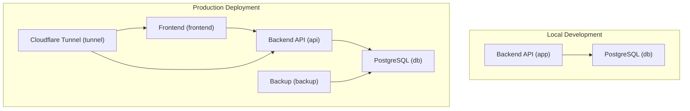
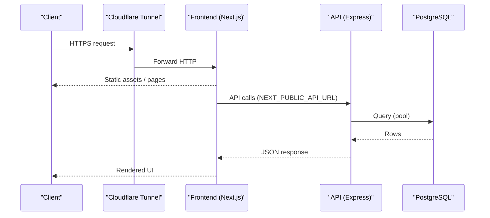
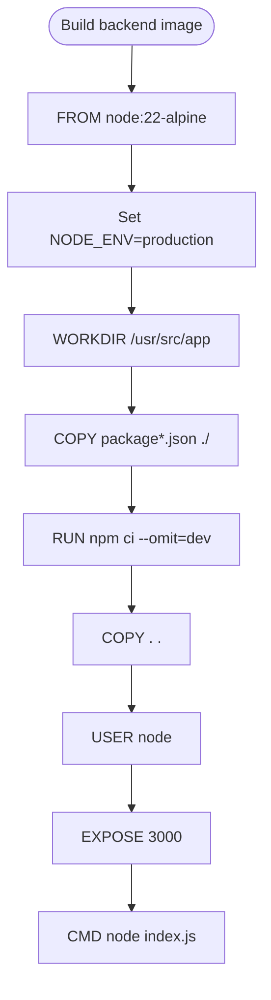
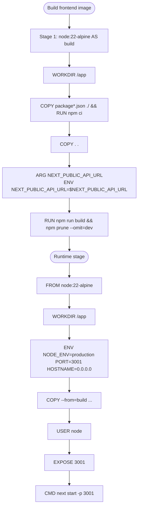
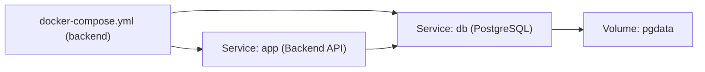
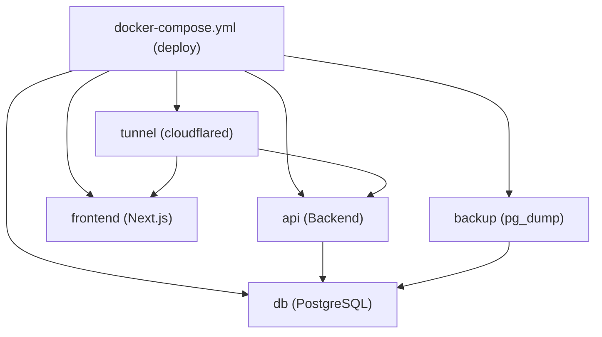
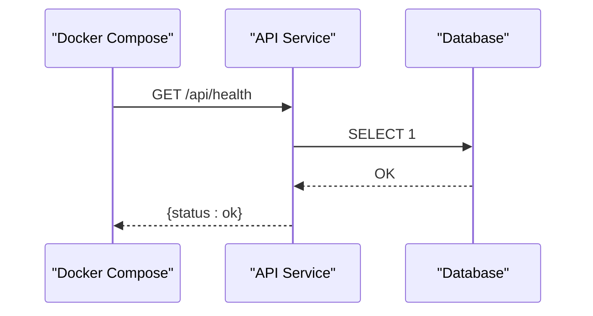
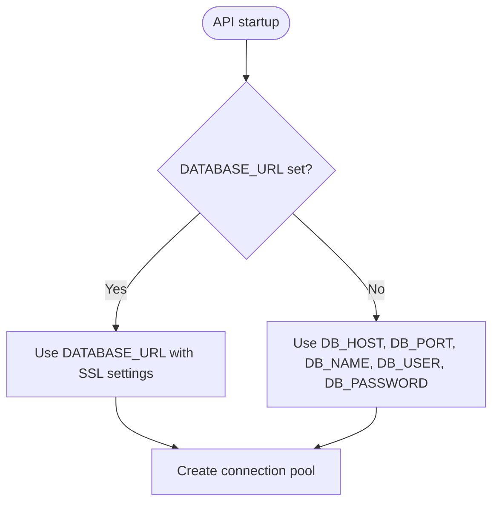
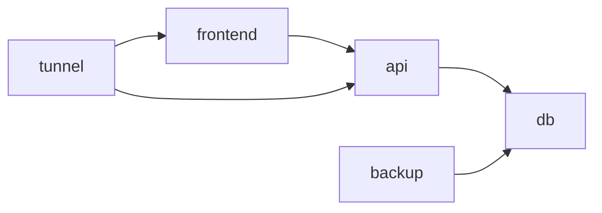

# Containerization with Docker

<cite>
**Referenced Files in This Document**
- [backend/Dockerfile](file://backend/Dockerfile)
- [deploy/frontend/Dockerfile](file://deploy/frontend/Dockerfile)
- [backend/docker-compose.yml](file://backend/docker-compose.yml)
- [deploy/docker-compose.yml](file://deploy/docker-compose.yml)
- [backend/.dockerignore](file://backend/.dockerignore)
- [deploy/frontend/Dockerfile.dockerignore](file://deploy/frontend/Dockerfile.dockerignore)
- [backend/index.js](file://backend/index.js)
- [backend/src/config/db.js](file://backend/src/config/db.js)
- [backend/db/index.js](file://backend/db/index.js)
- [railway.json](file://railway.json)
- [deploy/README.md](file://deploy/README.md)
</cite>

## Table of Contents
1. [Introduction](#introduction)
2. [Project Structure](#project-structure)
3. [Core Components](#core-components)
4. [Architecture Overview](#architecture-overview)
5. [Detailed Component Analysis](#detailed-component-analysis)
6. [Dependency Analysis](#dependency-analysis)
7. [Performance Considerations](#performance-considerations)
8. [Troubleshooting Guide](#troubleshooting-guide)
9. [Conclusion](#conclusion)

## Introduction
This document explains SIMO’s containerization strategy using Docker and Docker Compose. It covers the multi-stage build for the backend and frontend, optimization techniques, security considerations, environment configuration, health checks, and operational guidance for local development and production deployments.

## Project Structure
SIMO ships two distinct containerized applications:
- Backend API (Node.js + Express)
- Frontend web app (Next.js)

Both are built from lightweight Alpine-based Node images and orchestrated via Docker Compose. The repository includes:
- A development-oriented compose file under `backend/`
- A production-oriented compose file under `deploy/` that also provisions a backup service and a Cloudflare tunnel

**Diagram sources**
- [backend/docker-compose.yml:3-37](file://backend/docker-compose.yml#L3-L37)
- [deploy/docker-compose.yml:14-116](file://deploy/docker-compose.yml#L14-L116)

**Section sources**
- [backend/docker-compose.yml:1-41](file://backend/docker-compose.yml#L1-L41)
- [deploy/docker-compose.yml:1-120](file://deploy/docker-compose.yml#L1-L120)

## Core Components
- Backend image: single-stage build optimized for production runtime.
- Frontend image: multi-stage build separating compilation and runtime to minimize final image size.
- Local development compose: runs PostgreSQL and the backend API locally.
- Production compose: runs database, API, frontend, automated backups, and a Cloudflare tunnel; exposes only loopback ports and routes external traffic through Cloudflare.

Key characteristics:
- Alpine-based Node images for smaller footprint.
- Non-root user execution inside containers.
- Health checks for database, API, and frontend.
- Environment-driven configuration supporting both local and cloud databases.

**Section sources**
- [backend/Dockerfile:1-26](file://backend/Dockerfile#L1-L26)
- [deploy/frontend/Dockerfile:1-33](file://deploy/frontend/Dockerfile#L1-L33)
- [backend/docker-compose.yml:1-41](file://backend/docker-compose.yml#L1-L41)
- [deploy/docker-compose.yml:1-120](file://deploy/docker-compose.yml#L1-L120)

## Architecture Overview
The production deployment uses Docker Compose to orchestrate services:
- Database: PostgreSQL 18 on Alpine, with initialization scripts and persistent volumes.
- API: Node 22 Express server, connecting to either a local or cloud database depending on environment variables.
- Frontend: Next.js application compiled in a dedicated build stage and served in a minimal runtime image.
- Backup: Scheduled pg_dump jobs writing to a host-mounted directory.
- Tunnel: Cloudflared container publishing services securely via Cloudflare.

**Diagram sources**
- [deploy/docker-compose.yml:39-80](file://deploy/docker-compose.yml#L39-L80)
- [deploy/frontend/Dockerfile:14-18](file://deploy/frontend/Dockerfile#L14-L18)
- [backend/src/config/db.js:17-26](file://backend/src/config/db.js#L17-L26)

## Detailed Component Analysis

### Backend Image (Single-Stage Build)
The backend Dockerfile:
- Uses a lightweight Node 22 Alpine base image.
- Sets production environment variables.
- Copies dependency manifests first to leverage layer caching.
- Installs only production dependencies.
- Copies application code and switches to non-root user.
- Exposes port 3000 and starts the process directly with node.

Optimizations and security:
- Layer caching by copying package files before source code.
- Production-only dependencies reduce image size and attack surface.
- Non-root user reduces privilege escalation risk.
- Direct CMD avoids extra shell overhead.

**Diagram sources**
- [backend/Dockerfile:1-26](file://backend/Dockerfile#L1-L26)

**Section sources**
- [backend/Dockerfile:1-26](file://backend/Dockerfile#L1-L26)
- [backend/.dockerignore:1-12](file://backend/.dockerignore#L1-L12)

### Frontend Image (Multi-Stage Build)
The frontend Dockerfile defines two stages:
- Build stage: installs dependencies, copies source, sets NEXT_PUBLIC_API_URL at build time, builds the Next.js app, and prunes dev dependencies.
- Runtime stage: copies only necessary artifacts (package.json, node_modules, .next, public), sets production environment variables, and starts Next.js on port 3001.

Optimizations and security:
- Multi-stage build ensures no build-time tooling leaks into the runtime image.
- Pruning dev dependencies reduces image size.
- Non-root user execution.
- Explicitly disabled telemetry to avoid network calls during runtime.

**Diagram sources**
- [deploy/frontend/Dockerfile:1-33](file://deploy/frontend/Dockerfile#L1-L33)

**Section sources**
- [deploy/frontend/Dockerfile:1-33](file://deploy/frontend/Dockerfile#L1-L33)
- [deploy/frontend/Dockerfile.dockerignore:1-5](file://deploy/frontend/Dockerfile.dockerignore#L1-L5)

### Local Development Compose
The development compose file:
- Runs PostgreSQL with an Alpine image, exposing the database only on localhost.
- Initializes the database using scripts mounted read-only into the entrypoint directory.
- Builds and runs the backend API, binding it to localhost:3000.
- Persists database data in a named volume.

Networking and volumes:
- Database is reachable by the API via the service name db.
- Data persistence is handled by a Docker volume.
- Initialization scripts run once when the volume is empty.

**Diagram sources**
- [backend/docker-compose.yml:3-22](file://backend/docker-compose.yml#L3-L22)
- [backend/docker-compose.yml:23-37](file://backend/docker-compose.yml#L23-L37)
- [backend/docker-compose.yml:39-41](file://backend/docker-compose.yml#L39-L41)

**Section sources**
- [backend/docker-compose.yml:1-41](file://backend/docker-compose.yml#L1-L41)

### Production Compose
The production compose file orchestrates:
- Database with health check and initialization scripts.
- API with health check against `/api/health`.
- Frontend with health check against `/login`.
- Backup service running scheduled dumps.
- Cloudflare tunnel for secure external access.

Service relationships:
- API depends on a healthy database.
- Frontend depends on the API being available (via NEXT_PUBLIC_API_URL).
- Backup depends on a healthy database.
- Tunnel depends on a healthy database and publishes services according to Cloudflare configuration.

**Diagram sources**
- [deploy/docker-compose.yml:14-116](file://deploy/docker-compose.yml#L14-L116)

**Section sources**
- [deploy/docker-compose.yml:1-120](file://deploy/docker-compose.yml#L1-L120)

### Health Checks and Endpoints
- API health endpoint returns a status indicating whether the database connection is available.
- Docker Compose health checks probe:
  - Database readiness using a database utility command.
  - API readiness by fetching `/api/health`.
  - Frontend readiness by fetching `/login`.

**Diagram sources**
- [backend/index.js:63-70](file://backend/index.js#L63-L70)
- [deploy/docker-compose.yml:59-63](file://deploy/docker-compose.yml#L59-L63)

**Section sources**
- [backend/index.js:63-70](file://backend/index.js#L63-L70)
- [deploy/docker-compose.yml:33-37](file://deploy/docker-compose.yml#L33-L37)
- [deploy/docker-compose.yml:59-63](file://deploy/docker-compose.yml#L59-L63)
- [deploy/docker-compose.yml:76-80](file://deploy/docker-compose.yml#L76-L80)

### Environment Variables and Configuration
The backend supports two connection modes:
- DATABASE_URL: preferred for cloud databases (e.g., Neon), with SSL handling based on environment flags.
- DB_HOST, DB_PORT, DB_NAME, DB_USER, DB_PASSWORD: used for local or Docker-hosted databases.

Environment variable precedence:
- If DATABASE_URL is set, it takes precedence over individual DB_* variables.
- SSL behavior can be toggled via DB_SSL.

Frontend build-time configuration:
- NEXT_PUBLIC_API_URL is passed as a build argument and embedded into the client bundle at build time.

**Diagram sources**
- [backend/src/config/db.js:17-26](file://backend/src/config/db.js#L17-L26)

**Section sources**
- [backend/src/config/db.js:1-28](file://backend/src/config/db.js#L1-L28)
- [deploy/docker-compose.yml:43-53](file://deploy/docker-compose.yml#L43-L53)
- [deploy/frontend/Dockerfile:14-18](file://deploy/frontend/Dockerfile#L14-L18)

### Security Considerations
- Images run as non-root users.
- Only loopback ports are published in both development and production compose files.
- External access is routed through Cloudflare Tunnel, not direct port exposure.
- Database credentials are managed via environment variables and not committed to version control.
- The API uses a least-privilege database role (`simo_app`) in production.

Operational notes:
- `.env` files and backup directories are excluded from version control.
- Database initialization scripts are mounted read-only.

**Section sources**
- [backend/Dockerfile:18-25](file://backend/Dockerfile#L18-L25)
- [deploy/frontend/Dockerfile:30-32](file://deploy/frontend/Dockerfile#L30-L32)
- [backend/docker-compose.yml:13-21](file://backend/docker-compose.yml#L13-L21)
- [deploy/docker-compose.yml:26-32](file://deploy/docker-compose.yml#L26-L32)
- [deploy/docker-compose.yml:54-55](file://deploy/docker-compose.yml#L54-L55)
- [deploy/docker-compose.yml:74-75](file://deploy/docker-compose.yml#L74-L75)
- [deploy/README.md:208-215](file://deploy/README.md#L208-L215)

### Customizing Docker Images
- Backend customization:
  - Adjust dependencies by editing package files; rebuild with `docker compose build`.
  - Add new environment variables in the compose file or via `.env`.
- Frontend customization:
  - Change NEXT_PUBLIC_API_URL at build time via Docker Compose args.
  - Rebuild only the frontend service after changes.

Example commands:
- Build and start local development: `cd backend && docker compose up --build`
- Build and start production: `cd deploy && docker compose up -d --build`

**Section sources**
- [backend/docker-compose.yml:23-37](file://backend/docker-compose.yml#L23-L37)
- [deploy/docker-compose.yml:65-75](file://deploy/docker-compose.yml#L65-L75)

### Managing Environment Variables in Containers
- Local development:
  - Database credentials and seed flags are provided via environment variables in the compose file.
  - API binds to localhost:3000.
- Production:
  - Database credentials and timezone are configured via environment variables.
  - API connects to either a local database or a cloud database depending on DATABASE_URL.
  - Frontend receives NEXT_PUBLIC_API_URL at build time.

Best practices:
- Store secrets in `.env` files and ensure they are ignored by version control.
- Use explicit defaults in compose files for convenience while enforcing required values where appropriate.

**Section sources**
- [backend/docker-compose.yml:8-12](file://backend/docker-compose.yml#L8-L12)
- [backend/docker-compose.yml:29-35](file://backend/docker-compose.yml#L29-L35)
- [deploy/docker-compose.yml:19-25](file://deploy/docker-compose.yml#L19-L25)
- [deploy/docker-compose.yml:43-53](file://deploy/docker-compose.yml#L43-L53)
- [deploy/docker-compose.yml:69-71](file://deploy/docker-compose.yml#L69-L71)

### Implementing Health Checks
- Database health check uses a database readiness command.
- API health check fetches `/api/health`, which verifies database connectivity.
- Frontend health check fetches `/login`.

Recommendations:
- Keep health endpoints lightweight and fast.
- Include dependency checks (like database connectivity) in health responses.
- Configure reasonable intervals, timeouts, and retries.

**Section sources**
- [deploy/docker-compose.yml:33-37](file://deploy/docker-compose.yml#L33-L37)
- [deploy/docker-compose.yml:59-63](file://deploy/docker-compose.yml#L59-L63)
- [deploy/docker-compose.yml:76-80](file://deploy/docker-compose.yml#L76-L80)
- [backend/index.js:63-70](file://backend/index.js#L63-L70)

### Debugging Containerized Applications
- View logs:
  - `docker compose logs -f <service>`
- Inspect running containers:
  - `docker compose ps`
- Execute commands inside containers:
  - `docker compose exec <service> <command>`
- Verify API health locally:
  - `curl http://localhost:3000/api/health`

Operational tips:
- Ensure services are healthy before accessing them externally.
- For database issues, verify environment variables and network reachability between services.

**Section sources**
- [deploy/README.md:87-99](file://deploy/README.md#L87-L99)
- [deploy/README.md:101-125](file://deploy/README.md#L101-L125)

## Dependency Analysis
The following diagram shows how services depend on each other in the production deployment:

**Diagram sources**
- [deploy/docker-compose.yml:56-58](file://deploy/docker-compose.yml#L56-L58)
- [deploy/docker-compose.yml:103-105](file://deploy/docker-compose.yml#L103-L105)
- [deploy/docker-compose.yml:114-116](file://deploy/docker-compose.yml#L114-L116)

**Section sources**
- [deploy/docker-compose.yml:56-58](file://deploy/docker-compose.yml#L56-L58)
- [deploy/docker-compose.yml:103-105](file://deploy/docker-compose.yml#L103-L105)
- [deploy/docker-compose.yml:114-116](file://deploy/docker-compose.yml#L114-L116)

## Performance Considerations
- Use Alpine-based images to reduce image size and attack surface.
- Separate build and runtime stages for the frontend to exclude build tools from the final image.
- Install only production dependencies in the backend to minimize image size.
- Leverage Docker layer caching by copying dependency manifests before source code.
- Disable telemetry in production environments to avoid unnecessary network calls.

[No sources needed since this section provides general guidance]

## Troubleshooting Guide
Common issues and resolutions:
- Database not ready:
  - Verify health check status and environment variables.
  - Ensure initialization scripts are mounted correctly.
- API cannot connect to database:
  - Confirm DATABASE_URL or DB_* variables are set correctly.
  - Check SSL settings if using a cloud database.
- Frontend cannot reach API:
  - Validate NEXT_PUBLIC_API_URL is set at build time.
  - Ensure the API service is healthy and accessible within the Docker network.
- Port conflicts:
  - Avoid running both development and production compose stacks simultaneously on the same machine.

Operational references:
- Logs inspection and service management commands.
- Steps to apply migrations and manage backups.

**Section sources**
- [deploy/README.md:87-99](file://deploy/README.md#L87-L99)
- [deploy/README.md:127-139](file://deploy/README.md#L127-L139)
- [deploy/README.md:141-206](file://deploy/README.md#L141-L206)

## Conclusion
SIMO’s containerization leverages lightweight Alpine images, multi-stage builds, and Docker Compose to deliver a secure, efficient, and maintainable deployment. The setup supports both local development and production operations, with robust health checks, environment-driven configuration, and clear separation of concerns across services. Following the documented best practices will help you customize images, manage secrets, and troubleshoot effectively.

[No sources needed since this section summarizes without analyzing specific files]