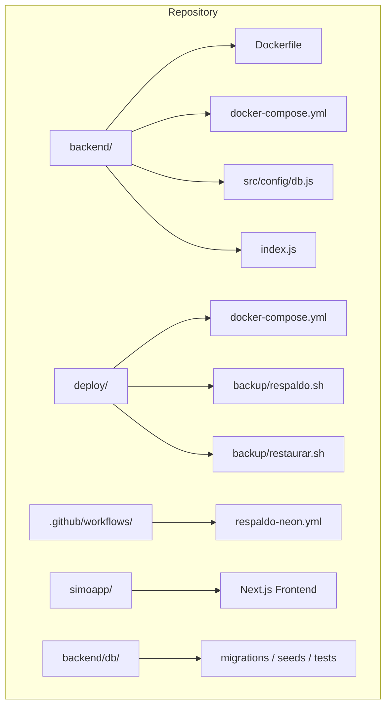
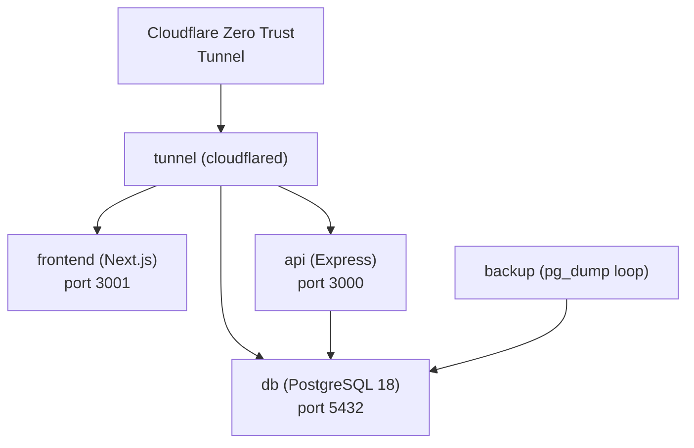
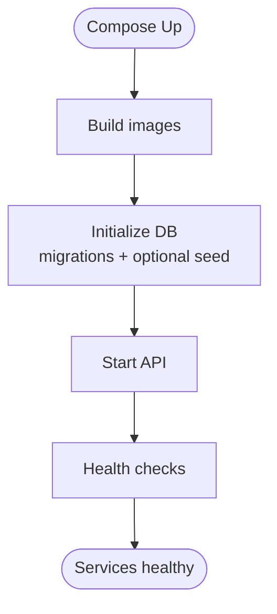
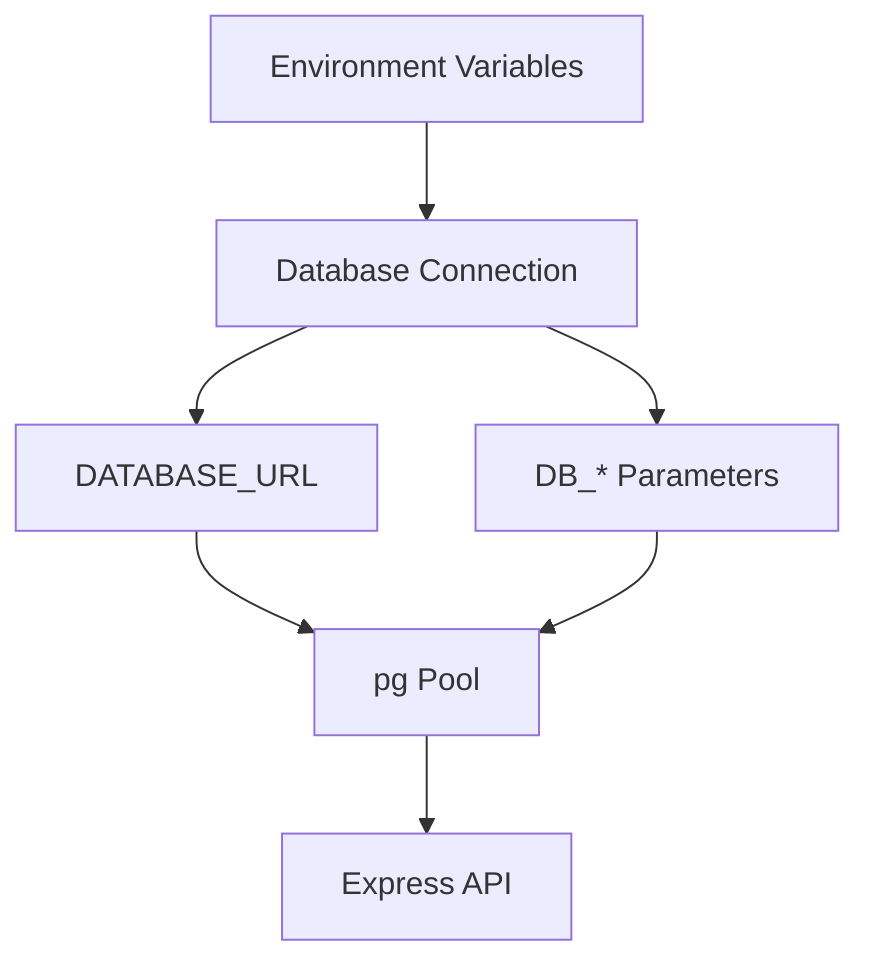
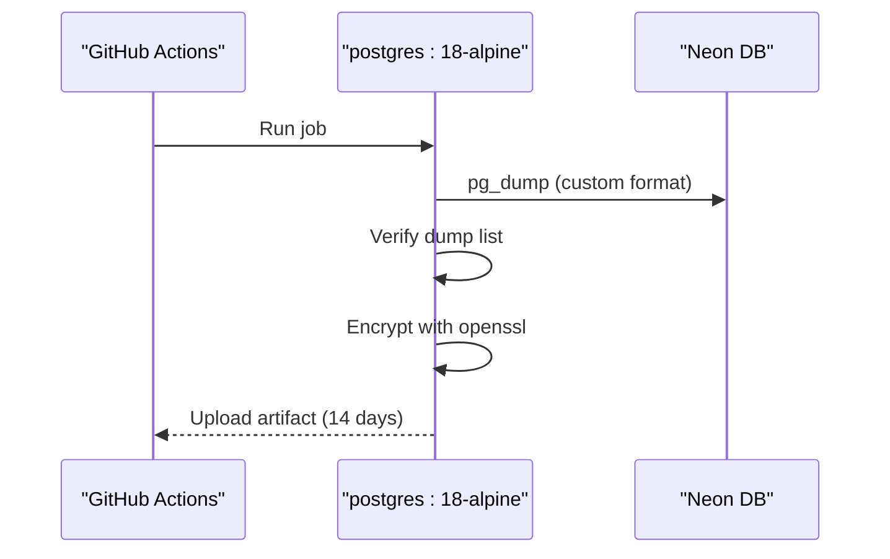
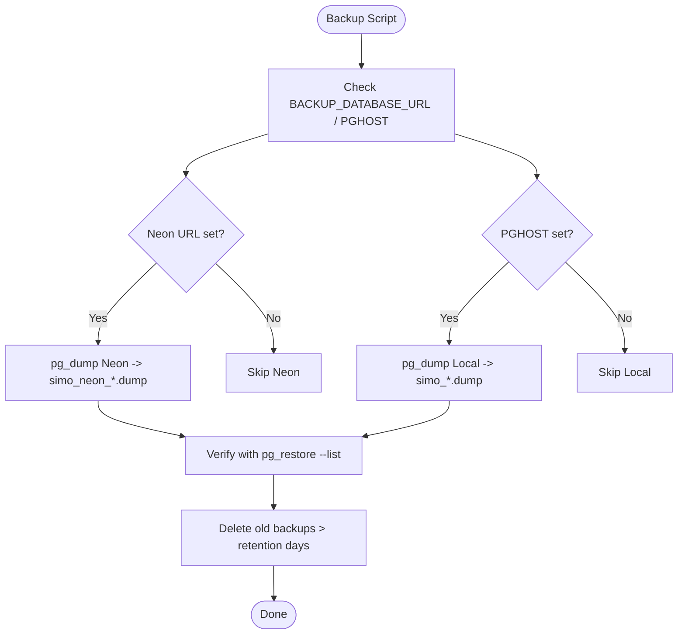
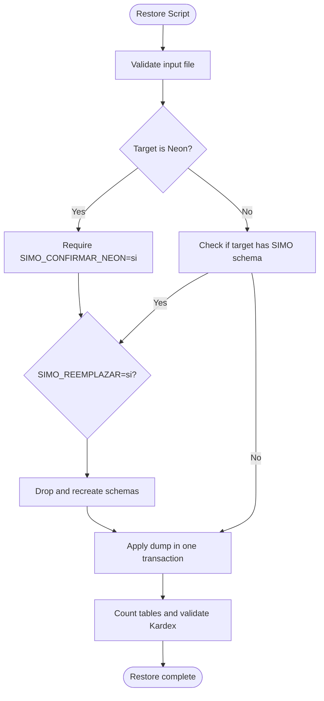
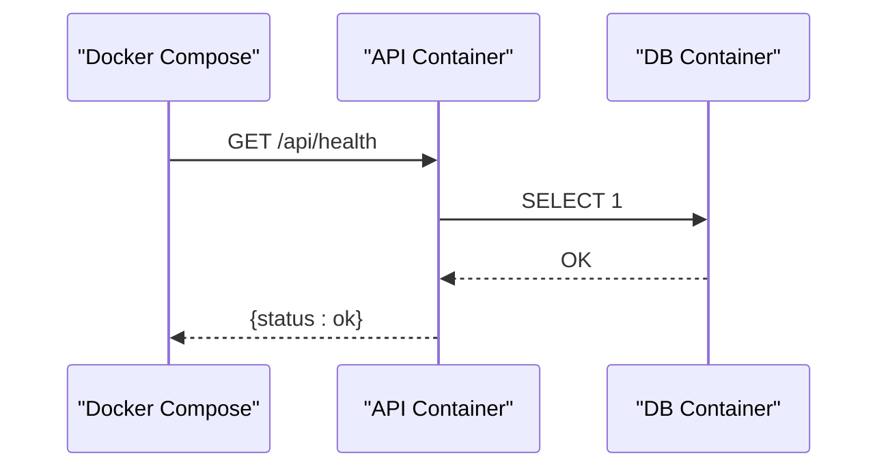
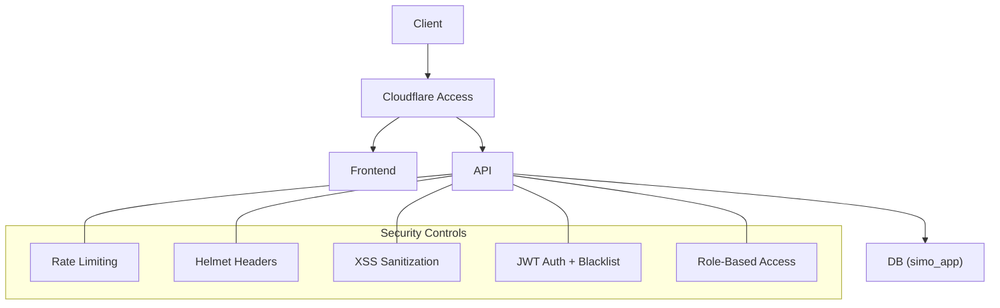
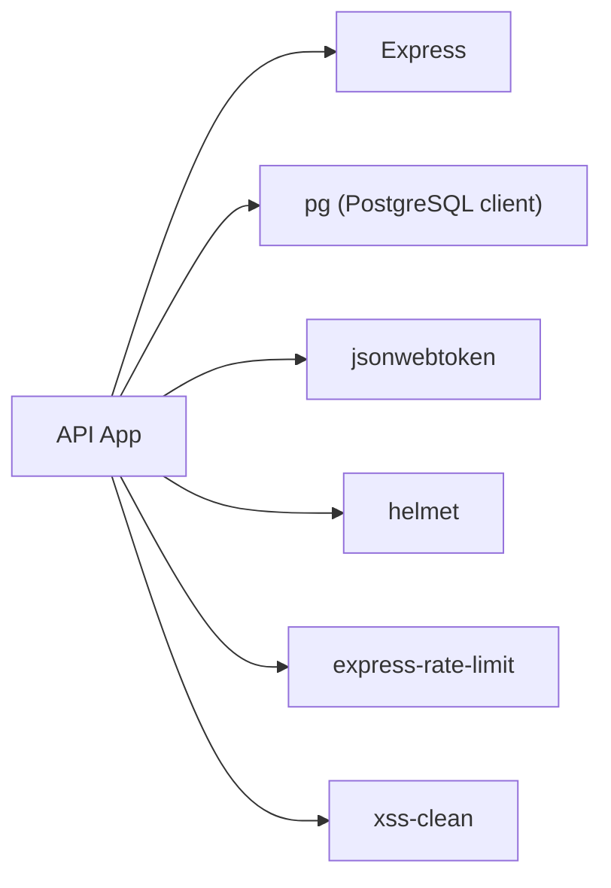

# Deployment & DevOps

<cite>
**Referenced Files in This Document**   
- [README.md](file://README.md)
- [backend/Dockerfile](file://backend/Dockerfile)
- [backend/docker-compose.yml](file://backend/docker-compose.yml)
- [deploy/docker-compose.yml](file://deploy/docker-compose.yml)
- [deploy/README.md](file://deploy/README.md)
- [deploy/backup/respaldo.sh](file://deploy/backup/respaldo.sh)
- [deploy/backup/restaurar.sh](file://deploy/backup/restaurar.sh)
- [.github/workflows/respaldo-neon.yml](file://.github/workflows/respaldo-neon.yml)
- [backend/src/config/db.js](file://backend/src/config/db.js)
- [backend/index.js](file://backend/index.js)
- [backend/package.json](file://backend/package.json)
- [backend/railway.json](file://backend/railway.json)
- [railway.json](file://railway.json)
- [render.yaml](file://render.yaml)
- [backend/db/README.md](file://backend/db/README.md)
</cite>

## Table of Contents
1. [Introduction](#introduction)
2. [Project Structure](#project-structure)
3. [Core Components](#core-components)
4. [Architecture Overview](#architecture-overview)
5. [Detailed Component Analysis](#detailed-component-analysis)
6. [Dependency Analysis](#dependency-analysis)
7. [Performance Considerations](#performance-considerations)
8. [Troubleshooting Guide](#troubleshooting-guide)
9. [Conclusion](#conclusion)
10. [Appendices](#appendices)

## Introduction
This document provides comprehensive deployment and DevOps guidance for SIMO, covering Docker containerization, environment configuration, CI/CD with GitHub Actions, production deployment procedures, database backup and recovery, monitoring and logging, scaling considerations, cloud deployment options, load balancing strategies, disaster recovery, security hardening, performance tuning, and maintenance automation.

SIMO consists of:
- A Node.js Express backend API.
- A Next.js frontend application.
- A PostgreSQL database (local or Neon).
- Optional Cloudflare Tunnel for secure external access.
- Automated daily backups to local storage and encrypted artifacts in GitHub Actions.

The repository includes both a development-oriented Docker Compose setup under `backend/` and a production-oriented setup under `deploy/`.

**Section sources**
- [README.md:27-64](file://README.md#L27-L64)
- [deploy/README.md:1-28](file://deploy/README.md#L1-L28)

## Project Structure
At a high level, the deployment-relevant structure is:

Key responsibilities:
- `backend/Dockerfile`: Builds a minimal Node image for the API.
- `backend/docker-compose.yml`: Development stack with local PostgreSQL and app.
- `deploy/docker-compose.yml`: Production stack with DB, API, frontend, backup, and tunnel.
- `deploy/backup/*`: Backup and restore scripts.
- `.github/workflows/respaldo-neon.yml`: Daily encrypted backups of Neon.
- `backend/src/config/db.js`: Database connection configuration supporting both local and cloud databases.
- `backend/index.js`: API entrypoint exposing health check and routes.

**Diagram sources**
- [backend/Dockerfile:1-26](file://backend/Dockerfile#L1-L26)
- [backend/docker-compose.yml:1-41](file://backend/docker-compose.yml#L1-L41)
- [deploy/docker-compose.yml:1-120](file://deploy/docker-compose.yml#L1-L120)
- [deploy/backup/respaldo.sh:1-89](file://deploy/backup/respaldo.sh#L1-L89)
- [deploy/backup/restaurar.sh:1-77](file://deploy/backup/restaurar.sh#L1-L77)
- [.github/workflows/respaldo-neon.yml:1-58](file://.github/workflows/respaldo-neon.yml#L1-L58)
- [backend/src/config/db.js:1-29](file://backend/src/config/db.js#L1-L29)
- [backend/index.js:1-70](file://backend/index.js#L1-L70)

**Section sources**
- [README.md:27-64](file://README.md#L27-L64)
- [deploy/README.md:1-28](file://deploy/README.md#L1-L28)

## Core Components
- Backend API:
  - Built from `backend/Dockerfile`, runs on port 3000 inside containers.
  - Exposes `/api/health` for health checks.
  - Uses `express-rate-limit`, `helmet`, and XSS sanitization middleware.
- Database:
  - PostgreSQL 18 Alpine image.
  - Migrations and optional seed data are mounted into the init directory.
  - Health check uses `pg_isready`.
- Frontend:
  - Next.js app built via `deploy/frontend/Dockerfile` and served on port 3001.
- Backup service:
  - Runs `respaldo.sh` to back up Neon and/or local database at a configured hour.
  - Verifies dumps and enforces retention policy.
- Cloudflare Tunnel:
  - Publishes services securely without opening router ports.

Environment variables:
- Local development: `DB_USER`, `DB_PASSWORD`, `DB_HOST`, `DB_PORT`, `DB_NAME`, `PORT`, `SIMO_SEED`.
- Production deploy: `POSTGRES_USER`, `POSTGRES_PASSWORD`, `POSTGRES_DB`, `SIMO_APP_PASSWORD`, `DATABASE_URL`, `NEXT_PUBLIC_API_URL`, `CLOUDFLARE_TUNNEL_TOKEN`, `BACKUP_DATABASE_URL`, `PGHOST`, `PGUSER`, `PGPASSWORD`, `PGDATABASE`, `BACKUP_HOUR`, `BACKUP_RETENTION_DAYS`, `TZ`.

**Section sources**
- [backend/Dockerfile:1-26](file://backend/Dockerfile#L1-L26)
- [backend/index.js:18-70](file://backend/index.js#L18-L70)
- [backend/docker-compose.yml:1-41](file://backend/docker-compose.yml#L1-L41)
- [deploy/docker-compose.yml:1-120](file://deploy/docker-compose.yml#L1-L120)
- [deploy/README.md:29-49](file://deploy/README.md#L29-L49)

## Architecture Overview
Production architecture using Docker Compose and Cloudflare Tunnel:

Notes:
- All published ports bind to `127.0.0.1`; external access goes through Cloudflare.
- The API connects as the least-privileged role `simo_app`.
- Backups run independently and can target Neon and/or local DB.

**Diagram sources**
- [deploy/docker-compose.yml:14-116](file://deploy/docker-compose.yml#L14-L116)
- [deploy/README.md:1-28](file://deploy/README.md#L1-L28)

## Detailed Component Analysis

### Docker Containerization Strategy
- Backend image:
  - Base: Node 22 Alpine.
  - Installs only production dependencies.
  - Runs as non-root user.
  - Exposes port 3000 and starts `node index.js`.
- Development compose:
  - Starts PostgreSQL and API locally.
  - Mounts migrations and seeds into the init directory.
  - Persists data via named volume.
- Production compose:
  - Services: `db`, `api`, `frontend`, `backup`, `tunnel`.
  - Health checks for DB (`pg_isready`) and API (`/api/health`).
  - Frontend health check hits `/login`.
  - Backup service runs daily dump loops and retains files by age.

**Diagram sources**
- [backend/Dockerfile:1-26](file://backend/Dockerfile#L1-L26)
- [backend/docker-compose.yml:1-41](file://backend/docker-compose.yml#L1-L41)
- [deploy/docker-compose.yml:14-80](file://deploy/docker-compose.yml#L14-L80)

**Section sources**
- [backend/Dockerfile:1-26](file://backend/Dockerfile#L1-L26)
- [backend/docker-compose.yml:1-41](file://backend/docker-compose.yml#L1-L41)
- [deploy/docker-compose.yml:14-80](file://deploy/docker-compose.yml#L14-L80)

### Environment Configuration Management
- Database connection:
  - Supports `DATABASE_URL` for cloud providers (Neon) with SSL enabled by default unless overridden.
  - Falls back to `DB_HOST`, `DB_PORT`, `DB_NAME`, `DB_USER`, `DB_PASSWORD` for local or Docker setups.
  - SSL behavior controlled by `DB_SSL`.
- API runtime:
  - Port via `PORT`.
  - Rate limit configurable via `RATE_LIMIT_MAX`.
- Frontend build-time variable:
  - `NEXT_PUBLIC_API_URL` passed during build.
- Secrets handling:
  - Use `.env` files excluded from version control.
  - For CI/CD, use repository secrets (e.g., `NEON_BACKUP_URL`, `RESPALDO_CLAVE`).

**Diagram sources**
- [backend/src/config/db.js:1-29](file://backend/src/config/db.js#L1-L29)
- [backend/index.js:18-48](file://backend/index.js#L18-L48)

**Section sources**
- [backend/src/config/db.js:1-29](file://backend/src/config/db.js#L1-L29)
- [backend/index.js:18-48](file://backend/index.js#L18-L48)
- [deploy/docker-compose.yml:43-53](file://deploy/docker-compose.yml#L43-L53)

### CI/CD Pipeline Setup with GitHub Actions
- Workflow: `respaldo-neon.yml`
  - Scheduled daily at 03:00 Colombia time.
  - Runs in a Postgres container.
  - Performs `pg_dump`, verifies with `pg_restore --list`, encrypts with AES-256-CBC, and uploads artifact for 14 days.
- Required secrets:
  - `NEON_BACKUP_URL`: Direct connection string (without pooler).
  - `RESPALDO_CLAVE`: Encryption passphrase.

**Diagram sources**
- [.github/workflows/respaldo-neon.yml:16-58](file://.github/workflows/respaldo-neon.yml#L16-L58)

**Section sources**
- [.github/workflows/respaldo-neon.yml:1-58](file://.github/workflows/respaldo-neon.yml#L1-L58)

### Production Deployment Procedures
- Prerequisites:
  - Docker Desktop running.
  - Avoid conflicting with development stack on same host ports.
  - Keep the host awake when relying on it as the server.
- Cloudflare setup:
  - Create a tunnel and publish TCP for DB and HTTP for frontend.
  - Protect DB and frontend with Access policies.
  - API publishing is deferred until authentication and roles are enforced.
- First launch:
  - Copy `.env.example`, fill secrets, and run `docker compose up -d --build`.
  - Verify services are healthy.
  - Create admin user if needed.
  - Test API health endpoint.

Operational commands:
- View logs: `docker compose logs -f <service>`
- Update API or frontend: `docker compose up -d --build api frontend`
- Apply new migrations manually against the running DB.
- Reapply permissions for `simo_app` after schema changes.

**Section sources**
- [deploy/README.md:29-85](file://deploy/README.md#L29-L85)
- [deploy/README.md:127-139](file://deploy/README.md#L127-L139)

### Database Backup and Recovery Processes
- Local automated backups:
  - Service `backup` runs `respaldo.sh` in a loop.
  - Targets Neon (if `BACKUP_DATABASE_URL` set) and/or local DB (via `PG*` variables).
  - Writes custom-format dumps, verifies them, and deletes older than retention period.
- Manual backup:
  - Execute `sh /opt/backup/respaldo.sh ahora` inside the backup container.
- Restore process:
  - `restaurar.sh` restores in a single transaction and validates row counts and Kardex consistency.
  - Requires explicit flags to overwrite existing schemas or restore directly to Neon.

**Diagram sources**
- [deploy/backup/respaldo.sh:21-56](file://deploy/backup/respaldo.sh#L21-L56)
- [deploy/backup/respaldo.sh:60-89](file://deploy/backup/respaldo.sh#L60-L89)

Restore flow:

**Diagram sources**
- [deploy/backup/restaurar.sh:22-52](file://deploy/backup/restaurar.sh#L22-L52)
- [deploy/backup/restaurar.sh:54-77](file://deploy/backup/restaurar.sh#L54-L77)

**Section sources**
- [deploy/backup/respaldo.sh:1-89](file://deploy/backup/respaldo.sh#L1-L89)
- [deploy/backup/restaurar.sh:1-77](file://deploy/backup/restaurar.sh#L1-L77)
- [deploy/README.md:101-125](file://deploy/README.md#L101-L125)
- [deploy/README.md:165-200](file://deploy/README.md#L165-L200)

### Monitoring and Logging Strategies
- Health checks:
  - API exposes `/api/health`, which pings the database and returns status.
  - Docker Compose health checks:
    - DB: `pg_isready`.
    - API: `wget http://localhost:3000/api/health`.
    - Frontend: `wget http://localhost:3001/login`.
- Logs:
  - Use `docker compose logs -f <service>` to stream logs.
  - Backup service logs creation and cleanup actions.
- External monitoring:
  - Cloudflare Access protects endpoints; consider adding uptime monitors behind authenticated tunnels.

**Diagram sources**
- [backend/index.js:62-70](file://backend/index.js#L62-L70)
- [deploy/docker-compose.yml:33-63](file://deploy/docker-compose.yml#L33-L63)

**Section sources**
- [backend/index.js:62-70](file://backend/index.js#L62-L70)
- [deploy/docker-compose.yml:33-80](file://deploy/docker-compose.yml#L33-L80)
- [deploy/README.md:87-99](file://deploy/README.md#L87-L99)

### Scaling Considerations
- Horizontal scaling:
  - Run multiple API replicas behind a reverse proxy or load balancer.
  - Ensure stateless sessions or externalize session storage if needed.
  - Use a managed PostgreSQL service (Neon) for scalability and failover.
- Database scaling:
  - Use Neon’s pooler for connection pooling.
  - Tune indexes and vacuuming based on workload patterns.
- Frontend scaling:
  - Serve static assets via CDN or platform hosting.
  - Configure `NEXT_PUBLIC_API_URL` per environment.

[No sources needed since this section provides general guidance]

### Security Hardening
- Network exposure:
  - Only loopback ports are published; external access via Cloudflare Tunnel.
- Authentication and authorization:
  - JWT-based auth with blacklist support for logout.
  - Role-based route protection for sensitive endpoints.
- Input validation and sanitization:
  - Helmet headers, rate limiting, and XSS sanitization middleware.
- Least privilege:
  - API uses `simo_app` role with restricted privileges.
  - Superuser reserved for administration and backups.

**Diagram sources**
- [backend/index.js:24-48](file://backend/index.js#L24-L48)
- [backend/middleware/authMiddleware.js:1-37](file://backend/middleware/authMiddleware.js#L1-L37)
- [deploy/README.md:208-214](file://deploy/README.md#L208-L214)

**Section sources**
- [backend/index.js:24-48](file://backend/index.js#L24-L48)
- [backend/middleware/authMiddleware.js:1-37](file://backend/middleware/authMiddleware.js#L1-L37)
- [deploy/README.md:208-214](file://deploy/README.md#L208-L214)

### Performance Tuning
- Database:
  - Indexes for sales queries and coverage indexes for detail lookups.
  - Planner settings tuned for SSD storage.
  - Use `VACUUM ANALYZE` after large loads.
- Application:
  - Rate limiting to mitigate abuse.
  - Minimal Node image and production-only dependencies.
- Frontend:
  - Static asset optimization via Next.js build pipeline.

**Section sources**
- [backend/db/README.md:159-179](file://backend/db/README.md#L159-L179)
- [backend/package.json:15-24](file://backend/package.json#L15-L24)
- [backend/Dockerfile:1-26](file://backend/Dockerfile#L1-L26)

### Maintenance Automation
- Automated daily backups:
  - Local service `backup` runs `respaldo.sh` at a scheduled hour.
  - GitHub Actions backs up Neon daily and stores encrypted artifacts.
- Migration management:
  - Initial migrations run on empty volumes; apply new migrations manually to avoid data loss.
  - Reapply `simo_app` permissions after schema changes.
- Admin provisioning:
  - Create admin users via provided tooling when seed is disabled.

**Section sources**
- [deploy/backup/respaldo.sh:1-89](file://deploy/backup/respaldo.sh#L1-L89)
- [.github/workflows/respaldo-neon.yml:1-58](file://.github/workflows/respaldo-neon.yml#L1-L58)
- [deploy/README.md:127-139](file://deploy/README.md#L127-L139)
- [deploy/README.md:75-79](file://deploy/README.md#L75-L79)

## Dependency Analysis
Runtime dependencies relevant to deployment:
- Express, CORS, bcrypt, JSON Web Token, pg, helmet, express-rate-limit, xss-clean.
- Development dependencies include dotenv, jest, nodemon, supertest.

**Diagram sources**
- [backend/package.json:15-24](file://backend/package.json#L15-L24)

**Section sources**
- [backend/package.json:1-38](file://backend/package.json#L1-L38)

## Performance Considerations
- Prefer managed databases (Neon) for production to leverage built-in scaling and backups.
- Use connection pooling via Neon’s pooler and tune SSL settings as needed.
- Monitor query performance and maintain indexes; run `VACUUM ANALYZE` after bulk operations.
- Keep API stateless to enable horizontal scaling.
- Cache frequently accessed catalog data at the edge or within the app where appropriate.

[No sources needed since this section provides general guidance]

## Troubleshooting Guide
Common issues and resolutions:
- Cannot connect to DB:
  - Verify `DATABASE_URL` or `DB_*` variables.
  - Ensure SSL mode matches provider requirements.
- API unhealthy:
  - Check `/api/health` response and container logs.
  - Confirm DB connectivity from API container.
- Backup failures:
  - Validate `BACKUP_DATABASE_URL` and `PG*` variables.
  - Inspect backup container logs for errors.
- Restore blocked:
  - Provide required flags (`SIMO_REEMPLAZAR=si`, `SIMO_CONFIRMAR_NEON=si`) when overwriting existing data or restoring to Neon.

**Section sources**
- [backend/src/config/db.js:1-29](file://backend/src/config/db.js#L1-L29)
- [backend/index.js:62-70](file://backend/index.js#L62-L70)
- [deploy/backup/respaldo.sh:60-89](file://deploy/backup/respaldo.sh#L60-L89)
- [deploy/backup/restaurar.sh:32-52](file://deploy/backup/restaurar.sh#L32-L52)

## Conclusion
SIMO’s deployment model emphasizes security, reliability, and operational clarity:
- Containers encapsulate all services with explicit health checks.
- Environment configuration supports both local and cloud databases.
- CI/CD automates encrypted backups of the production database.
- Cloudflare Tunnel secures external access without exposing internal ports.
- Backup and restore processes are robust, auditable, and safe for production use.
- Security controls and least-privilege database roles reduce risk.
- Performance tuning and maintenance automation ensure long-term stability.

[No sources needed since this section summarizes without analyzing specific files]

## Appendices

### Cloud Deployment Options
- Railway:
  - Uses Dockerfile builder and defines start command and healthcheck path.
- Render:
  - Declares a Node web service with environment variables for `DATABASE_URL` and `NODE_ENV`.

**Section sources**
- [backend/railway.json:1-14](file://backend/railway.json#L1-L14)
- [railway.json:1-14](file://railway.json#L1-L14)
- [render.yaml:1-12](file://render.yaml#L1-L12)

### Load Balancing Strategies
- Reverse proxy/load balancer in front of multiple API replicas.
- Sticky sessions not required if sessions are stateless or externalized.
- Route traffic through Cloudflare for global distribution and WAF capabilities.

[No sources needed since this section provides general guidance]

### Disaster Recovery Procedures
- Primary recovery path:
  - Restore latest local backup using `restaurar.sh`.
  - If local server is unavailable, download encrypted artifact from GitHub Actions, decrypt, and restore to a fresh database.
- Neon branch strategy:
  - Create a branch in Neon, restore there, verify, then switch API to the restored branch.

**Section sources**
- [deploy/README.md:141-200](file://deploy/README.md#L141-L200)
- [deploy/backup/restaurar.sh:54-77](file://deploy/backup/restaurar.sh#L54-L77)