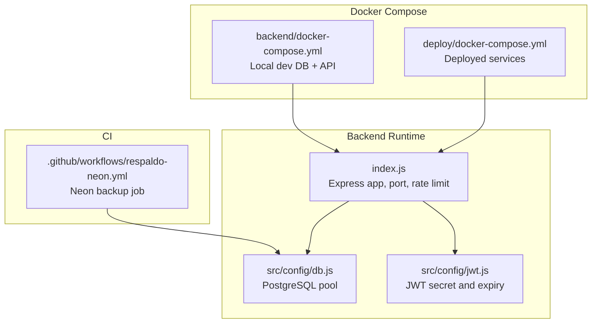
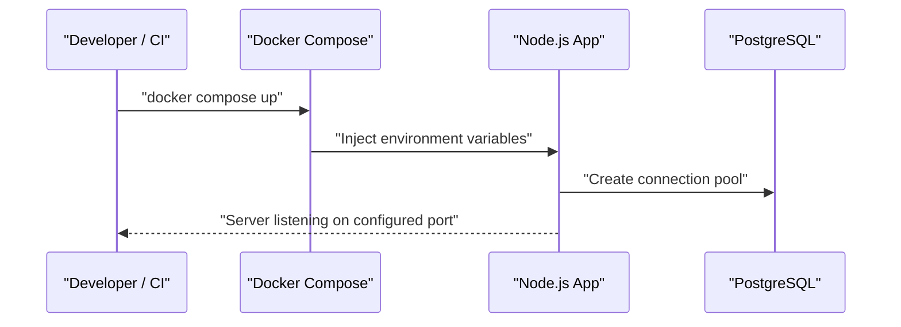
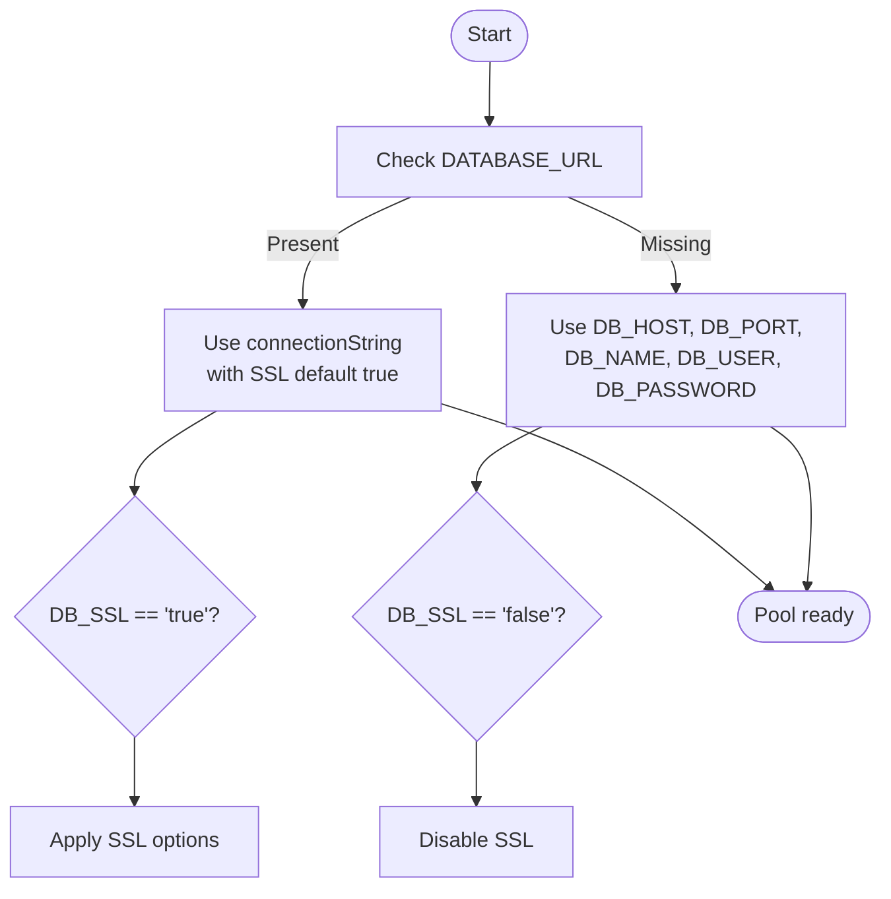
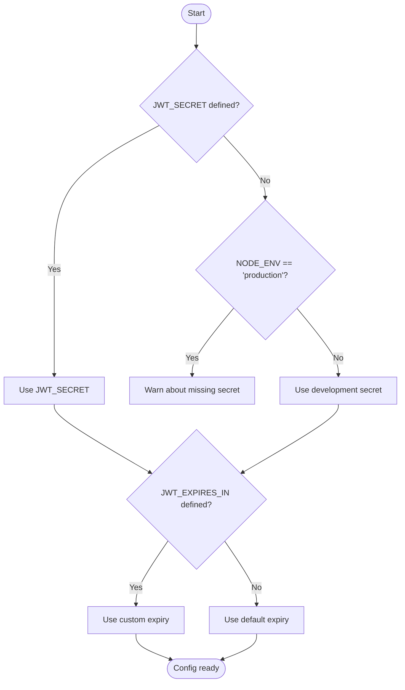
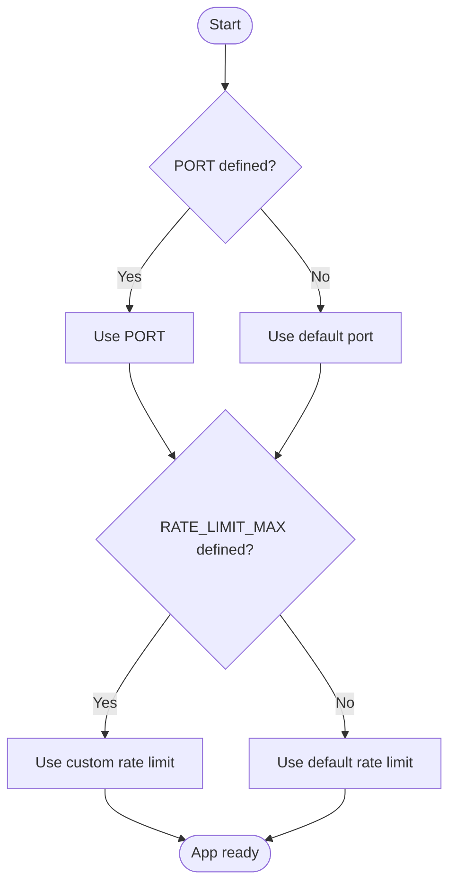
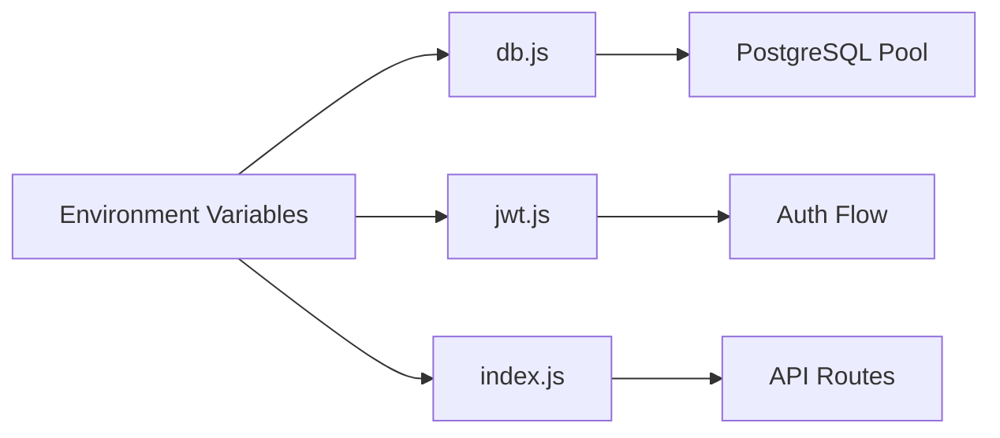

# Environment Configuration

<cite>
**Referenced Files in This Document**   
- [backend/src/config/db.js](file://backend/src/config/db.js)
- [backend/src/config/jwt.js](file://backend/src/config/jwt.js)
- [backend/index.js](file://backend/index.js)
- [backend/docker-compose.yml](file://backend/docker-compose.yml)
- [deploy/docker-compose.yml](file://deploy/docker-compose.yml)
- [.github/workflows/respaldo-neon.yml](file://.github/workflows/respaldo-neon.yml)
</cite>

## Table of Contents
1. [Introduction](#introduction)
2. [Project Structure](#project-structure)
3. [Core Components](#core-components)
4. [Architecture Overview](#architecture-overview)
5. [Detailed Component Analysis](#detailed-component-analysis)
6. [Dependency Analysis](#dependency-analysis)
7. [Performance Considerations](#performance-considerations)
8. [Troubleshooting Guide](#troubleshooting-guide)
9. [Conclusion](#conclusion)
10. [Appendices](#appendices)

## Introduction
This document explains how SIMO configures its environment across development, staging, and production. It focuses on:
- Environment variable management and precedence
- Database connection configuration (local PostgreSQL and Neon cloud)
- JWT signing and expiration settings
- Application-specific runtime configuration
- Security best practices for secrets, rotation, validation, isolation, auditing, and troubleshooting

The backend is a Node.js Express application that reads configuration from process environment variables at startup. Docker Compose files define defaults and environment overrides for local and deployed environments.

## Project Structure
Configuration is primarily defined in:
- Backend runtime configuration modules under `backend/src/config`
- Application entrypoint that wires middleware, routes, and server port
- Docker Compose files that inject environment variables into containers
- CI workflow for backups to Neon

**Diagram sources**
- [backend/index.js:1-18](file://backend/index.js#L1-L18)
- [backend/src/config/db.js:1-28](file://backend/src/config/db.js#L1-L28)
- [backend/src/config/jwt.js:1-15](file://backend/src/config/jwt.js#L1-L15)
- [backend/docker-compose.yml:1-41](file://backend/docker-compose.yml#L1-L41)
- [deploy/docker-compose.yml:1-120](file://deploy/docker-compose.yml#L1-L120)
- [.github/workflows/respaldo-neon.yml](file://.github/workflows/respaldo-neon.yml)

**Section sources**
- [backend/index.js:1-18](file://backend/index.js#L1-L18)
- [backend/docker-compose.yml:1-41](file://backend/docker-compose.yml#L1-L41)
- [deploy/docker-compose.yml:1-120](file://deploy/docker-compose.yml#L1-L120)

## Core Components
SIMO’s configuration centers around three runtime concerns:
- Database connectivity via PostgreSQL
- JWT authentication token signing and expiration
- Application-level runtime options such as port and rate limiting

Key behaviors:
- The database module supports either a full connection string or individual host/port/user/password fields.
- JWT configuration centralizes the secret and expiration, with a development fallback and a warning when missing in production.
- The application uses environment variables for the server port and rate-limit maximum.

**Section sources**
- [backend/src/config/db.js:1-28](file://backend/src/config/db.js#L1-L28)
- [backend/src/config/jwt.js:1-15](file://backend/src/config/jwt.js#L1-L15)
- [backend/index.js:18-48](file://backend/index.js#L18-L48)

## Architecture Overview
Environment variables flow from deployment definitions into the running application. In local development, Docker Compose provides defaults; in deployment, explicit values are expected.

**Diagram sources**
- [backend/docker-compose.yml:23-37](file://backend/docker-compose.yml#L23-L37)
- [deploy/docker-compose.yml:39-63](file://deploy/docker-compose.yml#L39-L63)
- [backend/index.js:18-18](file://backend/index.js#L18-L18)

## Detailed Component Analysis

### Database Configuration
The database module creates a shared PostgreSQL connection pool. It supports two modes:
- Cloud-first mode using a full connection string
- Local/Docker mode using individual host, port, user, password, and database fields

SSL behavior is controlled by an environment flag and differs between the two modes.

**Diagram sources**
- [backend/src/config/db.js:11-26](file://backend/src/config/db.js#L11-L26)

Environment variables:
- DATABASE_URL: Full connection string (e.g., Neon). When present, it takes precedence over individual fields.
- DB_HOST, DB_PORT, DB_NAME, DB_USER, DB_PASSWORD: Individual fields used when DATABASE_URL is absent.
- DB_SSL: Controls SSL behavior. Accepts 'true' or 'false'; otherwise falls back to defaults per mode.

Defaults and precedence:
- If DATABASE_URL exists, it is used with SSL enabled by default unless explicitly disabled.
- Otherwise, individual fields are used with SSL disabled by default unless explicitly enabled.

Security notes:
- Prefer DATABASE_URL for cloud providers that require TLS.
- Avoid disabling SSL in production unless you fully understand the risk.

Operational guidance:
- For local development, use individual fields through Docker Compose defaults.
- For cloud databases like Neon, provide DATABASE_URL and keep SSL enabled.

**Section sources**
- [backend/src/config/db.js:1-28](file://backend/src/config/db.js#L1-L28)

### JWT Configuration
JWT settings are centralized to ensure consistent signing and verification across login and authentication middleware.

Behavior:
- Secret: Uses JWT_SECRET if set; otherwise falls back to a development-only secret.
- Expiration: Uses JWT_EXPIRES_IN if set; otherwise defaults to a short-lived session.
- Warning: Logs a warning when JWT_SECRET is missing in production.

**Diagram sources**
- [backend/src/config/jwt.js:7-14](file://backend/src/config/jwt.js#L7-L14)

Environment variables:
- JWT_SECRET: Signing secret. Required in production.
- JWT_EXPIRES_IN: Token lifetime string (e.g., '30m'). Defaults to a short-lived session.

Security recommendations:
- Always set JWT_SECRET in production.
- Rotate JWT_SECRET periodically and redeploy to invalidate existing tokens.
- Keep JWT_EXPIRES_IN short in production to reduce exposure window.

**Section sources**
- [backend/src/config/jwt.js:1-15](file://backend/src/config/jwt.js#L1-L15)

### Application Runtime Configuration
The application entrypoint sets the server port and rate limiting based on environment variables.

Key points:
- PORT: Server listen port. Defaults to a development-friendly value if not set.
- RATE_LIMIT_MAX: Maximum requests per minute for the rate limiter. Defaults to a safe baseline.

**Diagram sources**
- [backend/index.js:18-48](file://backend/index.js#L18-L48)

Environment variables:
- PORT: HTTP server port.
- RATE_LIMIT_MAX: Requests per minute allowed by the rate limiter.

Operational guidance:
- Set PORT according to your container orchestration or reverse proxy expectations.
- Tune RATE_LIMIT_MAX for testing vs. production workloads.

**Section sources**
- [backend/index.js:18-48](file://backend/index.js#L18-L48)

### Docker Compose Environments

#### Development (backend/docker-compose.yml)
Provides local PostgreSQL and API services with sensible defaults.

Highlights:
- Local Postgres service with seeded data option.
- API service connects to local DB using DB_* fields.
- Ports bound to localhost only.

Recommended variables:
- DB_USER, DB_PASSWORD, DB_NAME: Database credentials and name.
- SIMO_SEED: Enable/disable seeding during initialization.
- PORT: API port inside the container.

**Section sources**
- [backend/docker-compose.yml:1-41](file://backend/docker-compose.yml#L1-L41)

#### Deployment (deploy/docker-compose.yml)
Defines the full stack for deployment, including health checks and optional external dependencies.

Highlights:
- Database service with health check and required secrets.
- API service preferring DATABASE_URL for cloud databases; falls back to local DB fields.
- Frontend service with build-time API URL injection.
- Backup service for periodic backups.
- Cloudflare tunnel service requiring a token.

Recommended variables:
- POSTGRES_USER, POSTGRES_PASSWORD, POSTGRES_DB: Database credentials and name.
- SIMO_APP_PASSWORD: Password for the application role.
- DATABASE_URL: Optional cloud database connection string (e.g., Neon).
- NEXT_PUBLIC_API_URL: Frontend build-time API base URL.
- BACKUP_DATABASE_URL: Optional cloud database for backup jobs.
- PGHOST, PGUSER, PGPASSWORD, PGDATABASE: Backup service DB access.
- BACKUP_HOUR, BACKUP_RETENTION_DAYS: Backup schedule and retention.
- CLOUDFLARE_TUNNEL_TOKEN: Tunnel authentication token.

**Section sources**
- [deploy/docker-compose.yml:1-120](file://deploy/docker-compose.yml#L1-L120)

### CI and Backups
The CI workflow integrates with Neon for backups. Ensure that backup-related environment variables are provided securely in your CI provider’s secret store.

Recommended variables:
- BACKUP_DATABASE_URL: Connection string for the target database.
- PGHOST, PGUSER, PGPASSWORD, PGDATABASE: Alternative connection parameters for backup tasks.
- BACKUP_HOUR, BACKUP_RETENTION_DAYS: Schedule and retention policy.

**Section sources**
- [.github/workflows/respaldo-neon.yml](file://.github/workflows/respaldo-neon.yml)

## Dependency Analysis
Configuration dependencies among components:

**Diagram sources**
- [backend/src/config/db.js:1-28](file://backend/src/config/db.js#L1-L28)
- [backend/src/config/jwt.js:1-15](file://backend/src/config/jwt.js#L1-L15)
- [backend/index.js:18-48](file://backend/index.js#L18-L48)

Coupling and cohesion:
- db.js and jwt.js are cohesive configuration modules with clear responsibilities.
- index.js depends on both modules but remains focused on application wiring.
- Docker Compose files decouple environment provisioning from application code.

Potential risks:
- Missing or misconfigured DATABASE_URL can cause connection failures.
- Missing JWT_SECRET in production triggers a warning and may fall back to a development secret.
- Disabling SSL in production weakens security posture.

**Section sources**
- [backend/src/config/db.js:1-28](file://backend/src/config/db.js#L1-L28)
- [backend/src/config/jwt.js:1-15](file://backend/src/config/jwt.js#L1-L15)
- [backend/index.js:18-48](file://backend/index.js#L18-L48)

## Performance Considerations
- Connection pooling: Reuse a single PostgreSQL pool instance to minimize overhead.
- Short-lived JWTs: Reduce token lifetime to limit exposure and improve security.
- Rate limiting: Adjust RATE_LIMIT_MAX to balance throughput and protection against abuse.
- Health checks: Use /api/health to monitor database connectivity and service readiness.

[No sources needed since this section provides general guidance]

## Troubleshooting Guide

Common issues and resolutions:

- Cannot connect to database
  - Verify DATABASE_URL or DB_* fields are correctly set.
  - Confirm DB_SSL matches your database provider requirements.
  - Check container networking and ports in Docker Compose.

- JWT errors or inconsistent behavior
  - Ensure JWT_SECRET is set in production.
  - Confirm JWT_EXPIRES_IN is a valid duration string.
  - Redeploy after rotating JWT_SECRET to invalidate old tokens.

- Server not reachable
  - Verify PORT is set and matches your orchestrator or reverse proxy.
  - Check firewall rules and container port bindings.

- Rate limiting too aggressive
  - Increase RATE_LIMIT_MAX for load tests or high-throughput scenarios.

- Health check fails
  - Inspect /api/health response and database connectivity logs.

Validation checklist:
- All required secrets are present in the target environment.
- DATABASE_URL or DB_* fields are correct and SSL settings match the provider.
- JWT_SECRET is set and strong; JWT_EXPIRES_IN is appropriate.
- PORT and RATE_LIMIT_MAX align with operational expectations.

**Section sources**
- [backend/src/config/db.js:11-26](file://backend/src/config/db.js#L11-L26)
- [backend/src/config/jwt.js:7-14](file://backend/src/config/jwt.js#L7-L14)
- [backend/index.js:18-48](file://backend/index.js#L18-L48)

## Conclusion
SIMO’s environment configuration is designed for clarity and security:
- Centralized JWT settings prevent inconsistencies.
- Flexible database configuration supports local and cloud deployments.
- Docker Compose provides safe defaults while allowing explicit overrides.
- Operational controls like health checks and rate limiting help maintain reliability.

Adopt the recommended practices for secret management, rotation, validation, and isolation to ensure secure and predictable deployments across development, staging, and production.

[No sources needed since this section summarizes without analyzing specific files]

## Appendices

### Environment Variable Reference

- Database
  - DATABASE_URL: Full connection string (preferred for cloud providers).
  - DB_HOST: Database host.
  - DB_PORT: Database port.
  - DB_NAME: Database name.
  - DB_USER: Database user.
  - DB_PASSWORD: Database password.
  - DB_SSL: 'true' or 'false' to control SSL behavior.

- Authentication
  - JWT_SECRET: Signing secret (required in production).
  - JWT_EXPIRES_IN: Token lifetime string (e.g., '30m').

- Application
  - PORT: HTTP server port.
  - RATE_LIMIT_MAX: Requests per minute for rate limiting.

- Deployment and Operations
  - POSTGRES_USER, POSTGRES_PASSWORD, POSTGRES_DB: Database credentials and name.
  - SIMO_APP_PASSWORD: Application role password.
  - NEXT_PUBLIC_API_URL: Frontend build-time API base URL.
  - BACKUP_DATABASE_URL: Cloud database connection for backups.
  - PGHOST, PGUSER, PGPASSWORD, PGDATABASE: Backup service DB access.
  - BACKUP_HOUR, BACKUP_RETENTION_DAYS: Backup schedule and retention.
  - CLOUDFLARE_TUNNEL_TOKEN: Cloudflare tunnel token.

[No sources needed since this section lists variables without analyzing specific files]