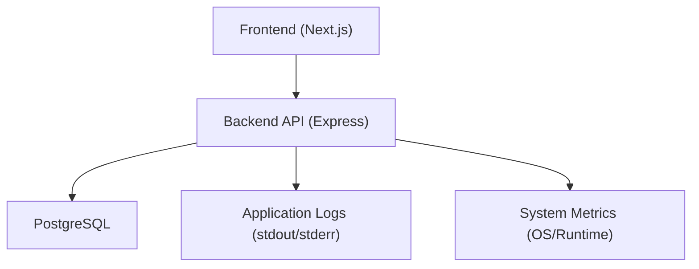
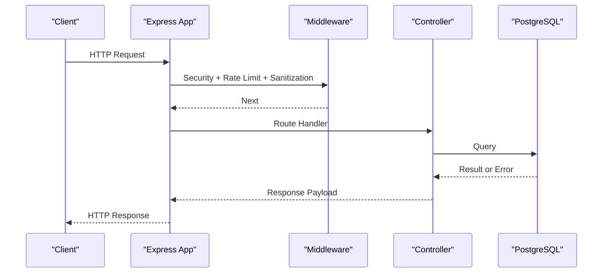
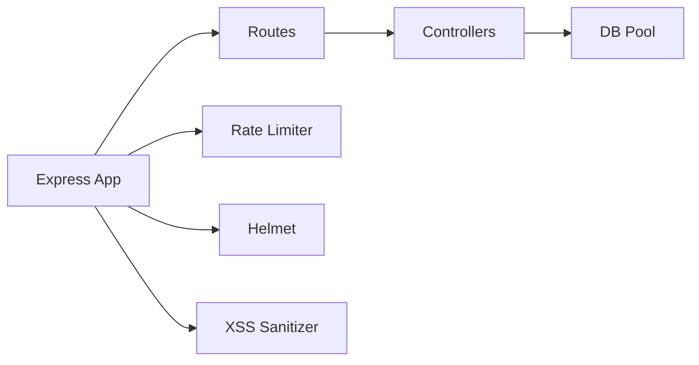

# Monitoring & Logging

<cite>
**Referenced Files in This Document**
- [README.md](file://README.md)
- [backend/index.js](file://backend/index.js)
- [backend/db/index.js](file://backend/db/index.js)
- [backend/src/config/db.js](file://backend/src/config/db.js)
- [backend/src/config/jwt.js](file://backend/src/config/jwt.js)
- [backend/middleware/authMiddleware.js](file://backend/middleware/authMiddleware.js)
- [backend/routes/ventasRoutes.js](file://backend/routes/ventasRoutes.js)
- [backend/routes/usuariosRoutes.js](file://backend/routes/usuariosRoutes.js)
- [backend/src/controllers/clientes.controller.js](file://backend/src/controllers/clientes.controller.js)
- [backend/src/controllers/inventario.controller.js](file://backend/src/controllers/inventario.controller.js)
- [backend/src/controllers/usuarios.controller.js](file://backend/src/controllers/usuarios.controller.js)
- [backend/db/migrations/007_auditoria.sql](file://backend/db/migrations/007_auditoria.sql)
- [backend/db/migrations/013_indices_ventas.sql](file://backend/db/migrations/013_indices_ventas.sql)
- [backend/db/README.md](file://backend/db/README.md)
</cite>

## Table of Contents
1. [Introduction](#introduction)
2. [Project Structure](#project-structure)
3. [Core Components](#core-components)
4. [Architecture Overview](#architecture-overview)
5. [Detailed Component Analysis](#detailed-component-analysis)
6. [Dependency Analysis](#dependency-analysis)
7. [Performance Considerations](#performance-considerations)
8. [Troubleshooting Guide](#troubleshooting-guide)
9. [Conclusion](#conclusion)

## Introduction
This document defines the monitoring and logging strategy for SIMO, covering application-level logging, structured log formats, log aggregation, performance monitoring, error tracking, alerting, and operational procedures. It focuses on the Node.js backend (Express), PostgreSQL database, and the Next.js frontend where relevant to observability. The goal is to provide a practical, production-ready approach that aligns with the current codebase while outlining recommended enhancements.

## Project Structure
SIMO consists of:
- Backend API built with Express (Node.js)
- PostgreSQL database with migrations and indexes
- Frontend Next.js application
- Docker-based orchestration and deployment scripts

[No sources needed since this diagram shows conceptual workflow, not actual code structure]

**Section sources**
- [README.md:27-64](file://README.md#L27-L64)

## Core Components
- Application entrypoint and middleware pipeline: security headers, CORS, JSON parsing, XSS sanitization, rate limiting, and route mounting.
- Database connection pooling and lifecycle events.
- Controllers and routes with error handling and console logging.
- Audit table schema and sales performance indexes.

Key responsibilities:
- Centralize request/response logging via middleware.
- Standardize structured logs (JSON) with consistent fields.
- Track database query performance and errors.
- Monitor system resources and alert on critical thresholds.

**Section sources**
- [backend/index.js:1-56](file://backend/index.js#L1-L56)
- [backend/db/index.js:1-23](file://backend/db/index.js#L1-L23)
- [backend/src/config/db.js:1-29](file://backend/src/config/db.js#L1-L29)
- [backend/src/controllers/clientes.controller.js:119-270](file://backend/src/controllers/clientes.controller.js#L119-L270)
- [backend/src/controllers/inventario.controller.js:144-263](file://backend/src/controllers/inventario.controller.js#L144-L263)
- [backend/src/controllers/usuarios.controller.js:81-252](file://backend/src/controllers/usuarios.controller.js#L81-L252)

## Architecture Overview
The backend exposes REST endpoints under /api, protected by JWT and role-based authorization. Observability touches multiple layers:
- HTTP layer: request tracing, latency, status codes, rate limiting.
- Business layer: controller actions, validation, business rules.
- Data layer: PostgreSQL queries, pool events, slow queries, audit logs.
- System layer: CPU, memory, disk I/O, network.

**Diagram sources**
- [backend/index.js:20-56](file://backend/index.js#L20-L56)
- [backend/src/controllers/clientes.controller.js:119-270](file://backend/src/controllers/clientes.controller.js#L119-L270)
- [backend/src/config/db.js:17-26](file://backend/src/config/db.js#L17-L26)

## Detailed Component Analysis

### Application-Level Logging Strategy
Current state:
- Console logging via console.log/console.error across controllers, routes, and the app entrypoint.
- No centralized logger or structured format yet.

Recommended strategy:
- Introduce a structured logger (e.g., pino or winston) configured to output JSON lines to stdout.
- Add a global request logging middleware that captures:
  - requestId, timestamp, method, url, path, queryParams (sanitized), statusCode, durationMs, userAgent, ip (if available).
- Correlate logs across layers using requestId propagated from middleware to controllers.
- Avoid logging sensitive data (passwords, tokens, PII). Mask or omit such fields.

Example implementation pattern (conceptual):
- Create a middleware that attaches a unique requestId and measures request duration.
- Wrap controller calls to include context in logs.
- Use a logger utility to emit structured logs at appropriate levels (info, warn, error).

[No sources needed since this section provides general guidance]

### Structured Log Format
Proposed fields:
- level: info|warn|error
- ts: ISO timestamp
- reqId: correlation ID
- method, path, query (sanitized), statusCode, durationMs
- userId (when authenticated), role
- db.queryTimeMs, db.rowsAffected (for DB operations)
- msg: human-readable message

Guidelines:
- Always include reqId and ts.
- Include statusCode and durationMs for all requests.
- For errors, include stack traces only in development; in production, include error code and sanitized details.

[No sources needed since this section provides general guidance]

### Log Aggregation Approaches
Options:
- Containerized environments: collect stdout/stderr into a central log aggregator (e.g., Fluent Bit, Vector) and ship to Elasticsearch/OpenSearch, Loki, or a cloud provider’s logging service.
- File-based: rotate and ship log files if running outside containers.
- Ensure log retention policies are enforced at the aggregator level.

[No sources needed since this section provides general guidance]

### Performance Monitoring
- HTTP metrics: request rate, latency percentiles (p50/p95/p99), error rates, and rate-limit hits.
- Database metrics: query latency, active connections, pool utilization, slow queries, lock waits.
- System metrics: CPU, memory, disk I/O, network throughput.

Implementation suggestions:
- Expose an internal metrics endpoint (e.g., /metrics) with Prometheus-compatible metrics.
- Use OS-level tools (node --report, process.memoryUsage, os.cpus) and container metrics.
- Instrument DB queries with timing and attach to structured logs.

[No sources needed since this section provides general guidance]

### Error Tracking and Alerting
- Centralize error logging with severity and context (reqId, userId, endpoint).
- Integrate with an error tracking platform (e.g., Sentry) to capture unhandled exceptions and user-facing errors.
- Define alerts for:
  - High error rate (> threshold % over time window)
  - Elevated p95 latency
  - Database connection failures or high pool usage
  - Rate limit spikes indicating abuse or misconfiguration

[No sources needed since this section provides general guidance]

### Custom Middleware Examples

#### Request Logging Middleware
Conceptual steps:
- Generate requestId per request.
- Record start time.
- On response finish, compute duration and emit structured log with method, path, statusCode, durationMs, and sanitized query.

[No sources needed since this section provides general guidance]

#### Database Query Monitoring
Conceptual steps:
- Wrap pool.query to measure execution time and record rows affected.
- Emit structured logs for slow queries above a threshold.
- Capture and log pool-level events (connect, error) already present in the codebase.

**Section sources**
- [backend/db/index.js:14-20](file://backend/db/index.js#L14-L20)

#### API Performance Metrics
Conceptual steps:
- Collect per-endpoint latency and status code distributions.
- Export metrics to a time-series store.
- Visualize dashboards for SLOs and capacity planning.

[No sources needed since this section provides general guidance]

### User Activity Logging
- Leverage the existing audit table schema to record significant user actions (create/update/delete, login/logout, inventory changes).
- Enforce immutability and access controls on audit logs.
- Include actor identity, action type, target entity, and timestamp.

**Section sources**
- [backend/db/migrations/007_auditoria.sql:50-67](file://backend/db/migrations/007_auditoria.sql#L50-L67)

### Database Performance Tracking
- Indexes and statistics maintenance are present for sales-related tables to optimize query plans.
- Use slow query logs and query plan analysis to identify bottlenecks.
- Periodically run VACUUM ANALYZE after bulk loads.

**Section sources**
- [backend/db/migrations/013_indices_ventas.sql:43-70](file://backend/db/migrations/013_indices_ventas.sql#L43-L70)
- [backend/db/README.md:173-179](file://backend/db/README.md#L173-L179)

### Health Check Endpoint
- The health endpoint verifies database connectivity and returns status for readiness/liveness probes.

**Section sources**
- [backend/index.js:62-70](file://backend/index.js#L62-L70)

## Dependency Analysis
Observability dependencies and relationships:
- Express app wires security and rate limiting before routes.
- Controllers call the shared database pool.
- Controllers and routes log errors via console methods.
- Audit schema enforces immutability for compliance.

**Diagram sources**
- [backend/index.js:1-56](file://backend/index.js#L1-L56)
- [backend/src/controllers/clientes.controller.js:119-270](file://backend/src/controllers/clientes.controller.js#L119-L270)
- [backend/src/controllers/inventario.controller.js:144-263](file://backend/src/controllers/inventario.controller.js#L144-L263)
- [backend/src/controllers/usuarios.controller.js:81-252](file://backend/src/controllers/usuarios.controller.js#L81-L252)

**Section sources**
- [backend/index.js:1-56](file://backend/index.js#L1-L56)
- [backend/routes/ventasRoutes.js:103-141](file://backend/routes/ventasRoutes.js#L103-L141)
- [backend/routes/usuariosRoutes.js:17-43](file://backend/routes/usuariosRoutes.js#L17-L43)
- [backend/middleware/authMiddleware.js:43-43](file://backend/middleware/authMiddleware.js#L43-L43)

## Performance Considerations
- Use structured logging efficiently: avoid heavy object serialization in hot paths; sample logs when necessary.
- Keep query payloads small; paginate and filter aggressively.
- Monitor database pool size and tune based on workload.
- Enable compression and caching where appropriate.
- Review index coverage and query plans periodically.

[No sources needed since this section provides general guidance]

## Troubleshooting Guide
Common issues and diagnostics:
- Authentication failures: check JWT configuration and token blacklist logic.
- Login/logout errors: inspect controller error logs and DB interactions.
- Product CRUD errors: validate input constraints and DB integrity constraints.
- Database connectivity: verify environment variables and SSL settings.

Operational tips:
- Use the health endpoint to confirm DB availability.
- Inspect pool connect/error events for DB issues.
- Correlate errors using requestId across middleware, controllers, and DB logs.

**Section sources**
- [backend/index.js:347-469](file://backend/index.js#L347-L469)
- [backend/src/config/jwt.js:8-8](file://backend/src/config/jwt.js#L8-L8)
- [backend/db/index.js:14-20](file://backend/db/index.js#L14-L20)
- [backend/index.js:62-70](file://backend/index.js#L62-L70)

## Conclusion
SIMO currently relies on console logging and basic error handling. To achieve robust observability:
- Implement structured request logging and correlation IDs.
- Centralize logs and metrics with a dedicated aggregator and dashboard.
- Extend audit logging to cover key user actions.
- Monitor database performance and maintain indexes/statistics.
- Set up alerting for critical errors, latency, and resource saturation.

These steps will improve debugging speed, reliability, and operational insight across development and production environments.