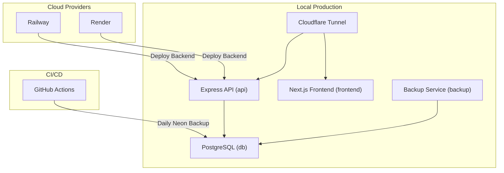
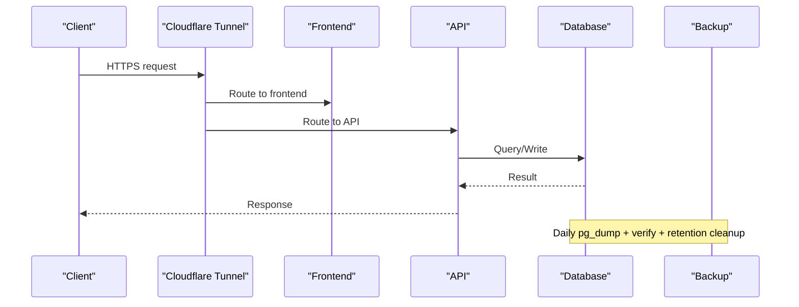
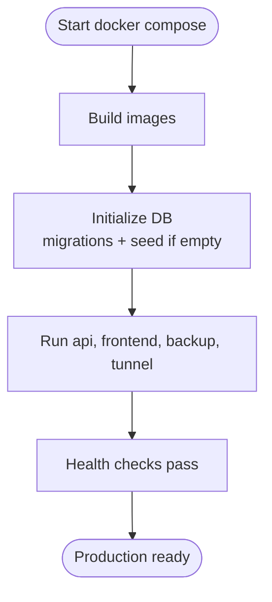
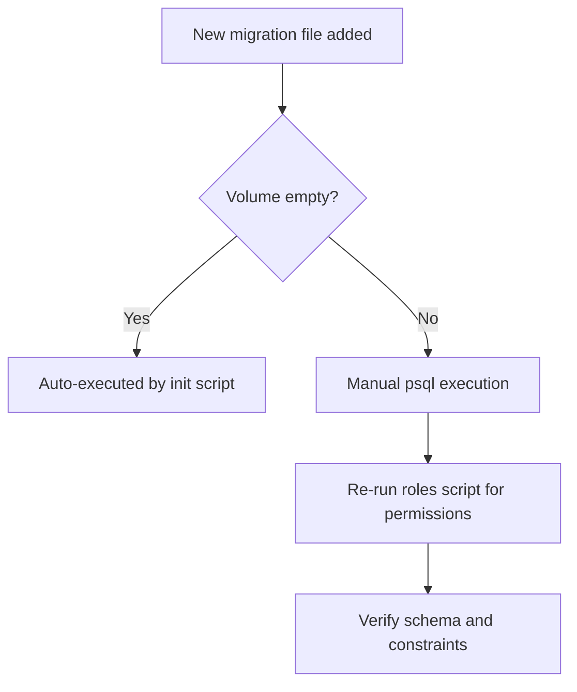
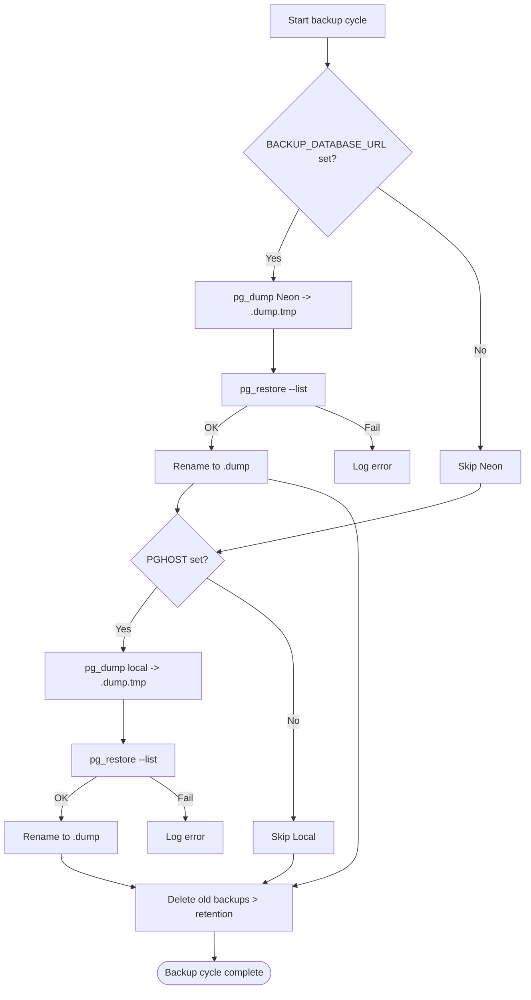
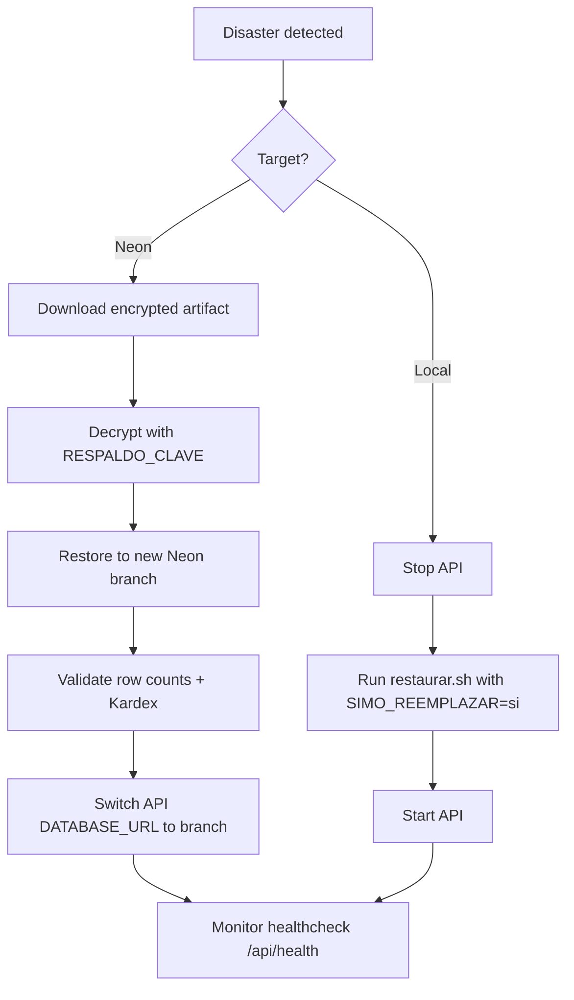
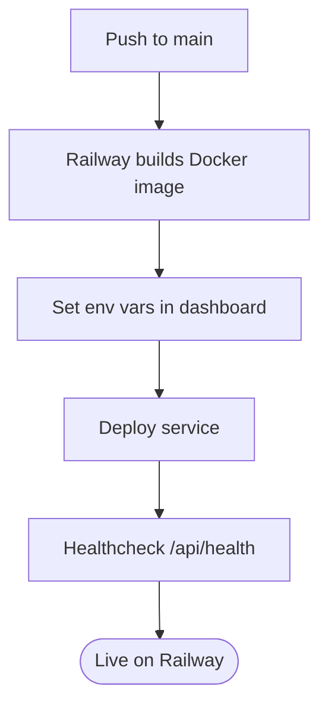
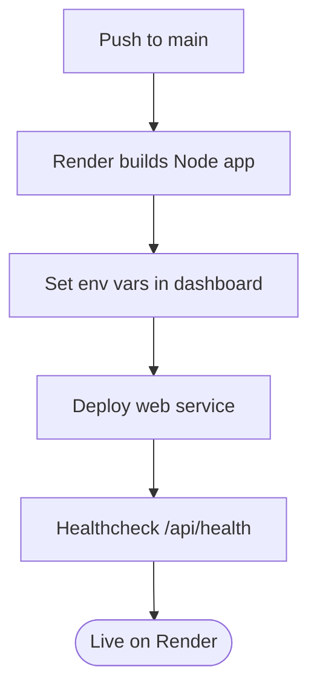
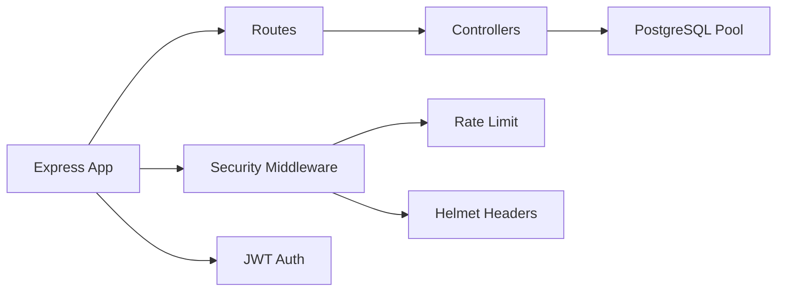

# Production Deployment

<cite>
**Referenced Files in This Document**
- [README.md](file://README.md)
- [deploy/README.md](file://deploy/README.md)
- [deploy/docker-compose.yml](file://deploy/docker-compose.yml)
- [deploy/backup/respaldo.sh](file://deploy/backup/respaldo.sh)
- [deploy/backup/restaurar.sh](file://deploy/backup/restaurar.sh)
- [.github/workflows/respaldo-neon.yml](file://.github/workflows/respaldo-neon.yml)
- [railway.json](file://railway.json)
- [backend/railway.json](file://backend/railway.json)
- [render.yaml](file://render.yaml)
- [backend/Dockerfile](file://backend/Dockerfile)
- [backend/index.js](file://backend/index.js)
- [backend/src/config/db.js](file://backend/src/config/db.js)
- [backend/src/config/jwt.js](file://backend/src/config/jwt.js)
- [backend/db/README.md](file://backend/db/README.md)
</cite>

## Table of Contents
1. [Introduction](#introduction)
2. [Project Structure](#project-structure)
3. [Core Components](#core-components)
4. [Architecture Overview](#architecture-overview)
5. [Detailed Component Analysis](#detailed-component-analysis)
6. [Dependency Analysis](#dependency-analysis)
7. [Performance Considerations](#performance-considerations)
8. [Troubleshooting Guide](#troubleshooting-guide)
9. [Conclusion](#conclusion)
10. [Appendices](#appendices)

## Introduction
This document provides production deployment guidance for SIMO across multiple targets: the local Docker-based deployment with Cloudflare Tunnel, Railway, and Render. It covers the complete workflow from code commit to production release, including zero-downtime strategies, database migrations, backups and recovery using provided scripts, disaster recovery planning, cloud provider configuration, load balancing considerations, SSL certificate management, domain configuration, scaling strategies, capacity planning, and production maintenance procedures.

The repository includes a production-grade local deployment orchestrated by Docker Compose, automated daily backups via GitHub Actions, and platform-specific configuration files for Railway and Render. The backend is an Express API with PostgreSQL, and the frontend is a Next.js application built separately.

**Section sources**
- [README.md:241-244](file://README.md#L241-L244)
- [deploy/README.md:1-28](file://deploy/README.md#L1-L28)

## Project Structure
At a high level, the project contains:
- Backend (Express API): Node.js application with PostgreSQL integration, JWT authentication, rate limiting, and security headers.
- Frontend (Next.js): Web application that communicates with the backend API.
- Database: PostgreSQL schema, migrations, roles, seeds, tests, and performance scripts.
- Deployment: Local Docker Compose stack with Cloudflare Tunnel, backup scripts, and operational documentation.
- CI/CD: GitHub Actions workflow for daily Neon database backups.
- Platform configs: Railway and Render definitions for deploying the backend.

**Diagram sources**
- [deploy/docker-compose.yml:14-116](file://deploy/docker-compose.yml#L14-L116)
- [.github/workflows/respaldo-neon.yml:24-58](file://.github/workflows/respaldo-neon.yml#L24-L58)
- [railway.json:1-15](file://railway.json#L1-L15)
- [render.yaml:1-13](file://render.yaml#L1-L13)

**Section sources**
- [README.md:241-244](file://README.md#L241-L244)
- [deploy/docker-compose.yml:1-120](file://deploy/docker-compose.yml#L1-L120)

## Core Components
- Backend API: Express server exposing REST endpoints, health check, JWT authentication, rate limiting, and security headers.
- Database: PostgreSQL with schema migrations, roles, and validation functions; supports both local and Neon managed databases.
- Frontend: Next.js app built independently and served through the same deployment stack or a separate host.
- Backup System: Automated daily backups of Neon and local databases, retention policy, and verification.
- CI/CD: Scheduled GitHub Actions job to back up Neon securely and retain artifacts.
- Platform Configurations: Railway and Render definitions for building and running the backend.

Key environment variables:
- DATABASE_URL: Neon connection string (pooler) with SSL required.
- DB_HOST, DB_PORT, DB_NAME, DB_USER, DB_PASSWORD: Local or Docker database connectivity.
- JWT_SECRET, JWT_EXPIRES_IN: Authentication token secret and expiration.
- PORT: HTTP port for the API.
- BACKUP_DATABASE_URL: Direct Neon connection string for backups (without pooler).
- PGHOST, PGUSER, PGPASSWORD, PGDATABASE: Local database credentials for backup service.
- CLOUDFLARE_TUNNEL_TOKEN: Token for Cloudflare tunnel.

**Section sources**
- [backend/index.js:1-57](file://backend/index.js#L1-L57)
- [backend/src/config/db.js:1-29](file://backend/src/config/db.js#L1-L29)
- [backend/src/config/jwt.js:1-16](file://backend/src/config/jwt.js#L1-L16)
- [deploy/docker-compose.yml:39-63](file://deploy/docker-compose.yml#L39-L63)
- [deploy/docker-compose.yml:82-105](file://deploy/docker-compose.yml#L82-L105)

## Architecture Overview
The production architecture uses a secure ingress via Cloudflare Tunnel, which publishes only the necessary services while keeping internal ports bound to localhost. The backend connects to PostgreSQL either locally or to Neon. Backups run daily for both Neon and local databases, with verification and retention policies enforced.

**Diagram sources**
- [deploy/README.md:5-28](file://deploy/README.md#L5-L28)
- [deploy/docker-compose.yml:14-116](file://deploy/docker-compose.yml#L14-L116)
- [deploy/backup/respaldo.sh:1-18](file://deploy/backup/respaldo.sh#L1-L18)

**Section sources**
- [deploy/README.md:1-28](file://deploy/README.md#L1-L28)
- [deploy/docker-compose.yml:14-116](file://deploy/docker-compose.yml#L14-L116)

## Detailed Component Analysis

### Local Production Deployment (Docker + Cloudflare Tunnel)
- Services:
  - db: PostgreSQL container with initialization scripts and volumes.
  - api: Express backend built from backend/Dockerfile.
  - frontend: Next.js app built from simoapp with deploy/frontend/Dockerfile.
  - backup: Scheduled backups using postgres image and custom scripts.
  - tunnel: Cloudflared container publishing services via Cloudflare Zero Trust.

- Security:
  - Internal services listen on localhost only.
  - Access control via Cloudflare Access policies.
  - Minimal privilege role simo_app for the API.

- Operations:
  - Start/stop services.
  - Apply new migrations manually.
  - Run manual backups and restore operations.

**Diagram sources**
- [deploy/docker-compose.yml:14-116](file://deploy/docker-compose.yml#L14-L116)
- [deploy/README.md:50-85](file://deploy/README.md#L50-L85)

**Section sources**
- [deploy/README.md:29-85](file://deploy/README.md#L29-L85)
- [deploy/docker-compose.yml:14-116](file://deploy/docker-compose.yml#L14-L116)

### Database Migrations and Schema Management
- Migration files are located under backend/db/migrations and executed during initial setup when the volume is empty.
- For existing data, apply new migrations directly against the database using psql.
- After creating new tables, re-run the roles script to grant permissions to the application role.

**Diagram sources**
- [backend/db/README.md:34-52](file://backend/db/README.md#L34-L52)
- [deploy/README.md:127-139](file://deploy/README.md#L127-L139)

**Section sources**
- [backend/db/README.md:1-32](file://backend/db/README.md#L1-L32)
- [deploy/README.md:127-139](file://deploy/README.md#L127-L139)

### Data Backup and Recovery
- Daily backups:
  - Neon database via BACKUP_DATABASE_URL.
  - Local database via PG* variables.
  - Verification with pg_restore --list before finalizing.
  - Retention policy removes old backups beyond configured days.

- Manual backup:
  - Trigger immediate backup via backup container entrypoint.

- Restore process:
  - Single transaction restore with pre-checks.
  - Optional schema cleanup if target already has SIMO schema.
  - Post-restore validation of row counts and Kardex consistency.

**Diagram sources**
- [deploy/backup/respaldo.sh:21-56](file://deploy/backup/respaldo.sh#L21-L56)
- [deploy/README.md:101-125](file://deploy/README.md#L101-L125)

**Section sources**
- [deploy/backup/respaldo.sh:1-89](file://deploy/backup/respaldo.sh#L1-L89)
- [deploy/backup/restaurar.sh:1-77](file://deploy/backup/restaurar.sh#L1-L77)
- [deploy/README.md:101-200](file://deploy/README.md#L101-L200)

### Disaster Recovery Planning
- Primary recovery path:
  - Use latest encrypted artifact from GitHub Actions for Neon.
  - Decrypt artifact and restore into a new Neon branch for validation.
  - Switch API to point at validated branch.

- Local recovery path:
  - Stop API service.
  - Restore local database using restaurar.sh with SIMO_REEMPLAZAR=si.
  - Restart API service.

- Validation:
  - Row count checks for core tables.
  - Kardex consistency validation function.

**Diagram sources**
- [.github/workflows/respaldo-neon.yml:30-58](file://.github/workflows/respaldo-neon.yml#L30-L58)
- [deploy/README.md:141-200](file://deploy/README.md#L141-L200)
- [deploy/backup/restaurar.sh:40-62](file://deploy/backup/restaurar.sh#L40-L62)

**Section sources**
- [.github/workflows/respaldo-neon.yml:1-58](file://.github/workflows/respaldo-neon.yml#L1-L58)
- [deploy/README.md:141-200](file://deploy/README.md#L141-L200)
- [deploy/backup/restaurar.sh:1-77](file://deploy/backup/restaurar.sh#L1-L77)

### Blue-Green Deployments and Zero-Downtime Strategies
- Current deployment model:
  - Docker Compose services can be rebuilt and restarted without affecting the database.
  - Health checks ensure readiness before traffic is routed.

- Recommended blue-green approach:
  - Maintain two identical environments (blue/green) behind a load balancer or reverse proxy.
  - Route traffic to one environment while deploying to the other.
  - Validate health and smoke tests, then switch traffic.
  - Keep rollback capability by retaining previous environment.

- Zero-downtime considerations:
  - Ensure database migrations are backward compatible or use feature flags.
  - Use connection pooling and graceful shutdowns.
  - Perform rolling restarts where supported by the platform.

[No sources needed since this section provides conceptual guidance]

### Cloud Provider Specific Configurations

#### Railway
- Configuration:
  - railway.json defines DOCKERFILE builder and start command.
  - Healthcheck path configured for /api/health.
  - Restart policy set to ON_FAILURE with retries.

- Environment variables:
  - DATABASE_URL (Neon pooler with SSL).
  - JWT_SECRET, JWT_EXPIRES_IN.
  - PORT.

- Deployment steps:
  - Connect repository to Railway.
  - Set environment variables in dashboard.
  - Trigger build and deploy.

**Diagram sources**
- [railway.json:1-15](file://railway.json#L1-L15)
- [backend/railway.json:1-15](file://backend/railway.json#L1-L15)

**Section sources**
- [railway.json:1-15](file://railway.json#L1-L15)
- [backend/railway.json:1-15](file://backend/railway.json#L1-L15)

#### Render
- Configuration:
  - render.yaml defines web service with Node runtime.
  - Build command installs dependencies; start command runs npm start.
  - Environment variables include DATABASE_URL and NODE_ENV.

- Environment variables:
  - DATABASE_URL (Neon pooler with SSL).
  - JWT_SECRET, JWT_EXPIRES_IN.
  - PORT.

- Deployment steps:
  - Connect repository to Render.
  - Set environment variables in dashboard.
  - Trigger build and deploy.

**Diagram sources**
- [render.yaml:1-13](file://render.yaml#L1-L13)

**Section sources**
- [render.yaml:1-13](file://render.yaml#L1-L13)

### Load Balancing Setup
- Local deployment:
  - Cloudflare Tunnel acts as ingress; no direct exposure of internal ports.
  - Multiple backend instances can be added behind Cloudflare Load Balancing if needed.

- Cloud providers:
  - Railway and Render provide managed infrastructure; scale horizontally by adding instances.
  - Use platform-native load balancing or integrate with external load balancers.

[No sources needed since this section provides general guidance]

### SSL Certificate Management
- Cloudflare Tunnel:
  - TLS termination handled by Cloudflare; certificates managed automatically.
  - No need to manage certificates on the origin servers.

- Cloud providers:
  - Railway and Render terminate TLS at the edge; certificates managed by the platform.
  - Custom domains can be configured in provider dashboards.

[No sources needed since this section provides general guidance]

### Domain Configuration
- Local deployment:
  - Subdomains published via Cloudflare Tunnel (db, app, api).
  - Access policies restrict who can reach services.

- Cloud providers:
  - Configure custom domains in Railway/Render dashboards.
  - Point DNS records to provider-provided endpoints.

**Section sources**
- [deploy/README.md:35-49](file://deploy/README.md#L35-L49)

### Scaling Strategies and Capacity Planning
- Horizontal scaling:
  - Add more backend instances behind a load balancer.
  - Stateless design allows easy scaling; state resides in PostgreSQL.

- Vertical scaling:
  - Increase CPU/memory for containers or instances.
  - Tune PostgreSQL settings and indexes for query performance.

- Database scaling:
  - Use Neon’s managed features (branching, scaling).
  - Monitor query performance and adjust indexes.

- Monitoring and alerting:
  - Track API health, response times, error rates.
  - Set alerts for resource utilization and database metrics.

[No sources needed since this section provides general guidance]

### Production Maintenance Procedures
- Regular tasks:
  - Review logs for errors and warnings.
  - Verify backups completed successfully.
  - Rotate secrets and update JWT_SECRET periodically.
  - Apply security patches and dependency updates.

- Operational commands:
  - Rebuild and restart specific services.
  - Execute manual backups and restores as needed.
  - Validate database integrity using provided functions.

**Section sources**
- [deploy/README.md:87-125](file://deploy/README.md#L87-L125)
- [deploy/README.md:127-200](file://deploy/README.md#L127-L200)

## Dependency Analysis
The backend depends on:
- Express framework and middleware (helmet, cors, rate-limit).
- PostgreSQL client library (pg) for database connections.
- JWT library for authentication tokens.
- bcrypt for password hashing.

Environment-driven configuration:
- DATABASE_URL vs DB_* variables determine connection mode.
- SSL behavior controlled by DB_SSL.
- JWT secret and expiration configurable via environment.

**Diagram sources**
- [backend/index.js:1-57](file://backend/index.js#L1-L57)
- [backend/src/config/db.js:1-29](file://backend/src/config/db.js#L1-L29)
- [backend/src/config/jwt.js:1-16](file://backend/src/config/jwt.js#L1-L16)

**Section sources**
- [backend/index.js:1-57](file://backend/index.js#L1-L57)
- [backend/src/config/db.js:1-29](file://backend/src/config/db.js#L1-L29)
- [backend/src/config/jwt.js:1-16](file://backend/src/config/jwt.js#L1-L16)

## Performance Considerations
- Database indexing:
  - Indexes added for sales queries improve performance significantly.
  - Use EXPLAIN ANALYZE to validate query plans.

- Connection pooling:
  - Use PgBouncer or Neon’s pooler for efficient connection reuse.

- Application tuning:
  - Enable compression and caching where appropriate.
  - Optimize payload sizes and pagination.

- Monitoring:
  - Track slow queries and adjust indexes accordingly.
  - Use profiling tools to identify bottlenecks.

**Section sources**
- [backend/db/README.md:159-180](file://backend/db/README.md#L159-L180)

## Troubleshooting Guide
Common issues and resolutions:
- Health check failures:
  - Verify database connectivity and credentials.
  - Check API logs for startup errors.

- Backup failures:
  - Confirm BACKUP_DATABASE_URL and PG* variables are correct.
  - Inspect backup logs for permission or network issues.

- Restore errors:
  - Ensure target database is empty or SIMO_REEMPLAZAR=si is set.
  - Validate backup file integrity before restore.

- Authentication issues:
  - Confirm JWT_SECRET is set in production.
  - Verify user accounts and roles exist in the database.

**Section sources**
- [backend/index.js:62-70](file://backend/index.js#L62-L70)
- [deploy/backup/respaldo.sh:60-68](file://deploy/backup/respaldo.sh#L60-L68)
- [deploy/backup/restaurar.sh:22-38](file://deploy/backup/restaurar.sh#L22-L38)
- [backend/src/config/jwt.js:7-15](file://backend/src/config/jwt.js#L7-L15)

## Conclusion
SIMO’s production deployment leverages Docker Compose for local orchestration, Cloudflare Tunnel for secure ingress, and GitHub Actions for reliable backups. Platform configurations for Railway and Render enable straightforward cloud deployments. With robust backup and recovery processes, clear migration procedures, and scalable architecture patterns, SIMO is well-positioned for production reliability and growth.

[No sources needed since this section summarizes without analyzing specific files]

## Appendices

### Environment Variables Reference
- DATABASE_URL: Neon connection string (pooler) with SSL required.
- DB_HOST, DB_PORT, DB_NAME, DB_USER, DB_PASSWORD: Local or Docker database connectivity.
- JWT_SECRET: Secret key for signing JWTs.
- JWT_EXPIRES_IN: Token expiration time.
- PORT: HTTP port for the API.
- BACKUP_DATABASE_URL: Direct Neon connection string for backups (without pooler).
- PGHOST, PGUSER, PGPASSWORD, PGDATABASE: Local database credentials for backup service.
- CLOUDFLARE_TUNNEL_TOKEN: Token for Cloudflare tunnel.

**Section sources**
- [deploy/docker-compose.yml:39-63](file://deploy/docker-compose.yml#L39-L63)
- [deploy/docker-compose.yml:82-105](file://deploy/docker-compose.yml#L82-L105)
- [backend/src/config/db.js:1-29](file://backend/src/config/db.js#L1-L29)
- [backend/src/config/jwt.js:1-16](file://backend/src/config/jwt.js#L1-L16)

### Deployment Commands Quick Reference
- Start local deployment:
  - cd deploy && docker compose up -d --build

- Rebuild specific services:
  - docker compose up -d --build api frontend

- Manual backup:
  - docker compose exec backup sh /opt/backup/respaldo.sh ahora

- Restore local database:
  - docker compose stop api
  - docker compose exec -e SIMO_REEMPLAZAR=si backup sh -c 'sh /opt/backup/restaurar.sh /backups/simo_AAAAMMDD_HHMM.dump "postgres://$PGUSER:$PGPASSWORD@db:5432/$PGDATABASE"'
  - docker compose start api

**Section sources**
- [deploy/README.md:95-125](file://deploy/README.md#L95-L125)
- [deploy/README.md:182-194](file://deploy/README.md#L182-L194)