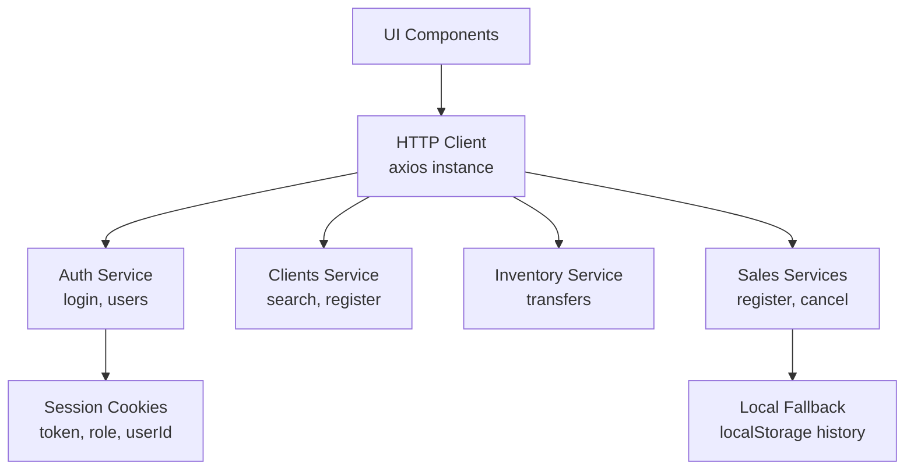
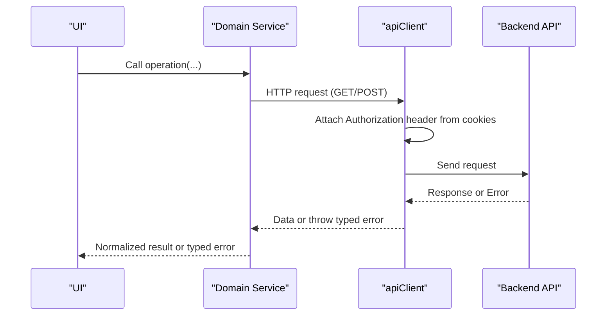
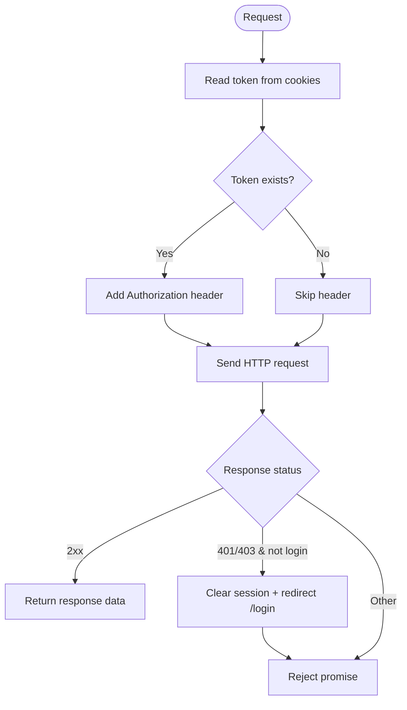
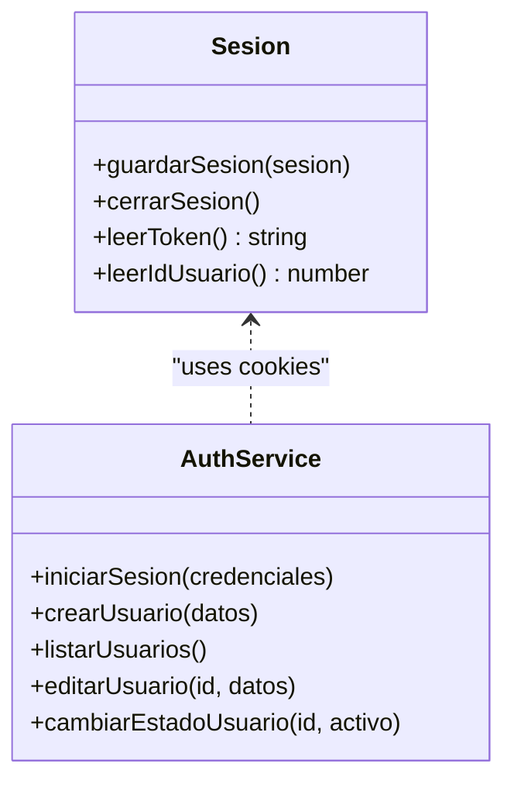
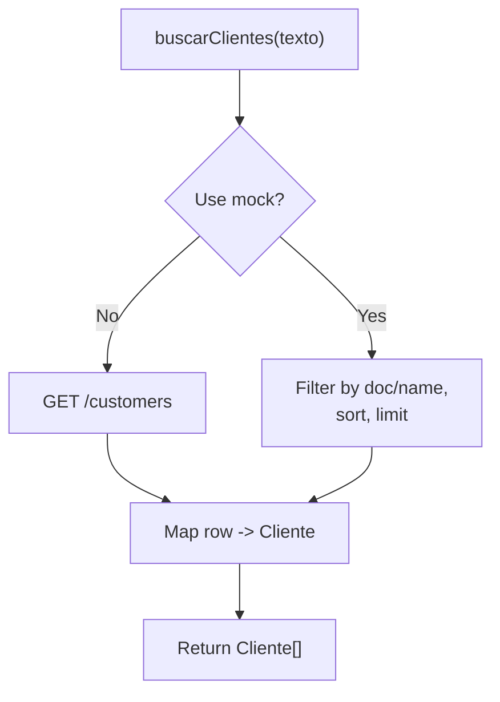
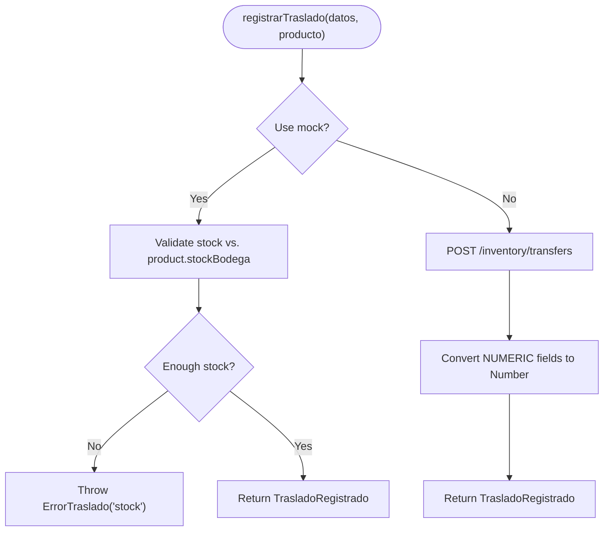
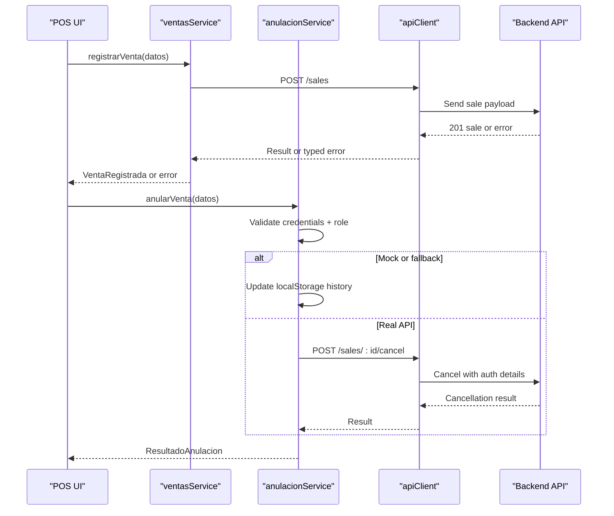
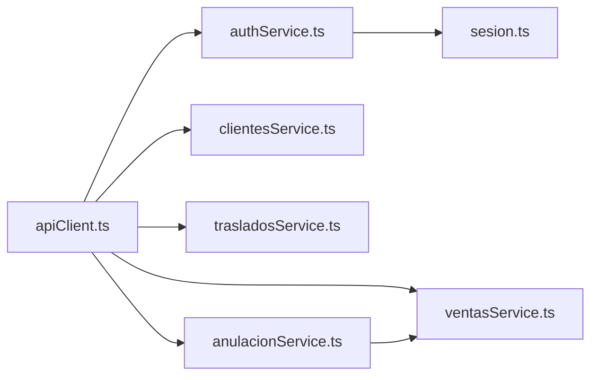

# API Integration Layer

<cite>
**Referenced Files in This Document**
- [apiClient.ts](file://simoapp/lib/apiClient.ts)
- [sesion.ts](file://simoapp/lib/auth/sesion.ts)
- [authService.ts](file://simoapp/lib/auth/authService.ts)
- [tipos.ts](file://simoapp/lib/auth/tipos.ts)
- [clientesService.ts](file://simoapp/lib/clientes/clientesService.ts)
- [trasladosService.ts](file://simoapp/lib/inventario/trasladosService.ts)
- [ventasService.ts](file://simoapp/lib/ventas/ventasService.ts)
- [anulacionService.ts](file://simoapp/lib/ventas/anulacionService.ts)
</cite>

## Table of Contents
1. [Introduction](#introduction)
2. [Project Structure](#project-structure)
3. [Core Components](#core-components)
4. [Architecture Overview](#architecture-overview)
5. [Detailed Component Analysis](#detailed-component-analysis)
6. [Dependency Analysis](#dependency-analysis)
7. [Performance Considerations](#performance-considerations)
8. [Troubleshooting Guide](#troubleshooting-guide)
9. [Conclusion](#conclusion)

## Introduction
This document describes the frontend API integration layer for the application. It explains how HTTP requests are configured, how authentication tokens are attached and refreshed, how errors are handled consistently across modules, and how business domains (clients, inventory, sales) are encapsulated behind modular services. It also covers data transformation patterns, mock strategies for development, offline fallback behavior, and testing approaches used by both frontend services and backend tests.

## Project Structure
The integration layer is organized under `simoapp/lib`:
- A shared HTTP client with interceptors: `lib/apiClient.ts`
- Authentication session management: `lib/auth/sesion.ts`, `lib/auth/authService.ts`, `lib/auth/tipos.ts`
- Domain services:
  - Clients: `lib/clientes/clientesService.ts`
  - Inventory: `lib/inventario/trasladosService.ts`
  - Sales: `lib/ventas/ventasService.ts`, `lib/ventas/anulacionService.ts`

**Diagram sources**
- [apiClient.ts:1-59](file://simoapp/lib/apiClient.ts#L1-L59)
- [authService.ts:1-252](file://simoapp/lib/auth/authService.ts#L1-L252)
- [sesion.ts:1-60](file://simoapp/lib/auth/sesion.ts#L1-L60)
- [clientesService.ts:1-184](file://simoapp/lib/clientes/clientesService.ts#L1-L184)
- [trasladosService.ts:1-129](file://simoapp/lib/inventario/trasladosService.ts#L1-L129)
- [ventasService.ts:1-118](file://simoapp/lib/ventas/ventasService.ts#L1-L118)
- [anulacionService.ts:1-261](file://simoapp/lib/ventas/anulacionService.ts#L1-L261)

**Section sources**
- [apiClient.ts:1-59](file://simoapp/lib/apiClient.ts#L1-L59)
- [authService.ts:1-252](file://simoapp/lib/auth/authService.ts#L1-L252)
- [sesion.ts:1-60](file://simoapp/lib/auth/sesion.ts#L1-L60)
- [clientesService.ts:1-184](file://simoapp/lib/clientes/clientesService.ts#L1-L184)
- [trasladosService.ts:1-129](file://simoapp/lib/inventario/trasladosService.ts#L1-L129)
- [ventasService.ts:1-118](file://simoapp/lib/ventas/ventasService.ts#L1-L118)
- [anulacionService.ts:1-261](file://simoapp/lib/ventas/anulacionService.ts#L1-L261)

## Core Components
- HTTP client configuration and interceptors:
  - Base URL from environment variable or default.
  - Request interceptor attaches Bearer token from cookies.
  - Response interceptor clears session and redirects on 401/403, except login endpoint.
- Session management:
  - Centralized cookie-based storage for token, role, and userId.
  - Helpers to read/write/clear session and clean up POS cart on logout.
- Domain services:
  - Clients: search and register with error normalization and optional mock.
  - Inventory: transfer registration with stock validation and error mapping.
  - Sales: sale registration and cancellation with authorization checks and local fallback.

Key responsibilities:
- apiClient.ts: HTTP transport, auth header injection, global auth error handling.
- sesion.ts: Cookie lifecycle and cleanup.
- authService.ts: Login, user CRUD, error mapping, mock switch.
- clientesService.ts: Customer operations, DTO mapping, mock switch.
- trasladosService.ts: Transfer operations, numeric conversion, mock switch.
- ventasService.ts: Sale creation, stock rule enforcement, mock switch.
- anulacionService.ts: Sale cancellation with manager/admin authorization, localStorage fallback.

**Section sources**
- [apiClient.ts:1-59](file://simoapp/lib/apiClient.ts#L1-L59)
- [sesion.ts:1-60](file://simoapp/lib/auth/sesion.ts#L1-L60)
- [authService.ts:1-252](file://simoapp/lib/auth/authService.ts#L1-L252)
- [clientesService.ts:1-184](file://simoapp/lib/clientes/clientesService.ts#L1-L184)
- [trasladosService.ts:1-129](file://simoapp/lib/inventario/trasladosService.ts#L1-L129)
- [ventasService.ts:1-118](file://simoapp/lib/ventas/ventasService.ts#L1-L118)
- [anulacionService.ts:1-261](file://simoapp/lib/ventas/anulacionService.ts#L1-L261)

## Architecture Overview
The integration layer follows a layered approach:
- UI calls domain services.
- Domain services call the shared HTTP client.
- The HTTP client injects auth headers and handles global auth failures.
- Each service maps backend payloads to frontend types and throws typed errors.
- Mock implementations are conditionally enabled via environment variables.

**Diagram sources**
- [apiClient.ts:13-55](file://simoapp/lib/apiClient.ts#L13-L55)
- [authService.ts:76-101](file://simoapp/lib/auth/authService.ts#L76-L101)
- [clientesService.ts:85-116](file://simoapp/lib/clientes/clientesService.ts#L85-L116)
- [trasladosService.ts:47-79](file://simoapp/lib/inventario/trasladosService.ts#L47-L79)
- [ventasService.ts:43-75](file://simoapp/lib/ventas/ventasService.ts#L43-L75)

## Detailed Component Analysis

### HTTP Client Configuration and Interceptors
- Base URL:
  - Uses `NEXT_PUBLIC_API_URL` if present; otherwise defaults to a local backend address.
- Headers:
  - Sets JSON content type by default.
- Request interceptor:
  - Reads the JWT from cookies using session helpers.
  - Attaches `Authorization: Bearer <token>` when available.
- Response interceptor:
  - On 401/403 (excluding `/auth/login`), clears session and redirects to `/login`.
  - Re-throws all errors so services can handle them.

**Diagram sources**
- [apiClient.ts:13-55](file://simoapp/lib/apiClient.ts#L13-L55)
- [sesion.ts:32-52](file://simoapp/lib/auth/sesion.ts#L32-L52)

**Section sources**
- [apiClient.ts:1-59](file://simoapp/lib/apiClient.ts#L1-L59)
- [sesion.ts:1-60](file://simoapp/lib/auth/sesion.ts#L1-L60)

### Authentication and Session Management
- Token source:
  - JWT stored in cookies after successful login.
- Session cookies:
  - `token`: JWT string.
  - `role`: Role code used by middleware.
  - `userId`: Current user id for additional guards.
- Lifecycle:
  - `guardarSesion` writes cookies with an 8-hour max-age.
  - `cerrarSesion` clears cookies and removes legacy localStorage entries; also clears POS basket.
  - `leerToken` provides the current token for request interception.

**Diagram sources**
- [sesion.ts:17-59](file://simoapp/lib/auth/sesion.ts#L17-L59)
- [authService.ts:76-224](file://simoapp/lib/auth/authService.ts#L76-L224)

**Section sources**
- [sesion.ts:1-60](file://simoapp/lib/auth/sesion.ts#L1-L60)
- [authService.ts:1-252](file://simoapp/lib/auth/authService.ts#L1-L252)
- [tipos.ts:1-77](file://simoapp/lib/auth/tipos.ts#L1-L77)

### Clients Module
Responsibilities:
- Search active customers by document prefix or name.
- Register new customers with normalized inputs.
- Map backend rows to frontend types.
- Throw typed errors (`ErrorCliente`) with friendly messages.

API contract highlights:
- GET `/customers?q=...&estado=true&limit=8` returns paginated data.
- POST `/customers` creates a customer; 409 indicates duplicate document.

Mock strategy:
- Controlled by `NEXT_PUBLIC_CLIENTES_MOCK`; when true, uses in-memory mock with artificial delays.

**Diagram sources**
- [clientesService.ts:85-96](file://simoapp/lib/clientes/clientesService.ts#L85-L96)
- [clientesService.ts:151-166](file://simoapp/lib/clientes/clientesService.ts#L151-L166)

**Section sources**
- [clientesService.ts:1-184](file://simoapp/lib/clientes/clientesService.ts#L1-L184)

### Inventory Module
Responsibilities:
- Register transfers from warehouse to store.
- Validate stock availability and normalize numeric fields.
- Map backend responses to frontend types.
- Throw typed errors (`ErrorTraslado`).

API contract highlights:
- POST `/inventory/transfers` with product id, quantity, responsible id, reason.
- Errors: insufficient stock (409), product not found (404), invalid data (400).

Mock strategy:
- Controlled by `NEXT_PUBLIC_TRASLADOS_MOCK`; default is mock unless explicitly set to false.

**Diagram sources**
- [trasladosService.ts:47-79](file://simoapp/lib/inventario/trasladosService.ts#L47-L79)
- [trasladosService.ts:106-128](file://simoapp/lib/inventario/trasladosService.ts#L106-L128)

**Section sources**
- [trasladosService.ts:1-129](file://simoapp/lib/inventario/trasladosService.ts#L1-L129)

### Sales Module
Responsibilities:
- Register POS sales with payment method, discounts, taxes, totals, and line items.
- Enforce stock rules (frontend mock validates; backend must recalculate and enforce).
- Provide cancellation flow requiring manager/admin authorization.
- Maintain local fallback history for offline/demo scenarios.

API contract highlights:
- POST `/sales` creates a sale; 409 indicates insufficient stock.
- POST `/sales/:id/cancel` requires manager/admin credentials and reason.

Offline/local fallback:
- When mock is enabled or API fails, `anulacionService` reads/writes `simo.ventas.historial` in localStorage.
- Seed versioning ensures demo data updates once.

**Diagram sources**
- [ventasService.ts:43-75](file://simoapp/lib/ventas/ventasService.ts#L43-L75)
- [anulacionService.ts:146-261](file://simoapp/lib/ventas/anulacionService.ts#L146-L261)

**Section sources**
- [ventasService.ts:1-118](file://simoapp/lib/ventas/ventasService.ts#L1-L118)
- [anulacionService.ts:1-261](file://simoapp/lib/ventas/anulacionService.ts#L1-L261)

## Dependency Analysis
- Shared dependencies:
  - All domain services depend on `apiClient` for network access.
  - Auth service depends on session cookies for persistence and on `apiClient` for endpoints.
- Coupling:
  - Low coupling between UI and backend through typed services.
  - High cohesion within each domain service (mapping, validation, error handling).
- External integrations:
  - Backend REST endpoints for auth, customers, inventory, and sales.
  - Browser APIs for cookies and localStorage.

**Diagram sources**
- [apiClient.ts:1-59](file://simoapp/lib/apiClient.ts#L1-L59)
- [authService.ts:1-252](file://simoapp/lib/auth/authService.ts#L1-L252)
- [sesion.ts:1-60](file://simoapp/lib/auth/sesion.ts#L1-L60)
- [clientesService.ts:1-184](file://simoapp/lib/clientes/clientesService.ts#L1-L184)
- [trasladosService.ts:1-129](file://simoapp/lib/inventario/trasladosService.ts#L1-L129)
- [ventasService.ts:1-118](file://simoapp/lib/ventas/ventasService.ts#L1-L118)
- [anulacionService.ts:1-261](file://simoapp/lib/ventas/anulacionService.ts#L1-L261)

**Section sources**
- [apiClient.ts:1-59](file://simoapp/lib/apiClient.ts#L1-L59)
- [authService.ts:1-252](file://simoapp/lib/auth/authService.ts#L1-L252)
- [sesion.ts:1-60](file://simoapp/lib/auth/sesion.ts#L1-L60)
- [clientesService.ts:1-184](file://simoapp/lib/clientes/clientesService.ts#L1-L184)
- [trasladosService.ts:1-129](file://simoapp/lib/inventario/trasladosService.ts#L1-L129)
- [ventasService.ts:1-118](file://simoapp/lib/ventas/ventasService.ts#L1-L118)
- [anulacionService.ts:1-261](file://simoapp/lib/ventas/anulacionService.ts#L1-L261)

## Performance Considerations
- Network efficiency:
  - Use minimal payloads and only necessary fields.
  - Avoid redundant requests by caching results at the UI state level where appropriate.
- Numeric conversions:
  - Convert PostgreSQL NUMERIC fields to numbers immediately after receiving responses to avoid repeated parsing.
- Mock delays:
  - Keep mock delays short during development to maintain responsiveness while still simulating latency.
- Local storage:
  - Use localStorage sparingly and keep records small; consider pagination or trimming old entries.

[No sources needed since this section provides general guidance]

## Troubleshooting Guide
Common issues and resolutions:
- 401/403 unexpected redirects:
  - Ensure the request is not hitting `/auth/login`, which should preserve error messages.
  - Verify that cookies are being set correctly after login.
- Connection errors:
  - Confirm `NEXT_PUBLIC_API_URL` points to a running backend.
  - Check CORS and network connectivity.
- Duplicate clients:
  - Handle 409 responses and display the existing client information returned by the backend.
- Insufficient stock:
  - For sales and transfers, validate stock before sending requests; handle 409 gracefully.
- Offline behavior:
  - In sales cancellation, if the API is unavailable, the service falls back to localStorage; ensure the key `simo.ventas.historial` is readable/writable.

**Section sources**
- [apiClient.ts:33-55](file://simoapp/lib/apiClient.ts#L33-L55)
- [clientesService.ts:72-82](file://simoapp/lib/clientes/clientesService.ts#L72-L82)
- [trasladosService.ts:69-79](file://simoapp/lib/inventario/trasladosService.ts#L69-L79)
- [ventasService.ts:66-75](file://simoapp/lib/ventas/ventasService.ts#L66-L75)
- [anulacionService.ts:127-140](file://simoapp/lib/ventas/anulacionService.ts#L127-L140)

## Conclusion
The frontend API integration layer provides a consistent, secure, and testable interface to the backend. It centralizes HTTP configuration, enforces authentication via cookies, normalizes errors, and isolates business logic in domain-specific services. Mock strategies enable rapid development and testing, while offline fallbacks improve resilience. By following the documented contracts and error-handling patterns, teams can extend the system safely and predictably.

[No sources needed since this section summarizes without analyzing specific files]