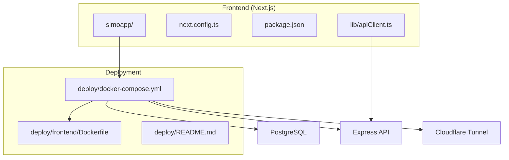
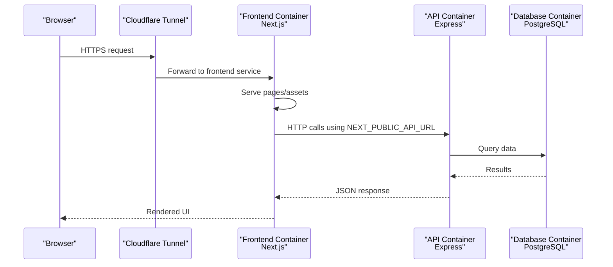
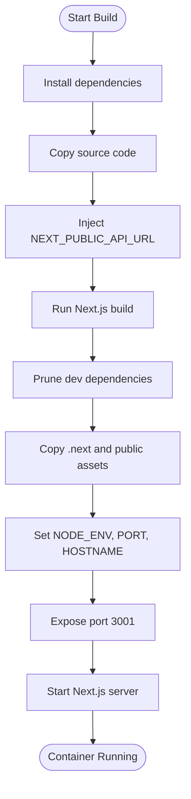
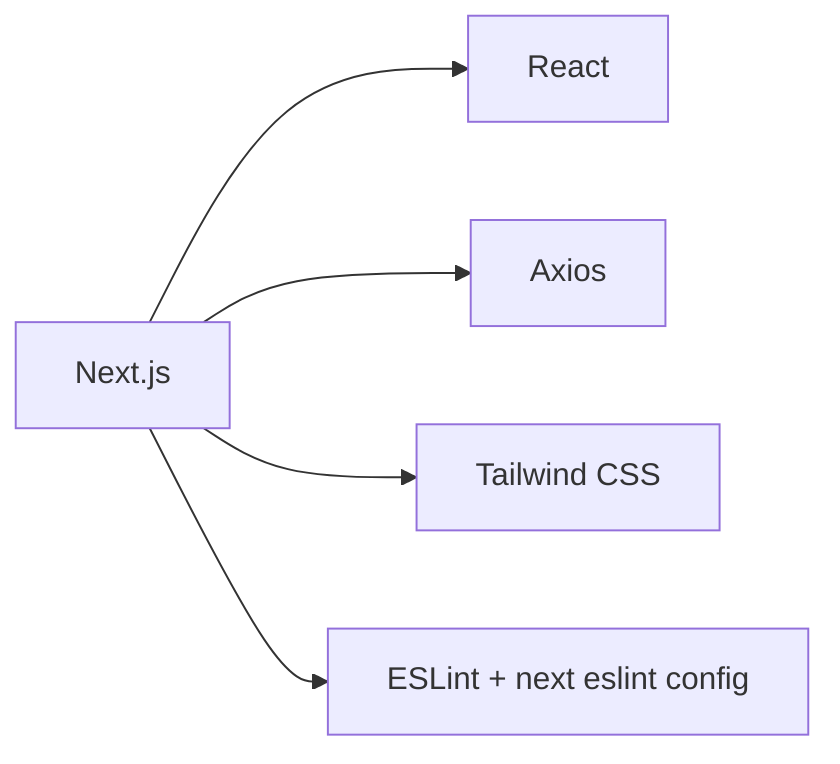

# Build & Deployment Configuration

<cite>
**Referenced Files in This Document**
- [next.config.ts](file://simoapp/next.config.ts)
- [package.json](file://simoapp/package.json)
- [Dockerfile](file://deploy/frontend/Dockerfile)
- [docker-compose.yml](file://deploy/docker-compose.yml)
- [apiClient.ts](file://simoapp/lib/apiClient.ts)
- [README.md](file://deploy/README.md)
- [eslint.config.mjs](file://simoapp/eslint.config.mjs)
</cite>

## Table of Contents
1. [Introduction](#introduction)
2. [Project Structure](#project-structure)
3. [Core Components](#core-components)
4. [Architecture Overview](#architecture-overview)
5. [Detailed Component Analysis](#detailed-component-analysis)
6. [Dependency Analysis](#dependency-analysis)
7. [Performance Considerations](#performance-considerations)
8. [Troubleshooting Guide](#troubleshooting-guide)
9. [Conclusion](#conclusion)

## Introduction
This document explains how the Next.js frontend is built, containerized, and deployed as part of the SIMO application. It covers:
- Next.js configuration and build scripts
- Environment variable management for client-side runtime values
- Docker multi-stage build and production settings
- Local deployment with Docker Compose and Cloudflare Tunnel
- Development workflow, hot reloading, and debugging strategies
- Guidance for customizing webpack via Next.js configuration and optimizing assets

The goal is to help developers and operators understand the end-to-end flow from source code to a running production container, while keeping the documentation accessible to non-experts.

## Project Structure
The Next.js application lives under `simoapp/`. The deployment artifacts are under `deploy/`, including a dedicated frontend Dockerfile and a compose file that orchestrates database, API, frontend, backup, and tunnel services.

**Diagram sources**
- [docker-compose.yml:14-80](file://deploy/docker-compose.yml#L14-L80)
- [Dockerfile:1-33](file://deploy/frontend/Dockerfile#L1-L33)
- [apiClient.ts:1-11](file://simoapp/lib/apiClient.ts#L1-L11)

**Section sources**
- [docker-compose.yml:1-120](file://deploy/docker-compose.yml#L1-L120)
- [README.md:1-28](file://deploy/README.md#L1-L28)

## Core Components
- Next.js app entry and scripts:
  - Development, build, and start commands are defined in the frontend package manifest.
- Next.js configuration:
  - A TypeScript config file is present and ready for customization.
- Client API client:
  - Axios-based HTTP client uses a public environment variable to target the backend URL at build time.
- Frontend Docker image:
  - Multi-stage build compiles the app and runs it on Node 22 Alpine.
- Orchestration:
  - Docker Compose defines services for DB, API, frontend, backup, and tunnel.

**Section sources**
- [package.json:5-10](file://simoapp/package.json#L5-L10)
- [next.config.ts:1-7](file://simoapp/next.config.ts#L1-L7)
- [apiClient.ts:1-11](file://simoapp/lib/apiClient.ts#L1-L11)
- [Dockerfile:5-32](file://deploy/frontend/Dockerfile#L5-L32)
- [docker-compose.yml:65-80](file://deploy/docker-compose.yml#L65-L80)

## Architecture Overview
At runtime, the frontend container serves static assets and Next.js server endpoints, calling the Express API over an internal network. External access is routed through Cloudflare Tunnel, which forwards traffic to local services bound only to loopback addresses.

**Diagram sources**
- [docker-compose.yml:39-80](file://deploy/docker-compose.yml#L39-L80)
- [Dockerfile:20-32](file://deploy/frontend/Dockerfile#L20-L32)
- [apiClient.ts:4-11](file://simoapp/lib/apiClient.ts#L4-L11)

## Detailed Component Analysis

### Next.js Configuration and Build Scripts
- Configuration file:
  - The project includes a TypeScript Next.js configuration file where you can add optimization options such as asset handling, redirects, headers, rewrites, and experimental features.
- Build scripts:
  - Standard scripts include development (`dev`), production build (`build`), and production server (`start`).

Recommended Next.js configuration areas:
- Asset optimization: enable image optimization, configure CDN or external domains if needed.
- Security headers: set security-related headers for production.
- Redirects and rewrites: define routing rules for SEO and legacy URLs.
- Experimental flags: cautiously enable performance-related experiments when necessary.

To customize webpack behavior, extend the Next.js configuration with a webpack function. Typical goals include:
- Minimize bundle size by excluding unused dependencies.
- Configure asset loaders for fonts, images, and other media.
- Add analytics or monitoring SDKs conditionally in production builds.

**Section sources**
- [next.config.ts:1-7](file://simoapp/next.config.ts#L1-L7)
- [package.json:5-10](file://simoapp/package.json#L5-L10)

### Environment Variables Management
- Public variables:
  - The frontend uses `NEXT_PUBLIC_API_URL` to determine the backend base URL at build time. If not provided, it falls back to a local development URL.
- Runtime usage:
  - The Axios client sets its base URL from this variable and attaches authentication tokens via interceptors.

Environment variable best practices:
- Use `NEXT_PUBLIC_*` variables only for values safe to expose to the browser.
- Keep secrets out of the frontend; they belong in the backend or platform secret managers.
- In Docker, pass public variables via build arguments and environment variables during the build stage.

Example flows:
- Development: run locally without setting `NEXT_PUBLIC_API_URL`; the client defaults to localhost.
- Production: set `NEXT_PUBLIC_API_URL` to the published API domain so the compiled frontend points to the correct backend.

**Section sources**
- [apiClient.ts:4-11](file://simoapp/lib/apiClient.ts#L4-L11)
- [docker-compose.yml:65-72](file://deploy/docker-compose.yml#L65-L72)
- [Dockerfile:14-18](file://deploy/frontend/Dockerfile#L14-L18)

### Docker Containerization Process
The frontend uses a two-stage Docker build:
- Build stage:
  - Installs dependencies, copies source, injects public environment variables, runs the Next.js build, and prunes dev dependencies.
- Runtime stage:
  - Copies only the production build output and required files into a minimal Node image, sets production environment variables, exposes port 3001, and starts the Next.js server.

Key production settings:
- `NODE_ENV=production`
- `NEXT_TELEMETRY_DISABLED=1`
- `PORT=3001`
- `HOSTNAME=0.0.0.0`

Security and efficiency:
- Non-root user for running the process.
- `.dockerignore` excludes unnecessary files like `node_modules`, `.next`, and `.env*`.

**Diagram sources**
- [Dockerfile:5-32](file://deploy/frontend/Dockerfile#L5-L32)

**Section sources**
- [Dockerfile:1-33](file://deploy/frontend/Dockerfile#L1-L33)
- [Dockerfile.dockerignore:1-5](file://deploy/frontend/Dockerfile.dockerignore#L1-L5)

### Production Build Settings and Optimization
- Image minimization:
  - Dev dependencies are removed after building to reduce image size.
- Telemetry disabled:
  - Disables Next.js telemetry in production builds.
- Health checks:
  - Compose defines health checks for frontend and API services.

Additional optimizations you can apply in Next.js configuration:
- Enable image optimization and configure remote patterns for hosted images.
- Define security headers and caching policies for static assets.
- Configure redirects and rewrites for SEO-friendly routes.
- Use experimental features judiciously to improve performance.

**Section sources**
- [Dockerfile:14-32](file://deploy/frontend/Dockerfile#L14-L32)
- [docker-compose.yml:74-80](file://deploy/docker-compose.yml#L74-L80)

### Deployment Strategies
Local deployment:
- Services are exposed only on loopback addresses to prevent direct internet exposure.
- Cloudflare Tunnel provides secure external access via Zero Trust policies.

Services orchestrated:
- Database: PostgreSQL with initialization scripts and optional seeding.
- API: Express backend connecting to the database.
- Frontend: Next.js app served from the container.
- Backup: Scheduled backups of the database.
- Tunnel: Cloudflared connector publishing services securely.

Operational notes:
- Do not run both the development environment and the deployment environment simultaneously on the same ports.
- Ensure the host machine does not sleep to keep services available.

**Section sources**
- [README.md:1-28](file://deploy/README.md#L1-L28)
- [README.md:29-49](file://deploy/README.md#L29-L49)
- [docker-compose.yml:14-116](file://deploy/docker-compose.yml#L14-L116)

### Custom Webpack Configurations
Although the repository does not include a custom webpack configuration, you can extend the Next.js configuration file to:
- Exclude large or unused packages from bundles.
- Configure asset loaders for fonts, images, and other media.
- Integrate third-party libraries that require specific webpack rules.
- Add conditional logic to include analytics or monitoring SDKs only in production builds.

When adding custom webpack rules:
- Validate that rules do not conflict with Next.js defaults.
- Test thoroughly in both development and production builds.
- Prefer Next.js-native features (e.g., image optimization) before reaching for custom loaders.

**Section sources**
- [next.config.ts:1-7](file://simoapp/next.config.ts#L1-L7)

### Asset Optimization
Recommendations:
- Use Next.js image optimization for responsive images and automatic format selection.
- Host large static assets on a CDN and reference them via configured domains.
- Minimize font sizes and use modern formats (e.g., WOFF2).
- Avoid bundling heavy libraries unless necessary; prefer tree-shaking and dynamic imports.

These optimizations should be configured within the Next.js configuration and supported by the Docker build pipeline.

[No sources needed since this section provides general guidance]

### Performance Monitoring Setup
Options:
- Integrate a front-end monitoring SDK (e.g., error tracking, performance metrics) via the Next.js configuration or application code.
- Conditionally include monitoring code in production builds to avoid leaking sensitive information in development.
- Use Next.js built-in metrics and logs, combined with your hosting platform’s observability tools.

Implementation approach:
- Add monitoring initialization in a centralized place in the app.
- Guard initialization with environment checks to ensure it runs only in production.
- Verify that monitoring payloads do not include secrets or sensitive user data.

[No sources needed since this section provides general guidance]

### Development Workflow, Hot Reloading, and Debugging
Development:
- Use the standard Next.js development script to start the app with hot reloading enabled.
- When developing locally, the frontend defaults to a local API endpoint if no public API URL is set.

Hot reloading:
- Enabled by default in development mode.
- Changes to components and styles reload automatically.

Debugging:
- Inspect network requests in the browser to verify the API base URL and authentication headers.
- Check container logs for errors in the frontend and API services.
- Use health check endpoints to validate service readiness.

**Section sources**
- [package.json:5-10](file://simoapp/package.json#L5-L10)
- [apiClient.ts:4-11](file://simoapp/lib/apiClient.ts#L4-L11)
- [docker-compose.yml:74-80](file://deploy/docker-compose.yml#L74-L80)

## Dependency Analysis
The frontend depends on:
- Next.js runtime and build tooling
- Axios for HTTP communication
- Tailwind CSS and PostCSS for styling
- ESLint configuration for code quality

**Diagram sources**
- [package.json:11-27](file://simoapp/package.json#L11-L27)
- [eslint.config.mjs:1-18](file://simoapp/eslint.config.mjs#L1-L18)

**Section sources**
- [package.json:11-27](file://simoapp/package.json#L11-L27)
- [eslint.config.mjs:1-18](file://simoapp/eslint.config.mjs#L1-L18)

## Performance Considerations
- Keep the frontend image small by pruning dev dependencies and avoiding unnecessary assets.
- Disable telemetry in production builds.
- Use Next.js image optimization and configure appropriate cache headers.
- Monitor bundle size and remove unused dependencies.
- Prefer server-side rendering and data fetching strategies that minimize client payload.

[No sources needed since this section provides general guidance]

## Troubleshooting Guide
Common issues and resolutions:
- Frontend cannot reach the API:
  - Verify `NEXT_PUBLIC_API_URL` is set correctly in the build environment.
  - Confirm the API service is healthy and reachable from the frontend container.
- Authentication failures:
  - Check that the API returns proper status codes and that the frontend handles 401/403 responses appropriately.
- Port conflicts:
  - Ensure no other services are using ports 5432, 3000, or 3001 on the host.
- Health checks failing:
  - Inspect container logs and verify the health check endpoints are responding.

Operational tips:
- Use Docker Compose logs to inspect service outputs.
- Restart affected services after updating configurations.
- Validate environment variables in the compose file and Dockerfile.

**Section sources**
- [apiClient.ts:13-56](file://simoapp/lib/apiClient.ts#L13-L56)
- [docker-compose.yml:54-80](file://deploy/docker-compose.yml#L54-L80)
- [README.md:87-99](file://deploy/README.md#L87-L99)

## Conclusion
The Next.js frontend is configured for a clean development experience and a secure, efficient production deployment. The Dockerfile ensures a lean production image, while Docker Compose orchestrates all services behind a Cloudflare Tunnel for safe external access. Environment variables are managed carefully to expose only what is necessary to the browser. With the provided structure, you can extend the Next.js configuration to optimize assets, customize webpack, and integrate monitoring, while maintaining a consistent and reliable deployment workflow.

[No sources needed since this section summarizes without analyzing specific files]