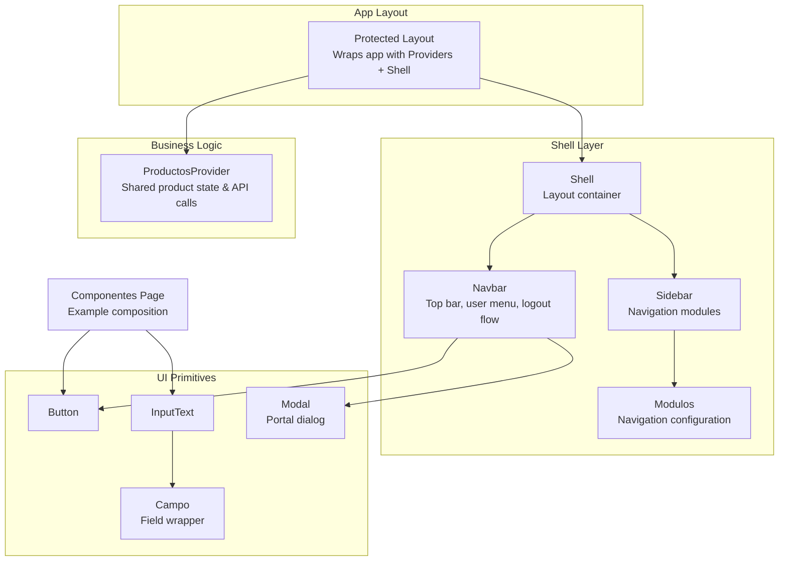
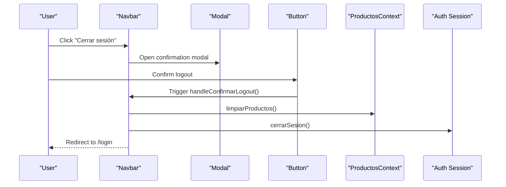
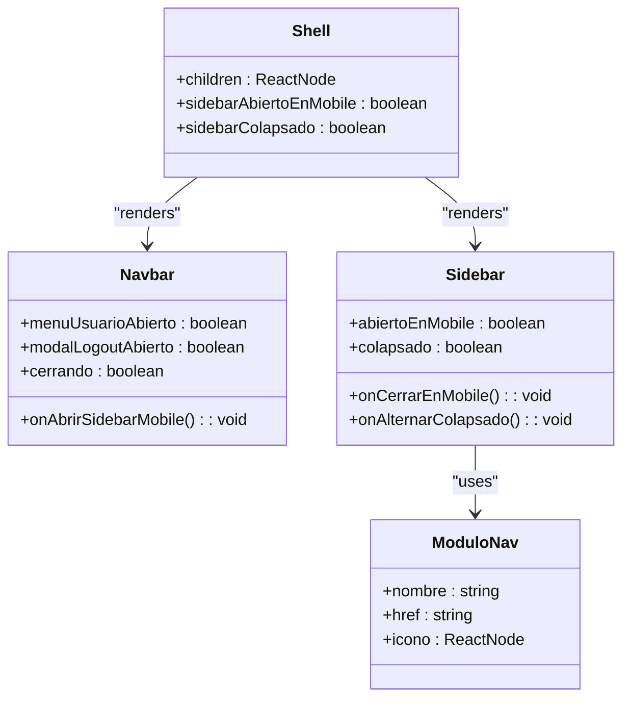
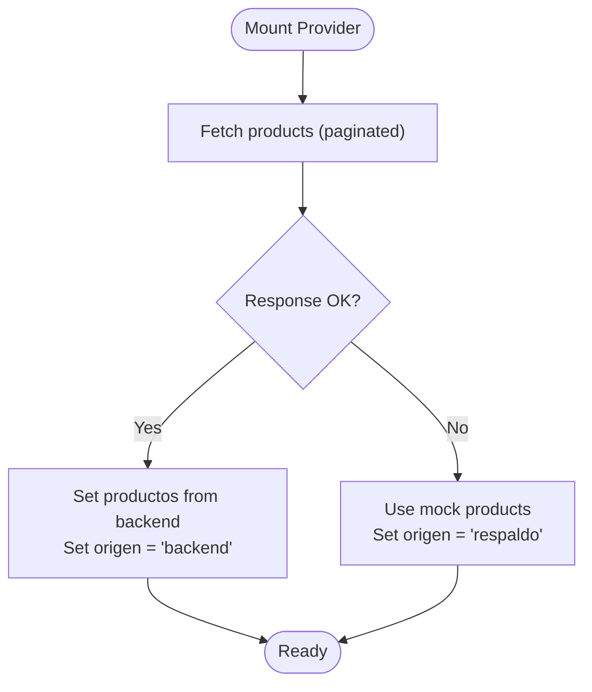
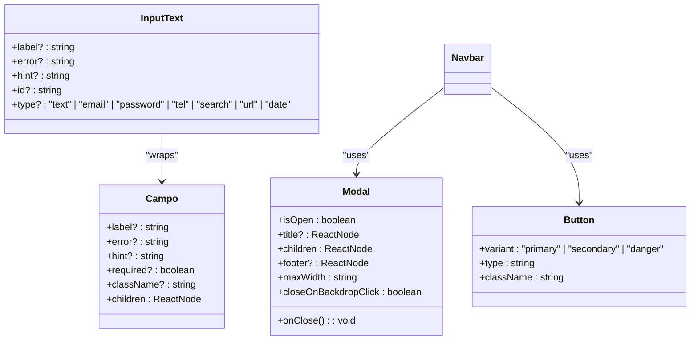
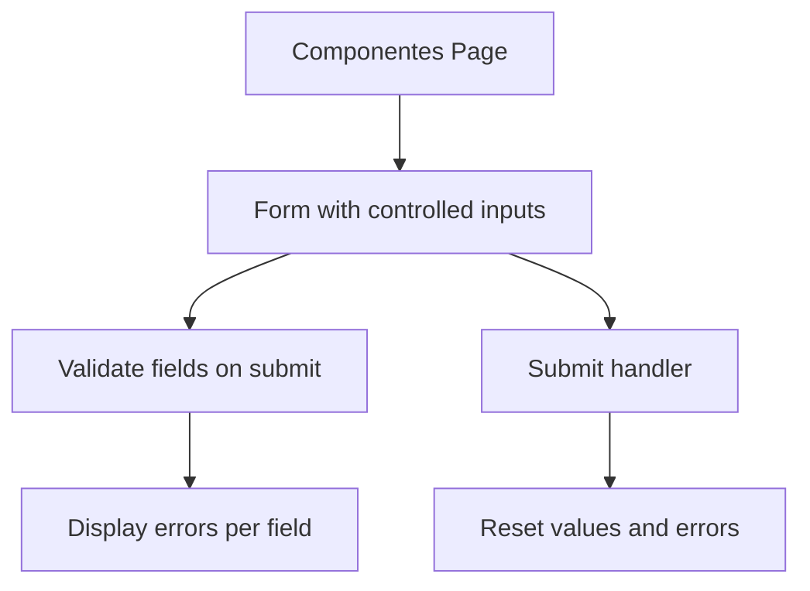

# Component Architecture

<cite>
**Referenced Files in This Document**
- [Shell.tsx](file://simoapp/components/shell/Shell.tsx)
- [Navbar.tsx](file://simoapp/components/shell/Navbar.tsx)
- [Sidebar.tsx](file://simoapp/components/shell/Sidebar.tsx)
- [modulos.tsx](file://simoapp/components/shell/modulos.tsx)
- [Protected Layout](file://simoapp/app/(protected)/layout.tsx)
- [ProductosContext.tsx](file://simoapp/components/catalogo/ProductosContext.tsx)
- [Button.tsx](file://simoapp/components/ui/Button.tsx)
- [InputText.tsx](file://simoapp/components/ui/InputText.tsx)
- [Campo.tsx](file://simoapp/components/ui/Campo.tsx)
- [Modal.tsx](file://simoapp/components/ui/Modal.tsx)
- [Componentes Page](file://simoapp/app/(protected)/componentes/page.tsx)
</cite>

## Table of Contents
1. [Introduction](#introduction)
2. [Project Structure](#project-structure)
3. [Core Components](#core-components)
4. [Architecture Overview](#architecture-overview)
5. [Detailed Component Analysis](#detailed-component-analysis)
6. [Dependency Analysis](#dependency-analysis)
7. [Performance Considerations](#performance-considerations)
8. [Troubleshooting Guide](#troubleshooting-guide)
9. [Conclusion](#conclusion)

## Introduction
This document explains the Next.js component architecture used in the application, focusing on how layout, business logic, and presentation components are organized and composed. It covers:

- The hierarchy from Shell-level layout components down to UI primitives.
- Composition patterns and prop interfaces.
- Separation of concerns between layout, business logic, and presentation layers.
- Lifecycle management, event handling, and state lifting strategies.
- Reusable component patterns, TypeScript-based prop validation, and testing approaches.
- Performance considerations such as memoization, lazy loading, and code splitting.

The goal is to make the architecture understandable for both technical and non-technical readers while providing concrete references to source files.

## Project Structure
The frontend lives under `simoapp`. The relevant structure for this documentation is:

- `app/(protected)/layout.tsx` — Protected route layout that wraps pages with global providers and the Shell.
- `components/shell/*` — Shell-level layout components (Shell, Navbar, Sidebar, navigation data).
- `components/ui/*` — Presentation primitives (Button, InputText, Campo, Modal, etc.).
- `components/catalogo/ProductosContext.tsx` — Shared business logic and state provider for product data.
- `app/(protected)/componentes/page.tsx` — Example page demonstrating composition of UI primitives.

**Diagram sources**
- [Protected Layout:1-10](file://simoapp/app/(protected)/layout.tsx#L1-L10)
- [Shell.tsx:14-39](file://simoapp/components/shell/Shell.tsx#L14-L39)
- [Navbar.tsx:31-51](file://simoapp/components/shell/Navbar.tsx#L31-L51)
- [Sidebar.tsx:17-30](file://simoapp/components/shell/Sidebar.tsx#L17-L30)
- [modulos.tsx:25-78](file://simoapp/components/shell/modulos.tsx#L25-L78)
- [ProductosContext.tsx:129-150](file://simoapp/components/catalogo/ProductosContext.tsx#L129-L150)
- [Button.tsx:23-43](file://simoapp/components/ui/Button.tsx#L23-L43)
- [InputText.tsx:21-34](file://simoapp/components/ui/InputText.tsx#L21-L34)
- [Campo.tsx:10-24](file://simoapp/components/ui/Campo.tsx#L10-L24)
- [Modal.tsx:6-14](file://simoapp/components/ui/Modal.tsx#L6-L14)
- [Componentes Page:36-72](file://simoapp/app/(protected)/componentes/page.tsx#L36-L72)

**Section sources**
- [Protected Layout:1-10](file://simoapp/app/(protected)/layout.tsx#L1-L10)
- [Shell.tsx:14-39](file://simoapp/components/shell/Shell.tsx#L14-L39)
- [Navbar.tsx:31-51](file://simoapp/components/shell/Navbar.tsx#L31-L51)
- [Sidebar.tsx:17-30](file://simoapp/components/shell/Sidebar.tsx#L17-L30)
- [modulos.tsx:25-78](file://simoapp/components/shell/modulos.tsx#L25-L78)
- [ProductosContext.tsx:129-150](file://simoapp/components/catalogo/ProductosContext.tsx#L129-L150)
- [Button.tsx:23-43](file://simoapp/components/ui/Button.tsx#L23-L43)
- [InputText.tsx:21-34](file://simoapp/components/ui/InputText.tsx#L21-L34)
- [Campo.tsx:10-24](file://simoapp/components/ui/Campo.tsx#L10-L24)
- [Modal.tsx:6-14](file://simoapp/components/ui/Modal.tsx#L6-L14)
- [Componentes Page:36-72](file://simoapp/app/(protected)/componentes/page.tsx#L36-L72)

## Core Components
This section outlines the main architectural layers and their responsibilities.

- Shell layer
  - Shell: Top-level layout container coordinating Navbar and Sidebar, holding shared UI state like mobile drawer visibility and desktop collapse state.
  - Navbar: Top bar with logo, user menu, and logout confirmation flow using Modal and Button.
  - Sidebar: Navigation panel driven by modulos configuration; highlights active routes based on current pathname.
  - modulos: Declarative navigation configuration including icons and hrefs.

- Business logic layer
  - ProductosProvider: Provides shared product list, origin indicator, and actions (add product, stock adjustments, location updates, clear products). Handles fetching from backend with pagination and fallback to mock data.

- UI primitives layer
  - Button: Base button with variants (primary, secondary, danger), default type="button", and Tailwind styling.
  - InputText: Accessible text input with label, error/hint, password toggle, and integration with Campo.
  - Campo: Field wrapper managing labels, required indicators, error messages, hints, and accessibility attributes.
  - Modal: Portal-backed dialog with backdrop, keyboard escape handling, animated transitions, and configurable width.

These layers follow a clear separation of concerns: Shell handles layout and navigation state; ProductosProvider encapsulates domain state and side effects; UI primitives focus purely on presentation and accessibility.

**Section sources**
- [Shell.tsx:14-39](file://simoapp/components/shell/Shell.tsx#L14-L39)
- [Navbar.tsx:31-51](file://simoapp/components/shell/Navbar.tsx#L31-L51)
- [Sidebar.tsx:17-30](file://simoapp/components/shell/Sidebar.tsx#L17-L30)
- [modulos.tsx:25-78](file://simoapp/components/shell/modulos.tsx#L25-L78)
- [ProductosContext.tsx:129-150](file://simoapp/components/catalogo/ProductosContext.tsx#L129-L150)
- [Button.tsx:23-43](file://simoapp/components/ui/Button.tsx#L23-L43)
- [InputText.tsx:21-34](file://simoapp/components/ui/InputText.tsx#L21-L34)
- [Campo.tsx:10-24](file://simoapp/components/ui/Campo.tsx#L10-L24)
- [Modal.tsx:6-14](file://simoapp/components/ui/Modal.tsx#L6-L14)

## Architecture Overview
The application uses a layered architecture:

- App layout provides global context via ProductosProvider and wraps content with Shell.
- Shell composes Navbar and Sidebar, orchestrating layout state and rendering children (page content).
- Navbar integrates with Modal and Button for user interactions and logout flows.
- Sidebar renders navigation links based on modulos configuration and highlights active routes.
- ProductosProvider manages shared product state and API interactions, consumed by feature pages.
- UI primitives provide reusable, accessible building blocks for forms and dialogs.

**Diagram sources**
- [Navbar.tsx:37-51](file://simoapp/components/shell/Navbar.tsx#L37-L51)
- [Modal.tsx:16-24](file://simoapp/components/ui/Modal.tsx#L16-L24)
- [Button.tsx:30-43](file://simoapp/components/ui/Button.tsx#L30-L43)
- [ProductosContext.tsx:275-277](file://simoapp/components/catalogo/ProductosContext.tsx#L275-L277)

## Detailed Component Analysis

### Shell Layer Components
- Shell
  - Responsibilities: Compose Navbar and Sidebar, manage mobile drawer open/close and desktop collapse state, render BannerConexion and page children.
  - State: Two useState hooks for mobile drawer and collapse toggles.
  - Composition: Passes callbacks to Navbar and Sidebar to control state from parent.

- Navbar
  - Responsibilities: Logo, user menu dropdown, logout confirmation flow.
  - Event Handling: Toggles user menu, opens Modal for logout, performs cleanup and redirect.
  - Integration: Uses Modal and Button; consumes ProductosContext to clear product state before logout.

- Sidebar
  - Responsibilities: Render navigation items from modulos, highlight active route, support collapsed mode on desktop and drawer on mobile.
  - Routing: Uses usePathname to compare against module hrefs.

- modulos
  - Responsibilities: Define navigation entries with names, hrefs, and icons.

**Diagram sources**
- [Shell.tsx:14-39](file://simoapp/components/shell/Shell.tsx#L14-L39)
- [Navbar.tsx:27-51](file://simoapp/components/shell/Navbar.tsx#L27-L51)
- [Sidebar.tsx:17-30](file://simoapp/components/shell/Sidebar.tsx#L17-L30)
- [modulos.tsx:25-78](file://simoapp/components/shell/modulos.tsx#L25-L78)

**Section sources**
- [Shell.tsx:14-39](file://simoapp/components/shell/Shell.tsx#L14-L39)
- [Navbar.tsx:31-51](file://simoapp/components/shell/Navbar.tsx#L31-L51)
- [Sidebar.tsx:17-30](file://simoapp/components/shell/Sidebar.tsx#L17-L30)
- [modulos.tsx:25-78](file://simoapp/components/shell/modulos.tsx#L25-L78)

### Business Logic Layer: ProductosProvider
- Responsibilities:
  - Provide shared product list and origin status ("cargando", "backend", "respaldo").
  - Fetch products from backend with pagination; fallback to mock data on failure.
  - Expose actions: add product, discount stock, restore stock, update locations, clear products.
- Data Flow:
  - On mount, fetches all pages until hasNextPage is false.
  - Maps backend rows to frontend Product model, handling numeric strings and optional fields.
  - Updates local state immutably after mutations.

**Diagram sources**
- [ProductosContext.tsx:129-150](file://simoapp/components/catalogo/ProductosContext.tsx#L129-L150)
- [ProductosContext.tsx:116-127](file://simoapp/components/catalogo/ProductosContext.tsx#L116-L127)

**Section sources**
- [ProductosContext.tsx:129-150](file://simoapp/components/catalogo/ProductosContext.tsx#L129-L150)
- [ProductosContext.tsx:116-127](file://simoapp/components/catalogo/ProductosContext.tsx#L116-L127)

### UI Primitives Layer
- Button
  - Props: variant (primary, secondary, danger), type defaults to "button", className appended.
  - Behavior: Extends native button props; ensures safe default behavior inside forms.

- InputText
  - Props: label, error, hint, className, id, type (text, email, password, tel, search, url, date).
  - Behavior: Integrates with Campo; adds password visibility toggle; sets accessibility attributes.

- Campo
  - Props: label, error, hint, required, className, children.
  - Behavior: Renders label with required indicator, error message or hint; exposes accessibility helpers and style classes.

- Modal
  - Props: isOpen, onClose, title, children, footer, maxWidth, closeOnBackdropClick.
  - Behavior: Portal rendering, backdrop click handling, Escape key listener, animated transitions, body scroll lock.

**Diagram sources**
- [Button.tsx:23-43](file://simoapp/components/ui/Button.tsx#L23-L43)
- [InputText.tsx:21-34](file://simoapp/components/ui/InputText.tsx#L21-L34)
- [Campo.tsx:10-24](file://simoapp/components/ui/Campo.tsx#L10-L24)
- [Modal.tsx:6-14](file://simoapp/components/ui/Modal.tsx#L6-L14)
- [Navbar.tsx:138-176](file://simoapp/components/shell/Navbar.tsx#L138-L176)

**Section sources**
- [Button.tsx:23-43](file://simoapp/components/ui/Button.tsx#L23-L43)
- [InputText.tsx:21-34](file://simoapp/components/ui/InputText.tsx#L21-L34)
- [Campo.tsx:10-24](file://simoapp/components/ui/Campo.tsx#L10-L24)
- [Modal.tsx:6-14](file://simoapp/components/ui/Modal.tsx#L6-L14)
- [Navbar.tsx:138-176](file://simoapp/components/shell/Navbar.tsx#L138-L176)

### Example Composition: Componentes Page
- Demonstrates usage of Button, InputText, Select, and form validation.
- Shows controlled inputs, error states, and submission handling.

**Diagram sources**
- [Componentes Page:36-72](file://simoapp/app/(protected)/componentes/page.tsx#L36-L72)

**Section sources**
- [Componentes Page:36-72](file://simoapp/app/(protected)/componentes/page.tsx#L36-L72)

## Dependency Analysis
Key dependencies and relationships:

- Protected Layout depends on ProductosProvider and Shell.
- Shell depends on Navbar and Sidebar.
- Navbar depends on Modal, Button, and ProductosContext.
- Sidebar depends on modulos and Next.js routing hooks.
- InputText depends on Campo.
- Componentes Page composes Button, InputText, and Select.

```mermaid
graph LR
ProtectedLayout["Protected Layout"] --> Shell["Shell"]
ProtectedLayout --> ProductosProvider["ProductosProvider"]
Shell --> Navbar["Navbar"]
Shell --> Sidebar["Sidebar"]
Navbar --> Modal["Modal"]
Navbar --> Button["Button"]
Navbar --> ProductosProvider
Sidebar --> Modulos["Modulos"]
InputText["InputText"] --> Campo["Campo"]
ComponentesPage["Componentes Page"] --> Button
ComponentesPage --> InputText
```

**Diagram sources**
- [Protected Layout:1-10](file://simoapp/app/(protected)/layout.tsx#L1-L10)
- [Shell.tsx:14-39](file://simoapp/components/shell/Shell.tsx#L14-L39)
- [Navbar.tsx:138-176](file://simoapp/components/shell/Navbar.tsx#L138-L176)
- [Sidebar.tsx:17-30](file://simoapp/components/shell/Sidebar.tsx#L17-L30)
- [modulos.tsx:25-78](file://simoapp/components/shell/modulos.tsx#L25-L78)
- [InputText.tsx:21-34](file://simoapp/components/ui/InputText.tsx#L21-L34)
- [Campo.tsx:10-24](file://simoapp/components/ui/Campo.tsx#L10-L24)
- [Componentes Page:36-72](file://simoapp/app/(protected)/componentes/page.tsx#L36-L72)

**Section sources**
- [Protected Layout:1-10](file://simoapp/app/(protected)/layout.tsx#L1-L10)
- [Shell.tsx:14-39](file://simoapp/components/shell/Shell.tsx#L14-L39)
- [Navbar.tsx:138-176](file://simoapp/components/shell/Navbar.tsx#L138-L176)
- [Sidebar.tsx:17-30](file://simoapp/components/shell/Sidebar.tsx#L17-L30)
- [modulos.tsx:25-78](file://simoapp/components/shell/modulos.tsx#L25-L78)
- [InputText.tsx:21-34](file://simoapp/components/ui/InputText.tsx#L21-L34)
- [Campo.tsx:10-24](file://simoapp/components/ui/Campo.tsx#L10-L24)
- [Componentes Page:36-72](file://simoapp/app/(protected)/componentes/page.tsx#L36-L72)

## Performance Considerations
Recommendations aligned with the current architecture:

- Memoization
  - Use React.memo for pure presentational components (e.g., Button, Modal) when they receive stable props to avoid unnecessary re-renders.
  - Wrap expensive computations in useMemo within ProductosProvider where mapping backend rows to frontend models occurs.
  - Stabilize callback functions passed to Shell’s children (e.g., onAbrirSidebarMobile) using useCallback to prevent child re-renders.

- Lazy Loading and Code Splitting
  - Apply dynamic imports for heavy feature modules (e.g., dashboard charts, inventory forms) to reduce initial bundle size.
  - Use Next.js built-in code splitting for route-level components and ensure Shell remains lightweight.

- Rendering Optimization
  - Avoid passing new object/array props into deeply nested components without memoization.
  - Prefer stable identifiers for lists (e.g., product ids) to optimize reconciliation.

- Network Efficiency
  - Cache paginated product lists appropriately; consider client-side caching strategies if repeated fetches occur.
  - Debounce or throttle user inputs in forms to minimize state churn.

[No sources needed since this section provides general guidance]

## Troubleshooting Guide
Common issues and resolutions:

- Modal not closing on Escape key
  - Ensure Modal receives isOpen and onClose correctly; verify event listeners are attached only when mounted.

- Body scroll not restored after closing Modal
  - Check useEffect cleanup that restores document.body.style.overflow; confirm timer cleanup on unmount.

- Logout flow does not clear global state
  - Verify limpiarProductos is called before redirect; ensure ProductosProvider is wrapping the app.

- Sidebar active route not highlighting
  - Confirm usePathname returns expected value and module href comparisons match route structure.

- InputText password toggle not working
  - Validate esPassword branch and ensure toggle state updates onChange handlers properly.

**Section sources**
- [Modal.tsx:41-65](file://simoapp/components/ui/Modal.tsx#L41-L65)
- [Navbar.tsx:37-51](file://simoapp/components/shell/Navbar.tsx#L37-L51)
- [ProductosContext.tsx:275-277](file://simoapp/components/catalogo/ProductosContext.tsx#L275-L277)
- [Sidebar.tsx:66-70](file://simoapp/components/shell/Sidebar.tsx#L66-L70)
- [InputText.tsx:40-43](file://simoapp/components/ui/InputText.tsx#L40-L43)

## Conclusion
The application follows a clear layered architecture:

- Shell components coordinate layout and navigation state.
- Business logic is encapsulated in ProductosProvider, managing shared state and side effects.
- UI primitives provide reusable, accessible building blocks.

Composition patterns emphasize prop-driven configuration, controlled inputs, and portal-based overlays. TypeScript enforces prop contracts, improving reliability and developer experience. Testing should focus on unit tests for UI primitives, integration tests for Shell interactions, and end-to-end tests for critical flows like logout and product creation. Performance optimizations include memoization, lazy loading, and efficient network handling.

[No sources needed since this section summarizes without analyzing specific files]