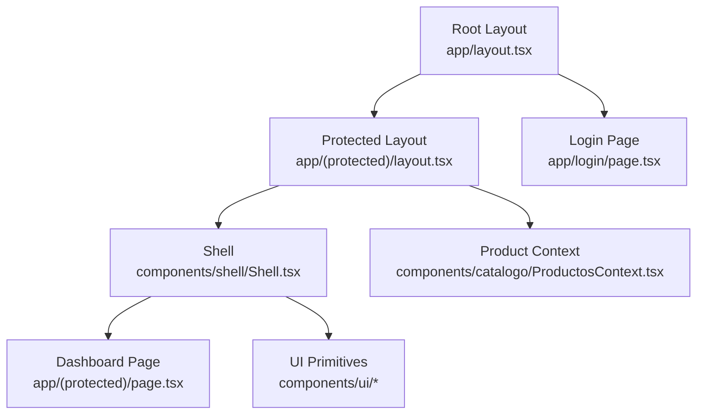
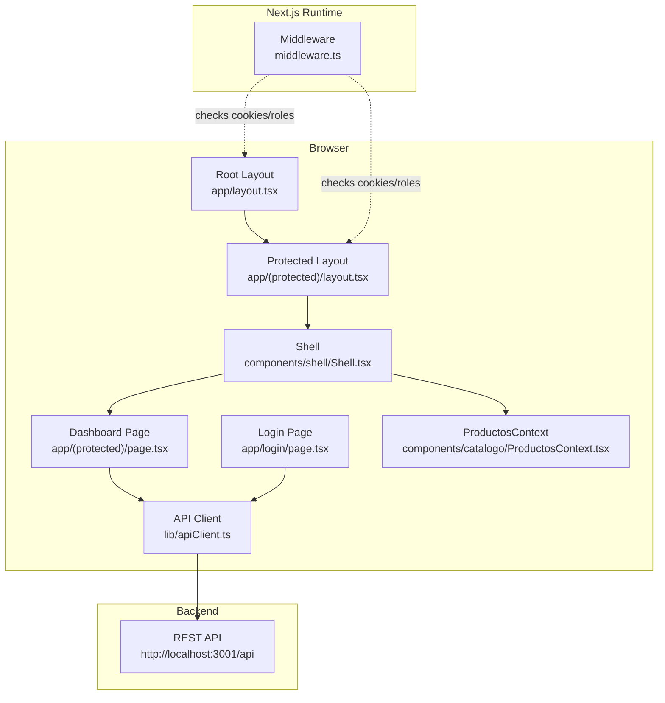
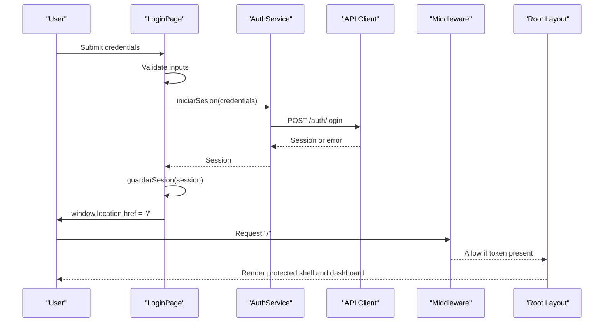
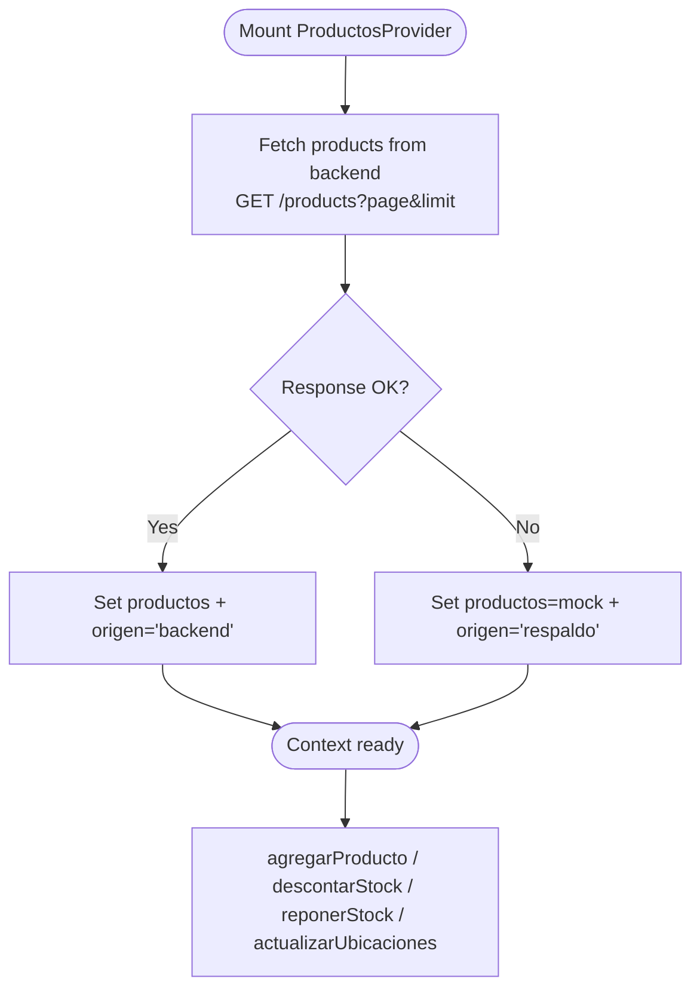
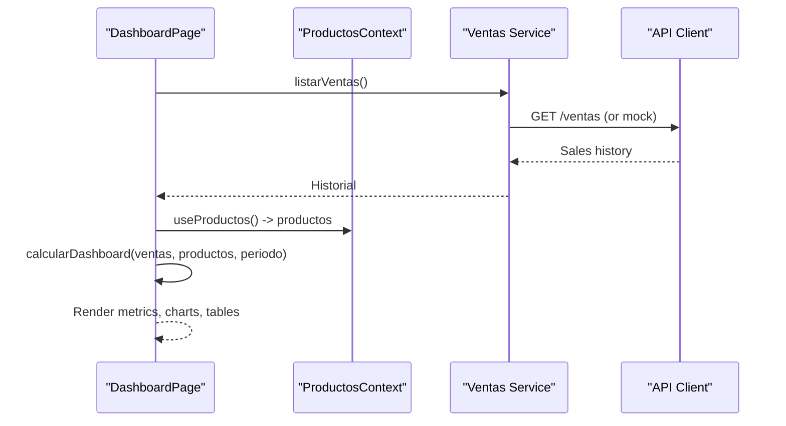
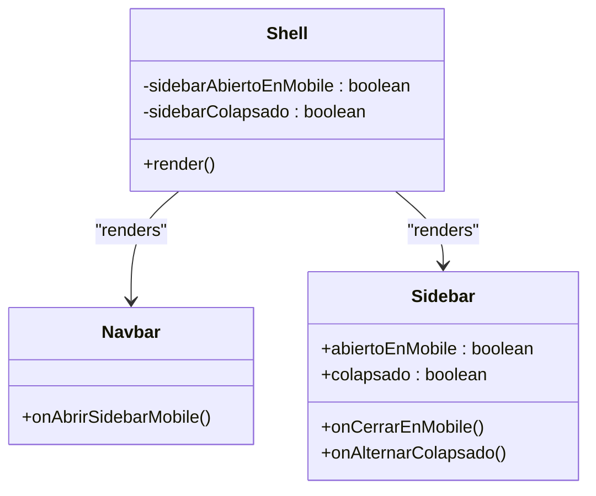
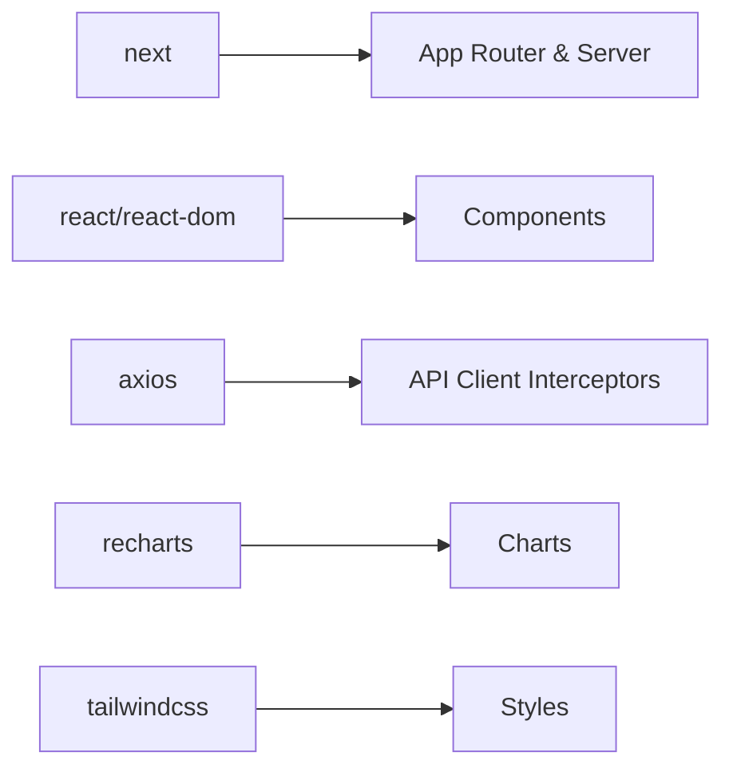

# Frontend Architecture

<cite>
**Referenced Files in This Document**
- [package.json](file://simoapp/package.json)
- [next.config.ts](file://simoapp/next.config.ts)
- [layout.tsx](file://simoapp/app/layout.tsx)
- [protected layout.tsx](file://simoapp/app/(protected)/layout.tsx)
- [dashboard page.tsx](file://simoapp/app/(protected)/page.tsx)
- [login page.tsx](file://simoapp/app/login/page.tsx)
- [middleware.ts](file://simoapp/middleware.ts)
- [apiClient.ts](file://simoapp/lib/apiClient.ts)
- [ProductosContext.tsx](file://simoapp/components/catalogo/ProductosContext.tsx)
- [Shell.tsx](file://simoapp/components/shell/Shell.tsx)
- [Button.tsx](file://simoapp/components/ui/Button.tsx)
- [InputText.tsx](file://simoapp/components/ui/InputText.tsx)
- [Modal.tsx](file://simoapp/components/ui/Modal.tsx)
- [tipos.ts](file://simoapp/components/catalogo/tipos.ts)
</cite>

## Table of Contents
1. Introduction
2. Project Structure
3. Core Components
4. Architecture Overview
5. Detailed Component Analysis
6. Dependency Analysis
7. Performance Considerations
8. Troubleshooting Guide
9. Conclusion

## Introduction
This document describes the Next.js frontend architecture for the SIMO application. It explains the App Router routing structure, component hierarchy, React Context state management for shared product data, styling with Tailwind CSS, reusable UI components, navigation flow, API integration, error handling, loading states, build configuration, environment variables, deployment preparation, performance optimization, accessibility compliance, and responsive design principles.

## Project Structure
The frontend is a Next.js application using the App Router under the app directory. The root layout sets global fonts and metadata, while protected routes are wrapped by a Shell layout that provides navigation and shared context. Public pages such as login are outside the protected group. Reusable UI primitives live under components/ui, domain features under feature folders (catalogo, dashboard, ventas, etc.), and shared logic under lib.

**Diagram sources**
- [layout.tsx:15-33](file://simoapp/app/layout.tsx#L15-L33)
- [protected layout.tsx:1-10](file://simoapp/app/(protected)/layout.tsx#L1-L10)
- [Shell.tsx:14-39](file://simoapp/components/shell/Shell.tsx#L14-L39)
- [dashboard page.tsx:53-127](file://simoapp/app/(protected)/page.tsx#L53-L127)
- [login page.tsx:23-59](file://simoapp/app/login/page.tsx#L23-L59)
- [ProductosContext.tsx:129-294](file://simoapp/components/catalogo/ProductosContext.tsx#L129-L294)

**Section sources**
- [layout.tsx:1-33](file://simoapp/app/layout.tsx#L1-L33)
- [protected layout.tsx:1-10](file://simoapp/app/(protected)/layout.tsx#L1-L10)
- [shell.tsx:1-39](file://simoapp/components/shell/Shell.tsx#L1-L39)

## Core Components
- Root layout: Sets global metadata, fonts, and base body styles.
- Protected layout: Wraps authenticated routes with ProductosProvider and Shell.
- Shell: Provides Navbar, Sidebar, and connection banner; manages sidebar open/collapsed state.
- Dashboard page: Loads sales history, computes metrics, renders charts and tables, handles loading and errors.
- Login page: Validates credentials, calls auth service, stores session, redirects via full-page navigation to trigger middleware.
- Product context: Centralized product list and operations; fetches from backend or falls back to mock data; exposes actions like add, stock adjustments, and location updates.
- UI primitives: Button, InputText, Modal provide consistent styling, accessibility, and behavior.

Key responsibilities:
- Routing and protection: middleware.ts enforces authentication and role-based access.
- Data sharing: ProductosContext holds product catalog and mutations.
- API integration: apiClient.ts configures axios interceptors for token injection and 401/403 handling.
- Styling: Tailwind CSS classes applied across components.

**Section sources**
- [layout.tsx:15-33](file://simoapp/app/layout.tsx#L15-L33)
- [protected layout.tsx:1-10](file://simoapp/app/(protected)/layout.tsx#L1-L10)
- [shell.tsx:14-39](file://simoapp/components/shell/Shell.tsx#L14-L39)
- [dashboard page.tsx:53-127](file://simoapp/app/(protected)/page.tsx#L53-L127)
- [login page.tsx:23-59](file://simoapp/app/login/page.tsx#L23-L59)
- [productoscontext.tsx:129-294](file://simoapp/components/catalogo/ProductosContext.tsx#L129-L294)
- [apiclient.ts:1-59](file://simoapp/lib/apiClient.ts#L1-L59)

## Architecture Overview
The application uses Next.js App Router with route groups. The root layout defines global HTML and metadata. Protected routes are grouped under (protected) and wrapped by a layout that injects ProductosProvider and Shell. Middleware protects routes based on cookies and roles. API calls go through an axios client that attaches JWT tokens and handles unauthorized responses.

**Diagram sources**
- [layout.tsx:15-33](file://simoapp/app/layout.tsx#L15-L33)
- [protected layout.tsx:1-10](file://simoapp/app/(protected)/layout.tsx#L1-L10)
- [shell.tsx:14-39](file://simoapp/components/shell/Shell.tsx#L14-L39)
- [dashboard page.tsx:53-127](file://simoapp/app/(protected)/page.tsx#L53-L127)
- [login page.tsx:23-59](file://simoapp/app/login/page.tsx#L23-L59)
- [productoscontext.tsx:129-294](file://simoapp/components/catalogo/ProductosContext.tsx#L129-L294)
- [apiclient.ts:1-59](file://simoapp/lib/apiClient.ts#L1-L59)
- [middleware.ts:1-37](file://simoapp/middleware.ts#L1-L37)

## Detailed Component Analysis

### Authentication and Routing Flow
The login page validates user input, calls the auth service, persists the session, and performs a full-page redirect so the server-side middleware can read the new cookie. Middleware enforces authentication and role-based access for protected routes.

**Diagram sources**
- [login page.tsx:37-59](file://simoapp/app/login/page.tsx#L37-L59)
- [apiclient.ts:13-56](file://simoapp/lib/apiClient.ts#L13-L56)
- [middleware.ts:4-28](file://simoapp/middleware.ts#L4-L28)
- [layout.tsx:15-33](file://simoapp/app/layout.tsx#L15-L33)

**Section sources**
- [login page.tsx:23-59](file://simoapp/app/login/page.tsx#L23-L59)
- [middleware.ts:4-28](file://simoapp/middleware.ts#L4-L28)

### Shared Product State with React Context
ProductosContext maintains the product catalog, tracks its source (loading, backend, fallback), and exposes actions to add products, adjust stock, update locations, and reset to mock data. It fetches products from the backend with pagination and falls back to mock data when unavailable.

**Diagram sources**
- [productoscontext.tsx:116-150](file://simoapp/components/catalogo/ProductosContext.tsx#L116-L150)
- [productoscontext.tsx:152-219](file://simoapp/components/catalogo/ProductosContext.tsx#L152-L219)
- [productoscontext.tsx:229-277](file://simoapp/components/catalogo/ProductosContext.tsx#L229-L277)

Key interfaces and types:
- Producto interface includes identifiers, pricing, stock totals, per-location stock, minimum stock, and status.
- OrigenProductos indicates data source: loading, backend, or fallback.
- ProductosContextValue exposes state and mutation functions.

**Section sources**
- [productoscontext.tsx:31-44](file://simoapp/components/catalogo/ProductosContext.tsx#L31-L44)
- [productoscontext.tsx:129-294](file://simoapp/components/catalogo/ProductosContext.tsx#L129-L294)
- [tipos.ts:25-46](file://simoapp/components/catalogo/tipos.ts#L25-L46)

### Dashboard Page and Metrics
The dashboard loads sales history, computes metrics, and renders charts and tables. It shows skeletons while loading, displays contextual messages when using fallback data, and allows refreshing without reloading the page.

**Diagram sources**
- [dashboard page.tsx:64-113](file://simoapp/app/(protected)/page.tsx#L64-L113)
- [dashboard page.tsx:123-127](file://simoapp/app/(protected)/page.tsx#L123-L127)
- [productoscontext.tsx:129-150](file://simoapp/components/catalogo/ProductosContext.tsx#L129-L150)

**Section sources**
- [dashboard page.tsx:53-127](file://simoapp/app/(protected)/page.tsx#L53-L127)

### UI Primitives and Composition
Reusable UI components follow consistent patterns:
- Button: Variants primary, secondary, danger; defaults to type="button"; supports className composition and focus-visible rings.
- InputText: Label, error, hint, password visibility toggle, date support, accessible attributes.
- Modal: Portal-based overlay, backdrop click-to-close, Escape key handling, animated transitions, accessible dialog semantics.

Composition examples:
- Login form composes InputText and Button to collect credentials and submit.
- Dashboard composes PanelDashboard, chart components, and TarjetaMetrica to visualize metrics.

Accessibility highlights:
- Inputs expose aria attributes and labels.
- Modal uses role="dialog", aria-modal, and keyboard handling.
- Buttons include focus-visible outlines and disabled states.

**Section sources**
- [button.tsx:10-43](file://simoapp/components/ui/Button.tsx#L10-L43)
- [inputtext.tsx:16-91](file://simoapp/components/ui/InputText.tsx#L16-L91)
- [modal.tsx:6-146](file://simoapp/components/ui/Modal.tsx#L6-L146)
- [login page.tsx:75-127](file://simoapp/app/login/page.tsx#L75-L127)
- [dashboard page.tsx:244-322](file://simoapp/app/(protected)/page.tsx#L244-L322)

### Shell and Navigation
Shell coordinates Navbar and Sidebar, managing mobile drawer state and desktop collapse state. It renders a connection banner above the main content area.

**Diagram sources**
- [shell.tsx:14-39](file://simoapp/components/shell/Shell.tsx#L14-L39)

**Section sources**
- [shell.tsx:14-39](file://simoapp/components/shell/Shell.tsx#L14-L39)

## Dependency Analysis
Frontend dependencies and their roles:
- next: Framework and App Router.
- react/react-dom: UI runtime.
- axios: HTTP client with interceptors for auth and error handling.
- recharts: Charts for dashboard visualizations.
- tailwindcss/@tailwindcss/postcss: Utility-first styling.

Build scripts:
- dev: Start development server.
- build: Production build.
- start: Run production server.
- lint: ESLint.

Environment variables:
- NEXT_PUBLIC_API_URL: Base URL for backend API.
- NEXT_PUBLIC_VENTAS_MOCK: Controls whether sales history uses mock data.

**Diagram sources**
- [package.json:11-26](file://simoapp/package.json#L11-L26)
- [apiclient.ts:1-11](file://simoapp/lib/apiClient.ts#L1-L11)

**Section sources**
- [package.json:5-26](file://simoapp/package.json#L5-L26)
- [apiclient.ts:1-11](file://simoapp/lib/apiClient.ts#L1-L11)

## Performance Considerations
- Minimize unnecessary re-renders:
  - Use memoization for derived metrics (e.g., useMemo for dashboard calculations).
  - Avoid heavy computations inside render paths; compute in effects or callbacks.
- Efficient data fetching:
  - Paginate product listings and only load what’s needed.
  - Prefer server-side data where possible; keep client state minimal.
- UI responsiveness:
  - Skeleton loaders during async operations to improve perceived performance.
  - Debounce search/filter inputs if added later.
- Bundle size:
  - Lazy-load non-critical components and charts.
  - Tree-shake unused modules; avoid importing entire libraries.
- Network resilience:
  - Retry failed requests with exponential backoff.
  - Cache responses where appropriate (e.g., product catalog).

[No sources needed since this section provides general guidance]

## Troubleshooting Guide
Common issues and resolutions:
- Unauthorized or forbidden responses:
  - The API client clears session and redirects to login on 401/403, except for the login endpoint itself.
- Backend unreachable:
  - ProductosContext falls back to mock data and marks origen as "respaldo". The dashboard shows a notice indicating fallback mode.
- Middleware not seeing new cookies:
  - After login, a full-page navigation ensures the server reads updated cookies before rendering protected routes.
- Form validation errors:
  - Login page validates inputs and displays field-level errors; disable controls while submitting to prevent duplicate submissions.

Operational tips:
- Verify NEXT_PUBLIC_API_URL points to the correct backend host.
- Check browser console for network errors and payload mismatches.
- Ensure cookies are set correctly and not blocked by SameSite policies.

**Section sources**
- [apiclient.ts:33-56](file://simoapp/lib/apiClient.ts#L33-L56)
- [productoscontext.tsx:133-150](file://simoapp/components/catalogo/ProductosContext.tsx#L133-L150)
- [dashboard page.tsx:213-223](file://simoapp/app/(protected)/page.tsx#L213-L223)
- [login page.tsx:37-59](file://simoapp/app/login/page.tsx#L37-L59)
- [middleware.ts:4-28](file://simoapp/middleware.ts#L4-L28)

## Conclusion
The SIMO frontend follows a clear, modular architecture built on Next.js App Router, React Context for shared state, and Tailwind CSS for styling. Protected routes are enforced by middleware, and API interactions are centralized through an axios client with robust error handling. The component hierarchy separates concerns between layout, shell, domain pages, and reusable UI primitives. With careful attention to performance, accessibility, and responsive design, the application delivers a maintainable and user-friendly experience.

[No sources needed since this section summarizes without analyzing specific files]