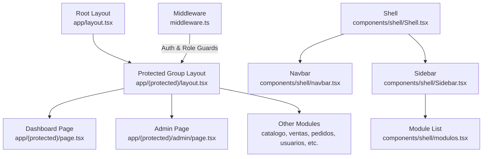
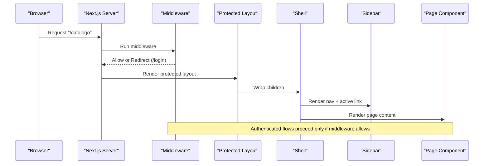
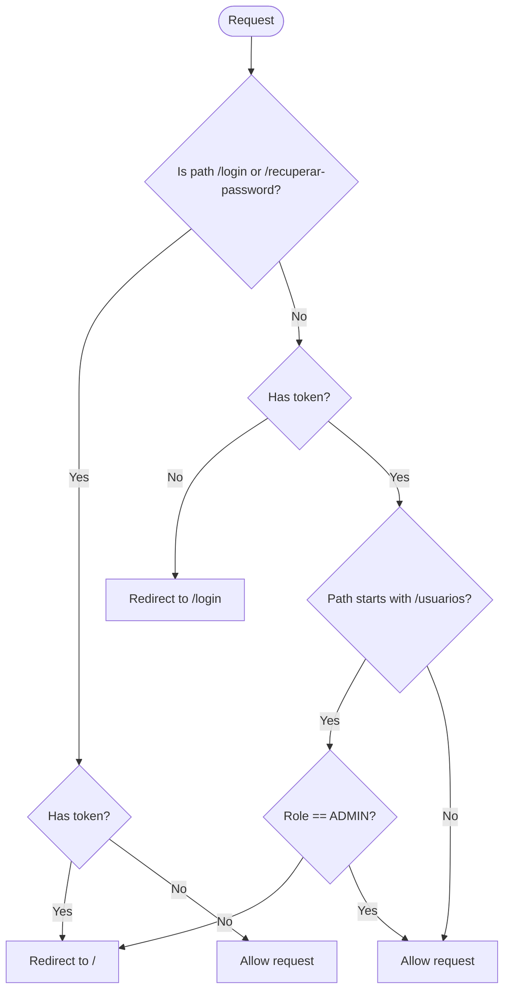
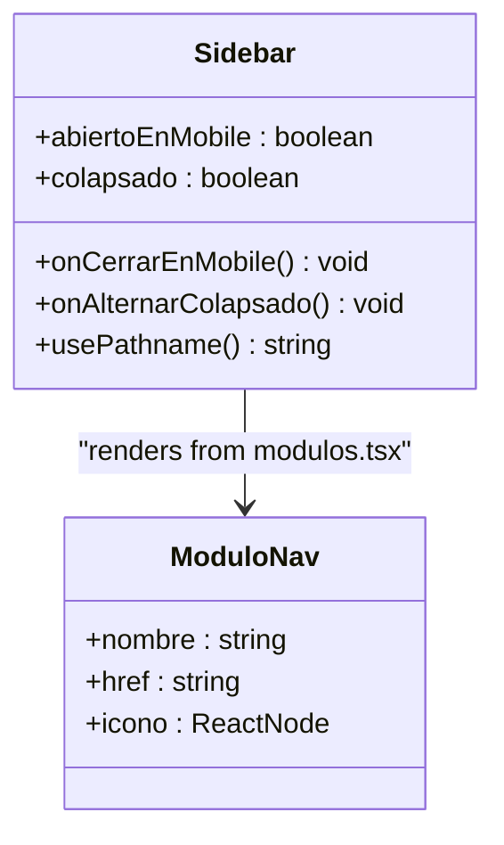
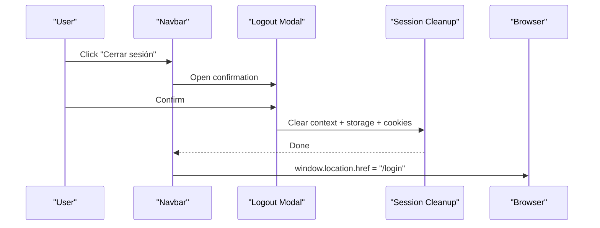
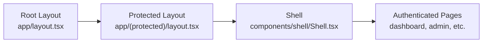
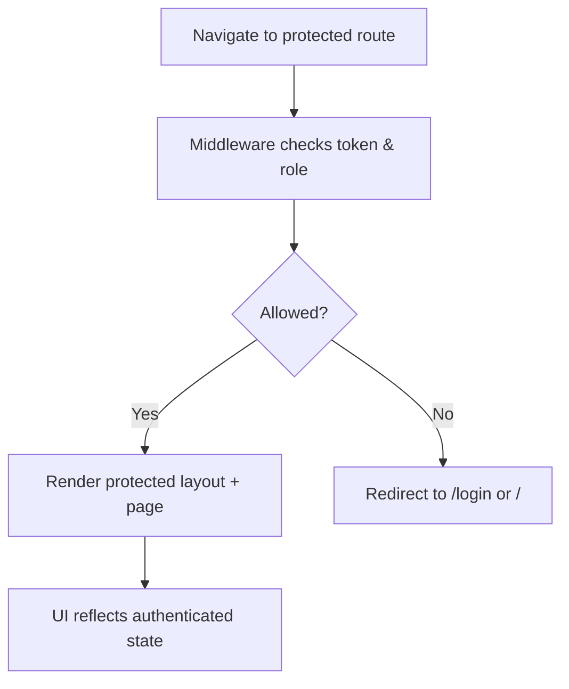
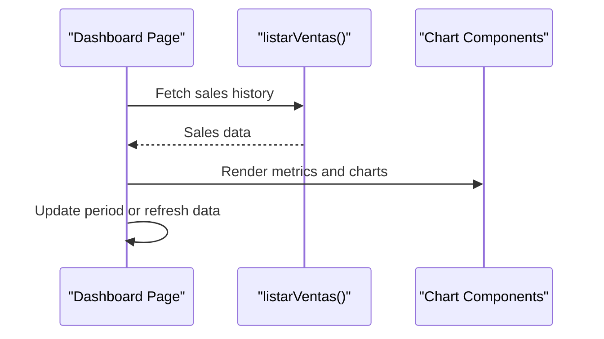
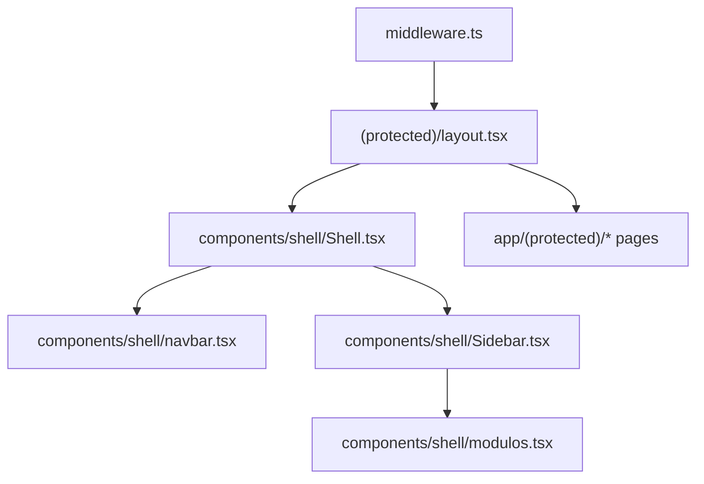

# Routing & Navigation

<cite>
**Referenced Files in This Document**
- [middleware.ts](file://simoapp/middleware.ts)
- [layout.tsx](file://simoapp/app/layout.tsx)
- [protected layout.tsx](file://simoapp/app/(protected)/layout.tsx)
- [dashboard page.tsx](file://simoapp/app/(protected)/page.tsx)
- [admin page.tsx](file://simoapp/app/(protected)/admin/page.tsx)
- [Shell.tsx](file://simoapp/components/shell/Shell.tsx)
- [Sidebar.tsx](file://simoapp/components/shell/Sidebar.tsx)
- [Navbar.tsx](file://simoapp/components/shell/navbar.tsx)
- [modulos.tsx](file://simoapp/components/shell/modulos.tsx)
</cite>

## Table of Contents
1. [Introduction](#introduction)
2. [Project Structure](#project-structure)
3. [Core Components](#core-components)
4. [Architecture Overview](#architecture-overview)
5. [Detailed Component Analysis](#detailed-component-analysis)
6. [Dependency Analysis](#dependency-analysis)
7. [Performance Considerations](#performance-considerations)
8. [Troubleshooting Guide](#troubleshooting-guide)
9. [Conclusion](#conclusion)

## Introduction
This document explains the Next.js App Router routing and navigation patterns used in the application, focusing on:
- Route groups and protected routes via middleware
- Sidebar navigation system and active route highlighting
- Programmatic navigation and logout flow
- Authentication and role-based guards
- Nested layouts and where to add dynamic routes, query strings, and route parameters
- SEO considerations, metadata management, and performance optimization for route transitions

The goal is to help developers understand how the app’s routing works today and how to extend it safely with new pages, dynamic segments, and navigation state.

## Project Structure
The App Router structure uses a root layout and a protected route group:
- Root layout defines global HTML, fonts, and site-wide metadata.
- The `(protected)` route group wraps authenticated areas with a shared Shell layout that includes Navbar, Sidebar, and main content area.
- Public routes (login, password recovery) live outside the protected group.

**Diagram sources**
- [layout.tsx:15-33](file://simoapp/app/layout.tsx#L15-L33)
- [protected layout.tsx:1-10](file://simoapp/app/(protected)/layout.tsx#L1-L10)
- [dashboard page.tsx:1-336](file://simoapp/app/(protected)/page.tsx#L1-L336)
- [admin page.tsx:1-113](file://simoapp/app/(protected)/admin/page.tsx#L1-L113)
- [middleware.ts:1-37](file://simoapp/middleware.ts#L1-L37)
- [Shell.tsx:1-40](file://simoapp/components/shell/Shell.tsx#L1-L40)
- [Sidebar.tsx:1-98](file://simoapp/components/shell/Sidebar.tsx#L1-L98)
- [modulos.tsx:1-79](file://simoapp/components/shell/modulos.tsx#L1-L79)

**Section sources**
- [layout.tsx:15-33](file://simoapp/app/layout.tsx#L15-L33)
- [protected layout.tsx:1-10](file://simoapp/app/(protected)/layout.tsx#L1-L10)
- [middleware.ts:1-37](file://simoapp/middleware.ts#L1-L37)

## Core Components
- Middleware enforces authentication and role-based access before rendering protected routes.
- Protected layout composes the Shell and product context provider for all authenticated modules.
- Shell coordinates Navbar and Sidebar and manages mobile/desktop sidebar state.
- Sidebar renders navigation links from a central module list and highlights the active route.
- Navbar provides user menu actions including logout, which clears session state and redirects to login.

Key responsibilities:
- Security: middleware validates token and role.
- Layout composition: root layout sets global metadata; protected layout adds Shell and providers.
- Navigation: Sidebar uses Next.js Link and usePathname to highlight current route.
- Programmatic navigation: Navbar triggers full-page redirect to /login after logout.

**Section sources**
- [middleware.ts:4-28](file://simoapp/middleware.ts#L4-L28)
- [protected layout.tsx:1-10](file://simoapp/app/(protected)/layout.tsx#L1-L10)
- [Shell.tsx:14-39](file://simoapp/components/shell/Shell.tsx#L14-L39)
- [Sidebar.tsx:30-92](file://simoapp/components/shell/Sidebar.tsx#L30-L92)
- [Navbar.tsx:31-51](file://simoapp/components/shell/navbar.tsx#L31-L51)

## Architecture Overview
The routing architecture combines server-side protection with client-side navigation:

**Diagram sources**
- [middleware.ts:4-28](file://simoapp/middleware.ts#L4-L28)
- [protected layout.tsx:1-10](file://simoapp/app/(protected)/layout.tsx#L1-L10)
- [Shell.tsx:14-39](file://simoapp/components/shell/Shell.tsx#L14-L39)
- [Sidebar.tsx:30-92](file://simoapp/components/shell/Sidebar.tsx#L30-L92)

## Detailed Component Analysis

### Route Groups and Protected Routes
- Route group `(protected)` isolates authenticated routes and applies a shared layout.
- Middleware protects these routes by checking cookies for token and role.
- Public routes like `/login` and `/recuperar-password` are explicitly allowed without a token.
- Role-based guard restricts `/usuarios` to ADMIN users.

**Diagram sources**
- [middleware.ts:9-28](file://simoapp/middleware.ts#L9-L28)

**Section sources**
- [middleware.ts:4-28](file://simoapp/middleware.ts#L4-L28)
- [protected layout.tsx:1-10](file://simoapp/app/(protected)/layout.tsx#L1-L10)

### Sidebar Navigation System
- Sidebar renders navigation items from a centralized module list.
- Active route detection compares the current pathname against each item’s href and its subpaths.
- Mobile behavior shows a drawer overlay; desktop behavior supports collapsed mode.

**Diagram sources**
- [Sidebar.tsx:17-92](file://simoapp/components/shell/Sidebar.tsx#L17-L92)
- [modulos.tsx:25-78](file://simoapp/components/shell/modulos.tsx#L25-L78)

**Section sources**
- [Sidebar.tsx:30-92](file://simoapp/components/shell/Sidebar.tsx#L30-L92)
- [modulos.tsx:25-78](file://simoapp/components/shell/modulos.tsx#L25-L78)

### Programmatic Navigation and Logout Flow
- Logout action clears local state, calls session cleanup, and performs a full-page redirect to `/login`.
- Full-page reload ensures middleware re-evaluates authentication state.

**Diagram sources**
- [Navbar.tsx:37-51](file://simoapp/components/shell/navbar.tsx#L37-L51)

**Section sources**
- [Navbar.tsx:31-51](file://simoapp/components/shell/navbar.tsx#L31-L51)

### Nested Layouts and Shared Providers
- Root layout sets global HTML attributes and site metadata.
- Protected layout wraps children with Shell and product context provider, ensuring consistent UI and data availability across authenticated pages.

**Diagram sources**
- [layout.tsx:15-33](file://simoapp/app/layout.tsx#L15-L33)
- [protected layout.tsx:1-10](file://simoapp/app/(protected)/layout.tsx#L1-L10)
- [Shell.tsx:14-39](file://simoapp/components/shell/Shell.tsx#L14-L39)

**Section sources**
- [layout.tsx:15-33](file://simoapp/app/layout.tsx#L15-L33)
- [protected layout.tsx:1-10](file://simoapp/app/(protected)/layout.tsx#L1-L10)

### Dynamic Routing, Route Parameters, and Query Strings
- The codebase currently uses static routes under the protected group (e.g., `/catalogo`, `/ventas`, `/pedidos`, `/usuarios`, `/admin`).
- To add dynamic routes, create folders with square brackets (e.g., `app/(protected)/productos/[id]/page.tsx`) and read parameters using Next.js hooks inside the page component.
- For query strings, use Next.js searchParams in server components or `useSearchParams` in client components to read values like `?q=...` or `?periodo=...`.
- Example pattern:
  - Dynamic segment: `[id]`
  - Optional catch-all: `[...slug]`
  - Query string: `?search=term&sort=asc`

[No sources needed since this section provides general guidance]

### Route Guards and Authentication Flow Integration
- Middleware acts as the primary route guard, enforcing token presence and role checks.
- Client-side UI (Navbar, Sidebar) assumes authenticated state when rendered within the protected layout.
- Logout resets client state and forces a full-page redirect to ensure middleware runs again.

**Diagram sources**
- [middleware.ts:4-28](file://simoapp/middleware.ts#L4-L28)
- [protected layout.tsx:1-10](file://simoapp/app/(protected)/layout.tsx#L1-L10)

**Section sources**
- [middleware.ts:4-28](file://simoapp/middleware.ts#L4-L28)
- [Navbar.tsx:37-51](file://simoapp/components/shell/navbar.tsx#L37-L51)

### Dashboard Page and Data Loading Patterns
- The dashboard page demonstrates client-side data fetching, loading states, error handling, and periodic updates without full-page reloads.
- It composes multiple chart and metric components, showing how to structure complex pages within the protected layout.

**Diagram sources**
- [dashboard page.tsx:53-102](file://simoapp/app/(protected)/page.tsx#L53-L102)
- [dashboard page.tsx:242-323](file://simoapp/app/(protected)/page.tsx#L242-L323)

**Section sources**
- [dashboard page.tsx:53-102](file://simoapp/app/(protected)/page.tsx#L53-L102)
- [dashboard page.tsx:242-323](file://simoapp/app/(protected)/page.tsx#L242-L323)

### Admin Page Example
- The admin page illustrates a simple form-driven update flow within a protected route, demonstrating how to manage local state and confirm changes.

**Section sources**
- [admin page.tsx:14-23](file://simoapp/app/(protected)/admin/page.tsx#L14-L23)
- [admin page.tsx:25-110](file://simoapp/app/(protected)/admin/page.tsx#L25-L110)

## Dependency Analysis
The following diagram maps key dependencies between routing, layout, and navigation components:

**Diagram sources**
- [middleware.ts:1-37](file://simoapp/middleware.ts#L1-L37)
- [protected layout.tsx:1-10](file://simoapp/app/(protected)/layout.tsx#L1-L10)
- [Shell.tsx:1-40](file://simoapp/components/shell/Shell.tsx#L1-L40)
- [Sidebar.tsx:1-98](file://simoapp/components/shell/Sidebar.tsx#L1-L98)
- [modulos.tsx:1-79](file://simoapp/components/shell/modulos.tsx#L1-L79)

**Section sources**
- [middleware.ts:1-37](file://simoapp/middleware.ts#L1-L37)
- [protected layout.tsx:1-10](file://simoapp/app/(protected)/layout.tsx#L1-L10)
- [Shell.tsx:1-40](file://simoapp/components/shell/Shell.tsx#L1-L40)
- [Sidebar.tsx:1-98](file://simoapp/components/shell/Sidebar.tsx#L1-L98)
- [modulos.tsx:1-79](file://simoapp/components/shell/modulos.tsx#L1-L79)

## Performance Considerations
- Prefer client-side navigation using Next.js Link for in-app routes to avoid full-page reloads and leverage prefetching.
- Use the protected layout to share expensive providers (like product context) across authenticated pages.
- Keep middleware logic minimal and focused on token and role checks to reduce server overhead.
- For heavy dashboards, consider server components for initial data fetching and client components for interactivity.
- Avoid unnecessary re-renders in Sidebar by memoizing computed active states and icons.
- Use skeleton loaders and clear loading states to improve perceived performance during data fetches.

[No sources needed since this section provides general guidance]

## Troubleshooting Guide
Common issues and resolutions:
- Redirect loops on protected routes: Ensure cookies contain a valid token and role; verify middleware matcher excludes static assets.
- Unauthorized access to `/usuarios`: Confirm the user role is ADMIN; otherwise, middleware will redirect to the home route.
- Logout not clearing session: Verify the logout flow clears context, storage, and cookies, then performs a full-page redirect to `/login`.
- Sidebar not highlighting active route: Ensure the current pathname matches the href or starts with the href prefix; check for trailing slashes or case differences.

**Section sources**
- [middleware.ts:9-28](file://simoapp/middleware.ts#L9-L28)
- [Sidebar.tsx:66-71](file://simoapp/components/shell/Sidebar.tsx#L66-L71)
- [Navbar.tsx:37-51](file://simoapp/components/shell/navbar.tsx#L37-L51)

## Conclusion
The application uses Next.js App Router with a protected route group and middleware-based guards to secure authenticated features. The Shell layout standardizes the UI shell, while the Sidebar provides consistent navigation with active route highlighting. Programmatic navigation is used primarily for logout, ensuring a clean session reset. To extend the routing model, introduce dynamic segments and query strings within the protected group, and continue leveraging middleware for security. For SEO, set metadata at the root level and per-route where needed, and optimize performance by sharing providers and minimizing full-page reloads.

[No sources needed since this section summarizes without analyzing specific files]