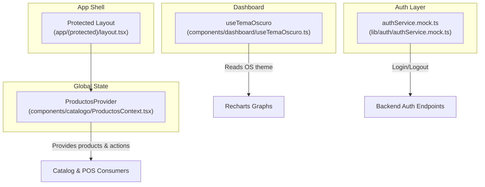
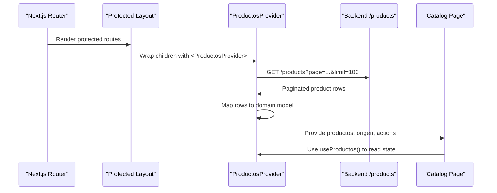
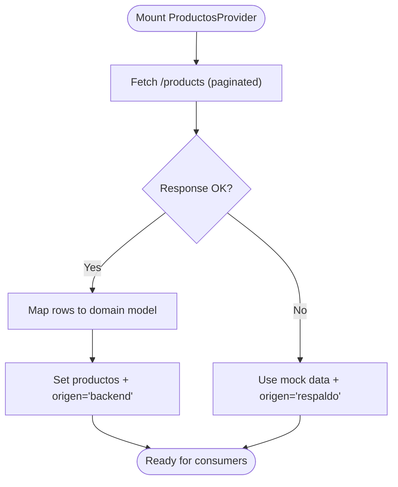
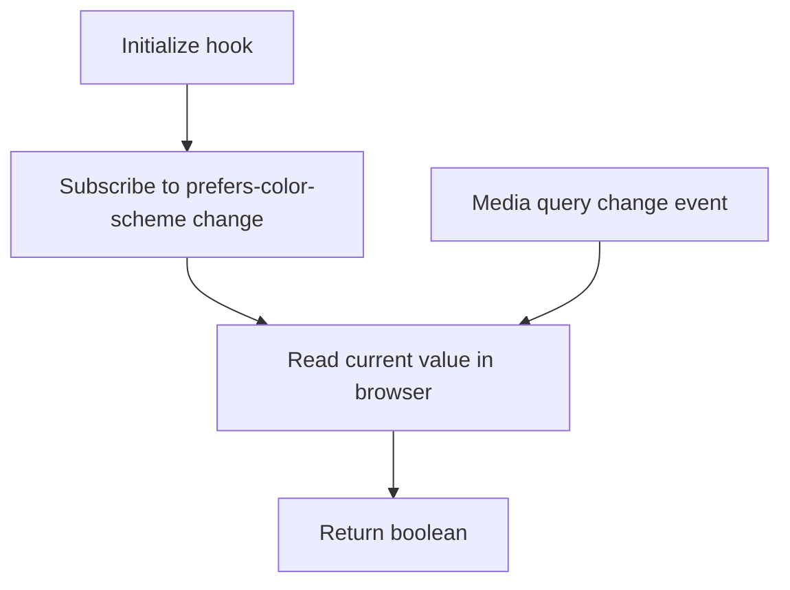
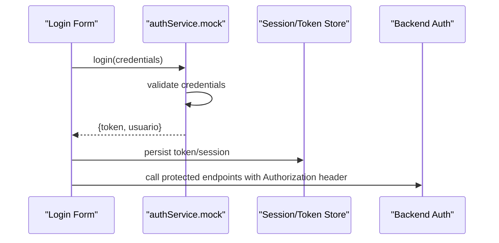
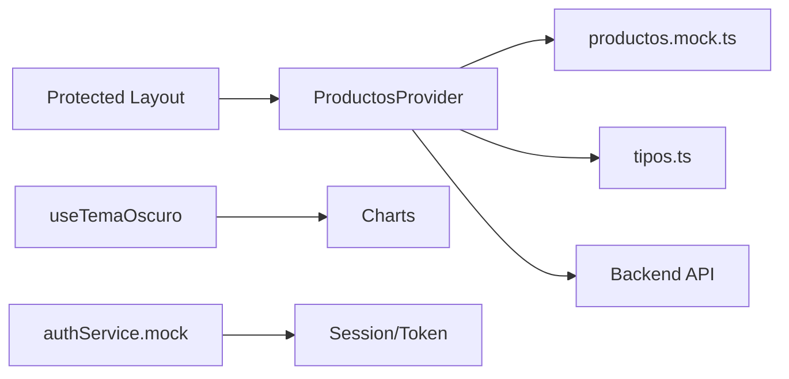

# State Management

<cite>
**Referenced Files in This Document**
- [layout.tsx](file://simoapp/app/(protected)/layout.tsx)
- [ProductosContext.tsx](file://simoapp/components/catalogo/ProductosContext.tsx)
- [productos.mock.ts](file://simoapp/components/catalogo/productos.mock.ts)
- [tipos.ts](file://simoapp/components/catalogo/tipos.ts)
- [useTemaOscuro.ts](file://simoapp/components/dashboard/useTemaOscuro.ts)
- [authService.mock.ts](file://simoapp/lib/auth/authService.mock.ts)
</cite>

## Table of Contents
1. [Introduction](#introduction)
2. [Project Structure](#project-structure)
3. [Core Components](#core-components)
4. [Architecture Overview](#architecture-overview)
5. [Detailed Component Analysis](#detailed-component-analysis)
6. [Dependency Analysis](#dependency-analysis)
7. [Performance Considerations](#performance-considerations)
8. [Troubleshooting Guide](#troubleshooting-guide)
9. [Conclusion](#conclusion)

## Introduction
This document explains the React Context-based state management patterns used in the application, focusing on:
- Global state architecture with Context providers
- Local component state and data fetching patterns
- Authentication context usage (via service layer)
- Product catalog context for shared product state
- Theme detection for dark mode
- State synchronization between UI and backend
- Error handling strategies and performance techniques such as selectors and memoization

The goal is to make these patterns accessible to both technical and non-technical readers while providing concrete references to source files.

## Project Structure
At a high level, the frontend organizes state around:
- A protected layout that wraps routes with a global provider
- A product catalog context that owns shared product data and mutations
- A dashboard hook that reads system theme preferences without causing unnecessary re-renders
- An authentication service layer that encapsulates login/logout logic and token handling



**Diagram sources**
- [layout.tsx:1-11](file://simoapp/app/(protected)/layout.tsx#L1-L11)
- [ProductosContext.tsx:129-294](file://simoapp/components/catalogo/ProductosContext.tsx#L129-L294)
- [useTemaOscuro.ts:18-33](file://simoapp/components/dashboard/useTemaOscuro.ts#L18-L33)
- [authService.mock.ts:77-92](file://simoapp/lib/auth/authService.mock.ts#L77-L92)

**Section sources**
- [layout.tsx:1-11](file://simoapp/app/(protected)/layout.tsx#L1-L11)
- [ProductosContext.tsx:1-303](file://simoapp/components/catalogo/ProductosContext.tsx#L1-L303)
- [useTemaOscuro.ts:1-35](file://simoapp/components/dashboard/useTemaOscuro.ts#L1-L35)
- [authService.mock.ts:77-121](file://simoapp/lib/auth/authService.mock.ts#L77-L121)

## Core Components
- ProductosProvider: Centralized product catalog state with server-side data fetching, fallback to mock data, and mutation functions for stock updates and location transfers.
- useTemaOscuro: Reads system dark mode preference using an external store pattern to avoid hydration mismatches and unnecessary renders.
- authService.mock: Encapsulates authentication flows, returning tokens and user info, and exposing helper utilities for listing and creating users.

Key responsibilities:
- Global product state and persistence strategy (backend-first, mock fallback)
- Safe consumption via typed hooks
- Theme detection aligned with OS settings
- Authentication service abstraction for consistent login/logout behavior

**Section sources**
- [ProductosContext.tsx:36-44](file://simoapp/components/catalogo/ProductosContext.tsx#L36-L44)
- [ProductosContext.tsx:129-294](file://simoapp/components/catalogo/ProductosContext.tsx#L129-L294)
- [useTemaOscuro.ts:18-33](file://simoapp/components/dashboard/useTemaOscuro.ts#L18-L33)
- [authService.mock.ts:77-92](file://simoapp/lib/auth/authService.mock.ts#L77-L92)

## Architecture Overview
The application uses a layered approach:
- Providers at the route level wrap feature areas with global state
- Feature contexts expose typed hooks for consumers
- Services abstract network calls and error handling
- Hooks read external stores (like media queries) safely



**Diagram sources**
- [layout.tsx:1-11](file://simoapp/app/(protected)/layout.tsx#L1-L11)
- [ProductosContext.tsx:116-127](file://simoapp/components/catalogo/ProductosContext.tsx#L116-L127)
- [ProductosContext.tsx:129-150](file://simoapp/components/catalogo/ProductosContext.tsx#L129-L150)

## Detailed Component Analysis

### ProductosProvider (Product Catalog Context)
Responsibilities:
- Initialize product list from backend with pagination
- Fallback to mock data when backend is unavailable
- Expose typed methods to add products, adjust stock, update locations, and reset to mock
- Provide a consumer hook that enforces usage within the provider

Data flow:
- On mount, fetch all pages until hasNextPage is false
- Map backend rows to domain model
- Update state and set origin flag ("backend" or "respaldo")

Mutations:
- Add product: POST to backend, then optimistically update local state
- Discount stock: cascade deduction from Almacén then Bodega
- Restore stock: increase Almacén and total on sale cancellation
- Update locations: reflect transfer results from backend

Error handling:
- Network errors trigger fallback to mock data
- Backend response errors are logged and surfaced to the user



**Diagram sources**
- [ProductosContext.tsx:116-127](file://simoapp/components/catalogo/ProductosContext.tsx#L116-L127)
- [ProductosContext.tsx:129-150](file://simoapp/components/catalogo/ProductosContext.tsx#L129-L150)

**Section sources**
- [ProductosContext.tsx:36-44](file://simoapp/components/catalogo/ProductosContext.tsx#L36-L44)
- [ProductosContext.tsx:90-112](file://simoapp/components/catalogo/ProductosContext.tsx#L90-L112)
- [ProductosContext.tsx:116-150](file://simoapp/components/catalogo/ProductosContext.tsx#L116-L150)
- [ProductosContext.tsx:152-219](file://simoapp/components/catalogo/ProductosContext.tsx#L152-L219)
- [ProductosContext.tsx:229-277](file://simoapp/components/catalogo/ProductosContext.tsx#L229-L277)
- [ProductosContext.tsx:279-302](file://simoapp/components/catalogo/ProductosContext.tsx#L279-L302)

### useTemaOscuro (Theme Detection Hook)
Purpose:
- Read OS-level dark mode preference without triggering cascading re-renders
- Avoid hydration mismatch by providing separate client/server getters

Implementation highlights:
- Uses an external store subscription pattern
- Subscribes to media query changes
- Returns a boolean indicating dark mode



**Diagram sources**
- [useTemaOscuro.ts:18-33](file://simoapp/components/dashboard/useTemaOscuro.ts#L18-L33)

**Section sources**
- [useTemaOscuro.ts:1-35](file://simoapp/components/dashboard/useTemaOscuro.ts#L1-L35)

### Authentication Service (authService.mock)
Purpose:
- Abstract login/logout operations and token handling
- Provide mock implementations for development/testing

Key behaviors:
- Validates credentials
- Returns a token and minimal user object
- Throws typed errors for invalid credentials or inactive accounts



**Diagram sources**
- [authService.mock.ts:77-92](file://simoapp/lib/auth/authService.mock.ts#L77-L92)

**Section sources**
- [authService.mock.ts:77-121](file://simoapp/lib/auth/authService.mock.ts#L77-L121)

### Data Models and Types
The product model defines fields for pricing, stock distribution across locations, and status. Categories and filters are strongly typed to ensure consistency across forms and search interfaces.

```mermaid
classDiagram
class Producto {
+number id
+string codigo
+string nombre
+string descripcion
+Categoria categoria
+string unidadMedida
+number precioCompra
+number precioVenta
+number stockActual
+number stockBodega
+number stockAlmacen
+number stockMinimo
+EstadoProducto estado
}
class Categoria {
<<enum>>
"Electrónica"
"Ropa"
"Ferretería"
"Papelería"
"Hogar"
}
class EstadoProducto {
<<enum>>
"Activo"
"Inactivo"
}
Producto --> Categoria : "uses"
Producto --> EstadoProducto : "uses"
```

**Diagram sources**
- [tipos.ts:4-21](file://simoapp/components/catalogo/tipos.ts#L4-L21)
- [tipos.ts:25-46](file://simoapp/components/catalogo/tipos.ts#L25-L46)

**Section sources**
- [tipos.ts:1-51](file://simoapp/components/catalogo/tipos.ts#L1-L51)

## Dependency Analysis
- Protected layout depends on ProductosProvider to provide global product state to all protected routes.
- ProductosProvider depends on:
  - Mock data for fallback
  - Domain types for strong typing
  - Backend API for initial load and mutations
- Dashboard theme hook is independent of product state but may be consumed by chart components.
- Authentication service is independent of product state and can be used across the app for auth flows.



**Diagram sources**
- [layout.tsx:1-11](file://simoapp/app/(protected)/layout.tsx#L1-L11)
- [ProductosContext.tsx:116-150](file://simoapp/components/catalogo/ProductosContext.tsx#L116-L150)
- [productos.mock.ts:1-191](file://simoapp/components/catalogo/productos.mock.ts#L1-L191)
- [tipos.ts:1-51](file://simoapp/components/catalogo/tipos.ts#L1-L51)
- [useTemaOscuro.ts:18-33](file://simoapp/components/dashboard/useTemaOscuro.ts#L18-L33)
- [authService.mock.ts:77-92](file://simoapp/lib/auth/authService.mock.ts#L77-L92)

**Section sources**
- [layout.tsx:1-11](file://simoapp/app/(protected)/layout.tsx#L1-L11)
- [ProductosContext.tsx:116-150](file://simoapp/components/catalogo/ProductosContext.tsx#L116-L150)
- [productos.mock.ts:1-191](file://simoapp/components/catalogo/productos.mock.ts#L1-L191)
- [tipos.ts:1-51](file://simoapp/components/catalogo/tipos.ts#L1-L51)
- [useTemaOscuro.ts:18-33](file://simoapp/components/dashboard/useTemaOscuro.ts#L18-L33)
- [authService.mock.ts:77-92](file://simoapp/lib/auth/authService.mock.ts#L77-L92)

## Performance Considerations
- Context selectors: When consuming product state, select only the fields needed by a component to minimize re-renders. For example, a search bar should subscribe only to the product list and filter options, not to mutation functions.
- Memoization:
  - Memoize derived lists (filtered/sorted products) using useMemo to avoid recomputation on every render.
  - Memoize expensive computations like category aggregations or stock summaries.
- External store pattern: The theme hook uses an external store subscription to avoid hydration mismatches and unnecessary re-renders triggered by media query changes.
- Optimistic updates: Stock adjustments are applied locally first to keep the UI responsive; eventual consistency is achieved on subsequent reloads or backend responses.
- Pagination handling: The provider fetches all pages once and caches them in memory, enabling fast client-side filtering and search.

[No sources needed since this section provides general guidance]

## Troubleshooting Guide
Common issues and resolutions:
- Using useProductos outside provider: The hook throws an error if called outside the provider scope. Ensure the component tree is wrapped by ProductosProvider.
- Backend connectivity failures: If the backend is unreachable, the provider falls back to mock data and sets the origin to "respaldo". Verify environment variables and API URL configuration.
- Hydration mismatch with theme: The theme hook avoids SSR/client differences by providing separate getters for server and browser. Ensure you do not force a theme state that conflicts with OS settings.
- Authentication errors: The service throws typed errors for invalid credentials or inactive accounts. Handle these errors in the UI and display appropriate messages.

**Section sources**
- [ProductosContext.tsx:296-302](file://simoapp/components/catalogo/ProductosContext.tsx#L296-L302)
- [ProductosContext.tsx:133-150](file://simoapp/components/catalogo/ProductosContext.tsx#L133-L150)
- [useTemaOscuro.ts:18-33](file://simoapp/components/dashboard/useTemaOscuro.ts#L18-L33)
- [authService.mock.ts:77-92](file://simoapp/lib/auth/authService.mock.ts#L77-L92)

## Conclusion
The application’s state management leverages React Context for global product state, a robust service layer for authentication, and an external store pattern for theme detection. By combining server-side data fetching with optimistic UI updates and careful error handling, the system delivers a responsive and reliable experience. Adopting selectors and memoization further improves performance, ensuring scalable growth as features expand.

[No sources needed since this section summarizes without analyzing specific files]