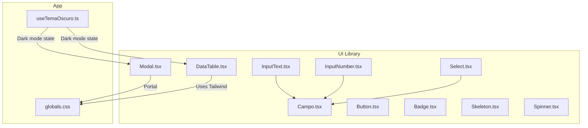
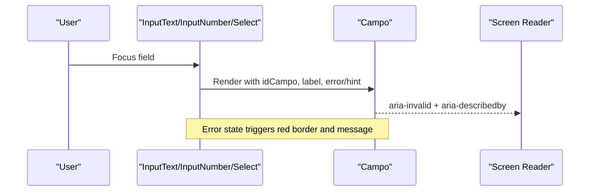
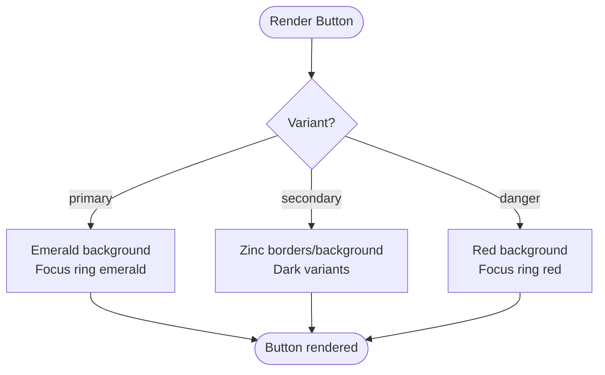
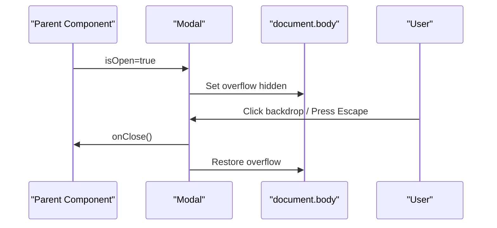
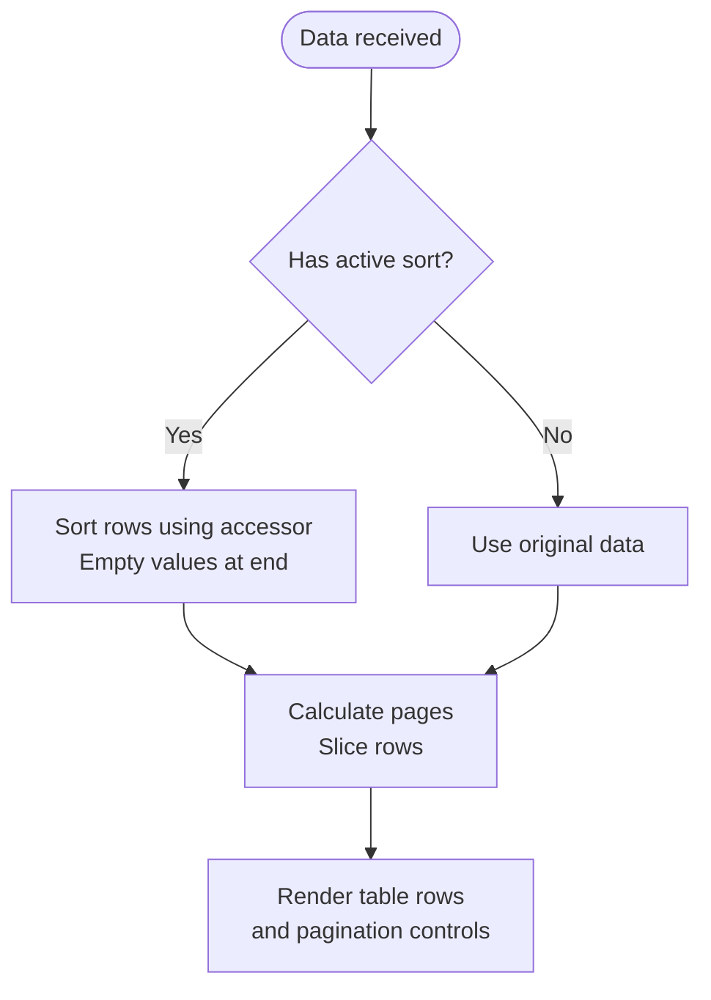
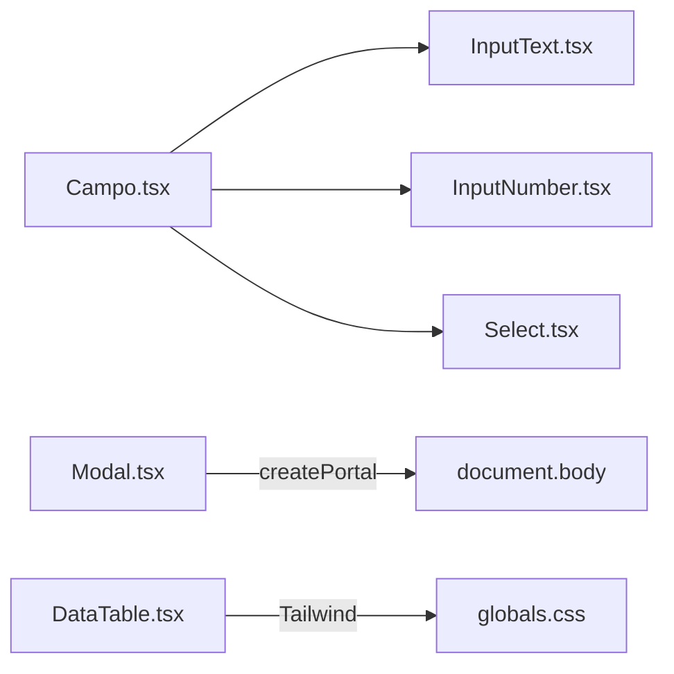

# UI Component Library

<cite>
**Referenced Files in This Document**
- [Button.tsx](file://simoapp/components/ui/Button.tsx)
- [Badge.tsx](file://simoapp/components/ui/Badge.tsx)
- [Campo.tsx](file://simoapp/components/ui/Campo.tsx)
- [InputText.tsx](file://simoapp/components/ui/InputText.tsx)
- [InputNumber.tsx](file://simoapp/components/ui/InputNumber.tsx)
- [Select.tsx](file://simoapp/components/ui/Select.tsx)
- [Modal.tsx](file://simoapp/components/ui/Modal.tsx)
- [DataTable.tsx](file://simoapp/components/ui/DataTable.tsx)
- [Skeleton.tsx](file://simoapp/components/ui/Skeleton.tsx)
- [Spinner.tsx](file://simoapp/components/ui/Spinner.tsx)
- [globals.css](file://simoapp/app/globals.css)
- [useTemaOscuro.ts](file://simoapp/components/dashboard/useTemaOscuro.ts)
- [package.json](file://simoapp/package.json)
</cite>

## Table of Contents
1. [Introduction](#introduction)
2. [Project Structure](#project-structure)
3. [Core Components](#core-components)
4. [Architecture Overview](#architecture-overview)
5. [Detailed Component Analysis](#detailed-component-analysis)
6. [Dependency Analysis](#dependency-analysis)
7. [Performance Considerations](#performance-considerations)
8. [Troubleshooting Guide](#troubleshooting-guide)
9. [Conclusion](#conclusion)
10. [Appendices](#appendices)

## Introduction
This document describes the custom React and Tailwind CSS UI component library located under simoapp/components/ui. It explains design system principles, styling approach, accessibility, theming, responsive behavior, API consistency, composition patterns, variant systems, and integration guidelines. It also provides testing strategies for UI components and visual regression approaches.

The library focuses on:
- Consistent form primitives with shared validation and accessibility behaviors
- A small set of presentational components (Button, Badge, Skeleton, Spinner)
- Complex interactive components (Modal, DataTable)
- Dark mode support via Tailwind’s dark variants and a dedicated hook for chart color adaptation
- Responsive layouts using Tailwind utility classes

## Project Structure
The UI library is organized by feature within a single folder:
- Form primitives: Campo (shared wrapper), InputText, InputNumber, Select
- Presentational: Button, Badge, Skeleton, Spinner
- Interactive: Modal, DataTable
- Global styles and theme variables: app/globals.css
- Theme detection hook: dashboard/useTemaOscuro.ts



**Diagram sources**
- [Campo.tsx:1-116](file://simoapp/components/ui/Campo.tsx#L1-L116)
- [InputText.tsx:1-92](file://simoapp/components/ui/InputText.tsx#L1-L92)
- [InputNumber.tsx:1-59](file://simoapp/components/ui/InputNumber.tsx#L1-L59)
- [Select.tsx:1-98](file://simoapp/components/ui/Select.tsx#L1-L98)
- [Button.tsx:1-44](file://simoapp/components/ui/Button.tsx#L1-L44)
- [Badge.tsx:1-48](file://simoapp/components/ui/Badge.tsx#L1-L48)
- [Skeleton.tsx:1-22](file://simoapp/components/ui/Skeleton.tsx#L1-L22)
- [Spinner.tsx:1-39](file://simoapp/components/ui/Spinner.tsx#L1-L39)
- [Modal.tsx:1-147](file://simoapp/components/ui/Modal.tsx#L1-L147)
- [DataTable.tsx:1-394](file://simoapp/components/ui/DataTable.tsx#L1-L394)
- [globals.css:1-69](file://simoapp/app/globals.css#L1-L69)
- [useTemaOscuro.ts:1-34](file://simoapp/components/dashboard/useTemaOscuro.ts#L1-L34)

**Section sources**
- [package.json:1-29](file://simoapp/package.json#L1-L29)

## Core Components
This section summarizes each component’s purpose, props interface, customization options, and accessibility features.

- Campo (internal base)
  - Purpose: Shared label, error/hint display, and accessible attributes for form fields.
  - Props: label, error, hint, required, className, children; exposes idCampo to connect label/input.
  - Accessibility: aria-invalid when error exists; aria-describedby linking to message element; visually hidden asterisk for required indicator.
  - Styling: Tailwind classes for control border/focus states; red border/ring on error; dark mode variants.

- InputText
  - Purpose: Text input with label, error/hint, optional password visibility toggle, and date picker support.
  - Props: All native <input> props except type override; supports text, email, password, tel, search, url, date.
  - Customization: className applied to container; automatic id generation if not provided.
  - Accessibility: Connects label via htmlFor/id; passes aria-invalid and aria-describedby from Campo.

- InputNumber
  - Purpose: Numeric input optimized for mobile numeric keyboard and scroll-wheel safety.
  - Props: All native <input> props except type override; inputMode defaults to decimal; optional onWheel handler.
  - Behavior: Blurs on wheel to avoid accidental value changes while scrolling.
  - Accessibility: Uses Campo’s accessibility helpers.

- Select
  - Purpose: Styled select with consistent arrow and placeholder option.
  - Props: options array with value/label/disabled; placeholder string; all native <select> props.
  - Behavior: Adds disabled placeholder option when provided; ensures default selection logic works correctly.
  - Accessibility: aria-invalid and aria-describedby via Campo; custom arrow icon marked as aria-hidden.

- Button
  - Purpose: Base button with three semantic variants.
  - Variants: primary, secondary, danger.
  - Props: All native <button> props; variant prop; className appended.
  - Default behavior: type="button" to prevent accidental form submission.

- Badge
  - Purpose: Small status or category labels.
  - Props: variant (default, primary, success, warning, danger, info); size (sm, md, lg); pill boolean; className.
  - Styling: Color-coded variants with dark mode support; rounded-md or full based on pill.

- Skeleton
  - Purpose: Placeholder for loading content.
  - Props: variant (rectangular, circular, text); className.
  - Styling: Pulse animation with gray/dark backgrounds.

- Spinner
  - Purpose: Loading indicator.
  - Props: size (sm, md, lg, xl); color (primary, white, gray, success, danger, current); className.
  - Accessibility: role="status" and sr-only text for screen readers.

- Modal
  - Purpose: Accessible dialog with backdrop, header/body/footer, and animations.
  - Props: isOpen, onClose, title, children, footer, maxWidth, closeOnBackdropClick.
  - Behavior: Esc key closes; body overflow hidden when open; portal to document.body; fade/scale transitions.
  - Accessibility: role="dialog", aria-modal, aria-labelledby, focus management considerations via standard elements.

- DataTable
  - Purpose: Reusable table with sorting, pagination, and column rendering.
  - Props: columns, data, getRowKey, pageSize, pageSizeOptions, initialSort, emptyMessage, caption.
  - Features: Column-level accessor/render; sortable headers; page size selector; navigation controls; responsive horizontal scroll.
  - Accessibility: aria-sort on headers; aria-labels on pagination buttons; caption for screen readers.

**Section sources**
- [Campo.tsx:1-116](file://simoapp/components/ui/Campo.tsx#L1-L116)
- [InputText.tsx:1-92](file://simoapp/components/ui/InputText.tsx#L1-L92)
- [InputNumber.tsx:1-59](file://simoapp/components/ui/InputNumber.tsx#L1-L59)
- [Select.tsx:1-98](file://simoapp/components/ui/Select.tsx#L1-L98)
- [Button.tsx:1-44](file://simoapp/components/ui/Button.tsx#L1-L44)
- [Badge.tsx:1-48](file://simoapp/components/ui/Badge.tsx#L1-L48)
- [Skeleton.tsx:1-22](file://simoapp/components/ui/Skeleton.tsx#L1-L22)
- [Spinner.tsx:1-39](file://simoapp/components/ui/Spinner.tsx#L1-L39)
- [Modal.tsx:1-147](file://simoapp/components/ui/Modal.tsx#L1-L147)
- [DataTable.tsx:1-394](file://simoapp/components/ui/DataTable.tsx#L1-L394)

## Architecture Overview
The library follows a layered approach:
- Presentation layer: Button, Badge, Skeleton, Spinner
- Form primitives: Campo + InputText/InputNumber/Select
- Composite components: Modal, DataTable
- Global theme and print styles: globals.css
- Theme detection: useTemaOscuro.ts for dark mode awareness

```mermaid
classDiagram
class Campo {
+propsAccesibilidad(idCampo, error, hint)
+clasesControl(conError)
}
class InputText {
+type : "text" | "email" | "password" | "tel" | "search" | "url" | "date"
}
class InputNumber {
+inputMode : "decimal"
+onWheel(e)
}
class Select {
+options : OpcionSelect[]
+placeholder : string
}
class Button {
+variant : "primary" | "secondary" | "danger"
}
class Badge {
+variant : "default" | "primary" | "success" | "warning" | "danger" | "info"
+size : "sm" | "md" | "lg"
+pill : boolean
}
class Skeleton {
+variant : "rectangular" | "circular" | "text"
}
class Spinner {
+size : "sm" | "md" | "lg" | "xl"
+color : "primary" | "white" | "gray" | "success" | "danger" | "current"
}
class Modal {
+isOpen : boolean
+onClose()
+title
+children
+footer
+maxWidth
+closeOnBackdropClick
}
class DataTable {
+columns
+data
+getRowKey(fila)
+pageSize
+pageSizeOptions
+initialSort
+emptyMessage
+caption
}
InputText --> Campo : "uses"
InputNumber --> Campo : "uses"
Select --> Campo : "uses"
Modal -->|"Portal"| DOM : "document.body"
DataTable -->|"Tailwind classes"| Styles : "globals.css"
```

**Diagram sources**
- [Campo.tsx:1-116](file://simoapp/components/ui/Campo.tsx#L1-L116)
- [InputText.tsx:1-92](file://simoapp/components/ui/InputText.tsx#L1-L92)
- [InputNumber.tsx:1-59](file://simoapp/components/ui/InputNumber.tsx#L1-L59)
- [Select.tsx:1-98](file://simoapp/components/ui/Select.tsx#L1-L98)
- [Button.tsx:1-44](file://simoapp/components/ui/Button.tsx#L1-L44)
- [Badge.tsx:1-48](file://simoapp/components/ui/Badge.tsx#L1-L48)
- [Skeleton.tsx:1-22](file://simoapp/components/ui/Skeleton.tsx#L1-L22)
- [Spinner.tsx:1-39](file://simoapp/components/ui/Spinner.tsx#L1-L39)
- [Modal.tsx:1-147](file://simoapp/components/ui/Modal.tsx#L1-L147)
- [DataTable.tsx:1-394](file://simoapp/components/ui/DataTable.tsx#L1-L394)
- [globals.css:1-69](file://simoapp/app/globals.css#L1-L69)

## Detailed Component Analysis

### Form Field System (Campo, InputText, InputNumber, Select)
Design principles:
- Shared structure: label, control, and message area
- Validation feedback: red border/ring and error message
- Accessibility: aria-invalid and aria-describedby consistently applied
- Dark mode: consistent color tokens via Tailwind dark variants



**Diagram sources**
- [Campo.tsx:30-42](file://simoapp/components/ui/Campo.tsx#L30-L42)
- [InputText.tsx:45-64](file://simoapp/components/ui/InputText.tsx#L45-L64)
- [InputNumber.tsx:42-55](file://simoapp/components/ui/InputNumber.tsx#L42-L55)
- [Select.tsx:49-64](file://simoapp/components/ui/Select.tsx#L49-L64)

**Section sources**
- [Campo.tsx:1-116](file://simoapp/components/ui/Campo.tsx#L1-L116)
- [InputText.tsx:1-92](file://simoapp/components/ui/InputText.tsx#L1-L92)
- [InputNumber.tsx:1-59](file://simoapp/components/ui/InputNumber.tsx#L1-L59)
- [Select.tsx:1-98](file://simoapp/components/ui/Select.tsx#L1-L98)

### Button and Badge
- Button
  - Variants map to distinct color sets and focus rings
  - Defaults to type="button" to avoid accidental submits
  - Accepts className for layout utilities like w-full

- Badge
  - Variants provide semantic colors (default, primary, success, warning, danger, info)
  - Sizes offer consistent typography and spacing
  - Pill option toggles fully rounded corners



**Diagram sources**
- [Button.tsx:14-21](file://simoapp/components/ui/Button.tsx#L14-L21)
- [Button.tsx:30-43](file://simoapp/components/ui/Button.tsx#L30-L43)

**Section sources**
- [Button.tsx:1-44](file://simoapp/components/ui/Button.tsx#L1-L44)
- [Badge.tsx:1-48](file://simoapp/components/ui/Badge.tsx#L1-L48)

### Modal
Behavioral flow:
- Mount and show/hide controlled by isOpen
- Backdrop click can close modal
- Escape key closes modal
- Body overflow hidden while open
- Content rendered via portal to document.body



**Diagram sources**
- [Modal.tsx:41-65](file://simoapp/components/ui/Modal.tsx#L41-L65)
- [Modal.tsx:81-85](file://simoapp/components/ui/Modal.tsx#L81-L85)
- [Modal.tsx:145-146](file://simoapp/components/ui/Modal.tsx#L145-L146)

**Section sources**
- [Modal.tsx:1-147](file://simoapp/components/ui/Modal.tsx#L1-L147)

### DataTable
Sorting and pagination flow:
- Columns define accessor for sort values and render for cell content
- Sorting cycles through asc → desc → none
- Pagination calculates total pages and slices rows
- Page size changes reset to first page



**Diagram sources**
- [DataTable.tsx:69-88](file://simoapp/components/ui/DataTable.tsx#L69-L88)
- [DataTable.tsx:104-127](file://simoapp/components/ui/DataTable.tsx#L104-L127)
- [DataTable.tsx:131-143](file://simoapp/components/ui/DataTable.tsx#L131-L143)

**Section sources**
- [DataTable.tsx:1-394](file://simoapp/components/ui/DataTable.tsx#L1-L394)

### Skeleton and Spinner
- Skeleton
  - Variants: rectangular, circular, text
  - Animation: pulse; dark mode background
- Spinner
  - Sizes: sm, md, lg, xl
  - Colors: primary, white, gray, success, danger, current
  - Accessibility: role="status" and sr-only text

**Section sources**
- [Skeleton.tsx:1-22](file://simoapp/components/ui/Skeleton.tsx#L1-L22)
- [Spinner.tsx:1-39](file://simoapp/components/ui/Spinner.tsx#L1-L39)

## Dependency Analysis
Internal dependencies:
- InputText, InputNumber, Select depend on Campo for shared label/error/hint and accessibility helpers
- Modal uses createPortal to mount into document.body
- DataTable composes internal pagination controls and icons
- Global styles define theme variables and print rules used across components

External dependencies:
- React and ReactDOM for component model and portals
- Tailwind CSS v4 for utility-first styling and dark mode variants



**Diagram sources**
- [Campo.tsx:1-116](file://simoapp/components/ui/Campo.tsx#L1-L116)
- [InputText.tsx:1-92](file://simoapp/components/ui/InputText.tsx#L1-L92)
- [InputNumber.tsx:1-59](file://simoapp/components/ui/InputNumber.tsx#L1-L59)
- [Select.tsx:1-98](file://simoapp/components/ui/Select.tsx#L1-L98)
- [Modal.tsx:1-147](file://simoapp/components/ui/Modal.tsx#L1-L147)
- [DataTable.tsx:1-394](file://simoapp/components/ui/DataTable.tsx#L1-L394)
- [globals.css:1-69](file://simoapp/app/globals.css#L1-L69)

**Section sources**
- [package.json:1-29](file://simoapp/package.json#L1-L29)

## Performance Considerations
- Memoization: DataTable uses useMemo to compute sorted rows efficiently.
- Client-side interactions: InputNumber prevents accidental number changes on scroll by blurring on wheel.
- Hydration safety: useTemaOscuro uses useSyncExternalStore to read media queries without causing hydration mismatches.
- Portal usage: Modal renders outside the React tree to avoid layout thrashing and z-index conflicts.

[No sources needed since this section provides general guidance]

## Troubleshooting Guide
Common issues and resolutions:
- Password visibility toggle not working
  - Ensure InputText is used as a client component ("use client") and that type="password" is passed.
  - Verify the toggle button is not disabled unintentionally.

- Date picker icons invisible in dark mode
  - InputText applies dark color-scheme for date inputs; ensure Tailwind dark variants are enabled.

- Select placeholder not showing
  - Provide placeholder prop; ensure no explicit value/defaultValue overrides it.

- Modal not closing on Escape
  - Confirm isOpen and onClose are wired correctly; check event listeners are attached when modal is open.

- DataTable sorting not behaving as expected
  - Ensure accessor returns comparable values; empty/null/undefined values are always placed at the end.

- Print output incorrect for POS tickets
  - Check globals.css print rules and ticket container classes; ensure non-printable elements are hidden.

**Section sources**
- [InputText.tsx:40-64](file://simoapp/components/ui/InputText.tsx#L40-L64)
- [Select.tsx:37-47](file://simoapp/components/ui/Select.tsx#L37-L47)
- [Modal.tsx:56-65](file://simoapp/components/ui/Modal.tsx#L56-L65)
- [DataTable.tsx:69-88](file://simoapp/components/ui/DataTable.tsx#L69-L88)
- [globals.css:31-68](file://simoapp/app/globals.css#L31-L68)

## Conclusion
The UI component library provides a cohesive set of accessible, themed, and responsive components built with React and Tailwind CSS. The form primitives share a consistent pattern for labeling, validation, and accessibility. Presentational components follow clear variant systems. Composite components like Modal and DataTable encapsulate complex interactions while remaining configurable. Dark mode is supported throughout, and global styles include specialized print rules for POS receipts.

[No sources needed since this section summarizes without analyzing specific files]

## Appendices

### Design System Principles
- Consistency: Shared wrappers (Campo) enforce uniform label/error/hint patterns.
- Accessibility: aria-invalid and aria-describedby are applied consistently; roles and labels are present where needed.
- Theming: Tailwind dark variants and CSS variables enable seamless light/dark modes.
- Responsiveness: Utility classes handle layout and spacing across devices.

**Section sources**
- [Campo.tsx:30-42](file://simoapp/components/ui/Campo.tsx#L30-L42)
- [globals.css:1-26](file://simoapp/app/globals.css#L1-L26)

### Component API Consistency
- Form fields accept label, error, hint, and className; they forward native input/select props.
- Buttons accept all native button props plus variant and className.
- Badges accept variant, size, pill, and className.
- Modals expose isOpen, onClose, title, children, footer, maxWidth, closeOnBackdropClick.
- Data tables expose columns, data, getRowKey, pagination, sorting, and caption.

**Section sources**
- [InputText.tsx:21-34](file://simoapp/components/ui/InputText.tsx#L21-L34)
- [InputNumber.tsx:18-29](file://simoapp/components/ui/InputNumber.tsx#L18-L29)
- [Select.tsx:17-33](file://simoapp/components/ui/Select.tsx#L17-L33)
- [Button.tsx:23-35](file://simoapp/components/ui/Button.tsx#L23-L35)
- [Badge.tsx:6-19](file://simoapp/components/ui/Badge.tsx#L6-L19)
- [Modal.tsx:6-24](file://simoapp/components/ui/Modal.tsx#L6-L24)
- [DataTable.tsx:46-61](file://simoapp/components/ui/DataTable.tsx#L46-L61)

### Styling Approach
- Utility-first with Tailwind CSS v4
- Dark mode via dark: variants and prefers-color-scheme
- CSS variables for background/foreground in globals.css
- Print-specific rules for thermal receipt printing

**Section sources**
- [globals.css:1-26](file://simoapp/app/globals.css#L1-L26)
- [globals.css:31-68](file://simoapp/app/globals.css#L31-L68)

### Theming Support
- Dark mode detection via useTemaOscuro for components that need programmatic access (e.g., charts).
- Tailwind dark variants applied across components for consistent appearance.

**Section sources**
- [useTemaOscuro.ts:1-34](file://simoapp/components/dashboard/useTemaOscuro.ts#L1-L34)

### Responsive Design Patterns
- Horizontal scrolling for tables on narrow screens
- Flexible layouts using flex and grid utilities
- Mobile-friendly input modes (numeric keyboard)

**Section sources**
- [DataTable.tsx:146-150](file://simoapp/components/ui/DataTable.tsx#L146-L150)
- [InputNumber.tsx:26-27](file://simoapp/components/ui/InputNumber.tsx#L26-L27)

### Testing Strategies
- Unit tests for component props and behavior (e.g., sorting, pagination, modal open/close)
- Accessibility checks using axe-core or similar tools
- Interaction tests for password toggle, select placeholder, and wheel handling

[No sources needed since this section provides general guidance]

### Visual Regression Testing Approaches
- Snapshot-based comparisons for static components (Badge, Skeleton, Spinner)
- Screenshot tests for complex layouts (DataTable with various column configurations)
- Cross-browser and dark-mode screenshot comparisons

[No sources needed since this section provides general guidance]