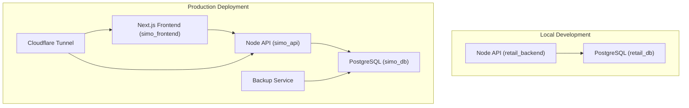
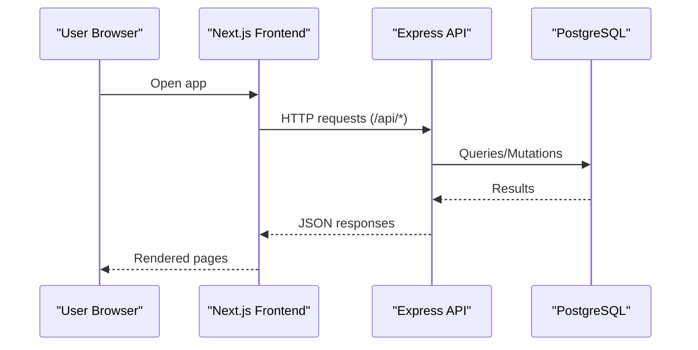
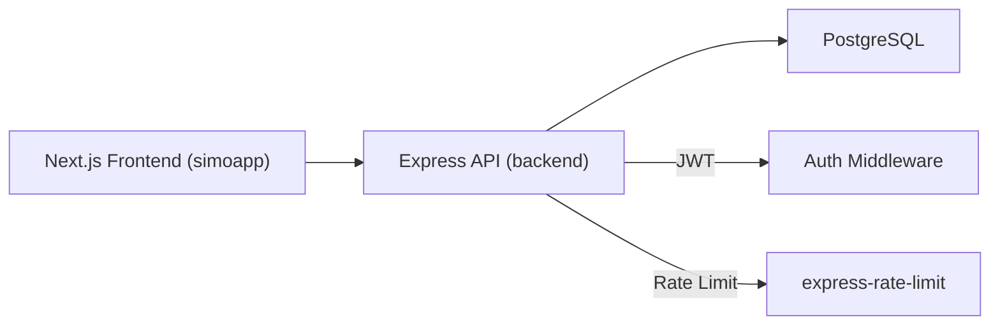

# Getting Started

<cite>
**Referenced Files in This Document**
- [README.md](file://README.md)
- [backend/docker-compose.yml](file://backend/docker-compose.yml)
- [deploy/docker-compose.yml](file://deploy/docker-compose.yml)
- [backend/Dockerfile](file://backend/Dockerfile)
- [deploy/frontend/Dockerfile](file://deploy/frontend/Dockerfile)
- [backend/package.json](file://backend/package.json)
- [simoapp/package.json](file://simoapp/package.json)
- [backend/db/README.md](file://backend/db/README.md)
- [backend/db/00_init.sh](file://backend/db/00_init.sh)
- [backend/index.js](file://backend/index.js)
- [deploy/README.md](file://deploy/README.md)
</cite>

## Table of Contents
1. [Introduction](#introduction)
2. [Project Structure](#project-structure)
3. [Core Components](#core-components)
4. [Architecture Overview](#architecture-overview)
5. [Detailed Component Analysis](#detailed-component-analysis)
6. [Dependency Analysis](#dependency-analysis)
7. [Performance Considerations](#performance-considerations)
8. [Troubleshooting Guide](#troubleshooting-guide)
9. [Conclusion](#conclusion)
10. [Appendices](#appendices)

## Introduction
SIMO is a retail management system that manages inventory, sales, and order traceability for small retail businesses. It consists of:
- A Next.js frontend (simoapp).
- A Node.js/Express backend API (backend).
- A PostgreSQL database.
- Optional production deployment with Cloudflare Tunnel, backups, and health checks.

This guide helps you install SIMO locally using Docker Compose, configure the environment, initialize the database, start services, verify installation, and access the application. It also covers development and production scenarios.

## Project Structure
At a high level:
- backend: Express API, Docker configuration, database migrations and seeds.
- simoapp: Next.js frontend.
- deploy: Production-oriented Docker Compose, frontend build file, and operational documentation.

**Diagram sources**
- [backend/docker-compose.yml:1-41](file://backend/docker-compose.yml#L1-L41)
- [deploy/docker-compose.yml:1-120](file://deploy/docker-compose.yml#L1-L120)

**Section sources**
- [README.md:27-66](file://README.md#L27-L66)
- [backend/docker-compose.yml:1-41](file://backend/docker-compose.yml#L1-L41)
- [deploy/docker-compose.yml:1-120](file://deploy/docker-compose.yml#L1-L120)

## Core Components
- Backend API (Express): Provides REST endpoints for users, sales, inventory, and customers. Health check at /api/health.
- Database (PostgreSQL): Stores all business data; runs migrations and optional seed on first volume creation.
- Frontend (Next.js): Web UI served by the frontend service in production or via local dev server.

Key runtime details:
- Backend listens on port 3000 (development) and exposes /api/* routes.
- Database uses default user/postgres and database name simo_retail unless overridden.
- Frontend builds from simoapp and serves on port 3001 in production.

**Section sources**
- [backend/index.js:17-56](file://backend/index.js#L17-L56)
- [backend/index.js:62-70](file://backend/index.js#L62-L70)
- [backend/docker-compose.yml:23-37](file://backend/docker-compose.yml#L23-L37)
- [deploy/docker-compose.yml:39-80](file://deploy/docker-compose.yml#L39-L80)

## Architecture Overview
The system follows a standard three-tier architecture:
- Frontend (Next.js) communicates with the Backend API over HTTP.
- Backend API connects to PostgreSQL for persistence.
- In production, a backup service performs scheduled dumps and a tunnel provides secure external access.

**Diagram sources**
- [backend/index.js:53-56](file://backend/index.js#L53-L56)
- [backend/index.js:62-70](file://backend/index.js#L62-L70)
- [deploy/docker-compose.yml:39-80](file://deploy/docker-compose.yml#L39-L80)

## Detailed Component Analysis

### Prerequisites
- Docker Desktop installed and running.
- For local development: Node.js is not required if you use Docker Compose only. If you run the frontend locally, ensure Node.js is available for Next.js.
- For production operations: familiarity with Docker Compose and basic shell commands.

**Section sources**
- [README.md:66-74](file://README.md#L66-L74)
- [deploy/README.md:29-33](file://deploy/README.md#L29-L33)

### Installation: Local Development with Docker Compose
1. Navigate to the backend directory:
   - cd backend
2. Build and start services:
   - docker compose up -d --build
3. Verify containers are running:
   - docker ps
   - Expect two services: retail_db (PostgreSQL) and retail_backend (API).
4. Check logs:
   - docker logs retail_backend -f
   - docker logs retail_db -f
5. Stop services:
   - docker compose down
   - To reset the database: docker compose down -v && docker compose up -d --build

Environment variables:
- The compose file reads DB_USER, DB_PASSWORD, DB_NAME, and SIMO_SEED from your environment or defaults.
- The API container receives DB_HOST=db, DB_PORT=5432, DB_NAME, DB_USER, DB_PASSWORD, and PORT=3000.

Database initialization:
- On first run, PostgreSQL executes backend/db/00_init.sh which runs migrations and optionally seeds test data when SIMO_SEED=true.

Access points:
- API: http://localhost:3000
- Health check: GET http://localhost:3000/api/health

**Section sources**
- [README.md:68-110](file://README.md#L68-L110)
- [backend/docker-compose.yml:1-41](file://backend/docker-compose.yml#L1-L41)
- [backend/db/README.md:34-52](file://backend/db/README.md#L34-L52)
- [backend/db/00_init.sh:1-43](file://backend/db/00_init.sh#L1-L43)
- [backend/index.js:62-70](file://backend/index.js#L62-L70)

### Environment Configuration
Development (backend/.env recommended):
- DB_USER, DB_PASSWORD, DB_HOST, DB_PORT, DB_NAME, PORT, SIMO_SEED.
- These values are consumed by the API container and the database container.

Production (deploy/.env):
- POSTGRES_USER, POSTGRES_PASSWORD, POSTGRES_DB, SIMO_APP_PASSWORD, SIMO_SEED=false.
- DATABASE_URL (optional, for Neon), NEXT_PUBLIC_API_URL (for frontend build), CLOUDFLARE_TUNNEL_TOKEN.
- BACKUP_DATABASE_URL, PGHOST, PGUSER, PGPASSWORD, PGDATABASE, BACKUP_HOUR, BACKUP_RETENTION_DAYS, TZ.

Notes:
- In production, the API connects as simo_app (minimum privileges) rather than postgres.
- The frontend build injects NEXT_PUBLIC_API_URL into the client bundle.

**Section sources**
- [README.md:50-64](file://README.md#L50-L64)
- [backend/docker-compose.yml:8-12](file://backend/docker-compose.yml#L8-L12)
- [backend/docker-compose.yml:29-35](file://backend/docker-compose.yml#L29-L35)
- [deploy/docker-compose.yml:19-25](file://deploy/docker-compose.yml#L19-L25)
- [deploy/docker-compose.yml:43-53](file://deploy/docker-compose.yml#L43-L53)
- [deploy/docker-compose.yml:65-80](file://deploy/docker-compose.yml#L65-L80)
- [deploy/docker-compose.yml:82-105](file://deploy/docker-compose.yml#L82-L105)
- [deploy/docker-compose.yml:107-116](file://deploy/docker-compose.yml#L107-L116)

### Initial Database Initialization
- First-time setup runs migrations and optionally seeds test data via 00_init.sh.
- To recreate the database from scratch:
  - docker compose down -v && docker compose up -d --build
- To apply new migrations without losing data:
  - docker compose exec -T db psql -v ON_ERROR_STOP=1 -U postgres -d simo_retail < ../backend/db/migrations/<migration_file>.sql
- After creating new tables, reapply role permissions for simo_app:
  - docker compose exec -T db psql -v ON_ERROR_STOP=1 -U postgres -d simo_retail -v app_password="$(grep SIMO_APP_PASSWORD .env | cut -d= -f2-)" < ../backend/db/roles/001_rol_aplicacion.sql

Seed users (development):
- Test accounts are created by the seed script.

**Section sources**
- [backend/db/README.md:34-52](file://backend/db/README.md#L34-L52)
- [backend/db/00_init.sh:1-43](file://backend/db/00_init.sh#L1-L43)
- [deploy/README.md:127-139](file://deploy/README.md#L127-L139)

### Starting Services and Verifying Installation
Local development:
- Start: docker compose up -d --build (from backend/)
- Verify: docker ps
- Health check: curl http://localhost:3000/api/health
- Expected response includes status ok and database ok.

Production deployment:
- From deploy/:
  - cp .env.example .env and fill required variables.
  - docker compose up -d --build
- Verify services:
  - docker compose ps
- Create admin user (production):
  - docker compose exec api node tools/crear-admin.js "Full Name" email@example.com username
- Access:
  - API: http://localhost:3000
  - Frontend: http://localhost:3001

**Section sources**
- [README.md:68-110](file://README.md#L68-L110)
- [backend/index.js:62-70](file://backend/index.js#L62-L70)
- [deploy/README.md:50-85](file://deploy/README.md#L50-L85)

### Accessing the Application
- Frontend (local dev): npm run dev inside simoapp opens http://localhost:3000.
- Frontend (production): http://localhost:3001 or via Cloudflare Tunnel hostname configured in Zero Trust.
- API: http://localhost:3000 or via Cloudflare Tunnel hostname configured in Zero Trust.

Note: When running both development and production stacks on the same machine, avoid port conflicts (e.g., 5432 and 3000).

**Section sources**
- [simoapp/README.md:3-17](file://simoapp/README.md#L3-L17)
- [deploy/README.md:35-48](file://deploy/README.md#L35-L48)
- [deploy/docker-compose.yml:65-80](file://deploy/docker-compose.yml#L65-L80)

## Dependency Analysis
Runtime dependencies:
- Backend depends on Express, pg, bcrypt, jsonwebtoken, helmet, cors, express-rate-limit, xss-clean.
- Frontend depends on Next.js, React, Tailwind CSS, Recharts.

Containerization:
- Backend image built from backend/Dockerfile.
- Frontend image built from deploy/frontend/Dockerfile using simoapp context.

**Diagram sources**
- [backend/package.json:15-23](file://backend/package.json#L15-L23)
- [simoapp/package.json:11-27](file://simoapp/package.json#L11-L27)
- [backend/Dockerfile:1-26](file://backend/Dockerfile#L1-L26)
- [deploy/frontend/Dockerfile:1-33](file://deploy/frontend/Dockerfile#L1-L33)

**Section sources**
- [backend/package.json:1-38](file://backend/package.json#L1-L38)
- [simoapp/package.json:1-29](file://simoapp/package.json#L1-L29)
- [backend/Dockerfile:1-26](file://backend/Dockerfile#L1-L26)
- [deploy/frontend/Dockerfile:1-33](file://deploy/frontend/Dockerfile#L1-L33)

## Performance Considerations
- Use Docker volumes for persistent database storage to avoid rebuild overhead.
- Keep SIMO_SEED=false in production to avoid unnecessary seed execution.
- Ensure health checks pass before exposing services externally.
- Tune rate limits via RATE_LIMIT_MAX if needed for testing or high traffic.

[No sources needed since this section provides general guidance]

## Troubleshooting Guide
Common issues and resolutions:
- Port conflicts between development and production stacks:
  - Stop one stack before starting the other.
- Database not ready when API starts:
  - The production compose waits for db health; ensure db container is healthy.
- Admin user missing in production:
  - Run the crear-admin.js tool inside the api container.
- Cannot connect to database from clients:
  - Confirm host, port, database name, and credentials match the environment variables.
- Frontend cannot reach API:
  - Verify NEXT_PUBLIC_API_URL is set during build and matches the deployed API URL.

Verification steps:
- API health: GET http://localhost:3000/api/health
- Frontend health: GET http://localhost:3001/login
- Container status: docker ps or docker compose ps
- Logs: docker logs <container_name> -f

**Section sources**
- [deploy/README.md:29-33](file://deploy/README.md#L29-L33)
- [deploy/docker-compose.yml:33-37](file://deploy/docker-compose.yml#L33-L37)
- [deploy/docker-compose.yml:59-63](file://deploy/docker-compose.yml#L59-L63)
- [deploy/docker-compose.yml:76-80](file://deploy/docker-compose.yml#L76-L80)
- [deploy/README.md:75-85](file://deploy/README.md#L75-L85)
- [backend/index.js:62-70](file://backend/index.js#L62-L70)

## Conclusion
You can run SIMO locally with Docker Compose for rapid development or deploy it with the provided production stack. Use the environment variables to configure database credentials and feature flags, initialize the database once, and verify services through health endpoints. For production, follow the deployment guide to configure Cloudflare Tunnel, backups, and security policies.

[No sources needed since this section summarizes without analyzing specific files]

## Appendices

### Quick Commands Reference
- Start local services:
  - cd backend && docker compose up -d --build
- Stop local services:
  - docker compose down
- Reset local database:
  - docker compose down -v && docker compose up -d --build
- Start production stack:
  - cd deploy && docker compose up -d --build
- Check production services:
  - docker compose ps
- Create production admin:
  - docker compose exec api node tools/crear-admin.js "Full Name" email@example.com username

**Section sources**
- [README.md:68-110](file://README.md#L68-L110)
- [deploy/README.md:50-85](file://deploy/README.md#L50-L85)