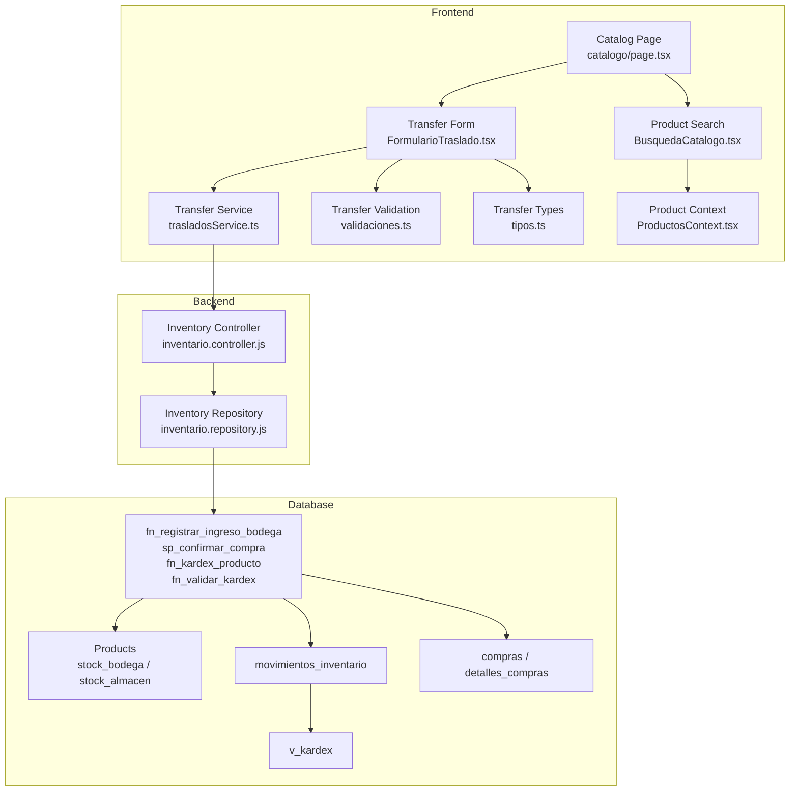
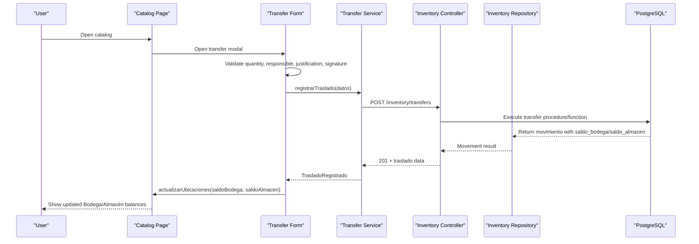
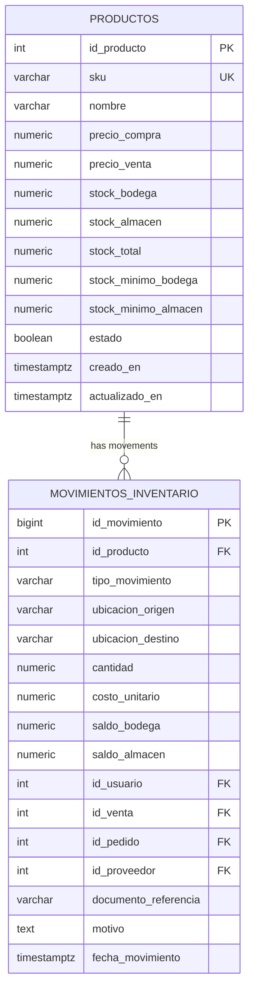
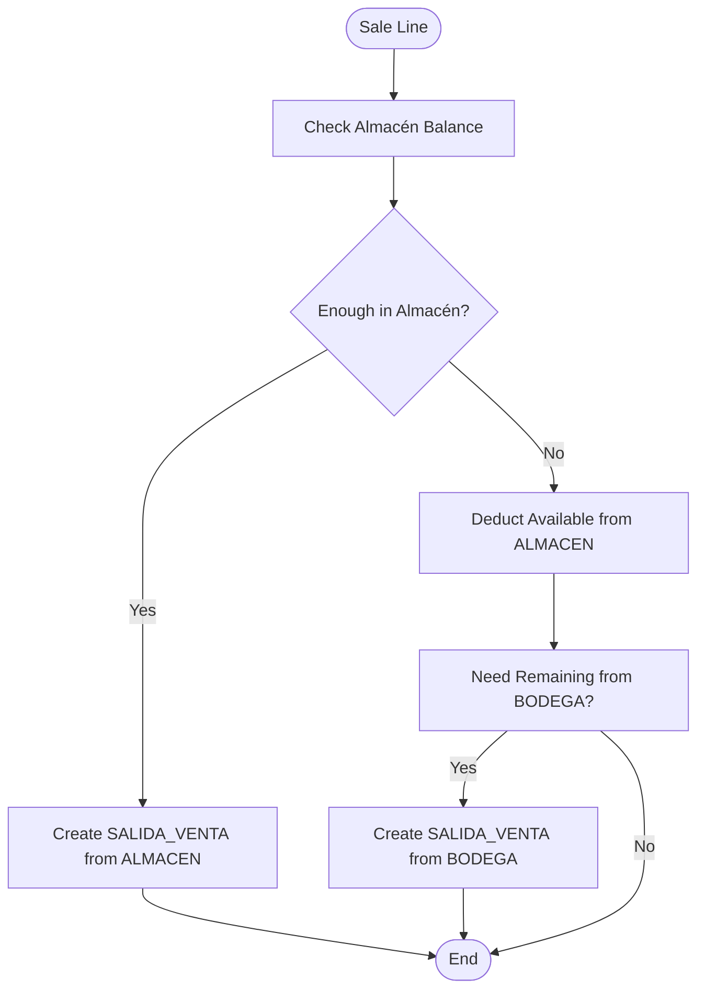
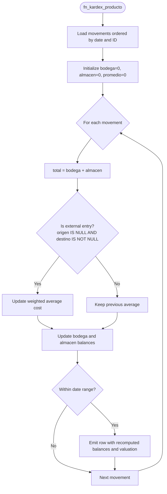
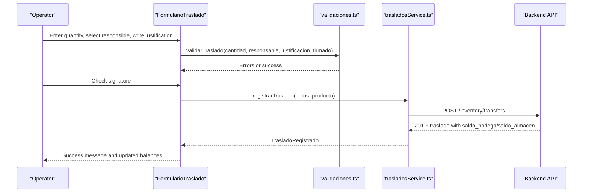
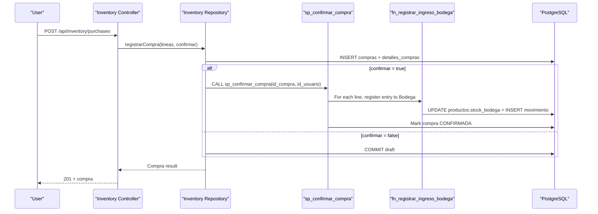
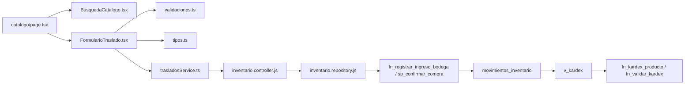

# Dual-Location Stock Tracking

<cite>
**Referenced Files in This Document**
- [006_inventario.sql](file://backend/db/migrations/006_inventario.sql)
- [008_ingreso_bodega.sql](file://backend/db/migrations/008_ingreso_bodega.sql)
- [011_compras.sql](file://backend/db/migrations/011_compras.sql)
- [012_saldo_kardex.sql](file://backend/db/migrations/012_saldo_kardex.sql)
- [inventario.controller.js](file://backend/src/controllers/inventario.controller.js)
- [inventario.repository.js](file://backend/src/repositories/inventario.repository.js)
- [FormularioTraslado.tsx](file://simoapp/components/inventario/FormularioTraslado.tsx)
- [validaciones.ts](file://simoapp/lib/inventario/validaciones.ts)
- [tipos.ts](file://simoapp/lib/inventario/tipos.ts)
- [trasladosService.ts](file://simoapp/lib/inventario/trasladosService.ts)
- [catalogo/page.tsx](file://simoapp/app/(protected)/catalogo/page.tsx)
- [BusquedaCatalogo.tsx](file://simoapp/components/catalogo/BusquedaCatalogo.tsx)
- [ProductosContext.tsx](file://simoapp/components/catalogo/ProductosContext.tsx)
- [003_catalogo.sql](file://backend/db/migrations/003_catalogo.sql)
- [004_saldo_kardex.sql](file://backend/db/tests/004_saldo_kardex.sql)
</cite>

## Table of Contents
1. [Introduction](#introduction)
2. [Project Structure](#project-structure)
3. [Core Components](#core-components)
4. [Architecture Overview](#architecture-overview)
5. [Detailed Component Analysis](#detailed-component-analysis)
6. [Dependency Analysis](#dependency-analysis)
7. [Performance Considerations](#performance-considerations)
8. [Troubleshooting Guide](#troubleshooting-guide)
9. [Conclusion](#conclusion)

## Introduction
This document explains the dual-location stock tracking system for SIMO, focusing on how inventory is modeled and updated across two physical locations: the warehouse (`Bodega`) and the store counter (`Almacén`). It covers:

- The location model and product-level balances.
- Movement types, authorization requirements, and audit trails.
- Real-time balance calculation and Kardex reconciliation.
- Stock transfer operations from `Bodega` to `Almacén`.
- Inventory valuation using a weighted average cost method.
- Location-specific queries, reporting, low-stock alerts, and operational workflows.

The system is designed so that all stock changes are recorded as immutable movements, while current balances are maintained per product and per location.

## Project Structure
The dual-location logic spans database migrations, backend controllers and repositories, and frontend components:

- **Database layer**: defines products with dual stock columns, the immutable movement ledger, purchase workflow, and Kardex validation functions.
- **Backend layer**: validates requests, calls database functions/procedures, and maps business errors to HTTP responses.
- **Frontend layer**: provides the catalog UI, transfer form, validation, and mock service for transfers.

**Diagram sources**
- [catalogo/page.tsx:18-127](file://simoapp/app/(protected)/catalogo/page.tsx#L18-L127)
- [BusquedaCatalogo.tsx:39-275](file://simoapp/components/catalogo/BusquedaCatalogo.tsx#L39-L275)
- [FormularioTraslado.tsx:53-312](file://simoapp/components/inventario/FormularioTraslado.tsx#L53-L312)
- [trasladosService.ts:47-79](file://simoapp/lib/inventario/trasladosService.ts#L47-L79)
- [validaciones.ts:27-37](file://simoapp/lib/inventario/validaciones.ts#L27-L37)
- [tipos.ts:7-23](file://simoapp/lib/inventario/tipos.ts#L7-L23)
- [inventario.controller.js:48-147](file://backend/src/controllers/inventario.controller.js#L48-L147)
- [inventario.repository.js:12-27](file://backend/src/repositories/inventario.repository.js#L12-L27)
- [006_inventario.sql:62-161](file://backend/db/migrations/006_inventario.sql#L62-L161)
- [008_ingreso_bodega.sql:23-88](file://backend/db/migrations/008_ingreso_bodega.sql#L23-L88)
- [011_compras.sql:21-261](file://backend/db/migrations/011_compras.sql#L21-L261)
- [012_saldo_kardex.sql:26-155](file://backend/db/migrations/012_saldo_kardex.sql#L26-L155)

**Section sources**
- [catalogo/page.tsx:18-127](file://simoapp/app/(protected)/catalogo/page.tsx#L18-L127)
- [BusquedaCatalogo.tsx:39-275](file://simoapp/components/catalogo/BusquedaCatalogo.tsx#L39-L275)
- [FormularioTraslado.tsx:53-312](file://simoapp/components/inventario/FormularioTraslado.tsx#L53-L312)
- [inventario.controller.js:48-147](file://backend/src/controllers/inventario.controller.js#L48-L147)
- [inventario.repository.js:12-27](file://backend/src/repositories/inventario.repository.js#L12-L27)
- [006_inventario.sql:62-161](file://backend/db/migrations/006_inventario.sql#L62-L161)
- [011_compras.sql:21-261](file://backend/db/migrations/011_compras.sql#L21-L261)
- [012_saldo_kardex.sql:26-155](file://backend/db/migrations/012_saldo_kardex.sql#L26-L155)

## Core Components
The core components of the dual-location system are:

- **Product model with dual stock**: Each product has `stock_bodega`, `stock_almacen`, and a generated `stock_total`. Minimum thresholds per location support low-stock alerts.
- **Immutable movement ledger**: `movimientos_inventario` records every stock change with source/destination locations, quantities, unit costs, resulting balances, user, and references to sales, orders, purchases, or adjustments.
- **Kardex view and validation**: `v_kardex` exposes chronological movement history; `fn_kardex_producto` recalculates balances and weighted average cost; `fn_validar_kardex` audits consistency between Kardex and product stock.
- **Purchase workflow**: Draft purchases become confirmed by adding all lines to `Bodega` atomically via `sp_confirmar_compra`.
- **Transfer workflow (frontend)**: A controlled UI allows moving stock from `Bodega` to `Almacén`, requiring quantity, responsible operator, justification, and signature confirmation.

Key responsibilities:

| Component | Responsibility |
|---|---|
| `productos` table | Stores SKU, names, prices, dual stock levels, and minimum stock per location. |
| `movimientos_inventario` | Immutable record of all stock changes with location semantics. |
| `v_kardex` | Read-only historical view of movements with per-location entries and totals. |
| `fn_registrar_ingreso_bodega` | Atomically updates `stock_bodega` and inserts an `ENTRADA_COMPRA` movement. |
| `sp_confirmar_compra` | Confirms a purchase draft and applies all lines to `Bodega`. |
| `fn_kardex_producto` | Recalculates per-location balances and weighted average cost. |
| `fn_validar_kardex` | Audits Kardex vs product stock and counts inconsistent movements. |
| Frontend transfer form | Validates, authorizes, and submits a `TRASLADO_INTERNO` request. |

**Section sources**
- [003_catalogo.sql:76-93](file://backend/db/migrations/003_catalogo.sql#L76-L93)
- [006_inventario.sql:62-161](file://backend/db/migrations/006_inventario.sql#L62-L161)
- [008_ingreso_bodega.sql:23-88](file://backend/db/migrations/008_ingreso_bodega.sql#L23-L88)
- [011_compras.sql:21-261](file://backend/db/migrations/011_compras.sql#L21-L261)
- [012_saldo_kardex.sql:26-155](file://backend/db/migrations/012_saldo_kardex.sql#L26-L155)
- [FormularioTraslado.tsx:53-312](file://simoapp/components/inventario/FormularioTraslado.tsx#L53-L312)

## Architecture Overview
The architecture separates concerns into three layers:

1. **Frontend**: Catalog browsing, filtering, and transfer initiation.
2. **Backend**: Request validation, business error mapping, and database access.
3. **Database**: Data integrity, atomic stock updates, movement recording, and Kardex calculations.

**Diagram sources**
- [catalogo/page.tsx:18-127](file://simoapp/app/(protected)/catalogo/page.tsx#L18-L127)
- [FormularioTraslado.tsx:106-130](file://simoapp/components/inventario/FormularioTraslado.tsx#L106-L130)
- [trasladosService.ts:47-79](file://simoapp/lib/inventario/trasladosService.ts#L47-L79)
- [inventario.controller.js:48-147](file://backend/src/controllers/inventario.controller.js#L48-L147)
- [inventario.repository.js:12-27](file://backend/src/repositories/inventario.repository.js#L12-L27)

## Detailed Component Analysis

### Warehouse and Store Location Model
The product model stores inventory at two locations:

- `stock_bodega`: Warehouse stock.
- `stock_almacen`: Store counter stock.
- `stock_total`: Generated sum of both locations.
- `stock_minimo_bodega` and `stock_minimo_almacen`: Per-location minimum thresholds used for low-stock alerts.

Stock values must remain non-negative and are only changed through movement records.

**Diagram sources**
- [003_catalogo.sql:76-93](file://backend/db/migrations/003_catalogo.sql#L76-L93)
- [006_inventario.sql:62-161](file://backend/db/migrations/006_inventario.sql#L62-L161)

**Section sources**
- [003_catalogo.sql:76-93](file://backend/db/migrations/003_catalogo.sql#L76-L93)
- [006_inventario.sql:62-161](file://backend/db/migrations/006_inventario.sql#L62-L161)

### Movement Types and Authorization Rules
Movement types define where stock enters or leaves and which references are required:

| Type | Source | Destination | Required Reference | Notes |
|---|---|---|---|---|
| `ENTRADA_COMPRA` | None | `BODEGA` | Optional provider | Purchase receipt entry. |
| `TRASLADO_INTERNO` | `BODEGA` | `ALMACEN` | None | Internal transfer from warehouse to store. |
| `SALIDA_VENTA` | `BODEGA` or `ALMACEN` | None | Sale ID | Point-of-sale deduction. |
| `SALIDA_PEDIDO` | `BODEGA` or `ALMACEN` | None | Order ID | Reservation/picking deduction. |
| `REVERSO_VENTA` | None | `BODEGA` or `ALMACEN` | Sale ID | Sales reversal. |
| `REVERSO_PEDIDO` | None | `BODEGA` or `ALMACEN` | Order ID | Order cancellation reversal. |
| `AJUSTE_POSITIVO` | None | `BODEGA` or `ALMACEN` | Reason | Manual positive adjustment. |
| `AJUSTE_NEGATIVO` | `BODEGA` or `ALMACEN` | None | Reason | Manual negative adjustment. |

Authorization and audit requirements:

- Every movement records `id_usuario`.
- Adjustments require a reason.
- Sales and orders link movements to business documents.
- Purchases link movements to purchase drafts.
- The movement table is immutable: updates and deletes are blocked by triggers.

**Section sources**
- [006_inventario.sql:43-129](file://backend/db/migrations/006_inventario.sql#L43-L129)

### Stock Allocation Strategies
The system supports multiple allocation strategies implicitly through movement types:

- **Warehouse-first purchases**: All incoming purchases enter `BODEGA`.
- **Store-first sales**: Sales can deduct from `ALMACEN`; if insufficient, cascading rules create additional deductions from `BODEGA`.
- **Internal replenishment**: `TRASLADO_INTERNO` moves stock from `BODEGA` to `ALMACEN`.
- **Manual corrections**: Positive/negative adjustments adjust specific locations.

Cascading deduction means a single sale line may generate up to two `SALIDA_*` movements: one from `ALMACEN` and another from `BODEGA` when needed. Reversals mirror the original locations.

**Diagram sources**
- [006_inventario.sql:56-58](file://backend/db/migrations/006_inventario.sql#L56-L58)

**Section sources**
- [006_inventario.sql:56-58](file://backend/db/migrations/006_inventario.sql#L56-L58)

### Real-Time Balance Calculations and Kardex
The Kardex is the authoritative chronological record of stock changes. Current balances are stored in `productos.stock_bodega` and `productos.stock_almacen`, but they must match the recomputed Kardex.

Key functions:

- `fn_kardex_producto(product_id, desde?, hasta?)`: Iterates movements chronologically, recalculating per-location balances and weighted average cost. It returns each movement with recomputed balances and whether the saved balances match.
- `fn_validar_kardex(product_id?)`: Audits one or all products, comparing final recalculated balances with product stock and counting inconsistent movements.

Weighted average cost rules:

- External entries (purchases, positive adjustments, reversals) update the weighted average.
- Internal transfers and exits do not change the average.
- Valuation equals total quantity times the current average cost.

**Diagram sources**
- [012_saldo_kardex.sql:26-108](file://backend/db/migrations/012_saldo_kardex.sql#L26-L108)

**Section sources**
- [012_saldo_kardex.sql:26-155](file://backend/db/migrations/012_saldo_kardex.sql#L26-L155)
- [004_saldo_kardex.sql:7-60](file://backend/db/tests/004_saldo_kardex.sql#L7-L60)

### Stock Transfer Operations: Bodega to Almacén
The transfer operation is initiated from the frontend and requires explicit authorization:

- **Quantity**: Must be greater than zero and cannot exceed `stock_bodega`.
- **Responsible operator**: An active user selected from the user list; defaults to the logged-in user when available.
- **Justification**: Mandatory text explaining the transfer.
- **Signature confirmation**: The responsible operator confirms delivery; changing quantity or responsible unchecks the signature.

The frontend currently uses a mock service when the backend endpoint is not available. When connected, it posts to `/inventory/transfers` and expects a response with movement details and updated balances.

**Diagram sources**
- [FormularioTraslado.tsx:106-130](file://simoapp/components/inventario/FormularioTraslado.tsx#L106-L130)
- [validaciones.ts:27-37](file://simoapp/lib/inventario/validaciones.ts#L27-L37)
- [trasladosService.ts:47-79](file://simoapp/lib/inventario/trasladosService.ts#L47-L79)

**Section sources**
- [FormularioTraslado.tsx:53-312](file://simoapp/components/inventario/FormularioTraslado.tsx#L53-L312)
- [validaciones.ts:27-37](file://simoapp/lib/inventario/validaciones.ts#L27-L37)
- [trasladosService.ts:47-79](file://simoapp/lib/inventario/trasladosService.ts#L47-L79)
- [tipos.ts:7-23](file://simoapp/lib/inventario/tipos.ts#L7-L23)

### Purchase Ingestion and Confirmation
Purchases follow a draft-and-confirm pattern:

1. Create a purchase draft with provider, reference, observation, and product lines.
2. Optionally confirm immediately; otherwise, keep as draft.
3. On confirmation, `sp_confirmar_compra` locks the purchase, iterates lines in deterministic order, and calls `fn_registrar_ingreso_bodega` for each line.
4. Each call updates `stock_bodega` and inserts an `ENTRADA_COMPRA` movement linked to the purchase.
5. If any line fails, the entire transaction rolls back.

**Diagram sources**
- [inventario.controller.js:163-247](file://backend/src/controllers/inventario.controller.js#L163-L247)
- [inventario.repository.js:32-62](file://backend/src/repositories/inventario.repository.js#L32-L62)
- [011_compras.sql:217-258](file://backend/db/migrations/011_compras.sql#L217-L258)
- [011_compras.sql:146-207](file://backend/db/migrations/011_compras.sql#L146-L207)

**Section sources**
- [inventario.controller.js:163-247](file://backend/src/controllers/inventario.controller.js#L163-L247)
- [inventario.repository.js:32-62](file://backend/src/repositories/inventario.repository.js#L32-L62)
- [011_compras.sql:21-261](file://backend/db/migrations/011_compras.sql#L21-L261)
- [008_ingreso_bodega.sql:23-88](file://backend/db/migrations/008_ingreso_bodega.sql#L23-L88)

### Inventory Valuation Methods
The system implements **weighted average cost**, not FIFO or LIFO:

- Only external entries update the average cost.
- Internal transfers and exits preserve the average.
- Valuation equals total quantity times the current average cost.
- Tests verify the progression of average cost and valuation across purchases, transfers, shrinkage, and adjustments.

FIFO/LIFO are not implemented in this codebase. If future requirements need FIFO/LIFO, the valuation logic in `fn_kardex_producto` would need to be redesigned to track batches instead of a single average.

**Section sources**
- [012_saldo_kardex.sql:18-22](file://backend/db/migrations/012_saldo_kardex.sql#L18-L22)
- [012_saldo_kardex.sql:68-99](file://backend/db/migrations/012_saldo_kardex.sql#L68-L99)
- [004_saldo_kardex.sql:7-60](file://backend/db/tests/004_saldo_kardex.sql#L7-L60)

### Location-Specific Reporting Capabilities
Reporting relies on the movement ledger and Kardex view:

- **Chronological Kardex**: Query `v_kardex` filtered by product, date range, movement type, or reference.
- **Per-location entries**: The view separates `entrada_bodega`, `salida_bodega`, `entrada_almacen`, `salida_almacen`.
- **Balances**: Use `saldo_bodega`, `saldo_almacen`, and `saldo_total` per movement.
- **Valuation**: Use `costo_promedio` and `saldo_valorizado` from `fn_kardex_producto`.
- **Audit**: Use `fn_validar_kardex` to compare Kardex with product stock and count inconsistencies.

Example query patterns:

- List all movements for a product: `SELECT * FROM v_kardex WHERE id_producto = ? ORDER BY fecha_movimiento, id_movimiento;`
- Summarize entries and exits per location over a period: group by `tipo_movimiento` and location columns.
- Identify inconsistent movements: select rows where `saldo_coincide` is false from `fn_kardex_producto`.
- Audit all products: call `fn_validar_kardex()` without a product ID.

**Section sources**
- [006_inventario.sql:131-161](file://backend/db/migrations/006_inventario.sql#L131-L161)
- [012_saldo_kardex.sql:26-155](file://backend/db/migrations/012_saldo_kardex.sql#L26-L155)

### Low Stock Alerts Per Location
Low-stock alerts are supported by per-location minimum thresholds:

- `stock_minimo_bodega`: minimum threshold for warehouse stock.
- `stock_minimo_almacen`: minimum threshold for store counter stock.

Alert logic should compare current stock against these thresholds:

- Alert when `stock_bodega < stock_minimo_bodega`.
- Alert when `stock_almacen < stock_minimo_almacen`.
- Prioritize alerts by severity: zero stock is critical; below minimum is warning.

The frontend already disables transfer actions when `stock_bodega` is zero or the product is inactive, preventing invalid transfers.

**Section sources**
- [003_catalogo.sql:76-93](file://backend/db/migrations/003_catalogo.sql#L76-L93)
- [BusquedaCatalogo.tsx:248-267](file://simoapp/components/catalogo/BusquedaCatalogo.tsx#L248-L267)

### Stock Queries Across Locations
Common query scenarios:

| Scenario | Approach |
|---|---|
| Current balances per product | Select `stock_bodega`, `stock_almacen`, `stock_total` from `productos`. |
| Historical balance evolution | Use `fn_kardex_producto(id_producto)` to get recomputed balances per movement. |
| Entries and exits by location | Query `v_kardex` and filter by `entrada_bodega`, `salida_bodega`, `entrada_almacen`, `salida_almacen`. |
| Movements linked to sales | Filter `v_kardex` by `id_venta`. |
| Movements linked to orders | Filter `v_kardex` by `id_pedido`. |
| Movements linked to purchases | Filter `movimientos_inventario` by `id_compra`. |
| Audit consistency | Call `fn_validar_kardex(id_producto)` or without parameter. |

**Section sources**
- [006_inventario.sql:131-161](file://backend/db/migrations/006_inventario.sql#L131-L161)
- [012_saldo_kardex.sql:113-155](file://backend/db/migrations/012_saldo_kardex.sql#L113-L155)

### Balance Reconciliation Processes
Reconciliation ensures that stored product balances match the Kardex:

1. Run `fn_validar_kardex()` to identify products with inconsistent movements.
2. Inspect `movimientos_inconsistentes` and reconcile discrepancies.
3. Investigate root causes: manual stock edits outside movements, failed transactions, or incorrect balance writes.
4. Correct underlying issues; avoid direct updates to `stock_bodega` or `stock_almacen`.
5. Re-run validation until consistent results are achieved.

The test file demonstrates expected behavior for purchases, transfers, shrinkage, and adjustments, including average cost and valuation progression.

**Section sources**
- [012_saldo_kardex.sql:113-155](file://backend/db/migrations/012_saldo_kardex.sql#L113-L155)
- [004_saldo_kardex.sql:7-60](file://backend/db/tests/004_saldo_kardex.sql#L7-L60)

## Dependency Analysis
The following diagram shows key dependencies between frontend, backend, and database components involved in dual-location stock tracking.

**Diagram sources**
- [catalogo/page.tsx:18-127](file://simoapp/app/(protected)/catalogo/page.tsx#L18-L127)
- [BusquedaCatalogo.tsx:39-275](file://simoapp/components/catalogo/BusquedaCatalogo.tsx#L39-L275)
- [FormularioTraslado.tsx:53-312](file://simoapp/components/inventario/FormularioTraslado.tsx#L53-L312)
- [validaciones.ts:27-37](file://simoapp/lib/inventario/validaciones.ts#L27-L37)
- [tipos.ts:7-23](file://simoapp/lib/inventario/tipos.ts#L7-L23)
- [trasladosService.ts:47-79](file://simoapp/lib/inventario/trasladosService.ts#L47-L79)
- [inventario.controller.js:48-147](file://backend/src/controllers/inventario.controller.js#L48-L147)
- [inventario.repository.js:12-27](file://backend/src/repositories/inventario.repository.js#L12-L27)
- [006_inventario.sql:62-161](file://backend/db/migrations/006_inventario.sql#L62-L161)
- [008_ingreso_bodega.sql:23-88](file://backend/db/migrations/008_ingreso_bodega.sql#L23-L88)
- [011_compras.sql:217-258](file://backend/db/migrations/011_compras.sql#L217-L258)
- [012_saldo_kardex.sql:26-155](file://backend/db/migrations/012_saldo_kardex.sql#L26-L155)

**Section sources**
- [catalogo/page.tsx:18-127](file://simoapp/app/(protected)/catalogo/page.tsx#L18-L127)
- [FormularioTraslado.tsx:53-312](file://simoapp/components/inventario/FormularioTraslado.tsx#L53-L312)
- [inventario.controller.js:48-147](file://backend/src/controllers/inventario.controller.js#L48-L147)
- [inventario.repository.js:12-27](file://backend/src/repositories/inventario.repository.js#L12-L27)
- [006_inventario.sql:62-161](file://backend/db/migrations/006_inventario.sql#L62-L161)
- [012_saldo_kardex.sql:26-155](file://backend/db/migrations/012_saldo_kardex.sql#L26-L155)

## Performance Considerations
- **Indexes**: Movement tables include indexes on product/date, date, sale, order, and purchase references to optimize queries and joins.
- **Atomic operations**: Database functions and procedures lock rows or transactions to prevent concurrent stock corruption.
- **Generated columns**: `stock_total` is computed by the database, reducing application-side calculation overhead.
- **Kardex recalculation**: `fn_kardex_producto` scans movements chronologically; large histories benefit from proper indexing and date-range filters.
- **Frontend state**: Product context updates balances locally after successful operations to improve responsiveness.

[No sources needed since this section provides general guidance]

## Troubleshooting Guide
Common issues and resolutions:

| Issue | Symptom | Resolution |
|---|---|---|
| Invalid quantity | Backend rejects with bad request or SQLSTATE SM003/SM004 | Ensure quantity is positive, valid decimal based on unit, and within allowed precision. |
| Inactive product | Business error SM002 | Activate the product before entering stock or transferring. |
| Inactive user or provider | Business error SM005/SM006 | Use active users and providers. |
| Duplicate purchase lines | Bad request during purchase registration | Group quantities per product in purchase lines. |
| Already confirmed purchase | Business error SM011 | Do not modify confirmed purchases; create new ones. |
| Missing purchase lines | Business error SM013 | Add at least one line before confirming. |
| Insufficient stock in Bodega | Transfer fails with 409 | Reload catalog and verify available warehouse stock. |
| Inconsistent Kardex | `fn_validar_kardex` reports inconsistent movements | Investigate unauthorized stock changes or failed transactions; correct root cause and revalidate. |

**Section sources**
- [008_ingreso_bodega.sql:13-18](file://backend/db/migrations/008_ingreso_bodega.sql#L13-L18)
- [inventario.controller.js:14-23](file://backend/src/controllers/inventario.controller.js#L14-L23)
- [011_compras.sql:12-17](file://backend/db/migrations/011_compras.sql#L12-L17)
- [011_compras.sql:102-123](file://backend/db/migrations/011_compras.sql#L102-L123)
- [011_compras.sql:223-253](file://backend/db/migrations/011_compras.sql#L223-L253)
- [trasladosService.ts:69-79](file://simoapp/lib/inventario/trasladosService.ts#L69-L79)
- [012_saldo_kardex.sql:113-155](file://backend/db/migrations/012_saldo_kardex.sql#L113-L155)

## Conclusion
The SIMO dual-location stock tracking system models inventory across `Bodega` and `Almacén` using a robust combination of product-level balances, an immutable movement ledger, and database-driven Kardex calculations. Purchases enter the warehouse, internal transfers move stock to the store, and sales or orders deduct from locations according to defined rules. Authorization is enforced through user attribution, mandatory justifications for adjustments, and signature confirmation for transfers. Inventory valuation uses weighted average cost, and reconciliation tools ensure consistency between Kardex and product stock. The frontend provides a controlled workflow for transfers, while the backend and database enforce data integrity, concurrency safety, and auditability.

[No sources needed since this section summarizes without analyzing specific files]