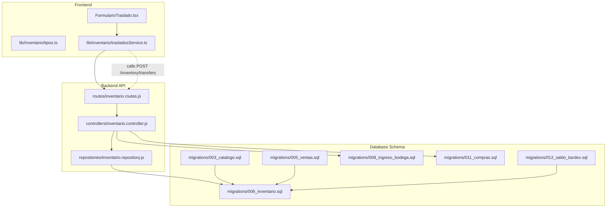
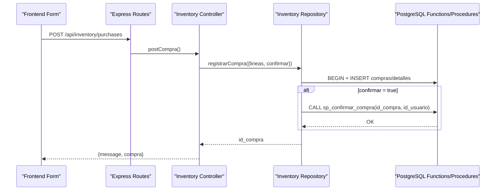
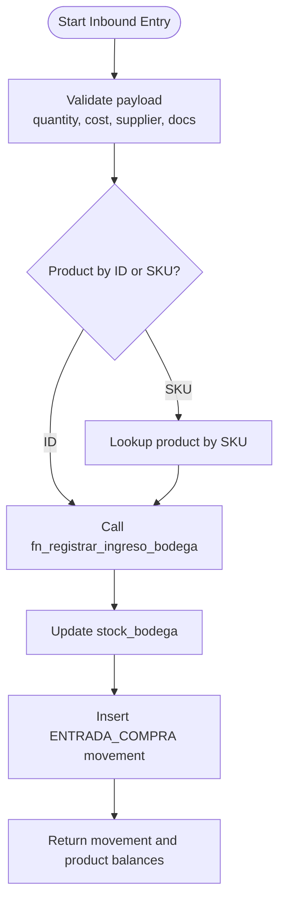
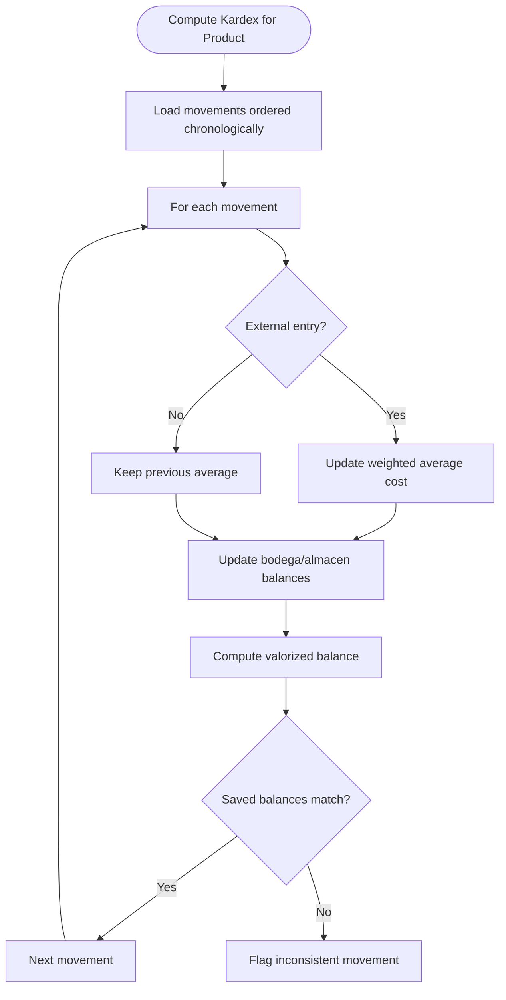
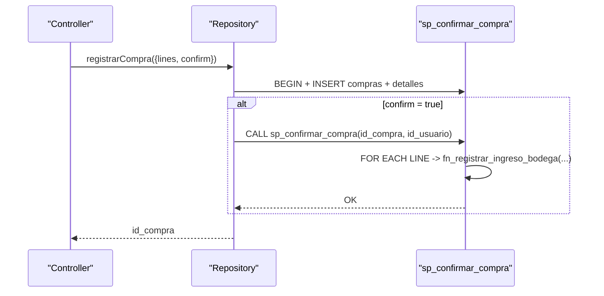
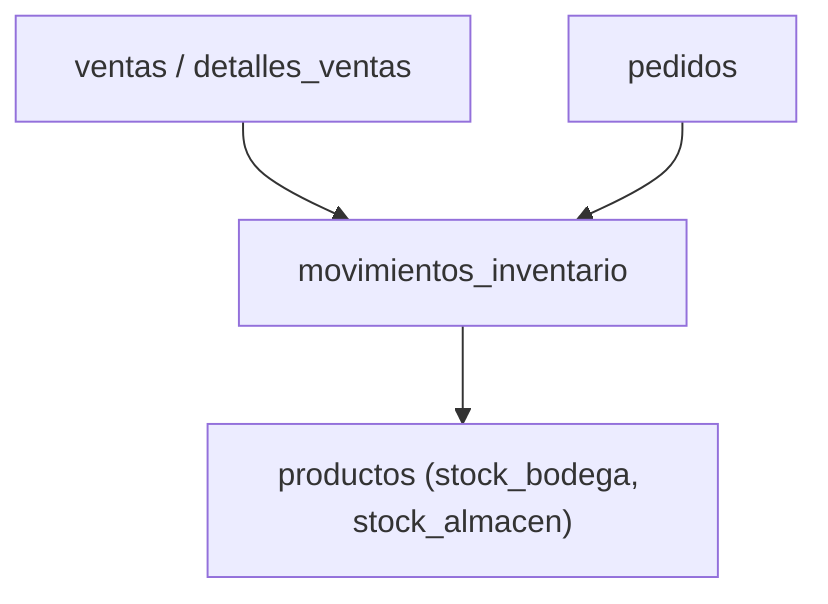
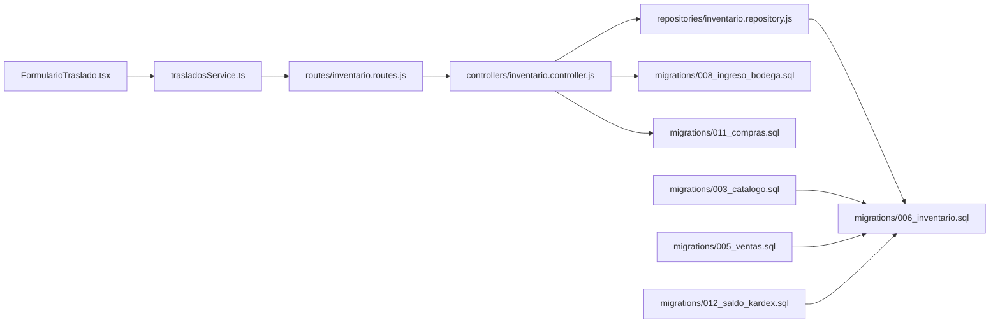

# Inventory Management System

<cite>
**Referenced Files in This Document**
- [inventario.controller.js](file://backend/src/controllers/inventario.controller.js)
- [inventario.repository.js](file://backend/src/repositories/inventario.repository.js)
- [inventario.routes.js](file://backend/src/routes/inventario.routes.js)
- [003_catalogo.sql](file://backend/db/migrations/003_catalogo.sql)
- [005_ventas.sql](file://backend/db/migrations/005_ventas.sql)
- [006_inventario.sql](file://backend/db/migrations/006_inventario.sql)
- [008_ingreso_bodega.sql](file://backend/db/migrations/008_ingreso_bodega.sql)
- [011_compras.sql](file://backend/db/migrations/011_compras.sql)
- [012_saldo_kardex.sql](file://backend/db/migrations/012_saldo_kardex.sql)
- [FormularioTraslado.tsx](file://simoapp/components/inventario/FormularioTraslado.tsx)
- [tipos.ts](file://simoapp/lib/inventario/tipos.ts)
- [trasladosService.ts](file://simoapp/lib/inventario/trasladosService.ts)
</cite>

## Table of Contents
1. [Introduction](#introduction)
2. [Project Structure](#project-structure)
3. [Core Components](#core-components)
4. [Architecture Overview](#architecture-overview)
5. [Detailed Component Analysis](#detailed-component-analysis)
6. [Dependency Analysis](#dependency-analysis)
7. [Performance Considerations](#performance-considerations)
8. [Troubleshooting Guide](#troubleshooting-guide)
9. [Conclusion](#conclusion)

## Introduction
This document explains the inventory management system implemented in the repository. It covers product catalog management, dual-location stock tracking (warehouse and store), stock movement processing, low stock alerts, the kardex valuation method, purchase order processing, supplier management, integration with sales and financial modules, reconciliation and cycle counting procedures, and performance optimization for large inventories. The explanation is grounded in the actual codebase and database migrations.

## Project Structure
The inventory subsystem spans backend API routes, controllers, repositories, PostgreSQL migrations, and a frontend form for internal transfers.

**Diagram sources**
- [inventario.routes.js:1-17](file://backend/src/routes/inventario.routes.js#L1-L17)
- [inventario.controller.js:1-269](file://backend/src/controllers/inventario.controller.js#L1-L269)
- [inventario.repository.js:1-102](file://backend/src/repositories/inventario.repository.js#L1-L102)
- [003_catalogo.sql:1-102](file://backend/db/migrations/003_catalogo.sql#L1-L102)
- [005_ventas.sql:1-104](file://backend/db/migrations/005_ventas.sql#L1-L104)
- [006_inventario.sql:1-166](file://backend/db/migrations/006_inventario.sql#L1-L166)
- [008_ingreso_bodega.sql:1-91](file://backend/db/migrations/008_ingreso_bodega.sql#L1-L91)
- [011_compras.sql:1-261](file://backend/db/migrations/011_compras.sql#L1-L261)
- [012_saldo_kardex.sql:1-155](file://backend/db/migrations/012_saldo_kardex.sql#L1-L155)
- [FormularioTraslado.tsx:1-312](file://simoapp/components/inventario/FormularioTraslado.tsx#L1-L312)
- [tipos.ts:1-23](file://simoapp/lib/inventario/tipos.ts#L1-L23)
- [trasladosService.ts:22-58](file://simoapp/lib/inventario/trasladosService.ts#L22-L58)

**Section sources**
- [inventario.routes.js:1-17](file://backend/src/routes/inventario.routes.js#L1-L17)
- [inventario.controller.js:1-269](file://backend/src/controllers/inventario.controller.js#L1-L269)
- [inventario.repository.js:1-102](file://backend/src/repositories/inventario.repository.js#L1-L102)
- [003_catalogo.sql:1-102](file://backend/db/migrations/003_catalogo.sql#L1-L102)
- [005_ventas.sql:1-104](file://backend/db/migrations/005_ventas.sql#L1-L104)
- [006_inventario.sql:1-166](file://backend/db/migrations/006_inventario.sql#L1-L166)
- [008_ingreso_bodega.sql:1-91](file://backend/db/migrations/008_ingreso_bodega.sql#L1-L91)
- [011_compras.sql:1-261](file://backend/db/migrations/011_compras.sql#L1-L261)
- [012_saldo_kardex.sql:1-155](file://backend/db/migrations/012_saldo_kardex.sql#L1-L155)
- [FormularioTraslado.tsx:1-312](file://simoapp/components/inventario/FormularioTraslado.tsx#L1-L312)
- [tipos.ts:1-23](file://simoapp/lib/inventario/tipos.ts#L1-L23)
- [trasladosService.ts:22-58](file://simoapp/lib/inventario/trasladosService.ts#L22-L58)

## Core Components
- Product catalog: units of measure, categories, products with dual stock fields and minimum thresholds per location.
- Inventory ledger: immutable movements table with location-aware entries and balances; Kardex view aggregates chronological history.
- Purchase orders: draft purchases with lines, confirmation procedure that posts all lines to warehouse stock atomically.
- Supplier management: suppliers linked to purchases and inbound movements.
- Sales integration: sales and orders link to inventory movements; cancellations reverse movements by origin location.
- Valuation: weighted average cost computed over external entries; validation functions audit consistency between kardex and product stock.
- Internal transfers: UI form and types define Bodega-to-Almacén transfers with responsible operator and justification.

Key responsibilities:
- Controller validates inputs and maps business errors to HTTP responses.
- Repository executes SQL functions/procedures and queries.
- Database enforces constraints, triggers, and atomicity via functions and procedures.
- Frontend provides user workflows for transfers and integrates with backend services.

**Section sources**
- [003_catalogo.sql:18-102](file://backend/db/migrations/003_catalogo.sql#L18-L102)
- [006_inventario.sql:20-166](file://backend/db/migrations/006_inventario.sql#L20-L166)
- [011_compras.sql:19-261](file://backend/db/migrations/011_compras.sql#L19-L261)
- [012_saldo_kardex.sql:24-155](file://backend/db/migrations/012_saldo_kardex.sql#L24-L155)
- [inventario.controller.js:43-269](file://backend/src/controllers/inventario.controller.js#L43-L269)
- [inventario.repository.js:5-102](file://backend/src/repositories/inventario.repository.js#L5-L102)
- [FormularioTraslado.tsx:1-312](file://simoapp/components/inventario/FormularioTraslado.tsx#L1-L312)
- [tipos.ts:1-23](file://simoapp/lib/inventario/tipos.ts#L1-L23)

## Architecture Overview
The system follows a layered architecture:
- Frontend forms call backend REST endpoints.
- Express routes enforce authentication and role-based access.
- Controllers validate payloads and delegate to repositories.
- Repositories invoke PostgreSQL functions/procedures and return results.
- Database schema enforces business rules, maintains immutability of movements, and computes balances and valuations.

**Diagram sources**
- [inventario.routes.js:9-14](file://backend/src/routes/inventario.routes.js#L9-L14)
- [inventario.controller.js:156-247](file://backend/src/controllers/inventario.controller.js#L156-L247)
- [inventario.repository.js:29-62](file://backend/src/repositories/inventario.repository.js#L29-L62)
- [011_compras.sql:217-258](file://backend/db/migrations/011_compras.sql#L217-L258)

## Detailed Component Analysis

### Product Catalog Management
The catalog defines units of measure, categories, and products. Products include:
- Dual stock: stock_bodega and stock_almacen, with generated stock_total.
- Minimum thresholds per location: stock_minimo_bodega and stock_minimo_almacen.
- Pricing: precio_compra and precio_venta.
- Identification: sku (unique), category, unit of measure.

Units of measure control whether fractional quantities are allowed. Categories group products. Stock fields must remain non-negative and are updated only through inventory movements.

Configuration options exposed by the schema:
- Units of measure: nombre, abreviatura, permite_decimales.
- Categories: nombre, descripcion, estado.
- Product thresholds: stock_minimo_bodega, stock_minimo_almacen.

Low stock alerts can be derived from these thresholds and current stock values.

**Section sources**
- [003_catalogo.sql:18-102](file://backend/db/migrations/003_catalogo.sql#L18-L102)

### Dual-Location Stock Tracking (Warehouse and Store)
Stock is tracked across two locations:
- BODEGA (warehouse): primary receiving point.
- ALMACEN (store/front): display or immediate sale location.

Movements record source and destination locations and maintain per-location balances after each operation. Constraints ensure valid combinations of type and locations.

Movement types include:
- ENTRADA_COMPRA: inbound from suppliers into BODEGA.
- TRASLADO_INTERNO: internal transfer from BODEGA to ALMACEN.
- SALIDA_VENTA/SALIDA_PEDIDO: outbound due to sales or orders.
- REVERSO_VENTA/REVERSO_PEDIDO: reversals for canceled items.
- AJUSTE_POSITIVO/AJUSTE_NEGATIVO: manual adjustments with required reasons.

The Kardex view presents chronological entries with per-location inflows/outflows and resulting balances.

**Section sources**
- [006_inventario.sql:43-166](file://backend/db/migrations/006_inventario.sql#L43-L166)

### Stock Movement Processing
Inbound stock entry:
- Controller endpoint accepts product identification (id or SKU), quantity, optional unit cost, optional supplier, reference document, and observation.
- Validates numeric ranges, decimal precision, and positive integers where required.
- Resolves product by SKU if needed.
- Calls database function to lock the product row, update stock_bodega, and insert an ENTRADA_COMPRA movement with resulting balances.

Purchase order processing:
- Controller validates multi-line purchase requests, normalizes SKUs to IDs, checks product existence, and ensures no duplicate product lines.
- Repository inserts purchase header and lines within a transaction.
- If confirmed, calls procedure to post all lines to BODEGA atomically; otherwise remains in draft state.

Internal transfers:
- Frontend form collects quantity, responsible operator, and justification.
- Types define data structures for transfer requests and responses.
- Service layer calls a transfer endpoint (currently mocked in development).

**Diagram sources**
- [inventario.controller.js:48-147](file://backend/src/controllers/inventario.controller.js#L48-L147)
- [inventario.repository.js:10-27](file://backend/src/repositories/inventario.repository.js#L10-L27)
- [008_ingreso_bodega.sql:23-88](file://backend/db/migrations/008_ingreso_bodega.sql#L23-L88)

**Section sources**
- [inventario.controller.js:43-147](file://backend/src/controllers/inventario.controller.js#L43-L147)
- [inventario.repository.js:10-27](file://backend/src/repositories/inventario.repository.js#L10-L27)
- [008_ingreso_bodega.sql:23-88](file://backend/db/migrations/008_ingreso_bodega.sql#L23-L88)
- [FormularioTraslado.tsx:1-312](file://simoapp/components/inventario/FormularioTraslado.tsx#L1-L312)
- [tipos.ts:1-23](file://simoapp/lib/inventario/tipos.ts#L1-L23)
- [trasladosService.ts:22-58](file://simoapp/lib/inventario/trasladosService.ts#L22-L58)

### Low Stock Alerts
Alerts are based on product-level minimum thresholds per location:
- stock_minimo_bodega
- stock_minimo_almacen

Current stock levels are maintained in stock_bodega and stock_almacen. A reporting or dashboard feature can compare current stock against thresholds to flag low-stock conditions. The schema exposes these fields and constraints; alerting logic can be implemented at the application layer using these columns.

**Section sources**
- [003_catalogo.sql:65-90](file://backend/db/migrations/003_catalogo.sql#L65-L90)

### Kardex System and Inventory Valuation
Kardex is represented by:
- Immutable movements table with per-location balances.
- View v_kardex aggregating chronological entries with per-location inflows/outflows and totals.
- Function fn_kardex_producto recomputes balances and weighted average cost across movements.
- Function fn_validar_kardex audits consistency between kardex recalculated balances and product stock.

Valuation method:
- Weighted average cost updates only on external entries (purchases, positive adjustments, reversals).
- Outbound and internal transfers do not change the average cost.
- Valorized balance equals total quantity times weighted average cost.

**Diagram sources**
- [012_saldo_kardex.sql:26-108](file://backend/db/migrations/012_saldo_kardex.sql#L26-L108)
- [006_inventario.sql:131-166](file://backend/db/migrations/006_inventario.sql#L131-L166)

**Section sources**
- [006_inventario.sql:131-166](file://backend/db/migrations/006_inventario.sql#L131-L166)
- [012_saldo_kardex.sql:24-155](file://backend/db/migrations/012_saldo_kardex.sql#L24-L155)

### Purchase Order Processing and Supplier Management
Purchases:
- Header table captures supplier, reference document, observation, state (draft or confirmed), total, creator, and confirmation metadata.
- Lines table stores product, quantity, unit cost, and computed line subtotal.
- Triggers prevent modifications to confirmed purchases and maintain totals.
- Confirmation procedure posts all lines to BODEGA atomically, linking movements to the purchase.

Suppliers:
- Supplier table includes tax ID, name, contact info, and active status.
- Linked to purchases and inbound movements for traceability.

**Diagram sources**
- [inventario.repository.js:29-62](file://backend/src/repositories/inventario.repository.js#L29-L62)
- [011_compras.sql:217-258](file://backend/db/migrations/011_compras.sql#L217-L258)
- [011_compras.sql:19-100](file://backend/db/migrations/011_compras.sql#L19-L100)

**Section sources**
- [011_compras.sql:19-261](file://backend/db/migrations/011_compras.sql#L19-L261)
- [inventario.controller.js:156-247](file://backend/src/controllers/inventario.controller.js#L156-L247)
- [inventario.repository.js:29-82](file://backend/src/repositories/inventario.repository.js#L29-L82)

### Integration with Sales System
Sales and orders interact with inventory through movements:
- Sales create SALIDA_VENTA movements; orders create SALIDA_PEDIDO movements.
- Cancellations generate REVERSO_* movements reversing original deductions by origin location.
- Sales details freeze unit cost at time of sale for margin analysis.
- When a sale originates from a fulfilled order, inventory was already deducted during order preparation; the sale does not generate new movements.

**Diagram sources**
- [005_ventas.sql:31-104](file://backend/db/migrations/005_ventas.sql#L31-L104)
- [006_inventario.sql:43-108](file://backend/db/migrations/006_inventario.sql#L43-L108)

**Section sources**
- [005_ventas.sql:31-104](file://backend/db/migrations/005_ventas.sql#L31-L104)
- [006_inventario.sql:43-108](file://backend/db/migrations/006_inventario.sql#L43-L108)

### Inventory Reconciliation and Cycle Counting
Reconciliation:
- Use fn_validar_kardex to audit one or all products, comparing recalculated kardex balances with product stock and counting inconsistent movements.
- Use fn_kardex_producto to inspect per-movement balances, weighted average cost, and valorized balance.

Cycle counting:
- Adjustments use AJUSTE_POSITIVO and AJUSTE_NEGATIVO movements with required reasons.
- After physical counts, record adjustments to align stock with kardex.
- Run validation functions to detect discrepancies and investigate root causes.

Operational steps:
- Identify discrepancies via validation function output.
- Investigate movements flagged as inconsistent.
- Record corrective adjustments with clear motives.
- Re-run validation to confirm consistency.

**Section sources**
- [012_saldo_kardex.sql:113-155](file://backend/db/migrations/012_saldo_kardex.sql#L113-L155)
- [006_inventario.sql:104-108](file://backend/db/migrations/006_inventario.sql#L104-L108)

### Configuration Options
- Stock thresholds:
  - stock_minimo_bodega
  - stock_minimo_almacen
- Location types:
  - BODEGA
  - ALMACEN
- Valuation method:
  - Weighted average cost computed by kardex function on external entries.
- Units of measure:
  - permite_decimales controls whether fractional quantities are allowed.

These options are defined in the schema and enforced by constraints and functions.

**Section sources**
- [003_catalogo.sql:22-36](file://backend/db/migrations/003_catalogo.sql#L22-L36)
- [003_catalogo.sql:65-90](file://backend/db/migrations/003_catalogo.sql#L65-L90)
- [012_saldo_kardex.sql:18-22](file://backend/db/migrations/012_saldo_kardex.sql#L18-L22)

## Dependency Analysis
The following diagram shows key dependencies among components:

**Diagram sources**
- [inventario.routes.js:1-17](file://backend/src/routes/inventario.routes.js#L1-L17)
- [inventario.controller.js:1-269](file://backend/src/controllers/inventario.controller.js#L1-L269)
- [inventario.repository.js:1-102](file://backend/src/repositories/inventario.repository.js#L1-L102)
- [003_catalogo.sql:1-102](file://backend/db/migrations/003_catalogo.sql#L1-L102)
- [005_ventas.sql:1-104](file://backend/db/migrations/005_ventas.sql#L1-L104)
- [006_inventario.sql:1-166](file://backend/db/migrations/006_inventario.sql#L1-L166)
- [008_ingreso_bodega.sql:1-91](file://backend/db/migrations/008_ingreso_bodega.sql#L1-L91)
- [011_compras.sql:1-261](file://backend/db/migrations/011_compras.sql#L1-L261)
- [012_saldo_kardex.sql:1-155](file://backend/db/migrations/012_saldo_kardex.sql#L1-L155)
- [FormularioTraslado.tsx:1-312](file://simoapp/components/inventario/FormularioTraslado.tsx#L1-L312)
- [trasladosService.ts:22-58](file://simoapp/lib/inventario/trasladosService.ts#L22-L58)

**Section sources**
- [inventario.routes.js:1-17](file://backend/src/routes/inventario.routes.js#L1-L17)
- [inventario.controller.js:1-269](file://backend/src/controllers/inventario.controller.js#L1-L269)
- [inventario.repository.js:1-102](file://backend/src/repositories/inventario.repository.js#L1-L102)
- [003_catalogo.sql:1-102](file://backend/db/migrations/003_catalogo.sql#L1-L102)
- [005_ventas.sql:1-104](file://backend/db/migrations/005_ventas.sql#L1-L104)
- [006_inventario.sql:1-166](file://backend/db/migrations/006_inventario.sql#L1-L166)
- [008_ingreso_bodega.sql:1-91](file://backend/db/migrations/008_ingreso_bodega.sql#L1-L91)
- [011_compras.sql:1-261](file://backend/db/migrations/011_compras.sql#L1-L261)
- [012_saldo_kardex.sql:1-155](file://backend/db/migrations/012_saldo_kardex.sql#L1-L155)
- [FormularioTraslado.tsx:1-312](file://simoapp/components/inventario/FormularioTraslado.tsx#L1-L312)
- [trasladosService.ts:22-58](file://simoapp/lib/inventario/trasladosService.ts#L22-L58)

## Performance Considerations
- Indexes:
  - Movements indexed by product and date, by date, and by references to sales/orders.
  - Purchases indexed by state and supplier.
  - Details indexed by product.
- Concurrency:
  - Product rows locked before updates to avoid race conditions.
  - Purchase confirmation locks the purchase row and processes lines in deterministic order to reduce deadlocks.
- Query efficiency:
  - Kardex view avoids redundant storage by deriving entries from movements.
  - Validation functions compute balances incrementally and filter by date range for display while maintaining correct initial balances.
- Recommendations:
  - Partition movements by date if volumes grow significantly.
  - Archive historical kardex snapshots periodically.
  - Use batch operations for bulk adjustments and reconciliations.
  - Monitor indexes and query plans for high-frequency reports.

[No sources needed since this section provides general guidance]

## Troubleshooting Guide
Common issues and resolutions:
- Unauthorized or invalid user context:
  - Ensure JWT token identifies an active user; controller rejects missing or invalid user IDs.
- Invalid input formats:
  - Quantities must be positive and respect decimal limits; unit costs must be non-negative with limited decimals.
  - Supplier and product identifiers must be positive integers when provided.
- Business rule violations:
  - Product inactive or not found.
  - Duplicate product lines in purchase requests.
  - Attempting to modify confirmed purchases.
- Stock inconsistencies:
  - Run validation functions to detect mismatches between kardex and product stock.
  - Investigate movements flagged as inconsistent and correct with adjustments.

Error mapping:
- Controller maps database error codes (class SM) to HTTP status codes and messages for inbound entries and purchases.

**Section sources**
- [inventario.controller.js:14-27](file://backend/src/controllers/inventario.controller.js#L14-L27)
- [inventario.controller.js:48-147](file://backend/src/controllers/inventario.controller.js#L48-L147)
- [inventario.controller.js:156-247](file://backend/src/controllers/inventario.controller.js#L156-L247)
- [011_compras.sql:63-123](file://backend/db/migrations/011_compras.sql#L63-L123)
- [012_saldo_kardex.sql:113-155](file://backend/db/migrations/012_saldo_kardex.sql#L113-L155)

## Conclusion
The inventory management system provides robust, auditable stock tracking across warehouse and store locations, supported by a comprehensive kardex valuation model and strict immutability guarantees. Purchase orders integrate seamlessly with supplier management and stock posting, while sales and orders link directly to inventory movements. Reconciliation tools enable accurate cycle counting and discrepancy resolution. With careful indexing, concurrency controls, and periodic validation, the system scales effectively for large inventories.

[No sources needed since this section summarizes without analyzing specific files]