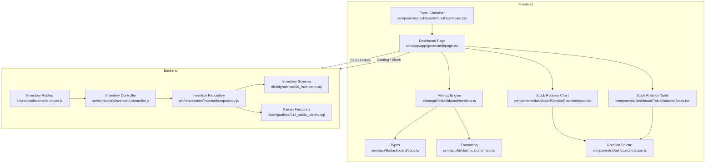
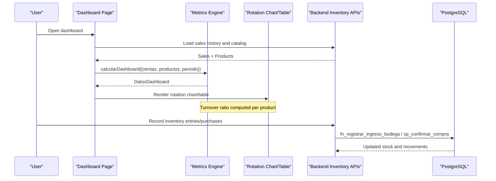
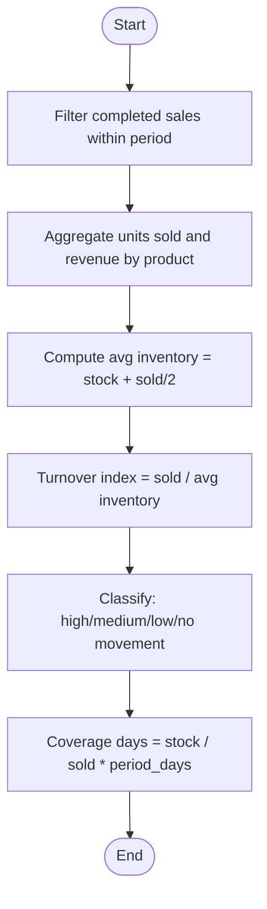
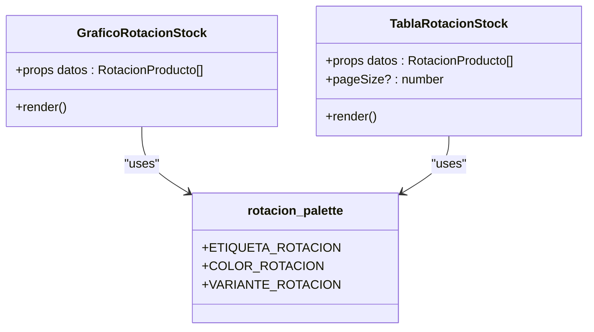
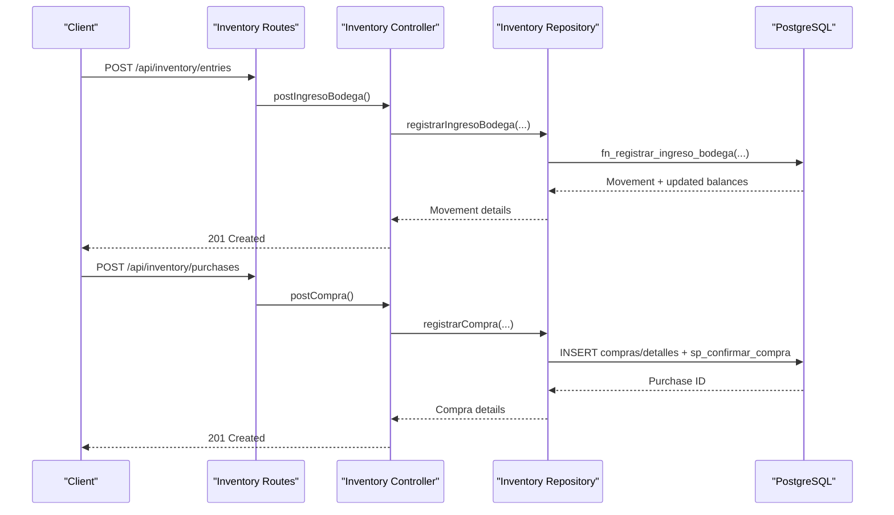
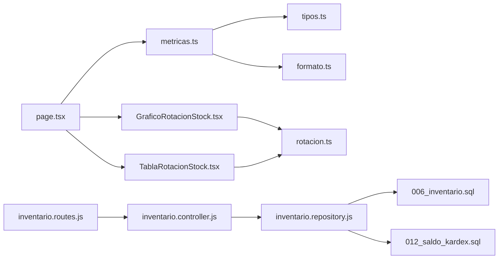
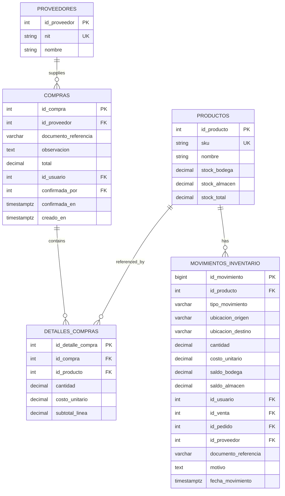

# Inventory Reporting & Analytics

<cite>
**Referenced Files in This Document**
- [page.tsx](file://simoapp/app/(protected)/page.tsx)
- [metricas.ts](file://simoapp/lib/dashboard/metricas.ts)
- [tipos.ts](file://simoapp/lib/dashboard/tipos.ts)
- [formato.ts](file://simoapp/lib/dashboard/formato.ts)
- [GraficoRotacionStock.tsx](file://simoapp/components/dashboard/GraficoRotacionStock.tsx)
- [TablaRotacionStock.tsx](file://simoapp/components/dashboard/TablaRotacionStock.tsx)
- [rotacion.ts](file://simoapp/components/dashboard/rotacion.ts)
- [PanelDashboard.tsx](file://simoapp/components/dashboard/PanelDashboard.tsx)
- [inventario.controller.js](file://backend/src/controllers/inventario.controller.js)
- [inventario.repository.js](file://backend/src/repositories/inventario.repository.js)
- [inventario.routes.js](file://backend/src/routes/inventario.routes.js)
- [006_inventario.sql](file://backend/db/migrations/006_inventario.sql)
- [012_saldo_kardex.sql](file://backend/db/migrations/012_saldo_kardex.sql)
</cite>

## Table of Contents
1. [Introduction](#introduction)
2. [Project Structure](#project-structure)
3. [Core Components](#core-components)
4. [Architecture Overview](#architecture-overview)
5. [Detailed Component Analysis](#detailed-component-analysis)
6. [Dependency Analysis](#dependency-analysis)
7. [Performance Considerations](#performance-considerations)
8. [Troubleshooting Guide](#troubleshooting-guide)
9. [Conclusion](#conclusion)
10. [Appendices](#appendices)

## Introduction
This document explains the inventory reporting and analytics capabilities implemented in the project. It focuses on:
- Inventory turnover ratios and classification
- Stock aging concepts and coverage metrics
- Slow-moving item identification
- Performance metrics calculation and dashboard visualizations
- Data sources, aggregation strategies, and validation tools for large datasets
- Guidance for extending the system with custom reports, scheduled reporting, export functionality, and BI integrations

The current implementation provides a robust operational dashboard that computes sales summaries, payment method usage, and product-level stock rotation using frontend logic over sales history and catalog data. The backend maintains an immutable inventory ledger (Kardex) and supports purchase and stock entry operations.

## Project Structure
The inventory analytics are primarily implemented in the Next.js frontend, while the backend provides inventory movement records and stock updates.

**Diagram sources**
- [page.tsx:1-336](file://simoapp/app/(protected)/page.tsx#L1-L336)
- [metricas.ts:1-334](file://simoapp/lib/dashboard/metricas.ts#L1-L334)
- [tipos.ts:1-90](file://simoapp/lib/dashboard/tipos.ts#L1-L90)
- [formato.ts:1-67](file://simoapp/lib/dashboard/formato.ts#L1-L67)
- [GraficoRotacionStock.tsx:1-159](file://simoapp/components/dashboard/GraficoRotacionStock.tsx#L1-L159)
- [TablaRotacionStock.tsx:1-115](file://simoapp/components/dashboard/TablaRotacionStock.tsx#L1-L115)
- [rotacion.ts:1-40](file://simoapp/components/dashboard/rotacion.ts#L1-L40)
- [PanelDashboard.tsx:1-40](file://simoapp/components/dashboard/PanelDashboard.tsx#L1-L40)
- [inventario.routes.js:1-17](file://backend/src/routes/inventario.routes.js#L1-L17)
- [inventario.controller.js:1-269](file://backend/src/controllers/inventario.controller.js#L1-L269)
- [inventario.repository.js:1-102](file://backend/src/repositories/inventario.repository.js#L1-L102)
- [006_inventario.sql:1-166](file://backend/db/migrations/006_inventario.sql#L1-L166)
- [012_saldo_kardex.sql:1-155](file://backend/db/migrations/012_saldo_kardex.sql#L1-L155)

**Section sources**
- [page.tsx:1-336](file://simoapp/app/(protected)/page.tsx#L1-L336)
- [metricas.ts:1-334](file://simoapp/lib/dashboard/metricas.ts#L1-L334)
- [inventario.controller.js:1-269](file://backend/src/controllers/inventario.controller.js#L1-L269)
- [inventario.repository.js:1-102](file://backend/src/repositories/inventario.repository.js#L1-L102)
- [006_inventario.sql:1-166](file://backend/db/migrations/006_inventario.sql#L1-L166)
- [012_saldo_kardex.sql:1-155](file://backend/db/migrations/012_saldo_kardex.sql#L1-L155)

## Core Components
- Operational dashboard page aggregates sales history and catalog data to compute indicators and render charts and tables.
- Metrics engine calculates period ranges, sales series, summaries, payment method usage, and product-level stock rotation.
- Visualization components display rotation by product and detailed per-product metrics.
- Backend routes and controllers manage inventory entries and purchases; repository functions interact with PostgreSQL functions and views.
- Database schema defines inventory movements, Kardex view, and validation functions for stock consistency.

Key responsibilities:
- Frontend: UI orchestration, metric computation, visualization, formatting.
- Backend: Inventory transactions, stock updates, auditability via Kardex.

**Section sources**
- [page.tsx:104-121](file://simoapp/app/(protected)/page.tsx#L104-L121)
- [metricas.ts:135-277](file://simoapp/lib/dashboard/metricas.ts#L135-L277)
- [GraficoRotacionStock.tsx:47-133](file://simoapp/components/dashboard/GraficoRotacionStock.tsx#L47-L133)
- [TablaRotacionStock.tsx:19-113](file://simoapp/components/dashboard/TablaRotacionStock.tsx#L19-L113)
- [inventario.controller.js:48-147](file://backend/src/controllers/inventario.controller.js#L48-L147)
- [inventario.repository.js:12-27](file://backend/src/repositories/inventario.repository.js#L12-L27)
- [006_inventario.sql:62-161](file://backend/db/migrations/006_inventario.sql#L62-L161)
- [012_saldo_kardex.sql:26-108](file://backend/db/migrations/012_saldo_kardex.sql#L26-L108)

## Architecture Overview
The analytics pipeline combines sales history and catalog data on the client side to produce actionable insights. Inventory changes are recorded immutably in the database, ensuring reliable stock figures.

**Diagram sources**
- [page.tsx:64-113](file://simoapp/app/(protected)/page.tsx#L64-L113)
- [metricas.ts:316-333](file://simoapp/lib/dashboard/metricas.ts#L316-L333)
- [inventario.controller.js:48-147](file://backend/src/controllers/inventario.controller.js#L48-L147)
- [inventario.repository.js:12-27](file://backend/src/repositories/inventario.repository.js#L12-L27)

## Detailed Component Analysis

### Inventory Turnover Ratio Calculation
- The system estimates average inventory as current stock plus half of units sold during the period.
- Turnover index = units sold / average inventory.
- Classification thresholds define high, medium, low, or no movement.
- Coverage days estimate how long current stock lasts at the period’s sales rate.

**Diagram sources**
- [metricas.ts:216-277](file://simoapp/lib/dashboard/metricas.ts#L216-L277)

**Section sources**
- [metricas.ts:216-277](file://simoapp/lib/dashboard/metricas.ts#L216-L277)
- [tipos.ts:54-71](file://simoapp/lib/dashboard/tipos.ts#L54-L71)

### Dashboard Visualizations
- Horizontal bar chart shows top products by turnover index with color-coded classification.
- Table lists all products with units sold, stock, coverage days, and classification badges.
- Formatting utilities standardize currency, numbers, dates, and indices.

**Diagram sources**
- [GraficoRotacionStock.tsx:47-133](file://simoapp/components/dashboard/GraficoRotacionStock.tsx#L47-L133)
- [TablaRotacionStock.tsx:19-113](file://simoapp/components/dashboard/TablaRotacionStock.tsx#L19-L113)
- [rotacion.ts:8-39](file://simoapp/components/dashboard/rotacion.ts#L8-L39)

**Section sources**
- [GraficoRotacionStock.tsx:47-133](file://simoapp/components/dashboard/GraficoRotacionStock.tsx#L47-L133)
- [TablaRotacionStock.tsx:19-113](file://simoapp/components/dashboard/TablaRotacionStock.tsx#L19-L113)
- [formato.ts:5-66](file://simoapp/lib/dashboard/formato.ts#L5-L66)

### Stock Aging Reports and Slow-Moving Items
- Current implementation does not include explicit aging buckets (e.g., 0–30, 31–60, 61–90+ days).
- Slow-moving items can be identified using:
  - Low turnover classification
  - High coverage days indicating excess stock relative to sales
  - Zero units sold (“no movement”)
- Recommendations:
  - Add aging buckets based on movement timestamps from the Kardex view.
  - Surface slow-movers in a dedicated report with filters for classification and coverage.

[No sources needed since this section proposes extensions beyond current code]

### Inventory Health Scores and Optimization Recommendations
- Health signals available:
  - Turnover classification (high/medium/low/no movement)
  - Coverage days
  - Replenishment flag when stock is at or below minimum
- Example recommendations:
  - For “low” turnover with high coverage: consider promotions or reduced reorder quantities.
  - For “no movement”: review demand forecasting and supplier lead times.
  - For replenishment flagged items: trigger purchase orders or transfers.

[No sources needed since this section provides conceptual guidance]

### Predictive Analytics for Demand Forecasting
- Not implemented in the current codebase.
- Suggested approach:
  - Use historical sales time series from the dashboard to fit simple models (moving averages, exponential smoothing).
  - Incorporate seasonality and promotional effects if available.
  - Integrate with external ML services or libraries for advanced forecasting.

[No sources needed since this section provides conceptual guidance]

### Custom Report Generation, Scheduled Reporting, and Export Functionality
- Not implemented in the current codebase.
- Recommended design:
  - Define report templates (CSV/JSON/PDF) for turnover, coverage, slow-movers, and health scores.
  - Implement server-side endpoints to generate reports from aggregated data.
  - Schedule jobs (cron or task queue) to run periodic reports and email or store exports.
  - Provide BI connectors (REST/GraphQL) for dashboards like Power BI or Metabase.

[No sources needed since this section provides conceptual guidance]

### Backend Inventory Operations and Data Integrity
- Inventory entries and purchases update stock levels and create immutable movements.
- Kardex view and functions provide chronological tracking and valuation.
- Validation functions ensure stock consistency and detect inconsistencies.

**Diagram sources**
- [inventario.routes.js:9-14](file://backend/src/routes/inventario.routes.js#L9-L14)
- [inventario.controller.js:48-147](file://backend/src/controllers/inventario.controller.js#L48-L147)
- [inventario.controller.js:163-246](file://backend/src/controllers/inventario.controller.js#L163-L246)
- [inventario.repository.js:12-27](file://backend/src/repositories/inventario.repository.js#L12-L27)
- [inventario.repository.js:32-62](file://backend/src/repositories/inventario.repository.js#L32-L62)

**Section sources**
- [inventario.controller.js:48-147](file://backend/src/controllers/inventario.controller.js#L48-L147)
- [inventario.controller.js:163-246](file://backend/src/controllers/inventario.controller.js#L163-L246)
- [inventario.repository.js:12-62](file://backend/src/repositories/inventario.repository.js#L12-L62)
- [006_inventario.sql:62-161](file://backend/db/migrations/006_inventario.sql#L62-L161)
- [012_saldo_kardex.sql:26-108](file://backend/db/migrations/012_saldo_kardex.sql#L26-L108)

## Dependency Analysis
The dashboard depends on sales history and catalog data; metrics computations are pure functions. Visualization components depend on shared palette and formatting utilities. Backend routes delegate to controller logic, which uses repository functions to interact with database functions and views.

**Diagram sources**
- [page.tsx:1-336](file://simoapp/app/(protected)/page.tsx#L1-L336)
- [metricas.ts:1-334](file://simoapp/lib/dashboard/metricas.ts#L1-L334)
- [tipos.ts:1-90](file://simoapp/lib/dashboard/tipos.ts#L1-L90)
- [formato.ts:1-67](file://simoapp/lib/dashboard/formato.ts#L1-L67)
- [GraficoRotacionStock.tsx:1-159](file://simoapp/components/dashboard/GraficoRotacionStock.tsx#L1-L159)
- [TablaRotacionStock.tsx:1-115](file://simoapp/components/dashboard/TablaRotacionStock.tsx#L1-L115)
- [rotacion.ts:1-40](file://simoapp/components/dashboard/rotacion.ts#L1-L40)
- [inventario.routes.js:1-17](file://backend/src/routes/inventario.routes.js#L1-L17)
- [inventario.controller.js:1-269](file://backend/src/controllers/inventario.controller.js#L1-L269)
- [inventario.repository.js:1-102](file://backend/src/repositories/inventario.repository.js#L1-L102)
- [006_inventario.sql:1-166](file://backend/db/migrations/006_inventario.sql#L1-L166)
- [012_saldo_kardex.sql:1-155](file://backend/db/migrations/012_saldo_kardex.sql#L1-L155)

**Section sources**
- [page.tsx:1-336](file://simoapp/app/(protected)/page.tsx#L1-L336)
- [metricas.ts:1-334](file://simoapp/lib/dashboard/metricas.ts#L1-L334)
- [inventario.routes.js:1-17](file://backend/src/routes/inventario.routes.js#L1-L17)
- [inventario.controller.js:1-269](file://backend/src/controllers/inventario.controller.js#L1-L269)
- [inventario.repository.js:1-102](file://backend/src/repositories/inventario.repository.js#L1-L102)

## Performance Considerations
- Frontend aggregation:
  - Aggregates sales by product using maps to avoid repeated scans.
  - Computes series and summaries in linear time relative to sales count.
  - Limits chart dataset to top N products to reduce rendering load.
- Backend operations:
  - Uses stored procedures/functions to atomically update stock and record movements.
  - Immutable movements table ensures auditability without reconciliation overhead.
- Data integrity:
  - Kardex validation functions compare recalculated balances with stored values to detect inconsistencies.

Recommendations:
- Pre-aggregate sales series on the server for very large histories.
- Paginate or filter movements when generating aging reports.
- Cache catalog and recent sales in the browser for faster dashboard refreshes.

**Section sources**
- [metricas.ts:135-277](file://simoapp/lib/dashboard/metricas.ts#L135-L277)
- [GraficoRotacionStock.tsx:52-57](file://simoapp/components/dashboard/GraficoRotacionStock.tsx#L52-L57)
- [012_saldo_kardex.sql:113-149](file://backend/db/migrations/012_saldo_kardex.sql#L113-L149)

## Troubleshooting Guide
Common issues and resolutions:
- Dashboard shows mock data warning:
  - Indicates demo sales history is active; verify environment configuration to use real data.
- Stock and rotation appear inaccurate:
  - Ensure catalog stock is up to date; check inventory entries and purchases were confirmed.
  - Run Kardex validation to detect inconsistent movements.
- Errors when recording inventory entries or purchases:
  - Validate input constraints (positive integers, numeric limits, required fields).
  - Check business rule errors mapped to HTTP status codes.

Operational checks:
- Verify authentication and role middleware allow access to inventory endpoints.
- Confirm database functions and views exist and return expected results.

**Section sources**
- [page.tsx:160-175](file://simoapp/app/(protected)/page.tsx#L160-L175)
- [page.tsx:215-223](file://simoapp/app/(protected)/page.tsx#L215-L223)
- [inventario.controller.js:138-146](file://backend/src/controllers/inventario.controller.js#L138-L146)
- [inventario.controller.js:235-246](file://backend/src/controllers/inventario.controller.js#L235-L246)
- [012_saldo_kardex.sql:113-149](file://backend/db/migrations/012_saldo_kardex.sql#L113-L149)

## Conclusion
The system delivers a clear operational dashboard focused on sales performance and inventory turnover. Turnover ratios are computed using estimated average inventory, enabling quick identification of fast- and slow-moving items. The backend maintains a robust, auditable inventory ledger with validation functions to ensure data integrity. Extending the solution with aging reports, predictive analytics, scheduled exports, and BI integrations will further enhance decision-making capabilities.

[No sources needed since this section summarizes without analyzing specific files]

## Appendices

### Key Data Models and Relationships

**Diagram sources**
- [006_inventario.sql:25-108](file://backend/db/migrations/006_inventario.sql#L25-L108)
- [006_inventario.sql:136-161](file://backend/db/migrations/006_inventario.sql#L136-L161)
- [inventario.repository.js:64-82](file://backend/src/repositories/inventario.repository.js#L64-L82)