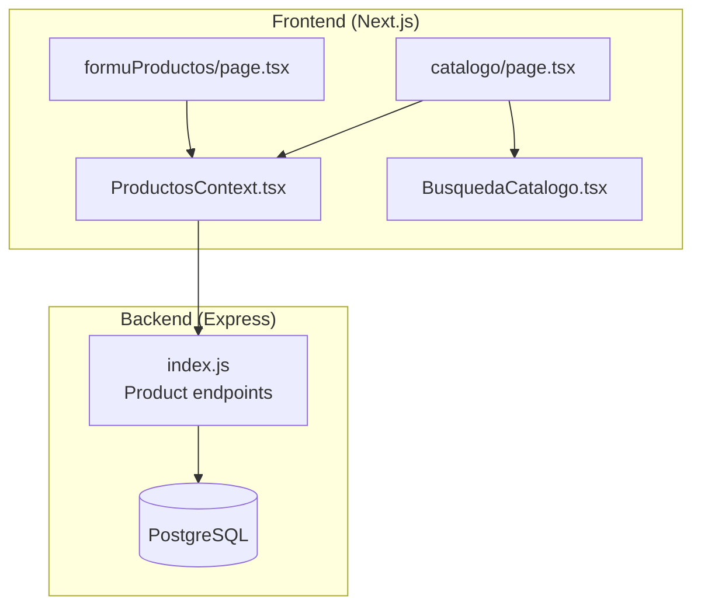
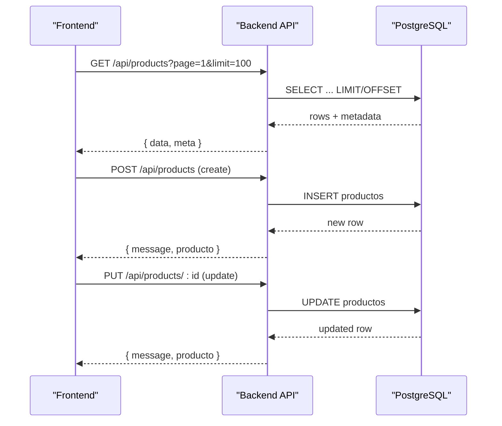
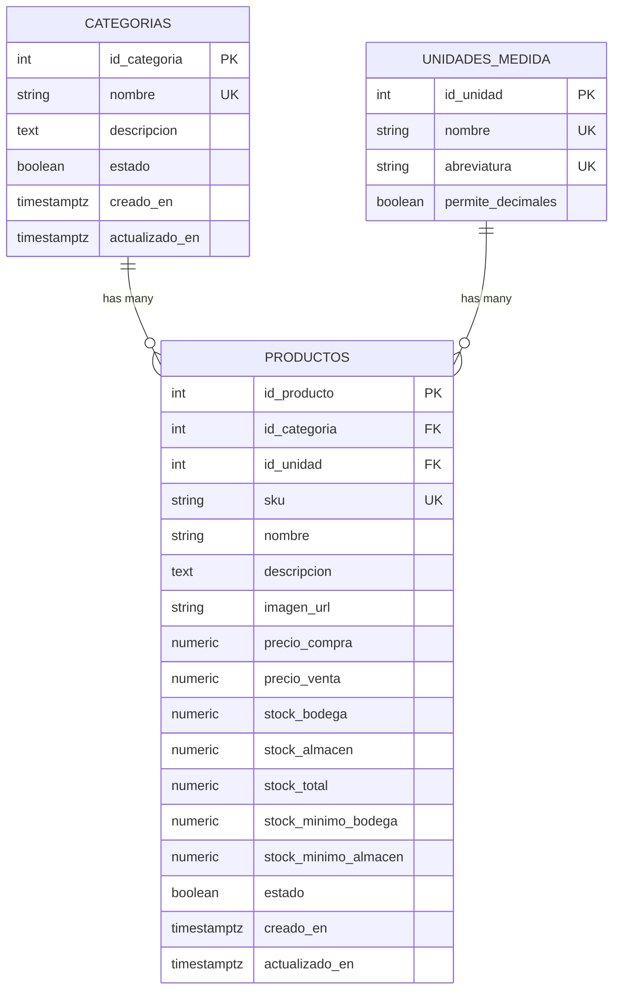
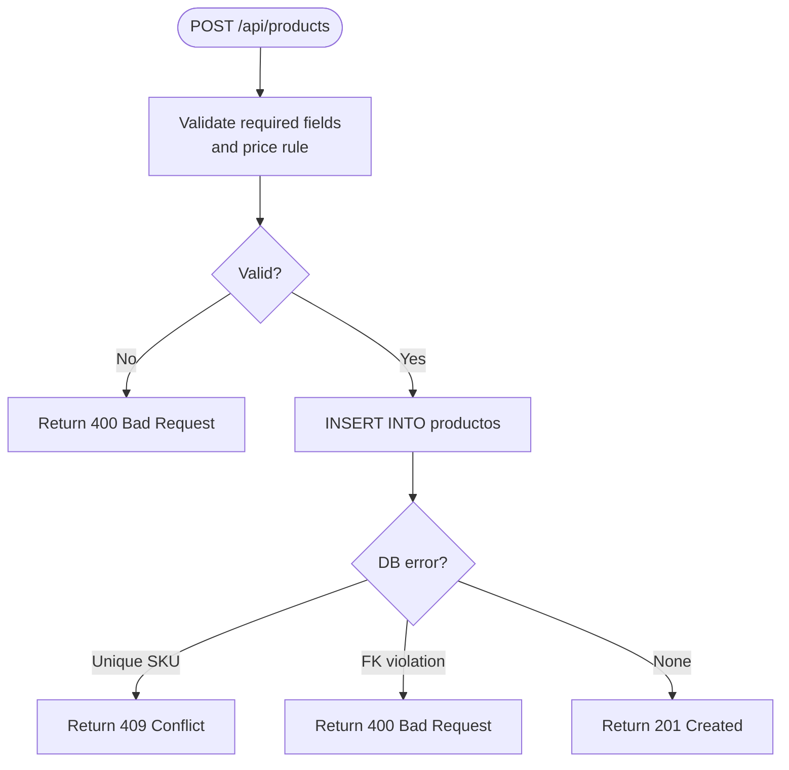
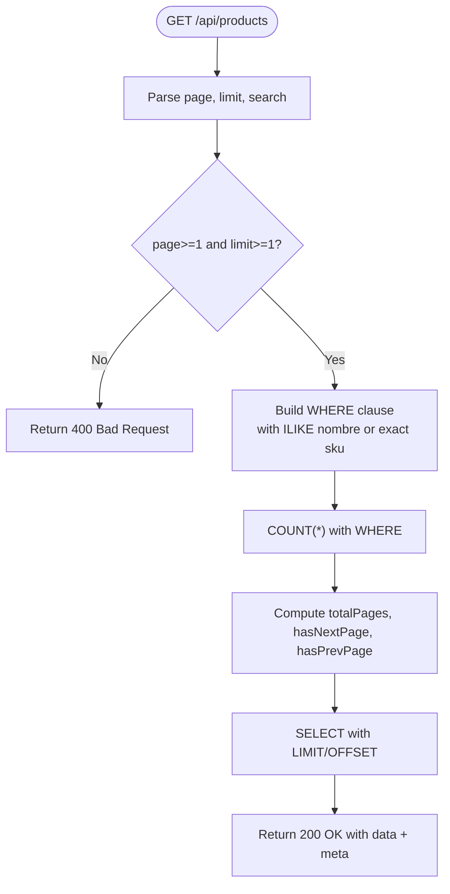
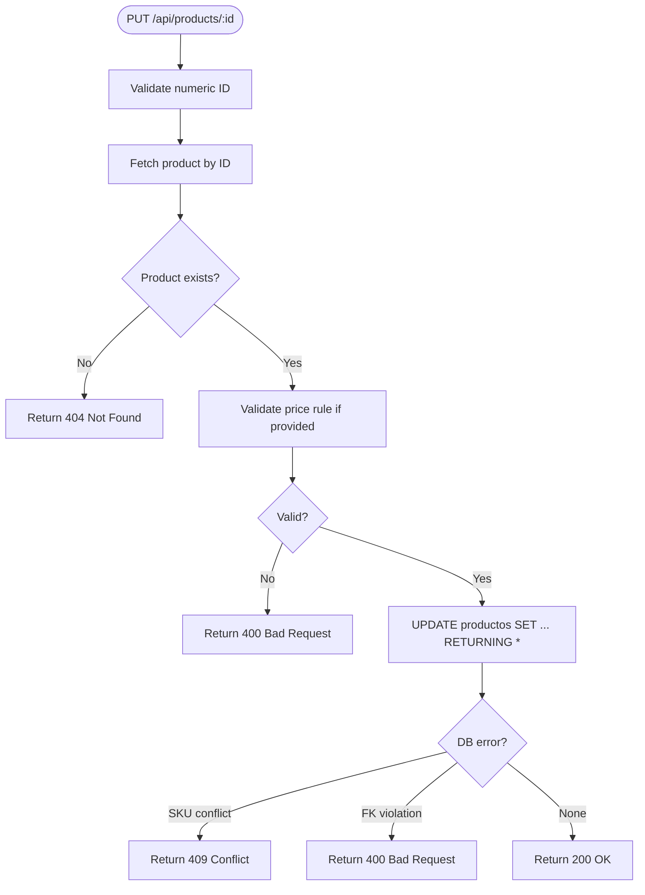
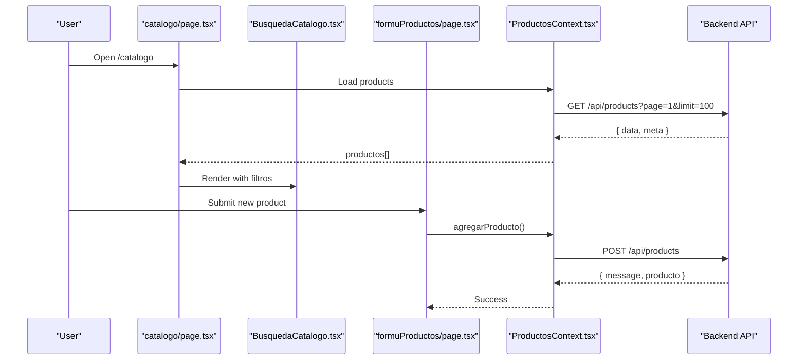
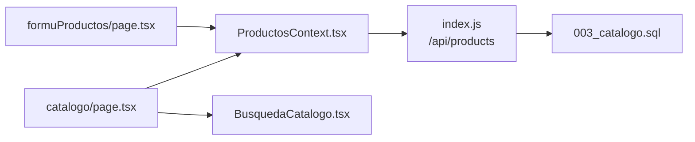

# Product Catalog Management

<cite>
**Referenced Files in This Document**   
- [backend/index.js](file://backend/index.js)
- [backend/db/migrations/003_catalogo.sql](file://backend/db/migrations/003_catalogo.sql)
- [simoapp/app/(protected)/catalogo/page.tsx](file://simoapp/app/(protected)/catalogo/page.tsx)
- [simoapp/components/catalogo/ProductosContext.tsx](file://simoapp/components/catalogo/ProductosContext.tsx)
- [simoapp/components/catalogo/BusquedaCatalogo.tsx](file://simoapp/components/catalogo/BusquedaCatalogo.tsx)
- [simoapp/components/catalogo/tipos.ts](file://simoapp/components/catalogo/tipos.ts)
- [simoapp/app/(protected)/formuProductos/page.tsx](file://simoapp/app/(protected)/formuProductos/page.tsx)
</cite>

## Table of Contents
1. [Introduction](#introduction)
2. [Project Structure](#project-structure)
3. [Core Components](#core-components)
4. [Architecture Overview](#architecture-overview)
5. [Detailed Component Analysis](#detailed-component-analysis)
6. [Dependency Analysis](#dependency-analysis)
7. [Performance Considerations](#performance-considerations)
8. [Troubleshooting Guide](#troubleshooting-guide)
9. [Conclusion](#conclusion)

## Introduction
This document explains product catalog management within the inventory system, covering how products are created, read, updated, and managed through API endpoints; how SKU rules, categorization, search, and status work; and how the frontend catalog interface displays, filters, and interacts with products. It also addresses stock locations (Bodega and Almacén), image handling, bulk operations, and performance considerations for large catalogs.

## Project Structure
The product catalog spans a small backend Express application and a Next.js frontend:
- Backend exposes REST endpoints for product creation, listing, and updates under /api/products.
- Database schema defines categories, units of measure, and products with dual stock locations and minimum thresholds.
- Frontend provides a catalog page with live search and filters, a product creation form, and shared state via a context provider.

**Diagram sources**
- [simoapp/app/(protected)/catalogo/page.tsx:18-131](file://simoapp/app/(protected)/catalogo/page.tsx#L18-L131)
- [simoapp/components/catalogo/ProductosContext.tsx:116-127](file://simoapp/components/catalogo/ProductosContext.tsx#L116-L127)
- [simoapp/components/catalogo/BusquedaCatalogo.tsx:39-80](file://simoapp/components/catalogo/BusquedaCatalogo.tsx#L39-L80)
- [simoapp/app/(protected)/formuProductos/page.tsx:24-48](file://simoapp/app/(protected)/formuProductos/page.tsx#L24-L48)
- [backend/index.js:75-152](file://backend/index.js#L75-L152)

**Section sources**
- [backend/index.js:75-152](file://backend/index.js#L75-L152)
- [backend/db/migrations/003_catalogo.sql:22-101](file://backend/db/migrations/003_catalogo.sql#L22-L101)
- [simoapp/app/(protected)/catalogo/page.tsx:18-131](file://simoapp/app/(protected)/catalogo/page.tsx#L18-L131)
- [simoapp/components/catalogo/ProductosContext.tsx:116-127](file://simoapp/components/catalogo/ProductosContext.tsx#L116-L127)

## Core Components
- Product data model and constraints are defined in the database migration, including unique SKUs, category and unit references, dual stock columns, generated total stock, minimum stock per location, and an active/inactive status flag.
- The backend exposes:
  - POST /api/products to create a product.
  - GET /api/products to list products with pagination and optional search by name or exact SKU.
  - PUT /api/products/:id to update product fields, including status.
- The frontend:
  - Loads all pages of products from the backend into a shared context.
  - Provides a catalog view with live text search and filters for category, availability, and status.
  - Offers a product creation form that posts to the backend and updates local state.

Key responsibilities:
- Backend: validation, persistence, error mapping, pagination, search.
- Frontend: UI, filtering, state synchronization, user feedback.

**Section sources**
- [backend/db/migrations/003_catalogo.sql:41-101](file://backend/db/migrations/003_catalogo.sql#L41-L101)
- [backend/index.js:75-152](file://backend/index.js#L75-L152)
- [backend/index.js:157-232](file://backend/index.js#L157-L232)
- [backend/index.js:237-342](file://backend/index.js#L237-L342)
- [simoapp/components/catalogo/ProductosContext.tsx:116-127](file://simoapp/components/catalogo/ProductosContext.tsx#L116-L127)
- [simoapp/components/catalogo/BusquedaCatalogo.tsx:51-80](file://simoapp/components/catalogo/BusquedaCatalogo.tsx#L51-L80)

## Architecture Overview
The product catalog follows a simple client-server architecture:
- The Next.js app fetches product data from the Express API.
- The Express API validates requests, enforces business rules, and persists data to PostgreSQL.
- The frontend maintains a client-side copy of the full product list to enable fast filtering and searching.

**Diagram sources**
- [backend/index.js:75-152](file://backend/index.js#L75-L152)
- [backend/index.js:157-232](file://backend/index.js#L157-L232)
- [backend/index.js:237-342](file://backend/index.js#L237-L342)

## Detailed Component Analysis

### Database Schema and Data Model
The catalog schema includes:
- unidades_medida: configurable units of measure with decimal support flags.
- categorias: product categories with active status and timestamps.
- productos: core product entity with:
  - Unique, non-empty SKU.
  - Category and unit references.
  - Purchase and sale prices (non-negative).
  - Dual stock: stock_bodega and stock_almacen, both non-negative.
  - Generated stock_total = stock_bodega + stock_almacen.
  - Minimum stock per location.
  - Active/inactive estado flag.
  - Timestamps for creation and updates.

Indexes exist on category, estado, and normalized nombre to optimize common queries.

**Diagram sources**
- [backend/db/migrations/003_catalogo.sql:22-101](file://backend/db/migrations/003_catalogo.sql#L22-L101)

**Section sources**
- [backend/db/migrations/003_catalogo.sql:22-101](file://backend/db/migrations/003_catalogo.sql#L22-L101)

### Product Creation API
Endpoint: POST /api/products
- Purpose: Create a new product.
- Required fields: id_categoria, id_unidad, sku, nombre, precio_compra, precio_venta.
- Optional fields: descripcion, stock_minimo_bodega, stock_minimo_almacen.
- Business rule: precio_venta must be greater than precio_compra.
- Constraints enforced by DB:
  - SKU is unique and non-empty.
  - Category and unit IDs must exist (foreign keys).
  - Prices and stock values are non-negative.
- Responses:
  - 201 Created with the inserted product.
  - 400 Bad Request for missing fields or business rule violations.
  - 409 Conflict if SKU already exists.
  - 400 Bad Request if referenced category/unit does not exist.
  - 500 Internal Server Error on unexpected failures.

Validation flow:

**Diagram sources**
- [backend/index.js:75-152](file://backend/index.js#L75-L152)

**Section sources**
- [backend/index.js:75-152](file://backend/index.js#L75-L152)

### Product Listing and Search API
Endpoint: GET /api/products
- Query parameters:
  - page: integer >= 1 (default 1).
  - limit: integer >= 1 (default 10).
  - search: optional string to filter by name (ILIKE) or exact match on SKU.
- Pagination:
  - Returns data array and meta object with totalItems, itemsPerPage, totalPages, currentPage, hasNextPage, hasPrevPage.
- Filtering:
  - If search is provided, matches any product whose nombre contains the search term (case-insensitive) or whose sku equals the search term exactly.
- Response structure:
  - data: array of product rows.
  - meta: pagination metadata.

Search behavior:

**Diagram sources**
- [backend/index.js:157-232](file://backend/index.js#L157-L232)

**Section sources**
- [backend/index.js:157-232](file://backend/index.js#L157-L232)

### Product Update API
Endpoint: PUT /api/products/:id
- Purpose: Partially update product fields, including estado (active/inactive).
- Validation:
  - ID must be numeric.
  - If precio_venta and/or precio_compra are provided, the business rule requires precio_venta > precio_compra.
- Behavior:
  - Uses COALESCE to keep existing values when fields are omitted.
  - Enforces foreign key constraint on id_categoria.
  - Enforces unique constraint on sku.
- Responses:
  - 200 OK with updated product.
  - 400 Bad Request for invalid ID, business rule violation, or missing category.
  - 404 Not Found if product ID does not exist.
  - 409 Conflict if SKU conflicts with another product.
  - 500 Internal Server Error on unexpected failures.

Update flow:

**Diagram sources**
- [backend/index.js:237-342](file://backend/index.js#L237-L342)

**Section sources**
- [backend/index.js:237-342](file://backend/index.js#L237-L342)

### Product Deletion
There is no DELETE endpoint for products in the current backend implementation. To remove a product, use the update endpoint to set its estado to false (inactive). This preserves historical data and aligns with the schema’s soft-delete approach via estado.

**Section sources**
- [backend/index.js:237-342](file://backend/index.js#L237-L342)

### SKU Generation Rules
- SKU is mandatory, unique, and cannot be empty.
- The backend rejects duplicate SKUs on create and update.
- The search endpoint supports exact SKU matching via the search parameter.
- No automatic generation logic is present in the backend; SKUs are supplied by the caller.

Recommendation:
- Implement server-side SKU generation (e.g., prefix based on category or supplier) to ensure uniqueness and consistency.
- Add a dedicated endpoint or field to validate proposed SKUs before submission.

**Section sources**
- [backend/db/migrations/003_catalogo.sql:65-70](file://backend/db/migrations/003_catalogo.sql#L65-L70)
- [backend/index.js:75-152](file://backend/index.js#L75-L152)
- [backend/index.js:157-232](file://backend/index.js#L157-L232)
- [backend/index.js:237-342](file://backend/index.js#L237-L342)

### Product Categorization
- Products reference categorias via id_categoria.
- Categories have names, descriptions, and an estado flag.
- Frontend maps category IDs to display names for rendering and filtering.

Best practices:
- Always validate id_categoria against existing categories.
- Use category indexes for efficient filtering.

**Section sources**
- [backend/db/migrations/003_catalogo.sql:41-55](file://backend/db/migrations/003_catalogo.sql#L41-L55)
- [simoapp/components/catalogo/ProductosContext.tsx:76-88](file://simoapp/components/catalogo/ProductosContext.tsx#L76-L88)

### Search Functionality
- Backend search supports:
  - Name substring search (case-insensitive).
  - Exact SKU match.
- Frontend performs additional client-side filtering by:
  - Text (code or name).
  - Category.
  - Availability (stockActual > 0).
  - Status (Activo/Inactivo).

Note:
- The frontend currently loads all pages of products into memory to enable fast client-side filtering. For very large catalogs, consider server-side filtering and pagination controls.

**Section sources**
- [backend/index.js:157-232](file://backend/index.js#L157-L232)
- [simoapp/components/catalogo/ProductosContext.tsx:116-127](file://simoapp/components/catalogo/ProductosContext.tsx#L116-L127)
- [simoapp/components/catalogo/BusquedaCatalogo.tsx:51-80](file://simoapp/components/catalogo/BusquedaCatalogo.tsx#L51-L80)

### Product Data Structures
Frontend Producto type includes:
- id, codigo (SKU), nombre, descripcion, categoria, unidadMedida.
- precioCompra, precioVenta.
- stockActual, stockBodega, stockAlmacen, stockMinimo.
- estado ("Activo" | "Inactivo").

Backend returns raw product rows; the frontend maps them to the Producto type.

Example mapping highlights:
- Stock totals and split between Bodega and Almacén.
- Category and unit names resolved from IDs when not provided by backend.

**Section sources**
- [simoapp/components/catalogo/tipos.ts:25-46](file://simoapp/components/catalogo/tipos.ts#L25-L46)
- [simoapp/components/catalogo/ProductosContext.tsx:90-112](file://simoapp/components/catalogo/ProductosContext.tsx#L90-L112)

### Validation Rules Summary
- Create:
  - Required fields: id_categoria, id_unidad, sku, nombre, precio_compra, precio_venta.
  - Business rule: precio_venta > precio_compra.
  - DB constraints: unique SKU, non-empty SKU, non-negative prices, valid foreign keys.
- Update:
  - Numeric ID.
  - Price rule applies when prices are provided.
  - Unique SKU across products.
  - Valid category ID.
- Search:
  - page and limit must be positive integers.
  - search filters by nombre (ILIKE) or exact sku.

**Section sources**
- [backend/index.js:75-152](file://backend/index.js#L75-L152)
- [backend/index.js:157-232](file://backend/index.js#L157-L232)
- [backend/index.js:237-342](file://backend/index.js#L237-L342)

### Bulk Operations
- There is no dedicated bulk product creation/update endpoint.
- Recommended approach:
  - Batch multiple POST/PUT calls with client-side retries and concurrency limits.
  - Alternatively, implement a server-side bulk endpoint that accepts arrays of products and processes them atomically where possible.

**Section sources**
- [backend/index.js:75-152](file://backend/index.js#L75-L152)
- [backend/index.js:237-342](file://backend/index.js#L237-L342)

### Product Status Management
- Products have an estado boolean column.
- Update endpoint allows toggling estado.
- Frontend displays status badges and filters by status.

Operational guidance:
- Inactivate products instead of deleting to preserve history.
- Disable actions (e.g., transfers) for inactive products.

**Section sources**
- [backend/db/migrations/003_catalogo.sql:65-83](file://backend/db/migrations/003_catalogo.sql#L65-L83)
- [backend/index.js:237-342](file://backend/index.js#L237-L342)
- [simoapp/components/catalogo/BusquedaCatalogo.tsx:152-163](file://simoapp/components/catalogo/BusquedaCatalogo.tsx#L152-L163)

### Image Handling
- The productos table includes an imagen_url column.
- Current endpoints do not handle image uploads; they accept a URL string if provided.
- Frontend does not render images in the catalog cards.

Recommendations:
- Implement a secure image upload endpoint with size/type validation.
- Store images in object storage and return CDN URLs.
- Display thumbnails in the catalog and allow zoomable previews.

**Section sources**
- [backend/db/migrations/003_catalogo.sql:65-73](file://backend/db/migrations/003_catalogo.sql#L65-L73)
- [backend/index.js:75-152](file://backend/index.js#L75-L152)
- [backend/index.js:237-342](file://backend/index.js#L237-L342)

### Frontend Catalog Interface
- Catalog page:
  - Displays a header and link to create a new product.
  - Shows loading states and fallback messages when backend is unavailable.
  - Integrates the search component and a transfer modal for moving stock from Bodega to Almacén.
- Search component:
  - Live text search by code or name.
  - Filters by category, availability, and status.
  - Displays product cards with price, stock split, and status badge.
- Product creation form:
  - Collects product details and posts to POST /api/products.
  - Updates local state upon success.

**Diagram sources**
- [simoapp/app/(protected)/catalogo/page.tsx:18-131](file://simoapp/app/(protected)/catalogo/page.tsx#L18-L131)
- [simoapp/components/catalogo/BusquedaCatalogo.tsx:39-80](file://simoapp/components/catalogo/BusquedaCatalogo.tsx#L39-L80)
- [simoapp/app/(protected)/formuProductos/page.tsx:24-48](file://simoapp/app/(protected)/formuProductos/page.tsx#L24-L48)
- [simoapp/components/catalogo/ProductosContext.tsx:116-127](file://simoapp/components/catalogo/ProductosContext.tsx#L116-L127)
- [backend/index.js:75-152](file://backend/index.js#L75-L152)

**Section sources**
- [simoapp/app/(protected)/catalogo/page.tsx:18-131](file://simoapp/app/(protected)/catalogo/page.tsx#L18-L131)
- [simoapp/components/catalogo/BusquedaCatalogo.tsx:39-80](file://simoapp/components/catalogo/BusquedaCatalogo.tsx#L39-L80)
- [simoapp/app/(protected)/formuProductos/page.tsx:24-48](file://simoapp/app/(protected)/formuProductos/page.tsx#L24-L48)
- [simoapp/components/catalogo/ProductosContext.tsx:116-127](file://simoapp/components/catalogo/ProductosContext.tsx#L116-L127)

## Dependency Analysis
- Frontend depends on:
  - ProductosContext for shared product state and API calls.
  - BusquedaCatalogo for filtering and display.
  - Catalog page for layout and navigation.
- Backend depends on:
  - Express middleware (helmet, cors, rate-limit, XSS sanitization).
  - PostgreSQL via pool for queries.
  - Database schema for constraints and indexes.

**Diagram sources**
- [simoapp/app/(protected)/catalogo/page.tsx:18-131](file://simoapp/app/(protected)/catalogo/page.tsx#L18-L131)
- [simoapp/components/catalogo/ProductosContext.tsx:116-127](file://simoapp/components/catalogo/ProductosContext.tsx#L116-L127)
- [simoapp/components/catalogo/BusquedaCatalogo.tsx:39-80](file://simoapp/components/catalogo/BusquedaCatalogo.tsx#L39-L80)
- [simoapp/app/(protected)/formuProductos/page.tsx:24-48](file://simoapp/app/(protected)/formuProductos/page.tsx#L24-L48)
- [backend/index.js:75-152](file://backend/index.js#L75-L152)
- [backend/db/migrations/003_catalogo.sql:22-101](file://backend/db/migrations/003_catalogo.sql#L22-L101)

**Section sources**
- [simoapp/app/(protected)/catalogo/page.tsx:18-131](file://simoapp/app/(protected)/catalogo/page.tsx#L18-L131)
- [simoapp/components/catalogo/ProductosContext.tsx:116-127](file://simoapp/components/catalogo/ProductosContext.tsx#L116-L127)
- [backend/index.js:75-152](file://backend/index.js#L75-L152)
- [backend/db/migrations/003_catalogo.sql:22-101](file://backend/db/migrations/003_catalogo.sql#L22-L101)

## Performance Considerations
- Pagination:
  - Backend supports page and limit; frontend currently paginates internally to load all products for client-side filtering.
  - For large catalogs, prefer server-side filtering and controlled pagination UI.
- Indexes:
  - Ensure indexes on frequently filtered columns (category, estado, normalized nombre).
- Client-side filtering:
  - Keep filter sets small; avoid excessive re-renders by memoizing computed lists.
- Network efficiency:
  - Cache product lists in context to avoid repeated fetches during navigation.
- Rate limiting:
  - Backend applies rate limiting to /api routes; tune limits for expected traffic.

[No sources needed since this section provides general guidance]

## Troubleshooting Guide
Common issues and resolutions:
- Duplicate SKU on create/update:
  - Cause: SKU already exists.
  - Resolution: Choose a unique SKU or implement server-side generation.
- Missing required fields:
  - Cause: Omitted id_categoria, id_unidad, sku, nombre, precio_compra, precio_venta.
  - Resolution: Provide all required fields.
- Business rule violation (price):
  - Cause: precio_venta <= precio_compra.
  - Resolution: Ensure venta price is strictly greater than compra price.
- Invalid category/unit IDs:
  - Cause: Referenced IDs do not exist.
  - Resolution: Use valid IDs from categorias and unidades_medida.
- Backend unreachable:
  - Symptom: Frontend shows fallback data and a notice.
  - Resolution: Verify NEXT_PUBLIC_API_URL and backend health endpoint.

**Section sources**
- [backend/index.js:75-152](file://backend/index.js#L75-L152)
- [backend/index.js:237-342](file://backend/index.js#L237-L342)
- [simoapp/app/(protected)/catalogo/page.tsx:59-71](file://simoapp/app/(protected)/catalogo/page.tsx#L59-L71)

## Conclusion
The product catalog system provides robust creation, listing, and update capabilities with strong data integrity enforced at the database level. The frontend offers a responsive interface with live search and filters, while the backend ensures consistent validation and pagination. For production-scale catalogs, consider implementing server-side filtering, image upload services, and bulk operation endpoints to improve usability and performance.

[No sources needed since this section summarizes without analyzing specific files]