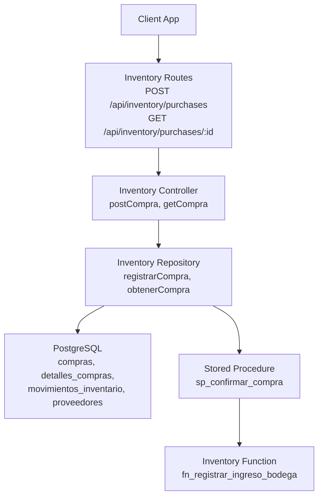
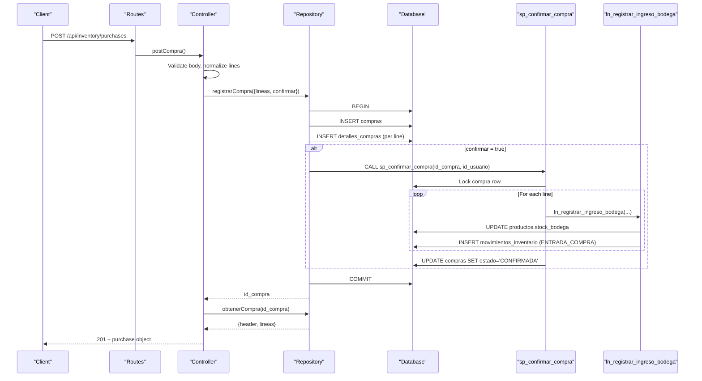
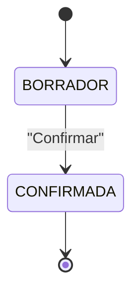
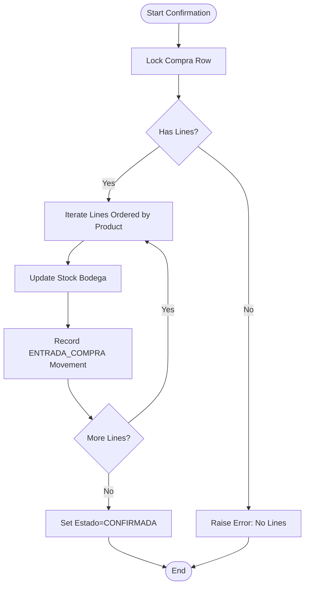
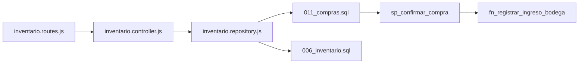

# Purchase Order Management

<cite>
**Referenced Files in This Document**
- [011_compras.sql](file://backend/db/migrations/011_compras.sql)
- [006_inventario.sql](file://backend/db/migrations/006_inventario.sql)
- [inventario.routes.js](file://backend/src/routes/inventario.routes.js)
- [inventario.controller.js](file://backend/src/controllers/inventario.controller.js)
- [inventario.repository.js](file://backend/src/repositories/inventario.repository.js)
</cite>

## Table of Contents
1. [Introduction](#introduction)
2. [Project Structure](#project-structure)
3. [Core Components](#core-components)
4. [Architecture Overview](#architecture-overview)
5. [Detailed Component Analysis](#detailed-component-analysis)
6. [Dependency Analysis](#dependency-analysis)
7. [Performance Considerations](#performance-considerations)
8. [Troubleshooting Guide](#troubleshooting-guide)
9. [Conclusion](#conclusion)

## Introduction
This document explains purchase order management within the inventory system. It covers how purchase orders are created, validated, confirmed, and integrated with inventory receipts. It also documents supplier integration, line-item cost calculation, state transitions, API contracts, and available reporting and analytics surfaces. Where functionality is not yet implemented, this guide clearly identifies gaps and proposes safe extensions aligned with the existing architecture.

## Project Structure
Purchase order capabilities are implemented in the backend under the inventory module:
- Database schema for purchases and inventory movements lives in SQL migrations.
- HTTP routes expose endpoints for creating and reading purchase orders.
- Controllers validate requests and orchestrate business logic.
- Repositories encapsulate database operations and stored procedures.

**Diagram sources**
- [inventario.routes.js:12-14](file://backend/src/routes/inventario.routes.js#L12-L14)
- [inventario.controller.js:149-266](file://backend/src/controllers/inventario.controller.js#L149-L266)
- [inventario.repository.js:29-82](file://backend/src/repositories/inventario.repository.js#L29-L82)
- [011_compras.sql:217-258](file://backend/db/migrations/011_compras.sql#L217-L258)

**Section sources**
- [inventario.routes.js:1-16](file://backend/src/routes/inventario.routes.js#L1-L16)
- [inventario.controller.js:1-269](file://backend/src/controllers/inventario.controller.js#L1-L269)
- [inventario.repository.js:1-102](file://backend/src/repositories/inventario.repository.js#L1-L102)
- [011_compras.sql:1-261](file://backend/db/migrations/011_compras.sql#L1-L261)

## Core Components
- Purchase header table stores supplier reference, optional external document reference, observation, state, total, user who created it, and confirmation metadata.
- Purchase line items store product, quantity, unit cost, and computed line subtotal.
- Inventory movement ledger records stock changes; purchase confirmations create ENTRADA_COMPRA movements linked to the purchase.
- Stored procedure confirms a purchase by applying all lines to Bodega atomically.
- REST endpoints allow creating purchase orders (with optional immediate confirmation) and retrieving a purchase by ID.

Key responsibilities:
- Route layer: exposes authenticated endpoints for purchase creation and retrieval.
- Controller layer: validates inputs, normalizes data, enforces business rules, and maps database errors to HTTP responses.
- Repository layer: performs transactional inserts for purchase headers and lines, calls the confirmation procedure when requested, and reads purchase details with line items.
- Database layer: enforces referential integrity, prevents modifications after confirmation, maintains totals via triggers, and links movements to purchases.

**Section sources**
- [011_compras.sql:21-59](file://backend/db/migrations/011_compras.sql#L21-L59)
- [011_compras.sql:85-100](file://backend/db/migrations/011_compras.sql#L85-L100)
- [011_compras.sql:125-140](file://backend/db/migrations/011_compras.sql#L125-L140)
- [011_compras.sql:217-258](file://backend/db/migrations/011_compras.sql#L217-L258)
- [inventario.controller.js:149-266](file://backend/src/controllers/inventario.controller.js#L149-L266)
- [inventario.repository.js:29-82](file://backend/src/repositories/inventario.repository.js#L29-L82)

## Architecture Overview
The purchase order flow integrates request handling, validation, persistence, and inventory updates through a single confirmation operation.

**Diagram sources**
- [inventario.routes.js:12-14](file://backend/src/routes/inventario.routes.js#L12-L14)
- [inventario.controller.js:163-234](file://backend/src/controllers/inventario.controller.js#L163-L234)
- [inventario.repository.js:32-62](file://backend/src/repositories/inventario.repository.js#L32-L62)
- [011_compras.sql:217-258](file://backend/db/migrations/011_compras.sql#L217-L258)
- [011_compras.sql:146-208](file://backend/db/migrations/011_compras.sql#L146-L208)

## Detailed Component Analysis

### Purchase Order Creation API
Endpoint: `POST /api/inventory/purchases`
- Authentication: required via token and role check.
- Request body fields:
  - Optional supplier identifier, optional external document reference, optional observation.
  - Boolean flag to confirm immediately.
  - Array of line items, each specifying either product ID or SKU, quantity, and optional unit cost.
- Validation:
  - Ensures at least one and up to 100 lines.
  - Normalizes quantities and unit costs with decimal precision checks.
  - Resolves SKUs to product IDs and rejects duplicates per product.
  - Validates that referenced products exist.
- Behavior:
  - Creates purchase header and line items inside a transaction.
  - If confirmation is requested, calls the stored procedure to apply all lines to Bodega and set state to CONFIRMED.
  - Returns the created purchase with its lines.

Response behavior:
- Success returns 201 with a message indicating whether goods entered Bodega or the purchase remains in draft.
- Business rule violations return mapped error codes with appropriate HTTP status codes.

**Section sources**
- [inventario.routes.js:12-14](file://backend/src/routes/inventario.routes.js#L12-L14)
- [inventario.controller.js:149-246](file://backend/src/controllers/inventario.controller.js#L149-L246)
- [inventario.repository.js:32-62](file://backend/src/repositories/inventario.repository.js#L32-L62)

### Purchase Retrieval API
Endpoint: `GET /api/inventory/purchases/:id`
- Authentication: required via token and role check.
- Path parameter: positive integer purchase ID.
- Response: purchase header plus line items including product details, quantities, unit costs, line subtotals, and current stock levels.

Error handling:
- Invalid ID format returns a bad request response.
- Missing purchase returns Not Found.

**Section sources**
- [inventario.routes.js:12-14](file://backend/src/routes/inventario.routes.js#L12-L14)
- [inventario.controller.js:249-266](file://backend/src/controllers/inventario.controller.js#L249-L266)
- [inventario.repository.js:64-82](file://backend/src/repositories/inventario.repository.js#L64-L82)

### Supplier Integration
Suppliers are modeled as an independent catalog entity and can be optionally associated with purchase orders and inventory movements.
- The purchase header references a supplier if provided.
- Inventory movements record the supplier when they originate from a purchase.
- Supplier existence and active state are enforced by database constraints and function validations.

Integration points:
- Purchase creation accepts an optional supplier identifier.
- Inventory receipt functions validate supplier presence and active state.
- Movement records include supplier information for traceability.

**Section sources**
- [006_inventario.sql:25-36](file://backend/db/migrations/006_inventario.sql#L25-L36)
- [011_compras.sql:21-37](file://backend/db/migrations/011_compras.sql#L21-L37)
- [011_compras.sql:172-175](file://backend/db/migrations/011_compras.sql#L172-L175)
- [inventario.controller.js:172-178](file://backend/src/controllers/inventario.controller.js#L172-L178)

### Purchase Line Items and Cost Calculation
Line item model:
- Each line specifies a product, quantity, and optional unit cost.
- If unit cost is omitted, the system uses the product’s purchase price.
- Line subtotal is computed as quantity multiplied by unit cost.
- Duplicate products within a single purchase are rejected; quantities should be aggregated into one line.

Total calculation:
- Purchase total is maintained automatically as the sum of line subtotals via a trigger.
- Triggers prevent modification of lines once the purchase is confirmed.

**Section sources**
- [011_compras.sql:49-59](file://backend/db/migrations/011_compras.sql#L49-L59)
- [011_compras.sql:85-100](file://backend/db/migrations/011_compras.sql#L85-L100)
- [inventario.repository.js:42-49](file://backend/src/repositories/inventario.repository.js#L42-L49)
- [inventario.controller.js:184-215](file://backend/src/controllers/inventario.controller.js#L184-L215)

### State Transitions and Approval Workflow
Current states:
- BORRADOR: Draft state where lines can be added or modified.
- CONFIRMADA: Confirmed state where the purchase has been applied to inventory and becomes immutable.

Transition rules:
- A purchase starts in BORRADOR.
- Confirmation sets state to CONFIRMADA and records the confirming user and timestamp.
- Once CONFIRMADA, neither the header nor the lines can be changed.

Approval workflow:
- The current implementation supports immediate confirmation via the creation endpoint.
- There is no separate approval step exposed by the API; approval would require extending the controller and repository to support a pending approval state and a dedicated approval endpoint.

**Diagram sources**
- [011_compras.sql:21-37](file://backend/db/migrations/011_compras.sql#L21-L37)
- [011_compras.sql:102-123](file://backend/db/migrations/011_compras.sql#L102-L123)
- [011_compras.sql:217-258](file://backend/db/migrations/011_compras.sql#L217-L258)

**Section sources**
- [011_compras.sql:21-37](file://backend/db/migrations/011_compras.sql#L21-L37)
- [011_compras.sql:102-123](file://backend/db/migrations/011_compras.sql#L102-L123)
- [011_compras.sql:217-258](file://backend/db/migrations/011_compras.sql#L217-L258)

### Integration with Inventory Receipt Processes
When a purchase is confirmed:
- The stored procedure iterates over all lines in deterministic order.
- For each line, it calls the inventory receipt function to update Bodega stock and record an ENTRADA_COMPRA movement.
- All updates occur within a single transaction; any failure rolls back the entire purchase.

Movement linkage:
- Each movement includes a link to the originating purchase ID.
- Constraints ensure only purchase-type movements carry a purchase reference.

**Diagram sources**
- [011_compras.sql:217-258](file://backend/db/migrations/011_compras.sql#L217-L258)
- [011_compras.sql:146-208](file://backend/db/migrations/011_compras.sql#L146-L208)
- [011_compras.sql:125-140](file://backend/db/migrations/011_compras.sql#L125-L140)

**Section sources**
- [011_compras.sql:217-258](file://backend/db/migrations/011_compras.sql#L217-L258)
- [011_compras.sql:146-208](file://backend/db/migrations/011_compras.sql#L146-L208)
- [011_compras.sql:125-140](file://backend/db/migrations/011_compras.sql#L125-L140)

### Purchase Order Reporting and Analytics
Available reporting surfaces:
- Purchase retrieval returns header and line details, enabling client-side aggregation.
- Inventory movement ledger provides chronological records of purchase entries, including supplier, document reference, and timestamps.
- Kardex view summarizes inbound/outbound flows per location and product, which can be filtered by purchase-related movements.

Recommended analytical queries:
- Total purchase value by supplier over a date range.
- Number of purchase confirmations per period.
- Average unit cost trends per product across purchase movements.
- Supplier delivery performance based on purchase-to-receipt timing (requires additional timestamp fields).

Note: Dedicated procurement analytics endpoints are not currently implemented; clients can build reports using the purchase retrieval and movement/Kardex views.

**Section sources**
- [inventario.repository.js:64-82](file://backend/src/repositories/inventario.repository.js#L64-L82)
- [006_inventario.sql:136-163](file://backend/db/migrations/006_inventario.sql#L136-L163)

### Templates, Bulk Operations, and Automated Reordering
Templates:
- No template mechanism is implemented in the current codebase.
- Clients can implement templates by storing predefined line sets and mapping them to purchase creation requests.

Bulk operations:
- The creation endpoint supports multiple line items in a single request (up to 100), enabling bulk line addition.
- There is no explicit bulk purchase creation endpoint beyond the multi-line creation already supported.

Automated reordering:
- No automated reordering based on stock levels is implemented.
- The dashboard metrics compute rotation and coverage indicators, which can inform manual reorder decisions.
- An extension could introduce a scheduled job that evaluates low-stock products against minimum thresholds and creates draft purchases.

**Section sources**
- [inventario.controller.js:180-182](file://backend/src/controllers/inventario.controller.js#L180-L182)
- [simoapp/lib/dashboard/metricas.ts:247-277](file://simoapp/lib/dashboard/metricas.ts#L247-L277)

## Dependency Analysis
The following diagram shows component dependencies across layers and database objects.

**Diagram sources**
- [inventario.routes.js:1-16](file://backend/src/routes/inventario.routes.js#L1-L16)
- [inventario.controller.js:1-269](file://backend/src/controllers/inventario.controller.js#L1-L269)
- [inventario.repository.js:1-102](file://backend/src/repositories/inventario.repository.js#L1-L102)
- [011_compras.sql:217-258](file://backend/db/migrations/011_compras.sql#L217-L258)
- [006_inventario.sql:136-163](file://backend/db/migrations/006_inventario.sql#L136-L163)

Coupling and cohesion:
- Routes are thin and delegate to controllers.
- Controllers encapsulate validation and error mapping.
- Repositories isolate database interactions and stored procedures.
- Database-level constraints and triggers enforce business rules and maintain consistency.

Potential circular dependencies:
- None observed; dependencies flow from routes to controller to repository to database.

External dependencies:
- PostgreSQL stored procedures and functions.
- JWT-based authentication middleware (used by routes).

**Section sources**
- [inventario.routes.js:1-16](file://backend/src/routes/inventario.routes.js#L1-L16)
- [inventario.controller.js:1-269](file://backend/src/controllers/inventario.controller.js#L1-L269)
- [inventario.repository.js:1-102](file://backend/src/repositories/inventario.repository.js#L1-L102)
- [011_compras.sql:1-261](file://backend/db/migrations/011_compras.sql#L1-L261)
- [006_inventario.sql:1-166](file://backend/db/migrations/006_inventario.sql#L1-L166)

## Performance Considerations
- Transactional safety: Purchase creation and optional confirmation run in a single transaction, preventing partial updates.
- Deterministic ordering: Confirmation iterates lines ordered by product ID to reduce deadlock risk during concurrent confirmations.
- Triggered total recalculation: Purchase total is recomputed on line changes; keep line counts reasonable (validated up to 100).
- Indexing: Indices exist on purchase state, supplier, product references, and movement dates to support common queries.
- Batch processing: Multi-line creation reduces round trips; consider client-side batching for large catalogs.

[No sources needed since this section provides general guidance]

## Troubleshooting Guide
Common issues and resolutions:
- Unauthorized access: Ensure the request includes a valid token and the user has the required role.
- Invalid purchase ID format: Provide a positive integer path parameter.
- Missing purchase: Verify the ID exists before retrieval.
- Duplicate product in lines: Aggregate quantities into a single line per product.
- Non-existent product SKU: Resolve SKU to a valid product ID.
- Supplier not found: Confirm the supplier exists and is active.
- Attempting to modify a confirmed purchase: Changes are blocked; create a new purchase instead.
- Empty line list: Include at least one line item.

Error mapping:
- Business rule errors from the database are mapped to specific HTTP statuses and messages.
- Constraint violations such as missing suppliers are handled explicitly.

**Section sources**
- [inventario.controller.js:156-161](file://backend/src/controllers/inventario.controller.js#L156-L161)
- [inventario.controller.js:163-246](file://backend/src/controllers/inventario.controller.js#L163-L246)
- [inventario.controller.js:249-266](file://backend/src/controllers/inventario.controller.js#L249-L266)
- [011_compras.sql:102-123](file://backend/db/migrations/011_compras.sql#L102-L123)

## Conclusion
The purchase order management feature provides a robust foundation for creating, validating, and confirming purchase orders with full integration into inventory receipts. It enforces strong data integrity through database constraints and triggers, supports supplier association, and offers clear APIs for creation and retrieval. While advanced features like approval workflows, templates, bulk purchase creation, and automated reordering are not implemented, the existing architecture supports straightforward extensions. Reporting can be built atop the purchase retrieval and inventory movement/Kardex surfaces, enabling comprehensive procurement analytics.

[No sources needed since this section summarizes without analyzing specific files]