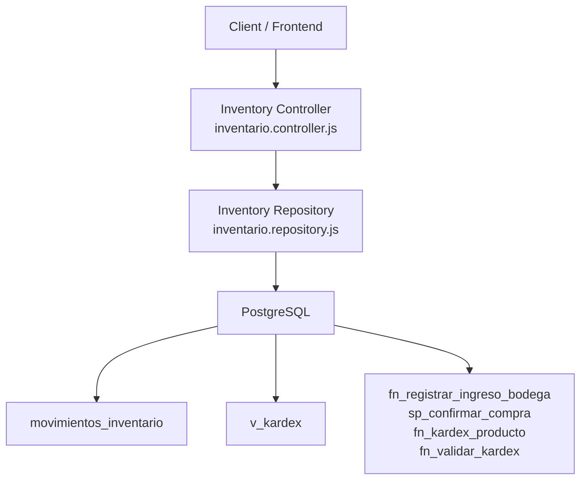
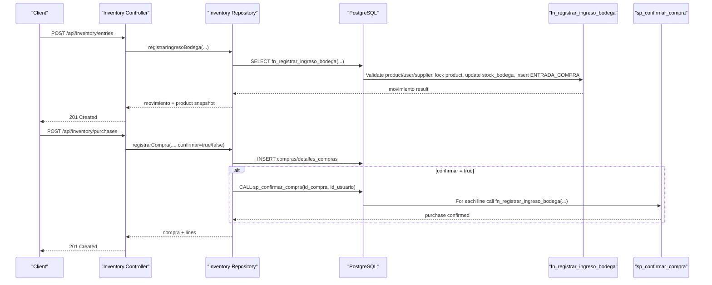
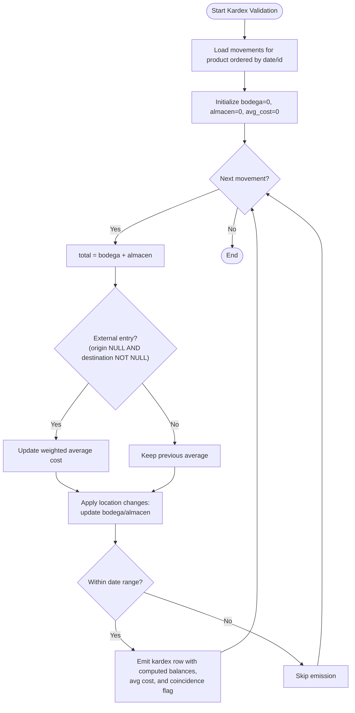
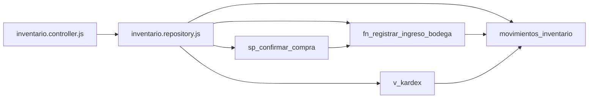

# Stock Movement Processing

<cite>
**Referenced Files in This Document**   
- [006_inventario.sql](file://backend/db/migrations/006_inventario.sql)
- [008_ingreso_bodega.sql](file://backend/db/migrations/008_ingreso_bodega.sql)
- [011_compras.sql](file://backend/db/migrations/011_compras.sql)
- [012_saldo_kardex.sql](file://backend/db/migrations/012_saldo_kardex.sql)
- [inventario.controller.js](file://backend/src/controllers/inventario.controller.js)
- [inventario.repository.js](file://backend/src/repositories/inventario.repository.js)
- [004_saldo_kardex.sql](file://backend/db/tests/004_saldo_kardex.sql)
</cite>

## Table of Contents
1. [Introduction](#introduction)
2. [Project Structure](#project-structure)
3. [Core Components](#core-components)
4. [Architecture Overview](#architecture-overview)
5. [Detailed Component Analysis](#detailed-component-analysis)
6. [Dependency Analysis](#dependency-analysis)
7. [Performance Considerations](#performance-considerations)
8. [Troubleshooting Guide](#troubleshooting-guide)
9. [Conclusion](#conclusion)

## Introduction
This document explains the stock movement processing system implemented in the project. It covers all supported movement types, their triggers and business rules, the Kardex inventory history model, automatic balance updates, audit trail generation, integration with purchases and sales/pedidos, validation and error handling, and filtering/reporting capabilities for historical analysis.

The system is centered on an immutable inventory movement ledger (`movimientos_inventario`) and a chronological Kardex view (`v_kardex`). Inventory balances are maintained per location: `BODEGA` (warehouse) and `ALMACEN` (store). The Kardex also tracks weighted average unit cost and total valued inventory.

## Project Structure
The relevant implementation spans database migrations, backend controllers, and repositories:

- Database layer:
  - Movement schema, Kardex view, and constraints: [006_inventario.sql](file://backend/db/migrations/006_inventario.sql)
  - Warehouse entry function: [008_ingreso_bodega.sql](file://backend/db/migrations/008_ingreso_bodega.sql)
  - Purchase workflow and confirmation procedure: [011_compras.sql](file://backend/db/migrations/011_compras.sql)
  - Kardex recalculation and validation functions: [012_saldo_kardex.sql](file://backend/db/migrations/012_saldo_kardex.sql)
- Backend API:
  - Inventory controller exposing purchase and warehouse entry endpoints: [inventario.controller.js](file://backend/src/controllers/inventario.controller.js)
  - Repository calling stored procedures/functions and querying movements: [inventario.repository.js](file://backend/src/repositories/inventario.repository.js)

**Diagram sources**
- [inventario.controller.js:48-147](file://backend/src/controllers/inventario.controller.js#L48-L147)
- [inventario.repository.js:12-62](file://backend/src/repositories/inventario.repository.js#L12-L62)
- [006_inventario.sql:62-161](file://backend/db/migrations/006_inventario.sql#L62-L161)
- [008_ingreso_bodega.sql:23-88](file://backend/db/migrations/008_ingreso_bodega.sql#L23-L88)
- [011_compras.sql:217-258](file://backend/db/migrations/011_compras.sql#L217-L258)
- [012_saldo_kardex.sql:26-108](file://backend/db/migrations/012_saldo_kardex.sql#L26-L108)

**Section sources**
- [006_inventario.sql:1-166](file://backend/db/migrations/006_inventario.sql#L1-L166)
- [008_ingreso_bodega.sql:1-91](file://backend/db/migrations/008_ingreso_bodega.sql#L1-L91)
- [011_compras.sql:1-261](file://backend/db/migrations/011_compras.sql#L1-L261)
- [012_saldo_kardex.sql:1-155](file://backend/db/migrations/012_saldo_kardex.sql#L1-L155)
- [inventario.controller.js:1-269](file://backend/src/controllers/inventario.controller.js#L1-L269)
- [inventario.repository.js:1-102](file://backend/src/repositories/inventario.repository.js#L1-L102)

## Core Components
- Movement ledger (`movimientos_inventario`): Immutable record of every stock change, including type, origin/destination locations, quantity, unit cost, resulting balances, user, and references to sales, orders, or suppliers.
- Kardex view (`v_kardex`): Chronological presentation of movements with per-location entries/exits and resulting balances.
- Warehouse entry function (`fn_registrar_ingreso_bodega`): Atomic operation that validates inputs, locks the product row, updates `stock_bodega`, and inserts an `ENTRADA_COMPRA` movement.
- Purchase workflow (`compras`, `detalles_compras`, `sp_confirmar_compra`): Draft purchase with lines; confirmation atomically applies all lines to Bodega and marks the purchase confirmed.
- Kardex auditing functions (`fn_kardex_producto`, `fn_validar_kardex`): Recalculate balances and weighted average cost chronologically and compare against current product stock to detect inconsistencies.

Key responsibilities:
- Business rule enforcement via database constraints and triggers.
- Auditability through immutable movements and user attribution.
- Consistency between Kardex recalculated balances and product stock columns.

**Section sources**
- [006_inventario.sql:44-110](file://backend/db/migrations/006_inventario.sql#L44-L110)
- [006_inventario.sql:131-161](file://backend/db/migrations/006_inventario.sql#L131-L161)
- [008_ingreso_bodega.sql:23-88](file://backend/db/migrations/008_ingreso_bodega.sql#L23-L88)
- [011_compras.sql:21-57](file://backend/db/migrations/011_compras.sql#L21-L57)
- [011_compras.sql:217-258](file://backend/db/migrations/011_compras.sql#L217-L258)
- [012_saldo_kardex.sql:26-108](file://backend/db/migrations/012_saldo_kardex.sql#L26-L108)
- [012_saldo_kardex.sql:113-149](file://backend/db/migrations/012_saldo_kardex.sql#L113-L149)

## Architecture Overview
The stock movement architecture enforces consistency at multiple layers:

- API layer validates request payloads and maps business errors to HTTP responses.
- Repository layer calls stored functions/procedures and queries views.
- Database layer enforces business rules, maintains balances, and provides Kardex reporting.

**Diagram sources**
- [inventario.controller.js:48-147](file://backend/src/controllers/inventario.controller.js#L48-L147)
- [inventario.controller.js:163-246](file://backend/src/controllers/inventario.controller.js#L163-L246)
- [inventario.repository.js:12-62](file://backend/src/repositories/inventario.repository.js#L12-L62)
- [008_ingreso_bodega.sql:23-88](file://backend/db/migrations/008_ingreso_bodega.sql#L23-L88)
- [011_compras.sql:217-258](file://backend/db/migrations/011_compras.sql#L217-L258)

## Detailed Component Analysis

### Movement Types, Triggers, and Business Rules
Supported movement types and their semantics:

| Type | Origin | Destination | Required Reference | Trigger / Integration |
|---|---:|---:|---|---|
| `ENTRADA_COMPRA` | None | `BODEGA` | Supplier optional | Direct warehouse entry or purchase confirmation |
| `TRASLADO_INTERNO` | `BODEGA` | `ALMACEN` | None | Internal transfer from warehouse to store |
| `SALIDA_VENTA` | `BODEGA` or `ALMACEN` | None | `id_venta` | Sales module deduction |
| `SALIDA_PEDIDO` | `BODEGA` or `ALMACEN` | None | `id_pedido` | Order preparation deduction |
| `REVERSO_VENTA` | None | `BODEGA` or `ALMACEN` | `id_venta` | Sale reversal/cancellation |
| `REVERSO_PEDIDO` | None | `BODEGA` or `ALMACEN` | `id_pedido` | Order cancellation reversal |
| `AJUSTE_POSITIVO` | None | `BODEGA` or `ALMACEN` | `motivo` required | Manual inventory increase |
| `AJUSTE_NEGATIVO` | `BODEGA` or `ALMACEN` | None | `motivo` required | Manual inventory decrease |

Business rules enforced by constraints:
- Location validity depends on movement type.
- References must match movement type (e.g., sale-related movements require `id_venta`; order-related require `id_pedido`).
- Adjustments require a non-empty reason.
- Only `ENTRADA_COMPRA` may reference a supplier.

Cascading deductions:
- A single sale/order line can generate up to two `SALIDA_*` movements: one from `ALMACEN` and another from `BODEGA`. Reversals create corresponding `REVERSO_*` movements to the same locations.

**Section sources**
- [006_inventario.sql:44-108](file://backend/db/migrations/006_inventario.sql#L44-L108)

### Kardex System and Automatic Balance Updates
Kardex design:
- `movimientos_inventario` is immutable; updates/deletes/truncates are blocked by triggers.
- `v_kardex` exposes chronological entries/exits per location and resulting balances.
- Each movement stores `saldo_bodega` and `saldo_almacen` after applying the change.

Automatic balance updates:
- `fn_registrar_ingreso_bodega` locks the product row, validates inputs, increments `stock_bodega`, and inserts an `ENTRADA_COMPRA` movement with post-change balances.
- Purchase confirmation (`sp_confirmar_compra`) iterates lines in deterministic order and calls the same function for each line, ensuring atomic application across all lines.

Weighted average cost:
- External entries (purchases, positive adjustments, reverses) update the weighted average unit cost.
- Internal transfers and exits do not change the average.

Validation and auditing:
- `fn_kardex_producto(producto, desde, hasta)` recomputes balances chronologically and flags inconsistent rows.
- `fn_validar_kardex(producto opcional)` compares final recalculated balances with current product stock and counts inconsistent movements.

**Diagram sources**
- [012_saldo_kardex.sql:26-108](file://backend/db/migrations/012_saldo_kardex.sql#L26-L108)

**Section sources**
- [006_inventario.sql:62-161](file://backend/db/migrations/006_inventario.sql#L62-L161)
- [008_ingreso_bodega.sql:23-88](file://backend/db/migrations/008_ingreso_bodega.sql#L23-L88)
- [011_compras.sql:217-258](file://backend/db/migrations/011_compras.sql#L217-L258)
- [012_saldo_kardex.sql:26-108](file://backend/db/migrations/012_saldo_kardex.sql#L26-L108)
- [012_saldo_kardex.sql:113-149](file://backend/db/migrations/012_saldo_kardex.sql#L113-L149)

### Movement Registration Examples

#### Example 1: Direct Warehouse Entry
- Endpoint: `POST /api/inventory/entries`
- Request body fields:
  - `id_producto` or `sku`
  - `cantidad` (positive number, up to 3 decimals)
  - Optional: `costo_unitario`, `id_proveedor`, `documento_referencia`, `observacion`
- Validation highlights:
  - User identity comes from session token, never from request body.
  - Quantity must be numeric, positive, within decimal and digit limits.
  - Unit cost must be non-negative with up to 2 decimals when provided.
  - Text fields validated for length.
  - SKU lookup resolves to product ID if needed.
- Response includes:
  - Movement details (type, location, quantity, cost, balances, user, supplier, reference, observation, timestamp).
  - Product snapshot (SKU, name, stock per location and total).

Error mapping:
- Business errors raised by the database function use SQLSTATE codes starting with `SM`; the controller maps them to appropriate HTTP status codes and messages.

**Section sources**
- [inventario.controller.js:48-147](file://backend/src/controllers/inventario.controller.js#L48-L147)
- [inventario.repository.js:12-27](file://backend/src/repositories/inventario.repository.js#L12-L27)
- [008_ingreso_bodega.sql:23-88](file://backend/db/migrations/008_ingreso_bodega.sql#L23-L88)

#### Example 2: Purchase Workflow
- Endpoint: `POST /api/inventory/purchases`
- Request body fields:
  - Optional: `id_proveedor`, `documento_referencia`, `observacion`
  - `confirmar` (boolean; default `true`)
  - `lineas`: array of 1–100 lines, each with either `id_producto` or `sku`, plus `cantidad` and optional `costo_unitario`
- Validation highlights:
  - Lines normalized and deduplicated by product.
  - Quantities validated similarly to direct entries.
  - Unit costs validated when provided; otherwise uses product’s purchase price.
  - Products existence checked before committing.
- Behavior:
  - Creates draft purchase with lines.
  - If `confirmar = true`, calls `sp_confirmar_compra`, which applies all lines to Bodega atomically.
- Response includes:
  - Message indicating draft or confirmed state.
  - Purchase object with lines and current product stocks.

Error mapping:
- Additional purchase-specific errors include already confirmed, missing purchase, empty lines, etc.

**Section sources**
- [inventario.controller.js:163-246](file://backend/src/controllers/inventario.controller.js#L163-L246)
- [inventario.repository.js:29-62](file://backend/src/repositories/inventario.repository.js#L29-L62)
- [011_compras.sql:21-57](file://backend/db/migrations/011_compras.sql#L21-L57)
- [011_compras.sql:217-258](file://backend/db/migrations/011_compras.sql#L217-L258)

### Validation Rules and Error Handling
Frontend validation:
- Positive integer checks for IDs.
- Numeric parsing with finite value checks.
- Decimal precision checks using scaled rounding tolerance.
- Length validations for text fields.

Backend/database validation:
- Constraints enforce valid combinations of movement type, locations, and references.
- Triggers prevent modification or truncation of the movement ledger.
- Business exceptions use custom SQLSTATE codes (`SMxxx`) for clear error classification.

Error response strategy:
- Controller catches database errors and maps known business codes to HTTP statuses.
- Unknown errors return generic server error responses with logging.

**Section sources**
- [inventario.controller.js:12-41](file://backend/src/controllers/inventario.controller.js#L12-L41)
- [inventario.controller.js:138-146](file://backend/src/controllers/inventario.controller.js#L138-L146)
- [inventario.controller.js:235-246](file://backend/src/controllers/inventario.controller.js#L235-L246)
- [006_inventario.sql:121-129](file://backend/db/migrations/006_inventario.sql#L121-L129)
- [008_ingreso_bodega.sql:13-18](file://backend/db/migrations/008_ingreso_bodega.sql#L13-L18)
- [011_compras.sql:12-16](file://backend/db/migrations/011_compras.sql#L12-L16)

### Integration with Sales, Purchases, and Inventory Adjustments
- Sales and orders:
  - Deductions produce `SALIDA_VENTA` and `SALIDA_PEDIDO` movements linked to respective documents.
  - Reversals produce `REVERSO_VENTA` and `REVERSO_PEDIDO` movements.
  - Cascading deduction ensures correct allocation across locations.
- Purchases:
  - Draft purchases allow multi-line planning.
  - Confirmation atomically applies all lines to Bodega and links movements to the purchase.
- Inventory adjustments:
  - Positive/negative adjustments require a reason and target specific locations.
  - They participate in weighted average cost calculation when they represent external entries.

Integration points:
- Movement table references `ventas`, `pedidos`, and `proveedores`.
- Purchase confirmation ties movements to `compras`.

**Section sources**
- [006_inventario.sql:44-108](file://backend/db/migrations/006_inventario.sql#L44-L108)
- [011_compras.sql:125-140](file://backend/db/migrations/011_compras.sql#L125-L140)

### Movement Filtering, Reporting, and Historical Analysis
- Kardex view (`v_kardex`) provides chronological data per product with entries/exits per location and resulting balances.
- Date-range filtering:
  - Use `v_kardex` with filters on `fecha_movimiento` for UI reports.
- Recalculation and audit:
  - `fn_kardex_producto(producto, desde, hasta)` recomputes balances chronologically; date filters only affect displayed rows, not cumulative balance computation.
  - `fn_validar_kardex(producto opcional)` audits consistency between recalculated balances and current product stock.

Example usage patterns:
- Retrieve Kardex for a product: query `v_kardex` filtered by `id_producto` and ordered by `fecha_movimiento`, `id_movimiento`.
- Validate all products: call `fn_validar_kardex()` without parameters.
- Validate a specific product: call `fn_validar_kardex(p_id_producto)`.

Test scenarios demonstrate expected sequences of purchases, internal transfers, shrinkage (negative adjustment), and positive adjustments, verifying balances, averages, and valuation.

**Section sources**
- [006_inventario.sql:131-161](file://backend/db/migrations/006_inventario.sql#L131-L161)
- [012_saldo_kardex.sql:26-108](file://backend/db/migrations/012_saldo_kardex.sql#L26-L108)
- [012_saldo_kardex.sql:113-149](file://backend/db/migrations/012_saldo_kardex.sql#L113-L149)
- [004_saldo_kardex.sql:1-78](file://backend/db/tests/004_saldo_kardex.sql#L1-L78)

## Dependency Analysis
Component relationships:

**Diagram sources**
- [inventario.controller.js:48-147](file://backend/src/controllers/inventario.controller.js#L48-L147)
- [inventario.repository.js:12-62](file://backend/src/repositories/inventario.repository.js#L12-L62)
- [006_inventario.sql:62-161](file://backend/db/migrations/006_inventario.sql#L62-L161)
- [008_ingreso_bodega.sql:23-88](file://backend/db/migrations/008_ingreso_bodega.sql#L23-L88)
- [011_compras.sql:217-258](file://backend/db/migrations/011_compras.sql#L217-L258)

Coupling and cohesion:
- Controller focuses on request validation and response formatting.
- Repository encapsulates database interactions and transaction boundaries.
- Database functions/procedures enforce business rules and maintain consistency.

Potential circular dependencies:
- None detected; flow is unidirectional from API to repository to database objects.

External integrations:
- Sales and orders integrate via foreign keys in movements.
- Suppliers integrate via purchase workflow.

**Section sources**
- [inventario.controller.js:1-269](file://backend/src/controllers/inventario.controller.js#L1-L269)
- [inventario.repository.js:1-102](file://backend/src/repositories/inventario.repository.js#L1-L102)
- [006_inventario.sql:62-161](file://backend/db/migrations/006_inventario.sql#L62-L161)
- [011_compras.sql:125-140](file://backend/db/migrations/011_compras.sql#L125-L140)

## Performance Considerations
- Deterministic ordering in purchase confirmation avoids deadlocks by locking products in consistent order.
- Indexes on movement dates, product IDs, and references support efficient Kardex queries and filtering.
- Immutability of movements prevents expensive reconciliation but requires careful insertion logic.
- Weighted average cost computation is performed in PostgreSQL functions, leveraging set-based operations where possible.

Recommendations:
- Use date-range filters judiciously in Kardex reports; rely on indexes on `fecha_movimiento` and composite indexes on `(id_producto, fecha_movimiento, id_movimiento)`.
- Batch operations should prefer purchase confirmation over many individual entries to reduce transaction overhead.

[No sources needed since this section provides general guidance]

## Troubleshooting Guide
Common issues and resolutions:

- Invalid movement registration:
  - Ensure quantities are positive and within allowed decimal precision.
  - Provide required reasons for adjustments.
  - Verify referenced entities exist and are active.

- Purchase confirmation failures:
  - Confirm the purchase has lines and is not already confirmed.
  - Check that all referenced products and suppliers are valid and active.

- Kardex inconsistency detection:
  - Run `fn_validar_kardex()` to identify products where recalculated balances differ from current stock.
  - Investigate manual stock modifications outside the movement process.

- Unauthorized access:
  - Ensure the session token contains a valid user ID; controller rejects requests without proper identification.

Error code mapping:
- Business errors use SQLSTATE codes starting with `SM`; map them to HTTP responses in the controller.

**Section sources**
- [inventario.controller.js:138-146](file://backend/src/controllers/inventario.controller.js#L138-L146)
- [inventario.controller.js:235-246](file://backend/src/controllers/inventario.controller.js#L235-L246)
- [012_saldo_kardex.sql:113-149](file://backend/db/migrations/012_saldo_kardex.sql#L113-L149)

## Conclusion
The stock movement processing system provides a robust, auditable, and consistent model for managing inventory across warehouse and store locations. It enforces strict business rules at the database level, supports multiple movement types with clear triggers, and offers comprehensive Kardex reporting and validation. Integration with purchases, sales, and orders is achieved through well-defined references and cascading deduction rules. The API layer adds strong input validation and clear error mapping, while the database functions ensure atomicity and correctness of balance updates and weighted average cost calculations.