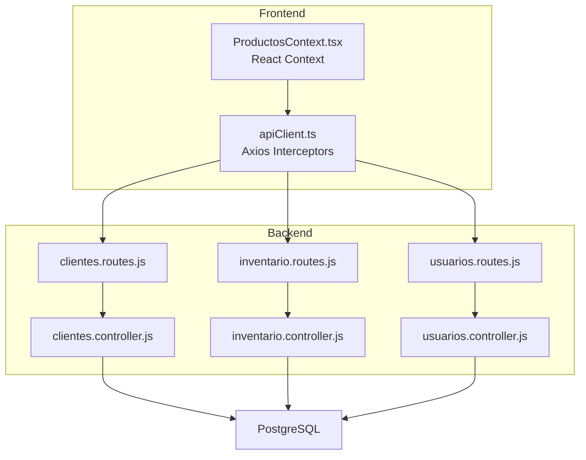
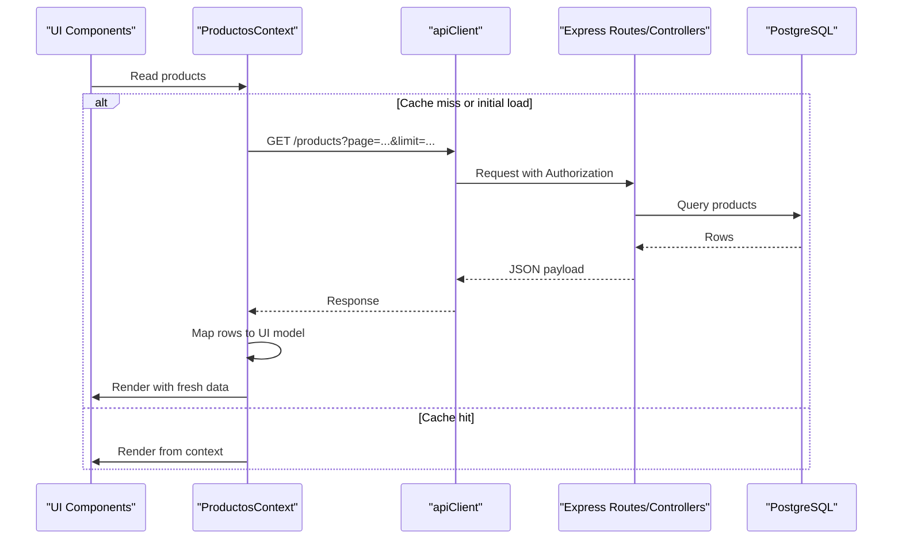
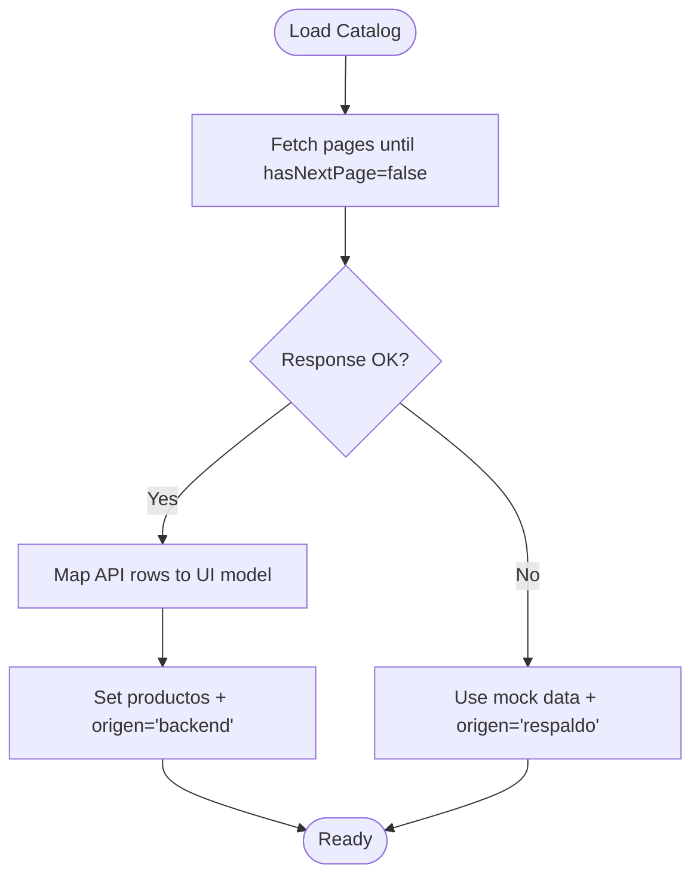
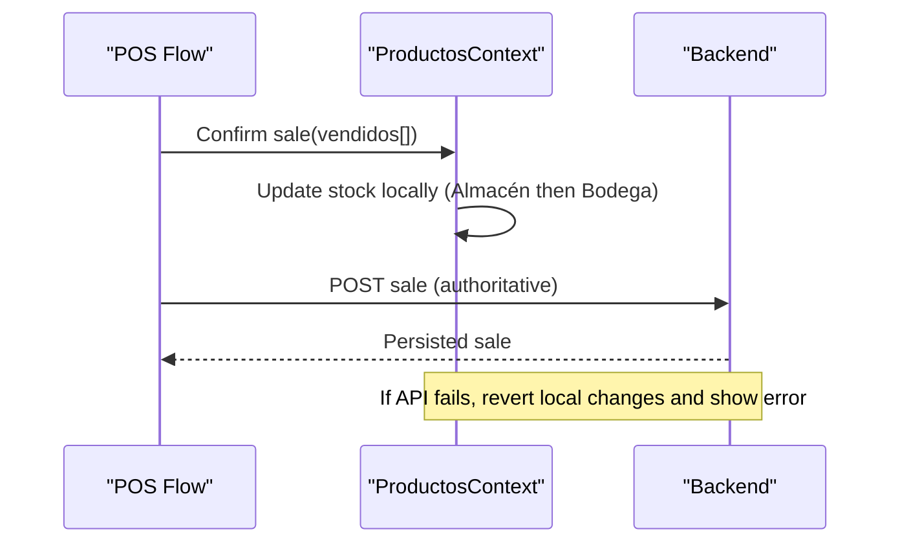
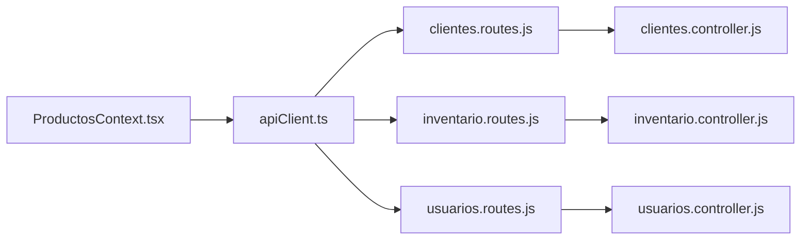

# Caching Strategies

<cite>
**Referenced Files in This Document**
- [ProductosContext.tsx](file://simoapp/components/catalogo/ProductosContext.tsx)
- [apiClient.ts](file://simoapp/lib/apiClient.ts)
- [clientes.controller.js](file://backend/src/controllers/clientes.controller.js)
- [inventario.controller.js](file://backend/src/controllers/inventario.controller.js)
- [usuarios.controller.js](file://backend/src/controllers/usuarios.controller.js)
- [clientes.routes.js](file://backend/src/routes/clientes.routes.js)
- [inventario.routes.js](file://backend/src/routes/inventario.routes.js)
- [usuarios.routes.js](file://backend/src/routes/usuarios.routes.js)
</cite>

## Table of Contents
1. [Introduction](#introduction)
2. [Project Structure](#project-structure)
3. [Core Components](#core-components)
4. [Architecture Overview](#architecture-overview)
5. [Detailed Component Analysis](#detailed-component-analysis)
6. [Dependency Analysis](#dependency-analysis)
7. [Performance Considerations](#performance-considerations)
8. [Troubleshooting Guide](#troubleshooting-guide)
9. [Conclusion](#conclusion)

## Introduction
This document defines the caching strategy for SIMO across client, API, and database layers. It explains how to implement multi-level caching with React Context on the frontend, request deduplication, optimistic updates, stale-while-revalidate patterns, cache invalidation, cache warming, distributed caching considerations, consistency across clients, real-time synchronization, and monitoring/debugging techniques. The guidance is grounded in the existing codebase: a Next.js frontend that uses React Context for shared product state and an Axios-based HTTP client, plus a Node.js backend exposing REST endpoints for users, customers, and inventory operations.

## Project Structure
The project consists of:
- Frontend (Next.js + React): Shared UI state via React Context; HTTP client via Axios interceptors.
- Backend (Node.js + Express): Controllers and routes for users, customers, and inventory.
- Database (PostgreSQL): Relational data accessed through repositories and stored procedures.

**Diagram sources**
- [ProductosContext.tsx:116-127](file://simoapp/components/catalogo/ProductosContext.tsx#L116-L127)
- [apiClient.ts:1-59](file://simoapp/lib/apiClient.ts#L1-L59)
- [clientes.routes.js:1-27](file://backend/src/routes/clientes.routes.js#L1-L27)
- [inventario.routes.js:1-17](file://backend/src/routes/inventario.routes.js#L1-L17)
- [usuarios.routes.js:1-18](file://backend/src/routes/usuarios.routes.js#L1-L18)

**Section sources**
- [ProductosContext.tsx:1-303](file://simoapp/components/catalogo/ProductosContext.tsx#L1-L303)
- [apiClient.ts:1-59](file://simoapp/lib/apiClient.ts#L1-L59)
- [clientes.routes.js:1-27](file://backend/src/routes/clientes.routes.js#L1-L27)
- [inventario.routes.js:1-17](file://backend/src/routes/inventario.routes.js#L1-L17)
- [usuarios.routes.js:1-18](file://backend/src/routes/usuarios.routes.js#L1-L18)

## Core Components
- Client-side state cache: ProductosContext maintains a single source of truth for products within the browser session, including optimistic stock adjustments after POS actions.
- HTTP client: apiClient centralizes JWT injection and global auth error handling.
- Backend controllers: Validate inputs, enforce business rules, and coordinate persistence to PostgreSQL.

Key responsibilities:
- ProductosContext: fetches product catalog from backend, maps API payloads to UI models, supports optimistic updates for sales and transfers, and provides fallback to mock data when backend is unavailable.
- apiClient: attaches Authorization headers and redirects to login on 401/403.
- Controllers: implement CRUD and domain operations for users, customers, and inventory.

**Section sources**
- [ProductosContext.tsx:116-127](file://simoapp/components/catalogo/ProductosContext.tsx#L116-L127)
- [ProductosContext.tsx:152-219](file://simoapp/components/catalogo/ProductosContext.tsx#L152-L219)
- [ProductosContext.tsx:221-273](file://simoapp/components/catalogo/ProductosContext.tsx#L221-L273)
- [apiClient.ts:13-56](file://simoapp/lib/apiClient.ts#L13-L56)
- [clientes.controller.js:70-122](file://backend/src/controllers/clientes.controller.js#L70-L122)
- [inventario.controller.js:43-147](file://backend/src/controllers/inventario.controller.js#L43-L147)
- [usuarios.controller.js:26-84](file://backend/src/controllers/usuarios.controller.js#L26-L84)

## Architecture Overview
The recommended multi-level caching architecture for SIMO:

- Level 1: Browser memory cache (React Context)
  - Holds current product list and derived views.
  - Optimistic updates reflect user actions immediately.
- Level 2: API response cache (HTTP layer)
  - Deduplicates concurrent requests for the same resource.
  - Implements stale-while-revalidate for read-heavy endpoints.
- Level 3: Database query result cache (server-side)
  - Optional short-lived cache for expensive queries or heavy aggregations.
  - Invalidated by write operations or time-based TTL.

**Diagram sources**
- [ProductosContext.tsx:116-127](file://simoapp/components/catalogo/ProductosContext.tsx#L116-L127)
- [apiClient.ts:13-26](file://simoapp/lib/apiClient.ts#L13-L26)

## Detailed Component Analysis

### Client-Side Caching with React Context
ProductosContext implements:
- Initial catalog fetch with pagination until hasNextPage is false.
- Fallback to mock data if backend fails, marking the source as “respaldo”.
- Optimistic updates for:
  - Sales: decrements stock across Almacén and Bodega using cascading logic.
  - Returns: restores stock after cancellation.
  - Transfers: updates per-location balances while keeping totals consistent.

Cache characteristics:
- Scope: In-memory, process-scoped (per browser tab).
- Lifetime: Until component unmounts or explicit reset.
- Consistency: Local-only; server remains authoritative.

**Diagram sources**
- [ProductosContext.tsx:116-127](file://simoapp/components/catalogo/ProductosContext.tsx#L116-L127)
- [ProductosContext.tsx:133-150](file://simoapp/components/catalogo/ProductosContext.tsx#L133-L150)

Optimistic update flow for sales:

**Diagram sources**
- [ProductosContext.tsx:221-244](file://simoapp/components/catalogo/ProductosContext.tsx#L221-L244)

**Section sources**
- [ProductosContext.tsx:116-127](file://simoapp/components/catalogo/ProductosContext.tsx#L116-L127)
- [ProductosContext.tsx:133-150](file://simoapp/components/catalogo/ProductosContext.tsx#L133-L150)
- [ProductosContext.tsx:152-219](file://simoapp/components/catalogo/ProductosContext.tsx#L152-L219)
- [ProductosContext.tsx:221-273](file://simoapp/components/catalogo/ProductosContext.tsx#L221-L273)

### API Response Caching and Request Deduplication
Current behavior:
- axios.create() sets baseURL and default headers.
- Request interceptor injects JWT from cookies.
- Response interceptor handles 401/403 by clearing session and redirecting to login.

Recommended enhancements:
- Implement request deduplication:
  - Maintain a map of pending requests keyed by normalized URL + method + headers.
  - Return the same Promise for duplicate calls until completion.
- Implement stale-while-revalidate:
  - Serve cached response immediately for GETs.
  - Trigger background refresh and update cache on success.
- Add cache tags for invalidation:
  - Tag responses by entity type (e.g., products, customers, users).
  - On mutations, invalidate related tags.

Implementation notes:
- Use a module-level cache store with TTL and size limits.
- Normalize keys by hashing query parameters and excluding volatile headers.
- Integrate with apiClient interceptors to wrap GETs with caching logic.

**Section sources**
- [apiClient.ts:1-59](file://simoapp/lib/apiClient.ts#L1-L59)

### Database Query Result Caching
Current behavior:
- Controllers call repositories which execute SQL against PostgreSQL.
- No in-process cache is visible in the provided files.

Recommended approach:
- Add a short-lived server-side cache (e.g., in-memory LRU or Redis-backed) for read-heavy endpoints such as product catalogs and customer lists.
- Use tags and TTLs aligned with API cache tags.
- Invalidate on writes (create/update/delete) and on scheduled events (e.g., nightly reindex).

Considerations:
- Keep TTLs small for frequently changing data (inventory, prices).
- For analytics dashboards, allow slightly longer TTLs with explicit refresh controls.

[No sources needed since this section provides general guidance]

### Cache Invalidation Strategies
- Write-through invalidation:
  - After successful mutations (e.g., creating a product, updating a customer), invalidate corresponding cache tags.
- Time-based invalidation:
  - Apply TTLs based on data volatility (e.g., seconds for inventory, minutes for catalogs).
- Event-driven invalidation:
  - Publish domain events (e.g., SaleConfirmed, ProductUpdated) to trigger cache purges across services.

Practical mapping:
- Products: invalidate on create/update/delete and on stock changes.
- Customers: invalidate on create/update/delete and history refresh.
- Users: invalidate on create/update/status change.

**Section sources**
- [ProductosContext.tsx:152-219](file://simoapp/components/catalogo/ProductosContext.tsx#L152-L219)
- [clientes.controller.js:70-122](file://backend/src/controllers/clientes.controller.js#L70-L122)
- [usuarios.controller.js:166-255](file://backend/src/controllers/usuarios.controller.js#L166-L255)

### Cache Warming Techniques
- On application startup, pre-warm critical caches:
  - Load active product catalog into React Context.
  - Preload top-selling items and key reference data.
- Background warmers:
  - Periodically refresh hot datasets (e.g., dashboard metrics) during off-peak hours.
- Progressive loading:
  - Show skeleton UI while warming completes.

[No sources needed since this section provides general guidance]

### Distributed Caching Considerations
- When scaling horizontally:
  - Move from in-memory caches to a shared store like Redis.
  - Ensure cache keys include tenant/environment prefixes.
- Consistency:
  - Use pub/sub to broadcast invalidation events to all instances.
- Security:
  - Encrypt sensitive data at rest and in transit.
  - Isolate caches per environment and tenant.

[No sources needed since this section provides general guidance]

### Practical Patterns

#### Request Deduplication
- Track pending requests by normalized key.
- Return the same Promise for duplicates.
- Clean up entries on resolve/reject.

[No sources needed since this section provides general guidance]

#### Optimistic Updates
- Immediately update local state (e.g., stock levels).
- Send mutation to server.
- Reconcile on failure by reverting local changes and surfacing errors.

**Section sources**
- [ProductosContext.tsx:221-244](file://simoapp/components/catalogo/ProductosContext.tsx#L221-L244)

#### Stale-While-Revalidate
- Serve cached GET response instantly.
- Trigger background refresh.
- Replace cache entry on success; keep stale data on error.

[No sources needed since this section provides general guidance]

### Cache Storage Strategies and Memory Management
- Browser memory cache (React Context):
  - Store only what’s needed for the current view.
  - Avoid storing large blobs; paginate and filter client-side where possible.
- API response cache:
  - Enforce max size and TTL.
  - Evict least recently used entries when capacity is reached.
- Database query cache:
  - Prefer small, focused caches for hot paths.
  - Monitor memory usage and set eviction policies.

[No sources needed since this section provides general guidance]

### Consistency Across Multiple Clients and Real-Time Synchronization
- Single source of truth:
  - Server persists authoritative state; clients reconcile via cache invalidation.
- Real-time sync:
  - Use WebSockets or Server-Sent Events to push updates (e.g., new sales, stock changes).
  - On receiving an event, invalidate relevant cache tags and refetch affected data.

[No sources needed since this section provides general guidance]

### Monitoring and Debugging
- Frontend:
  - Log cache hits/misses and stale-while-revalidate cycles.
  - Expose a debug panel showing cache sizes, TTLs, and last refresh times.
- Backend:
  - Instrument cache hit rates, latency, and eviction counts.
  - Correlate cache activity with endpoint performance.

[No sources needed since this section provides general guidance]

## Dependency Analysis
The following diagram shows the runtime dependency chain between frontend components and backend modules involved in data access and mutations.

**Diagram sources**
- [ProductosContext.tsx:116-127](file://simoapp/components/catalogo/ProductosContext.tsx#L116-L127)
- [apiClient.ts:1-59](file://simoapp/lib/apiClient.ts#L1-L59)
- [clientes.routes.js:1-27](file://backend/src/routes/clientes.routes.js#L1-L27)
- [inventario.routes.js:1-17](file://backend/src/routes/inventario.routes.js#L1-L17)
- [usuarios.routes.js:1-18](file://backend/src/routes/usuarios.routes.js#L1-L18)

**Section sources**
- [ProductosContext.tsx:116-127](file://simoapp/components/catalogo/ProductosContext.tsx#L116-L127)
- [apiClient.ts:1-59](file://simoapp/lib/apiClient.ts#L1-L59)
- [clientes.routes.js:1-27](file://backend/src/routes/clientes.routes.js#L1-L27)
- [inventario.routes.js:1-17](file://backend/src/routes/inventario.routes.js#L1-L17)
- [usuarios.routes.js:1-18](file://backend/src/routes/usuarios.routes.js#L1-L18)

## Performance Considerations
- Reduce network calls:
  - Deduplicate concurrent requests.
  - Use stale-while-revalidate for read-heavy endpoints.
- Minimize re-renders:
  - Keep React Context state minimal and stable.
  - Avoid unnecessary object allocations in optimistic updates.
- Optimize backend:
  - Paginate large datasets.
  - Index frequently queried columns.
  - Consider server-side caching for expensive queries.

[No sources needed since this section provides general guidance]

## Troubleshooting Guide
Common issues and resolutions:
- Authentication failures:
  - 401/403 triggers session cleanup and redirect to login via apiClient.
  - Verify token presence and cookie configuration.
- Stale data after mutations:
  - Ensure cache invalidation is triggered on successful mutations.
  - Check tag scoping and TTL settings.
- Inconsistent stock levels:
  - Validate optimistic update logic and rollback on failure.
  - Confirm server-side stock accounting matches client expectations.

**Section sources**
- [apiClient.ts:33-56](file://simoapp/lib/apiClient.ts#L33-L56)
- [ProductosContext.tsx:221-244](file://simoapp/components/catalogo/ProductosContext.tsx#L221-L244)

## Conclusion
SIMO benefits from a layered caching strategy: React Context for immediate responsiveness, an API response cache for deduplication and staleness control, and optional database query caching for performance. With disciplined invalidation, cache warming, and real-time synchronization, the system can deliver fast, consistent experiences across multiple clients. Monitoring and debugging tools should be integrated to maintain visibility into cache health and performance.