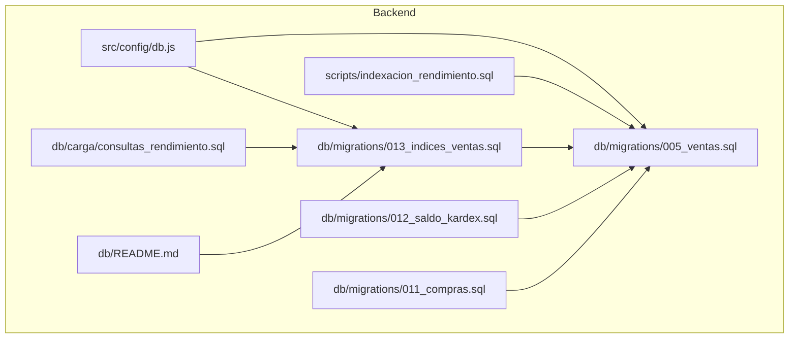
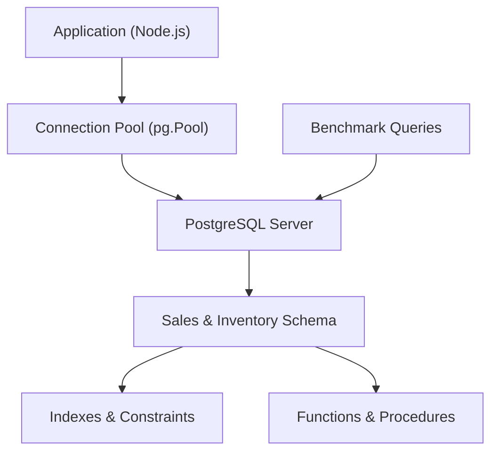
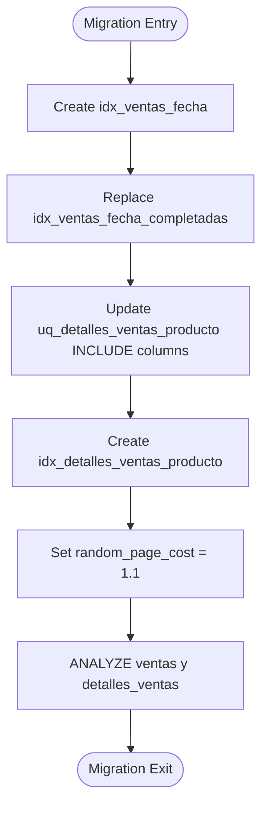
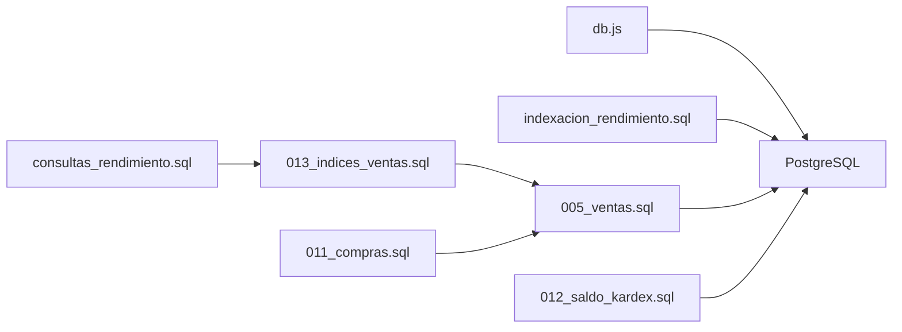

# Database Optimization

<cite>
**Referenced Files in This Document**
- [db.js](file://backend/src/config/db.js)
- [indexacion_rendimiento.sql](file://backend/scripts/indexacion_rendimiento.sql)
- [013_indices_ventas.sql](file://backend/db/migrations/013_indices_ventas.sql)
- [005_ventas.sql](file://backend/db/migrations/005_ventas.sql)
- [consultas_rendimiento.sql](file://backend/db/carga/consultas_rendimiento.sql)
- [README.md](file://backend/db/README.md)
- [012_saldo_kardex.sql](file://backend/db/migrations/012_saldo_kardex.sql)
- [011_compras.sql](file://backend/db/migrations/011_compras.sql)
</cite>

## Table of Contents
1. [Introduction](#introduction)
2. [Project Structure](#project-structure)
3. [Core Components](#core-components)
4. [Architecture Overview](#architecture-overview)
5. [Detailed Component Analysis](#detailed-component-analysis)
6. [Dependency Analysis](#dependency-analysis)
7. [Performance Considerations](#performance-considerations)
8. [Troubleshooting Guide](#troubleshooting-guide)
9. [Conclusion](#conclusion)
10. [Appendices](#appendices)

## Introduction
This document provides a comprehensive database optimization guide for SIMO, focusing on PostgreSQL performance tuning, indexing strategies, query optimization, connection pooling configuration, stored procedure considerations, and operational maintenance procedures. It consolidates the performance indexes created by `indexacion_rendimiento.sql`, the sales index migration `013_indices_ventas.sql`, and the base sales schema from `005_ventas.sql`. It also explains how to identify slow queries, analyze execution plans, maintain indexes, and prepare for high-load scenarios with connection pooling and memory tuning guidance.

## Project Structure
The database-related assets relevant to this optimization guide are organized under `backend/db` and `backend/scripts`:
- Migrations define schema, constraints, functions, and indexes.
- Scripts provide initial performance indexes for catalog and inventory tables.
- Load and benchmark scripts help measure query performance.
- The application’s database configuration is centralized in `db.js`.

**Diagram sources**
- [db.js:1-29](file://backend/src/config/db.js#L1-L29)
- [indexacion_rendimiento.sql:1-4](file://backend/scripts/indexacion_rendimiento.sql#L1-L4)
- [005_ventas.sql:1-104](file://backend/db/migrations/005_ventas.sql#L1-L104)
- [013_indices_ventas.sql:1-71](file://backend/db/migrations/013_indices_ventas.sql#L1-L71)
- [consultas_rendimiento.sql:1-15](file://backend/db/carga/consultas_rendimiento.sql#L1-L15)
- [012_saldo_kardex.sql:1-155](file://backend/db/migrations/012_saldo_kardex.sql#L1-L155)
- [011_compras.sql:218-260](file://backend/db/migrations/011_compras.sql#L218-L260)
- [README.md:159-180](file://backend/db/README.md#L159-L180)

**Section sources**
- [db.js:1-29](file://backend/src/config/db.js#L1-L29)
- [indexacion_rendimiento.sql:1-4](file://backend/scripts/indexacion_rendimiento.sql#L1-L4)
- [005_ventas.sql:1-104](file://backend/db/migrations/005_ventas.sql#L1-L104)
- [013_indices_ventas.sql:1-71](file://backend/db/migrations/013_indices_ventas.sql#L1-L71)
- [consultas_rendimiento.sql:1-15](file://backend/db/carga/consultas_rendimiento.sql#L1-L15)
- [012_saldo_kardex.sql:1-155](file://backend/db/migrations/012_saldo_kardex.sql#L1-L155)
- [011_compras.sql:218-260](file://backend/db/migrations/011_compras.sql#L218-L260)
- [README.md:159-180](file://backend/db/README.md#L159-L180)

## Core Components
This section summarizes the core database components that drive SIMO’s performance:
- Connection pooling configuration in `db.js` manages shared PostgreSQL connections for the application.
- Performance indexes in `indexacion_rendimiento.sql` target product categories, inventory movements, and Kardex lookups.
- Sales schema and baseline indexes in `005_ventas.sql` establish the foundation for transactional and reporting queries.
- Advanced sales indexes in `013_indices_ventas.sql` optimize dashboard, history, and product sales reports using B-tree and covering indexes.
- Benchmark queries in `consultas_rendimiento.sql` provide repeatable EXPLAIN ANALYZE examples to validate optimizations.
- Inventory valuation functions in `012_saldo_kardex.sql` compute weighted average cost and validate Kardex consistency.
- Purchase confirmation procedure in `011_compras.sql` demonstrates locking and deterministic ordering to avoid deadlocks.

Key responsibilities:
- `db.js`: Pool creation, SSL handling, environment-based configuration.
- `indexacion_rendimiento.sql`: Initial performance indexes for catalog and inventory.
- `005_ventas.sql`: Schema and baseline indexes for sales and sale details.
- `013_indices_ventas.sql`: Covering indexes, partial indexes, planner tuning, and statistics refresh.
- `consultas_rendimiento.sql`: Reference queries with EXPLAIN ANALYZE for performance measurement.
- `012_saldo_kardex.sql`: Functions for recalculation and validation of inventory balances.
- `011_compras.sql`: Stored procedure for purchase confirmation with row-level locking.

**Section sources**
- [db.js:1-29](file://backend/src/config/db.js#L1-L29)
- [indexacion_rendimiento.sql:1-4](file://backend/scripts/indexacion_rendimiento.sql#L1-L4)
- [005_ventas.sql:1-104](file://backend/db/migrations/005_ventas.sql#L1-L104)
- [013_indices_ventas.sql:1-71](file://backend/db/migrations/013_indices_ventas.sql#L1-L71)
- [consultas_rendimiento.sql:1-15](file://backend/db/carga/consultas_rendimiento.sql#L1-L15)
- [012_saldo_kardex.sql:1-155](file://backend/db/migrations/012_saldo_kardex.sql#L1-L155)
- [011_compras.sql:218-260](file://backend/db/migrations/011_compras.sql#L218-L260)

## Architecture Overview
The database architecture centers around PostgreSQL with an application layer using a connection pool. Indexes and functions are applied via migrations and scripts. Benchmark queries validate performance improvements.

**Diagram sources**
- [db.js:1-29](file://backend/src/config/db.js#L1-L29)
- [005_ventas.sql:1-104](file://backend/db/migrations/005_ventas.sql#L1-L104)
- [013_indices_ventas.sql:1-71](file://backend/db/migrations/013_indices_ventas.sql#L1-L71)
- [consultas_rendimiento.sql:1-15](file://backend/db/carga/consultas_rendimiento.sql#L1-L15)

## Detailed Component Analysis

### Connection Pool Configuration (db.js)
The connection pool is configured to support both cloud services (e.g., Neon) and local Docker setups. It supports environment-driven SSL behavior and uses `DATABASE_URL` when available; otherwise, it constructs connection parameters from individual environment variables.

Key behaviors:
- Uses `pg.Pool` to share connections across modules.
- Supports SSL via environment variable `DB_SSL`; defaults vary based on whether `DATABASE_URL` is present.
- Exposes the pool instance for import by other modules.

Recommendations:
- Tune pool size according to expected concurrency and database capacity.
- Monitor connection usage and adjust pool settings under load.
- Ensure SSL configuration matches your deployment environment.

**Section sources**
- [db.js:1-29](file://backend/src/config/db.js#L1-L29)

### Performance Indexes (indexacion_rendimiento.sql)
Initial performance indexes target frequently queried columns in catalog and inventory tables:
- Product category lookup index.
- Inventory movement product and date indexes.
- Kardex product-date composite index.

These indexes reduce full table scans for common filtering and sorting operations on large inventories.

Best practices:
- Add indexes selectively based on query patterns.
- Avoid over-indexing write-heavy tables.
- Reassess index utility after data growth or workload changes.

**Section sources**
- [indexacion_rendimiento.sql:1-4](file://backend/scripts/indexacion_rendimiento.sql#L1-L4)

### Sales Schema and Baseline Indexes (005_ventas.sql)
Defines the sales domain:
- `metodos_pago`: payment methods reference table.
- `ventas`: sales transactions with state management and audit fields.
- `detalles_ventas`: line items with pricing and quantity.

Baseline indexes include:
- Foreign key indexes for client and user joins.
- Partial index on completed sales filtered by date.
- Product index on sale details for product-centric queries.

Design notes:
- Constraints enforce business rules such as totals and cancellation requirements.
- Indexes support typical reporting and historical queries.

**Section sources**
- [005_ventas.sql:1-104](file://backend/db/migrations/005_ventas.sql#L1-L104)

### Sales Index Migration (013_indices_ventas.sql)
This migration introduces advanced indexing and planner tuning for sales workloads:
- `idx_ventas_fecha`: covers date-based history and recent sales without state filtering.
- `idx_ventas_fecha_completadas`: partial covering index for daily totals in dashboards.
- Updated unique constraint `uq_detalles_ventas_producto` with INCLUDE columns to enable index-only scans for top-selling products.
- `idx_detalles_ventas_producto`: covering index replacing older product index to avoid table visits.
- Sets `random_page_cost = 1.1` at database level to favor index usage on SSD-backed storage.
- Runs `ANALYZE` on sales tables to refresh planner statistics.

Operational implications:
- Idempotent creation with conditional updates for constraints.
- Planner tuning improves index selection for complex aggregations.
- Statistics refresh ensures optimal plans after bulk loads.

**Diagram sources**
- [013_indices_ventas.sql:31-70](file://backend/db/migrations/013_indices_ventas.sql#L31-L70)

**Section sources**
- [013_indices_ventas.sql:1-71](file://backend/db/migrations/013_indices_ventas.sql#L1-L71)

### Benchmark Queries (consultas_rendimiento.sql)
Reference queries use `EXPLAIN (ANALYZE, BUFFERS, SUMMARY ON, TIMING OFF)` to measure performance:
- Q1: Last month’s sales history (all states).
- Q2: Daily totals for the last week (dashboard).
- Q3: Top-selling products for the month.
- Q4: Sales history for a specific product.
- Q5: Units sold for a product in the last quarter.
- Q6: Last 20 sales ordered by date.

Usage:
- Run against a dataset populated by the massive loader script.
- Compare execution times and plans before and after indexes.
- Validate buffer usage and plan types (Index Scan vs Seq Scan).

**Section sources**
- [consultas_rendimiento.sql:1-15](file://backend/db/carga/consultas_rendimiento.sql#L1-L15)

### Inventory Valuation Functions (012_saldo_kardex.sql)
Two functions implement inventory accounting logic:
- `fn_kardex_producto`: Iterates inventory movements chronologically, recalculating balances per location and computing weighted average cost. Outputs detailed rows including consistency flags.
- `fn_validar_kardex`: Audits one or all products by comparing recalculated balances with current stock and counting inconsistent movements.

Optimization notes:
- Functions are marked STABLE to allow planner optimizations.
- Filtering by date range affects output visibility but not balance calculation scope.
- Use these functions for reconciliation and integrity checks rather than hot paths.

**Section sources**
- [012_saldo_kardex.sql:1-155](file://backend/db/migrations/012_saldo_kardex.sql#L1-L155)

### Purchase Confirmation Procedure (011_compras.sql)
Stored procedure `sp_confirmar_compra` confirms purchases and posts inventory entries:
- Locks the purchase row (`FOR UPDATE`) to prevent concurrent confirmations.
- Validates existence and state.
- Iterates detail lines in deterministic order by product ID to minimize deadlock risk.
- Calls inventory registration function for each line.
- Updates purchase state upon successful processing.

Concurrency considerations:
- Row-level locking ensures atomicity.
- Deterministic ordering reduces contention.
- Error codes distinguish business rule violations.

**Section sources**
- [011_compras.sql:218-260](file://backend/db/migrations/011_compras.sql#L218-L260)

## Dependency Analysis
The following diagram shows how components depend on each other:

**Diagram sources**
- [db.js:1-29](file://backend/src/config/db.js#L1-L29)
- [indexacion_rendimiento.sql:1-4](file://backend/scripts/indexacion_rendimiento.sql#L1-L4)
- [005_ventas.sql:1-104](file://backend/db/migrations/005_ventas.sql#L1-L104)
- [013_indices_ventas.sql:1-71](file://backend/db/migrations/013_indices_ventas.sql#L1-L71)
- [consultas_rendimiento.sql:1-15](file://backend/db/carga/consultas_rendimiento.sql#L1-L15)
- [012_saldo_kardex.sql:1-155](file://backend/db/migrations/012_saldo_kardex.sql#L1-L155)
- [011_compras.sql:218-260](file://backend/db/migrations/011_compras.sql#L218-L260)

**Section sources**
- [db.js:1-29](file://backend/src/config/db.js#L1-L29)
- [indexacion_rendimiento.sql:1-4](file://backend/scripts/indexacion_rendimiento.sql#L1-L4)
- [005_ventas.sql:1-104](file://backend/db/migrations/005_ventas.sql#L1-L104)
- [013_indices_ventas.sql:1-71](file://backend/db/migrations/013_indices_ventas.sql#L1-L71)
- [consultas_rendimiento.sql:1-15](file://backend/db/carga/consultas_rendimiento.sql#L1-L15)
- [012_saldo_kardex.sql:1-155](file://backend/db/migrations/012_saldo_kardex.sql#L1-L155)
- [011_compras.sql:218-260](file://backend/db/migrations/011_compras.sql#L218-L260)

## Performance Considerations
- Index strategy:
  - Use covering indexes to eliminate table visits for read-heavy queries.
  - Apply partial indexes for filtered subsets (e.g., completed sales).
  - Maintain composite indexes aligned with WHERE and ORDER BY clauses.
- Planner tuning:
  - Adjust `random_page_cost` for SSD environments to improve index utilization.
  - Refresh statistics with `ANALYZE` after bulk loads.
- Query optimization:
  - Prefer indexed filters and sorts.
  - Avoid unnecessary joins; leverage INCLUDE columns where possible.
  - Use EXPLAIN ANALYZE to validate plans and buffer usage.
- Connection pooling:
  - Size pools based on workload and database capacity.
  - Monitor active/idle connections and adjust accordingly.
- Memory allocation:
  - Tune shared buffers, work_mem, and maintenance_work_mem according to server resources.
  - Monitor cache hit ratios and adjust shared_buffers if below recommended thresholds.
- Buffer pool optimization:
  - Ensure adequate shared_buffers for working set size.
  - Use effective_cache_size to reflect OS caching.
- Concurrent connection management:
  - Limit max_connections to prevent overload.
  - Implement application-level retry logic for transient errors.

[No sources needed since this section provides general guidance]

## Troubleshooting Guide
Slow query identification and analysis:
- Use the provided benchmark queries to reproduce performance issues.
- Run EXPLAIN ANALYZE to inspect execution plans and buffer usage.
- Compare plans before and after index changes.

Index maintenance:
- After massive data loads, run VACUUM ANALYZE to keep statistics fresh and enable index-only scans.
- Monitor index bloat and rebuild if necessary.

Execution plan pitfalls:
- If Seq Scans appear despite indexes, check planner costs (e.g., random_page_cost) and statistics freshness.
- Verify INCLUDE columns are present in covering indexes for index-only scans.

Monitoring setup:
- Track long-running queries and lock waits.
- Use database logs and monitoring tools to detect bottlenecks.

**Section sources**
- [consultas_rendimiento.sql:1-15](file://backend/db/carga/consultas_rendimiento.sql#L1-L15)
- [013_indices_ventas.sql:59-70](file://backend/db/migrations/013_indices_ventas.sql#L59-L70)
- [README.md:173-180](file://backend/db/README.md#L173-L180)

## Conclusion
SIMO’s database optimization leverages targeted indexing, planner tuning, and robust schema design to deliver fast, reliable performance for sales and inventory operations. The combination of covering indexes, partial indexes, and updated planner settings significantly improves query efficiency. Connection pooling and careful memory tuning further enhance scalability under load. Regular maintenance, benchmarking, and monitoring ensure sustained performance as data grows.

[No sources needed since this section summarizes without analyzing specific files]

## Appendices

### Appendix A: Key Index Definitions Summary
- Product category index for catalog queries.
- Inventory movement indexes for product and date filters.
- Kardex composite index for product-date lookups.
- Sales date index covering total and state for history and recent sales.
- Partial sales date index for completed sales totals.
- Unique constraint with INCLUDE columns for top-selling product reports.
- Product-sale details index for product-centric reports.

**Section sources**
- [indexacion_rendimiento.sql:1-4](file://backend/scripts/indexacion_rendimiento.sql#L1-L4)
- [013_indices_ventas.sql:33-57](file://backend/db/migrations/013_indices_ventas.sql#L33-L57)

### Appendix B: Benchmark Query Reference
- Q1: Last month sales history (all states).
- Q2: Daily totals for dashboard (last week).
- Q3: Top-selling products (month).
- Q4: Product sales history.
- Q5: Quarterly units sold per product.
- Q6: Last 20 sales by date.

**Section sources**
- [consultas_rendimiento.sql:8-18](file://backend/db/carga/consultas_rendimiento.sql#L8-L18)